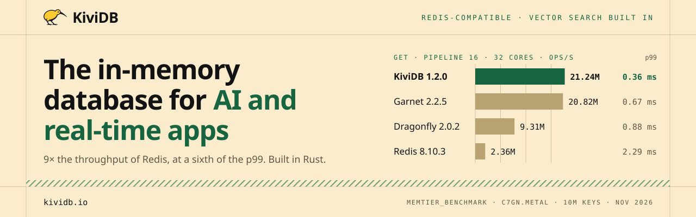
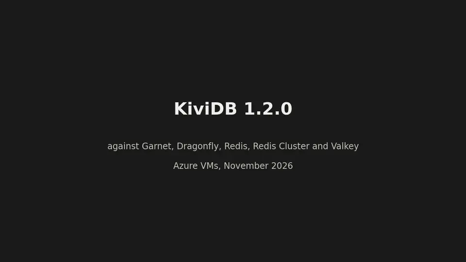

<p align="center">
  <a href="https://kividb.io"></a>
</p>

<p align="center">
  <a href="README.md">English</a> · <a href="README.zh.md">简体中文</a> · <b>日本語</b>
</p>

<p align="center">
  <a href="https://github.com/kividbio/kividb/actions/workflows/ci.yml"></a>
  <a href="https://github.com/kividbio/kividb/releases/latest"></a>
  <a href="https://hub.docker.com/r/kividb/kividb"></a>
  <a href="https://artifacthub.io/packages/helm/kividb-operator/kividb-operator-chart"></a>
  <a href="LICENSE"></a>
  <a href="https://github.com/kividbio/kividb/discussions"></a>
  <a href="https://discord.com/invite/ZcMxFeSAPA"></a>
</p>

<p align="center">
  <a href="https://trendshift.io/repositories/309924?utm_source=trendshift-badge&amp;utm_medium=badge&amp;utm_campaign=badge-trendshift-309924" target="_blank" rel="noopener noreferrer"></a>
  <a href="https://hackergit.org/r/kividbio/kividb"></a>
</p>

> 本書は [README.md](README.md) の日本語訳です。内容に相違がある場合は英語版が優先されます。リンク先のドキュメントは現在すべて英語です。

**KiviDB** は、Rust で書かれた高速なマルチスレッドの Redis® / Valkey 代替です。Redis
プロトコル (RESP2 と RESP3) を話すため、既存の Redis クライアント、`redis-cli`、各種ライブラリを
そのまま使えます。また、全文検索とベクトル検索を内蔵しています。シャーディングされたインメモリの
キーバリュー設計によりすべての CPU コアを活用し、スナップショットとオプションの追記専用ファイル (AOF)
にデータを永続化します。

AWS のベアメタル 32 コア環境で、KiviDB 1.2.0 は毎秒 **2,120 万回のパイプライン GET を処理します。
これは Redis 8.10 の 9 倍、Dragonfly の 2.3 倍**で、Garnet も上回り、p99 は 0.36 ms です
([ベンチマーク](#パフォーマンス))。

## インストール

**Debian と Ubuntu (apt)**

```bash
sudo apt update && sudo apt install -y ca-certificates curl
sudo install -d -m 0755 /etc/apt/keyrings
curl -fsSL https://packages.kividb.io/kividb.gpg | sudo tee /etc/apt/keyrings/kividb.gpg > /dev/null
echo "deb [signed-by=/etc/apt/keyrings/kividb.gpg] https://packages.kividb.io/deb stable main" \
  | sudo tee /etc/apt/sources.list.d/kividb.list > /dev/null
sudo apt update && sudo apt install -y kividb
```

**Fedora、RHEL と互換ディストリビューション、Amazon Linux 2023 (dnf)**

```bash
sudo curl -fsSL -o /etc/yum.repos.d/kividb.repo https://packages.kividb.io/kividb.repo
sudo dnf install -y kividb
```

**macOS、Cargo、Docker**

```bash
brew install kividbio/tap/kividb                  # macOS (Homebrew)
cargo install --locked kividb                     # Linux and macOS, from crates.io
docker run -d -p 6380:6380 -v kividb-data:/home/kividb kividb/kividb:v1.2.2
```

Docker イメージは Docker Hub と GitHub Container Registry (`ghcr.io/kividbio/kividb`) で公開されており、
タグは `v1.2.2`、`1.2`、`latest` です。イメージは distroless (シェルなし) です。データは
`/home/kividb` に保存されます。ここにボリュームをマウントしないと、コンテナを削除または再作成したときにデータが失われます。

apt と dnf のリポジトリは、鍵
`6492 17DE 0F7F D7DB 3D7B  AC3A E21D 8F6E DDE5 F489` で署名されています。インストール前に確認してください。
[docs/INSTALL.md](docs/INSTALL.md) には、鍵の確認方法、パッケージがインストールするもの、アップグレードと
バージョン固定、Lua と TLS のバリアント、[GitHub Releases](https://github.com/kividbio/kividb/releases)
にあるリリース tarball と `.deb`/`.rpm` ファイル、ダウンロードの検証方法が記載されています。
自分でビルドする場合は [docs/BUILDING.md](docs/BUILDING.md) を参照してください。

## クイックスタート

apt と dnf のパッケージは、KiviDB を systemd サービスとして `127.0.0.1:6380` で起動します。それ以外の場合は、
自分で起動してください。

```bash
kividb                                   # listens on 0.0.0.0:6380
redis-cli -p 6380 PING                   # PONG
redis-cli -p 6380 SET greeting hello     # OK
redis-cli -p 6380 GET greeting           # "hello"
```

KiviDB は Redis の 6379 ではなく **6380** で待ち受けるため、両者を並行して実行できます。クライアントの
接続先をこのポートにするか、`--port 6379` を指定してください。[保護モード](docs/CONFIGURATION.md#protected-mode)
はデフォルトで有効です。パスワードまたはバインドアドレスを設定するまでは、同じマシン上のクライアントしか
接続できません。[docs/CONFIGURATION.md](docs/CONFIGURATION.md) には、フラグと設定ファイル、TLS、ログ、
起動時のアップデートチェックが記載されています。

## パフォーマンス

<a href="assets/benchmarks/1.2.0/kividb-1.2.0-benchmarks.mp4">
  
</a>

*Garnet、Dragonfly、Redis、Redis Cluster、Valkey と比較した KiviDB 1.2.0。クリックするとフル解像度の動画を表示します。*

[docs/PERFORMANCE.md](docs/PERFORMANCE.md) には、ベアメタルでの結果表と測定方法、Azure VM での
フルスイート、KiviDB が劣るケース、過去の測定結果、第三者によるレビューが記載されています。

## 機能

- **Redis 8.10 互換**: 文字列、リスト、ハッシュ、セット、ソート済みセット、ストリーム、ビットマップ、
  HyperLogLog、geo、pub/sub、トランザクションを RESP2 と RESP3 でサポート
  ([COMMANDS.md](COMMANDS.md)、[相違点](docs/COMPATIBILITY.md))
- **検索とベクトル**: 全文、タグ、数値、ベクトル (FLAT / HNSW) 検索のための Redis Stack 形式の
  `FT.*` コマンドと、ベクトルセット ([docs/SEARCH.md](docs/SEARCH.md))
- **JSON と時系列**: `JSON.*` と `TS.*` コマンド
- **永続化**: スナップショット (`dump.kdb`) とオプションの追記専用ファイル
  ([docs/PERSISTENCE.md](docs/PERSISTENCE.md))
- **レプリケーションとクラスター**: `--replicaof`、およびゴシップ、障害検知、フェイルオーバーを備えた
  クラスターモード
- **セキュリティ**: ACL ユーザー、`requirepass`、保護モード、`tls` と `full` ビルドでのクライアント証明書付き
  TLS
- **Lua スクリプト**: `lua` と `full` ビルドでの `EVAL`、`FUNCTION`、`FCALL`
  ([docs/BUILDING.md](docs/BUILDING.md#builds))
- **Kubernetes**: [KiviDB operator](https://github.com/kividbio/kividb-operator)

## ドキュメント

[インストール](docs/INSTALL.md) · [ソースからのビルド](docs/BUILDING.md) ·
[実行と設定](docs/CONFIGURATION.md) · [永続化](docs/PERSISTENCE.md) ·
[Redis からの移行](docs/MIGRATING_FROM_REDIS.md) ·
[互換性と相違点](docs/COMPATIBILITY.md) · [コマンド](COMMANDS.md) ·
[クライアントの例](examples/clients/) · [ベクトル検索](docs/SEARCH.md) ·
[パフォーマンス](docs/PERFORMANCE.md) · [ログ](docs/LOGGING.md)と[エラー](docs/ERRORS.md) ·
[FAQ](docs/FAQ.md) · [変更履歴](CHANGELOG.md) ·
[リリース](https://github.com/kividbio/kividb/releases) · Web サイト: [kividb.io](https://kividb.io)

## コントリビューション

コントリビューションを歓迎します。ビルド、テスト、変更の提出方法については [CONTRIBUTING.md](CONTRIBUTING.md)
を参照してください。コントリビューションは [Contributor License Agreement](CLA.md) のもとで受け付けており、
最初のプルリクエストで署名していただきます。

質問やアイデアがある場合、またはメンテナーと話したい場合は、[Discord](https://discord.com/invite/ZcMxFeSAPA) に参加するか、[ディスカッション](https://github.com/kividbio/kividb/discussions)を開いてください。

[行動規範](CODE_OF_CONDUCT.md)に従ってください。[変更履歴](CHANGELOG.md)には、
各リリースでの変更点が記載されています。

## セキュリティ

セキュリティ脆弱性を公開の Issue で報告**しないでください**。非公開で報告する方法については
[SECURITY.md](SECURITY.md) を参照してください。

## ライセンス

Copyright (c) 2026 KIVIDB PRIVATE LIMITED.

KiviDB はオープンソースソフトウェアであり、OSI 承認ライセンスである
**[GNU Affero General Public License, version 3](LICENSE)** (AGPL-3.0-only) のもとでライセンスされています。
その条件に従って、使用、改変、再配布できます。[NOTICE](NOTICE) を参照してください。

**KiviDB を使用しても、あなたのアプリケーションが AGPL の対象になることはありません。** ネットワーク経由で、
任意の Redis クライアントを通じて KiviDB と通信するアプリケーションは別のプログラムです。改変していない
KiviDB は、オープンかクローズドか、商用か否かを問わず、どの製品でもデータベースとして実行でき、
アプリケーションのコードに義務は生じません。AGPL が GPL に加えて求めるのは 1 点だけです。
**KiviDB 自体を改変し**、その改変版をネットワーク経由で他者に利用させる場合 (たとえばホスティング
サービスとして)、改変した KiviDB のソースコードを提供する必要があります。

**商用ライセンス。** KIVIDB PRIVATE LIMITED は KiviDB の著作権を保有しており、AGPL ソフトウェアを
使用できない組織や、変更を公開せずに KiviDB を改変または組み込みたい組織向けに、商用ライセンスでも
提供しています。support@kividb.io までご連絡ください。

**私たちの約束。** 私たちが AGPLv3 のもとでリリースする KiviDB のすべてのバージョンは、今後も AGPLv3 の
もとで利用可能です。[Contributor License Agreement](CLA.md) は、それと並行して商用ライセンスを提供する
ためのものであり、オープンソース版を取り上げる手段ではありません。

ライセンスに関する質問は [FAQ](docs/FAQ.md#licensing) で回答しています。

## 商標

Redis® は Redis Ltd. の登録商標です。同商標に関する一切の権利は Redis Ltd. に帰属します。
KiviDB による使用は参照目的のみであり、Redis と KiviDB の間のスポンサーシップ、推奨、提携関係を示すものでは
ありません。KiviDB は Redis Ltd. と提携していません。
その他の名称は、それぞれの所有者の商標です。
