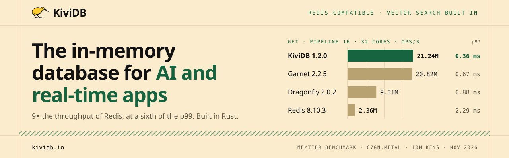
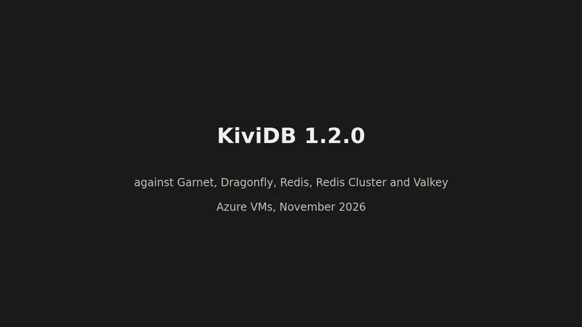

<p align="center">
  <a href="https://kividb.io"></a>
</p>

<p align="center">
  <a href="https://github.com/kividbio/kividb/actions/workflows/ci.yml"></a>
  <a href="https://github.com/kividbio/kividb/releases/latest"></a>
  <a href="https://hub.docker.com/r/kividb/kividb"></a>
  <a href="https://artifacthub.io/packages/helm/kividb-operator/kividb-operator-chart"></a>
  <a href="LICENSE"></a>
  <a href="https://github.com/kividbio/kividb/discussions"></a>
  <a href="https://discord.com/invite/ZcMxFeSAPA"></a>
</p>

<p align="center">
  <a href="https://trendshift.io/repositories/309924?utm_source=trendshift-badge&amp;utm_medium=badge&amp;utm_campaign=badge-trendshift-309924" target="_blank" rel="noopener noreferrer"></a>
  <a href="https://hackergit.org/r/kividbio/kividb"></a>
</p>

**KiviDB** is a fast, multi-threaded alternative to Redis® and Valkey, written in Rust. It
speaks the Redis protocol (RESP2 and RESP3), so existing Redis clients, `redis-cli` and
libraries work unchanged, and it has full-text and vector search built in. It runs every
core on a sharded in-memory key-value design, and persists to snapshots and an optional
append-only file.

On 32 cores of AWS bare metal, KiviDB 1.2.0 serves **21.2 million pipelined GETs per second:
9× Redis 8.10 and 2.3× Dragonfly**, ahead of Garnet, at 0.36 ms p99
([benchmarks](#performance)).

## Install

**Debian and Ubuntu (apt)**

```bash
sudo apt update && sudo apt install -y ca-certificates curl
sudo install -d -m 0755 /etc/apt/keyrings
curl -fsSL https://packages.kividb.io/kividb.gpg | sudo tee /etc/apt/keyrings/kividb.gpg > /dev/null
echo "deb [signed-by=/etc/apt/keyrings/kividb.gpg] https://packages.kividb.io/deb stable main" \
  | sudo tee /etc/apt/sources.list.d/kividb.list > /dev/null
sudo apt update && sudo apt install -y kividb
```

**Fedora, RHEL and compatibles, Amazon Linux 2023 (dnf)**

```bash
sudo curl -fsSL -o /etc/yum.repos.d/kividb.repo https://packages.kividb.io/kividb.repo
sudo dnf install -y kividb
```

**macOS, Cargo and Docker**

```bash
brew install kividbio/tap/kividb                  # macOS (Homebrew)
cargo install --locked kividb                     # Linux and macOS, from crates.io
docker run -d -p 6380:6380 -v kividb-data:/home/kividb kividb/kividb:v1.2.2
```

Docker images are on Docker Hub and the GitHub Container Registry (`ghcr.io/kividbio/kividb`),
tagged `v1.2.2`, `1.2` and `latest`; they are distroless (no shell). The data lives in
`/home/kividb`: without a volume there, it is lost when the container is removed or recreated.

The apt and dnf repositories are signed with the key
`6492 17DE 0F7F D7DB 3D7B  AC3A E21D 8F6E DDE5 F489`; check it before you install.
[docs/INSTALL.md](docs/INSTALL.md) has how to check it, what the packages install, upgrades
and pinning, the Lua and TLS variants, the release tarballs and `.deb`/`.rpm` files on
[GitHub Releases](https://github.com/kividbio/kividb/releases), and how to verify a
download. To build it yourself, see [docs/BUILDING.md](docs/BUILDING.md).

## Quick start

The apt and dnf packages start KiviDB as a systemd service, on `127.0.0.1:6380`. Otherwise,
start it yourself:

```bash
kividb                                   # listens on 0.0.0.0:6380
redis-cli -p 6380 PING                   # PONG
redis-cli -p 6380 SET greeting hello     # OK
redis-cli -p 6380 GET greeting           # "hello"
```

KiviDB listens on **6380**, not Redis's 6379, so the two can run side by side; point your
client at that port, or pass `--port 6379`. [Protected mode](docs/CONFIGURATION.md#protected-mode)
is on by default: until you set a password or a bind address, only clients on the same
machine may connect. [docs/CONFIGURATION.md](docs/CONFIGURATION.md) lists the flags and the
configuration file, TLS, logs and the startup update check.

## Performance

<a href="assets/benchmarks/1.2.0/kividb-1.2.0-benchmarks.mp4">
  
</a>

*KiviDB 1.2.0 against Garnet, Dragonfly, Redis, Redis Cluster and Valkey. Click for the full-resolution video.*

[docs/PERFORMANCE.md](docs/PERFORMANCE.md) has the bare-metal table and method, the full
suite on Azure VMs, where KiviDB loses, earlier runs and independent reviews.

## Features

- **Redis 8.10 compatible**: strings, lists, hashes, sets, sorted sets, streams, bitmaps,
  HyperLogLog, geo, pub/sub and transactions over RESP2 and RESP3
  ([COMMANDS.md](COMMANDS.md), [differences](docs/COMPATIBILITY.md))
- **Search and vectors**: Redis Stack–style `FT.*` commands for full-text, tag, numeric and
  vector (FLAT / HNSW) search, and vector sets ([docs/SEARCH.md](docs/SEARCH.md))
- **JSON and time series**: `JSON.*` and `TS.*` commands
- **Persistence**: snapshots (`dump.kdb`) and an optional append-only file
  ([docs/PERSISTENCE.md](docs/PERSISTENCE.md))
- **Replication and cluster**: `--replicaof`, and cluster mode with gossip, failure
  detection and failover
- **Security**: ACL users, `requirepass`, protected mode, and TLS with client certificates
  in the `tls` and `full` builds
- **Lua scripting**: `EVAL`, `FUNCTION` and `FCALL` in the `lua` and `full` builds
  ([docs/BUILDING.md](docs/BUILDING.md#builds))
- **Kubernetes**: the [KiviDB operator](https://github.com/kividbio/kividb-operator)

## Documentation

[Installing](docs/INSTALL.md) · [Building from source](docs/BUILDING.md) ·
[Running and configuring](docs/CONFIGURATION.md) · [Persistence](docs/PERSISTENCE.md) ·
[Migrating from Redis](docs/MIGRATING_FROM_REDIS.md) ·
[Compatibility and differences](docs/COMPATIBILITY.md) · [Commands](COMMANDS.md) ·
[Client examples](examples/clients/) · [Vector search](docs/SEARCH.md) ·
[Performance](docs/PERFORMANCE.md) · [Logs](docs/LOGGING.md) and [errors](docs/ERRORS.md) ·
[FAQ](docs/FAQ.md) · [Changelog](CHANGELOG.md) ·
[Releases](https://github.com/kividbio/kividb/releases) · Website: [kividb.io](https://kividb.io)

## Contributing

Contributions are welcome. See [CONTRIBUTING.md](CONTRIBUTING.md) for how to build, test
and submit changes. Contributions are accepted under the
[Contributor License Agreement](CLA.md), which you sign on your first pull request.

Questions, ideas, or want to talk to the maintainers? Join us on [Discord](https://discord.com/invite/ZcMxFeSAPA), or open a [discussion](https://github.com/kividbio/kividb/discussions).

Please follow the [Code of Conduct](CODE_OF_CONDUCT.md). The [Changelog](CHANGELOG.md)
lists what changed in each release.

## Security

Please do **not** report security vulnerabilities in public issues. See
[SECURITY.md](SECURITY.md) for how to report one privately.

## License

Copyright (c) 2026 KIVIDB PRIVATE LIMITED.

KiviDB is open source software, licensed under the
**[GNU Affero General Public License, version 3](LICENSE)** (AGPL-3.0-only), an
OSI-approved license. You may use, modify and redistribute it under its terms. See
[NOTICE](NOTICE).

**Using KiviDB does not put your application under the AGPL.** An application that talks
to KiviDB over the network, through any Redis client, is a separate program: you can run an
unmodified KiviDB as your database, in any product, open or closed, commercial or not, with
no obligation on your application's code. The AGPL asks for one thing beyond the GPL: if you
**modify KiviDB itself** and let others use your modified version over a network (for
example, as a hosted service), you must offer them the source code of your modified KiviDB.

**Commercial license.** KIVIDB PRIVATE LIMITED owns the copyright in KiviDB and also offers
it under a commercial license, for organizations that cannot use AGPL software or that want
to modify or embed KiviDB without publishing their changes. Write to support@kividb.io.

**Our commitment.** Every version of KiviDB we release under the AGPLv3 stays available
under the AGPLv3. The [Contributor License Agreement](CLA.md) lets us offer the commercial
license alongside it; it is not a way to take the open source version away.

Questions about the license are answered in the [FAQ](docs/FAQ.md#licensing).

## Trademarks

Redis® is a registered trademark of Redis Ltd. Any rights therein are reserved to Redis Ltd.
Any use by KiviDB is for referential purposes only and does not indicate any sponsorship,
endorsement or affiliation between Redis and KiviDB. KiviDB is not affiliated with Redis Ltd.
Other names mentioned are trademarks of their respective owners.
