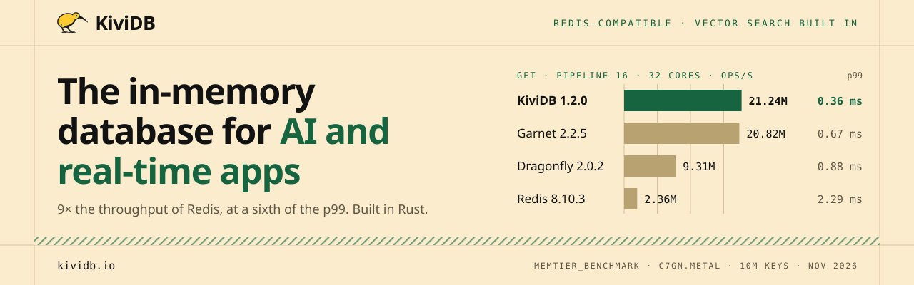
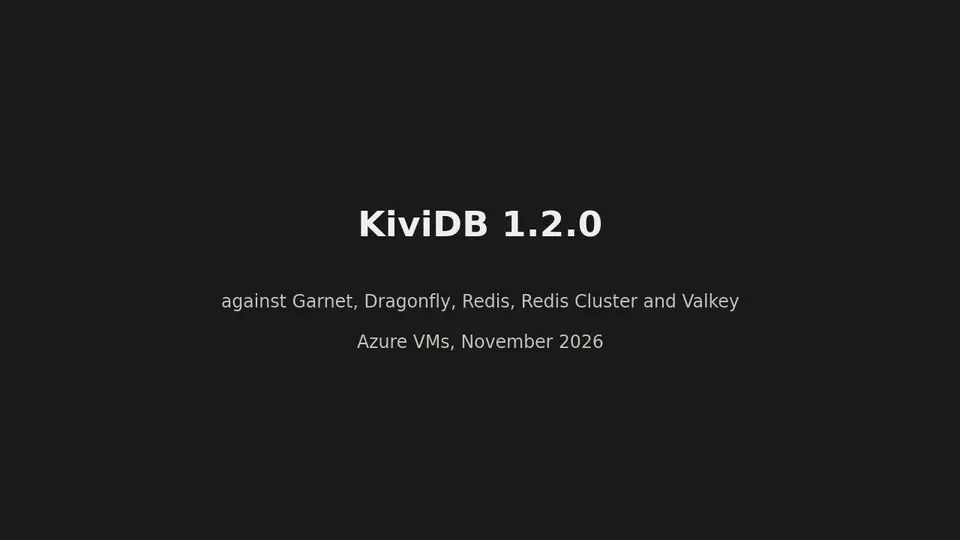

<p align="center">
  <a href="https://kividb.io"></a>
</p>

<p align="center">
  <a href="README.md">English</a> · <b>简体中文</b>
</p>

<p align="center">
  <a href="https://github.com/kividbio/kividb/actions/workflows/ci.yml"></a>
  <a href="https://github.com/kividbio/kividb/releases/latest"></a>
  <a href="https://hub.docker.com/r/kividb/kividb"></a>
  <a href="https://artifacthub.io/packages/helm/kividb-operator/kividb-operator-chart"></a>
  <a href="LICENSE"></a>
  <a href="https://github.com/kividbio/kividb/discussions"></a>
  <a href="https://discord.com/invite/ZcMxFeSAPA"></a>
</p>

> 本文是 [README.md](README.md) 的中文译本。如有出入，以英文版为准；链接的文档目前均为英文。

**KiviDB** 是一个用 Rust 编写的高速、多线程数据库，可替代 Redis® 和 Valkey。它使用 Redis
协议（RESP2 和 RESP3），现有的 Redis 客户端、`redis-cli` 和各类库无需改动即可使用，并内置全文搜索
和向量搜索。它采用分片的内存键值设计，能用上全部 CPU 核心，并可将数据持久化为快照及可选的
追加写入文件（AOF）。

在 AWS 32 核裸金属服务器上，KiviDB 1.2.0 每秒可处理 **2120 万次流水线 GET：是 Redis 8.10 的
9 倍、Dragonfly 的 2.3 倍**，并领先 Garnet，p99 延迟为 0.36 毫秒（[基准测试](#性能)）。

## 安装

**Debian 和 Ubuntu（apt）**

```bash
sudo apt update && sudo apt install -y ca-certificates curl
sudo install -d -m 0755 /etc/apt/keyrings
curl -fsSL https://packages.kividb.io/kividb.gpg | sudo tee /etc/apt/keyrings/kividb.gpg > /dev/null
echo "deb [signed-by=/etc/apt/keyrings/kividb.gpg] https://packages.kividb.io/deb stable main" \
  | sudo tee /etc/apt/sources.list.d/kividb.list > /dev/null
sudo apt update && sudo apt install -y kividb
```

**Fedora、RHEL 及兼容发行版、Amazon Linux 2023（dnf）**

```bash
sudo curl -fsSL -o /etc/yum.repos.d/kividb.repo https://packages.kividb.io/kividb.repo
sudo dnf install -y kividb
```

**macOS、Cargo 和 Docker**

```bash
brew install kividbio/tap/kividb                  # macOS（Homebrew）
cargo install --locked kividb                     # Linux 和 macOS，从 crates.io 安装
docker run -d -p 6380:6380 -v kividb-data:/home/kividb kividb/kividb:v1.2.2
```

Docker 镜像发布在 Docker Hub 和 GitHub Container Registry（`ghcr.io/kividbio/kividb`），
标签为 `v1.2.2`、`1.2` 和 `latest`；镜像基于 distroless（不含 shell）。数据位于
`/home/kividb`：如果没有在该路径挂载卷，删除或重建容器时数据会丢失。

apt 和 dnf 软件源使用以下密钥签名：
`6492 17DE 0F7F D7DB 3D7B  AC3A E21D 8F6E DDE5 F489`，安装前请先核对。
[docs/INSTALL.md](docs/INSTALL.md) 介绍了如何核对密钥、软件包会安装哪些内容、升级与版本锁定、
Lua 和 TLS 版本、[GitHub Releases](https://github.com/kividbio/kividb/releases) 上的发布压缩包和
`.deb`/`.rpm` 文件，以及如何校验下载文件。如需自行构建，请参阅 [docs/BUILDING.md](docs/BUILDING.md)。

## 快速上手

通过 apt 和 dnf 安装的软件包会将 KiviDB 作为 systemd 服务启动，监听 `127.0.0.1:6380`。
其他方式安装时，请手动启动：

```bash
kividb                                   # 监听 0.0.0.0:6380
redis-cli -p 6380 PING                   # PONG
redis-cli -p 6380 SET greeting hello     # OK
redis-cli -p 6380 GET greeting           # "hello"
```

KiviDB 默认监听 **6380** 端口，而不是 Redis 的 6379，因此两者可以同时运行；请将客户端指向该端口，
或者使用 `--port 6379` 启动。[保护模式](docs/CONFIGURATION.md#protected-mode)默认开启：
在设置密码或绑定地址之前，只有同一台机器上的客户端可以连接。
[docs/CONFIGURATION.md](docs/CONFIGURATION.md) 列出了命令行参数和配置文件、TLS、日志以及启动时的
更新检查。

## 性能

<a href="assets/benchmarks/1.2.0/kividb-1.2.0-benchmarks.mp4">
  
</a>

*KiviDB 1.2.0 与 Garnet、Dragonfly、Redis、Redis Cluster 和 Valkey 的对比。点击查看全分辨率视频。*

[docs/PERFORMANCE.md](docs/PERFORMANCE.md) 包含裸金属测试结果表和测试方法、在 Azure 虚拟机上的
完整测试、KiviDB 落后的场景、早期测试结果以及第三方评测。

## 功能

- **兼容 Redis 8.10**：通过 RESP2 和 RESP3 支持字符串、列表、哈希、集合、有序集合、流、位图、
  HyperLogLog、地理位置、发布/订阅和事务（[COMMANDS.md](COMMANDS.md)，
  [差异说明](docs/COMPATIBILITY.md)）
- **搜索与向量**：Redis Stack 风格的 `FT.*` 命令，支持全文、标签、数值和向量（FLAT / HNSW）搜索，
  以及向量集合（[docs/SEARCH.md](docs/SEARCH.md)）
- **JSON 与时间序列**：`JSON.*` 和 `TS.*` 命令
- **持久化**：快照（`dump.kdb`）和可选的追加写入文件（[docs/PERSISTENCE.md](docs/PERSISTENCE.md)）
- **复制与集群**：`--replicaof`，以及支持 gossip 协议、故障检测和故障转移的集群模式
- **安全**：ACL 用户、`requirepass`、保护模式，以及 `tls` 和 `full` 版本中支持客户端证书的 TLS
- **Lua 脚本**：`lua` 和 `full` 版本支持 `EVAL`、`FUNCTION` 和 `FCALL`
  （[docs/BUILDING.md](docs/BUILDING.md#builds)）
- **Kubernetes**：[KiviDB operator](https://github.com/kividbio/kividb-operator)

## 文档

[安装](docs/INSTALL.md) · [从源码构建](docs/BUILDING.md) ·
[运行与配置](docs/CONFIGURATION.md) · [持久化](docs/PERSISTENCE.md) ·
[从 Redis 迁移](docs/MIGRATING_FROM_REDIS.md) ·
[兼容性与差异](docs/COMPATIBILITY.md) · [命令](COMMANDS.md) ·
[客户端示例](examples/clients/) · [向量搜索](docs/SEARCH.md) ·
[性能](docs/PERFORMANCE.md) · [日志](docs/LOGGING.md)与[错误](docs/ERRORS.md) ·
[常见问题](docs/FAQ.md) · [更新日志](CHANGELOG.md) ·
[发布版本](https://github.com/kividbio/kividb/releases) · 官网：[kividb.io](https://kividb.io)

## 参与贡献

欢迎参与贡献。关于如何构建、测试和提交修改，请参阅 [CONTRIBUTING.md](CONTRIBUTING.md)。
贡献需遵循[贡献者许可协议](CLA.md)，你会在提交第一个 pull request 时签署。

有问题、有想法，或者想和维护者交流？欢迎加入 [Discord](https://discord.com/invite/ZcMxFeSAPA)，
或发起一个[讨论](https://github.com/kividbio/kividb/discussions)。

请遵守[行为准则](CODE_OF_CONDUCT.md)。[更新日志](CHANGELOG.md)列出了每个版本的变更。

## 安全

请**不要**在公开 issue 中报告安全漏洞。私下报告的方式请参阅 [SECURITY.md](SECURITY.md)。

## 许可证

Copyright (c) 2026 KIVIDB PRIVATE LIMITED.

KiviDB 是开源软件，采用 **[GNU Affero 通用公共许可证第 3 版](LICENSE)**（AGPL-3.0-only）授权，
这是经 OSI 认可的许可证。你可以按照其条款使用、修改和再分发 KiviDB。另见 [NOTICE](NOTICE)。

**使用 KiviDB 不会让你的应用受 AGPL 约束。** 通过网络、使用任何 Redis 客户端与 KiviDB 通信的应用
是一个独立的程序：你可以在任何产品中（无论开源或闭源、商业或非商业）使用未经修改的 KiviDB 作为数据库，
你的应用代码不承担任何义务。AGPL 在 GPL 之外只多提出一项要求：如果你**修改了 KiviDB 本身**，
并让他人通过网络使用你修改后的版本（例如作为托管服务提供），你必须向他们提供你所修改的 KiviDB 的源代码。

**商业许可。** KIVIDB PRIVATE LIMITED 拥有 KiviDB 的版权，并同时以商业许可提供 KiviDB，
供无法使用 AGPL 软件、或希望修改或嵌入 KiviDB 而不公开其修改的组织使用。请联系 support@kividb.io。

**我们的承诺。** 我们以 AGPLv3 发布的每一个 KiviDB 版本都将始终以 AGPLv3 提供。
[贡献者许可协议](CLA.md)使我们能够同时提供商业许可；它不是收回开源版本的手段。

关于许可证的问题，请参阅[常见问题](docs/FAQ.md#licensing)。

本节为译文，仅供参考；许可条款以英文版 [LICENSE](LICENSE) 和 [README.md](README.md) 为准。

## 商标

Redis® 是 Redis Ltd. 的注册商标，其中的任何权利均由 Redis Ltd. 保留。KiviDB 对该商标的任何使用
仅用于指称目的，并不表示 Redis 与 KiviDB 之间存在任何赞助、认可或关联关系。KiviDB 与 Redis Ltd.
无关联。文中提及的其他名称均为其各自所有者的商标。
