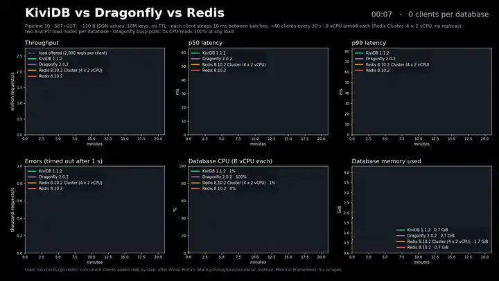

# KiviDB 1.1 on bare metal (October 2026)

These are earlier results, kept for reference. The current numbers are in the
[README](../README.md#performance) and [benchmarks/1.2.0/REPORT.md](1.2.0/REPORT.md).

The figures in this section are from one session in October 2026 on AWS Graviton3 bare metal: the
server on a `c7gn.metal` (64 vCPU), confined to 32 cores, and the load generator on a
second `c7gn.metal` in the same placement group. Each engine ran alone on the server,
one after another.

## Key-value

memtier_benchmark through kivi-benchmark's `run-matrix.sh`: 10 million keys, 100-byte
values, 30 s a scenario, mean of two rounds; 300 connections pipelined, 1,200 without
pipelining.

<picture>
  <source media="(prefers-color-scheme: dark)" srcset="../assets/benchmarks/throughput-pipelined-dark.png">
  
</picture>

| ops/s | KiviDB 1.1.0 | Dragonfly 2.0.2 | Redis 8.10 | Redis Cluster (32 shards) |
|---|------:|------:|------:|------:|
| GET, pipeline 16 | **21.2M** | 9.1M | 2.4M | 4.7M |
| SET, pipeline 16 | **19.2M** | 8.5M | 2.0M | 4.7M |
| GET, no pipelining | 3.07M | **3.35M** | 1.32M | 1.46M |
| SET, no pipelining | 3.12M | **3.38M** | 1.54M | 1.46M |
| p99 latency, GET / SET, pipeline 16 | **0.36 / 0.42 ms** | 0.88 / 1.07 ms | 2.2 / 2.7 ms | |
| Memory per key | 177 B | **134 B** | 178 B | 183 B |

<picture>
  <source media="(prefers-color-scheme: dark)" srcset="../assets/benchmarks/latency-p99-pipelined-dark.png">
  
</picture>

## Vector search

[redis/vector-db-benchmark](https://github.com/redis/vector-db-benchmark) on
glove-25-angular (1.18M vectors, 25 dimensions): HNSW with M=16 and EF_CONSTRUCTION=256,
100 clients uploading in batches of 64, then queries at ef 64, 128, 256 and 512.

<picture>
  <source media="(prefers-color-scheme: dark)" srcset="../assets/benchmarks/vector-qps-recall-dark.png">
  
</picture>

| | KiviDB 1.1.0 | Dragonfly 2.0.2 | Redis 8.10 (query engine) |
|---|------:|------:|------:|
| Queries/s at ef 64 (recall@10) | **59.3k** (0.943) | 41.3k (0.912) | 31.8k (0.912) |
| Queries/s at ef 128 | **50.7k** (0.961) | 40.3k (0.937) | 28.9k (0.937) |
| Queries/s at ef 256 | 31.5k (0.989) | **36.2k** (0.979) | 21.1k (0.979) |
| Queries/s at ef 512 | 18.7k (**0.998**) | **29.8k** (0.995) | 13.7k (0.995) |
| Ingest and index build | 31 s | **13 s** | 38 s |
| Memory after ingest | 1.66 GB | 1.13 GB | **1.07 GB** |

<picture>
  <source media="(prefers-color-scheme: dark)" srcset="../assets/benchmarks/vector-ingest-dark.png">
  
</picture>

## Load rising to saturation

A second setup, on Azure, in the manner of a latency/throughput/saturation test: rather
than one fixed load, clients are added every 30 seconds, 40 to 1,600 per database, until
each server can take no more. Each client sends 10 pipelined `SET`+`GET` pairs over 10
million keys, then sleeps 10 ms. Every single server ran on its own 8 vCPU arm64 VM
(D8ps_v5); the Redis Cluster had four 2 vCPU VMs, 8 vCPUs in all. KiviDB 1.1.2, October
2026.

*The whole run, 20 minutes at 60× speed. Click for the full-resolution video.*

| | Peak throughput | p50 / p99 at 1,600 clients | Errors |
|---|------:|------:|------:|
| KiviDB 1.1.2 | **2.08M req/s** | **4.3 / 13.9 ms** | 0 |
| Dragonfly 2.0.2 | 1.56M req/s | 10.1 / 33.9 ms | 0 |
| Redis 8.10.2 Cluster (4 × 2 vCPU) | 0.97M req/s | 26.8 / 44.9 ms | 0 |
| Redis 8.10.2 | 0.49M req/s | 55.2 / 72.1 ms | 0 |

Latency is per pipelined batch. Without pipelining, KiviDB measured about 20% below
Dragonfly on these machines (about 8% below on the bare-metal run above). The harness, the run's raw data and its
video are in
[kivi-benchmark/ramp-saturation](https://github.com/kividbio/kivi-benchmark/tree/main/ramp-saturation);
the run's dashboard is a
[Grafana snapshot](https://snapshots.raintank.io/dashboard/snapshot/AheJ35tyvNmMmRx3ExXOe2bbsebZIvWg).

- Methodology and scripts: [kivi-benchmark](https://github.com/kividbio/kivi-benchmark)
- The most recent automated run: [benchmarks/LATEST.md](../benchmarks/LATEST.md)

Results depend on the environment. Treat published figures as one controlled capture, not
a guarantee, and measure on your own hardware and workload.

