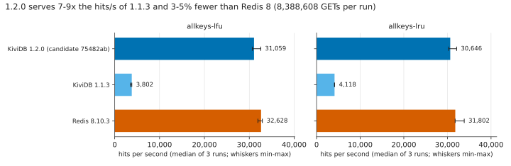
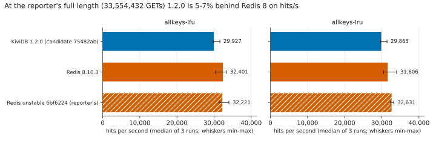
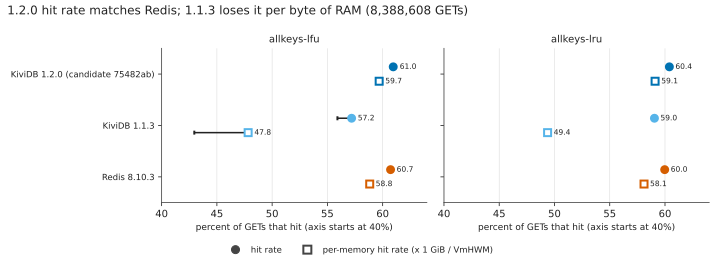
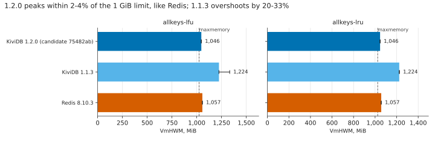
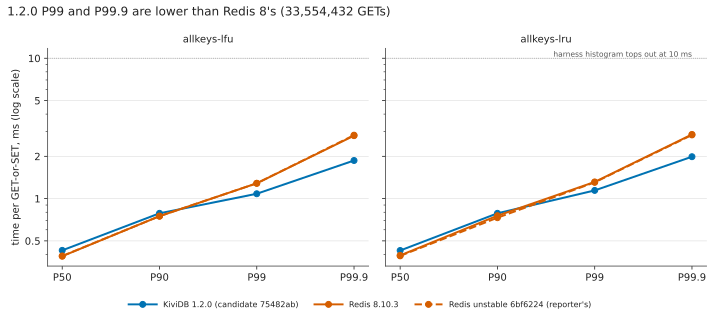
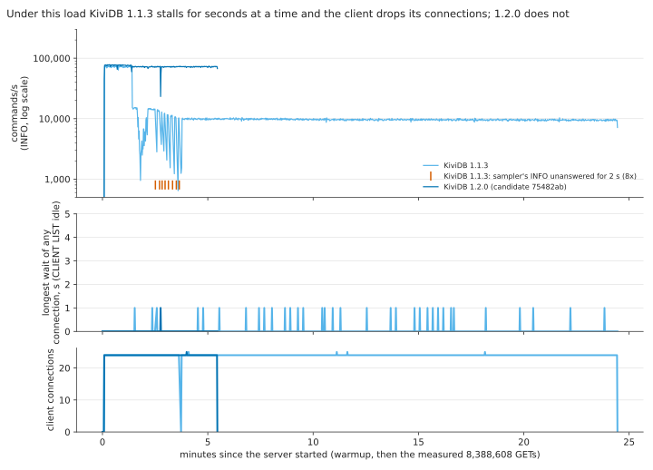
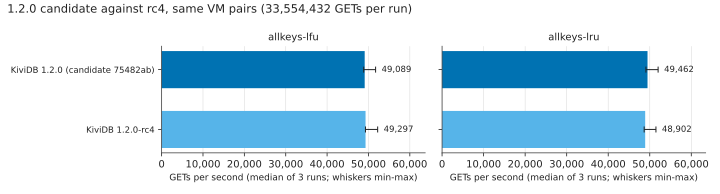
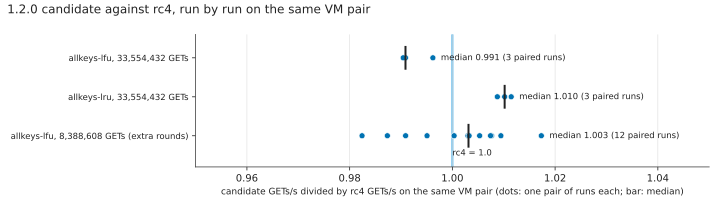

# KiviDB as a cache on a small arm64 box (issue #202, rerun for 1.2.0)

## What this answers

On Hacker News, [imchuncai asked](https://news.ycombinator.com/item?id=50300421) about
[kividbio/kividb#202](https://github.com/kividbio/kividb/issues/202), "Performance poor as a cache, redis is 7
times better". He ran his own harness,
[imchuncai/umem-cache-benchmark](https://github.com/imchuncai/umem-cache-benchmark), on a Raspberry Pi 4B.
The server was pinned to one core with a 1 GiB `maxmemory` and `allkeys-lfu`. There were 2,097,152 distinct
keys with random sizes up to 1 KiB and Zipf popularity, and a client that sends a GET and, on a miss, a SET.
On KiviDB commit 48280b7 (tag `v1.2.0-rc2`), Redis had a 35% higher hit rate and about 7.6x the hit
throughput.

1.2.0 changed eviction for exactly this workload:

- eviction samples in constant time instead of walking the table on every write;
- sampling is fair across keys;
- keys take less memory;
- `maxmemory` counts the memory the process really uses.

This folder reruns the same harness, unchanged, against the code that ships as 1.2.0, and checks it against
the rc4 numbers published before. Five servers, all in the same session on the same machines:

| engine | what it is | how it was built |
|---|---|---|
| **KiviDB 1.2.0** | the build under test: branch `release/1.2.0` at 75482ab (reports itself as `1.2.0-rc6` until rc7 is tagged) | `cargo build --release --features tls`, rustc 1.99.1 |
| KiviDB 1.2.0-rc4 | the previous published build, tag `v1.2.0-rc4` (a6b1bf3), for the regression check only | the same command, same VM, same toolchain |
| KiviDB 1.1.3 | the current stable release | official release tarball `kividb-tls-linux-aarch64` |
| Redis 8.10.3 | latest Redis 8 GA (1a2574c) | `make -j BUILD_TLS=yes`, gcc 13.3 |
| Redis unstable 6bf6224 | the exact Redis commit in the reporter's published Redis result (unstable branch, 2026-07-07, reports itself as 255.255.255) | `make -j BUILD_TLS=yes` |

Each server ran with `allkeys-lfu` (the reporter's setting) and again with `allkeys-lru`. The build
commands are the reporter's. The SHA-256 of every binary is in [results/binaries.txt](results/binaries.txt).
The rc4 binary rebuilt today is byte-identical to the one the rc4 run published (SHA-256 6933baf...), so the
build is reproducible and the two runs are directly comparable.

The issue's own commit 48280b7 (= rc2) is not rerun. Its numbers are in the rc4 version of this page: at a
quarter length it served 9,138 GETs/s under LFU with a 56.6% hit rate.

## Headline

| (median of 3 runs, allkeys-lfu) | hit rate | VmHWM (1 GiB limit) | GETs/s | hits/s | P99 / P99.9 |
|---|---|---|---|---|---|
| KiviDB 1.2.0, reporter's length | 60.96% | 1,066 MiB | 49,089 | 29,927 | 1.08 / 1.87 ms |
| Redis 8.10.3, reporter's length | 60.78% | 1,057 MiB | 53,312 | 32,401 | 1.29 / 2.81 ms |
| KiviDB 1.1.3, quarter length | 57.19% | 1,224 MiB | 6,648 | 3,802 | 8.29 / 9.96 ms |

- **Fixed since the report.** 1.2.0 matches Redis on hit rate (0.2-0.4 points higher under both policies)
  and on peak memory (within 1% of Redis, 2-4% over the 1 GiB limit). Its tails are lower than Redis's:
  P99 is 9-16% lower and P99.9 is 25-33% lower, under both policies and at both lengths.
- **Compared with 1.1.3** (same length, same pairs of VMs), 1.2.0 serves **7.1-8.0x the GETs/s** and
  **7.3-8.7x the hits/s**. 1.1.3 also stalls for seconds at a time under this load, and the client drops its
  connections; see [below](#kividb-113-stalls-and-loses-its-connections).
- **Still behind Redis on throughput.** 1.2.0 serves **3-6% fewer GETs/s than Redis 8.10.3** on the median
  (1-8% on single pairs). The median ratio on the same VM pair is 0.94 at the reporter's length and
  0.95-0.97 at the quarter length, under both policies. The cause is still eviction: 1.2.0 spends 11.9% of its cycles in `make_room`, where Redis spends
  7.9% in `performEvictions` ([profile](#why-120-is-still-slower-than-redis)). This gap is tracked in
  [#251](https://github.com/kividbio/kividb/issues/251).
- **No regression against rc4.** On the same VM pairs, run back to back, 1.2.0 serves 0.991x rc4's GETs/s
  under LFU and 1.010x under LRU at the reporter's length. In 12 extra paired rounds the ratio was 1.003
  (0.982-1.017). Hit rate, peak memory and tails are unchanged. See [Against 1.2.0-rc4](#against-120-rc4).

## This is not a Raspberry Pi

No Pi was available, so we used the smallest 4-core arm64 VM on Azure. It is much faster than a Pi:

| | Reporter: Raspberry Pi 4B | Here: Azure Standard_D4pls_v5 |
|---|---|---|
| CPU | Broadcom BCM2711, 4x Cortex-A72 at 1.5-1.8 GHz | Ampere Altra, 4 vCPU Neoverse-N1 at 3.0 GHz (one physical core per vCPU) |
| caches | 32 KiB L1d per core, 1 MiB shared L2, no L3 | 64 KiB L1d and 1 MiB L2 per core, 32 MiB system-level cache |
| memory | LPDDR4-3200 on a 32-bit bus (a few GB/s) | 8 GiB of the host's 8-channel DDR4-3200 (shared with other tenants) |
| network | client on another machine over the LAN (gigabit Ethernet) | client on a second VM of the same size in the same proximity placement group, accelerated networking; ping RTT median 0.65 ms (0.45-0.96 across runs), which is slower than a wired LAN |
| OS | Raspberry Pi OS | Ubuntu 24.04.5, kernel 7.0.0-1017-azure |

- **Absolute numbers do not carry over.** Redis does about 53k GETs/s here and about 21k on the Pi
  (48,034 ns/op in the reporter's result).
- **The ratios do carry over.** After we posted the rc3 numbers, the reporter re-ran rc3 on his Pi and
  found rc3 8% behind Redis on hit/s/mem (11,015 vs 11,991). That matches the 3-6% we measure here.

## Setup

- **VMs.** 6 server/client pairs of Standard_D4pls_v5, plus a Standard_D8pls_v5 build VM, region
  **japaneast** (where the rc4 run also ended up after northeurope had no capacity), in one proximity
  placement group and one subnet. All came up on the first try.
- **Pinning.** Every run used its own fresh server process.
  - The server was pinned to **core 1** with `taskset -c 1`, as the reporter did.
  - The client was pinned to **cores 1,2,3 of the client VM** with `taskset -c 1,2,3`, as the reporter did.
- **Server flags.** These are the reporter's, with `--maxmemory-policy` switched between `allkeys-lfu` and
  `allkeys-lru`:
  - KiviDB (every version): `--port 6379 --threads 1 --maxmemory 1073741824 --maxmemory-policy 
 --loglevel nothing --update-check no --protected-mode no`.
    KiviDB does not snapshot on a schedule, so nothing was written to disk.
  - Redis (both): `--protected-mode no --appendonly no --save "" --maxmemory 1073741824 --maxclients 24 --maxmemory-policy 
 --port 6379`.
  - Redis gets no `io-threads`: the test pins the server to one core by design. That is also why there is
    no Redis Cluster row.
- **Client.** The harness at commit 6d77492, the version used for our first reply on #202, built as a test
  binary with Go 1.25.3. The current upstream (c32e93b) changes only the umem-cache client; the Redis path
  is identical. The command was
  `bench.test -test.bench=^BenchmarkRedis$ -test.benchtime=<N>x true 1073741824 1024 8 1 0 <server-ip>`.
  That means random sizes, 1 GiB, values up to 1 KiB, `SetParallelism(8)` x 3 procs = 24 connections,
  one server, no TLS.
  - The harness runs a warmup of N GET-or-SET operations, then measures N more.
  - It prints the hit rate, latency percentiles and elapsed time of the measured phase.
  - Its "latency" is the time between two consecutive operations of one of the 24 workers (a closed loop),
    in 1 µs buckets that stop at 9,999 µs.
- **Lengths.**
  - **F** = `-benchtime=33554432x`, the reporter's length. Each run takes about 23 min. Run for 1.2.0, rc4
    and both Redis builds.
  - **S** = `8388608x`, a quarter of it, about 6 min a run. Run for 1.1.3, which needs 25 min even at this
    length, and for 1.2.0 and Redis 8.10.3 on the same pairs, so the 1.1.3 ratio is measured like for like.
  - Hit rate moves by less than 0.1 point between S and F (1.2.0 60.96 vs 60.96, Redis 60.72 vs 60.78).
- **Derived numbers.** As the reporter does, *per-memory hit rate* and *hit/s/mem* are scaled by
  1 GiB / the server's VmHWM. The client cannot read a remote VmHWM and prints 0 kB, so we read
  `/proc/<pid>/status` on the server after the run.
- **Repeats and order.** Each engine × policy × length ran 3 times on 3 different VM pairs.
  - Pairs 1-3 ran the reporter's length: 1.2.0 and rc4 back to back on the same pair, the order swapped on
    pair 2 and between policies, then both Redis builds (Redis unstable's LRU runs went to pairs 4-6).
  - Pairs 4-6 ran the quarter length: 1.1.3, 1.2.0 and Redis 8.10.3.
  - Then 12 extra 1.2.0/rc4 pairs of LFU runs at the quarter length, two on each of the 6 pairs, order
    alternating.
  - In all, 66 measured runs, plus 3 profiling and 2 diagnostic runs. The schedule is in
    [harness/jobs/](harness/jobs/).
- **Load.**
  - Server CPU: the server's core was 93-98% busy for every engine, averaged over the process's life, so
    every row is server-bound.
  - Client CPU, fast engines: the client's three cores were ~80% busy (11-25% idle per core in `mpstat`,
    median 17%).
  - Client CPU, 1.1.3: 16-17% busy.
  - Redis's core showed slightly more idle than 1.2.0's (93-97% vs 97-98% busy), so a faster client would
    widen the gap to Redis, not close it.

## Results

Each cell is the median of 3 runs, with [min-max]. *gets/s* is measured GETs divided by the measured
phase's time. The raw outputs are in [results/raw/](results/raw/), one row per run in
[results/runs.csv](results/runs.csv), and medians in [results/summary.csv](results/summary.csv). rc4's
rows are in [Against 1.2.0-rc4](#against-120-rc4).

#### allkeys-lfu, 33,554,432 GETs (the reporter's length)

| engine | runs | hit rate % | per-memory hit rate % | VmHWM MiB | gets/s | hits/s | hit/s/mem | P50 / P90 / P99 / P99.9 µs | server CPU % | client CPU % | errors |
|---|---|---|---|---|---|---|---|---|---|---|---|
| KiviDB 1.2.0 | 3 | 60.96 [60.96-61.02] | 58.60 [58.54-59.04] | 1,066 [1,057-1,066] | 49,089 [48,847-51,726] | 29,927 [29,776-31,566] | 28,838 [28,738-30,313] | 428 / 786 / 1,083 / 1,869 | 98 | 79 | 0 |
| Redis 8.10.3 | 3 | 60.78 [60.70-60.81] | 58.87 [58.78-58.90] | 1,057 [1,057-1,057] | 53,312 [49,916-54,803] | 32,401 [30,298-33,327] | 31,383 [29,342-32,280] | 389 / 750 / 1,286 / 2,809 | 97 | 79 | 0 |
| Redis unstable 6bf6224 (reporter's) | 3 | 60.77 [60.74-60.83] | 58.86 [58.83-58.91] | 1,057 [1,057-1,057] | 53,021 [51,653-55,891] | 32,221 [31,372-34,000] | 31,208 [30,388-32,928] | 390 / 750 / 1,286 / 2,832 | 96 | 79 | 0 |

#### allkeys-lru, 33,554,432 GETs (the reporter's length)

| engine | runs | hit rate % | per-memory hit rate % | VmHWM MiB | gets/s | hits/s | hit/s/mem | P50 / P90 / P99 / P99.9 µs | server CPU % | client CPU % | errors |
|---|---|---|---|---|---|---|---|---|---|---|---|
| KiviDB 1.2.0 | 3 | 60.38 [60.38-60.38] | 58.02 [58.02-58.48] | 1,066 [1,057-1,066] | 49,462 [49,080-52,013] | 29,865 [29,636-31,407] | 28,698 [28,478-30,417] | 427 / 786 / 1,144 / 1,989 | 98 | 79 | 0 |
| Redis 8.10.3 | 3 | 59.96 [59.96-59.96] | 58.06 [58.06-58.06] | 1,057 [1,057-1,057] | 52,714 [50,851-56,688] | 31,606 [30,490-33,988] | 30,609 [29,527-32,915] | 394 / 756 / 1,315 / 2,866 | 96 | 80 | 0 |
| Redis unstable 6bf6224 (reporter's) | 3 | 59.96 [59.96-59.96] | 58.07 [58.07-58.08] | 1,057 [1,057-1,057] | 54,424 [53,962-55,384] | 32,631 [32,356-33,208] | 31,606 [31,341-32,161] | 391 / 731 / 1,306 / 2,843 | 94 | 82 | 0 |

#### allkeys-lfu, 8,388,608 GETs (with 1.1.3)

| engine | runs | hit rate % | per-memory hit rate % | VmHWM MiB | gets/s | hits/s | hit/s/mem | P50 / P90 / P99 / P99.9 µs | server CPU % | client CPU % | errors |
|---|---|---|---|---|---|---|---|---|---|---|---|
| KiviDB 1.2.0 | 3 | 60.96 [60.95-61.00] | 59.69 [59.63-59.70] | 1,046 [1,046-1,046] | 50,952 [50,321-53,380] | 31,059 [30,668-32,564] | 30,411 [30,009-31,868] | 414 / 758 / 1,097 / 2,025 | 97 | 79 | 0 |
| KiviDB 1.1.3 | 3 | 57.19 [55.91-57.21] | 47.83 [42.96-47.85] | 1,224 [1,224-1,333] | 6,648 [6,299-6,664] | 3,802 [3,522-3,812] | 3,180 [2,706-3,189] | 3,323 / 6,207 / 8,286 / 9,962 | 99 | 16 | client timeouts in 2 of 3 runs; warmup cut short (see below) |
| Redis 8.10.3 | 3 | 60.72 [60.71-60.73] | 58.83 [58.83-58.83] | 1,057 [1,057-1,057] | 53,738 [52,578-54,206] | 32,628 [31,922-32,916] | 31,614 [30,929-31,889] | 395 / 729 / 1,238 / 2,700 | 95 | 78 | 0 |

#### allkeys-lru, 8,388,608 GETs (with 1.1.3)

| engine | runs | hit rate % | per-memory hit rate % | VmHWM MiB | gets/s | hits/s | hit/s/mem | P50 / P90 / P99 / P99.9 µs | server CPU % | client CPU % | errors |
|---|---|---|---|---|---|---|---|---|---|---|---|
| KiviDB 1.2.0 | 3 | 60.40 [60.39-60.40] | 59.10 [59.09-59.12] | 1,046 [1,046-1,047] | 50,744 [50,114-53,170] | 30,646 [30,267-32,113] | 29,992 [29,612-31,435] | 418 / 763 / 1,122 / 1,949 | 97 | 79 | 0 |
| KiviDB 1.1.3 | 3 | 59.05 [59.04-59.05] | 49.38 [49.32-49.39] | 1,224 [1,224-1,226] | 6,974 [6,922-7,015] | 4,118 [4,086-4,142] | 3,444 [3,418-3,460] | 3,151 / 5,987 / 8,099 / 9,803 | 99 | 17 | client timeouts in 3 of 3 runs; warmup cut short (see below) |
| Redis 8.10.3 | 3 | 59.97 [59.97-59.98] | 58.10 [58.08-58.10] | 1,057 [1,057-1,057] | 53,024 [52,974-56,451] | 31,802 [31,770-33,855] | 30,808 [30,780-32,789] | 397 / 741 / 1,232 / 2,744 | 95 | 79 | 0 |

**1.2.0 vs Redis 8.10.3 on the same VM pair** (1.2.0 GETs/s ÷ Redis GETs/s):

| | pair 1 | pair 2 | pair 3 | pair 4 | pair 5 | pair 6 | median |
|---|---|---|---|---|---|---|---|
| lfu, reporter's length | 0.979 | 0.921 | 0.944 | | | | 0.944 |
| lru, reporter's length | 0.965 | 0.938 | 0.918 | | | | 0.938 |
| lfu, quarter length | | | | 0.969 | 0.928 | 0.993 | 0.969 |
| lru, quarter length | | | | 0.945 | 0.958 | 0.942 | 0.945 |

The two Redis builds differ from each other by up to ±3% depending on policy and length, and the same
engine varies by about ±3% from pair to pair. That is why the paired ratios matter more than single rows.
Treat a difference under ~5% between single rows as noise.

**1.2.0 vs 1.1.3 on the same VM pair** (quarter length, pairs 4-6): 7.65 / 7.99 / 8.03x the GETs/s and
8.15 / 8.71 / 8.57x the hits/s under LFU; 7.14 / 7.28 / 7.68x and 7.31 / 7.44 / 7.86x under LRU.

### Charts

## Against 1.2.0-rc4

The 1.2.0 candidate and rc4 ran back to back on the same VM pair, in alternating order, built from source on
the same VM with the same toolchain. The ratio is candidate ÷ rc4 per pair; "spread" is the range of the
paired ratios.

| row | 1.2.0 GETs/s | rc4 GETs/s | paired ratio, median [min-max] | hit rate % (1.2.0 / rc4) | VmHWM MiB (1.2.0 / rc4) | P99 µs (1.2.0 / rc4) | P99.9 µs (1.2.0 / rc4) | verdict |
|---|---|---|---|---|---|---|---|---|
| lfu, reporter's length, 3 pairs | 49,089 [48,847-51,726] | 49,297 [49,276-52,226] | 0.991 [0.990-0.996] | 60.96 / 60.97 | 1,066 / 1,067 | 1,083 / 1,098 | 1,869 / 1,929 | same |
| lru, reporter's length, 3 pairs | 49,462 [49,080-52,013] | 48,902 [48,654-51,489] | 1.010 [1.009-1.011] | 60.38 / 60.38 | 1,066 / 1,066 | 1,144 / 1,097 | 1,989 / 1,826 | same |
| lfu, quarter length, 12 extra pairs of runs on 6 pairs | 50,333 [49,072-53,070] | 50,172 [48,910-54,020] | 1.003 [0.982-1.017] | 60.95 / 60.95 | 1,046 / 1,046 | 1,090 / 1,093 | 1,849 / 1,906 | same |

- **No regression.** The LFU rows at the reporter's length came out 0.9% below rc4 on all three pairs, and
  the LRU rows 1.0% above on all three. That looked like it could be a small, real LFU difference, so we ran
  12 more paired LFU rounds: their median is 1.003, and single pairs range from -1.8% to +1.7%. A 1% swing
  either way is the run-to-run noise of a pair, not a change in the code.
- **Tails.** LRU P99.9 is 9% higher on the median (1,989 vs 1,826 µs) but lower on pair 3 and within 1% on
  pair 2. In the 12 extra LFU rounds P99.9 is 3% lower. Noise again.
- **Hit rate and memory** are identical to two decimals, as expected: nothing in eviction or the store
  changed between rc4 and the candidate.
- **Profile.** We profiled the candidate and rc4 with `perf record -g` for 30 s inside the measured phase
  (quarter length, LFU, pair 4, one after the other; reports in [results/profile/](results/profile/)):
  - `make_room` takes 11.9% of cycles in the candidate and 12.5% in rc4 (self 5.7% vs 6.1%);
    `run_command` 27.2% vs 27.8% including children.
  - No KiviDB function is in the candidate's top 40 that is not in rc4's. Nothing from the changes since rc4 (ACL key checks,
    SLOWLOG/MONITOR redaction, the AOF writer, cluster gossip, MIGRATE, compaction) appears in the profile.
    This workload has no ACL users, no AOF, no slow log entries and no cluster.
  - User space is 29.6% of the candidate's cycles and 31.1% of rc4's; the kernel network path takes the
    rest in both.
  - These two profiled runs were 50,003 vs 51,263 GETs/s (0.975). They ran with `perf` attached, one after
    the other on one pair, and the 12 unprofiled extra rounds that followed on the same pairs gave 1.003.

## Findings

### 1.2.0 fixes what the issue reported

- **Hit rate.** The 1.2 line evicts as well as Redis does. 1.2.0's hit rate is 61.0% under LFU and 60.4%
  under LRU; Redis 8 is at 60.7-60.8% and 60.0%. With the same keys and the same 1 GiB, 1.2.0 keeps a
  slightly better set of keys.
- **Peak memory.** 1.2.0 peaks at 1,046 MiB (quarter length) and 1,057-1,066 MiB (reporter's length),
  against Redis's 1,057 MiB. 1.1.3 peaks at 1,224-1,333 MiB, 20-30% over the limit. That is what sank its
  per-memory hit rate (43-49% against 1.2.0's 58-60%).
  - 1.2.0's peak creeps up with run length (1,046 → 1,066 MiB, 2% → 4% over `maxmemory`), while Redis's
    stays flat. rc4 did the same. This is small but worth watching in longer runs.
- **Throughput against 1.1.3.** On the same pairs, 1.2.0 serves 8.0x (LFU) and 7.3x (LRU) the GETs/s of
  1.1.3, and 8.6x and 7.4x the hits/s.

### Why 1.2.0 is still slower than Redis

We profiled Redis 8.10.3 in the same way as the two KiviDB builds (quarter length, LFU, pair 4). The
reports are in [results/profile/](results/profile/).

- **Kernel time is about the same.** 1.2.0 spends 67% of its cycles in the kernel and its network
  modules; Redis spends 69%.
- **The difference is user-space eviction work.**
  - 1.2.0 spends 11.9% of all cycles inside `kividb::eviction::make_room` (5.7% in the function itself).
  - Redis spends 7.9% in `performEvictions`, including `evictionPoolPopulate` and `dictGetSomeKeys`.
  - That 4-point difference on a saturated core accounts for most of the 3-6%.
- **Where `make_room` loses time.** Earlier analysis in #251 found that most of `make_room`'s own time
  is cache misses on each sampled key: control byte, slot, then entry header. Prefetching has not helped
  yet; #251 lists the next things to try.
- **Effect on P50.** In a closed loop with 24 connections, the median time per operation follows
  throughput, so 1.2.0's P50 is 5-10% higher (428 vs 389 µs).
- **Effect on tails.** 1.2.0's tails are lower. P99 is 1,083 vs 1,286 µs (LFU) and 1,144 vs 1,315 µs (LRU).
  P99.9 is 1,869 vs 2,809 µs and 1,989 vs 2,866 µs.

### KiviDB 1.1.3 stalls and loses its connections

5 of the 6 measured 1.1.3 runs, and the diagnostic run, had client errors:

- Each of those runs logged 24 `got error: i/o timeout` lines, one per worker. The harness ends a worker on
  its first error, and go-redis gives up only after its retries and the harness's 30 s context.
- In all of them, every worker died during the **warmup**. The server then logged 3.6-3.7M fewer GETs than
  the 2 x 8,388,608 the client should have sent.
- The **measured** phase always ran in full. The server's GET count and the phase's length both confirm
  it. So the 1.1.3 numbers above are valid, but they come after a shortened warmup.
- The one clean run (LFU, pair 5) had the full warmup and peaked at 1,333 MiB, against 1,224 MiB for the
  others.

**What a diagnostic run showed.** We ran 1.1.3 again with a 1-second sampler of `INFO` and `CLIENT LIST`
([harness/diag-sampler.sh](harness/diag-sampler.sh), last chart above; 2 s timeout on each request):

- For the first 1.5 min, before memory fills, 1.1.3 runs at about 75k commands/s, the same as 1.2.0.
- Once memory fills, it falls to 1-15k commands/s and swings between the two for about 2 minutes. During
  that time the sampler's own `INFO` went unanswered for 2 s eight times, so the server stopped answering
  for seconds at a time, not just one connection.
- About 3.7 min in, all 24 client connections drop at once (the 30 s timeouts). The measured phase then
  reconnects and runs at a steady ~10k commands/s to the end.
- In the rc4 run's diagnostic, the same build showed it differently: one connection's `CLIENT LIST` idle
  time climbed to 24 s while the others were served. In this run no connection showed more than 1 s idle,
  but whole-server stalls took its place. Either way, with `--threads 1`, 1.1.3 cannot keep up with eviction
  under this load and the client gives up on it.
- **1.2.0:** zero client errors and zero retries in all 45 runs of 1.2.0 and rc4. The server's GET count is
  exactly 2N every time. In the same diagnostic run on 1.2.0, throughput stayed at ~75k commands/s
  throughout (apart from one dip as the client switched from warmup to the measured phase), every sampler
  request was answered, and no connection was idle for more than 1 s.

### Caveats

- This is not a Pi (see above). Expect absolute numbers about 2.5x lower on a Pi 4. The ratios should
  hold; the reporter's own rc3-on-Pi run agreed with them.
- **VM pairs differ.** The same engine on different VM pairs varies by about ±3% in GETs/s, which is why
  the paired ratios above matter more than single rows. These are different VMs from the rc4 run's, so
  compare rc4 with 1.2.0 only on this page, not with the rc4 page: on these VMs rc4 was 0.91-0.99x Redis
  8.10.3 at the reporter's length, where the rc4 page measured 0.88-0.95x.
- **Run lengths.** 1.1.3 was run only at a quarter of the reporter's length. At the full length it would
  take 1.5-2 h per run.
- **Latency.** This harness measures latency inside a closed loop and caps it at 10 ms. It is not an
  open-loop latency test.

## Reproduce

All scripts are in [harness/](harness/). The VM-side scripts assume Ubuntu 24.04 arm64 and user `azureuser`.

1. **Create the VMs.** Make a throwaway key pair (`ssh-keygen -t ed25519 -f internal`), then run
   `RG=<rg> L=<region> MYIP=<your ip> PUBKEY=<your .pub> INTERNAL_PUBKEY=internal.pub PAIRS=6 BSIZE=Standard_D8pls_v5 bash azure-create.sh`.
   It creates N server/client pairs of `Standard_D4pls_v5` plus a builder (`b1`, size `BSIZE`), all in one
   placement group. Server *i* is 10.30.1.(10+*i*), client *i* is 10.30.1.(20+*i*).
2. **Prepare every VM.** Copy the harness scripts and the private half of `internal` (as
   `~/.ssh/id_ed25519`) to each VM.
   - Run `vm-setup.sh server` on each server, `vm-setup.sh client` on each client (this builds the
     harness at 6d77492), and `vm-setup.sh builder` on b1.
   - On b1, write the servers' private IPs to `~/servers.txt`. On each client, write its server's IP to
     `~/server.txt`.
3. **Build.** Run `nohup bash build-all.sh &` on b1. It builds every engine as listed above and copies each
   binary, with a `.info` file of commit and SHA-256, to every server's `~/bin/`.
4. **Run.** Put a job list in `~/jobs.txt` on each client (ours are in `harness/jobs/`: `jobs-c<i>.txt`,
   then `jobs-c<i>-extra.txt` for the extra rc4 rounds), then run `nohup bash queue.sh &`.
   - For each job, `queue.sh` restarts the engine on its server (`server-run.sh`), pings, runs the
     harness under `/usr/bin/time` with `mpstat`, and collects VmHWM, INFO and CPU ticks
     (`server-collect.sh`).
   - Everything ends up in the client's `~/results/`.
5. **Optional extras.**
   - `diag-sampler.sh` on a server records throughput and connection idle times once a second.
   - `perf-when.sh <engine> <tag>` takes a 30 s profile once that engine's measured phase has started.
6. **Tables and charts.** Copy every client's `~/results/` into `results/raw/`, then run
   `python3 harness/parse.py results`, `python3 harness/table.py results` and
   `python3 harness/charts.py results charts`.
