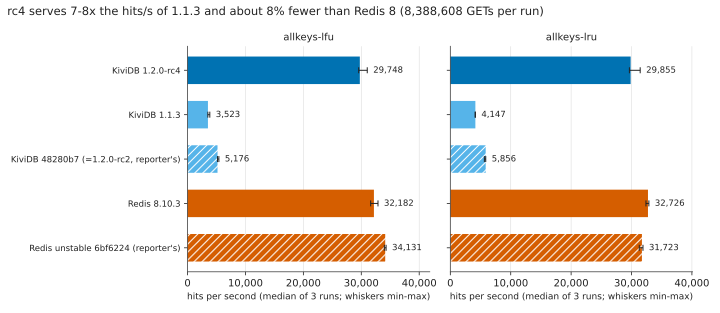
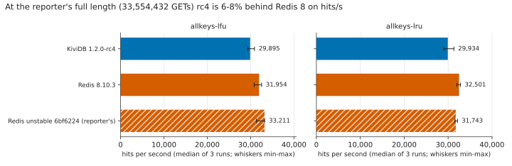
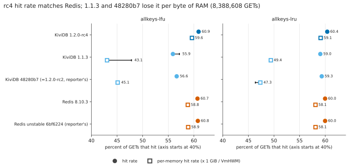
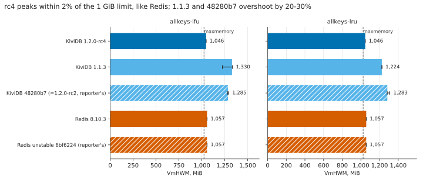
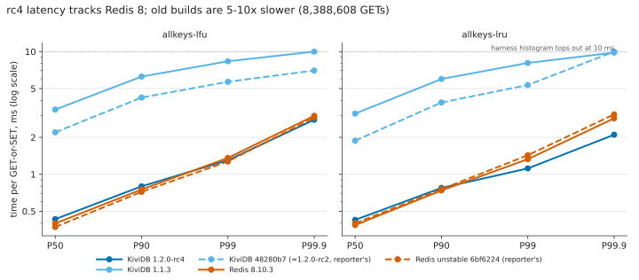
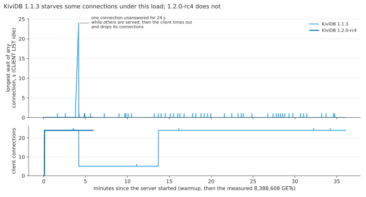

# KiviDB as a cache on a small arm64 box (issue #202, rerun for 1.2.0-rc4)

## What this answers

On Hacker News, [imchuncai asked](https://news.ycombinator.com/item?id=50300421) about
[kividbio/kividb#202](https://github.com/kividbio/kividb/issues/202), "Performance poor as a cache, redis is 7
times better". He ran his own harness,
[imchuncai/umem-cache-benchmark](https://github.com/imchuncai/umem-cache-benchmark), on a Raspberry Pi 4B.
The server was pinned to one core with a 1 GiB `maxmemory` and `allkeys-lfu`. There were 2,097,152 distinct
keys with random sizes up to 1 KiB and Zipf popularity, and a client that sends a GET and, on a miss, a SET.
On KiviDB commit 48280b7 (tag `v1.2.0-rc2`), Redis had a 35% higher hit rate and about 7.6x the hit
throughput.

1.2.0 changed eviction for exactly this workload:

- eviction samples in constant time instead of walking the table on every write;
- sampling is fair across keys;
- keys take less memory;
- `maxmemory` counts the memory the process really uses.

This folder reruns the same harness, unchanged, against five servers:

| engine | what it is | how it was built |
|---|---|---|
| **KiviDB 1.2.0-rc4** | the build under test, tag `v1.2.0-rc4` (a6b1bf3) | `cargo build --release --features tls`, rustc 1.99.1 |
| KiviDB 1.1.3 | the current stable release | official release tarball `kividb-tls-linux-aarch64` |
| KiviDB 48280b7 | the exact commit in the issue (= `v1.2.0-rc2`) | `cargo build --release --features tls` (it still builds) |
| Redis 8.10.3 | latest Redis 8 GA (1a2574c) | `make -j BUILD_TLS=yes`, gcc 13.3 |
| Redis unstable 6bf6224 | the exact Redis commit in the reporter's published Redis result (unstable branch, 2026-07-07, reports itself as 255.255.255) | `make -j BUILD_TLS=yes` |

Each server ran with `allkeys-lfu` (the reporter's setting) and again with `allkeys-lru`. The build
commands are the reporter's. The SHA-256 of every binary is in [results/binaries.txt](results/binaries.txt).

## Headline

| (median of 3 runs, allkeys-lfu) | hit rate | VmHWM (1 GiB limit) | GETs/s | hits/s | P99 / P99.9 |
|---|---|---|---|---|---|
| KiviDB 1.2.0-rc4, reporter's length | 60.96% | 1,067 MiB | 49,039 | 29,895 | 1.33 / 2.80 ms |
| Redis 8.10.3, reporter's length | 60.76% | 1,058 MiB | 52,590 | 31,954 | 1.43 / 3.04 ms |
| KiviDB 1.1.3, quarter length | 55.90% | 1,330 MiB | 6,302 | 3,523 | 8.35 / ≥10 ms |
| KiviDB 48280b7 (reporter's), quarter length | 56.64% | 1,285 MiB | 9,138 | 5,176 | 5.68 / 7.01 ms |

- **Fixed since the report.** rc4 now matches Redis on hit rate (0.2-0.4 points higher under both
  policies) and on peak memory (within 1-2% of Redis, 2-4% over the 1 GiB limit). It also matches Redis on
  tail latency: P99 and P99.9 are equal or lower.
- **Compared with 1.1.3** (same length, same pairs of VMs), rc4 serves **7.0-7.7x the GETs/s** and
  **7.2-8.4x the hits/s**. 1.1.3 also leaves some connections unanswered for over 20 s under this load;
  see [below](#kividb-113-leaves-connections-waiting).
- **Still behind Redis on throughput.** rc4 serves **6-10% fewer GETs/s than Redis 8.10.3**. The median
  ratio on the same VM pair is 0.92 to 0.93, and it holds under both policies and at both run lengths. The
  cause is eviction: rc4 spends 11.9% of its cycles in `make_room`, where Redis spends 7.4% in
  `performEvictions` ([profile](#why-rc4-is-still-slower-than-redis)). This gap is tracked in
  [#251](https://github.com/kividbio/kividb/issues/251).

## This is not a Raspberry Pi

No Pi was available, so we used the smallest 4-core arm64 VM on Azure. It is much faster than a Pi:

| | Reporter: Raspberry Pi 4B | Here: Azure Standard_D4pls_v5 |
|---|---|---|
| CPU | Broadcom BCM2711, 4x Cortex-A72 at 1.5-1.8 GHz | Ampere Altra, 4 vCPU Neoverse-N1 at 3.0 GHz (one physical core per vCPU) |
| caches | 32 KiB L1d per core, 1 MiB shared L2, no L3 | 64 KiB L1d and 1 MiB L2 per core, 32 MiB system-level cache |
| memory | LPDDR4-3200 on a 32-bit bus (a few GB/s) | 8 GiB of the host's 8-channel DDR4-3200 (shared with other tenants) |
| network | client on another machine over the LAN (gigabit Ethernet) | client on a second VM of the same size in the same proximity placement group, accelerated networking; ping RTT median 0.65 ms (0.43-1.13), which is slower than a wired LAN |
| OS | Raspberry Pi OS | Ubuntu 24.04.5, kernel 7.0.0-1017-azure |

- **Absolute numbers do not carry over.** Redis does about 53k GETs/s here and about 21k on the Pi
  (48,034 ns/op in the reporter's result).
- **The ratios do carry over.** After we posted the rc3 numbers, the reporter re-ran rc3 on his Pi and
  found rc3 8% behind Redis on hit/s/mem (11,015 vs 11,991). That matches the 6-10% we measure here.

## Setup

- **VMs.** 7 server/client pairs plus 1 build VM, all Standard_D4pls_v5, region **japaneast**, in one
  proximity placement group and one subnet.
  - We asked for northeurope. D4pls_v5 failed there with "SkuNotAvailable: Capacity Restrictions", as did
    D4ps_v5 and D4pls_v6.
  - westeurope was not accepting new customers. D4pls_v5 also hit capacity restrictions in uksouth,
    francecentral, germanywestcentral, switzerlandnorth, southindia, eastus, eastus2 and westus3.
- **Pinning.** Every run used its own fresh server process.
  - The server was pinned to **core 1** with `taskset -c 1`, as the reporter did.
  - The client was pinned to **cores 1,2,3 of the client VM** with `taskset -c 1,2,3`, as the reporter did.
- **Server flags.** These are the reporter's, with `--maxmemory-policy` switched between `allkeys-lfu` and
  `allkeys-lru`:
  - KiviDB (every version): `--port 6379 --threads 1 --maxmemory 1073741824 --maxmemory-policy 
 --loglevel nothing --update-check no --protected-mode no`.
    KiviDB does not snapshot on a schedule, so nothing was written to disk.
  - Redis (both): `--protected-mode no --appendonly no --save "" --maxmemory 1073741824 --maxclients 24 --maxmemory-policy 
 --port 6379`.
  - Redis gets no `io-threads`: the test pins the server to one core by design. That is also why there is
    no Redis Cluster row.
- **Client.** The harness at commit 6d77492, the version used for our first reply on #202, built as a test
  binary with Go 1.25.3. The current upstream (c32e93b) changes only the umem-cache client; the Redis path
  is identical. The command was
  `bench.test -test.bench=^BenchmarkRedis$ -test.benchtime=<N>x true 1073741824 1024 8 1 0 <server-ip>`.
  That means random sizes, 1 GiB, values up to 1 KiB, `SetParallelism(8)` x 3 procs = 24 connections,
  one server, no TLS.
  - The harness runs a warmup of N GET-or-SET operations, then measures N more.
  - It prints the hit rate, latency percentiles and elapsed time of the measured phase.
  - Its "latency" is the time between two consecutive operations of one of the 24 workers (a closed loop),
    in 1 µs buckets that stop at 9,999 µs.
- **Lengths.**
  - **F** = `-benchtime=33554432x`, the reporter's length. Each run takes about 22 min.
  - **S** = `8388608x`, a quarter of it. We used it for every engine because the two old KiviDB builds need
    25-35 min even at a quarter of the length.
  - Hit rate moves by less than 0.1 point between S and F (rc4 60.91 vs 60.96, Redis 60.70 vs 60.76).
- **Derived numbers.** As the reporter does, *per-memory hit rate* and *hit/s/mem* are scaled by
  1 GiB / the server's VmHWM. The client cannot read a remote VmHWM and prints 0 kB, so we read
  `/proc/<pid>/status` on the server after the run.
- **Repeats and order.** Each engine × policy × length ran 3 times on 3 different VM pairs, 49 runs in
  total, plus 2 profiling and 2 diagnostic runs. The schedule is in [harness/jobs/](harness/jobs/).
- **Load.**
  - Server CPU: the server's core was 95-99% busy for every engine, averaged over the process's life, so
    every row is server-bound.
  - Client CPU, fast engines: the client's three cores were ~80% busy (13-19% idle per core in `mpstat`).
  - Client CPU, old KiviDB builds: 16-22% busy.
  - Redis's core showed slightly more idle than rc4's (93-95% vs 97-98%), so a faster client would widen
    the gap to Redis, not close it.

## Results

Each cell is the median of 3 runs, with [min-max]. *gets/s* is measured GETs divided by the measured
phase's time. The raw outputs are in [results/raw/](results/raw/), one row per run in
[results/runs.csv](results/runs.csv), and medians in [results/summary.csv](results/summary.csv).

#### allkeys-lfu, 33,554,432 GETs (the reporter's length)

| engine | runs | hit rate % | per-memory hit rate % | VmHWM MiB | gets/s | hits/s | hit/s/mem | P50 / P90 / P99 / P99.9 µs | server CPU % | client CPU % | errors |
|---|---|---|---|---|---|---|---|---|---|---|---|
| KiviDB 1.2.0-rc4 | 3 | 60.96 [60.94-61.00] | 58.52 [58.49-59.04] | 1,067 [1,058-1,067] | 49,039 [48,144-50,638] | 29,895 [29,340-30,891] | 28,699 [28,158-29,898] | 426 / 797 / 1,326 / 2,803 | 98 | 80 | 0 |
| Redis 8.10.3 | 3 | 60.76 [60.72-60.78] | 58.85 [58.79-58.85] | 1,058 [1,057-1,058] | 52,590 [50,775-53,528] | 31,954 [30,829-32,533] | 30,947 [29,852-31,502] | 396 / 770 / 1,433 / 3,035 | 95 | 81 | 0 |
| Redis unstable 6bf6224 (reporter's) | 3 | 60.80 [60.74-60.80] | 58.87 [58.83-58.90] | 1,057 [1,057-1,058] | 54,620 [51,601-54,673] | 33,211 [31,342-33,243] | 32,157 [30,358-32,201] | 386 / 731 / 1,367 / 2,926 | 95 | 82 | 0 |

#### allkeys-lru, 33,554,432 GETs (the reporter's length)

| engine | runs | hit rate % | per-memory hit rate % | VmHWM MiB | gets/s | hits/s | hit/s/mem | P50 / P90 / P99 / P99.9 µs | server CPU % | client CPU % | errors |
|---|---|---|---|---|---|---|---|---|---|---|---|
| KiviDB 1.2.0-rc4 | 3 | 60.38 [60.38-60.38] | 57.98 [57.97-57.98] | 1,066 [1,066-1,067] | 49,576 [48,061-51,879] | 29,934 [29,020-31,325] | 28,744 [27,862-30,077] | 423 / 773 / 1,119 / 2,183 | 98 | 79 | 0 |
| Redis 8.10.3 | 3 | 59.96 [59.96-59.96] | 58.07 [58.06-58.07] | 1,057 [1,057-1,057] | 54,207 [53,378-54,746] | 32,501 [32,004-32,824] | 31,476 [30,994-31,788] | 385 / 736 / 1,329 / 2,939 | 95 | 83 | 0 |
| Redis unstable 6bf6224 (reporter's) | 3 | 59.96 [59.95-59.96] | 58.07 [58.06-58.07] | 1,057 [1,057-1,057] | 52,945 [52,627-53,598] | 31,743 [31,554-32,136] | 30,738 [30,560-31,125] | 396 / 751 / 1,393 / 2,979 | 94 | 85 | 0 |

#### allkeys-lfu, 8,388,608 GETs (every engine)

| engine | runs | hit rate % | per-memory hit rate % | VmHWM MiB | gets/s | hits/s | hit/s/mem | P50 / P90 / P99 / P99.9 µs | server CPU % | client CPU % | errors |
|---|---|---|---|---|---|---|---|---|---|---|---|
| KiviDB 1.2.0-rc4 | 3 | 60.91 [60.91-60.96] | 59.62 [59.61-59.62] | 1,046 [1,046-1,047] | 48,837 [48,517-50,903] | 29,748 [29,551-31,030] | 29,117 [28,920-30,349] | 431 / 798 / 1,302 / 2,785 | 97 | 80 | 0 |
| KiviDB 1.1.3 | 3 | 55.90 [55.79-57.17] | 43.05 [42.86-47.82] | 1,330 [1,224-1,333] | 6,302 [6,287-6,726] | 3,523 [3,508-3,845] | 2,713 [2,695-3,216] | 3,370 / 6,260 / 8,345 / ≥9,999 | 99 | 16 | client timeouts in 2 of 3 runs (see below) |
| KiviDB 48280b7 (reporter's) | 3 | 56.64 [56.61-56.68] | 45.12 [44.84-45.24] | 1,285 [1,283-1,293] | 9,138 [9,137-9,546] | 5,176 [5,172-5,411] | 4,123 [4,097-4,319] | 2,199 / 4,223 / 5,675 / 7,013 | 99 | 22 | client retries (reads over 3 s) in 3 of 3 runs |
| Redis 8.10.3 | 3 | 60.70 [60.69-60.72] | 58.81 [58.80-58.83] | 1,057 [1,057-1,057] | 53,019 [52,100-54,154] | 32,182 [31,619-32,884] | 31,179 [30,638-31,859] | 398 / 752 / 1,360 / 2,998 | 93 | 83 | 0 |
| Redis unstable 6bf6224 (reporter's) | 3 | 60.76 [60.76-60.78] | 58.88 [58.88-58.90] | 1,057 [1,057-1,057] | 56,170 [55,905-56,425] | 34,131 [33,979-34,282] | 33,074 [32,929-33,222] | 372 / 719 / 1,272 / 2,898 | 93 | 83 | 0 |

#### allkeys-lru, 8,388,608 GETs (every engine)

| engine | runs | hit rate % | per-memory hit rate % | VmHWM MiB | gets/s | hits/s | hit/s/mem | P50 / P90 / P99 / P99.9 µs | server CPU % | client CPU % | errors |
|---|---|---|---|---|---|---|---|---|---|---|---|
| KiviDB 1.2.0-rc4 | 3 | 60.40 [60.39-60.40] | 59.11 [59.08-59.13] | 1,046 [1,046-1,047] | 49,432 [49,094-52,054] | 29,855 [29,650-31,436] | 29,217 [29,004-30,777] | 425 / 775 / 1,117 / 2,102 | 97 | 79 | 0 |
| KiviDB 1.1.3 | 3 | 59.04 [59.04-59.04] | 49.38 [49.31-49.38] | 1,224 [1,224-1,226] | 7,024 [6,960-7,028] | 4,147 [4,109-4,149] | 3,464 [3,437-3,470] | 3,125 / 5,983 / 8,089 / 9,815 | 99 | 18 | client timeouts in 3 of 3 runs; warmup cut short (see below) |
| KiviDB 48280b7 (reporter's) | 3 | 59.32 [59.29-59.32] | 47.33 [46.37-47.38] | 1,283 [1,282-1,310] | 9,871 [9,501-9,885] | 5,856 [5,634-5,863] | 4,672 [4,405-4,684] | 1,880 / 3,851 / 5,342 / ≥9,999 | 99 | 22 | client retries (reads over 3 s) in 3 of 3 runs |
| Redis 8.10.3 | 3 | 59.97 [59.97-59.98] | 58.10 [58.09-58.10] | 1,057 [1,057-1,057] | 54,570 [54,008-54,817] | 32,726 [32,392-32,875] | 31,703 [31,378-31,844] | 386 / 739 / 1,329 / 2,860 | 92 | 82 | 0 |
| Redis unstable 6bf6224 (reporter's) | 3 | 59.97 [59.97-59.97] | 58.11 [58.11-58.11] | 1,057 [1,057-1,057] | 52,895 [52,161-53,188] | 31,723 [31,283-31,898] | 30,739 [30,310-30,906] | 399 / 756 / 1,431 / 3,078 | 92 | 85 | 0 |

**rc4 vs Redis 8.10.3 on the same VM pair** (rc4 GETs/s ÷ Redis GETs/s):

| | pair 1 | pair 2 | pair 3 | pair 4 | pair 5 | pair 6 |
|---|---|---|---|---|---|---|
| lfu, reporter's length | 0.948 | 0.946 | 0.932 | | | |
| lfu, quarter length | 0.902 | 0.960 | 0.931 | | | |
| lru, reporter's length | | | | 0.915 | 0.878 | |
| lru, quarter length | | | | 0.915 | 0.900 | 0.950 |

The two Redis builds differ from each other by up to ±6% depending on policy and length. Part of that is
VM pairs: the same engine varies by about ±3% from pair to pair. Treat a difference under ~5% between
single rows as noise.

### Charts

## Findings

### rc4 fixes what the issue reported

- **Hit rate.** The 1.2 line evicts as well as Redis does. rc4's hit rate is 60.9-61.0% under LFU and
  60.4% under LRU; Redis 8 is at 60.7-60.8% and 60.0%. With the same keys and the same 1 GiB, rc4 keeps a
  slightly better set of keys.
- **Peak memory.** rc4 peaks at 1,046 MiB (quarter length) and 1,067 MiB (reporter's length), against
  Redis's 1,057 MiB. 1.1.3 and 48280b7 peak at 1,224-1,333 MiB, 20-30% over the limit. That is what sank
  their per-memory hit rate (43-49% against rc4's 58-60%).
  - rc4's peak creeps up with run length (1,046 → 1,067 MiB, 2% → 4% over `maxmemory`), while Redis's
    stays flat. This is small but worth watching in longer runs.
- **Throughput against old builds.** On the same pairs, rc4 serves 7.7x (LFU) and 7.0x (LRU) the GETs/s
  of 1.1.3. Against 48280b7 it serves 5.3x and 5.0x.

### Why rc4 is still slower than Redis

We profiled both servers with `perf record -g` for 30 s inside the measured phase (quarter length, LFU,
pair 3). The reports are in [results/profile/](results/profile/).

- **Kernel time is the same.** Both spend about two thirds of their cycles in the kernel TCP path:
  rc4 66.9%, Redis 67.9%.
- **The difference is user-space eviction work.**
  - rc4 spends 11.9% of all cycles inside `kividb::eviction::make_room` (5.7% in the function itself).
  - Redis spends 7.4% in `performEvictions`, including `evictionPoolPopulate` and `dictGetSomeKeys`.
  - That 4.5-point difference on a saturated core accounts for most of the 6-10%.
- **Where `make_room` loses time.** Earlier analysis in #251 found that most of `make_room`'s own time
  is cache misses on each sampled key: control byte, slot, then entry header. Prefetching has not helped
  yet; #251 lists the next things to try.
- **Effect on P50.** In a closed loop with 24 connections, the median time per operation follows
  throughput, so rc4's P50 is 8-10% higher (426 vs 396 µs).
- **Effect on tails.** rc4's tails are not worse. P99 is 1,326 vs 1,433 µs (LFU) and 1,119 vs 1,329 µs
  (LRU). P99.9 is 2,803 vs 3,035 µs and 2,183 vs 2,939 µs.

### KiviDB 1.1.3 leaves connections waiting

5 of the 6 measured 1.1.3 runs, and the diagnostic run, had client errors:

- Each of those runs logged 19-24 `got error: i/o timeout` lines. The harness ends a worker on its first
  error, and go-redis gives up only after its retries and the harness's 30 s context.
- In 4 of the 6 runs, every worker died during the **warmup**. The server then logged 3.6-3.7M fewer
  GETs than the 2 x 8,388,608 the client should have sent.
- The **measured** phase always ran in full. The server's GET count and the phase's length both confirm
  it. So the 1.1.3 numbers above are valid, but they come after a shortened warmup.

**What a diagnostic run showed.** We ran 1.1.3 again with a 1-second sampler of `CLIENT LIST` and
`INFO` ([harness/diag-sampler.sh](harness/diag-sampler.sh), last chart above):

- About 3.8 min in, just after memory first fills, one connection's idle time climbs from 0 to 24 s.
- During that time the server keeps processing ~9k commands/s for the other connections.
- Then 19 of the 24 connections drop at once. The warmup continues on 5 connections until the measured
  phase reconnects all 24.

So this is starvation of single connections, not a global stall. With `--threads 1`, 1.1.3 can leave a
connection unserved for tens of seconds while it keeps serving the others.

- **48280b7 (= rc2):** the same problem in milder form. Every run shows 82-329 GETs more on the server than
  the client counted. These are go-redis retries after its 3 s read timeout, so some reads took over 3 s.
- **rc4:** zero client errors and zero retries in all 14 runs. The server's GET count is exactly 2N every
  time. In the same diagnostic run on rc4, no connection was idle for more than 1 s.

### Caveats

- This is not a Pi (see above). Expect absolute numbers about 2.5x lower on a Pi 4. The ratios should
  hold; the reporter's own rc3-on-Pi run agreed with them.
- **VM pairs differ.** The same engine on different VM pairs varies by about ±3% in GETs/s, which is why
  the paired ratios above matter more than single rows.
- **Run lengths.** The old KiviDB builds were run only at a quarter of the reporter's length. At the full
  length they would take 1.5-2 h per run.
- **Latency.** This harness measures latency inside a closed loop and caps it at 10 ms. It is not an
  open-loop latency test.

## Reproduce

All scripts are in [harness/](harness/). The VM-side scripts assume Ubuntu 24.04 arm64 and user `azureuser`.

1. **Create the VMs.** Make a throwaway key pair (`ssh-keygen -t ed25519 -f internal`), then run
   `RG=<rg> L=<region> MYIP=<your ip> PUBKEY=<your .pub> INTERNAL_PUBKEY=internal.pub PAIRS=7 bash azure-create.sh`.
   It creates N server/client pairs plus a builder (`b1`), all `Standard_D4pls_v5`, in one placement group.
   Server *i* is 10.30.1.(10+*i*), client *i* is 10.30.1.(20+*i*).
2. **Prepare every VM.** Copy the harness scripts and the private half of `internal` (as
   `~/.ssh/id_ed25519`) to each VM.
   - Run `vm-setup.sh server` on each server, `vm-setup.sh client` on each client (this builds the
     harness at 6d77492), and `vm-setup.sh builder` on b1.
   - On b1, write the servers' private IPs to `~/servers.txt`. On each client, write its server's IP to
     `~/server.txt`.
3. **Build.** Run `nohup bash build-all.sh &` on b1. It builds every engine as listed above and copies each
   binary, with a `.info` file of commit and SHA-256, to every server's `~/bin/`.
4. **Run.** Put a job list in `~/jobs.txt` on each client (ours are in `harness/jobs/`), then run
   `nohup bash queue.sh &`.
   - For each job, `queue.sh` restarts the engine on its server (`server-run.sh`), pings, runs the
     harness under `/usr/bin/time` with `mpstat`, and collects VmHWM, INFO and CPU ticks
     (`server-collect.sh`).
   - Everything ends up in the client's `~/results/`.
5. **Optional extras.**
   - `diag-sampler.sh` on a server records connection idle times once a second.
   - `perf-when.sh <engine> <tag>` takes a 30 s profile once that engine's measured phase has started.
6. **Tables and charts.** Copy every client's `~/results/` into `results/raw/`, then run
   `python3 harness/parse.py results`, `python3 harness/table.py results` and
   `python3 harness/charts.py results charts`.
