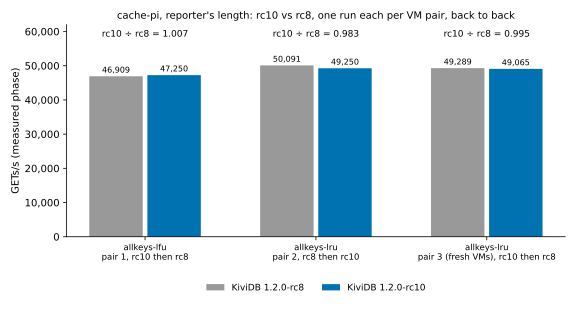

# cache-pi: 1.2.0-rc10 regression round (issue #202 cache benchmark)

## What ran

The reporter's harness (imchuncai/umem-cache-benchmark at 6d77492, Go 1.25.3) ran unchanged, at the
reporter's length (`-benchtime=33554432x`, about 23 min a run).
- Each run used a fresh server on core 1 (`taskset -c 1`) and the client on cores 1-3 of the client VM.
- Server flags were the ones in `benchmarks/1.2.0/cache-pi/README.md`, under `allkeys-lfu` and `allkeys-lru`.
- The harness scripts (`server-run.sh`, `queue.sh`, `server-collect.sh`, `parse.py`) were the rc8 round's,
  unchanged. Only the build list and job lists are new.
- No Redis this round.

| build | source | SHA-256 of the binary |
|---|---|---|
| **KiviDB 1.2.0-rc10** (under test) | tag `v1.2.0-rc10` (39bfacd2), reports `1.2.0-rc10`; `cargo build --release --features tls` | `eaee9421f1699cb360466ef935dbc8047ac4faf0b7c00bdfae8e0b82cc9970a4` |
| KiviDB 1.2.0-rc8 (reference) | 082dab3d, reports `1.2.0-rc8`; same command, same VM, same toolchain | `ebd13efe191f358a78996dbe7a6267990f67ade5a076368de414c2ee534569cd` |

- **Toolchain.** Both used rustc 1.99.1 (58cf8f9c3 2026-10-13), the rc8 round's toolchain.
- **rc8 reproduced exactly.** The rc8 binary is byte-identical to the one the rc8 round measured.
- **Second build matched.** Both commits were built a second time on a fresh builder for pair 3 (see
  below), and the SHA-256s matched again.
- **Details.** See [results/binaries.txt](results/binaries.txt) and
  [results/environment.txt](results/environment.txt).

**Hardware and region.** The round used the rc8 round's layout and region, **australiaeast**: Standard_D4pls_v5
server/client pairs (4 vCPU Ampere Altra Neoverse-N1, 8 GiB) and a Standard_D8pls_v5 builder, in one
proximity placement group with accelerated networking. The OS was Ubuntu 24.04.5 with kernel
7.0.0-1017-azure. Every VM was created on the first try. Average ping RTT was 0.61-0.91 ms per run.

**Schedule.** One run per build on each VM pair, back to back, in alternating order:

- pair 1, `allkeys-lfu`: rc10, then rc8;
- pair 2, `allkeys-lru`: rc8, then rc10;
- pair 3, `allkeys-lru`: rc10, then rc8. This extra LRU pair was added at the coordinator's request
  after pair 2 came out at -1.7%. See [What differs](#what-differs).

All 6 runs exited 0 with no client errors. On every run, the server counted exactly 2 x 33,554,432
GETs. Server CPU was 98% and client CPU 232-238% of 300 on every run, so every row is server-bound.

## rc10 against rc8 (same VM pair, same session)

Each cell is one run.
- **Spread** is the run-to-run spread the rc8 round measured on the same layout: the larger of rc8's
  and rc7's min-max ranges for that policy.
- **Regression rule.** A metric is called a regression only if rc10 is worse by more than both that
  spread and the rc8 round's noise floor. The floors are 2% for throughput and memory, 3% for P50,
  10% for P99/P99.9 and 0.1 pt for hit rate.

### allkeys-lfu, pair 1 (rc10 first)

| metric | rc10 | rc8 | change | spread | verdict |
|---|---|---|---|---|---|
| GETs/s | 47,250 | 46,909 | +0.7% | 1.2% | same |
| hits/s | 28,784 | 28,573 | +0.7% | 1.2% | same |
| hit rate % | 60.92 | 60.91 | +0.01 pt | 0.01 pt | same |
| VmHWM MiB | 1,067 | 1,066 | 0.0% | 0.8% | same |
| P50 µs | 439 | 448 | -2.0% | 1.5% | same |
| P99 µs | 1,206 | 1,294 | -6.8% | 3.2% | same |
| P99.9 µs | 2,546 | 2,612 | -2.5% | 10.9% | same |
| server CPU % | 98.1 | 98.1 | | | |

### allkeys-lru, pair 2 (rc8 first)

| metric | rc10 | rc8 | change | spread | verdict |
|---|---|---|---|---|---|
| GETs/s | 49,250 | 50,091 | -1.7% | 1.4% | same (past the spread, under the 2% floor) |
| hits/s | 29,737 | 30,246 | -1.7% | 1.4% | same (as GETs/s) |
| hit rate % | 60.38 | 60.38 | 0.00 pt | 0.00 pt | same |
| VmHWM MiB | 1,066 | 1,066 | 0.0% | 0.0% | same |
| P50 µs | 428 | 422 | +1.4% | 1.2% | same |
| P99 µs | 1,201 | 1,166 | +3.0% | 0.9% | same |
| P99.9 µs | 2,520 | 2,450 | +2.9% | 4.5% | same |
| server CPU % | 98.2 | 98.2 | | | |

### allkeys-lru, pair 3 (fresh VMs, rc10 first)

| metric | rc10 | rc8 | change | spread | verdict |
|---|---|---|---|---|---|
| GETs/s | 49,065 | 49,289 | -0.5% | 1.4% | same |
| hits/s | 29,626 | 29,762 | -0.5% | 1.4% | same |
| hit rate % | 60.38 | 60.38 | 0.00 pt | 0.00 pt | same |
| VmHWM MiB | 1,066 | 1,066 | 0.0% | 0.0% | same |
| P50 µs | 429 | 429 | 0.0% | 1.2% | same |
| P99 µs | 1,217 | 1,207 | +0.8% | 0.9% | same |
| P99.9 µs | 2,604 | 2,529 | +3.0% | 4.5% | same |
| server CPU % | 98.2 | 97.9 | | | |

### Paired ratios (rc10 ÷ rc8 GETs/s)

| pair | policy | order | ratio |
|---|---|---|---|
| 1 | lfu | rc10, rc8 | 1.007 |
| 2 | lru | rc8, rc10 | 0.983 |
| 3 | lru | rc10, rc8 | 0.995 |
| **LRU mean** | | | **0.989** |
| all three, mean | | | 0.995 |

**Verdict: no regression.** No metric passes the rc8 round's threshold on any pair. Hit rate and peak
memory are identical to two decimals.

LRU leans about 1% lower, though. Both LRU pairs have rc10 below rc8 (0.983 and 0.995, mean 0.989). Pair 3
ran in reversed order, and the ratio did not straddle 1.0. So "the second run on a pair is slower" does
not explain pair 2's -1.7%, as I had first guessed. Three things argue against a code cause:

- **The rc8 round saw bigger swings.** Its four rc8 ÷ rc7 pairs ranged 0.999-1.024. The suite's 12
  identical-code pairs (1.2.0 candidate ÷ rc4) ranged 0.982-1.017.
- **The changed code is not policy-specific.** The only change near the command path is one flag check
  in the write gate, which LFU and LRU share. LFU, on the same SET-on-miss path, is +0.7%.
- **The tails don't move with it.** P50 and P99 on pair 3 differ by 0.0% and +0.8%.

On 1-2 runs a pair, a real ~1% LRU-only cost can't be told apart from noise. Nothing here points to one.

## rc10 against the rc8 round's numbers (indicative only)

The rc8 round ran on other VMs, in australiaeast earlier the same day. Its rc8 rows are the median
of 2 runs. In the "now" columns, LRU is the median of pairs 2 and 3.

| row | GETs/s now (rc8 round) | change | hits/s now (rc8 round) | hit rate % now (rc8 round) | VmHWM MiB now (rc8 round) | P99 / P99.9 µs now (rc8 round) |
|---|---|---|---|---|---|---|
| lfu, rc10 | 47,250 (52,414) | -9.9% | 28,784 (31,994) | 60.92 (61.04) | 1,067 (1,062) | 1,206 / 2,546 (1,060 / 1,650) |
| lfu, rc8 rebuilt | 46,909 (52,414) | -10.5% | 28,573 (31,994) | 60.91 (61.04) | 1,066 (1,062) | 1,294 / 2,612 (1,060 / 1,650) |
| lru, rc10 | 49,158 (51,156) | -3.9% | 29,682 (30,888) | 60.38 (60.38) | 1,066 (1,066) | 1,209 / 2,562 (1,083 / 1,930) |
| lru, rc8 rebuilt | 49,690 (51,156) | -2.9% | 30,004 (30,888) | 60.38 (60.38) | 1,066 (1,066) | 1,186 / 2,490 (1,083 / 1,930) |

These VMs are slower than the rc8 round's. The byte-identical rc8 binary lost as much as rc10 did:
10.5% on pair 1 and 2-4% on pairs 2-3. P99.9 is 30-60% higher for both builds alike. So the absolute
drop is the VMs, not rc10. Pair 1 is the slowest pair of the session for both builds, and its ping had
the most jitter (max 2.1-2.6 ms).

## What differs

- **A third pair, on fresh VMs.** Pair 2 came out at -1.7%, and the coordinator asked for one more
  LRU pair in reversed order on the same VM pair. That request arrived after the RG delete had started,
  and the delete can't be cancelled. So pair 3 is a fresh server/client pair in a recreated RG (same name,
  region, sizes and script) with a fresh builder. Both binaries rebuilt byte-identical there. Its ratio
  is still within one VM pair, but across pairs 2 and 3 the VMs differ, not only the order.
- **One run per build per pair.** The rc8 round had 2 runs per build per policy. Its spread is used as
  the noise yardstick here.
- **A false start on pair 2.** That pair's queue started rc10 first because rc8 was still building.
  I stopped that run about 1 minute in and restarted the queue once rc8 was on the server. The
  partial run is not in `results/`.
- **Private addresses replaced.** The VMs' private addresses in the raw logs (client command line,
  ping) are replaced with `<server-private-ip>`. `parse.py` gives the same rows either way. The `final-*`
  and `samples-*` files keep redis-cli's CRLF INFO output verbatim, as the rc8 round's do.
- **Different VMs, same region and sizes** as the rc8 round. Absolute numbers are 3-10% lower for both
  builds (see above).

## Files

- `results/raw/`: for every run, the client's `bench-*.log`, `ping-*`, `client-mpstat-*` and `start-*`,
  plus the server's `final-*` (VmHWM, INFO, CPU ticks) and `samples-*` (30 s samples). Tags ending `_1`
  are pairs 1-2; `kividb-*_lru_F_2` is pair 3.
- `results/runs.csv`, `results/summary.csv`: written by the suite's `parse.py`, unchanged.
  `summary.csv` groups by engine and policy, so its LRU medians span pairs 2 and 3.
- `results/binaries.txt`, `results/environment.txt`: builds (both build sessions), toolchain, harness
  commit, kernel and CPU of every VM.
- `charts/rc10-vs-rc8.svg`: the regression-check chart.
- `NOTES.md`: the progress log.
