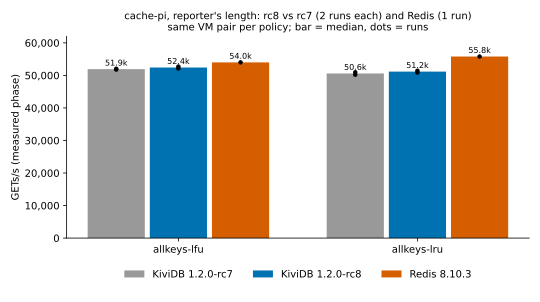

# cache-pi: 1.2.0-rc8 regression round (issue #202 cache benchmark)

## What ran

The reporter's harness (imchuncai/umem-cache-benchmark at 6d77492, Go 1.25.3), unchanged, at the
reporter's length (`-benchtime=33554432x`, about 21.5 min a run). Each run used a fresh server on
core 1 (`taskset -c 1`) and the client on cores 1-3 of the client VM. Server flags were the ones
in `benchmarks/1.2.0/cache-pi/README.md`, under `allkeys-lfu` and `allkeys-lru`. The harness
scripts (`server-run.sh`, `queue.sh`, `server-collect.sh`, `parse.py`) were used as published.
Only the build list and job lists are new.

| build | source | SHA-256 of the binary |
|---|---|---|
| **KiviDB 1.2.0-rc8** (under test) | `release/1.2.0` at 082dab3d, reports `1.2.0-rc8`; `cargo build --release --features tls` | `ebd13efe191f358a78996dbe7a6267990f67ade5a076368de414c2ee534569cd` |
| KiviDB 1.2.0-rc7 (reference) | tag `v1.2.0-rc7` (598b74d2); same command, same VM, same toolchain | `918a4aa3ea0ec2bf833b9ceacb2392b74b19f97d1c666f6064bd6c93fc40fd05` |
| Redis 8.10.3 (competitor) | tag 8.10.3 (1a2574c); `make -j BUILD_TLS=yes`, gcc 13.3.0 | `b7b268f9ff5e90efe977915a9e4febe5ce1716aecb95536b9173145efb42a96c` |

Both KiviDB builds used rustc 1.99.1 (58cf8f9c3 2026-10-13), the toolchain of the published run.
Details are in [results/binaries.txt](results/binaries.txt) and
[results/environment.txt](results/environment.txt).

**Hardware.** This used the published layout: two server/client pairs of Standard_D4pls_v5 (4 vCPU
Ampere Altra Neoverse-N1, 8 GiB) and a Standard_D8pls_v5 builder, in one proximity placement group
with accelerated networking. The OS was Ubuntu 24.04.5 with kernel 7.0.0-1017-azure, the same as
the published run. Ping RTT averaged 0.62-1.22 ms per run (median 0.85 ms); the published run had a
0.65 ms median.

**Region: australiaeast.** The assigned region, koreacentral, offers no Dplsv5 to this subscription.
Dplsv6 is listed there but restricted. The first fallback, eastus2, refused Standard_D8pls_v5 for
capacity. australiaeast created every VM on the first try. The published run was in japaneast.

**Schedule.** Each VM pair ran one policy, so each policy's five runs share one pair:

- pair 1, `allkeys-lfu`: rc8, rc7, Redis, rc7, rc8;
- pair 2, `allkeys-lru`: rc7, rc8, Redis, rc8, rc7.

Two pairs halved the wall time. No comparison in this page crosses pairs. All 10 runs exited 0 with
no client errors. On every run, the server counted exactly 2 x 33,554,432 GETs.

## rc8 against rc7 (same VM pair, same session)

Each cell is the median of 2 runs, with [min-max]. "Spread" is the larger of the two engines'
min-max ranges, relative to the median. A metric is called a regression only if rc8 is worse by
more than that spread. There is also a noise floor: 2% for throughput and memory, 3% for P50 and
10% for P99/P99.9. The published page showed tail swings of 9% between identical builds.

### allkeys-lfu, reporter's length, pair 1

| metric | rc8 | rc7 | change | spread | verdict |
|---|---|---|---|---|---|
| GETs/s | 52,414 [52,111-52,716] | 51,918 [51,789-52,048] | +1.0% | 1.2% | same |
| hits/s | 31,994 [31,805-32,182] | 31,686 [31,607-31,765] | +1.0% | 1.2% | same |
| hit rate % | 61.04 [61.03-61.05] | 61.03 [61.03-61.03] | +0.01 pt | 0.01 pt | same |
| VmHWM MiB | 1,062 [1,058-1,066] | 1,066 [1,066-1,067] | -0.4% | 0.8% | same |
| P50 µs | 401 [398-404] | 405 [402-408] | -1.0% | 1.5% | same |
| P99 µs | 1,060 [1,044-1,075] | 1,062 [1,045-1,079] | -0.2% | 3.2% | same |
| P99.9 µs | 1,650 [1,560-1,739] | 1,680 [1,658-1,702] | -1.8% | 10.9% | same |
| server CPU % | 98.3 | 98.3 | | | |

Back-to-back pairs (rc8 ÷ rc7 GETs/s): 1.013, 1.006.

### allkeys-lru, reporter's length, pair 2

| metric | rc8 | rc7 | change | spread | verdict |
|---|---|---|---|---|---|
| GETs/s | 51,156 [50,873-51,440] | 50,584 [50,218-50,949] | +1.1% | 1.4% | same |
| hits/s | 30,888 [30,717-31,060] | 30,542 [30,321-30,763] | +1.1% | 1.4% | same |
| hit rate % | 60.38 [60.38-60.38] | 60.38 [60.38-60.38] | +0.00 pt | 0.00 pt | same |
| VmHWM MiB | 1,066 [1,066-1,066] | 1,066 [1,066-1,066] | 0.0% | 0.0% | same |
| P50 µs | 412 [411-414] | 418 [415-420] | -1.2% | 1.2% | same |
| P99 µs | 1,083 [1,078-1,088] | 1,084 [1,083-1,085] | -0.1% | 0.9% | same |
| P99.9 µs | 1,930 [1,887-1,973] | 1,928 [1,914-1,942] | +0.1% | 4.5% | same |
| server CPU % | 98.3 | 98.2 | | | |

Back-to-back pairs (rc8 ÷ rc7 GETs/s): 0.999, 1.024.

**Verdict: no regression.** rc8 is 1.0-1.1% ahead of rc7 on the median under both policies. That
is inside the 1.2-1.4% run-to-run spread, so it is noise, not a gain. Across the four back-to-back
pairs, rc8 ÷ rc7 ranged from 0.999 to 1.024. Hit rate, peak memory and every latency percentile
match. The rc8 MSET/MSETNX locking change is not on this workload's path: the client sends only
GET and SET.

## rc8 against the published 1.2.0 numbers (indicative only)

The published numbers were measured on 75482ab (rc7's code) in japaneast on different VMs, as the
median of 3 runs on 3 pairs. Redis 8.10.3 moved by a similar amount between the two sessions, so
the absolute change is mostly the VMs.

| row | GETs/s now (published) | change | hits/s now (published) | hit rate % now (published) | VmHWM MiB now (published) | P99 / P99.9 µs now (published) |
|---|---|---|---|---|---|---|
| lfu, KiviDB rc8 vs 75482ab | 52,414 (49,089) | +6.8% | 31,994 (29,927) | 61.04 (60.96) | 1,062 (1,066) | 1,060 / 1,650 (1,083 / 1,869) |
| lru, KiviDB rc8 vs 75482ab | 51,156 (49,462) | +3.4% | 30,888 (29,865) | 60.38 (60.38) | 1,066 (1,066) | 1,083 / 1,930 (1,144 / 1,989) |

## Competitor: Redis 8.10.3 (1 run per policy, same pairs)

| row | GETs/s now (published) | change | hits/s now (published) | hit rate % now (published) | VmHWM MiB now (published) | P99 / P99.9 µs now (published) |
|---|---|---|---|---|---|---|
| lfu, Redis 8.10.3 | 53,996 (53,312) | +1.3% | 32,825 (32,401) | 60.79 (60.78) | 1,058 (1,057) | 1,195 / 2,680 (1,286 / 2,809) |
| lru, Redis 8.10.3 | 55,787 (52,714) | +5.8% | 33,451 (31,606) | 59.96 (59.96) | 1,057 (1,057) | 1,231 / 2,776 (1,315 / 2,866) |

Each published headline claim, checked against this round on the same pair:

| claim on the published page | this round | holds? |
|---|---|---|
| hit rate 0.2-0.4 pt above Redis | +0.25 pt (lfu), +0.42 pt (lru) | yes |
| peak memory within 1% of Redis | +0.4% (lfu), +0.8% (lru) | yes |
| P99 9-16% below Redis | 11% (lfu), 12% (lru) below | yes |
| P99.9 25-33% below Redis | 38% (lfu), 30% (lru) below | yes (lfu better than stated) |
| 3-6% fewer GETs/s than Redis on the median, 1-8% on single pairs; paired median 0.944 lfu / 0.938 lru | rc8 ÷ Redis 0.971 lfu (runs 0.976, 0.965), 0.917 lru (runs 0.912, 0.922) | lfu yes; lru 8.3% behind, just past the stated 1-8% single-pair range |

## What differs

- **Region and VMs.** This ran in australiaeast, not japaneast (see above). Absolute GETs/s are 1-7%
  higher here for both engines.
- **Two VM pairs, one per policy.** The published run used three pairs per row. Here each policy's
  rc8, rc7 and Redis runs all share one pair, so the pairs' ±3% difference does not enter any
  comparison. The rc8 ÷ rc7 tables have two runs each, as the brief asks.
- **Redis is one run per policy.** The LRU gap to Redis, 8.3%, is a little wider than the published
  6% median and the 1-8% single-pair range. It is one Redis run on one pair, and the published page
  measured ±3% for the same engine between pairs. rc7 on the same pair is 9.3% behind that same
  Redis run, so this is not something rc8 changed.
- **The rc7 binary is not byte-identical to the published 75482ab binary.** The code is the same,
  but the embedded version string is `1.2.0-rc7`, not `1.2.0-rc6`. The Redis 8.10.3 binary's
  SHA-256 also differs from the published one: its build id differs (`build=` in `--version`).
- **Peak memory.** rc8's LFU peak was 1,058 MiB in one run and 1,066 MiB in the other. rc7 and
  every LRU run peaked at 1,066 MiB. The published page noted this 1,046 → 1,066 creep with run
  length, and it is unchanged.
- Client CPU was 76-80% of its three cores (229-240% of 300) and server CPU 98% for KiviDB and
  96-97% for Redis, as in the published run. Every row is server-bound.

## Files

- `results/raw/`: the client's `bench-*.log`, `ping-*`, `client-mpstat-*`, and the server's
  `final-*` (VmHWM, INFO, CPU ticks) and `samples-*` (30 s samples), for every run.
- `results/runs.csv`, `results/summary.csv`: written by the suite's `parse.py`, unchanged.
- `results/binaries.txt`, `results/environment.txt`: builds, toolchain, harness commit, kernel and
  CPU.
- `charts/rc8-vs-rc7.svg`: the regression-check chart.
- `NOTES.md`: the progress log.
