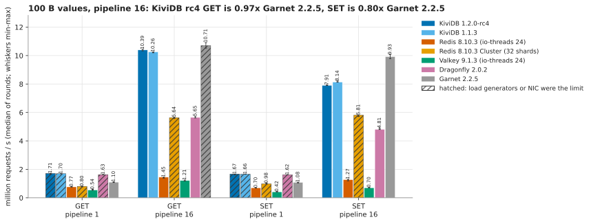
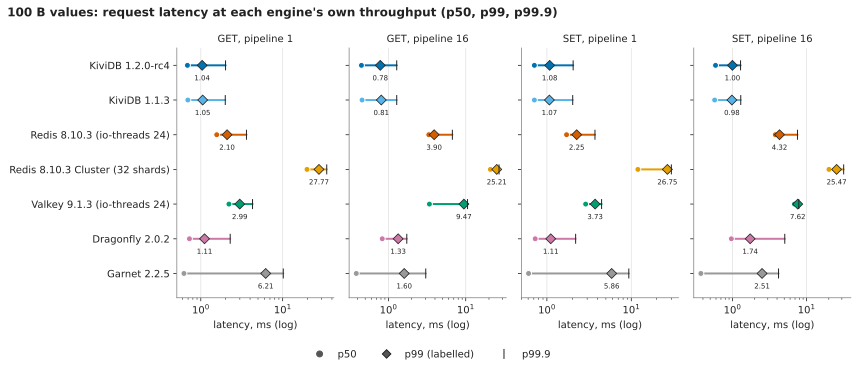
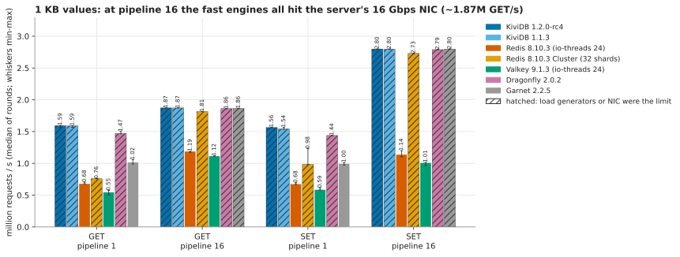
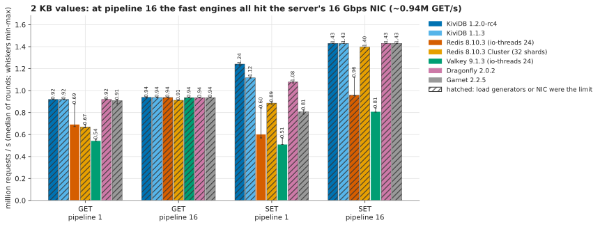
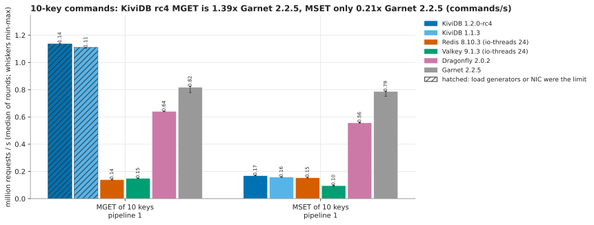
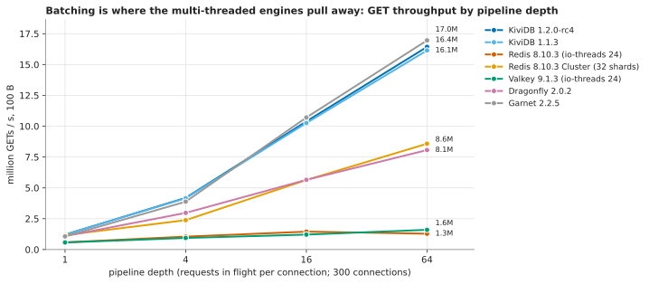
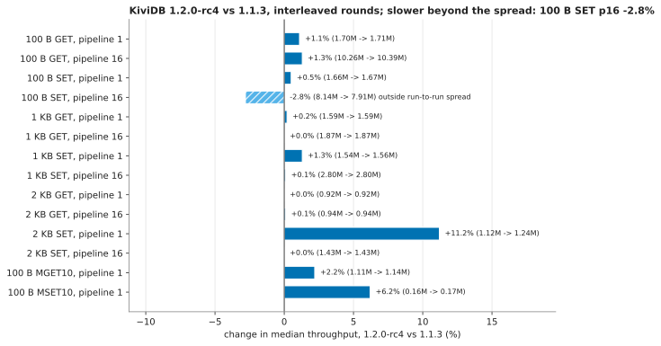

# Core string benchmark: KiviDB 1.2.0-rc4 against Redis, Redis Cluster, Valkey, Dragonfly and Garnet

GET and SET at 100 B, 1 KB and 2 KB, with and without pipelining, plus MGET and MSET
of 10 keys. Seven engines ran one at a time on the same 32-vCPU arm64 server, measured
from two load generators at once. Every row has three rounds and p50 / p99 / p99.9.
Run on 2026-11-01/02 for the 1.2.0 release.

The run answers these points from the [Show HN thread](https://news.ycombinator.com/item?id=50152541):

| Asked on HN | Where it is answered |
|---|---|
| "Past ~5M ops/sec we needed 3 separate memtier hosts ... Any p99 numbers alongside it?" ([falconBrisk47](https://news.ycombinator.com/item?id=50153410)) | Two load generators run together, client CPU is recorded for every row, and rows where the clients (or the NIC) were the limit are marked. p50/p99/p99.9 come from the two generators' histograms merged. |
| "Could you add Valkey ... big values (2KB) and small values (<256B)" ([edoceo](https://news.ycombinator.com/item?id=50153931)), "And MS Garnet" ([esafak](https://news.ycombinator.com/item?id=50154673)) | Valkey 9.1.3 and Garnet 2.2.5 are both included, at 100 B, 1 KB and 2 KB. |
| "running 46 redis instances under the pretence that Redis is mono-threaded ... Redis uses multi-threading on io" ([Shamanoid](https://news.ycombinator.com/item?id=50156303)) | Redis and Valkey run with `io-threads`, the count picked by a sweep (4/8/16/24). Redis Cluster is a separate row, one shard per core. |
| "whether the advantage ... stems primarily from more efficient I/O batching or from faster command execution" ([AtalantaDB](https://news.ycombinator.com/item?id=50161446)), "why its so much faster than redis" ([shepardrtc](https://news.ycombinator.com/item?id=50154950)) | [I/O batching or command execution?](#io-batching-or-command-execution) splits server CPU per request into user and kernel time at pipeline depths 1, 4, 16 and 64. |

## Summary

- **Pipelined 100 B: KiviDB and Garnet lead and are close on GET; Garnet leads on SET.**
  - GET at pipeline 16: KiviDB 1.2.0-rc4 10.39M/s, Garnet 10.71M/s (+3%).
  - SET at pipeline 16: KiviDB 7.91M/s, Garnet 9.93M/s (**+26% for Garnet**).
  - Both are well ahead of Dragonfly (5.65M / 4.81M) and Redis Cluster (5.64M / 5.81M, client-bound). KiviDB is 6-7× Redis with io-threads (1.45M / 1.27M) and 9-11× Valkey (1.21M / 0.70M).
  - KiviDB has the lowest tail latency of the 100 B pipelined rows: GET p99 0.78 ms, against Garnet 1.60 ms, Dragonfly 1.33 ms and Redis 3.90 ms.
- **Without pipelining**, KiviDB (1.71M GET) and Dragonfly (1.63M) both use up our two load generators (95% CPU), so those rows are a floor, not a ceiling. Garnet does 1.10M with a high tail: p99 6.2 ms against about 1 ms for KiviDB and Dragonfly.
- **1 KB and 2 KB values**: with pipelining, every fast engine stops at the same rate, the server's 16 Gbps NIC: ~1.87M GET/s at 1 KB and ~0.94M at 2 KB. These rows compare latency and CPU, not throughput.
- **MGET of 10 keys**: KiviDB leads at 1.14M commands/s (11.4M keys/s), against Garnet 0.82M and Dragonfly 0.64M; KiviDB's row is client-bound.
- **MSET of 10 keys is KiviDB's clear loss**: 168K commands/s against Garnet 787K (4.7×) and Dragonfly 557K (3.3×). It is about level with Redis (153K). See [MSET](#mset-of-10-keys-a-clear-loss).
- **1.2.0-rc4 against 1.1.3** (interleaved on the same machines):
  - Level or faster on 13 of 14 rows.
  - **100 B SET at pipeline 16 is 2.8% slower** (8.14M → 7.91M). That is outside the run-to-run spread: rc4's best round is below 1.1.3's worst.
  - The likely cause, not yet profiled: since 1.2.0 (#271) every write also takes its key's write-order lock, so that read-modify-write commands cannot lose updates. CPU per SET rose by the same 3% (3.47 → 3.57 µs). No other single-key row moved beyond the spread.
  - 2 KB SET at pipeline 1 is 11% faster, and MSET 6% faster.

## Hardware and setup

| | |
|---|---|
| Cloud | Azure, eastasia. All three VMs in one proximity placement group (one datacenter), accelerated networking. |
| Server | `Standard_D32ps_v5`: 32 vCPU Ampere Altra (Neoverse-N1), 128 GB, 16 Gbps network |
| Load generators | 2 × `Standard_D16ps_v5`: 16 vCPU, 64 GB, 12.5 Gbps each |
| OS | Ubuntu 24.04.5 LTS arm64, kernel 7.0.0-1017-azure |
| Load tool | memtier_benchmark 2.5.2 (built from its tag) |

**How this compares with what we published before**
- The README's bare-metal figures (21.2M GET at pipeline 16) came from an AWS `c7gn.metal` server confined to 32 cores and a 64-vCPU load generator, with a 200 Gbps network.
- This run is on a smaller, older core (Neoverse-N1 vs Graviton3), a 16 Gbps NIC, and 32 vCPUs of load generation in total. So every engine's absolute numbers here are lower, and the 1 KB and 2 KB rows hit the NIC.
- The VM sizes match [benchmarks/LATEST.md](../../LATEST.md) (D32ps_v5 server). LATEST.md used one D32ps_v5 client at pipeline 10; this run uses two clients.
- Why two 16-vCPU load generators and not three: the region's quota is 65 vCPUs, so 32 server + 2×16 client is the most we could run.

## Engines and flags

Every engine runs alone on the server, on all 32 vCPUs, with persistence off and no memory limit. The exact command lines and versions are in [results/launch.log](results/launch.log).

| Engine | Version | Command (beyond `--port 6379 --bind 0.0.0.0`) | Threads |
|---|---|---|---|
| KiviDB 1.2.0-rc4 | tag `v1.2.0-rc4` = `a6b1bf3`, default variant | none | 30 workers (its default, vCPUs − 2), io_uring |
| KiviDB 1.1.3 | release binary `kividb-linux-aarch64` | none | same |
| Redis | 8.10.3, from its release tag, plain `make` | `--save "" --appendonly no --protected-mode no --io-threads 24` | 1 command thread + I/O threads |
| Redis Cluster | 8.10.3 | 32 primaries on ports 7000-7031, no replicas, `--cluster-enabled yes`, same persistence flags | 32 single-threaded shards (one per vCPU) |
| Valkey | 9.1.3 (project's noble arm64 package) | `--save "" --appendonly no --protected-mode no --io-threads 24` | 1 command thread + I/O threads |
| Dragonfly | 2.0.2 release binary | `--dbfilename "" --logtostderr` | defaults: one proactor thread per vCPU |
| Garnet | 2.2.5 release package on .NET 10.0.14 | `--index 1g --memory 64g` | defaults (.NET thread pool) |

Notes on the flags:
- **KiviDB** has no scheduled snapshots and the AOF is off by default. Both builds are the default variant (no Lua, no TLS), as `release.yml` builds it for arm64 (`cargo build --release`, `RUSTFLAGS="-C target-feature=+lse"`).
  - Release candidates have no GitHub release assets, so rc4 was built on the server from the tag (rustc 1.99.1): [results/kividb-rc4-build.txt](results/kividb-rc4-build.txt).
- **Garnet**'s default log memory (16 GB) cannot hold 10M × 2 KB without its disk tier, so it was raised to 64 GB. The hash index is sized for 10M keys.
- **Redis and Valkey io-threads** were chosen by a sweep ([results/io-threads-sweep.csv](results/io-threads-sweep.csv); 100 B, 10M keys, one round each). We took the count with the best geometric mean of GET p1, GET p16 and SET p16.

  | io-threads | Redis GET p1 / GET p16 / SET p16 | Valkey GET p1 / GET p16 / SET p16 |
  |---|---|---|
  | 4 | 311K / 1.35M / 1.32M | 299K / 1.22M / 0.75M |
  | 8 | 559K / **1.65M** / **1.45M** | 607K / 1.19M / 0.69M |
  | 16 | 762K / 1.42M / 1.26M | 588K / 1.22M / 0.70M |
  | 24 | **785K** / 1.44M / 1.29M | **613K** / **1.27M** / 0.69M |

  24 wins for both on that measure. Redis at **io-threads 8 is 13-14% faster at pipeline 16** (1.65M GET, 1.45M SET) and 29% slower without pipelining. Neither setting changes how the engines rank.

## Method

**Dataset and workloads**
- 10,000,000 keys. Before each value size, the key space is emptied and every key written once: each load generator writes half, at pipeline 16.
- Then each scenario runs for 20 s after a 5 s warm-up, with uniform random keys over all 10M. The same dataset, key space and value sizes are used for every engine.
- GET and SET at pipeline 1 and pipeline 16, at 100 B, 1 KB and 2 KB.
  - Pipeline 1: 2 × 15 threads × 40 connections = 1,200 connections.
  - Pipeline 16: 2 × 15 × 10 = 300 connections.
  - These are the connection counts of the README's run.
- At 100 B only:
  - GET at depths 1, 4 and 64 with 300 connections, for the pipeline-depth chart (depth 16 is the main pipeline-16 row).
  - `MGET` and `MSET` of 10 random keys at pipeline 1 with 1,200 connections. They are not run on Redis Cluster: ten random keys are in different hash slots and the commands are refused.

**Rounds**
- Three rounds per engine, round-robin: each round runs every engine once.
- Competitors ran first (rounds 1-3, 22:18-00:12 UTC). Then KiviDB rc4 and 1.1.3 alternated (rc4, 1.1.3, rc4, ...; 00:18-01:01 UTC), so the regression comparison shares one time window.
- A fourth Redis round at the end checks drift ([results/drift-check-redis.csv](results/drift-check-redis.csv)). It landed within 2-3% of the first three rounds on every 100 B row.
- Each table and chart shows the median of the three rounds. "±" is half the min-max spread, and the whiskers on the charts are min and max.

**Measurements**
- Both load generators run the same memtier command at the same moment. Throughput is their sum.
- Latency percentiles come from their two HdrHistograms merged (exact), not from averaging percentiles.
- During the middle 60% of every scenario, `sample.sh` records machine-wide CPU on all three machines (user, system, softirq) and the server's NIC bytes.

**Limit flags**
- **C**: the load generators were the limit (either above 90% CPU).
- **N**: the server's NIC was the limit (above 85% of 2 GB/s).
- A flagged row says how fast the engine was *at least*, not how fast it can go.

## Results

Each cell gives requests/s, then **p50 / p99 / p99.9 in ms**. A flag after the throughput means the row was limited by **C** (the load generators) or **N** (the server NIC). Raw per-round rows are in [results/runs.csv](results/runs.csv), and the medians in [results/summary.csv](results/summary.csv).

#### 100 B values

| Engine | GET p1 | GET p16 | SET p1 | SET p16 |
|---|---:|---:|---:|---:|
| KiviDB 1.2.0-rc4 | 1.71M ±1.6% C 0.69 / 1.04 / 2.01 | 10.39M ±0.5% 0.45 / 0.78 / 1.28 | 1.67M ±1.6% C 0.71 / 1.08 / 2.05 | 7.91M ±0.2% 0.59 / 1.00 / 1.29 |
| KiviDB 1.1.3 | 1.70M ±0.2% C 0.69 / 1.05 / 1.99 | 10.26M ±0.3% 0.46 / 0.81 / 1.28 | 1.66M ±0.5% C 0.71 / 1.07 / 2.02 | 8.14M ±0.5% 0.57 / 0.98 / 1.29 |
| Redis 8.10.3, io-threads 24 | 766K ±1.7% 1.57 / 2.10 / 3.62 | 1.45M ±2.5% 3.33 / 3.90 / 6.72 | 700K ±1.1% 1.71 / 2.25 / 3.71 | 1.27M ±4.3% 3.79 / 4.32 / 7.55 |
| Redis 8.10.3 Cluster, 32 shards | 802K ±2.4% C 19.84 / 27.77 / 34.56 | 5.64M ±0.9% C 20.86 / 25.21 / 27.01 | 982K ±3.0% C 11.97 / 26.75 / 29.82 | 5.81M ±1.0% C 20.09 / 25.47 / 31.74 |
| Valkey 9.1.3, io-threads 24 | 544K ±5.8% 2.21 / 2.99 / 4.29 | 1.21M ±3.0% 3.39 / 9.47 / 10.56 | 418K ±3.5% 2.88 / 3.73 / 4.45 | 702K ±1.9% 6.88 / 7.62 / 7.87 |
| Dragonfly 2.0.2 | 1.63M ±0.5% C 0.73 / 1.11 / 2.29 | 5.65M ±1.1% 0.83 / 1.33 / 1.73 | 1.62M ±0.2% C 0.73 / 1.11 / 2.19 | 4.81M ±1.1% 0.97 / 1.74 / 5.09 |
| Garnet 2.2.5 | 1.10M ±2.5% 0.62 / 6.21 / 10.18 | 10.71M ±1.8% C 0.38 / 1.60 / 3.04 | 1.08M ±2.1% 0.61 / 5.86 / 9.34 | 9.93M ±1.4% 0.38 / 2.51 / 4.19 |

#### 1 KB values

| Engine | GET p1 | GET p16 | SET p1 | SET p16 |
|---|---:|---:|---:|---:|
| KiviDB 1.2.0-rc4 | 1.59M ±1.1% C N 0.74 / 1.11 / 2.17 | 1.87M ±0.1% N 1.32 / 7.07 / 7.74 | 1.56M ±0.2% C N 0.76 / 1.13 / 2.35 | 2.80M ±0.1% N 0.86 / 6.62 / 7.20 |
| KiviDB 1.1.3 | 1.59M ±0.8% C N 0.75 / 1.09 / 2.17 | 1.87M ±0.1% N 1.33 / 7.07 / 7.78 | 1.54M ±0.9% C N 0.77 / 1.14 / 2.35 | 2.80M ±0.1% N 0.71 / 7.23 / 7.71 |
| Redis 8.10.3, io-threads 24 | 681K ±1.9% 1.77 / 2.33 / 3.82 | 1.19M ±0.7% 4.86 / 6.01 / 6.33 | 676K ±1.9% 1.77 / 2.30 / 3.84 | 1.14M ±4.2% 3.81 / 7.97 / 8.38 |
| Redis 8.10.3 Cluster, 32 shards | 759K ±0.2% C 20.48 / 28.80 / 36.61 | 1.81M ±0.1% C N 18.43 / 251.90 / 505.86 | 983K ±12.8% C 11.01 / 27.14 / 30.08 | 2.73M ±0.1% C N 32.00 / 86.02 / 244.74 |
| Valkey 9.1.3, io-threads 24 | 546K ±6.2% 2.19 / 2.99 / 4.16 | 1.12M ±0.3% 3.84 / 11.20 / 12.29 | 586K ±2.9% 2.03 / 2.85 / 3.81 | 1.01M ±2.4% 4.35 / 12.29 / 13.12 |
| Dragonfly 2.0.2 | 1.47M ±1.1% C 0.81 / 1.22 / 2.42 | 1.86M ±0.1% N 1.74 / 6.40 / 8.13 | 1.44M ±0.1% C 0.82 / 1.27 / 2.62 | 2.79M ±0.1% N 0.95 / 6.46 / 7.29 |
| Garnet 2.2.5 | 1.02M ±3.4% 0.64 / 6.01 / 9.47 | 1.86M ±0.1% N 1.25 / 8.19 / 9.73 | 997K ±2.0% 0.66 / 6.11 / 9.73 | 2.80M ±0.1% N 0.63 / 7.78 / 8.70 |

#### 2 KB values

| Engine | GET p1 | GET p16 | SET p1 | SET p16 |
|---|---:|---:|---:|---:|
| KiviDB 1.2.0-rc4 | 920K ±0.1% N 1.18 / 2.96 / 4.19 | 939K ±0.1% N 6.94 / 9.09 / 9.86 | 1.24M ±0.6% C N 0.96 / 1.43 / 2.98 | 1.43M ±0.0% N 1.22 / 9.09 / 9.54 |
| KiviDB 1.1.3 | 920K ±0.1% N 1.18 / 2.94 / 4.25 | 937K ±0.1% N 7.01 / 9.15 / 9.79 | 1.12M ±0.6% N 1.05 / 1.76 / 3.28 | 1.43M ±0.1% N 0.98 / 9.09 / 10.18 |
| Redis 8.10.3, io-threads 24 | 692K ±14.9% 1.72 / 2.54 / 4.77 | 938K ±0.1% N 5.09 / 9.41 / 10.11 | 602K ±22.6% 1.99 / 2.59 / 4.22 | 958K ±8.8% N 5.44 / 6.05 / 6.17 |
| Redis 8.10.3 Cluster, 32 shards | 669K ±2.0% C 22.53 / 32.51 / 37.63 | 912K ±0.1% N 11.26 / 528.38 / 1044.48 | 886K ±1.1% C 16.06 / 29.82 / 34.56 | 1.40M ±0.1% C N 23.04 / 203.78 / 409.60 |
| Valkey 9.1.3, io-threads 24 | 544K ±1.4% 2.21 / 3.06 / 4.48 | 936K ±0.1% N 4.70 / 10.18 / 12.67 | 512K ±5.8% 2.37 / 3.49 / 4.51 | 809K ±2.3% 6.66 / 7.55 / 7.78 |
| Dragonfly 2.0.2 | 920K ±0.0% N 1.14 / 3.04 / 4.35 | 935K ±0.1% N 6.85 / 9.73 / 10.43 | 1.08M ±0.5% N 1.09 / 1.77 / 4.38 | 1.43M ±0.0% N 1.21 / 8.70 / 9.28 |
| Garnet 2.2.5 | 909K ±1.9% N 0.85 / 6.05 / 9.41 | 936K ±0.1% N 7.04 / 9.41 / 10.18 | 806K ±2.2% N 0.95 / 7.42 / 11.58 | 1.43M ±0.0% N 0.86 / 9.54 / 10.30 |

Latency charts for 1 KB and 2 KB: [latency-1024.svg](charts/latency-1024.svg), [latency-2048.svg](charts/latency-2048.svg).

#### MGET / MSET of 10 keys, 100 B, pipeline 1 (commands/s; keys/s is ten times that)

| Engine | MGET 10 keys | MSET 10 keys |
|---|---:|---:|
| KiviDB 1.2.0-rc4 | 1.14M ±0.5% C 1.04 / 1.49 / 3.87 | 168K ±0.5% 7.17 / 9.79 / 10.81 |
| KiviDB 1.1.3 | 1.11M ±0.3% C 1.07 / 1.56 / 3.89 | 158K ±0.6% 7.52 / 11.84 / 13.57 |
| Redis 8.10.3, io-threads 24 | 140K ±1.6% 8.64 / 9.54 / 17.02 | 153K ±1.4% 7.90 / 8.57 / 15.49 |
| Valkey 9.1.3, io-threads 24 | 149K ±0.3% 8.10 / 9.02 / 9.66 | 95K ±3.0% 12.67 / 13.63 / 14.02 |
| Dragonfly 2.0.2 | 641K ±0.1% 1.85 / 2.86 / 5.05 | 557K ±0.3% 2.08 / 4.42 / 6.59 |
| Garnet 2.2.5 | 818K ±2.7% 0.81 / 7.55 / 12.22 | 787K ±2.2% 0.88 / 7.42 / 11.46 |

#### Throughput by pipeline depth (GET, 100 B, 300 connections)

| Engine | depth 1 | depth 4 | depth 16 | depth 64 |
|---|---:|---:|---:|---:|
| KiviDB 1.2.0-rc4 | 1.21M | 4.19M | 10.39M | 16.43M C N |
| KiviDB 1.1.3 | 1.21M | 4.16M | 10.26M | 16.14M C N |
| Redis 8.10.3, io-threads 24 | 584K | 1.05M | 1.45M | 1.28M |
| Redis 8.10.3 Cluster, 32 shards | 1.17M C | 2.38M C | 5.64M C | 8.58M C |
| Valkey 9.1.3, io-threads 24 | 574K | 939K | 1.21M | 1.60M |
| Dragonfly 2.0.2 | 1.09M | 2.97M | 5.65M | 8.07M |
| Garnet 2.2.5 | 1.06M | 3.88M | 10.71M C | 16.96M C N |

#### KiviDB 1.2.0-rc4 against 1.1.3

Median, with [min - max] of 3 rounds each, run alternately in the same hour. "Slower" means rc4's best round is below 1.1.3's worst.

| Scenario | 1.1.3 | 1.2.0-rc4 | Change | Beyond spread? |
|---|---:|---:|---:|---|
| 100 B GET p1 | 1.70M [1.70M - 1.70M] | 1.71M [1.67M - 1.73M] | +1.1% | no |
| 100 B GET p16 | 10.26M [10.20M - 10.26M] | 10.39M [10.34M - 10.44M] | +1.3% | faster |
| 100 B SET p1 | 1.66M [1.66M - 1.67M] | 1.67M [1.62M - 1.67M] | +0.5% | no |
| 100 B SET p16 | 8.14M [8.13M - 8.21M] | 7.91M [7.90M - 7.94M] | **−2.8%** | **slower** |
| 1 KB GET p1 | 1.59M [1.57M - 1.59M] | 1.59M [1.56M - 1.60M] | +0.2% | no |
| 1 KB GET p16 | 1.87M [1.87M - 1.87M] | 1.87M [1.87M - 1.87M] | 0.0% | no (NIC) |
| 1 KB SET p1 | 1.54M [1.54M - 1.57M] | 1.56M [1.56M - 1.57M] | +1.3% | no |
| 1 KB SET p16 | 2.80M [2.79M - 2.80M] | 2.80M [2.79M - 2.80M] | +0.1% | no (NIC) |
| 2 KB GET p1 | 920K [919K - 920K] | 920K [919K - 920K] | 0.0% | no (NIC) |
| 2 KB GET p16 | 937K [937K - 938K] | 939K [937K - 939K] | +0.1% | no (NIC) |
| 2 KB SET p1 | 1.12M [1.11M - 1.13M] | 1.24M [1.23M - 1.24M] | +11.2% | faster |
| 2 KB SET p16 | 1.43M [1.43M - 1.43M] | 1.43M [1.43M - 1.43M] | 0.0% | no (NIC) |
| 100 B MGET10 p1 | 1.11M [1.10M - 1.11M] | 1.14M [1.13M - 1.14M] | +2.2% | faster |
| 100 B MSET10 p1 | 158K [157K - 158K] | 168K [168K - 169K] | +6.2% | faster |

## Findings

### Where KiviDB wins and why

- **Pipelined GET, and tail latency everywhere it is not network-bound.**
  - KiviDB runs 30 worker threads. Each owns a set of connections and drives them with io_uring.
  - A worker reads a batch of pipelined requests, executes them itself against a keyspace split into 8 shards per core (a hash map behind a reader-writer lock each), and writes the replies back in one go. No request is handed to another thread.
  - That is shared-everything with fine-grained locks: GETs on different keys almost never meet on the same lock. At pipeline 16 its p99 is 0.78 ms, half of Garnet's (1.60 ms) and Dragonfly's (1.33 ms).
- **Against Dragonfly (shared-nothing)**: a request for a key owned by another thread has to hop to that thread and back. At pipeline 16, Dragonfly spends 2.6× KiviDB's user CPU per GET (3.55 µs vs 1.37 µs; see the next section), and serves 5.65M against 10.39M.
- **Against Redis and Valkey with io-threads**: commands still execute on one thread. Throughput stops at 1.2-1.5M/s whatever the I/O thread count (sweep above). Past depth 16, Redis gets slower (1.45M → 1.28M at depth 64).
- **Against Redis Cluster (32 shards)**: a cluster-aware client splits each 16-deep pipeline across 32 shards. Each socket then carries about one request at a time, the batching is lost, and our load generators ran out of CPU (95%) at 5.6-5.8M/s. The numbers are what the cluster did for a fully cluster-aware memtier on 32 vCPUs of clients, not its ceiling. Its latency (p99 ~25 ms) comes from those saturated clients as much as from the cluster.
- **MGET of 10 keys**: KiviDB locks the shards for reading only, so 1.14M commands/s (11.4M keys/s), client-bound. That is 1.4× Garnet and 1.8× Dragonfly.

### Where KiviDB loses and why

- **SET at pipeline 16, 100 B: Garnet is 26% faster** (9.93M vs 7.91M). The cause is waiting, not CPU:
  - KiviDB's server was 88% busy and its load generators 72%, so neither was the limit.
  - Garnet's server was at 99%.
  - Every KiviDB SET takes its shard's write lock. Since 1.2.0 (#271) it also takes the key's write-order lock, so that read-modify-write commands cannot lose updates; that change is the likely cause of rc4's 2.8% SET regression against 1.1.3.
  - Garnet's hash index (Tsavorite) updates values in place, as far as we understand without a lock over a whole shard.
  - Per request, KiviDB's SET costs 3.57 µs of server CPU (1.68 user, 1.86 kernel) against Garnet's 3.20 µs (1.17 user, 2.04 kernel).
  - The flamegraph suite has the profile; this suite only shows that the gap is lock waits and per-request work, not the network.
- **GET at pipeline 16**: Garnet is 3% ahead (10.71M vs 10.39M). The difference is near the edge of what our load generators can drive: Garnet's row is client-bound at 91%, and KiviDB's clients were at 89%.
- **Without pipelining**: Dragonfly and KiviDB are level, and both rows are limited by our load generators. The README's bare-metal run, with a 64-vCPU load generator, measured 3.07M for KiviDB and 3.35M for Dragonfly at this depth.

### MSET of 10 keys: a clear loss

| | MSET 10 keys, commands/s | server CPU busy | p99 |
|---|---:|---:|---:|
| Garnet 2.2.5 | 787K | 95% | 7.42 ms |
| Dragonfly 2.0.2 | 557K | 99% | 4.42 ms |
| **KiviDB 1.2.0-rc4** | **168K** | **30%** | 9.79 ms |
| KiviDB 1.1.3 | 158K | 27% | 11.84 ms |
| Redis 8.10.3 | 153K | 13% | 8.57 ms |

**What MSET does in KiviDB**
- MSET is atomic: no client may see some of its keys set and others not.
- KiviDB keeps that promise by write-locking every shard the keys fall in, together, in a fixed order (`WriteShards::lock`), and then writing.
- Ten random keys land in ten of the 240 shards. With 1,200 connections doing the same, almost every MSET waits for a shard another MSET holds.

**Evidence that it is waiting, not work**
- The server sits 70% idle while throughput is 4.7× below Garnet's.
- Latency is high (p50 7.2 ms).

**What it is not**
- It is not the #271 write-order lock: 1.1.3, which has the same shard locking but not #271, does 158K. rc4 is 6% faster.
- MGET takes the same shards for reading, and reads do not block each other: it runs at 1.14M.

**How the others do it**
- Dragonfly and Garnet make multi-key writes atomic without locking whole shards: Dragonfly schedules transactions on per-key intent locks, and Garnet locks keys, not shards, in Tsavorite.

**In practice**
- KiviDB's MSET is about as fast as single-threaded Redis's (153K), and well behind the two other multi-threaded engines.
- Workloads heavy on multi-key writes (MSET, or MSETNX, which locks the same way) should expect this.
- Locking per key instead of per shard is the fix.

### I/O batching or command execution?

The question from HN, asked directly: is KiviDB's advantage I/O batching or faster command execution? It is **neither on its own**. Batching cuts the I/O cost for every engine, and KiviDB's per-command execution is about as expensive as Redis's. The difference is that KiviDB runs that execution on all its cores at once without moving requests between threads.

Server CPU per request, split into user time (parsing, executing, writing replies) and kernel time (system calls, TCP/IP, interrupts). GET, 100 B, 300 connections. Values are µs of server CPU per request, user + kernel:

| Engine | depth 1 | depth 4 | depth 16 | depth 64 |
|---|---:|---:|---:|---:|
| KiviDB 1.2.0-rc4 | 4.58 + 18.79 | 2.02 + 4.94 | 1.37 + 1.53 | 1.16 + 0.66 |
| Redis 8.10.3, io-threads 24 | 4.11 + 19.13 | 1.93 + 5.39 | 1.41 + 1.65 | 4.41 + 6.89 |
| Redis 8.10.3 Cluster, 32 shards | 4.62 + 18.26 | 2.66 + 8.39 | 1.44 + 2.80 | 1.18 + 1.46 |
| Dragonfly 2.0.2 | 8.57 + 19.22 | 5.41 + 5.19 | 3.55 + 2.08 | 2.79 + 1.15 |
| Garnet 2.2.5 | 7.12 + 22.67 | 2.41 + 5.77 | 1.13 + 1.82 | 0.86 + 0.94 |

1. **Without pipelining, every engine is a network stack with a database attached.** Each request is a system call in and a system call out, and the kernel takes 18-23 µs per request against 4-9 µs of user time. KiviDB's kernel share is the same as Redis's.
2. **Batching is where the per-request cost goes away.** From depth 1 to 64, KiviDB's kernel time per request falls 28× (18.8 → 0.66 µs), but its user time only 4× (4.6 → 1.2 µs). io_uring adds a little on top: one `io_uring_enter` submits the reads and writes of many connections. But the bulk of the saving is the pipelining itself, and Garnet's kernel time falls just as far over the same range (22.7 → 0.94).
3. **Command execution costs about what it costs in Redis.** At depth 16, KiviDB spends 1.37 µs of user CPU per GET, Redis 1.41 and a Redis Cluster shard 1.44. Garnet is cheaper (1.13) and Dragonfly dearer (3.55).
4. **What does differ is how many cores execute.** Redis executes on one thread, so its 1.4 µs per GET caps it near 1.45M/s, and extra I/O threads only move the reading and writing. KiviDB executes on 30 threads at once and never hands a request to another thread. Its fine-grained shard locks are almost never contended on GET, so the same per-request cost multiplies by the core count: 10.4M/s at depth 16, ~7× Redis.

Caveat on the table: an engine whose threads poll while idle shows CPU it does not need.
- Dragonfly's server read 94-100% busy in every 100 B row, at any throughput.
- Valkey's server was 66% busy at 1.2M GETs/s.
- Redis's I/O threads busy-wait, which is likely why its depth-64 row costs more than its depth-16 row.

Those engines' per-request CPU is an upper bound. Valkey is left out of this table for that reason; its numbers are in [results/summary.csv](results/summary.csv). KiviDB, Garnet, and Redis at depths 1-16 were close to their real load.

## Caveats

- **NIC cap at 1 KB and 2 KB.** With pipelining, every engine that is not bound elsewhere stops at the same rate: ~1.86-1.87M GET/s at 1 KB, ~0.94M at 2 KB, 2.8M / 1.43M SET/s. That is the server's 16 Gbps network (~1.95 GB/s of replies). It is not a property of any engine. Those rows rank latency and CPU only.
- **Pipeline-1 rows are client-bound for the fast engines.** KiviDB and Dragonfly drive both 16-vCPU load generators to ~95% CPU without pipelining. Their p1 numbers are floors; the bare-metal README run (64-vCPU generator) measured more than our 32 vCPUs of clients can send.
  - KiviDB's server was also 95% busy in those rows, almost all of it kernel network time (see above). A bigger load generator alone would not double them.
- **Redis Cluster is client-bound in every row.** memtier in cluster mode splits each pipeline across 32 shards, which costs the client far more CPU per request. It saturated both load generators at 95%. The Redis Cluster numbers are the most two 16-vCPU cluster-aware clients could push, not the cluster's limit.
  - With a 64-vCPU load generator on bare metal, the README measured 4.7M GET/s at pipeline 16 for 32 shards.
- **Redis/Valkey io-threads.** The matrix uses 24, the best overall in our sweep. Redis with io-threads 8 is 13-14% faster at pipeline 16 and 29% slower without pipelining. Valkey is within a few percent across 8-24.
- **No bytes-per-key figures.** The servers' `used_memory` after each load is recorded in [results/loads.txt](results/loads.txt), but it is not comparable across engines: Dragonfly's value at 2 KB is below the raw data size. Memory per key is measured properly in the memory suite.
- **One machine type.** In our earlier runs, how KiviDB and Garnet ranked against each other changed between Ampere Altra (Azure) and Graviton3 (AWS) machines. Whole-machine numbers on other hardware will differ.
- **20 s scenarios after a full load of 10M keys and a 5 s warm-up.** Round-to-round spread is under 3% on almost every row. Exceptions:
  - Redis 2 KB without pipelining (±15-23%).
  - Redis Cluster 1 KB SET p1 (±13%).
  - Valkey 1 KB GET p1 (±6%).

## Reproduce

Scripts are in [harness/](harness/), with step-by-step use in [harness/README.md](harness/README.md):

1. **Create the machines.** `create-vms.sh` makes three arm64 VMs in one proximity placement group: one D32ps_v5 and two D16ps_v5. It needs 64 vCPUs of quota.
2. **Install the engines.** `setup-server.sh` on the server (pinned versions), and `fetch-kividb.sh v1.2.0-rc4 rc4` for the KiviDB build. `setup-client.sh` on both load generators.
3. **Run it.** From load generator 1: `PHASES="sweep A B" REDIS_IO=24 VALKEY_IO=24 bash run-all.sh`. That is the io-threads sweep, three rounds of the competitors, then rc4 and 1.1.3 interleaved and a Redis drift round. It takes about 3.5 hours.
4. **Summarise and draw.**
   - `python3 summarize.py results` writes `runs.csv` and `summary.csv`, merging the latency histograms of both load generators.
   - `MAIN_ENGINES="kividb-rc4 kividb-113 redis@24 redis-cluster valkey@24 dragonfly garnet" python3 charts.py results charts` draws the charts.
   - `python3 tables.py results` writes the tables above.
5. **Delete the resource group.**

## Files

- `results/summary.csv`: one row per engine × size × scenario. It has the median, min and max requests/s; p50/p99/p99.9; server CPU and µs per request split into user and kernel; NIC rates; client CPU; and the limit flag.
- `results/runs.csv`: the same, per round.
- `results/io-threads-sweep.csv`, `results/io-threads-sweep-log.txt`: the Redis/Valkey io-threads sweep.
- `results/drift-check-redis.csv`: the fourth Redis round, run after KiviDB.
- `results/launch.log`: every engine start, with its version and full command line.
- `results/suite-log.txt`: the driver's log, including each load generator's throughput and the CPU samples per scenario.
- `results/loads.txt`: load time and `used_memory` after each load (see the caveat above).
- `results/kividb-rc4-build.txt`: the commit and build command of the rc4 binary.
- `charts/`: the SVG charts.
