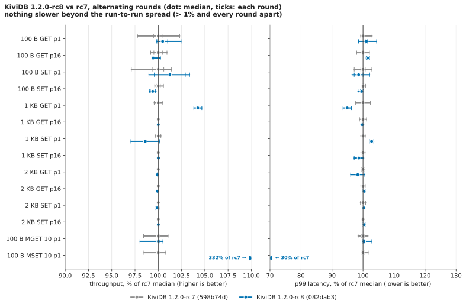

# Core string benchmark, rc8 round: KiviDB 1.2.0-rc8 against rc7

**Result: rc8 passes, and MSET of 10 keys is 3.3× faster.**
- **MSET-10: 172K → 569K commands/s (+232%).** p99 went from 9.63 to 2.89 ms and p99.9 from
  10.72 to 5.31 ms. The server went from 30% busy to 94%, at slightly *less* CPU per command
  (56.5 → 52.7 µs). It holds: all four rc8 rounds were 564K-572K and all four rc7 rounds 169K-173K.
- **The other 13 rows did not regress.** None is slower beyond the run-to-run spread. The two
  closest are 100 B GET p16 and SET p16, both −0.6% with the two builds' rounds overlapping, at
  the same server CPU per request.
- **The published headline numbers still hold.** rc8's 100 B GET p16 is 10.44M (published
  10.45M) and SET p16 8.02M (7.94M). Garnet, Dragonfly and Redis landed within −4% / +6% of
  their published medians.
- **The headline MSET finding changes.** Published: "MSET of 10 keys is KiviDB's clear loss:
  166K against Garnet 761K (4.6×) and Dragonfly 557K (3.4×)". Today rc8 does 569K: level with
  Dragonfly (561K), 4.0× Redis (144K), and 0.71× Garnet (800K). Garnet still leads.

## What ran

| | |
|---|---|
| Cloud | Azure **centralindia** (the assigned region; it accepted every size, no fallback). Server and both load generators in one proximity placement group, accelerated networking. |
| Server | `Standard_D32ps_v5`: 32 vCPU Ampere Altra (Neoverse-N1), 128 GB, Ubuntu 24.04 arm64, kernel 7.0.0-1017-azure |
| Load generators | 2 × `Standard_D16ps_v5`, memtier_benchmark 2.5.2 |
| Harness | the suite's own (`benchmarks/1.2.0/core/harness`), unchanged except that `engine.sh` knows `kividb-rc8` / `kividb-rc7`; driver `harness/run-rc8.sh`; tables and chart `harness/analyze.py` |
| Date | 2026-11-03, 02:47-03:35 UTC |

These are the same VM sizes, CPU and kernel as the published run (eastasia, 2026-11-02); the
region and the machines differ.

**Builds.** Both were built on the server one after the other, the way the published run built
75482abb (`fetch-kividb.sh`: `cargo build --release`, `RUSTFLAGS="-C target-feature=+lse"`, as
`release.yml` builds arm64). Both are the default variant (no features), built with
**rustc 1.99.1 (58cf8f9c3 2026-10-13)**, the toolchain of the published run.

| build | source | `--version` | SHA-256 |
|---|---|---|---|
| rc8 | `082dab3d8929c180bccf993835e28992ea054fb5` (`release/1.2.0`) | `kividb 1.2.0-rc8` | `ef2208fd547bb06348560dc1f0bce48302debc098e16de58ff37431bbbcf1260` |
| rc7 | tag `v1.2.0-rc7` = `598b74d20ec04de5a0ff74001324907562806c3c` | `kividb 1.2.0-rc7` | `331196d0d415312c790cab3ba29d4f73b917a169dbe1db54931057c40ee3dc3b` |

**Competitors** (setup-server.sh's pinned versions, the README's flags): Garnet v2.2.5 on .NET
10.0.14 (`--index 1g --memory 64g`), Dragonfly v2.0.2 (`--dbfilename "" --logtostderr`), Redis
8.10.3 built from its tag (`--save "" --appendonly no --protected-mode no --io-threads 24`).

**Rounds.** The method is the published one: 10M keys loaded before each value size, 20 s per
scenario after a 5 s warm-up, two load generators at once, latency from their merged histograms.
- Rounds 1-2, the full suite. Round 1 ran rc8 then rc7; round 2 ran rc7 then rc8 (02:47-03:15).
- One competitor round: Garnet, Dragonfly, Redis. 100 B only: GET p16, SET p16, then MGET and
  MSET of 10 keys (03:15-03:21).
- Rounds 3-4, 100 B block only (03:21-03:35). After two rounds, 100 B GET p16 was −0.8%, with
  every rc8 round at or below rc7's lower round. That was under the 1% floor, but rows that
  looked slower got extra rounds in the published run too. Round 3 ran rc8 first, round 4 rc7
  first.
- So the 100 B rows (and MGET/MSET) have 4 rounds per build, and the 1 KB and 2 KB rows 2.

## rc8 against rc7

Median [min - max] of the rounds. **C** = the load generators were the limit (>90% CPU), **N** =
the server NIC was (>85% of 2 GB/s). The verdict is *slower* only if every rc8 round is below every
rc7 round **and** the medians differ by more than 1%. The published six-round session's
rows spread ±0.5-1%, and with 2-4 rounds two builds can sit apart by chance at 0.1%.

| Scenario | rc7 | rc8 | Change | Spread rc7 / rc8 | Verdict | p99 ms rc7 → rc8 | p99.9 ms rc7 → rc8 | server µs/req rc7 → rc8 |
|---|---:|---:|---:|---:|---|---:|---:|---:|
| 100 B GET p1 | 1.64M [1.61M - 1.68M] C | 1.65M [1.64M - 1.68M] C | +0.5% | ±2.2% / ±1.3% | pass (level, clients) | 1.09 → 1.11 | 2.07 → 2.08 | 18.45 → 18.32 |
| 100 B GET p16 | 10.50M [10.41M - 10.60M] | 10.44M [10.43M - 10.52M] | −0.6% | ±0.8% / ±0.5% | pass (level) | 0.78 → 0.80 | 1.28 → 1.31 | 2.87 → 2.88 |
| 100 B SET p1 | 1.61M [1.56M - 1.63M] C | 1.63M [1.59M - 1.66M] C | +1.2% | ±2.1% / ±2.1% | pass (level, clients) | 1.13 → 1.11 | 2.28 → 2.10 | 18.81 → 18.59 |
| 100 B SET p16 | 8.07M [8.04M - 8.11M] | 8.02M [7.99M - 8.05M] | −0.6% | ±0.5% / ±0.3% | pass (level) | 0.99 → 0.99 | 1.32 → 1.29 | 3.50 → 3.53 |
| 1 KB GET p1 | 1.50M [1.50M - 1.51M] C | 1.57M [1.56M - 1.57M] C N | +4.3% | ±0.5% / ±0.4% | pass (faster, see below) | 1.18 → 1.12 | 2.49 → 2.19 | 20.15 → 19.33 |
| 1 KB GET p16 | 1.87M N | 1.87M N | 0.0% | ±0.1% / ±0.1% | pass (NIC) | 7.09 → 7.07 | 7.90 → 7.79 | 8.27 → 8.45 |
| 1 KB SET p1 | 1.53M [1.53M - 1.54M] C N | 1.51M [1.49M - 1.54M] C | −1.4% | ±0.3% / ±1.6% | pass (level, clients) | 1.16 → 1.19 | 2.42 → 2.40 | 19.74 → 20.02 |
| 1 KB SET p16 | 2.80M N | 2.80M N | 0.0% | ±0.1% / ±0.1% | pass (NIC) | 7.28 → 7.18 | 7.78 → 7.65 | 6.92 → 6.67 |
| 2 KB GET p1 | 919K N | 918K N | −0.1% | ±0.0% / ±0.0% | pass (NIC) | 2.81 → 2.77 | 4.24 → 4.38 | 27.70 → 27.91 |
| 2 KB GET p16 | 938K N | 937K N | −0.1% | ±0.1% / ±0.1% | pass (NIC) | 9.21 → 9.25 | 9.92 → 9.95 | 14.53 → 14.68 |
| 2 KB SET p1 | 1.24M C N | 1.23M C N | −0.1% | ±0.0% / ±0.2% | pass (NIC) | 1.45 → 1.46 | 2.97 → 3.02 | 24.53 → 24.55 |
| 2 KB SET p16 | 1.43M N | 1.43M N | 0.0% | ±0.0% / ±0.1% | pass (NIC) | 9.15 → 9.18 | 10.18 → 10.02 | 9.54 → 9.42 |
| 100 B MGET 10 p1 | 1.14M [1.12M - 1.15M] C | 1.14M [1.11M - 1.14M] C | 0.0% | ±1.3% / ±1.2% | pass (level, clients) | 1.50 → 1.51 | 3.82 → 3.90 | 26.61 → 26.62 |
| 100 B MSET 10 p1 | 172K [169K - 173K] | **569K [564K - 572K]** | **+231.6%** | ±1.1% / ±0.7% | **faster** | 9.63 → **2.89** | 10.72 → **5.31** | 56.46 → 52.66 |

Notes on the rows:
- **100 B GET p16 and SET p16** were the only rows below rc7 in all of the first rounds. With four
  rounds each, rc8's best GET round (10.52M) beats rc7's worst (10.41M), and rc8's best SET round
  (8.05M) beats rc7's worst (8.04M).
  - Server CPU per request is the same: GET 2.87 → 2.88 µs, SET 3.50 → 3.53 µs.
  - So are latency and the load generators' CPU.
  - Callgrind counts the same instructions per command: GET-100 3338 → 3342, SET-100 4268 → 4270 ([../profiling/](../profiling/README.md)).
  - rc8 changes no code on the GET or SET path.
  - Both rows are inside the spread, the same as the published 1.2.0-vs-rc4 check (−0.2% / −0.4%).
- **1 KB GET p1 +4.3%** is formally "faster", but it is not a code change.
  - rc8 changes nothing on GET.
  - It is a pipeline-1 row where the load generators are the limit (95% CPU), and rc8's rounds
    also hit the NIC flag.
  - It has only two rounds per build, and the other pipeline-1 rows swing ±2% from round to round.
  - Read it as noise in a client-bound row.
- **Side rows** (GET at depths 1, 4 and 64 with 300 connections, 4 rounds each) are level:
  +0.2%, +0.1% and +0.2% (`results/summary.csv`).

### MSET of 10 keys, round by round

| Build | round | commands/s | p50 / p99 / p99.9 ms | server CPU busy | server µs/cmd (user + kernel) | load generators busy |
|---|---|---:|---:|---:|---:|---:|
| rc7 | 1 | 173K | 6.94 / 9.60 / 10.75 | 30.3% | 56.01 (17.56 + 38.45) | 25.8% |
| rc7 | 2 | 169K | 7.10 / 9.79 / 11.07 | 30.3% | 57.34 (17.79 + 39.55) | 25.0% |
| rc7 | 3 | 172K | 7.01 / 9.66 / 10.69 | 30.3% | 56.43 (17.69 + 38.74) | 25.6% |
| rc7 | 4 | 172K | 7.01 / 9.60 / 10.56 | 30.3% | 56.49 (17.90 + 38.60) | 25.7% |
| rc8 | 1 | 564K | 2.13 / 2.91 / 5.41 | 93.7% | 53.12 (37.53 + 15.59) | 63.9% |
| rc8 | 2 | 569K | 2.11 / 2.88 / 5.21 | 93.6% | 52.61 (36.59 + 16.02) | 65.8% |
| rc8 | 3 | 572K | 2.10 / 2.90 / 5.41 | 93.6% | 52.38 (36.71 + 15.73) | 65.2% |
| rc8 | 4 | 569K | 2.11 / 2.88 / 5.18 | 93.8% | 52.71 (36.92 + 15.79) | 63.9% |

- **rc7 waits.** The server is 70% idle: MSETs queue for shards that other MSETs hold.
- **rc8 works.** The server is 94% busy and the load generators are not the limit (64-66%).
- **CPU per command fell a little** (56.5 → 52.7 µs).
  - Its split flipped: user time rose 17.7 → 36.8 µs and kernel time fell 38.7 → 15.8 µs.
  - That is consistent with the change: a short spin on a busy shard instead of sleeping and
    being woken, and no waiting for one shard while holding another.
- **It holds.** The rounds spread ±0.7%, and the 3.3× is far outside any noise.
- **Against the figure given for the fix** (~170K → ~579K on the same shapes): this run measured
  172K → 569K.

## rc8 against the published 1.2.0 numbers (indicative only)

The published numbers are 75482abb, rc7's code: six rounds, eastasia, 2026-11-02, other machines.

| Scenario | published 75482ab | rc8 today | Change | p99 ms published → today |
|---|---:|---:|---:|---:|
| 100 B GET p1 | 1.73M C | 1.65M C | −4.9% | 1.03 → 1.11 |
| 100 B GET p16 | 10.45M | 10.44M | −0.0% | 0.78 → 0.80 |
| 100 B SET p1 | 1.70M C | 1.63M C | −3.9% | 1.06 → 1.11 |
| 100 B SET p16 | 7.94M | 8.02M | +1.0% | 0.99 → 0.99 |
| 1 KB GET p1 | 1.63M C N | 1.57M C N | −3.6% | 1.08 → 1.12 |
| 1 KB GET p16 | 1.87M N | 1.87M N | +0.0% | 7.09 → 7.07 |
| 1 KB SET p1 | 1.61M C N | 1.51M C | −6.0% | 1.12 → 1.19 |
| 1 KB SET p16 | 2.80M N | 2.80M N | −0.0% | 7.28 → 7.18 |
| 2 KB GET p1 | 920K N | 918K N | −0.2% | 3.04 → 2.77 |
| 2 KB GET p16 | 938K N | 937K N | −0.0% | 9.21 → 9.25 |
| 2 KB SET p1 | 1.24M C N | 1.23M C N | −0.7% | 1.43 → 1.46 |
| 2 KB SET p16 | 1.43M N | 1.43M N | +0.0% | 9.18 → 9.18 |
| 100 B MGET 10 p1 | 1.16M C | 1.14M C | −1.6% | 1.46 → 1.51 |
| 100 B MSET 10 p1 | 166K | 569K | +243.8% | 9.95 → 2.89 |

- **The pipelined and NIC-bound rows match the published numbers to within 1%.**
- **The pipeline-1 rows are 4-6% lower today for rc7 too**, so it is the session, not rc8.
  - rc7 today: 100 B GET p1 1.64M, SET p1 1.61M, 1 KB GET p1 1.50M.
  - These rows are limited by the load generators, which are new machines in another region.

## Competitors (one round each) against their published medians

| Engine | Scenario | published | today | Change | p99 ms published → today | rc8 today | rc8 / engine |
|---|---|---:|---:|---:|---:|---:|---:|
| Garnet 2.2.5 | 100 B GET p16 | 10.69M C | 10.98M C | +2.7% | 1.72 → 1.32 | 10.44M | 0.95× |
| Garnet 2.2.5 | 100 B SET p16 | 9.83M | 9.75M | −0.8% | 2.40 → 2.40 | 8.02M | 0.82× |
| Garnet 2.2.5 | 100 B MSET 10 p1 | 761K | 800K | +5.2% | 7.42 → 7.90 | 569K | 0.71× |
| Dragonfly 2.0.2 | 100 B GET p16 | 5.66M | 5.74M | +1.4% | 1.33 → 1.34 | 10.44M | 1.82× |
| Dragonfly 2.0.2 | 100 B SET p16 | 4.87M | 4.95M | +1.6% | 1.69 → 1.58 | 8.02M | 1.62× |
| Dragonfly 2.0.2 | 100 B MSET 10 p1 | 557K | 561K | +0.7% | 4.48 → 4.38 | 569K | 1.02× |
| Redis 8.10.3, io-threads 24 | 100 B GET p16 | 1.41M | 1.40M | −1.0% | 4.00 → 4.01 | 10.44M | 7.46× |
| Redis 8.10.3, io-threads 24 | 100 B SET p16 | 1.25M | 1.23M | −1.7% | 4.42 → 4.51 | 8.02M | 6.54× |
| Redis 8.10.3, io-threads 24 | 100 B MSET 10 p1 | 150K | 144K | −4.2% | 8.77 → 9.54 | 569K | 3.96× |

MGET-10 ran too: Garnet 832K (published 788K), Dragonfly 618K (640K), Redis 135K (136K).

**Every competitor is within −4% / +6% of its published median, so the published headline
comparisons hold:**
- GET p16: KiviDB and Garnet are close (Garnet +5% today, +2% published, both client-bound).
- SET p16: Garnet leads by 22% today (24% published).
- Dragonfly is at 55-62% of KiviDB on GET p16 and SET p16.
- KiviDB is 6.5-7.5× Redis with io-threads.

**The MSET rows change with rc8.** "KiviDB's clear loss" becomes:
- level with Dragonfly (569K against 561K, with a lower p99: 2.89 against 4.38 ms);
- 0.71× Garnet (800K), with a much lower tail: p99 2.89 against 7.90 ms, p99.9 5.31 against
  12.54 ms (Garnet's p50 is lower, 0.88 against 2.11 ms);
- 4.0× Redis.

## What differs from the published run

- **Region and machines.** centralindia instead of eastasia; same VM sizes, CPU and kernel.
- **Rounds.**
  - 4 rounds per build at 100 B (incl. MGET/MSET and the depth sweep) and 2 at 1 KB / 2 KB, against 6 published.
  - The competitors had 1 round, against 3 published.
  - Redis Cluster, Valkey and KiviDB 1.1.3 were not run (not in the asked rows).
- **Rounds 3-4 cover 100 B only.** They were added to settle the GET p16 row (see above).
- **Round order alternates.** Round 2 and round 4 ran rc7 first.
- **The verdict has a 1% floor** in addition to "all rounds apart". Both criteria are in
  `harness/analyze.py`, and with the floor removed the only changes are the NIC-bound 2 KB GET
  rows (−0.1%), which would read "slower" from rounds that differ by 1K ops/s.

## Files

- `results/summary.csv`, `results/runs.csv`: medians and per-round rows (summarize.py, merged
  histograms), for rc8, rc7 and the competitors.
- `results/tables.md`: the tables as `harness/analyze.py` printed them.
- `results/builds.txt`: build commands, versions and SHA-256s; `results/launch.log`: every
  engine start with its command line; `results/suite.log`: the driver's log.
- `results/<engine>/r<round>/d<size>/`: raw memtier output (`*.json` with the compressed
  latency histograms, `*.txt`), CPU and NIC samples (`*.cpu`), `memory.txt` per load. Private
  addresses are replaced by `SERVER` / `CL1` / `CL2`.
- `charts/regression-rc7-vs-rc8.svg`.
- `harness/`: `create.sh` (the VMs), `engine.sh` (the suite's, with the two engine names
  added), `run-rc8.sh` (the driver), `analyze.py` (tables and chart).
- `NOTES.md`: the progress log.
