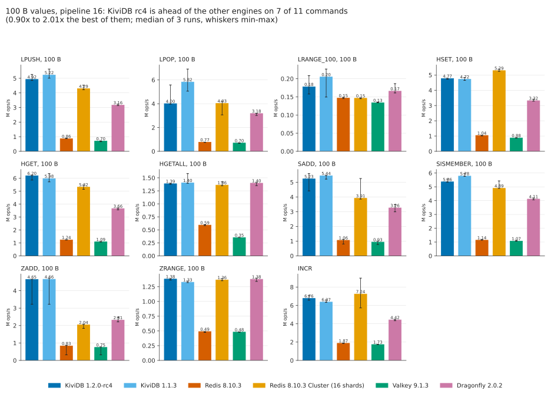
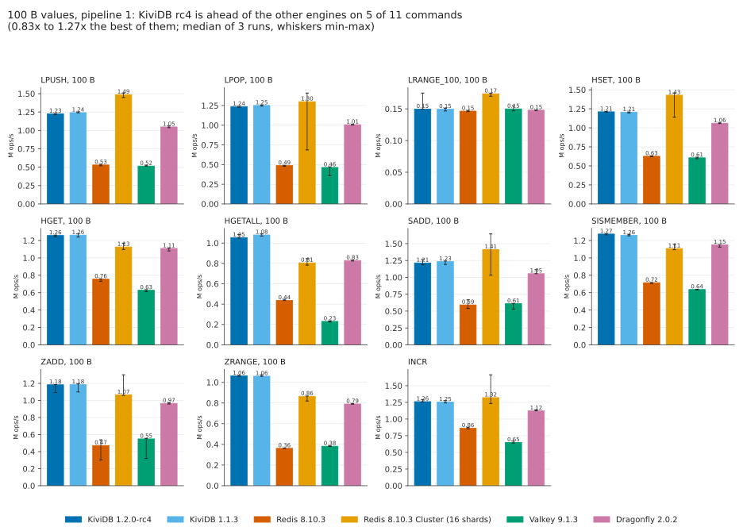
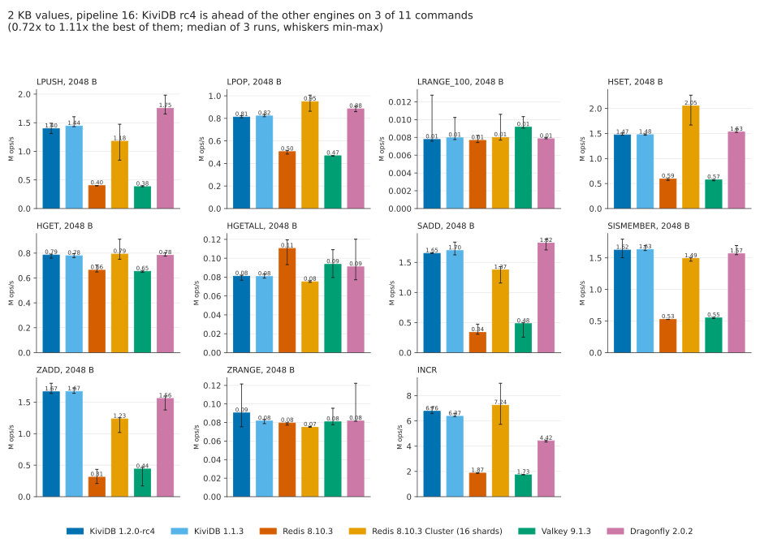
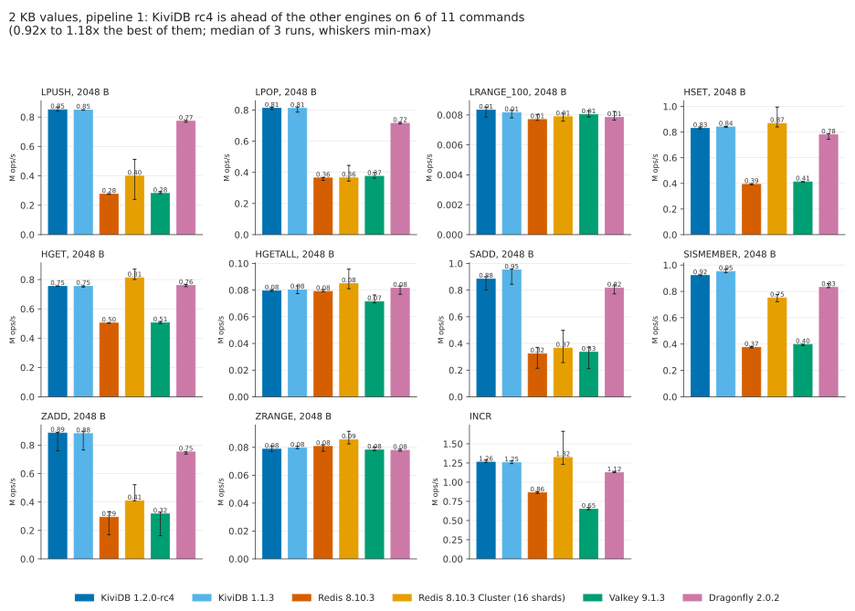
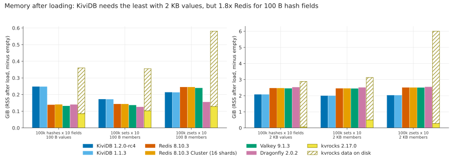
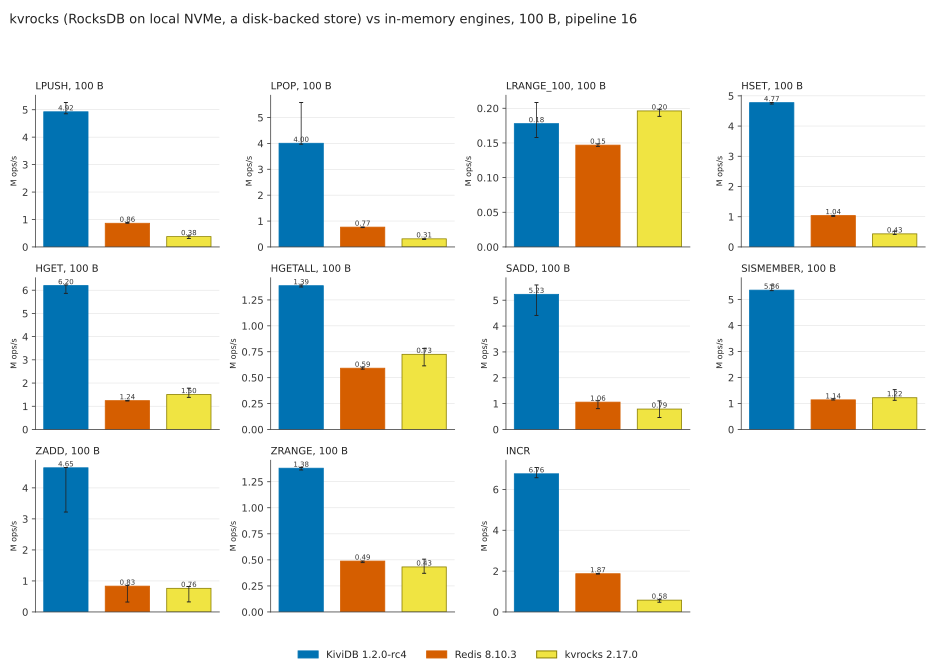

# Data types at 100 B and 2 KB: lists, hashes, sets, sorted sets, counters

Asked on Hacker News ([Show HN: KiviDB](https://news.ycombinator.com/item?id=50152541)):

> **edoceo:** Could you add Valkey to the benchmark? Curious about different key-types too, like list and hash.
> Also, big values (2KB) and small values (<256B)
>
> **syepes:** How does this compare and benchmark with https://github.com/apache/kvrocks

This suite measures eleven commands on five data types, with 100-byte and 2-KB values, at pipeline 1
and 16, against KiviDB 1.2.0-rc4, KiviDB 1.1.3, Redis 8.10.3 (io-threads), Redis 8.10.3 Cluster
(16 shards), Valkey 9.1.3 (io-threads) and Dragonfly 2.0.2. Apache kvrocks 2.17.0 is in a separate
table: it keeps its data in RocksDB on disk, so it is a different class of store, and the comparison
says how far apart the classes are, not which is "better".

**Short version.**

- **100-byte values, pipeline 16:** KiviDB 1.2.0-rc4 ran every list, hash, set, sorted-set and
  counter command at 4.0-6.8M ops/s, 3.6-5.7x Redis 8.10.3 (io-threads 8), 3.9-7.0x Valkey 9.1.3
  (io-threads 6) and 1.26-2.0x Dragonfly 2.0.2, with p99 of 0.53-0.75 ms. Redis Cluster with 16
  shards came within 15% on most rows and was ahead on HSET and INCR, with the client saturated.
- **2 KB values:** the network decides. Every fast engine fills the server's 12.5 Gbit/s egress on
  reads; on writes, measured for 20 s, KiviDB and Dragonfly tie (1.37M HSETs a second, 2.8 GB/s in)
  at 2.5x Redis and Valkey.
- **Pipeline 1, 100 B:** KiviDB answered fastest (p50 0.41 ms) and served 1.05-1.27M ops/s on every
  command, ahead of every single-endpoint engine (LRANGE_100, capped by the network, is a tie).
- **Where KiviDB loses:** memory for small hash fields (1.8x Redis for 100-byte fields; it uses the
  least of all at 2 KB); p99 on the network-capped HGETALL/ZRANGE rows; and a **tail-latency stall
  on LPOP** at pipeline 16 (p99.9 up to 77 ms, worst request 155 ms) that 1.1.3 has too.
- **kvrocks** (disk-backed) wrote at a tenth of KiviDB's rate, read from its cache at about Redis's
  rate, and held a fraction of the memory.
- **rc4 against 1.1.3:** the same within noise, except SISMEMBER at pipeline 16 and SADD at 2 KB,
  pipeline 1 (-7% each).

## Hardware and placement

| | server | client |
|---|---|---|
| VM | Azure `Standard_D16ds_v5` | Azure `Standard_D48s_v5` |
| CPU | 16 vCPU (8 cores x 2 threads), Intel Xeon Platinum 8370C 2.8 GHz | 48 vCPU, same CPU |
| memory | 64 GB | 192 GB |
| disk | 600 GB local NVMe temp disk (kvrocks' data directory) | - |
| OS | Ubuntu 24.04.5, kernel 7.0.0-1017-azure | same |
| network | accelerated networking; Azure caps a D16ds_v5's **egress** at 12.5 Gbit/s | 24 Gbit/s egress |

Region koreacentral, availability zone 1, both VMs in one proximity placement group and one VNet.
One engine runs on the server at a time, alone, on all 16 vCPUs; nothing else runs there (Docker
is installed for the engines that ship as images, which also means netfilter conntrack is active
for every engine alike). The client is three times the server's size so that it is not the limit:
memtier_benchmark reports its own threads' CPU, and the busiest single-endpoint run used 56% of them (see
`client_cpu_pct_max` in `results/summary.csv`).

## Engines and flags

| engine | version | how it ran | flags |
|---|---|---|---|
| KiviDB | 1.2.0-rc4 (`a6b1bf38`) | release binary `kividb-linux-x86_64` from the release workflow of the tag | defaults (14 worker threads = vCPUs - 2, io_uring), `--protected-mode no`, `save ""` |
| KiviDB | 1.1.3 | release binary from the GitHub release | same |
| Redis | 8.10.3 | built from source (`make`, jemalloc) | `--io-threads 8 --save "" --appendonly no` |
| Redis Cluster | 8.10.3 | 16 primaries, one per vCPU, each pinned with `taskset`, no replicas | `--cluster-enabled yes --save "" --appendonly no`, no io-threads |
| Valkey | 9.1.3 | `valkey/valkey:9.1.3`, host network | `--io-threads 6 --save "" --appendonly no` |
| Dragonfly | 2.0.2 | `docker.dragonflydb.io/dragonflydb/dragonfly:v2.0.2`, host network | `--proactor_threads 16 --maxmemory 48gb --dbfilename ""` |
| kvrocks | 2.17.0 | `apache/kvrocks:2.17.0`, host network, data on the local NVMe | the image's `kvrocks.conf` (4 GB block cache, snappy) plus `--workers 16` |

**io-threads.** Redis's and Valkey's own guidance is to leave a core or two to the main thread and
to measure. `harness/iothreads-sweep.sh` ran HGET, HGETALL and HSET at 100 B, pipeline 1 and 16,
with 4, 6, 8 and 12 I/O threads ([results](results/iothreads-sweep.csv)). Redis was best overall with 8
(the best at pipeline 1, within 8% of the best at pipeline 16); Valkey with 6 (with 8 or 12, its HGETALL at
pipeline 16 fell to half). The matrix uses those.

## Workload

Every engine gets the same keys, the same values and the same number of requests. Each value size
and data type starts from an empty database (`FLUSHALL`), loads its keys, and then runs, per
command and pipeline depth, one warm-up run (a quarter of the requests, not recorded) and three
measured runs. Keys are drawn uniformly at random from the group's range, and every connection has
its own random sequence (`--distinct-client-seed`).

| group | keys | loaded with | commands measured |
|---|---|---|---|
| hash | `h:1..100000` | 10 fields `f0..f9`, V bytes each | `HGET k f5`, `HGETALL k` (10 fields), `HSET k f0 <V bytes>` (overwrites a field) |
| set | `s:1..100000` | 1 known member + 9 random members, V bytes each | `SISMEMBER k <known member>` (always a hit), `SADD k <new random member>` |
| zset | `z:1..100000` | 10 random members, V bytes each | `ZRANGE k 0 9 WITHSCORES`, `ZADD k 1 <new random member>` |
| list | `l:1..10000` | at least 100 elements of V bytes | `LRANGE k 0 99` |
| | `q:1..10000` | empty | `LPUSH k <V bytes>`, then `LPOP k` (3/4 as many pops as pushes, so lists never run dry) |
| counter | `c:1..1000000` | created by the warm-up | `INCR k` (value size does not apply: run once) |

V is 100 bytes or 2048 bytes. SADD and ZADD insert a new random member every time (memtier
`--random-data` changes the value on every request), so those sets grow during the three runs,
and later runs are a little slower than the first: their spread is wider than the read rows'.
That is the same for every engine.

Connections: 32 memtier threads with 16 connections each (512) at pipeline 1, and 32 x 4 (128,
so 2,048 requests in flight) at pipeline 16. In cluster mode memtier opens those per shard.

Requests per measured run (kvrocks gets a quarter of each, being about ten times slower; its
rates are still per second):

| | pipeline 1 | pipeline 16 |
|---|---|---|
| 100 B: HGET, HSET, SISMEMBER, INCR | 6M | 24M |
| 100 B: SADD, ZADD, LPUSH / LPOP | 6M / 4.5M | 16M / 12M |
| 100 B: HGETALL, ZRANGE | 2M, 3M | 4M, 6M |
| 100 B: LRANGE_100 | 400k | 400k |
| 2 KB: HGET, HSET, SISMEMBER | 3M | 3M |
| 2 KB: SADD, ZADD, LPUSH / LPOP | 1.5M / 1.125M | 1.5M / 1.125M |
| 2 KB: HGETALL, ZRANGE | 300k | 300k |
| 2 KB: LRANGE_100 | 30k | 30k |

Latency is memtier's: from sending a request to reading its reply, per request, for every request
of the run (p50, p99 and p99.9 of the HDR histogram). At pipeline 16 it includes the time a request
waits behind the 15 before it.

## Results

Each chart has one panel per command (its own y scale); bars are the median of three runs and the
whiskers the min and max. The tables below them have every number, with p50 / p99 / p99.9.









p99 latency: [100 B p16](charts/p99-100B-p16.svg), [100 B p1](charts/p99-100B-p1.svg),
[2 KB p16](charts/p99-2048B-p16.svg), [2 KB p1](charts/p99-2048B-p1.svg).



### Tables

#### 100 B values, pipeline 1

ops/s: median of 3 runs (spread = (max-min)/median). Latency: p50 / p99 / p99.9 in ms. `*` = best ops/s in the row.

| command | KiviDB rc4 | KiviDB 1.1.3 | Redis 8.10.3 | Redis Cluster x16 | Valkey 9.1.3 | Dragonfly 2.0.2 |
|---|---|---|---|---|---|---|
| LPUSH | 1.23M (1.1%)<br>0.41 / 0.68 / 1.63 | 1.24M (0.9%)<br>0.41 / 0.68 / 1.76 | 531k (3.6%)<br>0.96 / 1.57 / 3.12 | *1.49M* (4.1%)<br>0.49 / 2.96 / 4.48 | 515k (2.4%)<br>0.98 / 1.39 / 3.10 | 1.05M (2.3%)<br>0.48 / 0.85 / 4.61 |
| LPOP | 1.24M (0.8%)<br>0.41 / 0.67 / 1.83 | 1.25M (1.2%)<br>0.41 / 0.68 / 2.01 | 487k (2.6%)<br>1.05 / 1.61 / 3.31 | *1.30M* (55.6%)<br>0.44 / 1.85 / 3.04 | 464k (24.5%)<br>1.09 / 1.70 / 3.34 | 1.01M (0.7%)<br>0.51 / 0.79 / 2.03 |
| LRANGE_100 | 150k (16.9%)<br>0.95 / 9.15 / 11.13 | 150k (2.9%)<br>0.94 / 9.15 / 11.01 | 146k (1.2%)<br>3.28 / 7.33 / 8.26 | *174k* (2.6%)<br>8.51 / 20.48 / 229.38 | 150k (5.2%)<br>2.98 / 7.52 / 8.32 | 148k (0.4%)<br>1.73 / 8.64 / 10.49 |
| HSET | 1.21M (0.5%)<br>0.42 / 0.69 / 1.57 | 1.21M (1.0%)<br>0.41 / 0.69 / 1.93 | 627k (1.8%)<br>0.81 / 1.46 / 2.94 | *1.43M* (22.2%)<br>0.57 / 2.56 / 3.84 | 606k (3.1%)<br>0.83 / 1.22 / 3.09 | 1.06M (0.9%)<br>0.49 / 0.74 / 2.03 |
| HGET | 1.26M (1.3%)<br>0.41 / 0.67 / 1.67 | *1.26M* (2.8%)<br>0.41 / 0.67 / 2.00 | 756k (3.7%)<br>0.66 / 1.26 / 2.46 | 1.13M (6.4%)<br>0.41 / 6.82 / 10.62 | 628k (3.6%)<br>0.79 / 1.29 / 2.73 | 1.11M (3.0%)<br>0.46 / 0.73 / 2.13 |
| HGETALL | 1.05M (3.3%)<br>0.47 / 0.78 / 1.92 | *1.08M* (1.9%)<br>0.47 / 0.78 / 1.83 | 437k (2.5%)<br>1.16 / 1.67 / 3.74 | 805k (7.9%)<br>0.45 / 7.74 / 12.03 | 230k (3.9%)<br>2.16 / 2.86 / 4.77 | 828k (0.8%)<br>0.61 / 0.94 / 2.30 |
| SADD | 1.21M (6.4%)<br>0.41 / 0.67 / 1.61 | 1.23M (4.1%)<br>0.41 / 0.67 / 2.10 | 592k (21.4%)<br>0.85 / 1.50 / 2.67 | *1.41M* (43.3%)<br>0.53 / 2.69 / 4.16 | 611k (13.8%)<br>0.82 / 1.42 / 2.62 | 1.05M (5.6%)<br>0.46 / 0.75 / 1.94 |
| SISMEMBER | *1.27M* (0.9%)<br>0.41 / 0.66 / 1.81 | 1.26M (1.1%)<br>0.41 / 0.67 / 1.57 | 715k (1.3%)<br>0.70 / 1.32 / 2.61 | 1.11M (5.6%)<br>0.41 / 7.17 / 11.20 | 636k (0.8%)<br>0.80 / 1.14 / 2.62 | 1.15M (2.3%)<br>0.44 / 0.70 / 1.70 |
| ZADD | 1.18M (7.9%)<br>0.42 / 0.69 / 1.70 | *1.18M* (8.0%)<br>0.42 / 0.70 / 1.81 | 472k (50.2%)<br>1.09 / 1.58 / 3.10 | 1.07M (22.6%)<br>0.69 / 7.42 / 10.69 | 549k (42.8%)<br>0.91 / 1.31 / 3.10 | 965k (1.3%)<br>0.54 / 0.81 / 2.19 |
| ZRANGE | *1.06M* (0.9%)<br>0.48 / 0.76 / 1.86 | 1.06M (1.4%)<br>0.47 / 0.78 / 2.24 | 362k (0.5%)<br>1.40 / 1.84 / 3.68 | 865k (5.5%)<br>0.47 / 7.90 / 12.48 | 382k (1.5%)<br>1.33 / 1.70 / 3.26 | 791k (0.8%)<br>0.65 / 0.97 / 2.83 |
| INCR | 1.26M (2.8%)<br>0.41 / 0.67 / 1.94 | 1.25M (2.8%)<br>0.41 / 0.66 / 1.70 | 862k (2.7%)<br>0.57 / 1.13 / 2.38 | *1.32M* (32.5%)<br>0.55 / 2.35 / 3.25 | 649k (4.4%)<br>0.78 / 1.16 / 2.86 | 1.12M (1.3%)<br>0.45 / 0.73 / 2.46 |

#### 100 B values, pipeline 16

ops/s: median of 3 runs (spread = (max-min)/median). Latency: p50 / p99 / p99.9 in ms. `*` = best ops/s in the row.

| command | KiviDB rc4 | KiviDB 1.1.3 | Redis 8.10.3 | Redis Cluster x16 | Valkey 9.1.3 | Dragonfly 2.0.2 |
|---|---|---|---|---|---|---|
| LPUSH | 4.92M (8.3%)<br>0.41 / 0.75 / 1.39 | *5.22M* (11.9%)<br>0.38 / 0.73 / 1.81 | 864k (3.5%)<br>2.35 / 4.58 / 5.47 | 4.29M (7.2%)<br>4.03 / 10.81 / 13.44 | 701k (7.8%)<br>2.91 / 3.33 / 4.83 | 3.16M (3.1%)<br>0.63 / 1.30 / 2.40 |
| LPOP | 4.00M (40.2%)<br>0.33 / 0.68 / 46.08 | *5.82M* (31.9%)<br>0.30 / 0.58 / 16.19 | 765k (2.4%)<br>2.64 / 3.66 / 5.95 | 4.03M (28.3%)<br>4.96 / 10.81 / 13.57 | 698k (4.9%)<br>2.90 / 3.76 / 4.58 | 3.18M (5.5%)<br>0.66 / 1.05 / 1.95 |
| LRANGE_100 | 178k (28.4%)<br>10.30 / 40.19 / 60.16 | *205k* (37.7%)<br>10.24 / 40.19 / 60.93 | 147k (2.4%)<br>13.44 / 29.44 / 40.19 | 146k (1.7%)<br>50.69 / 442.37 / 630.78 | 134k (1.2%)<br>15.17 / 22.53 / 27.65 | 166k (15.5%)<br>10.30 / 39.68 / 59.39 |
| HSET | 4.77M (1.1%)<br>0.41 / 0.73 / 1.56 | 4.72M (4.1%)<br>0.41 / 0.69 / 1.29 | 1.04M (3.3%)<br>1.95 / 3.79 / 4.70 | *5.29M* (2.8%)<br>3.79 / 8.57 / 10.81 | 876k (2.7%)<br>2.33 / 2.62 / 4.70 | 3.32M (3.8%)<br>0.60 / 0.97 / 1.76 |
| HGET | *6.20M* (5.8%)<br>0.34 / 0.58 / 0.97 | 5.98M (10.7%)<br>0.32 / 0.57 / 1.14 | 1.24M (1.5%)<br>1.63 / 2.48 / 3.90 | 5.32M (6.2%)<br>4.42 / 8.10 / 9.41 | 1.09M (3.8%)<br>1.87 / 2.21 / 3.58 | 3.66M (3.8%)<br>0.55 / 0.85 / 1.98 |
| HGETALL | 1.39M (1.4%)<br>0.75 / 6.46 / 7.01 | *1.40M* (13.2%)<br>0.72 / 6.56 / 7.13 | 591k (3.2%)<br>3.50 / 4.13 / 5.63 | 1.36M (5.5%)<br>10.49 / 39.94 / 73.73 | 352k (0.3%)<br>5.82 / 6.53 / 8.77 | 1.40M (4.2%)<br>1.39 / 3.21 / 3.95 |
| SADD | 5.23M (22.5%)<br>0.38 / 0.66 / 1.25 | *5.44M* (4.6%)<br>0.35 / 0.61 / 1.05 | 1.06M (29.1%)<br>1.91 / 3.73 / 4.64 | 3.91M (35.7%)<br>4.42 / 11.33 / 13.70 | 934k (25.7%)<br>2.06 / 3.31 / 4.51 | 3.26M (15.2%)<br>0.59 / 0.97 / 2.13 |
| SISMEMBER | 5.36M (4.1%)<br>0.34 / 0.60 / 1.02 | *5.78M* (3.5%)<br>0.33 / 0.57 / 0.94 | 1.14M (4.2%)<br>1.78 / 3.47 / 3.94 | 4.89M (11.0%)<br>4.80 / 8.45 / 10.18 | 1.07M (5.4%)<br>1.91 / 2.14 / 4.03 | 4.11M (3.3%)<br>0.49 / 0.90 / 2.14 |
| ZADD | 4.65M (30.9%)<br>0.42 / 0.69 / 1.19 | *4.66M* (32.2%)<br>0.41 / 0.73 / 1.45 | 832k (64.4%)<br>2.40 / 4.74 / 5.70 | 2.04M (11.2%)<br>10.75 / 24.57 / 28.80 | 749k (61.0%)<br>2.64 / 3.66 / 4.80 | 2.31M (11.7%)<br>0.83 / 1.88 / 3.73 |
| ZRANGE | *1.38M* (1.7%)<br>0.77 / 6.40 / 6.91 | 1.33M (2.0%)<br>0.74 / 6.46 / 6.97 | 489k (3.1%)<br>4.45 / 5.31 / 7.13 | 1.36M (2.7%)<br>10.75 / 40.19 / 80.38 | 480k (0.6%)<br>4.25 / 4.83 / 7.17 | 1.38M (4.1%)<br>1.45 / 2.99 / 4.13 |
| INCR | 6.76M (7.4%)<br>0.29 / 0.53 / 1.11 | 6.37M (4.1%)<br>0.29 / 0.55 / 1.03 | 1.87M (1.7%)<br>1.09 / 1.39 / 2.85 | *7.24M* (44.8%)<br>2.65 / 6.27 / 7.58 | 1.73M (1.5%)<br>1.17 / 1.41 / 2.69 | 4.42M (3.3%)<br>0.45 / 0.73 / 2.00 |

#### 2 KB values, pipeline 1

ops/s: median of 3 runs (spread = (max-min)/median). Latency: p50 / p99 / p99.9 in ms. `*` = best ops/s in the row.

| command | KiviDB rc4 | KiviDB 1.1.3 | Redis 8.10.3 | Redis Cluster x16 | Valkey 9.1.3 | Dragonfly 2.0.2 |
|---|---|---|---|---|---|---|
| LPUSH | *850k* (3.3%)<br>0.59 / 1.05 / 2.22 | 848k (0.3%)<br>0.58 / 0.99 / 2.42 | 276k (1.5%)<br>1.85 / 2.35 / 4.58 | 398k (68.5%)<br>0.46 / 2.75 / 4.89 | 280k (5.2%)<br>1.81 / 2.21 / 3.82 | 772k (1.6%)<br>0.65 / 1.38 / 2.35 |
| LPOP | *812k* (1.9%)<br>0.59 / 2.14 / 2.70 | 811k (4.0%)<br>0.58 / 2.21 / 2.94 | 364k (4.9%)<br>1.38 / 2.06 / 3.58 | 365k (27.6%)<br>0.54 / 2.70 / 4.29 | 375k (9.7%)<br>1.36 / 1.98 / 3.54 | 715k (1.4%)<br>0.70 / 1.14 / 2.58 |
| LRANGE_100 | *8k* (8.0%)<br>59.65 / 190.46 / 290.81 | 8k (6.2%)<br>59.39 / 189.44 / 290.81 | 8k (5.1%)<br>59.65 / 182.27 / 311.30 | 8k (6.7%)<br>190.46 / 1064.96 / 1777.66 | 8k (5.1%)<br>50.94 / 201.73 / 339.97 | 8k (7.4%)<br>59.65 / 190.46 / 319.49 |
| HSET | 829k (1.8%)<br>0.60 / 1.01 / 2.17 | 840k (0.7%)<br>0.59 / 1.01 / 2.30 | 392k (2.3%)<br>1.29 / 1.73 / 3.44 | *868k* (17.8%)<br>0.46 / 3.21 / 5.15 | 412k (1.4%)<br>1.22 / 1.69 / 3.36 | 779k (5.5%)<br>0.66 / 1.09 / 2.50 |
| HGET | 754k (0.4%)<br>0.54 / 3.04 / 3.49 | 755k (1.1%)<br>0.54 / 3.06 / 3.42 | 503k (0.5%)<br>1.00 / 1.75 / 3.01 | *812k* (8.7%)<br>0.75 / 9.73 / 14.02 | 505k (2.6%)<br>1.01 / 1.41 / 2.69 | 759k (1.9%)<br>0.61 / 2.22 / 3.23 |
| HGETALL | 80k (1.4%)<br>8.26 / 19.33 / 220.16 | 80k (7.2%)<br>8.26 / 19.33 / 221.18 | 79k (2.1%)<br>7.10 / 18.05 / 220.16 | *85k* (17.3%)<br>11.01 / 229.38 / 309.25 | 71k (8.3%)<br>7.07 / 9.02 / 9.73 | 82k (7.7%)<br>8.45 / 19.33 / 220.16 |
| SADD | 883k (11.2%)<br>0.55 / 0.95 / 2.51 | *952k* (11.9%)<br>0.55 / 0.94 / 1.81 | 323k (48.6%)<br>1.57 / 2.11 / 4.00 | 365k (66.3%)<br>0.48 / 3.55 / 5.95 | 335k (48.2%)<br>1.42 / 2.78 / 4.67 | 817k (8.1%)<br>0.63 / 1.07 / 2.10 |
| SISMEMBER | 920k (0.6%)<br>0.55 / 0.89 / 1.80 | *951k* (2.9%)<br>0.55 / 0.91 / 2.16 | 375k (2.9%)<br>1.35 / 1.80 / 3.68 | 751k (7.2%)<br>0.36 / 9.92 / 17.15 | 397k (2.6%)<br>1.27 / 1.71 / 3.76 | 831k (3.7%)<br>0.61 / 1.03 / 2.16 |
| ZADD | *885k* (14.5%)<br>0.57 / 0.97 / 2.77 | 881k (14.9%)<br>0.57 / 0.97 / 2.48 | 293k (55.0%)<br>1.71 / 2.43 / 4.42 | 409k (27.7%)<br>0.53 / 3.44 / 4.74 | 316k (52.5%)<br>1.57 / 2.16 / 3.62 | 752k (2.1%)<br>0.69 / 1.16 / 2.37 |
| ZRANGE | 79k (4.9%)<br>7.78 / 19.33 / 221.18 | 80k (2.2%)<br>8.32 / 19.33 / 221.18 | 81k (5.6%)<br>7.13 / 17.92 / 220.16 | *85k* (10.6%)<br>10.81 / 229.38 / 311.30 | 78k (3.3%)<br>6.40 / 17.41 / 220.16 | 78k (1.8%)<br>8.32 / 19.20 / 220.16 |

#### 2 KB values, pipeline 16

ops/s: median of 3 runs (spread = (max-min)/median). Latency: p50 / p99 / p99.9 in ms. `*` = best ops/s in the row.

| command | KiviDB rc4 | KiviDB 1.1.3 | Redis 8.10.3 | Redis Cluster x16 | Valkey 9.1.3 | Dragonfly 2.0.2 |
|---|---|---|---|---|---|---|
| LPUSH | 1.40M (12.9%)<br>1.38 / 3.47 / 4.61 | 1.44M (12.0%)<br>1.43 / 3.44 / 4.64 | 401k (1.3%)<br>5.44 / 6.08 / 7.71 | 1.18M (53.3%)<br>5.05 / 19.71 / 27.77 | 383k (4.4%)<br>5.95 / 6.69 / 8.96 | *1.75M* (18.8%)<br>1.05 / 3.29 / 5.63 |
| LPOP | 812k (2.2%)<br>1.20 / 7.97 / 8.57 | 821k (2.6%)<br>1.17 / 8.06 / 8.77 | 505k (6.4%)<br>4.77 / 7.01 / 7.65 | *949k* (15.0%)<br>9.98 / 49.15 / 80.89 | 468k (0.8%)<br>4.29 / 6.11 / 6.43 | 885k (5.5%)<br>1.40 / 7.33 / 9.54 |
| LRANGE_100 | 8k (66.7%)<br>250.88 / 491.52 / 581.63 | 8k (31.2%)<br>250.88 / 491.52 / 589.82 | 8k (10.4%)<br>250.88 / 501.76 / 581.63 | 8k (36.3%)<br>794.62 / 1712.13 / 1982.46 | *9k* (14.0%)<br>241.66 / 522.24 / 663.55 | 8k (1.9%)<br>250.88 / 491.52 / 602.11 |
| HSET | 1.47M (3.0%)<br>0.90 / 5.47 / 6.37 | 1.48M (1.7%)<br>0.90 / 5.47 / 6.33 | 593k (6.1%)<br>3.66 / 4.01 / 6.91 | *2.05M* (29.1%)<br>8.03 / 20.99 / 33.79 | 575k (4.0%)<br>3.95 / 4.51 / 6.88 | 1.53M (4.5%)<br>0.99 / 4.96 / 6.05 |
| HGET | 785k (4.1%)<br>0.79 / 8.77 / 9.66 | 779k (4.0%)<br>0.78 / 8.83 / 9.79 | 663k (8.4%)<br>3.28 / 3.92 / 5.60 | *792k* (20.3%)<br>10.88 / 80.89 / 219.13 | 654k (1.7%)<br>3.13 / 3.66 / 6.30 | 783k (3.7%)<br>1.12 / 7.97 / 8.70 |
| HGETALL | 81k (6.6%)<br>20.35 / 79.36 / 110.59 | 81k (5.6%)<br>20.48 / 79.87 / 110.59 | *110k* (23.8%)<br>20.09 / 79.87 / 119.81 | 75k (2.2%)<br>119.81 / 774.14 / 991.23 | 94k (31.4%)<br>20.61 / 79.36 / 110.59 | 91k (47.3%)<br>20.35 / 79.36 / 110.59 |
| SADD | 1.65M (0.7%)<br>0.67 / 6.50 / 6.94 | 1.70M (12.5%)<br>0.63 / 6.69 / 7.36 | 336k (49.6%)<br>6.27 / 7.71 / 9.41 | 1.37M (19.8%)<br>6.43 / 23.81 / 48.38 | 482k (49.7%)<br>4.51 / 7.04 / 8.89 | *1.82M* (9.7%)<br>0.88 / 4.83 / 5.66 |
| SISMEMBER | 1.62M (18.1%)<br>0.61 / 6.82 / 7.55 | *1.63M* (4.7%)<br>0.61 / 6.91 / 7.93 | 526k (0.4%)<br>4.09 / 4.45 / 6.97 | 1.49M (3.8%)<br>10.24 / 40.45 / 61.44 | 550k (3.1%)<br>4.13 / 4.86 / 7.13 | 1.57M (9.3%)<br>0.91 / 5.21 / 6.24 |
| ZADD | 1.67M (9.7%)<br>0.71 / 6.24 / 6.82 | *1.67M* (5.1%)<br>0.71 / 6.11 / 6.72 | 310k (72.4%)<br>6.88 / 9.02 / 10.88 | 1.23M (18.8%)<br>9.66 / 27.26 / 59.65 | 439k (66.7%)<br>5.02 / 6.17 / 8.19 | 1.56M (14.2%)<br>1.22 / 2.99 / 4.64 |
| ZRANGE | *90k* (51.1%)<br>20.48 / 79.36 / 109.57 | 82k (5.4%)<br>20.48 / 79.36 / 110.08 | 79k (3.1%)<br>20.35 / 79.36 / 110.59 | 75k (1.1%)<br>111.10 / 774.14 / 991.23 | 81k (22.1%)<br>20.86 / 71.17 / 100.35 | 82k (50.1%)<br>20.22 / 79.36 / 111.10 |

## Findings

**100-byte values, pipeline 16 (the server is the limit).** KiviDB rc4 runs the list, hash, set,
sorted-set and counter commands at 4.0-6.8M ops/s: 3.6-5.7x Redis 8.10.3 with 8 I/O threads, 3.9-7.0x
Valkey 9.1.3 with 6, and 1.26-2.0x Dragonfly 2.0.2, with p99 between 0.53 and 0.75 ms where Redis
is at 1.4-4.7 ms. Two rows are not engine-bound: HGETALL and `ZRANGE 0 9 WITHSCORES`
return ten 100-byte values (about 1.3 KB), and at 1.4M replies a second every fast engine is at the
server's 12.5 Gbit/s egress cap (KiviDB, Dragonfly and Redis Cluster all at 1.36-1.40M). There
KiviDB's p99 (6.4 ms) is higher than Redis's (4.1-5.3 ms at 0.5-0.6M ops/s): its requests queue at
the NIC instead of in the server.

**Redis Cluster with 16 shards** is the fair multi-core Redis: at pipeline 16 it is within 15% of
KiviDB on most rows and ahead on HSET (5.29M vs 4.77M) and INCR (7.24M vs 6.76M); KiviDB is ahead on
ZADD (4.65M vs 2.04M), SADD (5.23M vs 3.91M) and LRANGE. **These cluster rows are client-bound**:
memtier's threads were 83-95% busy (cluster mode makes the client route every key and keep 16
connections per client), so the cluster's capacity is higher than shown. We had no quota left for
a second client VM in the region.

**Pipeline 1.** With 512 connections each waiting for its reply, every engine is bounded by
connections / latency: KiviDB answered in 0.41 ms at the median and reached 1.05-1.27M ops/s on
every command (10.5-11 of 16 vCPUs busy), Dragonfly 0.79-1.15M at 0.45-0.49 ms, Redis 0.36-0.86M,
Valkey 0.23-0.65M. Redis Cluster shows higher pipeline-1 numbers on some rows (LPUSH 1.49M, HSET
1.43M) because memtier's cluster mode keeps one request in flight per shard connection, sixteen
times as many as against one endpoint; its p99 is 2.4-6.8 ms against KiviDB's 0.67-0.69 ms.

**2 KB values.** Replies of 2 KB or more cap at the server's egress bandwidth: HGET at 750-800k
ops/s (1.6 GB/s) for KiviDB, Dragonfly and Redis Cluster, HGETALL and ZRANGE (20 KB replies) at
~80k, LRANGE_100 (200 KB) at ~8k for every engine, including Redis. Those rows measure the VM's
network, not the engines; Redis HGETALL at pipeline 16 (110k) is ahead of everything there, inside
its own 24% spread. Requests of 2 KB (writes) come in on the server's ingress, which Azure does not
cap the same way: KiviDB writes LPUSH, HSET, SADD and ZADD at 1.4-1.7M ops/s at pipeline 16, 2.5-5.4x
Redis and Valkey. Dragonfly is ahead of KiviDB on 2 KB LPUSH (1.75M vs 1.40M), HSET (1.53M vs 1.47M),
SADD (1.82M vs 1.65M) and LPOP (885k vs 812k). Those runs are short (1.5M-3M requests, under 2 s
for the fast engines), so
`harness/sustained-2k.sh` re-ran HSET and HGET on the 2 KB hashes for 20 s each
([results](results/sustained-2k.txt)). Measured that way KiviDB and Dragonfly tie: 1.37M HSETs a
second at pipeline 16 (2.8 GB/s coming in: the client VM's 24 Gbit/s egress) and 725k HGETs
(1.48 GB/s going out: the server's 12.5 Gbit/s cap), where Redis did 0.54M / 0.61M and Valkey
0.55M / 0.63M. At pipeline 1, HSET 814k (KiviDB) against 770k (Dragonfly), HGET 717k against 716k.
Dragonfly's lead in the short runs was the burst allowance; with 2 KB values both are past what
this network carries, and KiviDB 1.1.3 measures the same as rc4.

**Tail latency, the one bad row: LPOP at pipeline 16.** KiviDB's LPOP at 100 B, pipeline 16 had
p99.9 of 68 ms and 46 ms in two of three runs (4.0M ops/s median, 40% spread), where every other
100 B pipeline-16 row that the network does not cap stayed under 1.6 ms. `harness/lpop-tail.sh`
reproduces it on its own (40M
LPUSHes on 10,000 lists, then 12M LPOPs at pipeline 16, three times):
on the suite's VMs, the first LPOP run is clean (p99.9 1.4-1.9 ms) but the second and third,
with the lists partly drained, have p99.9 of 48-77 ms and a worst request of 91-155 ms, and
throughput falls from 5.5M to 4.1M ops/s ([results](results/lpop-tail.txt)). It is the same with
`activedefrag no`, so it is not the compactor, and KiviDB 1.1.3 does the same (worst request
133-140 ms on a second VM pair), so it is not a regression. On that second pair, under the same
repro (at their lower rates), Redis's worst request took 10-14 ms and Dragonfly's 23-32 ms. During
the stalls the server makes no madvise,
munmap or brk calls (`harness/lpop-syscalls.sh`); a scheduler trace shows workers running 50-68 ms
without a switch (`harness/lpop-offcpu.sh`); and `perf` during a stalled run
(`harness/lpop-perf.sh`, [flamegraph](raw/lpop-perf/kividb-rc4-lpop-p16.svg)) puts 7% of the
server's CPU in glibc's `malloc_consolidate` and 14% under `free`. Our reading, not yet proven:
freeing millions of 100-byte list elements makes glibc consolidate its fast bins in one long pass
on a worker, and that worker's connections wait for it. Repro: `harness/lpop-tail.sh kividb-rc4`.

**KiviDB 1.2.0-rc4 against 1.1.3.** Within run-to-run noise on most rows (median differences of
0-6%, spreads of 1-12%). The rows where rc4 is lower by more than its spread: SISMEMBER 100 B
pipeline 16 (5.36M vs 5.78M, -7%), SADD 2 KB pipeline 1 (883k vs 952k, -7%) and LPOP 100 B
pipeline 16 (4.00M vs 5.82M, but both runs are wrecked by the tail above, spreads 32-40%). rc4 is
higher on HGET (+4%) and INCR (+6%) at pipeline 16. The single-thread instruction counts in the
[profiling suite](../profiling/) show where writes got dearer: SET is 7.8% more instructions in rc4,
mostly the write-order bookkeeping (`keyspec::key_positions`) added for #271.

**Memory after loading** (RSS minus the empty server, a fresh server per data type;
`results/memory.csv`):

| MiB | 100k hashes x 10 fields, 100 B | 100k sets x 10, 100 B | 100k zsets x 10, 100 B | hashes, 2 KB | sets, 2 KB | zsets, 2 KB |
|---|---|---|---|---|---|---|
| raw values | 95 | 95 | 95 | 1953 | 1953 | 1953 |
| KiviDB 1.2.0-rc4 | **253** | 176 | 218 | **2115** | **2037** | **2071** |
| KiviDB 1.1.3 | 252 | 175 | 217 | 2114 | 2036 | 2070 |
| Redis 8.10.3 | 141 | 146 | 250 | 2518 | 2504 | 2560 |
| Valkey 9.1.3 | 134 | 139 | 245 | 2504 | 2493 | 2550 |
| Dragonfly 2.0.2 | 142 | **128** | **158** | 2577 | 2564 | 2599 |
| Redis Cluster (16 shards, sum) | 143 | 146 | 250 | 2518 | 2505 | 2561 |
| kvrocks 2.17.0: RSS + data on disk | 88 + 277 | 105 + 255 | 131 + 460 | 66 + 2884 | 509 + 2695 | 278 + 5873 |

With 2 KB values KiviDB needs the least memory of the in-memory engines, 16-19% less than Redis,
Valkey and Dragonfly: about 8% over the raw bytes, where the others round each 2 KB allocation up
to a larger size class. With small values it loses on hashes: 253 MiB for a million 100-byte
fields, 1.8x Redis (141) and Dragonfly (142), about 160 bytes of overhead per field against
Redis's 48; sets are 1.2x Redis, sorted sets are smaller than Redis's (218 vs 250) and larger than
Dragonfly's (158). rc4 and 1.1.3 use the same memory for all six (whatever 1.2 changed in how
entries are stored did not reach the fields inside these types). kvrocks keeps a small resident set (its block cache
fills on reads) and puts 1.3-3x the raw bytes on disk right after loading, before compaction.

## Apache kvrocks (a disk-backed store: a different class)

kvrocks speaks the Redis protocol but keeps its data in RocksDB on disk, with a block cache in
memory; every write goes to RocksDB's write-ahead log and memtable. It ran on the same server with
its data directory on the VM's local NVMe disk, 16 worker threads, and the image's defaults
otherwise (4 GB block cache, snappy compression from level 2). It got a quarter of the requests of
the other engines per run (it is several times slower and the runs would have taken hours); the
rates are per second all the same.

Two things to keep in mind when reading the numbers. Each data set here (at most ~2 GB) fits in
kvrocks' 4 GB block cache, so its **reads are served from memory**: this is kvrocks at its best,
not a data set larger than RAM, which is the reason to run it. And its shorter runs end sooner,
which makes the network-capped rows (2 KB reads, LRANGE) read a little higher than the others'
(see the burst note above), so kvrocks' wins on HGETALL/ZRANGE/LRANGE at 2 KB are not real wins.




#### 100 B values, pipeline 1

ops/s: median of 3 runs (spread = (max-min)/median). Latency: p50 / p99 / p99.9 in ms. `*` = best ops/s in the row.

| command | KiviDB rc4 | Redis 8.10.3 | kvrocks 2.17.0 |
|---|---|---|---|
| LPUSH | *1.23M* (1.1%)<br>0.41 / 0.68 / 1.63 | 531k (3.6%)<br>0.96 / 1.57 / 3.12 | 277k (10.1%)<br>1.70 / 4.25 / 7.10 |
| LPOP | *1.24M* (0.8%)<br>0.41 / 0.67 / 1.83 | 487k (2.6%)<br>1.05 / 1.61 / 3.31 | 156k (3.8%)<br>3.25 / 7.29 / 9.02 |
| LRANGE_100 | 150k (16.9%)<br>0.95 / 9.15 / 11.13 | 146k (1.2%)<br>3.28 / 7.33 / 8.26 | *165k* (16.3%)<br>3.06 / 6.72 / 11.84 |
| HSET | *1.21M* (0.5%)<br>0.42 / 0.69 / 1.57 | 627k (1.8%)<br>0.81 / 1.46 / 2.94 | 279k (11.2%)<br>1.60 / 4.89 / 6.72 |
| HGET | *1.26M* (1.3%)<br>0.41 / 0.67 / 1.67 | 756k (3.7%)<br>0.66 / 1.26 / 2.46 | 640k (0.9%)<br>0.78 / 1.70 / 2.90 |
| HGETALL | *1.05M* (3.3%)<br>0.47 / 0.78 / 1.92 | 437k (2.5%)<br>1.16 / 1.67 / 3.74 | 427k (6.7%)<br>1.14 / 2.45 / 3.18 |
| SADD | *1.21M* (6.4%)<br>0.41 / 0.67 / 1.61 | 592k (21.4%)<br>0.85 / 1.50 / 2.67 | 509k (49.2%)<br>0.97 / 2.14 / 3.98 |
| SISMEMBER | *1.27M* (0.9%)<br>0.41 / 0.66 / 1.81 | 715k (1.3%)<br>0.70 / 1.32 / 2.61 | 612k (0.9%)<br>0.83 / 1.81 / 2.93 |
| ZADD | *1.18M* (7.9%)<br>0.42 / 0.69 / 1.70 | 472k (50.2%)<br>1.09 / 1.58 / 3.10 | 508k (55.6%)<br>0.98 / 2.17 / 3.34 |
| ZRANGE | *1.06M* (0.9%)<br>0.48 / 0.76 / 1.86 | 362k (0.5%)<br>1.40 / 1.84 / 3.68 | 313k (3.9%)<br>1.57 / 3.26 / 4.58 |
| INCR | *1.26M* (2.8%)<br>0.41 / 0.67 / 1.94 | 862k (2.7%)<br>0.57 / 1.13 / 2.38 | 344k (17.8%)<br>1.41 / 3.42 / 5.25 |

#### 100 B values, pipeline 16

ops/s: median of 3 runs (spread = (max-min)/median). Latency: p50 / p99 / p99.9 in ms. `*` = best ops/s in the row.

| command | KiviDB rc4 | Redis 8.10.3 | kvrocks 2.17.0 |
|---|---|---|---|
| LPUSH | *4.92M* (8.3%)<br>0.41 / 0.75 / 1.39 | 864k (3.5%)<br>2.35 / 4.58 / 5.47 | 378k (25.5%)<br>4.80 / 11.71 / 20.35 |
| LPOP | *4.00M* (40.2%)<br>0.33 / 0.68 / 46.08 | 765k (2.4%)<br>2.64 / 3.66 / 5.95 | 314k (8.4%)<br>6.05 / 15.04 / 18.56 |
| LRANGE_100 | 178k (28.4%)<br>10.30 / 40.19 / 60.16 | 147k (2.4%)<br>13.44 / 29.44 / 40.19 | *196k* (5.2%)<br>11.07 / 18.56 / 27.90 |
| HSET | *4.77M* (1.1%)<br>0.41 / 0.73 / 1.56 | 1.04M (3.3%)<br>1.95 / 3.79 / 4.70 | 433k (24.0%)<br>4.13 / 10.81 / 13.38 |
| HGET | *6.20M* (5.8%)<br>0.34 / 0.58 / 0.97 | 1.24M (1.5%)<br>1.63 / 2.48 / 3.90 | 1.50M (26.4%)<br>1.44 / 2.14 / 3.36 |
| HGETALL | *1.39M* (1.4%)<br>0.75 / 6.46 / 7.01 | 591k (3.2%)<br>3.50 / 4.13 / 5.63 | 725k (23.1%)<br>3.02 / 6.30 / 8.38 |
| SADD | *5.23M* (22.5%)<br>0.38 / 0.66 / 1.25 | 1.06M (29.1%)<br>1.91 / 3.73 / 4.64 | 790k (81.2%)<br>2.51 / 4.70 / 5.76 |
| SISMEMBER | *5.36M* (4.1%)<br>0.34 / 0.60 / 1.02 | 1.14M (4.2%)<br>1.78 / 3.47 / 3.94 | 1.22M (33.5%)<br>1.64 / 3.20 / 3.87 |
| ZADD | *4.65M* (30.9%)<br>0.42 / 0.69 / 1.19 | 832k (64.4%)<br>2.40 / 4.74 / 5.70 | 762k (65.2%)<br>2.61 / 5.05 / 6.37 |
| ZRANGE | *1.38M* (1.7%)<br>0.77 / 6.40 / 6.91 | 489k (3.1%)<br>4.45 / 5.31 / 7.13 | 432k (31.4%)<br>4.42 / 7.90 / 9.92 |
| INCR | *6.76M* (7.4%)<br>0.29 / 0.53 / 1.11 | 1.87M (1.7%)<br>1.09 / 1.39 / 2.85 | 579k (21.7%)<br>3.18 / 8.51 / 10.30 |

#### 2 KB values, pipeline 1

ops/s: median of 3 runs (spread = (max-min)/median). Latency: p50 / p99 / p99.9 in ms. `*` = best ops/s in the row.

| command | KiviDB rc4 | Redis 8.10.3 | kvrocks 2.17.0 |
|---|---|---|---|
| LPUSH | *850k* (3.3%)<br>0.59 / 1.05 / 2.22 | 276k (1.5%)<br>1.85 / 2.35 / 4.58 | 90k (10.5%)<br>5.82 / 11.58 / 13.82 |
| LPOP | *812k* (1.9%)<br>0.59 / 2.14 / 2.70 | 364k (4.9%)<br>1.38 / 2.06 / 3.58 | 217k (16.2%)<br>2.24 / 5.70 / 8.45 |
| LRANGE_100 | *8k* (8.0%)<br>59.65 / 190.46 / 290.81 | 8k (5.1%)<br>59.65 / 182.27 / 311.30 | 8k (2.2%)<br>58.62 / 190.46 / 290.81 |
| HSET | *829k* (1.8%)<br>0.60 / 1.01 / 2.17 | 392k (2.3%)<br>1.29 / 1.73 / 3.44 | 86k (5.0%)<br>5.89 / 11.26 / 13.82 |
| HGET | *754k* (0.4%)<br>0.54 / 3.04 / 3.49 | 503k (0.5%)<br>1.00 / 1.75 / 3.01 | 479k (11.3%)<br>1.01 / 2.33 / 5.09 |
| HGETALL | 80k (1.4%)<br>8.26 / 19.33 / 220.16 | 79k (2.1%)<br>7.10 / 18.05 / 220.16 | *93k* (3.8%)<br>3.38 / 17.02 / 20.61 |
| SADD | *883k* (11.2%)<br>0.55 / 0.95 / 2.51 | 323k (48.6%)<br>1.57 / 2.11 / 4.00 | 324k (77.4%)<br>1.39 / 5.02 / 7.13 |
| SISMEMBER | *920k* (0.6%)<br>0.55 / 0.89 / 1.80 | 375k (2.9%)<br>1.35 / 1.80 / 3.68 | 422k (12.0%)<br>1.18 / 2.51 / 4.19 |
| ZADD | *885k* (14.5%)<br>0.57 / 0.97 / 2.77 | 293k (55.0%)<br>1.71 / 2.43 / 4.42 | 284k (92.4%)<br>1.44 / 5.50 / 7.71 |
| ZRANGE | 79k (4.9%)<br>7.78 / 19.33 / 221.18 | 81k (5.6%)<br>7.13 / 17.92 / 220.16 | *94k* (6.5%)<br>4.13 / 10.75 / 20.73 |

#### 2 KB values, pipeline 16

ops/s: median of 3 runs (spread = (max-min)/median). Latency: p50 / p99 / p99.9 in ms. `*` = best ops/s in the row.

| command | KiviDB rc4 | Redis 8.10.3 | kvrocks 2.17.0 |
|---|---|---|---|
| LPUSH | *1.40M* (12.9%)<br>1.38 / 3.47 / 4.61 | 401k (1.3%)<br>5.44 / 6.08 / 7.71 | 106k (31.8%)<br>15.29 / 47.62 / 69.63 |
| LPOP | *812k* (2.2%)<br>1.20 / 7.97 / 8.57 | 505k (6.4%)<br>4.77 / 7.01 / 7.65 | 258k (10.9%)<br>7.55 / 21.50 / 27.77 |
| LRANGE_100 | 8k (66.7%)<br>250.88 / 491.52 / 581.63 | 8k (10.4%)<br>250.88 / 501.76 / 581.63 | *11k* (23.3%)<br>190.46 / 430.08 / 501.76 |
| HSET | *1.47M* (3.0%)<br>0.90 / 5.47 / 6.37 | 593k (6.1%)<br>3.66 / 4.01 / 6.91 | 130k (12.1%)<br>13.50 / 44.03 / 49.92 |
| HGET | 785k (4.1%)<br>0.79 / 8.77 / 9.66 | 663k (8.4%)<br>3.28 / 3.92 / 5.60 | *847k* (10.6%)<br>2.17 / 4.80 / 6.72 |
| HGETALL | 81k (6.6%)<br>20.35 / 79.36 / 110.59 | *110k* (23.8%)<br>20.09 / 79.87 / 119.81 | 96k (10.2%)<br>19.33 / 70.14 / 109.57 |
| SADD | *1.65M* (0.7%)<br>0.67 / 6.50 / 6.94 | 336k (49.6%)<br>6.27 / 7.71 / 9.41 | 440k (88.2%)<br>4.67 / 12.22 / 15.68 |
| SISMEMBER | *1.62M* (18.1%)<br>0.61 / 6.82 / 7.55 | 526k (0.4%)<br>4.09 / 4.45 / 6.97 | 523k (9.1%)<br>3.44 / 5.98 / 7.58 |
| ZADD | *1.67M* (9.7%)<br>0.71 / 6.24 / 6.82 | 310k (72.4%)<br>6.88 / 9.02 / 10.88 | 445k (81.7%)<br>4.74 / 12.35 / 16.51 |
| ZRANGE | 90k (51.1%)<br>20.48 / 79.36 / 109.57 | 79k (3.1%)<br>20.35 / 79.36 / 110.59 | *115k* (21.8%)<br>19.20 / 69.63 / 100.86 |

**What it shows.** Writes are where the classes differ: kvrocks did 0.16-0.51M writes a second at
pipeline 1 and 0.31-0.79M at pipeline 16 with 100-byte values, and 86-130k with 2 KB values
(HSET, LPUSH), a tenth of KiviDB's and a fifth to a half of single-threaded Redis's. Reads from its
cache are close to Redis: HGET 640k / 1.50M, SISMEMBER 612k / 1.22M (pipeline 1 / 16), and its
p99 at pipeline 16 is 2-15 ms against KiviDB's 0.5-0.8 ms. Its memory is a fraction of the
in-memory engines' (66-509 MiB resident against ~2 GB), with 1.3-3x the raw data on disk. If the
data set is larger than memory and the workload tolerates millisecond writes, kvrocks is the
cheaper store; if it fits in memory, any of the in-memory engines here is several times faster.

## Caveats

- **One client VM.** It was three times the server's size and was not the limit against any single
  endpoint (memtier's threads at most 56% busy), but in cluster mode against Redis Cluster it was
  (83-95%): the Redis Cluster pipeline-16 rows are lower bounds.
- **The network caps reads of 2 KB values, LRANGE_100, and the 100 B HGETALL/ZRANGE rows at
  pipeline 16**, at the D16ds_v5's 12.5 Gbit/s egress. Those rows say "every fast engine fills the
  NIC", not which is faster. Short runs can read above the sustained cap (Azure lets bursts
  through), which is why a few of those rows wobble and kvrocks' quarter-length runs read high.
- **SADD and ZADD grow their sets** during the three measured runs, so their spread is wider
  (later runs insert into bigger sets); the same requests in the same order of sizes for every
  engine.
- **Pipeline 1 is a latency test as much as a throughput test**: 512 connections, one request each
  in flight; the engine that answers fastest serves the most.
- **Docker's netfilter rules** (conntrack) were active on the server for every engine, including
  the ones not in containers. They cost every engine the same per packet.
- **Valkey, Dragonfly and kvrocks ran in their official images** with host networking; Redis and
  KiviDB ran as plain processes.
- **kvrocks' data set fits in its block cache**: its reads are served from memory.

## Reproduce

Everything is in `harness/`; nothing depends on this laptop.

```sh
# 1. Two VMs in one proximity placement group (Azure CLI; SSH from your IP only, auto-shutdown)
RG=my-rg REGION=koreacentral bash harness/infra/up.sh <your-ip> ~/.ssh/id_rsa.pub
# 2. On the server and the client
bash harness/infra/setup-srv.sh      # server: Redis 8.10.3 from source, images, KiviDB 1.1.3, perf, FlameGraph
bash harness/infra/setup-cli.sh      # client: memtier_benchmark 2.5.2
#    the server needs passwordless ssh to the client (the scripts run memtier there over ssh)
# 3. KiviDB 1.2.0-rc4: the kividb-linux-x86_64 release artifact, as ~/bin/kividb-rc4
#    (or: bash harness/build.sh rc4 v1.2.0-rc4)
# 4. On the server
bash harness/iothreads-sweep.sh                     # picks io-threads for Redis and Valkey
bash harness/run-all.sh kividb-rc4 kividb-1.1.3 redis valkey dragonfly redis-cluster kvrocks
bash harness/sustained-2k.sh kividb-rc4 dragonfly redis valkey kividb-1.1.3
bash harness/lpop-tail.sh kividb-rc4               # the LPOP tail repro
python3 harness/summarize.py ~/out/datatypes results
python3 harness/charts.py results charts
python3 harness/tables.py results/summary.csv
```

`CLI=<client private IP>` (default 10.0.0.5) and `PORT` (7001) can be set in the environment.
The whole matrix takes about 2.5 hours on these VMs (kvrocks and the Redis engines take longest).

## Files

- `results/summary.csv`: one row per engine, command, value size and pipeline: median ops/s of the
  three runs, min, max, spread, median p50/p99/p99.9 (ms), client CPU (max), server cores used
  (CPU seconds of the server processes over the wall time of the run, ssh start-up included, so a
  little low). `rx_MBps`/`tx_MBps` are memtier's own figures, which in 2.5.2 print the total in both.
- `results/runs.csv`: every measured run.
- `results/memory.csv`: RSS (and kvrocks' data directory) after loading each group into a fresh server.
- `results/iothreads-sweep.csv`: the io-threads sweep for Redis and Valkey.
- `results/sustained-2k.txt`, `results/lpop-tail.txt`: the two follow-up checks.
- `raw/<engine>/`: memtier's text reports for every run (tarred), server CPU per run, versions.
