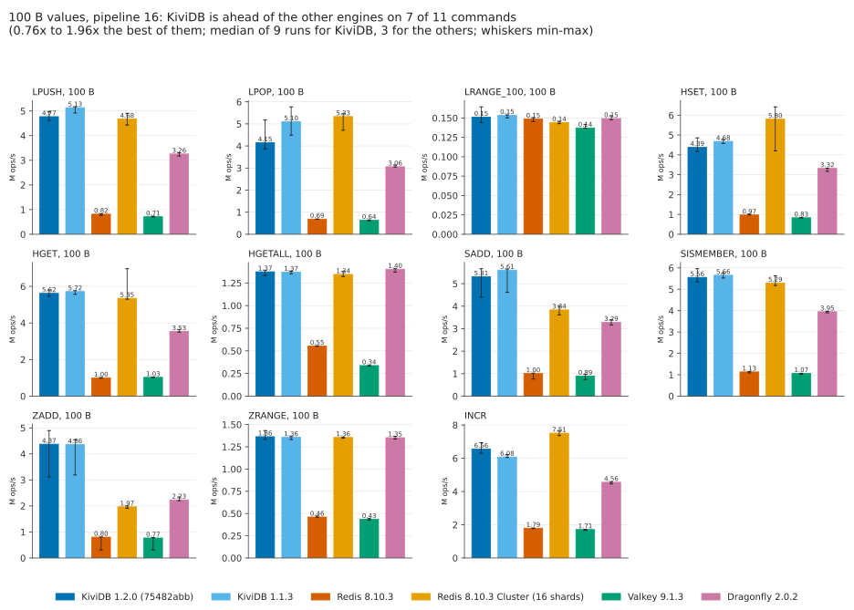
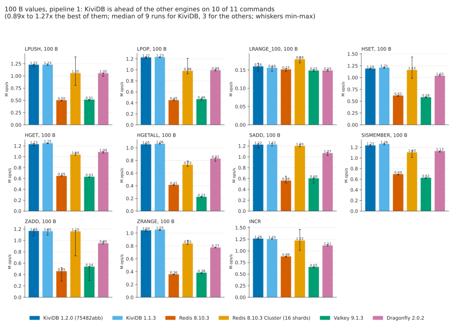
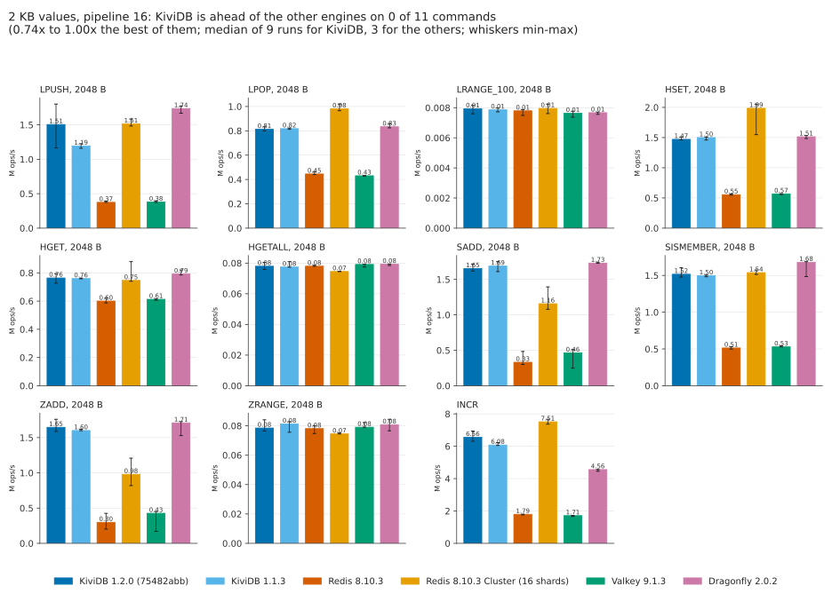
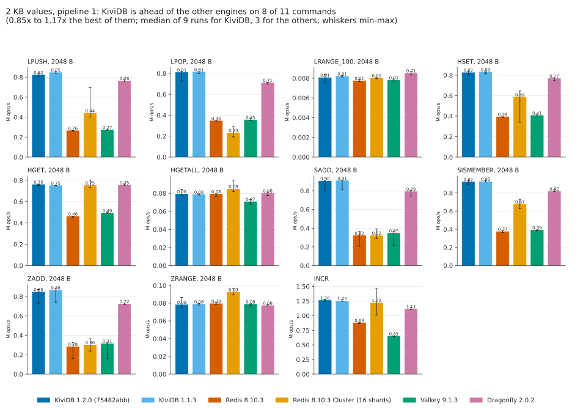
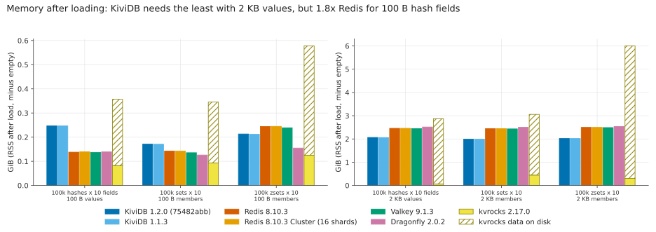
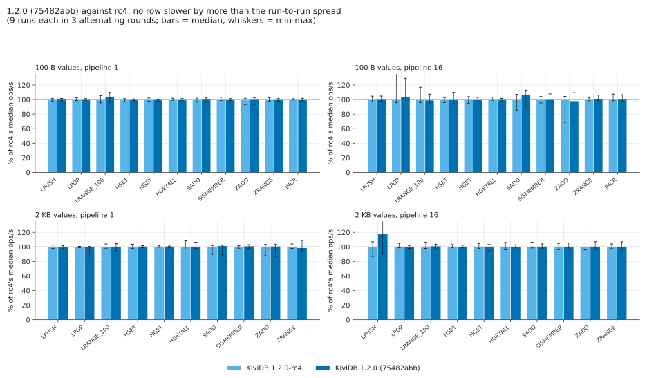
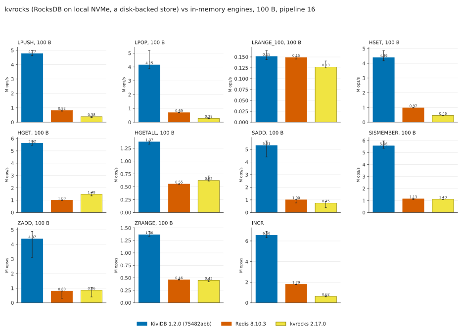

# Data types at 100 B and 2 KB: lists, hashes, sets, sorted sets, counters

Asked on Hacker News ([Show HN: KiviDB](https://news.ycombinator.com/item?id=50152541)):

> **edoceo:** Could you add Valkey to the benchmark? Curious about different key-types too, like list and hash.
> Also, big values (2KB) and small values (<256B)
>
> **syepes:** How does this compare and benchmark with https://github.com/apache/kvrocks

This suite measures eleven commands on five data types, with 100-byte and 2-KB values, at pipeline 1
and 16, against KiviDB 1.2.0 (release branch at `75482abb`, the code that ships as 1.2.0), KiviDB 1.1.3,
Redis 8.10.3 (io-threads), Redis 8.10.3 Cluster (16 shards), Valkey 9.1.3 (io-threads) and
Dragonfly 2.0.2. Apache kvrocks 2.17.0 is in a separate table: it keeps its data in RocksDB on disk,
so it is a different class of store, and the comparison says how far apart the classes are, not
which is "better". Every number here is from one session on 2026-11-02, on the same two VMs; the
same session ran 1.2.0-rc4 alongside the candidate as a regression check
([Against 1.2.0-rc4](#against-120-rc4)).

**Short version.**

- **100-byte values, pipeline 16:** KiviDB 1.2.0 ran every list, hash, set, sorted-set and counter
  command at 4.2-6.6M ops/s, 3.7-6.0x Redis 8.10.3 (io-threads 8), 3.8-6.7x Valkey 9.1.3
  (io-threads 6) and 1.3-2.0x Dragonfly 2.0.2, with p99 of 0.52-0.71 ms. Redis Cluster with 16
  shards was within 10% on LPUSH, HGET and SISMEMBER, ahead on HSET (+32%), INCR (+14%) and LPOP,
  and behind on SADD and ZADD, with the client saturated.
- **2 KB values:** the network decides. Every fast engine fills the server's 12.5 Gbit/s egress on
  reads, and the 2 KB writes at pipeline 16 arrive faster than the client VM can send for long;
  measured for 20 s, KiviDB and Dragonfly tie (1.37M HSETs a second, 2.8 GB/s in) at 2.4-2.5x Redis
  and Valkey. In the short matrix runs Dragonfly reads 3-15% higher on five 2 KB pipeline-16 rows
  (LPUSH, LPOP, SADD, SISMEMBER, ZADD), all above what the client VM can send for long.
- **Pipeline 1, 100 B:** KiviDB answered fastest of the single-endpoint engines (p50 0.41-0.49 ms) and served 1.04-1.26M ops/s on
  every command, ahead of every single-endpoint engine (LRANGE_100, capped by the network, is a tie).
- **Where KiviDB loses:** memory for small hash fields (1.8x Redis for 100-byte fields; it uses the
  least of all at 2 KB); p99 on the network-capped HGETALL/ZRANGE rows; and a **tail-latency stall
  on LPOP** at pipeline 16 (p99.9 50-78 ms once lists have drained, worst request 98-168 ms) that
  rc4 and 1.1.3 have too.
- **kvrocks** (disk-backed) wrote at 6-20% of KiviDB's rate, read from its cache at
  about Redis's rate, and held a fraction of the memory.
- **Against rc4:** no regression. On all 42 rows the candidate is within the run-to-run spread of
  rc4 (median differences -2.2% to +5.9%, plus one +17% row inside a 42% spread), with three
  alternating rounds each; CPU per request and instructions per command match too
  ([profiling](../profiling/#against-120-rc4)).

## Hardware and placement

| | server | client |
|---|---|---|
| VM | Azure `Standard_D16ds_v5` | Azure `Standard_D48s_v5` |
| CPU | 16 vCPU (8 cores x 2 threads), Intel Xeon Platinum 8370C 2.8 GHz | 48 vCPU, same CPU |
| memory | 64 GB | 192 GB |
| disk | 600 GB local NVMe temp disk (kvrocks' data directory) | - |
| OS | Ubuntu 24.04.5, kernel 7.0.0-1017-azure | same |
| network | accelerated networking; Azure caps a D16ds_v5's **egress** at 12.5 Gbit/s | 24 Gbit/s egress |

Region koreacentral, availability zone 1, both VMs in one proximity placement group and one VNet
(the same sizes, region, zone and kernel as the rc4 run). One engine runs on the server at a time,
alone, on all 16 vCPUs; nothing else runs there (Docker is installed for the engines that ship as
images, which also means netfilter conntrack is active for every engine alike). The client is three
times the server's size so that it is not the limit: memtier_benchmark reports its own threads'
CPU, and the busiest single-endpoint run used 58% of them (see `client_cpu_pct_max` in
`results/summary.csv`).

## Engines and flags

| engine | version | how it ran | flags |
|---|---|---|---|
| KiviDB | 1.2.0 (`75482abb` on `release/1.2.0`, reports `1.2.0-rc6` until rc7 is tagged) | built on the server VM: `harness/build.sh` (`cargo build --release`: the shipped profile, LTO fat, default features), rustc 1.99.1 | defaults (14 worker threads = vCPUs - 2, io_uring), `--protected-mode no`, `save ""` |
| KiviDB | 1.2.0-rc4 (`a6b1bf38`), for the regression check only | built the same way on the same VM | same |
| KiviDB | 1.1.3 | release binary from the GitHub release | same |
| Redis | 8.10.3 | built from source (`make`, jemalloc) | `--io-threads 8 --save "" --appendonly no` |
| Redis Cluster | 8.10.3 | 16 primaries, one per vCPU, each pinned with `taskset`, no replicas | `--cluster-enabled yes --save "" --appendonly no`, no io-threads |
| Valkey | 9.1.3 | `valkey/valkey:9.1.3`, host network | `--io-threads 6 --save "" --appendonly no` |
| Dragonfly | 2.0.2 | `docker.dragonflydb.io/dragonflydb/dragonfly:v2.0.2`, host network | `--proactor_threads 16 --maxmemory 48gb --dbfilename ""` |
| kvrocks | 2.17.0 | `apache/kvrocks:2.17.0`, host network, data on the local NVMe | the image's `kvrocks.conf` (4 GB block cache, snappy) plus `--workers 16` |

**io-threads.** Redis's and Valkey's own guidance is to leave a core or two to the main thread and
to measure. `harness/iothreads-sweep.sh` ran HGET, HGETALL and HSET at 100 B, pipeline 1 and 16,
with 4, 6, 8 and 12 I/O threads, in the rc4 session on the same VM types ([results](results/iothreads-sweep.csv)). Redis was best overall with 8
(the best at pipeline 1, within 8% of the best at pipeline 16); Valkey with 6 (with 8 or 12, its HGETALL at
pipeline 16 fell to half). The matrix uses those; the sweep was not repeated.

## Workload

Every engine gets the same keys, the same values and the same number of requests. Each value size
and data type starts from an empty database (`FLUSHALL`), loads its keys, and then runs, per
command and pipeline depth, one warm-up run (a quarter of the requests, not recorded) and three
measured runs. Keys are drawn uniformly at random from the group's range, and every connection has
its own random sequence (`--distinct-client-seed`).

| group | keys | loaded with | commands measured |
|---|---|---|---|
| hash | `h:1..100000` | 10 fields `f0..f9`, V bytes each | `HGET k f5`, `HGETALL k` (10 fields), `HSET k f0 <V bytes>` (overwrites a field) |
| set | `s:1..100000` | 1 known member + 9 random members, V bytes each | `SISMEMBER k <known member>` (always a hit), `SADD k <new random member>` |
| zset | `z:1..100000` | 10 random members, V bytes each | `ZRANGE k 0 9 WITHSCORES`, `ZADD k 1 <new random member>` |
| list | `l:1..10000` | at least 100 elements of V bytes | `LRANGE k 0 99` |
| | `q:1..10000` | empty | `LPUSH k <V bytes>`, then `LPOP k` (3/4 as many pops as pushes, so lists never run dry) |
| counter | `c:1..1000000` | created by the warm-up | `INCR k` (value size does not apply: run once) |

V is 100 bytes or 2048 bytes. SADD and ZADD insert a new random member every time (memtier
`--random-data` changes the value on every request), so those sets grow during the three runs,
and later runs are a little slower than the first: their spread is wider than the read rows'.
That is the same for every engine.

**Rounds.** The KiviDB builds ran the whole matrix three times each, alternating with each other
and with the competitors, so that drift over the session hits both builds alike:
1.2.0, rc4, 1.1.3, Redis, rc4, 1.2.0, Valkey, Dragonfly, 1.2.0, rc4, Redis Cluster, kvrocks
(`harness/session.sh`). KiviDB 1.2.0's numbers are therefore the median of 9 runs (3 rounds x 3
runs, each round loading afresh), the others' of 3. Memory was measured in the first round.

Connections: 32 memtier threads with 16 connections each (512) at pipeline 1, and 32 x 4 (128,
so 2,048 requests in flight) at pipeline 16. In cluster mode memtier opens those per shard.

Requests per measured run (kvrocks gets a quarter of each, being about ten times slower; its
rates are still per second):

| | pipeline 1 | pipeline 16 |
|---|---|---|
| 100 B: HGET, HSET, SISMEMBER, INCR | 6M | 24M |
| 100 B: SADD, ZADD, LPUSH / LPOP | 6M / 4.5M | 16M / 12M |
| 100 B: HGETALL, ZRANGE | 2M, 3M | 4M, 6M |
| 100 B: LRANGE_100 | 400k | 400k |
| 2 KB: HGET, HSET, SISMEMBER | 3M | 3M |
| 2 KB: SADD, ZADD, LPUSH / LPOP | 1.5M / 1.125M | 1.5M / 1.125M |
| 2 KB: HGETALL, ZRANGE | 300k | 300k |
| 2 KB: LRANGE_100 | 30k | 30k |

Latency is memtier's: from sending a request to reading its reply, per request, for every request
of the run (p50, p99 and p99.9 of the HDR histogram). At pipeline 16 it includes the time a request
waits behind the 15 before it.

## Results

Each chart has one panel per command (its own y scale); bars are the median of the runs (9 for
KiviDB 1.2.0, 3 for the others) and the whiskers the min and max. The tables below them have every
number, with p50 / p99 / p99.9.









p99 latency: [100 B p16](charts/p99-100B-p16.svg), [100 B p1](charts/p99-100B-p1.svg),
[2 KB p16](charts/p99-2048B-p16.svg), [2 KB p1](charts/p99-2048B-p1.svg).



### Tables

#### 100 B values, pipeline 1

ops/s: median of 9 runs (3 rounds) for KiviDB 1.2.0, of 3 for the others (spread = (max-min)/median). Latency: p50 / p99 / p99.9 in ms. `*` = best ops/s in the row.

| command | KiviDB 1.2.0 (75482abb) | KiviDB 1.1.3 | Redis 8.10.3 | Redis Cluster x16 | Valkey 9.1.3 | Dragonfly 2.0.2 |
|---|---|---|---|---|---|---|
| LPUSH | 1.22M (3.3%)<br>0.41 / 0.68 / 1.37 | *1.23M* (2.3%)<br>0.41 / 0.75 / 2.25 | 498k (3.1%)<br>1.02 / 1.51 / 2.61 | 1.05M (55.2%)<br>0.54 / 1.97 / 3.54 | 512k (4.3%)<br>0.99 / 1.47 / 3.20 | 1.05M (5.9%)<br>0.49 / 0.79 / 2.40 |
| LPOP | 1.22M (2.1%)<br>0.41 / 0.69 / 1.62 | *1.23M* (0.9%)<br>0.41 / 0.69 / 2.04 | 445k (4.8%)<br>1.14 / 1.66 / 2.80 | 978k (28.6%)<br>0.44 / 2.00 / 2.86 | 463k (6.1%)<br>1.09 / 1.58 / 3.26 | 990k (2.8%)<br>0.53 / 0.78 / 1.92 |
| LRANGE_100 | 159k (13.9%)<br>0.96 / 9.28 / 10.88 | 155k (8.5%)<br>0.97 / 9.28 / 10.94 | 151k (5.2%)<br>3.33 / 7.29 / 8.38 | *179k* (9.1%)<br>9.28 / 30.34 / 230.40 | 148k (3.0%)<br>2.90 / 7.74 / 8.89 | 148k (3.1%)<br>1.70 / 8.77 / 10.62 |
| HSET | 1.18M (2.1%)<br>0.42 / 0.69 / 1.54 | *1.21M* (1.6%)<br>0.41 / 0.68 / 1.42 | 615k (2.6%)<br>0.81 / 1.50 / 3.21 | 1.15M (39.1%)<br>0.48 / 1.76 / 2.42 | 580k (2.5%)<br>0.86 / 1.29 / 2.64 | 1.03M (2.7%)<br>0.49 / 0.76 / 1.47 |
| HGET | 1.23M (3.1%)<br>0.41 / 0.69 / 1.40 | *1.25M* (0.7%)<br>0.41 / 0.69 / 1.59 | 645k (0.9%)<br>0.78 / 1.42 / 3.02 | 1.04M (3.8%)<br>0.39 / 6.56 / 10.56 | 629k (1.0%)<br>0.81 / 1.14 / 2.29 | 1.09M (2.5%)<br>0.46 / 0.81 / 2.53 |
| HGETALL | 1.05M (2.5%)<br>0.48 / 0.77 / 1.62 | *1.06M* (1.2%)<br>0.48 / 0.73 / 1.36 | 410k (3.0%)<br>1.24 / 1.69 / 2.99 | 731k (11.5%)<br>0.25 / 6.94 / 11.52 | 222k (6.5%)<br>2.25 / 2.90 / 3.57 | 825k (5.9%)<br>0.62 / 0.92 / 2.08 |
| SADD | 1.22M (6.1%)<br>0.41 / 0.68 / 1.53 | *1.22M* (4.3%)<br>0.41 / 0.67 / 1.53 | 559k (22.2%)<br>0.92 / 1.51 / 3.29 | 1.20M (3.8%)<br>0.65 / 3.81 / 6.21 | 600k (15.0%)<br>0.84 / 1.22 / 2.54 | 1.07M (5.5%)<br>0.48 / 0.74 / 2.08 |
| SISMEMBER | 1.23M (2.6%)<br>0.41 / 0.68 / 1.56 | *1.26M* (2.5%)<br>0.41 / 0.65 / 1.46 | 691k (1.5%)<br>0.73 / 1.35 / 2.77 | 1.10M (11.6%)<br>0.34 / 6.50 / 10.43 | 625k (1.7%)<br>0.81 / 1.27 / 2.93 | 1.13M (1.4%)<br>0.45 / 0.73 / 2.02 |
| ZADD | *1.16M* (9.3%)<br>0.43 / 0.69 / 1.53 | 1.16M (8.6%)<br>0.42 / 0.73 / 2.14 | 455k (51.8%)<br>1.13 / 1.60 / 3.33 | 1.15M (38.4%)<br>0.55 / 2.33 / 3.97 | 536k (46.1%)<br>0.94 / 1.67 / 2.58 | 946k (4.0%)<br>0.54 / 0.81 / 1.70 |
| ZRANGE | 1.04M (3.5%)<br>0.49 / 0.81 / 1.87 | *1.05M* (1.3%)<br>0.48 / 0.78 / 1.78 | 355k (2.2%)<br>1.43 / 1.86 / 3.69 | 834k (7.7%)<br>0.51 / 8.00 / 12.48 | 379k (4.1%)<br>1.34 / 1.70 / 3.13 | 773k (1.1%)<br>0.66 / 0.97 / 2.04 |
| INCR | *1.26M* (3.4%)<br>0.41 / 0.72 / 2.14 | 1.25M (2.1%)<br>0.41 / 0.70 / 2.11 | 877k (1.8%)<br>0.57 / 1.10 / 2.17 | 1.22M (36.8%)<br>0.40 / 1.71 / 2.58 | 648k (1.7%)<br>0.78 / 1.11 / 2.24 | 1.11M (3.1%)<br>0.46 / 0.71 / 1.61 |

#### 100 B values, pipeline 16

ops/s: median of 9 runs (3 rounds) for KiviDB 1.2.0, of 3 for the others (spread = (max-min)/median). Latency: p50 / p99 / p99.9 in ms. `*` = best ops/s in the row.

| command | KiviDB 1.2.0 (75482abb) | KiviDB 1.1.3 | Redis 8.10.3 | Redis Cluster x16 | Valkey 9.1.3 | Dragonfly 2.0.2 |
|---|---|---|---|---|---|---|
| LPUSH | 4.77M (7.3%)<br>0.41 / 0.71 / 1.20 | *5.13M* (4.8%)<br>0.39 / 0.69 / 1.47 | 817k (7.9%)<br>2.50 / 4.96 / 5.63 | 4.68M (10.1%)<br>3.85 / 10.05 / 12.22 | 712k (4.9%)<br>2.88 / 3.21 / 4.86 | 3.26M (3.9%)<br>0.66 / 1.22 / 2.11 |
| LPOP | 4.15M (31.5%)<br>0.34 / 0.62 / 49.66 | 5.10M (25.1%)<br>0.32 / 0.56 / 25.09 | 689k (2.2%)<br>2.93 / 4.03 / 6.24 | *5.33M* (14.0%)<br>3.57 / 10.05 / 12.61 | 638k (6.9%)<br>3.18 / 4.16 / 5.18 | 3.06M (2.9%)<br>0.67 / 1.04 / 1.46 |
| LRANGE_100 | 151k (13.4%)<br>10.37 / 39.94 / 59.39 | *154k* (2.5%)<br>10.30 / 40.19 / 60.16 | 149k (3.3%)<br>13.63 / 29.57 / 40.70 | 144k (1.9%)<br>49.66 / 421.89 / 581.63 | 137k (3.7%)<br>14.85 / 21.38 / 26.11 | 149k (3.5%)<br>10.43 / 39.42 / 50.43 |
| HSET | 4.39M (15.6%)<br>0.44 / 0.69 / 1.01 | 4.68M (4.4%)<br>0.42 / 0.69 / 1.38 | 974k (4.6%)<br>2.08 / 4.16 / 4.96 | *5.80M* (38.2%)<br>3.77 / 8.03 / 9.79 | 832k (2.0%)<br>2.46 / 2.64 / 4.01 | 3.32M (4.8%)<br>0.61 / 1.00 / 1.97 |
| HGET | 5.62M (6.1%)<br>0.35 / 0.57 / 0.98 | *5.72M* (3.5%)<br>0.34 / 0.55 / 0.92 | 1.00M (3.9%)<br>2.03 / 2.83 / 4.38 | 5.35M (31.1%)<br>4.29 / 7.74 / 9.02 | 1.03M (0.7%)<br>1.99 / 2.29 / 3.31 | 3.53M (4.1%)<br>0.56 / 0.85 / 1.41 |
| HGETALL | 1.37M (4.4%)<br>0.75 / 6.46 / 7.01 | 1.37M (2.1%)<br>0.74 / 6.53 / 7.07 | 553k (0.8%)<br>3.73 / 5.47 / 6.62 | 1.34M (4.2%)<br>10.49 / 40.19 / 75.78 | 338k (1.7%)<br>6.08 / 6.56 / 6.88 | *1.40M* (2.6%)<br>1.41 / 3.15 / 3.76 |
| SADD | 5.31M (23.8%)<br>0.38 / 0.66 / 1.03 | *5.61M* (18.5%)<br>0.36 / 0.60 / 0.99 | 1.00M (26.1%)<br>2.02 / 4.13 / 5.18 | 3.84M (9.8%)<br>4.32 / 8.77 / 10.43 | 892k (25.8%)<br>2.16 / 3.39 / 4.42 | 3.29M (6.9%)<br>0.61 / 1.02 / 2.73 |
| SISMEMBER | 5.56M (11.0%)<br>0.35 / 0.60 / 0.90 | *5.66M* (4.3%)<br>0.34 / 0.59 / 1.24 | 1.13M (5.2%)<br>1.79 / 3.63 / 4.01 | 5.29M (8.6%)<br>4.38 / 7.87 / 9.28 | 1.07M (4.4%)<br>1.91 / 2.13 / 3.25 | 3.95M (1.6%)<br>0.49 / 0.85 / 1.94 |
| ZADD | *4.37M* (40.8%)<br>0.45 / 0.69 / 1.13 | 4.36M (31.1%)<br>0.44 / 0.77 / 2.11 | 802k (61.8%)<br>2.53 / 5.05 / 6.08 | 1.97M (4.7%)<br>9.92 / 23.55 / 27.39 | 770k (61.7%)<br>2.61 / 3.55 / 3.94 | 2.23M (6.5%)<br>0.88 / 1.65 / 2.27 |
| ZRANGE | *1.36M* (7.3%)<br>0.78 / 6.37 / 7.04 | 1.36M (2.5%)<br>0.75 / 6.43 / 7.07 | 461k (3.2%)<br>4.74 / 5.60 / 7.65 | 1.36M (1.0%)<br>10.69 / 40.19 / 73.73 | 435k (4.0%)<br>4.74 / 5.21 / 6.11 | 1.35M (2.3%)<br>1.46 / 2.91 / 4.08 |
| INCR | 6.56M (9.6%)<br>0.29 / 0.52 / 1.04 | 6.08M (2.9%)<br>0.30 / 0.60 / 1.70 | 1.79M (2.3%)<br>1.13 / 1.52 / 2.91 | *7.51M* (4.0%)<br>2.43 / 5.98 / 7.33 | 1.71M (3.8%)<br>1.19 / 1.42 / 2.17 | 4.56M (2.5%)<br>0.46 / 0.69 / 1.29 |

#### 2 KB values, pipeline 1

ops/s: median of 9 runs (3 rounds) for KiviDB 1.2.0, of 3 for the others (spread = (max-min)/median). Latency: p50 / p99 / p99.9 in ms. `*` = best ops/s in the row.

| command | KiviDB 1.2.0 (75482abb) | KiviDB 1.1.3 | Redis 8.10.3 | Redis Cluster x16 | Valkey 9.1.3 | Dragonfly 2.0.2 |
|---|---|---|---|---|---|---|
| LPUSH | 821k (4.2%)<br>0.62 / 1.02 / 2.17 | *845k* (2.0%)<br>0.60 / 1.00 / 2.46 | 263k (1.7%)<br>1.94 / 2.42 / 4.35 | 439k (66.8%)<br>0.52 / 3.18 / 4.42 | 271k (1.3%)<br>1.89 / 2.25 / 3.21 | 763k (2.8%)<br>0.66 / 1.37 / 2.59 |
| LPOP | 808k (10.8%)<br>0.60 / 1.95 / 2.77 | *813k* (1.9%)<br>0.59 / 2.19 / 2.67 | 346k (3.4%)<br>1.48 / 2.11 / 3.82 | 231k (42.3%)<br>0.50 / 2.21 / 4.13 | 355k (7.2%)<br>1.43 / 2.00 / 2.83 | 710k (2.3%)<br>0.71 / 1.11 / 2.08 |
| LRANGE_100 | 8k (10.1%)<br>59.65 / 181.25 / 301.06 | 8k (2.0%)<br>59.65 / 181.25 / 321.54 | 8k (2.9%)<br>59.65 / 181.25 / 311.30 | 8k (1.3%)<br>175.10 / 933.89 / 1605.63 | 8k (2.7%)<br>58.88 / 200.70 / 335.87 | *9k* (4.1%)<br>59.65 / 189.44 / 313.34 |
| HSET | 824k (3.0%)<br>0.61 / 1.01 / 1.98 | *830k* (2.2%)<br>0.60 / 1.07 / 2.80 | 392k (1.2%)<br>1.30 / 1.70 / 2.98 | 586k (52.1%)<br>0.46 / 2.32 / 3.97 | 406k (4.1%)<br>1.25 / 1.66 / 2.98 | 767k (3.7%)<br>0.68 / 1.05 / 1.73 |
| HGET | *759k* (1.8%)<br>0.55 / 2.99 / 3.38 | 750k (0.6%)<br>0.55 / 2.94 / 3.36 | 461k (1.9%)<br>1.09 / 1.88 / 3.89 | 752k (9.3%)<br>0.26 / 7.90 / 12.99 | 491k (2.1%)<br>1.05 / 1.43 / 3.15 | 753k (1.7%)<br>0.61 / 2.25 / 2.88 |
| HGETALL | 79k (8.6%)<br>7.58 / 19.33 / 221.18 | 79k (1.4%)<br>8.32 / 19.33 / 221.18 | 79k (3.6%)<br>6.97 / 18.43 / 220.16 | *85k* (14.9%)<br>10.11 / 220.16 / 280.57 | 71k (7.0%)<br>7.07 / 9.21 / 10.05 | 80k (4.5%)<br>8.51 / 19.20 / 220.16 |
| SADD | 904k (12.9%)<br>0.57 / 0.96 / 1.92 | *907k* (11.4%)<br>0.56 / 0.89 / 1.65 | 321k (49.0%)<br>1.57 / 2.16 / 3.71 | 322k (32.0%)<br>0.47 / 3.42 / 4.67 | 345k (43.7%)<br>1.42 / 2.21 / 2.99 | 792k (7.3%)<br>0.66 / 1.04 / 1.98 |
| SISMEMBER | 920k (5.4%)<br>0.56 / 0.90 / 1.80 | *924k* (1.9%)<br>0.55 / 0.94 / 2.04 | 373k (5.5%)<br>1.37 / 1.76 / 3.04 | 674k (15.4%)<br>0.28 / 9.66 / 15.74 | 389k (2.9%)<br>1.30 / 1.70 / 2.80 | 817k (2.5%)<br>0.61 / 1.01 / 2.29 |
| ZADD | 846k (16.8%)<br>0.58 / 1.11 / 2.53 | *865k* (16.0%)<br>0.57 / 0.96 / 1.81 | 282k (58.6%)<br>1.79 / 2.40 / 3.60 | 299k (42.3%)<br>0.49 / 3.58 / 4.58 | 314k (52.0%)<br>1.59 / 2.16 / 3.41 | 723k (2.2%)<br>0.69 / 1.14 / 2.06 |
| ZRANGE | 78k (14.5%)<br>7.07 / 19.33 / 221.18 | 79k (2.2%)<br>7.90 / 19.33 / 221.18 | 79k (3.2%)<br>6.91 / 18.05 / 220.16 | *92k* (7.3%)<br>10.30 / 221.18 / 270.33 | 79k (2.4%)<br>6.14 / 18.05 / 220.16 | 77k (1.9%)<br>8.38 / 19.20 / 220.16 |

#### 2 KB values, pipeline 16

ops/s: median of 9 runs (3 rounds) for KiviDB 1.2.0, of 3 for the others (spread = (max-min)/median). Latency: p50 / p99 / p99.9 in ms. `*` = best ops/s in the row.

| command | KiviDB 1.2.0 (75482abb) | KiviDB 1.1.3 | Redis 8.10.3 | Redis Cluster x16 | Valkey 9.1.3 | Dragonfly 2.0.2 |
|---|---|---|---|---|---|---|
| LPUSH | 1.51M (42.3%)<br>1.44 / 3.46 / 4.45 | 1.19M (5.5%)<br>1.54 / 3.60 / 5.70 | 375k (5.0%)<br>5.76 / 6.17 / 8.06 | 1.51M (6.6%)<br>5.41 / 18.43 / 29.05 | 379k (5.7%)<br>6.01 / 6.50 / 8.64 | *1.74M* (6.0%)<br>1.09 / 3.15 / 4.19 |
| LPOP | 813k (4.2%)<br>1.22 / 7.97 / 8.64 | 818k (1.3%)<br>1.17 / 8.06 / 8.77 | 445k (4.6%)<br>5.15 / 7.74 / 8.64 | *981k* (5.6%)<br>9.92 / 49.66 / 81.92 | 430k (1.1%)<br>4.58 / 7.33 / 7.65 | 833k (4.2%)<br>1.46 / 7.20 / 8.10 |
| LRANGE_100 | 8k (7.1%)<br>260.10 / 481.28 / 561.15 | 8k (3.3%)<br>260.10 / 481.28 / 573.44 | 8k (5.0%)<br>260.10 / 481.28 / 540.67 | *8k* (7.9%)<br>802.82 / 1777.66 / 2162.69 | 8k (5.2%)<br>261.12 / 481.28 / 552.96 | 8k (1.9%)<br>260.10 / 481.28 / 561.15 |
| HSET | 1.47M (3.2%)<br>0.94 / 5.21 / 5.63 | 1.50M (3.2%)<br>0.90 / 5.44 / 5.92 | 554k (3.5%)<br>3.89 / 4.19 / 5.44 | *1.99M* (25.5%)<br>7.36 / 20.61 / 31.23 | 568k (2.8%)<br>4.03 / 5.05 / 5.86 | 1.51M (3.3%)<br>1.02 / 4.54 / 5.18 |
| HGET | 764k (8.8%)<br>0.78 / 8.83 / 9.86 | 760k (0.7%)<br>0.78 / 8.77 / 9.66 | 600k (5.5%)<br>3.84 / 4.58 / 5.63 | 747k (18.6%)<br>10.56 / 80.38 / 219.13 | 613k (1.5%)<br>3.34 / 3.82 / 4.64 | *792k* (4.4%)<br>1.10 / 8.26 / 9.02 |
| HGETALL | 78k (5.8%)<br>20.61 / 79.87 / 110.08 | 77k (4.6%)<br>20.61 / 78.85 / 103.42 | 78k (0.9%)<br>20.35 / 79.87 / 110.08 | 75k (0.2%)<br>111.10 / 790.53 / 1007.62 | 79k (2.3%)<br>25.47 / 69.63 / 99.33 | *79k* (1.3%)<br>20.61 / 78.85 / 109.57 |
| SADD | 1.65M (6.0%)<br>0.68 / 6.40 / 6.82 | 1.69M (8.3%)<br>0.66 / 6.53 / 6.88 | 331k (55.3%)<br>6.37 / 7.93 / 8.32 | 1.16M (27.3%)<br>7.90 / 20.61 / 37.89 | 464k (56.2%)<br>4.51 / 7.07 / 8.96 | *1.73M* (0.8%)<br>1.00 / 4.58 / 5.12 |
| SISMEMBER | 1.52M (8.4%)<br>0.67 / 6.43 / 6.82 | 1.50M (1.6%)<br>0.66 / 6.56 / 6.97 | 514k (6.2%)<br>4.19 / 4.51 / 6.01 | 1.54M (4.0%)<br>9.92 / 40.19 / 60.93 | 529k (3.2%)<br>4.32 / 4.61 / 5.76 | *1.68M* (12.1%)<br>0.90 / 5.28 / 5.95 |
| ZADD | 1.65M (10.4%)<br>0.75 / 5.98 / 6.33 | 1.60M (1.2%)<br>0.74 / 6.01 / 6.46 | 299k (74.8%)<br>7.07 / 8.89 / 9.98 | 979k (39.7%)<br>9.47 / 28.03 / 49.92 | 427k (66.0%)<br>5.15 / 7.17 / 7.84 | *1.71M* (11.5%)<br>1.18 / 2.38 / 5.05 |
| ZRANGE | 78k (9.7%)<br>20.61 / 79.36 / 109.57 | *81k* (8.8%)<br>20.48 / 79.87 / 110.08 | 78k (6.9%)<br>20.48 / 79.87 / 110.59 | 74k (0.9%)<br>119.81 / 761.86 / 974.85 | 79k (4.0%)<br>20.61 / 79.36 / 110.08 | 81k (9.7%)<br>20.48 / 79.87 / 110.59 |

## Findings

**100-byte values, pipeline 16 (the server is the limit).** KiviDB 1.2.0 runs the list, hash, set,
sorted-set and counter commands at 4.2-6.6M ops/s: 3.7-6.0x Redis 8.10.3 with 8 I/O threads,
3.8-6.7x Valkey 9.1.3 with 6, and 1.3-2.0x Dragonfly 2.0.2, with p99 between 0.52 and 0.71 ms where
Redis is at 1.5-5.1 ms. Two rows are not engine-bound: HGETALL and `ZRANGE 0 9 WITHSCORES` return
ten 100-byte values (about 1.3 KB), and at 1.4M replies a second every fast engine is at the
server's 12.5 Gbit/s egress cap (KiviDB, Dragonfly and Redis Cluster all at 1.34-1.40M; Dragonfly's
1.40M HGETALL against KiviDB's 1.37M is inside the spread). There KiviDB's p99 (6.4-6.5 ms) is
higher than Redis's (5.5-5.6 ms at 0.46-0.55M ops/s) and Dragonfly's (2.9-3.2 ms at the same rate as
KiviDB): its requests queue at the NIC instead of in the server.

**Redis Cluster with 16 shards** is the fair multi-core Redis. At pipeline 16 it is within 10% of
KiviDB on LPUSH, HGET, SISMEMBER, HGETALL and ZRANGE, ahead on HSET (5.80M vs 4.39M), INCR (7.51M vs
6.56M) and LPOP (5.33M vs 4.15M, where KiviDB's runs are hit by the stall below), and behind on SADD
(3.84M vs 5.31M) and ZADD (1.97M vs 4.37M). Its HSET lead is larger than in the rc4 run (5.29M vs
4.77M then): KiviDB's HSET read 4.39M today (15.6% spread over 9 runs) and rc4 read 4.42M in the
same session, so the gap is today's measurement, not the code. **These cluster rows are
client-bound**: memtier's threads were 80-94% busy on most of them (cluster mode makes the client
route every key and keep 16 connections per client), so the cluster's capacity is higher than
shown. We had no quota left for a second client VM in the region.

**Pipeline 1.** With 512 connections each waiting for its reply, every engine is bounded by
connections / latency: KiviDB answered in 0.41-0.49 ms at the median and reached 1.04-1.26M ops/s on
every command, Dragonfly 0.77-1.13M at 0.45-0.66 ms, Redis 0.36-0.88M, Valkey 0.22-0.65M. Redis
Cluster's pipeline-1 numbers are close to KiviDB's on some rows (SADD 1.20M, INCR 1.22M) because
memtier's cluster mode keeps one request in flight per shard connection, sixteen times as many as
against one endpoint, and it is ahead on LRANGE_100 (179k vs 159k); its p99 is 1.7-8.0 ms against
KiviDB's 0.68-0.81 ms.

**2 KB values.** Replies of 2 KB or more cap at the server's egress bandwidth: HGET at 750-790k
ops/s (1.6 GB/s) for KiviDB, Dragonfly and Redis Cluster, HGETALL and ZRANGE (20 KB replies) at
~80k, LRANGE_100 (200 KB) at ~8k for every engine, including Redis. Those rows measure the VM's
network, not the engines. Requests of 2 KB (writes, and SISMEMBER's 2 KB member) come in on the
server's ingress: KiviDB runs LPUSH, HSET, SADD, ZADD and SISMEMBER at 1.47-1.65M ops/s at pipeline
16, 2.6-5.5x Redis and Valkey. In these short runs (1.5M-3M requests, 1-2 s for the fast engines)
Dragonfly is ahead of KiviDB on LPUSH (1.74M vs 1.51M), SADD (1.73M vs 1.65M), SISMEMBER (1.68M vs
1.52M), ZADD (1.71M vs 1.65M) and LPOP (833k vs 813k); in the rc4 run KiviDB was ahead on SISMEMBER
and ZADD. All of those exceed what the client VM's 24 Gbit/s egress carries for long (1.6M x 2 KB =
3.3 GB/s; the sustained limit is 2.8 GB/s): they measure the burst allowance of the moment.
`harness/sustained-2k.sh` re-ran HSET and HGET on the 2 KB hashes for 20 s each
([results](results/sustained-2k.txt)). Measured that way KiviDB 1.2.0, rc4, 1.1.3 and Dragonfly tie:
1.37M HSETs a second at pipeline 16 (2.8 GB/s coming in: the client VM's egress) and 725k HGETs (1.48
GB/s going out: the server's 12.5 Gbit/s cap), where Redis did 0.58M / 0.63M and Valkey 0.55M /
0.61M. At pipeline 1, HSET 810k (KiviDB 1.2.0) against 766k (Dragonfly), HGET 716k against 716k.

**Tail latency, the one bad row: LPOP at pipeline 16.** KiviDB's LPOP at 100 B, pipeline 16 has
p99.9 of 50 ms (median of 9 runs; 4.15M ops/s median, 32% spread), where every other 100 B
pipeline-16 row that the network does not cap stays under 1.3 ms. It is unchanged from rc4 (p99.9
46 ms, 47% spread, in the same session) and 1.1.3 has it too. `harness/lpop-tail.sh` reproduces it on
its own (40M LPUSHes on 10,000 lists, then 12M LPOPs at pipeline 16, three times), run twice for
each build, alternating ([results](results/lpop-tail.txt)): the first LPOP run is clean (p99.9
0.83-0.90 ms) but the second and third, with the lists partly drained, have p99.9 of 50-78 ms
(1.2.0) and 49-75 ms (rc4) and a worst request of 98-138 ms (1.2.0) and 91-111 ms (rc4); throughput
falls from 5.5-5.7M to 4.2-4.8M ops/s. Even the clean first runs have one request of 135-168 ms
(rc4: 140-141 ms). The rc4 run showed it is the same with `activedefrag no` (not
the compactor), that 1.1.3 does the same, that Redis's worst request under the same repro is
10-14 ms and Dragonfly's 23-32 ms, that the server makes no madvise, munmap or brk calls during the
stalls (`harness/lpop-syscalls.sh`), and that workers run 50-68 ms without a switch
(`harness/lpop-offcpu.sh`). `perf` during a stalled run of 1.2.0 (`harness/lpop-perf.sh`,
[flamegraph](raw/lpop-perf/kividb-cand-lpop-p16.svg)) puts 7.2% of the server's CPU in glibc's
`malloc_consolidate` and 13.4% under `free` (rc4: 7.2% and 13.7%). Our reading, not yet proven:
freeing millions of 100-byte list elements makes glibc consolidate its fast bins in one long pass
on a worker, and that worker's connections wait for it. Repro: `harness/lpop-tail.sh kividb-cand`.

**KiviDB 1.2.0 against 1.1.3.** Within run-to-run noise on every row (no row lower by more than
the spread). The medians are lower by 6-7% on two writes at 100 B, pipeline 16: LPUSH (4.77M vs
5.13M) and HSET (4.39M vs 4.68M), and by 19% on LPOP at pipeline 16 (4.15M vs 5.10M, both wrecked by
the tail above, spreads 25-32%); higher by 8% on INCR at pipeline 16 (6.56M vs 6.08M). The
single-thread instruction counts in the [profiling suite](../profiling/) show where writes got
dearer between 1.1.3 and 1.2.0: SET is 8.3% more instructions, mostly the write-order bookkeeping
(`keyspec::key_positions`, `write_order::lock_keys`) added for #271 in rc4; 1.2.0 adds nothing to it.

**Memory after loading** (RSS minus the empty server, a fresh server per data type;
`results/memory.csv`):

| MiB | 100k hashes x 10 fields, 100 B | 100k sets x 10, 100 B | 100k zsets x 10, 100 B | hashes, 2 KB | sets, 2 KB | zsets, 2 KB |
|---|---|---|---|---|---|---|
| raw values | 95 | 95 | 95 | 1953 | 1953 | 1953 |
| KiviDB 1.2.0 | **253** | 175 | 218 | **2115** | **2037** | **2071** |
| KiviDB 1.1.3 | 253 | 175 | 218 | 2114 | 2036 | 2070 |
| Redis 8.10.3 | 141 | 146 | 250 | 2517 | 2504 | 2560 |
| Valkey 9.1.3 | 140 | 139 | 245 | 2504 | 2493 | 2550 |
| Dragonfly 2.0.2 | 142 | **129** | **159** | 2577 | 2562 | 2599 |
| Redis Cluster (16 shards, sum) | 143 | 146 | 250 | 2518 | 2505 | 2560 |
| kvrocks 2.17.0: RSS + data on disk | 84 + 281 | 95 + 259 | 128 + 464 | 68 + 2871 | 456 + 2675 | 308 + 5844 |

With 2 KB values KiviDB needs the least memory of the in-memory engines, 15-20% less than Redis,
Valkey and Dragonfly: 4-8% over the raw bytes, where the others round each 2 KB allocation up to a
larger size class. With small values it loses on hashes: 253 MiB for a million 100-byte fields,
1.8x Redis (141) and Dragonfly (142), about 165 bytes of overhead per field against Redis's 48; sets
are 1.2x Redis, sorted sets are smaller than Redis's (218 vs 250) and larger than Dragonfly's
(159). 1.2.0, rc4 (within 1 MiB, `raw/kividb-rc4/memory.csv`) and 1.1.3 use the same memory for all
six (whatever 1.2 changed in how entries are stored did not reach the fields inside these types).
kvrocks keeps a small resident set (its block cache fills on reads) and puts 1.4-4.9x the raw bytes
on disk right after loading, before compaction.

## Against 1.2.0-rc4

The candidate and rc4 (`v1.2.0-rc4`, `a6b1bf38`) were built the same way on the same server and
each ran the full matrix three times, alternating (1.2.0 first in rounds 1 and 3, rc4 first in
round 2), so every row has 9 runs per build. A row counts as a regression when the candidate's
median is below rc4's by more than the larger of the two builds' spreads ((max-min)/median over
the 9 runs) (`harness/vs_rc4.py`, `results/vs-rc4.csv`).



**No row is a regression.** 41 of the 42 rows are within -2.2% and +5.9% of rc4. Round by round
(the "per round" column: the candidate's median of that round against rc4's), 108 of the 126
comparisons are within 3%, and the largest drops (-8.3% and -8.5%) are on network-capped rows
(LRANGE_100 at pipeline 16, HGETALL at 2 KB) whose 9-run spreads are 9-21%. The one larger difference is in the candidate's
favour and is not a claim: LPUSH at 2 KB, pipeline 16 read +17% (+21 to +29% in each round), but its
runs last about a second and are ingress-burst-bound (see 2 KB above), with spreads of 20-42%.
Latency agrees: the candidate's p99 is at most 0.14 ms above rc4's on any row that the network does
not cap (ZADD at 2 KB, pipeline 1: 1.11 vs 0.97 ms, a growing-set row with a 16% spread), and LPOP's
p99.9 tail (49.7 vs 46.1 ms) is the same stall in both. The [profiling suite](../profiling/#against-120-rc4)
finds the same from below: CPU per request within 1.1% of rc4 at pipeline 1 and 16 (release
binaries, three alternating rounds) and instructions per command within 0.5% on 16 of 18
callgrind workloads (DEL and DEL-TTL, the other two, are within their own repeat noise).

| values, pipeline | command | KiviDB 1.2.0 (75482abb) | KiviDB 1.2.0-rc4 | change | per round | p99 1.2.0 / rc4 (ms) | p99.9 1.2.0 / rc4 (ms) | verdict |
|---|---|---|---|---|---|---|---|---|
| 100 B, p1 | LPUSH | 1.22M (3.3%) | 1.21M (3.4%) | +0.8% | +0.5 +0.9 +0.6 | 0.68 / 0.69 | 1.37 / 1.85 | same |
| 100 B, p1 | LPOP | 1.22M (2.1%) | 1.22M (3.9%) | +0.3% | -0.2 +0.7 +0.9 | 0.69 / 0.67 | 1.62 / 1.55 | same |
| 100 B, p1 | LRANGE_100 | 159k (13.9%) | 153k (9.7%) | +3.9% | +2.5 +5.0 +1.7 | 9.28 / 9.15 | 10.88 / 10.88 | same |
| 100 B, p1 | HSET | 1.18M (2.1%) | 1.19M (4.7%) | -0.6% | +1.3 -0.5 -0.9 | 0.69 / 0.69 | 1.54 / 1.61 | same |
| 100 B, p1 | HGET | 1.23M (3.1%) | 1.24M (4.3%) | -0.7% | -0.3 -1.2 -0.3 | 0.69 / 0.66 | 1.40 / 1.38 | same |
| 100 B, p1 | HGETALL | 1.05M (2.5%) | 1.05M (2.8%) | -0.3% | -1.5 +0.3 -0.3 | 0.77 / 0.74 | 1.62 / 1.39 | same |
| 100 B, p1 | SADD | 1.22M (6.1%) | 1.21M (5.5%) | +0.7% | +1.0 +1.1 +0.7 | 0.68 / 0.69 | 1.53 / 1.66 | same |
| 100 B, p1 | SISMEMBER | 1.23M (2.6%) | 1.23M (4.2%) | -0.2% | -0.5 +0.1 -1.5 | 0.68 / 0.66 | 1.56 / 1.57 | same |
| 100 B, p1 | ZADD | 1.16M (9.3%) | 1.16M (8.4%) | +0.5% | +1.5 +0.2 -1.0 | 0.69 / 0.75 | 1.53 / 1.74 | same |
| 100 B, p1 | ZRANGE | 1.04M (3.5%) | 1.04M (4.8%) | -0.2% | +0.4 -1.7 -1.0 | 0.81 / 0.78 | 1.87 / 1.63 | same |
| 100 B, p1 | INCR | 1.26M (3.4%) | 1.26M (1.8%) | -0.0% | +0.2 -0.0 -0.2 | 0.72 / 0.69 | 2.14 / 1.49 | same |
| 100 B, p16 | LPUSH | 4.77M (7.3%) | 4.74M (8.1%) | +0.6% | +0.2 +0.5 +2.0 | 0.71 / 0.73 | 1.20 / 1.32 | same |
| 100 B, p16 | LPOP | 4.15M (31.5%) | 4.00M (47.0%) | +3.6% | +1.8 +0.8 +3.6 | 0.62 / 0.59 | 49.66 / 46.08 | same |
| 100 B, p16 | LRANGE_100 | 151k (13.4%) | 153k (21.0%) | -1.2% | +1.4 -8.3 +2.3 | 39.94 / 39.94 | 59.39 / 59.90 | same |
| 100 B, p16 | HSET | 4.39M (15.6%) | 4.42M (6.8%) | -0.8% | +1.2 +1.0 -0.8 | 0.69 / 0.70 | 1.01 / 1.09 | same |
| 100 B, p16 | HGET | 5.62M (6.1%) | 5.63M (9.4%) | -0.2% | +2.3 +0.4 -1.9 | 0.57 / 0.57 | 0.98 / 0.97 | same |
| 100 B, p16 | HGETALL | 1.37M (4.4%) | 1.37M (4.2%) | +0.3% | +0.4 +1.2 +0.1 | 6.46 / 6.46 | 7.01 / 7.07 | same |
| 100 B, p16 | SADD | 5.31M (23.8%) | 5.01M (21.6%) | +5.9% | +6.2 -1.2 +3.9 | 0.66 / 0.65 | 1.03 / 1.08 | same |
| 100 B, p16 | SISMEMBER | 5.56M (11.0%) | 5.53M (8.8%) | +0.4% | +2.1 +3.2 -0.3 | 0.60 / 0.60 | 0.90 / 0.98 | same |
| 100 B, p16 | ZADD | 4.37M (40.8%) | 4.47M (35.5%) | -2.2% | +0.3 -5.4 -0.8 | 0.69 / 0.72 | 1.13 / 1.44 | same |
| 100 B, p16 | ZRANGE | 1.36M (7.3%) | 1.35M (4.2%) | +1.0% | +4.0 +1.2 -1.4 | 6.37 / 6.37 | 7.04 / 7.04 | same |
| 100 B, p16 | INCR | 6.56M (9.6%) | 6.51M (9.0%) | +0.8% | +1.0 +3.0 -2.2 | 0.52 / 0.52 | 1.04 / 0.82 | same |
| 2 KB, p1 | LPUSH | 821k (4.2%) | 826k (4.6%) | -0.6% | -1.0 -0.4 -1.1 | 1.02 / 1.01 | 2.17 / 2.05 | same |
| 2 KB, p1 | LPOP | 808k (10.8%) | 811k (1.7%) | -0.4% | -0.2 -1.0 +0.4 | 1.95 / 1.98 | 2.77 / 2.61 | same |
| 2 KB, p1 | LRANGE_100 | 8k (10.1%) | 8k (5.8%) | +0.0% | +1.8 +0.0 -1.7 | 181.25 / 180.22 | 301.06 / 301.06 | same |
| 2 KB, p1 | HSET | 824k (3.0%) | 820k (5.5%) | +0.4% | -0.2 -0.2 +0.6 | 1.01 / 1.01 | 1.98 / 2.17 | same |
| 2 KB, p1 | HGET | 759k (1.8%) | 755k (2.1%) | +0.5% | +0.5 +0.9 -0.1 | 2.99 / 2.98 | 3.38 / 3.57 | same |
| 2 KB, p1 | HGETALL | 79k (8.6%) | 79k (11.3%) | -0.4% | +2.9 +0.7 -8.5 | 19.33 / 19.33 | 221.18 / 221.18 | same |
| 2 KB, p1 | SADD | 904k (12.9%) | 893k (12.2%) | +1.1% | +2.0 +1.1 -2.0 | 0.96 / 1.01 | 1.92 / 2.29 | same |
| 2 KB, p1 | SISMEMBER | 920k (5.4%) | 912k (4.1%) | +0.8% | +1.8 -2.1 +1.0 | 0.90 / 0.97 | 1.80 / 2.43 | same |
| 2 KB, p1 | ZADD | 846k (16.8%) | 842k (15.6%) | +0.5% | -1.0 +0.5 -1.7 | 1.11 / 0.97 | 2.53 / 2.16 | same |
| 2 KB, p1 | ZRANGE | 78k (14.5%) | 80k (6.1%) | -1.6% | -1.1 -2.2 -2.0 | 19.33 / 19.33 | 221.18 / 221.18 | same |
| 2 KB, p16 | LPUSH | 1.51M (42.3%) | 1.28M (20.0%) | +17.3% | +22.6 +28.8 +21.4 | 3.46 / 3.66 | 4.45 / 4.35 | same |
| 2 KB, p16 | LPOP | 813k (4.2%) | 816k (6.4%) | -0.5% | -0.5 -3.3 -0.2 | 7.97 / 7.97 | 8.64 / 8.64 | same |
| 2 KB, p16 | LRANGE_100 | 8k (7.1%) | 8k (8.4%) | +0.8% | -0.9 +2.8 -3.3 | 481.28 / 481.28 | 561.15 / 561.15 | same |
| 2 KB, p16 | HSET | 1.47M (3.2%) | 1.47M (4.5%) | -0.2% | -0.5 -2.2 +0.9 | 5.21 / 5.18 | 5.63 / 5.66 | same |
| 2 KB, p16 | HGET | 764k (8.8%) | 769k (6.8%) | -0.6% | -3.7 -1.1 +2.7 | 8.83 / 8.83 | 9.86 / 9.79 | same |
| 2 KB, p16 | HGETALL | 78k (5.8%) | 78k (10.1%) | -0.3% | +0.9 -1.6 +0.1 | 79.87 / 79.87 | 110.08 / 110.08 | same |
| 2 KB, p16 | SADD | 1.65M (6.0%) | 1.65M (7.8%) | +0.3% | +2.7 -3.1 +3.3 | 6.40 / 6.30 | 6.82 / 6.75 | same |
| 2 KB, p16 | SISMEMBER | 1.52M (8.4%) | 1.52M (8.5%) | -0.4% | -0.0 +0.5 -2.5 | 6.43 / 6.43 | 6.82 / 6.88 | same |
| 2 KB, p16 | ZADD | 1.65M (10.4%) | 1.64M (9.4%) | +0.1% | +1.9 +1.6 -3.2 | 5.98 / 5.92 | 6.33 / 6.30 | same |
| 2 KB, p16 | ZRANGE | 78k (9.7%) | 79k (6.6%) | -0.3% | +0.1 -2.6 +2.9 | 79.36 / 79.87 | 109.57 / 110.08 | same |

What changed between rc4 and `75482abb` (SORT/SORT_RO key access and ACL keyspecs, SLOWLOG/MONITOR
redaction with a fast path, the AOF writer's wake-ups and batch draining, AOF replay of expired keys,
cluster gossip addresses, MIGRATE on tokio, a slab-generation check in compaction, FreeBSD-only
code, `INFO stats rejected_connections`) is mostly off this suite's command path (no AOF, no
replicas, no cluster bus, no SORT). What could reach it (the redaction fast path, the ACL keyspec
changes) shows no measurable cost here or in the per-function callgrind counts, where
`keyspec::key_positions` and `write_order::lock_keys` cost the same instructions in both builds.

## Apache kvrocks (a disk-backed store: a different class)

kvrocks speaks the Redis protocol but keeps its data in RocksDB on disk, with a block cache in
memory; every write goes to RocksDB's write-ahead log and memtable. It ran on the same server with
its data directory on the VM's local NVMe disk, 16 worker threads, and the image's defaults
otherwise (4 GB block cache, snappy compression from level 2). It got a quarter of the requests of
the other engines per run (it is several times slower and the runs would have taken hours); the
rates are per second all the same.

Two things to keep in mind when reading the numbers. Each data set here (at most ~2 GB) fits in
kvrocks' 4 GB block cache, so its **reads are served from memory**: this is kvrocks at its best,
not a data set larger than RAM, which is the reason to run it. And its shorter runs end sooner,
which makes the network-capped rows (2 KB reads, LRANGE) read a little higher than the others'
(see the burst note above), so kvrocks' wins on HGET/HGETALL/ZRANGE/LRANGE at 2 KB are not real wins.



#### 100 B values, pipeline 1

ops/s: median of 9 runs (3 rounds) for KiviDB 1.2.0, of 3 for the others (spread = (max-min)/median). Latency: p50 / p99 / p99.9 in ms. `*` = best ops/s in the row.

| command | KiviDB 1.2.0 (75482abb) | Redis 8.10.3 | kvrocks 2.17.0 |
|---|---|---|---|
| LPUSH | *1.22M* (3.3%)<br>0.41 / 0.68 / 1.37 | 498k (3.1%)<br>1.02 / 1.51 / 2.61 | 213k (29.6%)<br>1.78 / 6.94 / 7.87 |
| LPOP | *1.22M* (2.1%)<br>0.41 / 0.69 / 1.62 | 445k (4.8%)<br>1.14 / 1.66 / 2.80 | 162k (35.1%)<br>3.25 / 6.94 / 8.38 |
| LRANGE_100 | *159k* (13.9%)<br>0.96 / 9.28 / 10.88 | 151k (5.2%)<br>3.33 / 7.29 / 8.38 | 130k (7.6%)<br>3.84 / 7.07 / 7.68 |
| HSET | *1.18M* (2.1%)<br>0.42 / 0.69 / 1.54 | 615k (2.6%)<br>0.81 / 1.50 / 3.21 | 282k (8.7%)<br>1.60 / 4.86 / 6.62 |
| HGET | *1.23M* (3.1%)<br>0.41 / 0.69 / 1.40 | 645k (0.9%)<br>0.78 / 1.42 / 3.02 | 642k (3.2%)<br>0.78 / 1.71 / 2.69 |
| HGETALL | *1.05M* (2.5%)<br>0.48 / 0.77 / 1.62 | 410k (3.0%)<br>1.24 / 1.69 / 2.99 | 436k (1.4%)<br>1.16 / 2.40 / 3.04 |
| SADD | *1.22M* (6.1%)<br>0.41 / 0.68 / 1.53 | 559k (22.2%)<br>0.92 / 1.51 / 3.29 | 506k (48.6%)<br>0.99 / 2.11 / 3.58 |
| SISMEMBER | *1.23M* (2.6%)<br>0.41 / 0.68 / 1.56 | 691k (1.5%)<br>0.73 / 1.35 / 2.77 | 573k (4.1%)<br>0.85 / 1.90 / 2.13 |
| ZADD | *1.16M* (9.3%)<br>0.43 / 0.69 / 1.53 | 455k (51.8%)<br>1.13 / 1.60 / 3.33 | 494k (57.5%)<br>1.04 / 2.22 / 3.17 |
| ZRANGE | *1.04M* (3.5%)<br>0.49 / 0.81 / 1.87 | 355k (2.2%)<br>1.43 / 1.86 / 3.69 | 310k (6.6%)<br>1.65 / 2.99 / 3.65 |
| INCR | *1.26M* (3.4%)<br>0.41 / 0.72 / 2.14 | 877k (1.8%)<br>0.57 / 1.10 / 2.17 | 334k (6.2%)<br>1.43 / 3.57 / 5.21 |

#### 100 B values, pipeline 16

ops/s: median of 9 runs (3 rounds) for KiviDB 1.2.0, of 3 for the others (spread = (max-min)/median). Latency: p50 / p99 / p99.9 in ms. `*` = best ops/s in the row.

| command | KiviDB 1.2.0 (75482abb) | Redis 8.10.3 | kvrocks 2.17.0 |
|---|---|---|---|
| LPUSH | *4.77M* (7.3%)<br>0.41 / 0.71 / 1.20 | 817k (7.9%)<br>2.50 / 4.96 / 5.63 | 382k (13.6%)<br>4.80 / 12.73 / 14.97 |
| LPOP | *4.15M* (31.5%)<br>0.34 / 0.62 / 49.66 | 689k (2.2%)<br>2.93 / 4.03 / 6.24 | 275k (10.8%)<br>6.24 / 17.54 / 20.48 |
| LRANGE_100 | *151k* (13.4%)<br>10.37 / 39.94 / 59.39 | 149k (3.3%)<br>13.63 / 29.57 / 40.70 | 127k (12.5%)<br>14.02 / 26.50 / 36.86 |
| HSET | *4.39M* (15.6%)<br>0.44 / 0.69 / 1.01 | 974k (4.6%)<br>2.08 / 4.16 / 4.96 | 459k (5.9%)<br>4.00 / 10.37 / 12.54 |
| HGET | *5.62M* (6.1%)<br>0.35 / 0.57 / 0.98 | 1.00M (3.9%)<br>2.03 / 2.83 / 4.38 | 1.48M (19.2%)<br>1.48 / 2.33 / 2.83 |
| HGETALL | *1.37M* (4.4%)<br>0.75 / 6.46 / 7.01 | 553k (0.8%)<br>3.73 / 5.47 / 6.62 | 623k (15.9%)<br>3.02 / 6.30 / 6.85 |
| SADD | *5.31M* (23.8%)<br>0.38 / 0.66 / 1.03 | 1.00M (26.1%)<br>2.02 / 4.13 / 5.18 | 747k (64.9%)<br>2.43 / 4.61 / 5.57 |
| SISMEMBER | *5.56M* (11.0%)<br>0.35 / 0.60 / 0.90 | 1.13M (5.2%)<br>1.79 / 3.63 / 4.01 | 1.10M (16.1%)<br>1.81 / 2.91 / 3.34 |
| ZADD | *4.37M* (40.8%)<br>0.45 / 0.69 / 1.13 | 802k (61.8%)<br>2.53 / 5.05 / 6.08 | 856k (75.9%)<br>2.53 / 6.05 / 11.58 |
| ZRANGE | *1.36M* (7.3%)<br>0.78 / 6.37 / 7.04 | 461k (3.2%)<br>4.74 / 5.60 / 7.65 | 451k (9.1%)<br>4.70 / 8.38 / 8.64 |
| INCR | *6.56M* (9.6%)<br>0.29 / 0.52 / 1.04 | 1.79M (2.3%)<br>1.13 / 1.52 / 2.91 | 623k (14.1%)<br>3.36 / 7.93 / 9.41 |

#### 2 KB values, pipeline 1

ops/s: median of 9 runs (3 rounds) for KiviDB 1.2.0, of 3 for the others (spread = (max-min)/median). Latency: p50 / p99 / p99.9 in ms. `*` = best ops/s in the row.

| command | KiviDB 1.2.0 (75482abb) | Redis 8.10.3 | kvrocks 2.17.0 |
|---|---|---|---|
| LPUSH | *821k* (4.2%)<br>0.62 / 1.02 / 2.17 | 263k (1.7%)<br>1.94 / 2.42 / 4.35 | 85k (7.1%)<br>5.92 / 10.81 / 12.16 |
| LPOP | *808k* (10.8%)<br>0.60 / 1.95 / 2.77 | 346k (3.4%)<br>1.48 / 2.11 / 3.82 | 220k (33.6%)<br>2.19 / 5.63 / 8.51 |
| LRANGE_100 | *8k* (10.1%)<br>59.65 / 181.25 / 301.06 | 8k (2.9%)<br>59.65 / 181.25 / 311.30 | 8k (1.8%)<br>59.39 / 181.25 / 290.81 |
| HSET | *824k* (3.0%)<br>0.61 / 1.01 / 1.98 | 392k (1.2%)<br>1.30 / 1.70 / 2.98 | 87k (1.7%)<br>5.76 / 11.58 / 13.95 |
| HGET | *759k* (1.8%)<br>0.55 / 2.99 / 3.38 | 461k (1.9%)<br>1.09 / 1.88 / 3.89 | 485k (2.7%)<br>1.02 / 2.32 / 4.06 |
| HGETALL | 79k (8.6%)<br>7.58 / 19.33 / 221.18 | 79k (3.6%)<br>6.97 / 18.43 / 220.16 | *99k* (3.0%)<br>3.31 / 17.28 / 214.01 |
| SADD | *904k* (12.9%)<br>0.57 / 0.96 / 1.92 | 321k (49.0%)<br>1.57 / 2.16 / 3.71 | 320k (74.1%)<br>1.36 / 4.86 / 7.13 |
| SISMEMBER | *920k* (5.4%)<br>0.56 / 0.90 / 1.80 | 373k (5.5%)<br>1.37 / 1.76 / 3.04 | 427k (9.8%)<br>1.16 / 2.43 / 3.26 |
| ZADD | *846k* (16.8%)<br>0.58 / 1.11 / 2.53 | 282k (58.6%)<br>1.79 / 2.40 / 3.60 | 332k (81.4%)<br>1.52 / 2.99 / 4.64 |
| ZRANGE | 78k (14.5%)<br>7.07 / 19.33 / 221.18 | 79k (3.2%)<br>6.91 / 18.05 / 220.16 | *98k* (5.1%)<br>4.19 / 11.20 / 20.22 |

#### 2 KB values, pipeline 16

ops/s: median of 9 runs (3 rounds) for KiviDB 1.2.0, of 3 for the others (spread = (max-min)/median). Latency: p50 / p99 / p99.9 in ms. `*` = best ops/s in the row.

| command | KiviDB 1.2.0 (75482abb) | Redis 8.10.3 | kvrocks 2.17.0 |
|---|---|---|---|
| LPUSH | *1.51M* (42.3%)<br>1.44 / 3.46 / 4.45 | 375k (5.0%)<br>5.76 / 6.17 / 8.06 | 94k (30.3%)<br>19.84 / 55.30 / 78.33 |
| LPOP | *813k* (4.2%)<br>1.22 / 7.97 / 8.64 | 445k (4.6%)<br>5.15 / 7.74 / 8.64 | 301k (22.0%)<br>6.05 / 16.89 / 24.96 |
| LRANGE_100 | 8k (7.1%)<br>260.10 / 481.28 / 561.15 | 8k (5.0%)<br>260.10 / 481.28 / 540.67 | *9k* (68.0%)<br>182.27 / 430.08 / 491.52 |
| HSET | *1.47M* (3.2%)<br>0.94 / 5.21 / 5.63 | 554k (3.5%)<br>3.89 / 4.19 / 5.44 | 145k (2.2%)<br>13.18 / 39.42 / 44.03 |
| HGET | 764k (8.8%)<br>0.78 / 8.83 / 9.86 | 600k (5.5%)<br>3.84 / 4.58 / 5.63 | *891k* (16.5%)<br>2.21 / 4.45 / 5.76 |
| HGETALL | 78k (5.8%)<br>20.61 / 79.87 / 110.08 | 78k (0.9%)<br>20.35 / 79.87 / 110.08 | *96k* (6.4%)<br>19.58 / 70.14 / 90.62 |
| SADD | *1.65M* (6.0%)<br>0.68 / 6.40 / 6.82 | 331k (55.3%)<br>6.37 / 7.93 / 8.32 | 374k (92.1%)<br>4.48 / 12.93 / 18.05 |
| SISMEMBER | *1.52M* (8.4%)<br>0.67 / 6.43 / 6.82 | 514k (6.2%)<br>4.19 / 4.51 / 6.01 | 573k (8.0%)<br>3.58 / 5.73 / 6.27 |
| ZADD | *1.65M* (10.4%)<br>0.75 / 5.98 / 6.33 | 299k (74.8%)<br>7.07 / 8.89 / 9.98 | 307k (111.1%)<br>5.18 / 17.28 / 21.63 |
| ZRANGE | 78k (9.7%)<br>20.61 / 79.36 / 109.57 | 78k (6.9%)<br>20.48 / 79.87 / 110.59 | *91k* (26.7%)<br>19.33 / 69.63 / 90.62 |

**What it shows.** Writes are where the classes differ: kvrocks did 0.16-0.51M writes a second at
pipeline 1 and 0.28-0.86M at pipeline 16 with 100-byte values, and 85-145k with 2 KB values
(HSET, LPUSH): 6-20% of KiviDB's rate, and from a quarter of single-threaded Redis's (2 KB LPUSH
and HSET at pipeline 16) to about the same (SADD, ZADD).
Reads from its cache are close to Redis: HGET 642k / 1.48M, SISMEMBER 573k / 1.10M (pipeline 1 /
16), and its p99 at pipeline 16 is 2.3-17.5 ms against KiviDB's 0.5-0.7 ms. Its memory is a
fraction of the in-memory engines' (68-456 MiB resident against ~2 GB), with 1.4-4.9x the raw data
on disk. If the data set is larger than memory and the workload tolerates millisecond writes, kvrocks
is the cheaper store; if it fits in memory, any of the in-memory engines here is several times
faster.

## Caveats

- **One client VM.** It was three times the server's size and was not the limit against any single
  endpoint (memtier's threads at most 58% busy), but in cluster mode against Redis Cluster it was
  (80-94% on most pipeline-16 rows): the Redis Cluster pipeline-16 rows are lower bounds.
- **The network caps reads of 2 KB values, LRANGE_100, and the 100 B HGETALL/ZRANGE rows at
  pipeline 16**, at the D16ds_v5's 12.5 Gbit/s egress, and the 2 KB writes at pipeline 16 at the
  client's egress. Those rows say "every fast engine fills the NIC", not which is faster. Short runs
  can read above the sustained cap (Azure lets bursts through), which is why a few of those rows
  wobble and kvrocks' quarter-length runs read high.
- **SADD and ZADD grow their sets** during the three measured runs, so their spread is wider
  (later runs insert into bigger sets); the same requests in the same order of sizes for every
  engine.
- **Pipeline 1 is a latency test as much as a throughput test**: 512 connections, one request each
  in flight; the engine that answers fastest serves the most.
- **KiviDB 1.2.0 has 9 runs per row, the competitors 3**: its spreads cover more of the session's
  drift, so they are wider than a 3-run spread would be.
- **Docker's netfilter rules** (conntrack) were active on the server for every engine, including
  the ones not in containers. They cost every engine the same per packet.
- **Valkey, Dragonfly and kvrocks ran in their official images** with host networking; Redis and
  KiviDB ran as plain processes.
- **kvrocks' data set fits in its block cache**: its reads are served from memory.

## Reproduce

Everything is in `harness/`; nothing depends on any one machine.

```sh
# 1. Two VMs in one proximity placement group (Azure CLI; SSH from your IP only, auto-shutdown)
RG=my-rg REGION=koreacentral bash harness/infra/up.sh <your-ip> ~/.ssh/id_rsa.pub
# 2. On the server and the client
bash harness/infra/setup-srv.sh      # server: Redis 8.10.3 from source, images, KiviDB 1.1.3, perf, FlameGraph
bash harness/infra/setup-cli.sh      # client: memtier_benchmark 2.5.2
#    the server needs passwordless ssh to the client (the scripts run memtier there over ssh)
# 3. The KiviDB builds, on the server
bash harness/build.sh cand 75482abb         # -> ~/bin/kividb-cand
bash harness/build.sh rc4 v1.2.0-rc4        # -> ~/bin/kividb-rc4
# 4. On the server: the whole session in order (matrix in alternating rounds, the 2 KB
#    re-check, the LPOP tail repro, then the profiling suite's runs)
bash harness/session.sh
#    or by hand:
bash harness/iothreads-sweep.sh                     # picks io-threads for Redis and Valkey
bash harness/run-all.sh kividb-cand kividb-rc4 kividb-1.1.3 redis kividb-rc4:kividb-rc4-r2 \
  kividb-cand:kividb-cand-r2 valkey dragonfly kividb-cand:kividb-cand-r3 kividb-rc4:kividb-rc4-r3 \
  redis-cluster kvrocks
bash harness/sustained-2k.sh kividb-cand kividb-rc4 dragonfly redis valkey kividb-1.1.3
DEFRAG=yes bash harness/lpop-tail.sh kividb-cand   # the LPOP tail repro
python3 harness/summarize.py ~/out/datatypes results
python3 harness/charts.py results charts
python3 harness/tables.py results/summary.csv
python3 harness/vs_rc4.py results charts            # the regression table and chart
```

`CLI=<client private IP>` (default 10.0.0.5) and `PORT` (7001) can be set in the environment.
A `SPEC` of `ENGINE:ENGINE-rN` in `run-all.sh` is round N of that engine: its own output folder,
no memory pass. The matrix takes about 3 hours 10 minutes on these VMs with the six KiviDB rounds
(the Redis engines and Valkey take longest).

## Files

- `results/summary.csv`: one row per engine, command, value size and pipeline: median ops/s of the
  runs (9 for KiviDB 1.2.0 and rc4, 3 for the others), min, max, spread, median p50/p99/p99.9 (ms),
  client CPU (max), server cores used (CPU seconds of the server processes over the wall time of
  the run, ssh start-up included, so a little low). `rx_MBps`/`tx_MBps` are memtier's own figures,
  which in 2.5.2 print the total in both.
- `results/runs.csv`: every measured run, with its round.
- `results/vs-rc4.csv`, `results/vs-rc4.md`: the regression check against rc4.
- `results/memory.csv`: RSS (and kvrocks' data directory) after loading each group into a fresh server.
- `results/iothreads-sweep.csv`: the io-threads sweep for Redis and Valkey (rc4 session).
- `results/sustained-2k.txt`, `results/lpop-tail.txt`: the two follow-up checks.
- `raw/<engine>/`, `raw/<engine>-r<N>/`: memtier's text reports for every run (tarred), server CPU
  per run, versions, memory (first round). `raw/lpop-perf/`: the LPOP stall profile.
