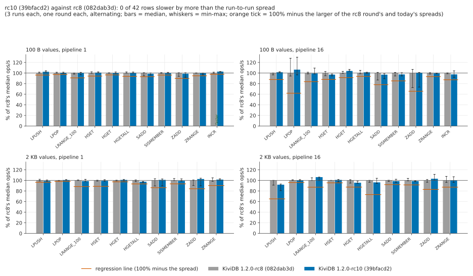

# Data types, 1.2.0-rc10 round

The `benchmarks/1.2.0/datatypes` suite on 1.2.0-rc10 against rc8: the full 42-row matrix (eleven
commands on lists, hashes, sets, sorted sets and counters; 100 B and 2 KB values; pipeline 1 and
16), one round each, rc10 first, on the same two VMs in one session on 2026-11-03. No competitors,
no memory pass, no LPOP tail repro. The suite's own harness ran unchanged (`datatypes.sh`,
`engines.sh`, `build.sh`, `summarize.py`); the scripts added for this round are in `harness/`.

## Short version

- **rc10 against rc8: no regression.** 42 of 42 rows are within the run-to-run spread the rc8 round
  measured: 41 read "same", and one reads "faster" (INCR at pipeline 1, +2.8% against a 2.4% spread).
  The rc10 medians are -8.0% to +6.5% of rc8's, and 35 of 42 rows are within 3%. The largest drop,
  -8.0% (2 KB LPUSH, pipeline 16), is on the ingress-burst row whose rc8-round spread is 34.8%.
- **Latency:** p99 moves by at most +0.13 ms on any row that the network doesn't cap. The only
  larger rise is +0.26 ms on that same 2 KB LPUSH pipeline-16 row (3.85 vs 3.60 ms). p99.9 shows no
  direction: rc10 reads higher on 27 of 42 rows, by at most 0.25 ms on rows under 20 ms. Of the six
  rows whose per-run p99.9 ranges don't overlap, three are higher for rc10 and three are lower.
- **Against the rc8 round's published rc8 numbers** (a different session, so indicative only): every
  row is within the larger of the two spreads except INCR at pipeline 1 (+2.8%, spread 2.4%), which
  is in rc10's favour. 39 of 42 rows are within 4%.
- **The LPOP stall is still there.** In the matrix, LPOP at 100 B, pipeline 16 has p99.9 of 50.9 ms
  for rc10 and 46.3 ms for rc8 (rc8 round: 45.8 ms). It is the same stall that the suite README
  describes, and rc10 doesn't change it.

## Hardware, region, builds

| | server | client |
|---|---|---|
| VM | Azure `Standard_D16ds_v5` | Azure `Standard_D48s_v5` |
| CPU | 16 vCPU, Intel Xeon Platinum 8370C 2.8 GHz | 48 vCPU, same CPU |
| OS | Ubuntu 24.04, kernel 7.0.0-1017-azure | same |

These are the sizes, CPU and kernel from the suite README and the rc8 round. The region is
**japaneast** with the proximity placement group in **zone 2**, as in the rc8 round. Both VMs are in
one PPG and one VNet, with accelerated networking. Both sizes were accepted on the first try. Only
one KiviDB server ran on the server at a time. Docker was installed and running, as in the earlier
rounds (netfilter conntrack active). The client ran memtier_benchmark 2.5.2.

Both builds ran on the server VM, one after the other, with `harness/build.sh`
(`cargo build --release`: the shipped profile, LTO fat, default features). The toolchain was rustup
stable = **rustc 1.99.1 (58cf8f9c3 2026-10-13)**, the same rustc as the rc8 round.

| build | commit | reports | SHA-256 of the binary |
|---|---|---|---|
| rc10, under test | `39bfacd231bb294d390448eacfe0e243d365ebe8` (tag `v1.2.0-rc10`) | `kividb 1.2.0-rc10` | `5083e19cd56c10f776a411b124afc62be323b1daf7507cfff44834aeed4717e6` |
| rc8, reference | `082dab3d8929c180bccf993835e28992ea054fb5` | `kividb 1.2.0-rc8` | `a9ea83cbb399ec8e921442caf59ea1a9a4fa8f2e65f561366cddd7d268299cd2` |

The rc8 binary is byte-for-byte the rc8 round's (same SHA-256), so the reference is exactly the code
and binary that round measured.

## Order and rule

`harness/session-rc10.sh` ran rc10, then rc8. Each round is the whole matrix: per row, one warm-up
and 3 measured runs. Each build therefore has 3 runs per row. Each round took 11 min 45 s.

A row is a regression when rc10's median is below rc8's by more than its threshold. The threshold
is the larger of:

- the run-to-run spread the rc8 round measured for that row, which is the larger of its rc8 and rc7
  spreads over 6 runs (`rc8/results/vs-rc7.csv`);
- today's two 3-run spreads.

Spread is (max-min)/median. A row is "faster" when rc10 is above rc8 by more than the threshold
(`harness/vs_rc8.py`). In this session the rc8 round's spread set the threshold on 36 of the 42 rows.

## rc10 against rc8

| values, pipeline | command | rc10: median (min-max) | rc8: median (min-max) | change | spread today rc10 / rc8 | spread, rc8 round | p99 rc10 / rc8 (ms) | p99.9 rc10 / rc8 (ms) | verdict |
|---|---|---|---|---|---|---|---|---|---|
| 100 B, p1 | LPUSH | 1.23M (1.23M-1.26M) | 1.20M (1.20M-1.23M) | +2.5% | 2.2% / 1.9% | 3.7% | 0.68 / 0.69 | 1.65 / 1.83 | same |
| 100 B, p1 | LPOP | 1.23M (1.21M-1.24M) | 1.22M (1.22M-1.24M) | +0.5% | 2.5% / 1.7% | 2.7% | 0.66 / 0.67 | 1.55 / 1.66 | same |
| 100 B, p1 | LRANGE_100 | 154k (149k-156k) | 154k (151k-154k) | +0.3% | 4.7% / 2.2% | 9.1% | 9.79 / 9.73 | 11.01 / 11.13 | same |
| 100 B, p1 | HSET | 1.20M (1.19M-1.21M) | 1.19M (1.18M-1.21M) | +0.9% | 1.7% / 2.7% | 5.7% | 0.70 / 0.69 | 1.61 / 1.65 | same |
| 100 B, p1 | HGET | 1.24M (1.23M-1.26M) | 1.24M (1.24M-1.24M) | -0.0% | 2.8% / 0.7% | 3.5% | 0.69 / 0.67 | 1.86 / 1.60 | same |
| 100 B, p1 | HGETALL | 1.06M (1.05M-1.07M) | 1.05M (1.05M-1.08M) | +0.2% | 1.9% / 2.2% | 6.2% | 0.78 / 0.76 | 1.89 / 1.71 | same |
| 100 B, p1 | SADD | 1.20M (1.18M-1.22M) | 1.22M (1.16M-1.23M) | -1.3% | 3.9% / 5.8% | 6.8% | 0.67 / 0.68 | 1.65 / 1.67 | same |
| 100 B, p1 | SISMEMBER | 1.25M (1.25M-1.27M) | 1.25M (1.24M-1.26M) | -0.1% | 1.6% / 1.1% | 3.8% | 0.69 / 0.66 | 1.68 / 1.49 | same |
| 100 B, p1 | ZADD | 1.16M (1.09M-1.19M) | 1.18M (1.11M-1.19M) | -1.3% | 8.7% / 6.8% | 10.1% | 0.72 / 0.71 | 1.78 / 1.76 | same |
| 100 B, p1 | ZRANGE | 1.06M (1.02M-1.06M) | 1.06M (1.06M-1.06M) | -0.2% | 3.2% / 0.5% | 5.1% | 0.78 / 0.77 | 1.93 / 1.74 | same |
| 100 B, p1 | INCR | 1.29M (1.28M-1.29M) | 1.26M (1.25M-1.28M) | +2.8% | 0.6% / 2.0% | 2.4% | 0.67 / 0.67 | 1.53 / 1.73 | faster |
| 100 B, p16 | LPUSH | 4.97M (4.94M-5.02M) | 4.90M (4.73M-4.91M) | +1.6% | 1.7% / 3.7% | 12.1% | 0.71 / 0.70 | 1.46 / 1.38 | same |
| 100 B, p16 | LPOP | 4.44M (4.03M-5.42M) | 4.17M (3.94M-5.34M) | +6.5% | 31.3% / 33.6% | 38.0% | 0.58 / 0.61 | 50.94 / 46.34 | same |
| 100 B, p16 | LRANGE_100 | 149k (147k-164k) | 150k (148k-152k) | -0.5% | 11.0% / 3.0% | 16.2% | 39.94 / 39.94 | 58.88 / 59.13 | same |
| 100 B, p16 | HSET | 4.55M (4.43M-4.59M) | 4.68M (4.45M-4.82M) | -2.9% | 3.6% / 7.9% | 12.0% | 0.72 / 0.71 | 1.53 / 1.48 | same |
| 100 B, p16 | HGET | 5.74M (5.73M-5.90M) | 5.52M (5.49M-5.69M) | +3.9% | 2.9% / 3.7% | 8.5% | 0.58 / 0.58 | 1.42 / 1.42 | same |
| 100 B, p16 | HGETALL | 1.39M (1.36M-1.39M) | 1.37M (1.35M-1.44M) | +1.4% | 2.0% / 6.3% | 3.4% | 6.62 / 6.50 | 7.46 / 7.33 | same |
| 100 B, p16 | SADD | 5.25M (4.84M-5.35M) | 5.41M (4.70M-5.48M) | -3.0% | 9.7% / 14.4% | 21.9% | 0.66 / 0.65 | 1.67 / 1.42 | same |
| 100 B, p16 | SISMEMBER | 5.77M (5.60M-5.96M) | 5.91M (5.60M-5.99M) | -2.5% | 6.1% / 6.6% | 14.8% | 0.61 / 0.61 | 1.52 / 1.34 | same |
| 100 B, p16 | ZADD | 4.46M (3.26M-4.49M) | 4.43M (3.22M-4.74M) | +0.6% | 27.5% / 34.3% | 34.2% | 0.71 / 0.72 | 1.61 / 1.77 | same |
| 100 B, p16 | ZRANGE | 1.35M (1.34M-1.35M) | 1.35M (1.33M-1.36M) | -0.4% | 1.0% / 2.6% | 6.6% | 6.50 / 6.46 | 7.42 / 7.23 | same |
| 100 B, p16 | INCR | 6.56M (6.19M-7.01M) | 6.73M (6.65M-6.76M) | -2.4% | 12.6% / 1.7% | 7.5% | 0.52 / 0.53 | 1.16 / 1.23 | same |
| 2 KB, p1 | LPUSH | 825k (821k-838k) | 832k (823k-851k) | -0.9% | 2.1% / 3.3% | 3.6% | 0.98 / 0.97 | 2.21 / 2.02 | same |
| 2 KB, p1 | LPOP | 813k (808k-820k) | 806k (803k-807k) | +0.8% | 1.4% / 0.6% | 1.9% | 2.13 / 2.21 | 2.99 / 2.72 | same |
| 2 KB, p1 | LRANGE_100 | 8k (8k-8k) | 8k (8k-8k) | -1.2% | 4.2% / 1.0% | 11.5% | 180.22 / 180.22 | 303.10 / 303.10 | same |
| 2 KB, p1 | HSET | 830k (823k-847k) | 835k (824k-839k) | -0.7% | 2.9% / 1.7% | 11.2% | 0.97 / 0.98 | 2.38 / 2.19 | same |
| 2 KB, p1 | HGET | 763k (749k-770k) | 755k (751k-759k) | +1.0% | 2.7% / 1.1% | 0.8% | 3.17 / 3.13 | 3.74 / 3.66 | same |
| 2 KB, p1 | HGETALL | 78k (77k-78k) | 80k (78k-80k) | -2.4% | 2.1% / 3.1% | 6.6% | 19.33 / 19.33 | 221.18 / 221.18 | same |
| 2 KB, p1 | SADD | 901k (800k-916k) | 892k (798k-920k) | +1.1% | 12.9% / 13.7% | 12.9% | 0.99 / 0.95 | 2.54 / 2.06 | same |
| 2 KB, p1 | SISMEMBER | 898k (897k-931k) | 905k (903k-937k) | -0.7% | 3.8% / 3.8% | 6.5% | 0.96 / 0.93 | 2.24 / 1.98 | same |
| 2 KB, p1 | ZADD | 858k (750k-871k) | 836k (756k-842k) | +2.6% | 14.1% / 10.3% | 15.7% | 0.96 / 1.01 | 2.32 / 2.27 | same |
| 2 KB, p1 | ZRANGE | 79k (79k-80k) | 78k (77k-82k) | +1.5% | 2.2% / 6.5% | 9.6% | 19.33 / 19.33 | 221.18 / 221.18 | same |
| 2 KB, p16 | LPUSH | 1.25M (1.10M-1.27M) | 1.36M (1.24M-1.36M) | -8.0% | 13.6% / 9.1% | 34.8% | 3.85 / 3.60 | 5.02 / 4.80 | same |
| 2 KB, p16 | LPOP | 809k (803k-822k) | 809k (808k-819k) | -0.0% | 2.4% / 1.3% | 3.9% | 8.10 / 8.32 | 8.77 / 9.15 | same |
| 2 KB, p16 | LRANGE_100 | 8k (8k-8k) | 8k (8k-8k) | +6.2% | 6.1% / 5.0% | 12.8% | 462.85 / 481.28 | 540.67 / 581.63 | same |
| 2 KB, p16 | HSET | 1.48M (1.43M-1.49M) | 1.47M (1.47M-1.47M) | +1.0% | 4.6% / 0.2% | 3.4% | 5.28 / 5.28 | 5.73 / 5.70 | same |
| 2 KB, p16 | HGET | 765k (757k-789k) | 800k (760k-811k) | -4.4% | 4.1% / 6.4% | 12.6% | 8.96 / 8.89 | 9.92 / 9.92 | same |
| 2 KB, p16 | HGETALL | 77k (75k-83k) | 80k (77k-80k) | -3.7% | 9.9% / 3.7% | 26.7% | 79.36 / 71.17 | 101.38 / 100.86 | same |
| 2 KB, p16 | SADD | 1.70M (1.66M-1.76M) | 1.72M (1.69M-1.73M) | -1.4% | 6.0% / 2.2% | 7.9% | 6.40 / 6.40 | 6.82 / 6.78 | same |
| 2 KB, p16 | SISMEMBER | 1.49M (1.47M-1.50M) | 1.50M (1.49M-1.56M) | -1.2% | 1.4% / 4.5% | 8.5% | 6.43 / 6.50 | 7.04 / 7.01 | same |
| 2 KB, p16 | ZADD | 1.67M (1.62M-1.80M) | 1.62M (1.56M-1.65M) | +3.1% | 10.8% / 5.1% | 17.0% | 6.14 / 6.08 | 6.59 / 6.46 | same |
| 2 KB, p16 | ZRANGE | 78k (76k-84k) | 79k (76k-85k) | -0.1% | 10.6% / 11.2% | 12.7% | 71.17 / 71.17 | 101.38 / 100.35 | same |

## rc10 against the rc8 round's published numbers (indicative only)

These are rc10's 3 runs from today against `rc8/results/summary.csv` (rc8, 6 runs, an earlier
session the same day on other VMs in the same region and zone). A gap here only means something if
it lies outside both spreads.

| values, pipeline | command | rc10, this session (3 runs) | rc8, rc8 round (6 runs) | change | larger spread | p99 rc10 / rc8 round (ms) | p99.9 rc10 / rc8 round (ms) | outside spread |
|---|---|---|---|---|---|---|---|---|
| 100 B, p1 | LPUSH | 1.23M (2.2%) | 1.20M (3.7%) | +2.6% | 3.7% | 0.68 / 0.69 | 1.65 / 1.64 | no |
| 100 B, p1 | LPOP | 1.23M (2.5%) | 1.21M (2.6%) | +1.7% | 2.6% | 0.66 / 0.69 | 1.55 / 1.80 | no |
| 100 B, p1 | LRANGE_100 | 154k (4.7%) | 150k (9.1%) | +3.2% | 9.1% | 9.79 / 9.76 | 11.01 / 10.94 | no |
| 100 B, p1 | HSET | 1.20M (1.7%) | 1.20M (5.7%) | -0.4% | 5.7% | 0.70 / 0.69 | 1.61 / 1.68 | no |
| 100 B, p1 | HGET | 1.24M (2.8%) | 1.23M (3.5%) | +0.6% | 3.5% | 0.69 / 0.66 | 1.86 / 1.51 | no |
| 100 B, p1 | HGETALL | 1.06M (1.9%) | 1.06M (4.3%) | -0.1% | 4.3% | 0.78 / 0.76 | 1.89 / 1.56 | no |
| 100 B, p1 | SADD | 1.20M (3.9%) | 1.21M (6.8%) | -0.4% | 6.8% | 0.67 / 0.68 | 1.65 / 1.66 | no |
| 100 B, p1 | SISMEMBER | 1.25M (1.6%) | 1.24M (1.6%) | +0.9% | 1.6% | 0.69 / 0.66 | 1.68 / 1.52 | no |
| 100 B, p1 | ZADD | 1.16M (8.7%) | 1.16M (8.8%) | +0.4% | 8.8% | 0.72 / 0.71 | 1.78 / 1.88 | no |
| 100 B, p1 | ZRANGE | 1.06M (3.2%) | 1.04M (3.1%) | +1.9% | 3.2% | 0.78 / 0.78 | 1.93 / 1.80 | no |
| 100 B, p1 | INCR | 1.29M (0.6%) | 1.26M (2.4%) | +2.8% | 2.4% | 0.67 / 0.68 | 1.53 / 1.73 | yes (faster) |
| 100 B, p16 | LPUSH | 4.97M (1.7%) | 4.89M (12.1%) | +1.6% | 12.1% | 0.71 / 0.73 | 1.46 / 1.75 | no |
| 100 B, p16 | LPOP | 4.44M (31.3%) | 4.42M (38.0%) | +0.5% | 38.0% | 0.58 / 0.62 | 50.94 / 45.82 | no |
| 100 B, p16 | LRANGE_100 | 149k (11.0%) | 154k (10.3%) | -3.4% | 11.0% | 39.94 / 40.06 | 58.88 / 59.52 | no |
| 100 B, p16 | HSET | 4.55M (3.6%) | 4.50M (5.8%) | +1.0% | 5.8% | 0.72 / 0.71 | 1.53 / 1.72 | no |
| 100 B, p16 | HGET | 5.74M (2.9%) | 5.69M (5.6%) | +0.8% | 5.6% | 0.58 / 0.58 | 1.42 / 1.48 | no |
| 100 B, p16 | HGETALL | 1.39M (2.0%) | 1.36M (2.7%) | +2.4% | 2.7% | 6.62 / 6.58 | 7.46 / 7.41 | no |
| 100 B, p16 | SADD | 5.25M (9.7%) | 5.04M (21.9%) | +4.1% | 21.9% | 0.66 / 0.66 | 1.67 / 1.50 | no |
| 100 B, p16 | SISMEMBER | 5.77M (6.1%) | 5.44M (10.2%) | +6.0% | 10.2% | 0.61 / 0.61 | 1.52 / 1.17 | no |
| 100 B, p16 | ZADD | 4.46M (27.5%) | 4.47M (32.6%) | -0.1% | 32.6% | 0.71 / 0.71 | 1.61 / 1.51 | no |
| 100 B, p16 | ZRANGE | 1.35M (1.0%) | 1.32M (6.6%) | +1.9% | 6.6% | 6.50 / 6.45 | 7.42 / 7.21 | no |
| 100 B, p16 | INCR | 6.56M (12.6%) | 6.57M (7.5%) | -0.1% | 12.6% | 0.52 / 0.54 | 1.16 / 1.23 | no |
| 2 KB, p1 | LPUSH | 825k (2.1%) | 810k (3.5%) | +1.9% | 3.5% | 0.98 / 0.98 | 2.21 / 2.05 | no |
| 2 KB, p1 | LPOP | 813k (1.4%) | 810k (1.9%) | +0.3% | 1.9% | 2.13 / 1.94 | 2.99 / 2.58 | no |
| 2 KB, p1 | LRANGE_100 | 8k (4.2%) | 8k (9.2%) | -3.7% | 9.2% | 180.22 / 180.74 | 303.10 / 295.94 | no |
| 2 KB, p1 | HSET | 830k (2.9%) | 813k (2.5%) | +2.0% | 2.9% | 0.97 / 1.00 | 2.38 / 2.24 | no |
| 2 KB, p1 | HGET | 763k (2.7%) | 749k (0.6%) | +1.8% | 2.7% | 3.17 / 3.10 | 3.74 / 3.81 | no |
| 2 KB, p1 | HGETALL | 78k (2.1%) | 79k (6.6%) | -1.9% | 6.6% | 19.33 / 19.20 | 221.18 / 221.18 | no |
| 2 KB, p1 | SADD | 901k (12.9%) | 873k (11.9%) | +3.2% | 12.9% | 0.99 / 0.95 | 2.54 / 2.08 | no |
| 2 KB, p1 | SISMEMBER | 898k (3.8%) | 893k (4.9%) | +0.7% | 4.9% | 0.96 / 0.92 | 2.24 / 1.91 | no |
| 2 KB, p1 | ZADD | 858k (14.1%) | 845k (15.7%) | +1.6% | 15.7% | 0.96 / 0.96 | 2.32 / 2.09 | no |
| 2 KB, p1 | ZRANGE | 79k (2.2%) | 80k (9.6%) | -0.6% | 9.6% | 19.33 / 19.20 | 221.18 / 221.18 | no |
| 2 KB, p16 | LPUSH | 1.25M (13.6%) | 1.28M (15.7%) | -2.5% | 15.7% | 3.85 / 3.58 | 5.02 / 5.12 | no |
| 2 KB, p16 | LPOP | 809k (2.4%) | 820k (3.5%) | -1.4% | 3.5% | 8.10 / 8.08 | 8.77 / 8.73 | no |
| 2 KB, p16 | LRANGE_100 | 8k (6.1%) | 8k (12.8%) | +2.6% | 12.8% | 462.85 / 476.16 | 540.67 / 567.29 | no |
| 2 KB, p16 | HSET | 1.48M (4.6%) | 1.50M (3.4%) | -1.2% | 4.6% | 5.28 / 5.15 | 5.73 / 5.66 | no |
| 2 KB, p16 | HGET | 765k (4.1%) | 764k (2.3%) | +0.1% | 4.1% | 8.96 / 9.21 | 9.92 / 10.05 | no |
| 2 KB, p16 | HGETALL | 77k (9.9%) | 82k (14.9%) | -6.7% | 14.9% | 79.36 / 79.36 | 101.38 / 109.57 | no |
| 2 KB, p16 | SADD | 1.70M (6.0%) | 1.64M (4.5%) | +3.5% | 6.0% | 6.40 / 6.42 | 6.82 / 6.78 | no |
| 2 KB, p16 | SISMEMBER | 1.49M (1.4%) | 1.54M (8.5%) | -3.2% | 8.5% | 6.43 / 6.40 | 7.04 / 6.86 | no |
| 2 KB, p16 | ZADD | 1.67M (10.8%) | 1.63M (5.8%) | +2.3% | 10.8% | 6.14 / 5.95 | 6.59 / 6.40 | no |
| 2 KB, p16 | ZRANGE | 78k (10.6%) | 78k (12.7%) | +1.0% | 12.7% | 71.17 / 79.10 | 101.38 / 109.82 | no |

## Anything that differs

- **One round each, 3 runs per build per row.** The rc8 round had two rounds and 6 runs. Today's
  3-run spreads are mostly narrower than the rc8 round's 6-run spreads, so the rc8 round's spreads
  set most thresholds. A single bad round would weigh more here, and nothing indicates one.
- **INCR at pipeline 1 reads "faster" (+2.8%).** rc10's three runs are within 0.6% of each other. The
  rc8 round's spread on this row was 2.4%. Nothing in rc10 touches INCR, so this is a narrow-spread
  row reading slightly high, not a claim.
- **2 KB LPUSH at pipeline 16 (-8.0%, threshold 34.8%).** This is the ingress-burst row: runs of
  about a second that exceed what the client VM can send for long (see the suite README). Against
  the rc8 round's rc8 it is -2.5%. Its p99 is 0.26 ms higher (3.85 vs 3.60 ms), inside the same burst
  behaviour.
- **p99.9.** rc10's per-row p99.9 median is higher on 27 of 42 rows, by at most 0.25 ms on rows
  under 20 ms. The most visible cases:
  - 100 B, pipeline 16: SADD 1.67 vs 1.42 ms, SISMEMBER 1.52 vs 1.34 ms;
  - 2 KB, pipeline 1: SADD 2.54 vs 2.06 ms, LPOP 2.99 vs 2.72 ms.

  Six rows have per-run p99.9 ranges that don't overlap. Three are higher for rc10 (SADD 100 B p16,
  SISMEMBER 100 B p1, ZRANGE 100 B p1) and three are lower (INCR p16, LPUSH 100 B p1, 2 KB LPOP p16).
  p99 is flat on all of them, and SISMEMBER and ZRANGE are reads that the write-gate change doesn't
  touch. With 3 runs per build, this round can't separate a 0.1-0.25 ms tail difference from session
  noise. The rc8 round saw the same size of p99.9 differences between rc8 and rc7 (LPUSH 1.75 vs
  1.46 ms), and rc8 shows no such LPUSH gap today.
- **No competitors, no LPOP tail repro, no memory pass:** not asked for in this round.

## Files

- `results/vs-rc8.csv`, `results/vs-rc8.md`: the regression check (thresholds included).
- `results/vs-rc8-round.md`: rc10 against the rc8 round's published rc8 summary.
- `results/summary.csv`, `results/runs.csv`: `summarize.py` output, every run.
- `results/session.log`, `results/versions.txt`: order, timings, toolchain, SHA-256, client version.
- `results/raw/<run>/`: memtier reports (tarred, private IPs replaced by `<server>`/`<client>`),
  server CPU per run, engine version.
- `charts/vs-rc8.svg`: the regression-check chart.
- `harness/`: the scripts added for this round: `build-both.sh`, `session-rc10.sh`, `vs_rc8.py`
  (`rc8/harness/vs_rc7.py` with rc10/rc8 names and the rc8 round's spreads as threshold),
  `compare_rc8.py`, `finalize-rc10.sh`.
