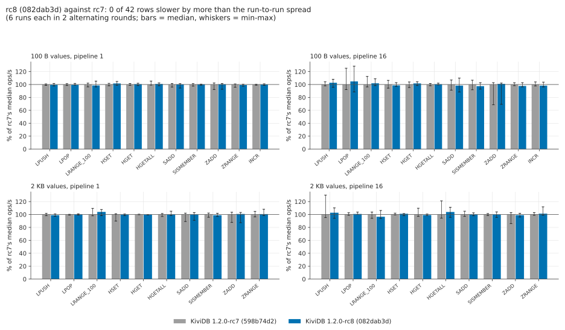

# Data types, 1.2.0-rc8 round

The `benchmarks/1.2.0/datatypes` suite rerun on 1.2.0-rc8 before the release is tagged: the full
42-row matrix (eleven commands on lists, hashes, sets, sorted sets and counters; 100 B and 2 KB
values; pipeline 1 and 16) for rc8 against rc7 in two alternating rounds, the four headline
competitors at 100 B, pipeline 16, one round each, and the LPOP tail repro on rc8, once. Every
number below comes from one session on 2026-11-03, on the same two VMs, with the suite's own
harness (`datatypes.sh`, `engines.sh`, `build.sh`, `lpop-tail.sh`, `summarize.py`, unchanged; the few scripts added for this round are listed at the end).

## Hardware and placement

| | server | client |
|---|---|---|
| VM | Azure `Standard_D16ds_v5` | Azure `Standard_D48s_v5` |
| CPU | 16 vCPU, Intel Xeon Platinum 8370C 2.8 GHz | 48 vCPU, same CPU |
| OS | Ubuntu 24.04, kernel 7.0.0-1017-azure | same |

These are the suite README's sizes, CPU and kernel. The region is **japaneast** (the published
run was koreacentral); both VMs are in one proximity placement group and one VNet, accelerated
networking. Zone 1 of japaneast refused both sizes for this subscription, so the PPG is in zone 2.
One engine ran on the server at a time; Docker was installed and running for every engine
(Valkey and Dragonfly run from their images), as in the published run.

## Builds

Both built on the server VM with `harness/build.sh` (`cargo build --release`: the shipped profile,
LTO fat, default features, as in the suite README), rustup stable = **rustc 1.99.1 (58cf8f9c3
2026-10-13)**, the same rustc as the published `75482abb` build, one after the other.

| build | commit | reports | SHA-256 of the binary |
|---|---|---|---|
| rc8, under test | `082dab3d8929c180bccf993835e28992ea054fb5` (`release/1.2.0`) | `kividb 1.2.0-rc8` | `a9ea83cbb399ec8e921442caf59ea1a9a4fa8f2e65f561366cddd7d268299cd2` |
| rc7, reference | `598b74d20ec04de5a0ff74001324907562806c3c` (tag `v1.2.0-rc7`) | `kividb 1.2.0-rc7` | `9df033f5191ad06c10750b94ca398c0e041f8d73787a05b04a7b3bb8e8909992` |

Competitors as in the suite README: Redis 8.10.3 from source (jemalloc 5.3.0), `--io-threads 8`;
Redis 8.10.3 Cluster, 16 primaries pinned one per vCPU; `valkey/valkey:9.1.3`, `--io-threads 6`;
`docker.dragonflydb.io/dragonflydb/dragonfly:v2.0.2`, `--proactor_threads 16 --maxmemory 48gb`.
memtier_benchmark 2.5.2 on the client.

## Order

`harness/session-rc8.sh`: rc8, rc7, Redis, Dragonfly, rc7 (round 2), rc8 (round 2), Valkey,
Redis Cluster, then `DEFRAG=yes lpop-tail.sh kividb-rc8`. Each KiviDB round is the whole matrix
(3 measured runs per row after a warm-up), so each KiviDB row has 6 runs per build; each
competitor row has 3. No memory pass (`MEMPASS=0`): this round checks throughput and latency.

## Short version

- **rc8 against rc7: no regression.** 42 of 42 rows are within the run-to-run spread; the rc8
  medians are -3.4% to +4.8% of rc7's (6 runs each, 2 alternating rounds). 68 of the 84
  round-by-round comparisons are within 3%; the largest single-round drop, -7.3% (HSET, 100 B,
  pipeline 16, round 2), sits next to +5.0% for the same row in round 1. p99 moves by at most
  +0.07 ms on any row the network does not cap. The MSET/MSETNX locking change is off this
  suite's command path (no MSET here), and nothing else in rc8 shows up in throughput or p99.
  The one thing to watch: p99.9 of LPUSH at 100 B, pipeline 16 is higher for rc8 in both rounds
  (1.75 vs 1.46 ms median), inside overlapping per-run ranges ([below](#anything-that-differs)).
- **rc8 against the published 75482abb numbers** (different session and region, indicative
  only): every row within the larger of the two spreads; 37 of 42 within 5%. The widest gaps are
  the ingress-burst row 2 KB LPUSH at pipeline 16 (-14.8%, published spread 42%) and the stalled
  LPOP at 100 B pipeline 16 (+6.5%, spreads 32-38%).
- **The headline holds.** At 100 B, pipeline 16, rc8 ran the list, hash, set, sorted-set and
  counter commands at 4.4-6.6M ops/s (published 4.2-6.6M) with p99 0.54-0.74 ms (published
  0.52-0.71): 3.5-6.0x Redis 8.10.3 (published 3.7-6.0x; the low end is INCR, where Redis read
  4% higher today), 3.8-6.7x Valkey 9.1.3 (published 3.8-6.7x) and 1.3-1.9x Dragonfly 2.0.2
  (published 1.3-2.0x). HGETALL, ZRANGE and LRANGE_100 are at the network cap for every fast
  engine, as published.
- **Redis Cluster x16 differs in detail.** As published, it is within 10% of KiviDB on LPUSH,
  HGET and SISMEMBER and behind on SADD (rc8 1.20x) and ZADD (2.09x). Unlike the published run, it
  is not clearly ahead on HSET (+9% here, +32% published), INCR (+3%, +14% published) or LPOP
  (tie; published 5.33M). Its runs were again client-bound (memtier 82-94% busy on most rows,
  spreads 8-31%), so these rows are lower bounds in both sessions; the published sentence
  "ahead on HSET (+32%), INCR (+14%) and LPOP" did not reproduce.
- **The LPOP tail is unchanged in rc8.** In the matrix, 100 B LPOP at pipeline 16 has p99.9 of
  45.8 ms (rc7 51.6 ms; published 49.7 ms). `lpop-tail.sh` on rc8: the first run is clean
  (p99.9 2.2 ms), the second and third have p99.9 of 50.2 and 56.3 ms, worst requests 131-166
  ms, throughput down from 5.49M to 4.15-4.52M (published 1.2.0: 50-78 ms, 98-168 ms).

## rc8 against rc7

Same rule as the suite's rc4 check (`vs_rc7.py` is `vs_rc4.py` with the names, rounds and colours
changed): a row is a regression when rc8's median is below rc7's by more than the larger of the
two builds' spreads ((max-min)/median over the 6 runs). Round 1 ran rc8 first, round 2 rc7 first.
After round 1 alone (3 runs each), 2 KB HSET at pipeline 1 read -1.6% against 3-run spreads of
0.7% and 1.3% and was flagged; with round 2 it is -0.4% (rc8 2.5%, rc7 11.2% spread).

| values, pipeline | command | KiviDB 1.2.0-rc8 (082dab3d) | KiviDB 1.2.0-rc7 (598b74d2) | change | per round | p99 rc8 / rc7 (ms) | p99.9 rc8 / rc7 (ms) | verdict |
|---|---|---|---|---|---|---|---|---|
| 100 B, p1 | LPUSH | 1.20M (3.7%) | 1.21M (2.3%) | -0.5% | -0.0 +0.3 | 0.69 / 0.68 | 1.64 / 1.55 | same |
| 100 B, p1 | LPOP | 1.21M (2.6%) | 1.21M (2.7%) | -0.5% | +0.8 -0.1 | 0.69 / 0.68 | 1.80 / 1.66 | same |
| 100 B, p1 | LRANGE_100 | 150k (9.1%) | 152k (5.7%) | -1.5% | +4.2 -1.8 | 9.76 / 9.82 | 10.94 / 10.88 | same |
| 100 B, p1 | HSET | 1.20M (5.7%) | 1.18M (3.7%) | +1.6% | +2.5 -0.3 | 0.69 / 0.68 | 1.68 / 1.61 | same |
| 100 B, p1 | HGET | 1.23M (3.5%) | 1.22M (2.7%) | +0.5% | +0.5 +0.4 | 0.66 / 0.68 | 1.51 / 1.67 | same |
| 100 B, p1 | HGETALL | 1.06M (4.3%) | 1.05M (6.2%) | +0.9% | -0.0 +1.6 | 0.76 / 0.78 | 1.56 / 1.90 | same |
| 100 B, p1 | SADD | 1.21M (6.8%) | 1.21M (5.3%) | +0.2% | +0.7 -0.6 | 0.68 / 0.69 | 1.66 / 1.63 | same |
| 100 B, p1 | SISMEMBER | 1.24M (1.6%) | 1.23M (3.8%) | +0.2% | +0.0 -0.8 | 0.66 / 0.68 | 1.52 / 1.63 | same |
| 100 B, p1 | ZADD | 1.16M (8.8%) | 1.16M (10.1%) | +0.3% | +0.2 +0.2 | 0.71 / 0.69 | 1.88 / 1.74 | same |
| 100 B, p1 | ZRANGE | 1.04M (3.1%) | 1.04M (5.1%) | -0.9% | +0.4 -1.2 | 0.78 / 0.79 | 1.80 / 1.73 | same |
| 100 B, p1 | INCR | 1.26M (2.4%) | 1.26M (1.5%) | -0.0% | -0.0 +0.0 | 0.68 / 0.66 | 1.73 / 1.49 | same |
| 100 B, p16 | LPUSH | 4.89M (12.1%) | 4.77M (6.2%) | +2.7% | +1.5 +5.0 | 0.73 / 0.71 | 1.75 / 1.46 | same |
| 100 B, p16 | LPOP | 4.42M (38.0%) | 4.22M (33.0%) | +4.8% | +9.0 +0.9 | 0.62 / 0.61 | 45.82 / 51.58 | same |
| 100 B, p16 | LRANGE_100 | 154k (10.3%) | 151k (16.2%) | +1.9% | +2.1 +1.7 | 40.06 / 39.94 | 59.52 / 52.61 | same |
| 100 B, p16 | HSET | 4.50M (5.8%) | 4.56M (12.0%) | -1.4% | +5.0 -7.3 | 0.71 / 0.71 | 1.72 / 1.48 | same |
| 100 B, p16 | HGET | 5.69M (5.6%) | 5.60M (8.5%) | +1.7% | +0.5 +3.1 | 0.58 / 0.59 | 1.48 / 1.42 | same |
| 100 B, p16 | HGETALL | 1.36M (2.7%) | 1.35M (3.4%) | +0.4% | +1.9 +0.2 | 6.58 / 6.56 | 7.41 / 7.39 | same |
| 100 B, p16 | SADD | 5.04M (21.9%) | 5.12M (15.7%) | -1.7% | -3.9 -1.0 | 0.66 / 0.66 | 1.50 / 1.55 | same |
| 100 B, p16 | SISMEMBER | 5.44M (10.2%) | 5.58M (14.8%) | -2.6% | -4.3 +0.0 | 0.61 / 0.61 | 1.17 / 1.27 | same |
| 100 B, p16 | ZADD | 4.47M (32.6%) | 4.42M (34.2%) | +1.0% | -2.7 +2.2 | 0.71 / 0.72 | 1.51 / 1.61 | same |
| 100 B, p16 | ZRANGE | 1.32M (6.6%) | 1.35M (4.5%) | -2.3% | -1.6 -2.7 | 6.45 / 6.40 | 7.21 / 7.12 | same |
| 100 B, p16 | INCR | 6.57M (7.5%) | 6.69M (6.2%) | -1.8% | +0.6 -2.5 | 0.54 / 0.54 | 1.23 / 1.22 | same |
| 2 KB, p1 | LPUSH | 810k (3.5%) | 819k (3.6%) | -1.1% | -3.1 -0.1 | 0.98 / 1.00 | 2.05 / 2.17 | same |
| 2 KB, p1 | LPOP | 810k (1.9%) | 810k (1.2%) | -0.0% | -0.3 +0.3 | 1.94 / 2.11 | 2.58 / 2.82 | same |
| 2 KB, p1 | LRANGE_100 | 8k (9.2%) | 8k (11.5%) | +4.0% | +7.7 +3.7 | 180.74 / 180.74 | 295.94 / 290.81 | same |
| 2 KB, p1 | HSET | 813k (2.5%) | 816k (11.2%) | -0.4% | -1.6 +0.5 | 1.00 / 0.97 | 2.24 / 2.05 | same |
| 2 KB, p1 | HGET | 749k (0.6%) | 752k (0.8%) | -0.4% | -0.2 -0.5 | 3.10 / 3.13 | 3.81 / 3.73 | same |
| 2 KB, p1 | HGETALL | 79k (6.6%) | 79k (4.7%) | -0.2% | +0.2 -1.3 | 19.20 / 19.33 | 221.18 / 221.18 | same |
| 2 KB, p1 | SADD | 873k (11.9%) | 874k (12.9%) | -0.1% | -2.5 +2.4 | 0.95 / 0.94 | 2.08 / 2.09 | same |
| 2 KB, p1 | SISMEMBER | 893k (4.9%) | 903k (6.5%) | -1.2% | -2.7 -0.9 | 0.92 / 0.94 | 1.91 / 2.23 | same |
| 2 KB, p1 | ZADD | 845k (15.7%) | 838k (15.7%) | +0.8% | +1.7 +0.1 | 0.96 / 0.97 | 2.09 / 2.12 | same |
| 2 KB, p1 | ZRANGE | 80k (9.6%) | 79k (8.6%) | +0.6% | +1.6 +1.0 | 19.20 / 19.33 | 221.18 / 221.18 | same |
| 2 KB, p16 | LPUSH | 1.28M (15.7%) | 1.25M (34.8%) | +2.7% | +9.5 -5.3 | 3.58 / 3.50 | 5.12 / 4.73 | same |
| 2 KB, p16 | LPOP | 820k (3.5%) | 813k (3.9%) | +0.8% | +1.2 -0.9 | 8.08 / 8.13 | 8.73 / 8.93 | same |
| 2 KB, p16 | LRANGE_100 | 8k (12.8%) | 8k (9.7%) | -3.4% | -5.4 -3.0 | 476.16 / 480.25 | 567.29 / 561.15 | same |
| 2 KB, p16 | HSET | 1.50M (3.4%) | 1.48M (2.6%) | +1.1% | +0.7 -0.6 | 5.15 / 5.21 | 5.66 / 5.63 | same |
| 2 KB, p16 | HGET | 764k (2.3%) | 771k (12.6%) | -0.8% | -0.6 -0.4 | 9.21 / 9.25 | 10.05 / 10.05 | same |
| 2 KB, p16 | HGETALL | 82k (14.9%) | 79k (26.7%) | +3.9% | +4.6 +2.3 | 79.36 / 79.36 | 109.57 / 105.22 | same |
| 2 KB, p16 | SADD | 1.64M (4.5%) | 1.64M (7.9%) | -0.1% | -1.7 +1.5 | 6.42 / 6.38 | 6.78 / 6.75 | same |
| 2 KB, p16 | SISMEMBER | 1.54M (8.5%) | 1.54M (3.1%) | -0.3% | +1.7 -2.5 | 6.40 / 6.43 | 6.86 / 6.86 | same |
| 2 KB, p16 | ZADD | 1.63M (5.8%) | 1.65M (17.0%) | -1.1% | -2.0 +5.1 | 5.95 / 6.01 | 6.40 / 6.42 | same |
| 2 KB, p16 | ZRANGE | 78k (12.7%) | 77k (4.2%) | +1.3% | +2.4 +0.8 | 79.10 / 71.42 | 109.82 / 100.86 | same |

## Against the published numbers (indicative only)

The published medians are from the 2026-11-02 session in koreacentral (9 runs of `75482abb`, 3 of each competitor); a different session, so a gap here says little unless it is outside both spreads, and none is.

#### rc8 against the published 75482abb numbers

| values, pipeline | command | rc8, this session (6 runs) | 75482abb, published (9 runs) | change | p99 rc8 / published (ms) | p99.9 rc8 / published (ms) |
|---|---|---|---|---|---|---|
| 100 B, p1 | LPUSH | 1.20M (3.7%) | 1.22M (3.3%) | -1.7% | 0.69 / 0.68 | 1.64 / 1.37 |
| 100 B, p1 | LPOP | 1.21M (2.6%) | 1.22M (2.1%) | -1.3% | 0.69 / 0.69 | 1.80 / 1.62 |
| 100 B, p1 | LRANGE_100 | 150k (9.1%) | 159k (13.9%) | -6.0% | 9.76 / 9.28 | 10.94 / 10.88 |
| 100 B, p1 | HSET | 1.20M (5.7%) | 1.18M (2.1%) | +1.5% | 0.69 / 0.69 | 1.68 / 1.54 |
| 100 B, p1 | HGET | 1.23M (3.5%) | 1.23M (3.1%) | -0.0% | 0.66 / 0.69 | 1.51 / 1.40 |
| 100 B, p1 | HGETALL | 1.06M (4.3%) | 1.05M (2.5%) | +0.6% | 0.76 / 0.77 | 1.56 / 1.62 |
| 100 B, p1 | SADD | 1.21M (6.8%) | 1.22M (6.1%) | -1.0% | 0.68 / 0.68 | 1.66 / 1.53 |
| 100 B, p1 | SISMEMBER | 1.24M (1.6%) | 1.23M (2.6%) | +0.3% | 0.66 / 0.68 | 1.52 / 1.56 |
| 100 B, p1 | ZADD | 1.16M (8.8%) | 1.16M (9.3%) | -0.2% | 0.71 / 0.69 | 1.88 / 1.53 |
| 100 B, p1 | ZRANGE | 1.04M (3.1%) | 1.04M (3.5%) | -0.6% | 0.78 / 0.81 | 1.80 / 1.87 |
| 100 B, p1 | INCR | 1.26M (2.4%) | 1.26M (3.4%) | -0.2% | 0.68 / 0.72 | 1.73 / 2.14 |
| 100 B, p16 | LPUSH | 4.89M (12.1%) | 4.77M (7.3%) | +2.6% | 0.73 / 0.71 | 1.75 / 1.20 |
| 100 B, p16 | LPOP | 4.42M (38.0%) | 4.15M (31.5%) | +6.5% | 0.62 / 0.62 | 45.82 / 49.66 |
| 100 B, p16 | LRANGE_100 | 154k (10.3%) | 151k (13.4%) | +2.0% | 40.06 / 39.94 | 59.52 / 59.39 |
| 100 B, p16 | HSET | 4.50M (5.8%) | 4.39M (15.6%) | +2.5% | 0.71 / 0.69 | 1.72 / 1.01 |
| 100 B, p16 | HGET | 5.69M (5.6%) | 5.62M (6.1%) | +1.2% | 0.58 / 0.57 | 1.48 / 0.98 |
| 100 B, p16 | HGETALL | 1.36M (2.7%) | 1.37M (4.4%) | -1.3% | 6.58 / 6.46 | 7.41 / 7.01 |
| 100 B, p16 | SADD | 5.04M (21.9%) | 5.31M (23.8%) | -5.2% | 0.66 / 0.66 | 1.50 / 1.03 |
| 100 B, p16 | SISMEMBER | 5.44M (10.2%) | 5.56M (11.0%) | -2.1% | 0.61 / 0.60 | 1.17 / 0.90 |
| 100 B, p16 | ZADD | 4.47M (32.6%) | 4.37M (40.8%) | +2.1% | 0.71 / 0.69 | 1.51 / 1.13 |
| 100 B, p16 | ZRANGE | 1.32M (6.6%) | 1.36M (7.3%) | -3.0% | 6.45 / 6.37 | 7.21 / 7.04 |
| 100 B, p16 | INCR | 6.57M (7.5%) | 6.56M (9.6%) | +0.2% | 0.54 / 0.52 | 1.23 / 1.04 |
| 2 KB, p1 | LPUSH | 810k (3.5%) | 821k (4.2%) | -1.4% | 0.98 / 1.02 | 2.05 / 2.17 |
| 2 KB, p1 | LPOP | 810k (1.9%) | 808k (10.8%) | +0.2% | 1.94 / 1.95 | 2.58 / 2.77 |
| 2 KB, p1 | LRANGE_100 | 8k (9.2%) | 8k (10.1%) | +1.4% | 180.74 / 181.25 | 295.94 / 301.06 |
| 2 KB, p1 | HSET | 813k (2.5%) | 824k (3.0%) | -1.3% | 1.00 / 1.01 | 2.24 / 1.98 |
| 2 KB, p1 | HGET | 749k (0.6%) | 759k (1.8%) | -1.3% | 3.10 / 2.99 | 3.81 / 3.38 |
| 2 KB, p1 | HGETALL | 79k (6.6%) | 79k (8.6%) | +0.2% | 19.20 / 19.33 | 221.18 / 221.18 |
| 2 KB, p1 | SADD | 873k (11.9%) | 904k (12.9%) | -3.4% | 0.95 / 0.96 | 2.08 / 1.92 |
| 2 KB, p1 | SISMEMBER | 893k (4.9%) | 920k (5.4%) | -3.0% | 0.92 / 0.90 | 1.91 / 1.80 |
| 2 KB, p1 | ZADD | 845k (15.7%) | 846k (16.8%) | -0.1% | 0.96 / 1.11 | 2.09 / 2.53 |
| 2 KB, p1 | ZRANGE | 80k (9.6%) | 78k (14.5%) | +1.8% | 19.20 / 19.33 | 221.18 / 221.18 |
| 2 KB, p16 | LPUSH | 1.28M (15.7%) | 1.51M (42.3%) | -14.8% | 3.58 / 3.46 | 5.12 / 4.45 |
| 2 KB, p16 | LPOP | 820k (3.5%) | 813k (4.2%) | +0.9% | 8.08 / 7.97 | 8.73 / 8.64 |
| 2 KB, p16 | LRANGE_100 | 8k (12.8%) | 8k (7.1%) | -1.0% | 476.16 / 481.28 | 567.29 / 561.15 |
| 2 KB, p16 | HSET | 1.50M (3.4%) | 1.47M (3.2%) | +2.0% | 5.15 / 5.21 | 5.66 / 5.63 |
| 2 KB, p16 | HGET | 764k (2.3%) | 764k (8.8%) | +0.0% | 9.21 / 8.83 | 10.05 / 9.86 |
| 2 KB, p16 | HGETALL | 82k (14.9%) | 78k (5.8%) | +5.5% | 79.36 / 79.87 | 109.57 / 110.08 |
| 2 KB, p16 | SADD | 1.64M (4.5%) | 1.65M (6.0%) | -0.8% | 6.42 / 6.40 | 6.78 / 6.82 |
| 2 KB, p16 | SISMEMBER | 1.54M (8.5%) | 1.52M (8.4%) | +1.3% | 6.40 / 6.43 | 6.86 / 6.82 |
| 2 KB, p16 | ZADD | 1.63M (5.8%) | 1.65M (10.4%) | -0.8% | 5.95 / 5.98 | 6.40 / 6.33 |
| 2 KB, p16 | ZRANGE | 78k (12.7%) | 78k (9.7%) | -1.0% | 79.10 / 79.36 | 109.82 / 109.57 |

#### Competitors at 100 B, pipeline 16: this session (3 runs) against published (3 runs)

| command | Redis 8.10.3 (io-threads 8) | Redis Cluster x16 | Valkey 9.1.3 (io-threads 6) | Dragonfly 2.0.2 | rc8 here | rc8 / Redis | rc8 / Valkey | rc8 / Dragonfly | rc8 / Cluster |
|---|---|---|---|---|---|---|---|---|---|
| LPUSH | 872k (9.0%) pub 817k, +6.8% | 4.97M (30.9%) pub 4.68M, +6.3% | 776k (4.2%) pub 712k, +9.0% | 3.14M (2.0%) pub 3.26M, -3.7% | 4.89M | 5.61x | 6.30x | 1.56x | 0.98x |
| LPOP | 734k (3.1%) pub 689k, +6.5% | 4.38M (12.1%) pub 5.33M, -17.9% | 659k (2.7%) pub 638k, +3.3% | 3.11M (4.8%) pub 3.06M, +1.6% | 4.42M | 6.02x | 6.71x | 1.42x | 1.01x |
| LRANGE_100 | 146k (3.4%) pub 149k, -1.6% | 145k (4.3%) pub 144k, +0.8% | 141k (5.4%) pub 137k, +2.6% | 152k (1.6%) pub 149k, +1.8% | 154k | 1.05x | 1.10x | 1.01x | 1.06x |
| HSET | 921k (2.7%) pub 974k, -5.4% | 4.89M (7.7%) pub 5.80M, -15.7% | 866k (1.9%) pub 832k, +4.1% | 3.18M (7.6%) pub 3.32M, -4.1% | 4.50M | 4.88x | 5.20x | 1.41x | 0.92x |
| HGET | 1.21M (3.3%) pub 1.00M, +20.8% | 5.72M (15.0%) pub 5.35M, +7.1% | 1.05M (0.5%) pub 1.03M, +1.7% | 3.59M (4.6%) pub 3.53M, +1.6% | 5.69M | 4.71x | 5.44x | 1.59x | 0.99x |
| HGETALL | 560k (4.2%) pub 553k, +1.2% | 1.33M (5.9%) pub 1.34M, -1.4% | 362k (2.8%) pub 338k, +7.2% | 1.37M (4.6%) pub 1.40M, -2.4% | 1.36M | 2.42x | 3.74x | 0.99x | 1.02x |
| SADD | 944k (30.5%) pub 1.00M, -6.0% | 4.19M (10.1%) pub 3.84M, +9.3% | 1.03M (28.9%) pub 892k, +15.8% | 3.46M (12.8%) pub 3.29M, +5.2% | 5.04M | 5.34x | 4.88x | 1.46x | 1.20x |
| SISMEMBER | 1.15M (5.3%) pub 1.13M, +1.6% | 5.63M (17.7%) pub 5.29M, +6.3% | 1.09M (1.1%) pub 1.07M, +1.7% | 4.05M (2.2%) pub 3.95M, +2.5% | 5.44M | 4.72x | 5.01x | 1.34x | 0.97x |
| ZADD | 752k (61.4%) pub 802k, -6.2% | 2.13M (14.6%) pub 1.97M, +8.4% | 829k (60.0%) pub 770k, +7.6% | 2.33M (6.2%) pub 2.23M, +4.2% | 4.47M | 5.94x | 5.39x | 1.92x | 2.09x |
| ZRANGE | 467k (2.4%) pub 461k, +1.5% | 1.39M (8.9%) pub 1.36M, +2.4% | 459k (2.0%) pub 435k, +5.6% | 1.37M (4.1%) pub 1.35M, +1.0% | 1.32M | 2.83x | 2.88x | 0.97x | 0.95x |
| INCR | 1.86M (0.4%) pub 1.79M, +4.0% | 6.79M (8.4%) pub 7.51M, -9.6% | 1.72M (2.1%) pub 1.71M, +0.5% | 4.42M (6.0%) pub 4.56M, -3.1% | 6.57M | 3.52x | 3.81x | 1.49x | 0.97x |

## LPOP tail check (rc8, once)

`DEFRAG=yes harness/lpop-tail.sh kividb-rc8`: 40M LPUSHes of 100 B on 10,000 lists, then three
LPOP runs of 12M at pipeline 16 ([results/lpop-tail.txt](results/lpop-tail.txt)).

| run | rc8 ops/s | p50 / p99 / p99.9 (ms) | worst request (ms) | published 1.2.0 (75482abb), two runs |
|---|---|---|---|---|
| 1 | 5.49M | 0.34 / 0.58 / 2.16 | 149.5 | 5.48-5.74M, p99.9 0.88-0.90, worst 135-168 |
| 2 | 4.52M | 0.34 / 0.60 / 50.18 | 131.1 | 4.47-4.54M, p99.9 50.2-51.7, worst 123-138 |
| 3 | 4.15M | 0.34 / 0.64 / 56.32 | 165.9 | 4.30-4.56M, p99.9 52.0-77.8, worst 98-99 |

The stall is the same as in 1.2.0 and rc4: it is not fixed in rc8 and not made worse by it. The
first run's p99.9 is 2.2 ms here against 0.9 ms published; one run, so not a finding.

## Anything that differs

- **Region and zone:** japaneast, PPG in zone 2 (published: koreacentral, zone 1). Same VM sizes,
  CPU model and kernel.
- **Two rounds, not three:** 6 runs per KiviDB row (published: 9), so the spreads are a little
  narrower and a single bad round weighs more.
- **No memory pass, no 1.1.3, no kvrocks, no 2 KB sustained re-check, no io-threads sweep:** not
  asked for this round. Competitors only at 100 B, pipeline 16.
- **p99.9 on the fast 100 B pipeline-16 rows** reads 1.2-1.8 ms for rc8 and 1.2-1.6 ms for rc7 today,
  against 0.9-1.2 ms in the published session, so most of it is the session. Row by row rc8 is
  above rc7 on LPUSH (1.75 vs 1.46 ms) and HSET (1.72 vs 1.48) and below on SADD, SISMEMBER and
  ZADD (by 0.05-0.10 ms). The per-run p99.9 ranges overlap (LPUSH rc8 1.66-2.37, rc7 1.31-1.92;
  HSET rc8 1.46-2.18, rc7 1.25-1.93), p99 is the same (0.73 vs 0.71, 0.71 vs 0.71), and these
  rows make no MSET calls. Still, rc8's LPUSH p99.9 median is higher in both rounds (1.80 vs
  1.36, 1.71 vs 1.64): a small tail difference that this round can neither confirm nor rule out.
- **Redis HGET** at 100 B, pipeline 16 read 1.21M against 1.00M published (+21%); the other
  Redis, Valkey and Dragonfly rows are within about 10% of their published medians, except
  Valkey SADD (+16%, spreads 26-29%).
- **Redis Cluster** HSET (-16%), LPOP (-18%) and INCR (-10%) read lower than published; all
  client-bound (see above).
- **Scripts added for this round** (in `harness/`): `session-rc8.sh` (the order above),
  `vs_rc7.py` (the suite's `vs_rc4.py` with rc8/rc7 names and the brief's colours), `compare.py`
  (the tables against the published summary), `finalize.sh` (tables, chart, raw outputs with
  private IPs replaced by `<server>`/`<client>`). The suite's own scripts ran unchanged.

## Files

- `results/vs-rc7.csv`, `results/vs-rc7.md`: the regression check.
- `results/vs-published.md`: rc8 against the published 75482abb summary, and the competitors.
- `results/summary.csv`, `results/runs.csv`: `summarize.py` output, every engine and run.
- `results/lpop-tail.txt`, `results/session.log`, `results/versions.txt`.
- `results/raw/<run>/`: memtier reports (tarred), server CPU per run, engine version.
- `charts/vs-rc7.svg`: the regression-check chart.
