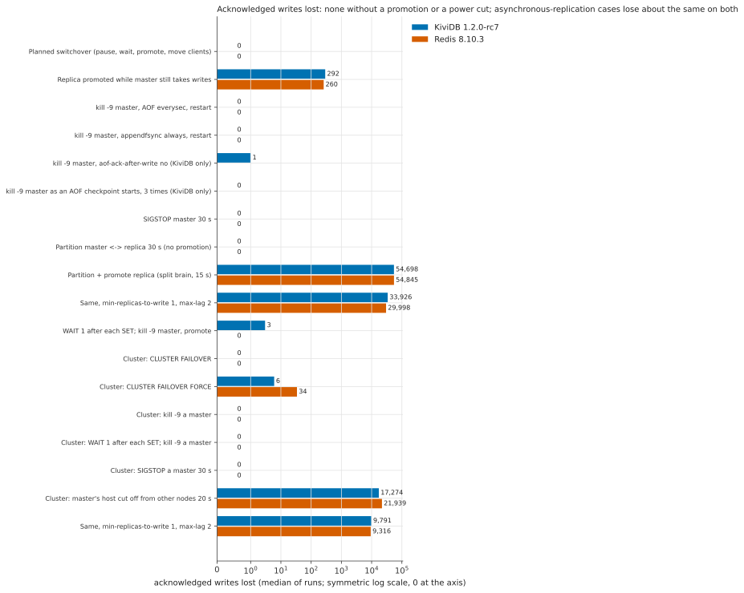
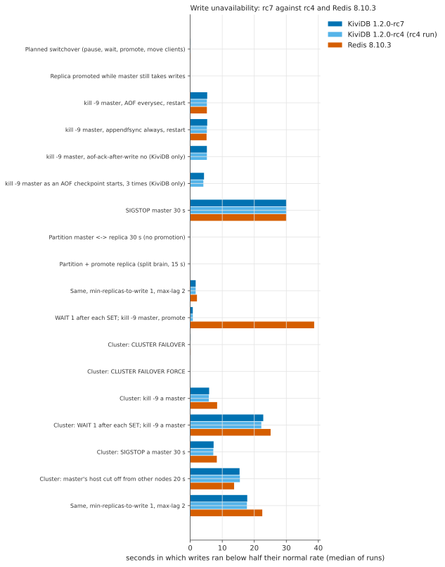
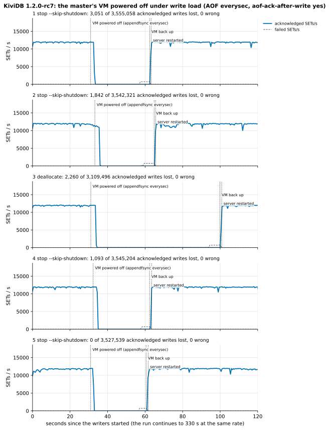
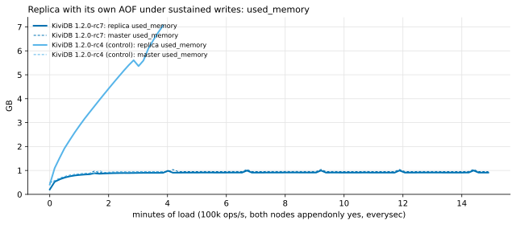

# KiviDB 1.2.0-rc7: failover and durability, final tests

**Build under test:** tag `v1.2.0-rc7`, commit `598b74d2` (branch `release/1.2.0`), release run 41509100399 (green).
The binary is the published default variant, `kividb-linux-x86_64.tar.gz` from the ORAS artifact
`ghcr.io/kividbio/kividb-binaries:v1.2.0-rc7`, with `SHA256SUMS.txt` verified. Controls used the published rc6 and rc4
binaries the same way. Redis is **8.10.3**, `redis-server` from the official `redis:8.10.3` image.

## Verdict

**Every check passes. No crash, and no server failed to start. The one acknowledged write lost outside a documented
window was a replica promoted past a write it never got: the asynchronous-replication window, counted on its own row
below.**

| # | Check | Result | Key numbers |
|---|---|---|---|
| 1 | The 17 failover scenarios of the rc4 run (+ `kill9_checkpoint`), rc7 and Redis 8.10.3, 3 runs each | **PASS** | 102 runs; rc7 acknowledged 33.3 M writes. **0 lost** wherever nothing is promoted past unreplicated writes: `kill -9` everysec/always 0 in 6 runs, 9 kills at checkpoint start 0, `SIGSTOP`, partition, `CLUSTER FAILOVER`, cluster `kill -9`. **0 wrong values, 0 WAIT-acknowledged writes lost, 0 replica differences.** Async-window losses are in line with rc4 and Redis. The one exception, cluster `SIGSTOP` rep 2 (1 write acknowledged 3 ms before the freeze, never streamed), is counted on its own row as "promoted past unreplicated writes". An instrumented re-run proves the mechanism: in 18 more stops, one more such write, found in the stopped master's AOF, with the replica exactly that one 78-byte record short |
| 2 | Three power-offs under write load, AOF on (+2 extra) | **PASS** | **Started by itself 5/5** (rc4: 0/2), including an AOF that ended in **550 zero bytes**. Lost 3,051 / 1,842 / 2,260 / 1,093 / 0 acknowledged writes, all within the last **≤ 0.256 s** before the cut (the documented everysec window). Each writer lost exactly its last writes; 0 wrong values. Synthetic zero tails: rc7 starts, rc4 refuses |
| 3 | Expired keys and fields stay gone after AOF replay | **PASS** (rc6 FAILS) | rc6 brought back h/s/l (DBSIZE 3) and field `g`, in 3/3 runs. rc7 matches Redis 8.10.3 in 3/3: all gone, and still gone after a second restart, one `UNLINK` per key in the AOF |
| 4 | Parikalp's slab race test (rc7 tag + `port-a.patch`, built on a VM) | **PASS** | **20/20 passed** (+3/3 as the child). Control rc4 + his repro, rebuilt: **0/10** ("the block T2 holds, handed out again") |
| 5 | MIGRATE with `--io-model tokio` and a slow destination | **PASS** | Failpoint probe: rc7 **0/10** stalls (0/10 with MIGRATE sent at once); rc4 10/10. A destination silent for 3 s: rc7 **0/10** stalled trials, worst PING **1 ms**; rc4 5/5, PING 2.9 s |
| 6 | Replica with its own AOF, 15 min at 100k ops/s | **PASS** | Replica `used_memory` **0.91 GB, flat** (max 1.00 GB). 85 checkpoints, median 0.74 s, none stuck. 1,275,828 keys compared, **0 differences**. rc4 control: 7.06 GB after 240 s, rising 1.4 GB/min |

Regressions against rc4/rc5/rc6: none found. `kill9_noack` lost 0-6 writes against rc4's 0-1 (median 1). That is
the documented behaviour of `aof-ack-after-write no`.

## Set-up

**Region: Azure Korea Central, not Germany West Central.** The RG `kividb-rc7-failover` was created in
germanywestcentral, but every VM size was refused there for this subscription (`SkuNotAvailable`, "capacity
restrictions"). The fallback, francecentral, refused D4s_v5, D4s_v6, D4as_v5, D4ds_v5, D4ls_v5, D4ads_v5, F4s_v2 and
E4s_v5 in all three zones. northeurope refused D4s_v5 too, and westeurope is "not accepting new customers". Korea Central
accepted D4s_v5, and the coordinator confirmed that no other agent was using it. The RG keeps its name, so its metadata
says germanywestcentral, but every VM ran in koreacentral.

Each VM ran Ubuntu 24.04.5 (kernel 7.0.0-1017-azure) with accelerated networking and auto-shutdown set.

| VMs | Size | Role |
|---|---|---|
| `fo1`-`fo3`, client `foc` | Standard_D4s_v5 (4 vCPU Xeon Platinum 8370C, 16 GB), one PPG | failover scenarios, set A: reps 1 and 2 |
| `fo4`-`fo6`, client `fod` | the same, in the same PPG | failover scenarios, set B: rep 3 and `kill9_checkpoint` (run in parallel to save ~1.2 h) |
| `pf1`, client `pfc` | the same, in the same PPG | power-offs. `pf1` keeps its data on the 64 GB Premium SSD OS disk (`/data`), as in rc4 |
| `sm`, `sr`, load `sc` | Standard_D8ds_v5 ×2 (data on the local SSD `/mnt`), D8s_v5, second PPG | replica with its own AOF |
| `bld` | Standard_D16s_v5 | cargo build of the slab test, expire-replay repro, MIGRATE probes, zero-tail AOF |
| `fo1`-`fo3`, `foc` (again) | Standard_D4s_v5, one PPG, a fresh deployment after the first teardown | the instrumented `c_sigstop` re-run (18 stops) |

The rc4 run used the same VM size and harness in Central India. Rates differ a little between the two regions: KiviDB
reaches about 11,000-12,000 acknowledged SETs a second here, against ~10,000 there.

**Clients:** Python 3.12.3, redis-py 5.2.1 with hiredis 3.0.0. `redis-cli` 7.0.15 creates the clusters.

**Harnesses:** these come from `benchmarks/1.2.0/` at `598b74d2`. The failover harness there is byte-identical to rc4's.
They are used unchanged, with these exceptions (everything is in `harness/`):

- **`pl_drive.sh` (the known bug, fixed).** The wait loop at the end treated an SSH failure (exit 255) as "the scenario
  has finished". On rc5 this let the next rep start and wipe a running one. Now every remote call is retried while
  `ssh` itself fails, and the script waits until no `fo_run.sh` is running before it starts. It also takes
  `STOP_MODE=deallocate` for a hard deallocate. The retry was needed for real in power-off 4: the driver's host list
  was being rewritten for a few seconds, 8 SSH calls failed with 255, and the run carried on correctly.
- **`ackcheck.py`.** This is the rc6 soak's copy. It also writes `lost.json`, which lists every lost write with the
  time it was acknowledged.
- **`fo_run.sh`.** Before the server restarts after a power-off, it records the AOF's size, how many zero bytes it ends
  in, and its last bytes (`aoftail.sh`, power-offs 4 and 5).
- **New scripts:**
  - `suite_b.sh` (set B's share of the scenarios);
  - `pl_analyze.py` (where lost writes fall relative to the cut);
  - `pl_chart.py`;
  - `cmp_rc4.py` (the rc7/rc4/Redis table);
  - `run_ra.sh` and `ra_report.py` (replica AOF);
  - `bld.sh` and `bld_prep.sh` (build VM);
  - `expire_more.sh`, `migrate_slowdst.py` and `zero_tail.sh`.
- **Unchanged copies:** `expire_replay.sh` and `field_replay.sh` (from the expire fix), with one addition: they also
  start Redis as the reference.

## 1. The 17 failover scenarios of the rc4 run (plus `kill9_checkpoint`), rc7 against rc4 and Redis 8.10.3

**What ran:** the scenarios and the checker of `benchmarks/1.2.0/failover/README.md`, unchanged.
- **Load:** 16 writers, unique keys, every acknowledged `SET` recorded and read back at the end.
- **Runs:** three of each scenario per engine, 102 in all. KiviDB ran 54 of them and acknowledged 33.3 M writes; Redis
  ran 48 and acknowledged 27.6 M.
- **Same as rc4:** the scenario list, the timings and the topologies (standalone master + replica; cluster of 3
  masters + 3 replicas with `cluster-node-timeout 5000`).
- **Column sources:** "rc4" is the rc4 run's own `summary.csv`, the same harness on the same VM size. "Redis" is
  Redis 8.10.3 in this run.

| Scenario | Runs rc7 / rc4 / Redis | Lost acked: rc7 | rc4 | Redis | WAIT-acked lost: rc7 / rc4 / Redis | Unavailable (s): rc7 | rc4 | Redis | Replica differs (rc7) | rc7 verdict |
|---|---|---|---|---|---|---|---|---|---|---|
| Planned switchover (pause, wait, promote, move clients) | 3 / 3 / 3 | 0 | 0 | 0 | – / – / – | 0.1 | 0.1 (0.0–0.1) | 0.1 | 0 | pass |
| Replica promoted while master still takes writes | 3 / 3 / 3 | 292 (238–301) | 243 (209–258) | 260 (256–286) | – / – / – | 0.0 | 0.0 | 0.0 | 0 | pass (loss expected: async replication) |
| kill -9 master, AOF everysec, restart | 3 / 3 / 3 | 0 | 0 | 0 | – / – / – | 5.3 | 5.2 | 5.2 (5.2–5.3) | 0 | pass |
| kill -9 master, appendfsync always, restart | 3 / 3 / 3 | 0 | 0 | 0 | – / – / – | 5.3 (5.2–5.3) | 5.2 (5.2–5.3) | 5.1 | 0 | pass |
| kill -9 master, aof-ack-after-write no (KiviDB only) | 3 / 3 / – | 1 (0–6) | 0 (0–1) | – | – / – / – | 5.2 (5.2–5.3) | 5.2 (5.2–5.3) | – | 0 | pass (documented: may lose the last few) |
| kill -9 master as an AOF checkpoint starts, 3 times (KiviDB only) | 3 / 3 / – | 0 | 0 | – | – / – / – | 4.3 (4.2–4.5) | 4.1 (4.0–4.3) | – | 0 | pass |
| SIGSTOP master 30 s | 3 / 3 / 3 | 0 | 0 | 0 | – / – / – | 30.0 | 30.0 | 30.0 | 0 | pass |
| Partition master <-> replica 30 s (no promotion) | 3 / 3 / 3 | 0 | 0 | 0 | – / – / – | 0.0 | 0.0 | 0.0 | 0 | pass |
| Partition + promote replica (split brain, 15 s) | 3 / 3 / 3 | 54,698 (52,657–54,748) | 49,585 (48,147–49,595) | 54,845 (53,377–54,847) | – / – / – | 0.0 | 0.0 | 0.0 | 0 | pass (loss expected: async replication) |
| Same, min-replicas-to-write 1, max-lag 2 | 3 / 3 / 3 | 33,926 (33,740–34,170) | 31,336 (30,915–33,994) | 29,998 (29,165–30,392) | – / – / – | 1.7 (1.7–1.8) | 1.7 | 2.1 (2.0–2.1) | 0 | pass (loss expected: async replication) |
| WAIT 1 after each SET; kill -9 master, promote | 3 / 3 / 3 | 3 (0–6) | 0 (0–2) | 0 | 0 / 0 / 0 | 0.8 | 0.8 | 38.7 | – | pass (no WAIT-acked write lost) |
| Cluster: CLUSTER FAILOVER | 3 / 3 / 3 | 0 | 0 | 0 | – / – / – | 0.1 (0.0–0.1) | 0.0 | 0.1 | – | pass |
| Cluster: CLUSTER FAILOVER FORCE | 3 / 3 / 3 | 6 (4–7) | 5 (5–7) | 34 (33–336) | – / – / – | 0.0 | 0.0 | 0.0 (0.0–0.1) | – | pass (loss expected: async replication) |
| Cluster: kill -9 a master | 3 / 3 / 3 | 0 | 0 | 0 | – / – / – | 5.9 (5.6–6.1) | 5.8 (5.7–5.9) | 8.4 (7.3–9.3) | – | pass |
| Cluster: WAIT 1 after each SET; kill -9 a master | 3 / 3 / 3 | 0 | 1 (0–7) | 0 | 0 / 0 / 0 | 22.8 (22.6–23.0) | 22.2 (20.5–22.3) | 25.1 (25.0–25.1) | – | pass (no WAIT-acked write lost) |
| Cluster: SIGSTOP a master 30 s (writes the replica had received) | 3 / 3 / 3 | 0 | 0 | 0 | – / – / – | 7.3 (7.2–7.3) | 7.2 (7.1–7.3) | 8.3 (8.2–8.3) | – | pass |
| ↳ of which promoted past unreplicated writes (async window) | 3 / 3 / 3 | 1 (rep 2 only: acknowledged 3 ms before the SIGSTOP) | 0 | 0 | – / – / – | – | – | – | – | expected (see the note below) |
| Cluster: master's host cut off from other nodes 20 s | 3 / 3 / 3 | 17,274 (15,593–17,867) | 14,176 (14,017–16,132) | 21,939 (19,062–23,843) | – / – / – | 15.4 (15.3–15.9) | 15.5 (15.5–15.6) | 13.7 (13.4–14.8) | – | pass (loss expected: async replication) |
| Same, min-replicas-to-write 1, max-lag 2 | 3 / 3 / 3 | 9,791 (9,785–9,950) | 9,094 (8,462–9,556) | 9,316 (6,382–9,417) | – / – / – | 17.8 (17.8–17.9) | 17.7 (17.6–17.7) | 22.5 (22.5–24.1) | – | pass (loss expected: async replication) |

Medians over the runs, with the range in brackets. "Unavailable" counts the seconds in which writes ran below half
their normal rate. Full per-engine tables, with acknowledged-write counts and recovery times, are in
`results/table.md`; one row per run is in `results/summary.csv`.





**Findings:**

- **No acknowledged write was lost where nothing is promoted past writes the replica never got.** That covers the
  planned switchover, `kill -9` of the master (everysec and "always", 0 in 6 runs), `kill -9` at a checkpoint's start
  (9 kills), `SIGSTOP`, a master/replica partition, `CLUSTER FAILOVER` and `kill -9` of a cluster master. No run
  returned a wrong value: 0 in 102.
- **Replicas converged.** After every standalone run a full key-by-key compare found 0 differences.
- **`WAIT`-acknowledged writes:** none was lost, standalone or cluster, on either engine. The known io_uring `WAIT`
  issue (rc4 README; also in 1.1.3) is unchanged: ~3,100-3,400 WAIT-acknowledged pairs per run against ~115,000 for
  Redis, the same as rc4's 1,154-3,313.
- **Where asynchronous replication must lose writes, rc7 loses about what rc4 and Redis lose.** These are a replica
  promoted while the master still takes writes, the split brain, `CLUSTER FAILOVER FORCE`, and a cluster master cut off
  on the minority side.
  - `min-replicas-to-write` narrows the loss the same way.
  - rc7's split-brain loss (54,698) is 10% above rc4's (49,585) and equal to Redis in this run (54,845). The writes run
    ~10% faster in this region.
- **Failover time:** a killed cluster master's slots were writable again after 5.9 s (rc4 5.8 s, Redis 8.4 s).
- **`kill9_noack`** (`aof-ack-after-write no`, KiviDB only) lost 1 write median, 0-6 over the runs (rc4: 0-1). That
  setting acknowledges a write once it is queued, and the docs say a killed process can lose the last few, so it is
  documented behaviour. The default, `yes`, lost 0.

### The one cluster `SIGSTOP` loss: a replica promoted past a write it never got

**What happened** (`c_sigstop`, rep 2):
- `ack:3:12276` was acknowledged at t = 20.281 s, **3 ms before** the harness logged `SIGSTOP` of master `fo1:7001`
  (20.284 s).
- The replica `fo2:7002` was marked FAIL, won the election and took over the slots. The old master resumed at t = 50 s,
  followed the new master and full-resynced.
- 1 write lost, 0 wrong values. Reps 1 and 3 lost 0; rc4 lost 0 in 3 runs; Redis lost 0 in 3 runs here.

**Evidence from that run's server logs** (`results/runs/rc7/kividb/c_sigstop/2/logs-fo{1,2}.tgz`):

```
fo2:7002  22:14:48.307 Replication: Promoted; the stream 2195f3d4… goes on as 0b091cf9… from offset 5068483
fo1:7001  22:15:13.277 Replication: Full resync from 0b091cf9… offset=11172107
fo1:7001  22:15:13.310 Replication: Dropped the 65926 local keys before loading 143414 from the master
fo1:7001  22:15:13.452 Replication: Backlog restarted at offset 11172107 (it ended at 5069835)
```

- **The replica was behind.** The old master's replication stream ended at offset **5,069,835**. The replica was
  promoted at **5,068,483**, so **1,352 bytes** of the old master's stream never reached it. One of these `SET`s is
  78 bytes on the wire, so the gap is about 17 writes.
- **What the poller saw** (`repl.csv`): 0.4 s before the stop, the replica was at 4,960,581 and catching up; its offset
  stayed at 5,068,483 from the stop until it was promoted.
- **Where the write went.** The old master then dropped its own keys for the new master's dataset (the full resync
  above), and with them the writes in that gap.
- **The likely cause:** the write reached the old master's AOF and was acknowledged, but the `SIGSTOP` came before it
  was streamed to the replica. That run's AOF was gone, so this is inferred here; the re-run below shows it directly.

**The instrumented re-run** (`harness/sigstop_probe.sh`, `fo_run_sigstop_probe.sh`):
- **Why it was needed:** that run's AOFs no longer existed, because each scenario wipes the servers' data at its start.
- **What it adds:** the same scenario, 18 more times on a fresh set of VMs. At t = 47 s, while the old master is still
  stopped, it copies the master's AOF. Every write it acknowledged is in that file, since replies wait for the AOF
  write. For each run it records:
  - the replica's promotion offset and the old master's stream end, both from the logs;
  - the AOF's size;
  - for every lost acknowledged write, whether it is in that AOF.

| Rep | Replica promoted at | Old master's stream ended at | Stream past the replica (bytes) | Old master's AOF at the stop (bytes) | Replica vs AOF | Acknowledged writes lost | Lost write in the old master's AOF |
|---|---|---|---|---|---|---|---|
| 1 | 4,867,969 | 4,868,535 | 566 | 4,867,941 | AOF + 28 (has all of it) | 0 | – |
| 2 | 4,961,647 | 4,962,921 | 1,274 | 4,961,619 | AOF + 28 (has all of it) | 0 | – |
| 3 | 4,808,459 | 4,809,733 | 1,274 | 4,808,431 | AOF + 28 (has all of it) | 0 | – |
| 4 | 4,951,633 | 4,952,275 | 642 | 4,951,605 | AOF + 28 (has all of it) | 0 | – |
| 5 | 4,876,541 | 4,877,815 | 1,274 | 4,876,513 | AOF + 28 (has all of it) | 0 | – |
| 6 | 4,912,281 | 4,913,555 | 1,274 | 4,912,253 | AOF + 28 (has all of it) | 0 | – |
| 7 | 4,701,861 | 4,702,505 | 644 | 4,701,833 | AOF + 28 (has all of it) | 0 | – |
| 8 | 4,889,059 | 4,890,333 | 1,274 | 4,889,031 | AOF + 28 (has all of it) | 0 | – |
| 9 | 4,858,505 | 4,859,779 | 1,274 | 4,858,477 | AOF + 28 (has all of it) | 0 | – |
| 10 | 4,915,381 | 4,916,655 | 1,274 | 4,915,353 | AOF + 28 (has all of it) | 0 | – |
| 11 | 4,794,559 | 4,795,833 | 1,274 | 4,794,531 | AOF + 28 (has all of it) | 0 | – |
| 12 | 4,927,301 | 4,928,575 | 1,274 | 4,927,273 | AOF + 28 (has all of it) | 0 | – |
| 13 | 4,759,899 | 4,761,173 | 1,274 | 4,759,871 | AOF + 28 (has all of it) | 0 | – |
| 14 | 4,937,661 | 4,938,935 | 1,274 | 4,937,633 | AOF + 28 (has all of it) | 0 | – |
| 15 | 4,851,325 | 4,852,599 | 1,274 | 4,851,297 | AOF + 28 (has all of it) | 0 | – |
| 16 | 4,909,363 | 4,910,087 | 724 | 4,909,413 | **78 bytes short** | **1: `ack:6:11942`, acknowledged at 20.579 s (2 ms before the SIGSTOP was logged)** | **yes** |
| 17 | 4,898,547 | 4,899,821 | 1,274 | 4,898,519 | AOF + 28 (has all of it) | 0 | – |
| 18 | 4,893,367 | 4,894,641 | 1,274 | 4,893,339 | AOF + 28 (has all of it) | 0 | – |

**What the re-run shows:**
- **Normally the replica has everything in the AOF.** In 17 of the 18 stops, the replica was promoted at exactly the
  old master's AOF size + 28 bytes (the stream's fixed lead). The stream past it (566-1,274 bytes) held writes that
  had not reached the AOF, so they were not yet acknowledged, and none of those was lost.
- **Rep 16 caught the loss directly.**
  - `ack:6:11942` was acknowledged 2 ms before the `SIGSTOP` was logged.
  - It is in the stopped old master's AOF.
  - The replica was promoted at 4,909,363, **78 bytes short** of that AOF + 28. 78 bytes is exactly one such record:
    `SET ack:6:11942 <40-byte value>` in RESP (4 + 9 + 18 + 47).
  - The old master then full-resynced from the new master and dropped its keys:
    `Dropped the 63898 local keys…`, `Backlog restarted at offset 10307745 (it ended at 4910087)`.
- **The suite's rep 2 matches the same pattern.** Its stream past the replica was 1,352 bytes, exactly 78 more than
  the usual 1,274. That run's AOF was gone by then, so only rep 16 shows the record in the AOF directly.
- **So the mechanism is proven.** The write reached the old master's AOF and was acknowledged (replies wait for the
  AOF write). The `SIGSTOP` landed before the record was streamed to the replica, and the replica was promoted without
  it.
- **How often:** 2 of 21 stops on rc7 lost exactly one write each. rc4 lost 0 of 3 and Redis 0 of 3, too few stops to
  tell the rates apart.

This is the asynchronous-replication window. A replica is promoted past writes it never got, as in Redis Cluster
without `WAIT`, and as the rc4 README counts for `promote_abrupt` and `c_failover_force`. It is not a durability bug: no
`WAIT`-acknowledged write was lost in any run, and nothing in the stream the replica had received was lost.

## 2. Power-offs under write load, AOF on

**The run:**
- **Load:** 16 `ackcheck.py` writers against `pf1` (rc7, `appendonly yes`, `appendfsync everysec`,
  `aof-ack-after-write` at its default `yes`), about 12,000 acknowledged SETs a second.
- **The cut:** at t ≈ 30 s the laptop powered the VM off with no OS shutdown, then started it again. The server was
  restarted from disk with nothing cut by hand.
- **The method:** reps 1, 2, 4 and 5 used `az vm stop --skip-shutdown`; rep 3 used `az vm deallocate`. That was a hard
  stop too: `wtmp` holds no shutdown record for any boot, and the server logged no shutdown.
- **The extra runs:** the three asked for are reps 1-3. Reps 4 and 5 were added to catch the AOF's tail as the power
  cut left it.

| Rep | Power-off | Acked writes | Lost acked | Lost writes acknowledged within … before the cut | Wrong value | AOF at restart | Started by itself | Replay |
|---|---|---|---|---|---|---|---|---|
| 1 | stop --skip-shutdown | 3,555,058 | 3,051 | 0.256 s | 0 | 57-byte torn tail, cut with the `[WARN] AOF ended with a partial record…` | **yes** | 390,780 keys, 0.35 s |
| 2 | stop --skip-shutdown | 3,542,321 | 1,842 | 0.169 s | 0 | 234-byte torn tail, cut | **yes** | 422,774 keys, 0.36 s |
| 3 | deallocate | 3,109,496 | 2,260 | 0.187 s | 0 | 143-byte torn tail, cut | **yes** | 403,218 keys, 0.38 s |
| 4 | stop --skip-shutdown | 3,545,204 | 1,093 | 0.091 s | 0 | **ended in 550 zero bytes** (seen before the restart), cut | **yes** | 413,115 keys, 0.38 s |
| 5 | stop --skip-shutdown | 3,527,539 | **0** | – | 0 | clean (0 trailing zeros) | **yes** | 383,234 keys, 0.35 s |

- **Every server started by itself**, including the one whose AOF ended in 550 zeros (rep 4). rc4 refused to start
  after both of its power-offs.
- **What `aof-ack-after-write yes` promises.** It promises that a write is in the file (the page cache) before it is
  acknowledged. A killed process then loses nothing: the `kill -9` rows below show 0, in every run. A power cut can
  still lose what the once-a-second `fsync` had not reached yet, as `docs/PERSISTENCE.md` says ("a power failure can
  lose up to a second").
- **What the power cuts lost was exactly that and no more** (`pl_analyze.py`):
  - The writes lost were, for each of the 16 writers, exactly its last acknowledged writes before the cut. Nothing
    older was missing.
  - None was acknowledged after the restart.
  - None came back with another value.
  - They span at most 0.256 s before the last acknowledgement, inside the one-second window.
- **So "every acknowledged write kept" holds for process kills, not for power cuts with everysec.** KiviDB has no
  `appendfsync always` (accepted with a warning, no effect), so there is no setting that would make a power cut lose
  nothing. That is documented, not new.

| Build | Power-offs | Started by itself | Lost acked writes |
|---|---|---|---|
| rc4 (rc4 run) | 2 | 0 (needed `truncate`) | 1,714 (after the manual cut) |
| rc5 (rc5 check) | 3 | 3 | 0, 4,311, 2,493 (≤ 0.54 s) |
| **rc7** | 5 | **5** | 3,051, 1,842, 2,260, 1,093, 0 (≤ 0.256 s) |



**Zero tails made on purpose** (`zero_tail.sh`, 5,000 SETs, `kill -9`, then the file is damaged, then a restart):

| AOF after the damage | rc7 | rc4 |
|---|---|---|
| whole records + 400 zero bytes | **starts, 5,000/5,000 keys**, WARN "incomplete tail (400 bytes) is cut off" | refuses (FATAL bad file format) |
| last record cut in half + 400 zeros | **starts, 4,999 keys** (the torn record dropped), tail of 418 bytes cut | refuses |
| 400 zeros, **then a whole record** | **refuses**: `FATAL … bad file format at byte offset 172809` (damage, not a torn tail, as designed) | refuses |

Raw data:
- `results/power-off/<rep>/`: `summary.json`, `timeline.csv`, `events`, `lost.json.gz` (every lost write with its
  acknowledgement time), the server's log, and `aof-before-restart.txt` for reps 4 and 5;
- `results/power-off/pl-analysis.jsonl`;
- `results/bld/zerotail/`.

`acked.json` (~115 MB per run) was not kept.

## 3. Expired keys and fields after AOF replay (rc6 fails, rc7 passes)

Each script ran three times per build, every time with the same result (`results/bld/expire/`, summary in
`results/bld/summary.txt`). The setup is `appendfsync always`. Each key gets a TTL, then a write that keeps the TTL;
the server is killed with `kill -9` before the deadline and restarted after it.

**`expire_replay.sh`** (the repro from the rc6 soak's finding A): `HSET h f0 v0; PEXPIRE h 2000; HSET h f1 v1`,
the same for a string (`APPEND`) and a list (`RPUSH`).

| Build | After the restart |
|---|---|
| rc6 | **h back as a hash with one field and no TTL, s = "x" with no TTL, l = [b] with no TTL; DBSIZE 3** (3/3 runs) |
| **rc7** | **h, s, l gone; DBSIZE 0** (3/3) |
| Redis 8.10.3 | h, s, l gone; DBSIZE 0 (3/3) |

**`field_replay.sh`**: hash-field TTLs. Field `g` gets `HPEXPIRE` then `HINCRBY` (the TTL is kept). Field `f` gets
`HPEXPIRE` then `HSET` (HSET clears a field's TTL, so `f` must stay).

| Build | After the restart |
|---|---|
| rc6 | `g` **back** as 1 with no TTL, HLEN 2 (3/3) |
| **rc7** | `g` gone, `f` kept with no TTL, HLEN 1 (3/3) |
| Redis 8.10.3 | the same as rc7 (3/3) |

**`expire_more.sh`** (new): every EXPIRE form on four types, two hash fields, a control key, two restarts.
- **Keys:** `EXPIRE` on a hash, `PEXPIREAT` on a string, `EXPIREAT` on a zset and `PEXPIRE` on a set, each followed by
  a write.
- **Fields:** `HPEXPIRE`+`HINCRBY` and `HPEXPIREAT`+`HINCRBYFLOAT`.
- **Control:** a list with a TTL an hour ahead.
- **Restarts:** the server restarts after the deadlines, then again from the AOF the first restart wrote.

| Build | After restart 1 | After restart 2 | Deletion records in the AOF |
|---|---|---|---|
| rc6 | **all four keys back, both fields back** | still back | 0 |
| **rc7** | all four gone, both fields gone, `hq` keeps `keep`; the control keeps its TTL (3,597 s) and both elements | the same | **4** (one `UNLINK` per key) |
| Redis 8.10.3 | the same as rc7 | the same as rc7 | (Redis keeps its AOF in `appendonlydir/`, not counted) |

## 4. Slab race test (Parikalp's), from source

**Build:** `v1.2.0-rc7` (598b74d2) plus `r12verify/port-a.patch` (only `src/value_slab.rs`: +281/-3, test hooks and
the test). Built with rustc 1.99.1 (latest stable) on `bld` and run
`cargo test --release --lib -- --exact value_slab::tests::plan_evacuation_never_takes_a_slab_a_thread_owns`. The test
re-runs itself in a child process.

| Build | Result |
|---|---|
| **rc7 + port-a.patch** | **20 of 20 passed**, and 3 of 3 run directly as the child (`KIVIDB_VALUE_SLAB_ALONE=1`) |
| rc4 + `r12-repro-on-a6b1bf3.patch` (control, rebuilt here) | **0 of 10 passed**: `assertion left != right failed: the block T2 holds, handed out again` (left == right, the same address), as in the earlier 10/10 failure |

Logs: `results/bld/slab/`.

## 5. MIGRATE with `--io-model tokio`: a slow destination does not stall other connections

**The repo's probe** (`fixes/migrate-tokio-stall/probe.py`): two nodes, `--io-model tokio --threads 2`, with the
`migrate-before-delete` failpoint holding MIGRATE. A `PING` goes out from a fresh connection, with a 3 s timeout.

| Build | MIGRATE sent | Stalled |
|---|---|---|
| **rc7** | 200 ms after connecting | **0/10** |
| **rc7** | at once | **0/10** |
| rc6 | 200 ms after connecting | 0/10 |
| rc4 (control) | 200 ms after connecting | **10/10** |

**A slow destination** (new, `migrate_slowdst.py`):
- **The destination:** a fake one that accepts MIGRATE's connection, then answers nothing for 3 s, then `+OK`.
- **The source:** real KiviDB with `--io-model tokio --threads 2`, MIGRATE timeout 5,000 ms.
- **While MIGRATE waits:** every 0.25 s, a PING goes out on a fresh connection and another on a connection opened
  before the MIGRATE. A PING slower than 1 s, or unanswered, is a stall.

| Build | MIGRATE sent | Trials with a stall | PINGs during the wait | Worst PING |
|---|---|---|---|---|
| **rc7** | 200 ms after connecting | **0/10** (and 0/5 in a first run) | 22 per trial | **1 ms** |
| **rc7** | at once | **0/10** | 22 per trial | ≤ 1 ms |
| rc6 | 200 ms after connecting | 0/5 | 22 per trial | ≤ 1 ms |
| rc4 (control) | 200 ms after connecting | **5/5** | 2 per trial (the first waited) | **2.9 s**, the whole MIGRATE |

Every MIGRATE answered `+OK` after 3.01 s on every build. Outputs: `results/bld/migrate/`.

## 6. Replica with its own AOF under sustained writes

**Harness:** `fixes/replica-aof/harness/replica_mem.sh`, run unchanged through `run_ra.sh`.
- **Nodes:** a fresh master and replica, both `appendonly yes` / `everysec`, on the local SSD.
- **Load:** 1 M keys prefilled, then the soak mix at 100,000 ops/s with 128 connections (`soakgen`).
- **After the load:** a catch-up, then a full key-by-key compare (`compare.py`).

| | rc7, 15 min | rc4 control, 240 s |
|---|---|---|
| Replica `used_memory`, end / max | **0.91 / 1.00 GB**, flat (−0.2 MB/min over the second half) | **7.06 GB and rising ~1.4 GB/min** |
| Replica RSS, max | 1.22 GB | 7.42 GB |
| Master `used_memory` at the end | 0.95 GB | 0.94 GB |
| Replica AOF checkpoints | **85 completed, median 0.74 s, max 0.76 s**, none open at the end (master: 85) | 1 in 240 s, taking **155.6 s**, the next still open |
| `aof_rewrite_in_progress:1` samples | 7/90 (only samples that fell inside a 0.7 s checkpoint) | 20/24 |
| Load | 100,000 ops/s median, **0 errors** | 100,000 ops/s, 0 errors |
| After the load | offsets equal at the first poll (23,583,903,015); DBSIZE 1,276,708 = 1,276,708; **1,275,828 keys compared, 0 differences** (95 differed on the first pass while expiring, 0 after the recheck); `aof_acks_before_write` 0 | – |

This matches rc5's 15-minute check (0.91 GB flat, 85 checkpoints, median 0.71 s).



Raw data: `results/replica-aof/`, which holds:
- the per-10 s samples;
- both servers' logs;
- the load;
- the post-run checks;
- `compare.json`;
- `summary.csv`.

## Reproduce

1. **VMs:** create them as in the set-up table. On every VM, run `harness/base.sh <role>`. It installs `redis-tools`
   and ORAS, pulls and verifies the published binaries into `/opt/kv` (`/opt/kvrc4`, `/opt/kvrc6` for the controls),
   and unpacks `benchmarks/1.2.0` into `~/b` (`~/fo` is `~/b/failover`).
2. **Redis:** `redis-server` comes from `docker create redis:8.10.3` on a client and is copied to `/opt/redis` on the
   servers.
3. **Failover:**
   - Put the servers' private IPs in `~/fo/harness/hosts.env` on the client.
   - Run `bash ~/fo/harness/fo_all.sh "kividb redis" "" 2` on set A, and `bash suite_b.sh` (rep 3 and
     `kill9_checkpoint`) on set B.
   - Then merge the two result trees and run `python harness/fo_report.py <results> .` and
     `python harness/cmp_rc4.py results/summary.csv <rc4 summary.csv> .`.
4. **Power-offs:** from a machine with `az`, run
   `RG=… MASTER_VM=pf1 SSH_CLIENT="ssh azureuser@<client>" RES_DIR=pl-results STOP_MODE=stop|deallocate bash harness/pl_drive.sh kividb power_loss_everysec <rep>`.
   Then run `python3 harness/pl_analyze.py <run dirs>` on the client.
5. **Build VM:** `harness/bld_prep.sh`, then `harness/bld.sh` (needs `~/p/port-a.patch` and
   `~/p/r12-repro-on-a6b1bf3.patch`). After that:
   - `python3 harness/migrate_slowdst.py /opt/kv/kividb 10 0.2 3 5000`;
   - `bash harness/zero_tail.sh /opt/kv/kividb rc7`.
6. **Replica AOF:** on the load VM, run `bash harness/run_ra.sh <master-ip> <replica-ip> ~/ra-out`. The servers need
   `server.sh` and `sampler.sh` from `fixes/replica-aof/harness` in their home directories, and
   `/opt/kvrc3 -> /opt/kvrc4` for the control. Then run `python3 harness/ra_report.py ~/ra-out .`.

## Teardown

Every VM was deleted as soon as its part was done. The RG `kividb-rc7-failover` was deleted at 22:30 UTC, and
`az group exists` answered `false`. It was then re-created (koreacentral) for the instrumented `c_sigstop` re-run and
deleted again at the end: `az group delete -n kividb-rc7-failover --yes`, then
`az group exists -n kividb-rc7-failover` → **false** (checked after the final delete; no VM, disk or network left).
