# Failover and durability: acknowledged writes lost, and time to recover

**The question** (Hacker News, user *ignoramous*): "For a database, as always, durability guarantees
(in case of in-memory setups, this would translate to any of the 'reasonable' forms of consistency, like
read your writes) trump speed." So: when something breaks, which writes that the server said `OK` to
are gone afterwards, and how long are writes unavailable? Measured for KiviDB 1.2.0-rc4 and, the same
way, for Redis 8.10.3.

**Short answer for KiviDB 1.2.0-rc4, measured against Redis 8.10.3 the same way, three runs each:**

* **No acknowledged write was lost** where nothing promotes a replica past writes it never got.
  This covers a planned switchover, `kill -9` of the master with the AOF on (everysec and always), `kill -9`
  as an AOF checkpoint starts (9 kills), `SIGSTOP` for 30 s, a master/replica partition, `CLUSTER FAILOVER`,
  `kill -9` of a cluster master, and `SIGSTOP` of a cluster master past the node timeout. Redis lost 2
  acknowledged writes in one of its three `kill -9` everysec runs; KiviDB lost none in any of them.
* **`WAIT`-acknowledged writes:** none lost across `kill -9` and promotion, standalone or cluster, for
  either engine. But `WAIT` itself misbehaves on an io_uring master (Linux's default): see the
  [`WAIT` finding](#finding-wait-on-an-io_uring-master-misses-replica-acknowledgements-under-concurrency).
* **Where asynchronous replication must lose writes** (a replica promoted while the old master still
  takes them, a split brain, a cluster master cut off on the minority side), KiviDB loses about what
  Redis loses, and `min-replicas-to-write` narrows it the same way on both. Cluster failover after a
  killed master took **5.8 s for KiviDB and 7.9 s for Redis**, with a 5 s node timeout on both.
* **Power cut (VM powered off, no OS shutdown):** with everysec, KiviDB lost 1,714 acknowledged writes
  and Redis 748. Both are within the documented "up to one second" of writes (~11,000 a second here).
  KiviDB has no `appendfsync always`: the setting is accepted and does nothing, so a power cut costs it the
  same as everysec. Redis with `always` lost nothing.
* **Bug, needs a fix before 1.2.0:** after both power cuts on rc4, **KiviDB refused to start**. The AOF ended
  in a few hundred zero bytes, which ext4 leaves after a power loss, and rc4 read them as a damaged file
  rather than a truncated tail. An operator had to cut the file by hand. The fix on `release/1.2.0` at
  **93524a1b** (not rc4) starts by itself, loads every whole record and cuts the zeros:
  [details](#finding-after-a-power-cut-rc4-refuses-to-start-fixed-on-release120-at-93524a1b).

## How it is measured

A checker (`harness/ackcheck.py`, Python + redis-py) runs 16 writer threads. Each writer writes its own
sequence of unique keys `ack:<writer>:<n>` with a known value, as fast as one connection goes
(about 10,000 SETs a second in total), and records every `SET` the server acknowledged with `OK`.
Twenty seconds in, the scenario breaks something; the writers keep going, reconnecting (and, where the
scenario says so, switching to the new primary). When the run ends, every acknowledged key is read back
from the final primary (standalone) or through the cluster (cluster mode), and the checker counts the
acknowledged writes that are **missing or hold another value**. A write that failed or timed out is not
counted either way (the client was not told it succeeded).

* **Lost acked** = acknowledged writes missing afterwards. A loss is *expected* where a replica is
  promoted past writes it never received (asynchronous replication, in Redis and in KiviDB alike);
  it is a bug anywhere else.
* **WAIT-acked lost**: in the `WAIT` scenarios each `SET` is followed by `WAIT 1 200`, and a write counts
  as WAIT-acknowledged only when `WAIT` answered 1. Those must survive the promotion of that replica.
* **Writes unavailable**: the 100 ms intervals, from the event to 60 s after it, in which fewer than half
  the usual number of writes succeeded. **Recovery**: from the event to the end of the last such interval.
* **Replica differs after**: for the standalone scenarios, once the run is over and the replica has caught
  up, a full key-by-key comparison of primary and replica (`../soak/harness/compare.py`): keys that differ
  in value, type or presence of a TTL.

Each scenario ran three times per engine (power-off: once per engine and setting); tables give the median and, in brackets, the range.

### Scenarios

Standalone: one master (`ops-fo1`), one replica (`ops-fo2`), AOF on (everysec unless stated), clients on
`ops-foc`.

| Scenario | What happens at t = 20 s |
|---|---|
| `promote_graceful` | planned switchover: `CLIENT PAUSE 10000 WRITE` on the master, wait until the replica's offset equals the master's, `REPLICAOF NO ONE` on the replica, clients move, old master `REPLICAOF` the new one, `CLIENT UNPAUSE` |
| `promote_abrupt` | `REPLICAOF NO ONE` on the replica while the master still takes writes; clients move within ~50 ms; the old master is demoted at t = 22 s |
| `kill9_everysec` | `kill -9` of the master, restarted from its AOF at t = 25 s |
| `kill9_always` | the same with `appendfsync always` (KiviDB accepts the setting with a warning and keeps syncing once a second, see below) |
| `kill9_noack` | KiviDB only: the same with `aof-ack-after-write no` (acknowledge once the record is queued, as 1.1 did) |
| `kill9_checkpoint` | KiviDB only: 1 KB values (a checkpoint every few seconds); three times, `kill -9` of the master the moment its log says a checkpoint starts, restart 3 s later |
| `power_loss_everysec` / `power_loss_always` | the master's **VM is powered off** without an OS shutdown (`az vm stop --skip-shutdown`), powered on again, the server restarted from disk; no replica |
| `sigstop` | `SIGSTOP` of the master for 30 s, then `SIGCONT`; nothing is promoted |
| `partition` | `iptables` drops all traffic between master and replica for 30 s; clients still reach the master; nothing is promoted |
| `partition_promote` | split brain: the same partition, the replica promoted at t = 25 s and clients moved to it; healed and old master demoted at t = 35 s |
| `partition_promote_minrep` | the same with `min-replicas-to-write 1`, `min-replicas-max-lag 2` on the master |
| `wait_kill9_promote` | every `SET` followed by `WAIT 1 200`; `kill -9` of the master, replica promoted at t = 21 s |

Cluster: 3 masters + 3 replicas (`redis-cli --cluster create ... --cluster-replicas 1`), two nodes on
each of `ops-fo1..3`, `cluster-node-timeout 5000`, AOF on; the client is redis-py's `RedisCluster`. "The
master" is the one owning slot 0; "its replica" is that master's replica.

| Scenario | What happens at t = 20 s |
|---|---|
| `c_failover` | `CLUSTER FAILOVER` on the replica |
| `c_failover_force` | `CLUSTER FAILOVER FORCE` on the replica |
| `c_kill9` | `kill -9` of the master; restarted at t = 40 s (it rejoins as a replica) |
| `c_wait_kill9` | as `c_kill9`, every `SET` followed by `WAIT 1 200` |
| `c_sigstop` | `SIGSTOP` of the master for 30 s (longer than the node timeout: its replica is elected), then `SIGCONT` |
| `c_partition` | the master's VM is cut off (`iptables`) from the other two server VMs for 20 s, **not from the clients**; its replica is elected on the majority side |
| `c_partition_minrep` | the same with `min-replicas-to-write 1`, `min-replicas-max-lag 2` |

## Results

| Scenario | Engine | Runs | Acked writes | Lost acked | WAIT-acked lost | Writes unavailable (s) | Recovery (s) | Replica differs after |
|---|---|---|---|---|---|---|---|---|
| Planned switchover (pause, wait, promote, move clients) | KiviDB 1.2.0-rc4 | 3 | 633,351 (623,392–640,739) | 0 | – | 0.1 (0.0–0.1) | 0.1 (0.0–0.1) | 0 |
| Planned switchover (pause, wait, promote, move clients) | Redis 8.10.3 | 3 | 634,845 (625,383–642,647) | 0 | – | 0.1 (0.0–0.1) | 0.1 (0.0–0.1) | 0 |
| Replica promoted while master still takes writes | KiviDB 1.2.0-rc4 | 3 | 639,760 (625,526–644,587) | 243 (209–258) | – | 0.0 | 0.0 | 0 |
| Replica promoted while master still takes writes | Redis 8.10.3 | 3 | 640,300 (622,885–644,845) | 195 (180–319) | – | 0.0 | 0.0 | 0 |
| kill -9 master, AOF everysec, restart | KiviDB 1.2.0-rc4 | 3 | 580,235 (567,188–585,386) | 0 | – | 5.2 | 5.2 | 0 |
| kill -9 master, AOF everysec, restart | Redis 8.10.3 | 3 | 565,874 (563,580–584,421) | 0 (0–2) | – | 5.2 | 5.2 | 0 |
| kill -9 master, appendfsync always, restart | KiviDB 1.2.0-rc4 | 3 | 577,176 (569,725–578,202) | 0 | – | 5.2 (5.2–5.3) | 5.2 (5.2–5.3) | 0 |
| kill -9 master, appendfsync always, restart | Redis 8.10.3 | 3 | 259,719 (259,295–304,420) | 0 | – | 5.1 | 5.1 | 0 |
| kill -9 master, aof-ack-after-write no (KiviDB only) | KiviDB 1.2.0-rc4 | 3 | 578,489 (574,722–581,821) | 0 (0–1) | – | 5.2 (5.2–5.3) | 5.2 (5.2–5.3) | 0 |
| kill -9 master as an AOF checkpoint starts, 3 times (KiviDB only) | KiviDB 1.2.0-rc4 | 3 | 757,541 (744,377–757,549) | 0 | – | 4.1 (4.0–4.3) | 4.1 (4.0–4.3) | 0 |
| Power-off of the master's VM, AOF everysec, restart | KiviDB 1.2.0-rc4 | 1 | 2,865,769 | 1,714 | – | 45.3 | 47.7 | – |
| Power-off of the master's VM, AOF everysec, restart | Redis 8.10.3 | 1 | 3,459,183 | 748 | – | 24.8 | 26.9 | – |
| Power-off of the master's VM, appendfsync always, restart | Redis 8.10.3 | 1 | 1,509,762 | 0 | – | 25.8 | 27.6 | – |
| SIGSTOP master 30 s | KiviDB 1.2.0-rc4 | 3 | 527,707 (525,114–544,539) | 0 | – | 30.0 | 30.0 | 0 |
| SIGSTOP master 30 s | Redis 8.10.3 | 3 | 537,454 (531,678–541,447) | 0 | – | 30.0 | 30.0 | 0 |
| Partition master <-> replica 30 s (no promotion) | KiviDB 1.2.0-rc4 | 3 | 856,400 (849,990–867,186) | 0 | – | 0.0 | 0.0 | 0 |
| Partition master <-> replica 30 s (no promotion) | Redis 8.10.3 | 3 | 841,643 (834,072–853,371) | 0 | – | 0.0 | 0.0 | 0 |
| Partition + promote replica (split brain, 15 s) | KiviDB 1.2.0-rc4 | 3 | 737,599 (736,597–743,358) | 49,585 (48,147–49,595) | – | 0.0 | 0.0 | 0 |
| Partition + promote replica (split brain, 15 s) | Redis 8.10.3 | 3 | 740,544 (724,046–750,458) | 49,781 (47,789–50,595) | – | 0.0 | 0.0 | 0 |
| Same, min-replicas-to-write 1, max-lag 2 | KiviDB 1.2.0-rc4 | 3 | 716,466 (710,563–726,333) | 31,336 (30,915–33,994) | – | 1.7 | 4.7 | 0 |
| Same, min-replicas-to-write 1, max-lag 2 | Redis 8.10.3 | 3 | 720,668 (702,684–731,337) | 27,462 (26,742–27,686) | – | 2.1 | 4.7 | 0 |
| WAIT 1 after each SET; kill -9 master, promote | KiviDB 1.2.0-rc4 | 3 | 217,560 (210,951–221,837) | 0 (0–2) | 0 | 0.8 | 0.7 | – |
| WAIT 1 after each SET; kill -9 master, promote | Redis 8.10.3 | 3 | 112,104 (103,220–114,114) | 0 | 0 | 38.7 | 38.7 | – |
| Cluster: CLUSTER FAILOVER | KiviDB 1.2.0-rc4 | 3 | 533,758 (515,212–559,962) | 0 | – | 0.0 | 0.0 | – |
| Cluster: CLUSTER FAILOVER | Redis 8.10.3 | 3 | 553,166 (530,052–561,058) | 0 | – | 0.1 | 0.1 | – |
| Cluster: CLUSTER FAILOVER FORCE | KiviDB 1.2.0-rc4 | 3 | 557,569 (514,453–559,864) | 5 (5–7) | – | 0.0 | 0.0 | – |
| Cluster: CLUSTER FAILOVER FORCE | Redis 8.10.3 | 3 | 527,841 (506,937–538,625) | 17 (13–27) | – | 0.1 | 0.2 | – |
| Cluster: kill -9 a master | KiviDB 1.2.0-rc4 | 3 | 573,211 (565,250–589,574) | 0 | – | 5.8 (5.7–5.9) | 5.8 (5.7–6.2) | – |
| Cluster: kill -9 a master | Redis 8.10.3 | 3 | 552,949 (541,401–560,663) | 0 | – | 7.9 (7.7–8.3) | 7.9 (7.7–8.5) | – |
| Cluster: WAIT 1 after each SET; kill -9 a master | KiviDB 1.2.0-rc4 | 3 | 29,482 (28,646–32,702) | 1 (0–7) | 0 | 22.2 (20.5–22.3) | 48.7 (48.6–48.7) | – |
| Cluster: WAIT 1 after each SET; kill -9 a master | Redis 8.10.3 | 3 | 199,256 (196,479–208,130) | 0 | 0 | 25.1 (25.1–25.2) | 25.1 (25.1–25.7) | – |
| Cluster: SIGSTOP a master 30 s | KiviDB 1.2.0-rc4 | 3 | 651,799 (649,595–667,659) | 0 | – | 7.2 (7.1–7.3) | 7.3 (7.1–7.3) | – |
| Cluster: SIGSTOP a master 30 s | Redis 8.10.3 | 3 | 644,175 (643,447–661,455) | 0 | – | 8.2 (8.2–8.3) | 8.4 (8.2–8.4) | – |
| Cluster: master's host cut off from other nodes 20 s | KiviDB 1.2.0-rc4 | 3 | 492,729 (487,406–499,088) | 14,176 (14,017–16,132) | – | 15.5 (15.5–15.6) | 20.1 (20.0–20.5) | – |
| Cluster: master's host cut off from other nodes 20 s | Redis 8.10.3 | 3 | 510,544 (489,166–512,566) | 20,046 (19,047–22,079) | – | 13.6 (13.6–14.3) | 20.2 (20.1–20.2) | – |
| Same, min-replicas-to-write 1, max-lag 2 | KiviDB 1.2.0-rc4 | 3 | 469,721 (432,801–474,976) | 9,094 (8,462–9,556) | – | 17.7 (17.6–17.7) | 20.4 (20.3–20.4) | – |
| Same, min-replicas-to-write 1, max-lag 2 | Redis 8.10.3 | 3 | 387,881 (360,510–394,380) | 7,729 (7,067–8,113) | – | 23.5 (22.3–24.0) | 25.9 (24.8–26.0) | – |

Power-off rows ran once per engine and setting: each needs a VM to be stopped and started. The KiviDB
power-off row's 45 s of unavailability includes the time the harness waited before cutting the zero tail
by hand (rc4 refused to start, see below). In the `WAIT` rows, "unavailable" reflects `WAIT` more than
writes. After promotion the new master has no replica: KiviDB answers `WAIT` 0 at once, while Redis
waits out the 200 ms timeout. In the cluster `WAIT` row KiviDB's rate stays below half of an already low
baseline until the old master is back as a replica.

**release/1.2.0 at 93524a1b (not rc4), power-off with everysec, 2 runs:**

| Run | Acked writes | Lost acked | Torn tail at restart | Started by itself |
|---|---|---|---|---|
| 1 | 3,194,653 | 0 | none (the cut left a clean file) | yes |
| 2 | 3,130,594 | 7,178 (all acknowledged in the last 0.62 s before the power cut took effect) | 392 bytes, cut with a warning | yes |

Run 2's loss is the everysec window: about 0.6 s of writes at ~11,500 a second.

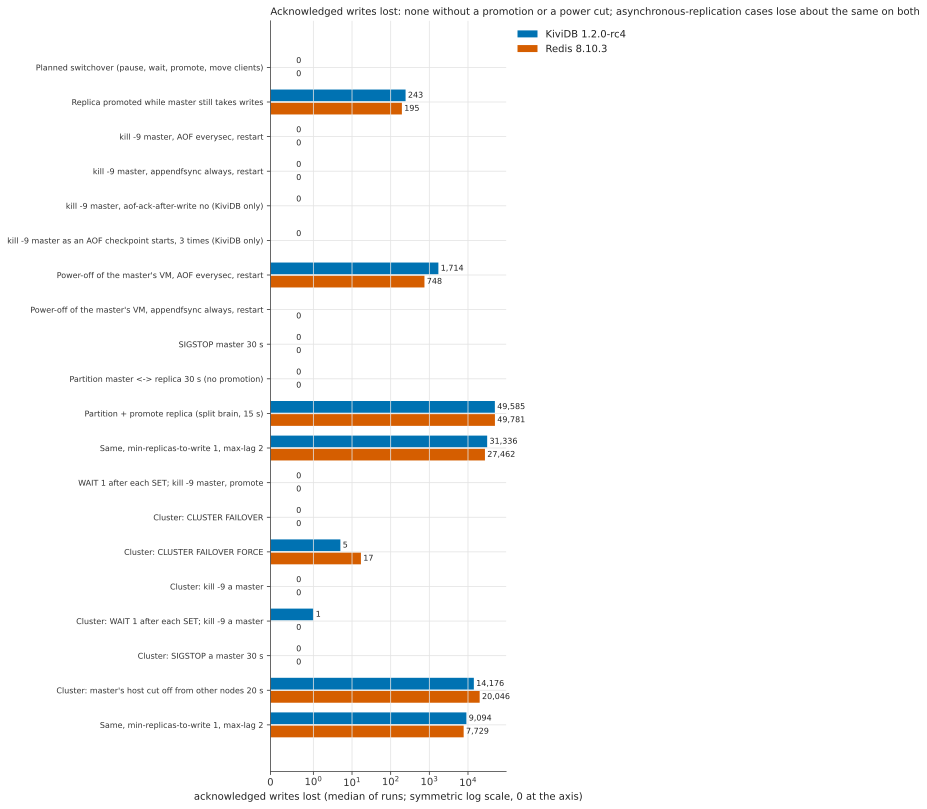

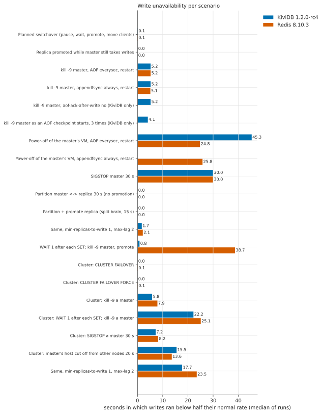

### Timelines (first run of each scenario; dotted lines are the events)

<details><summary><code>promote_graceful</code></summary>

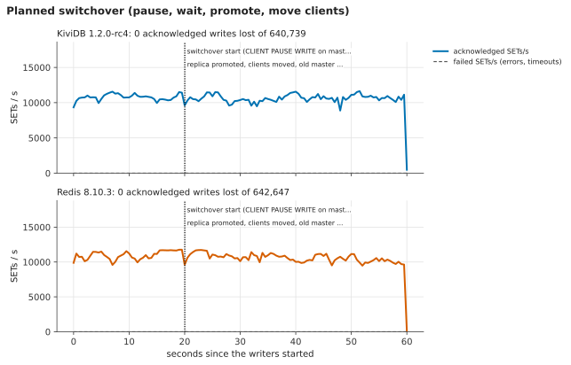

</details>

<details><summary><code>promote_abrupt</code></summary>

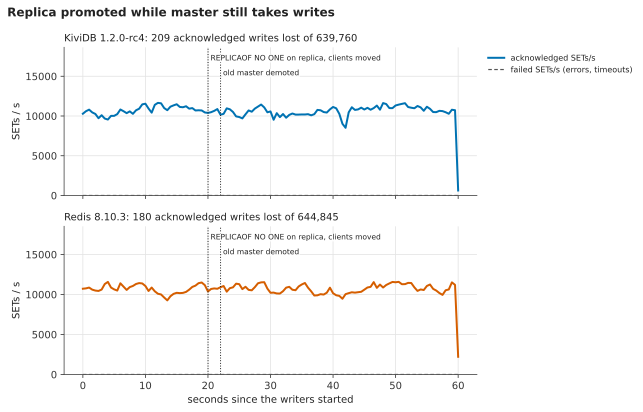

</details>

<details><summary><code>kill9_everysec</code></summary>

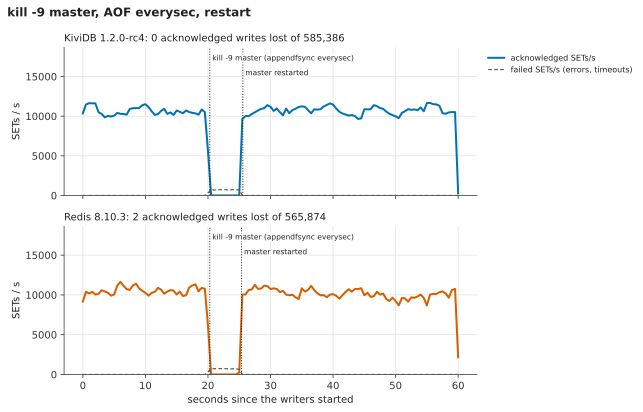

</details>

<details><summary><code>kill9_always</code></summary>

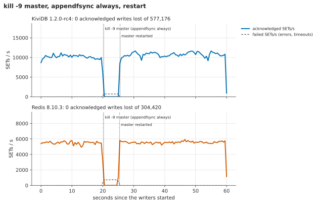

</details>

<details><summary><code>kill9_noack</code></summary>

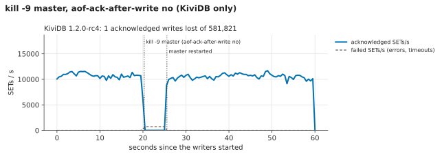

</details>

<details><summary><code>kill9_checkpoint</code></summary>

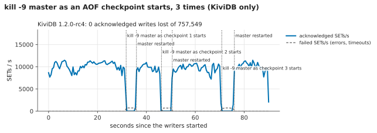

</details>

<details><summary><code>power_loss_everysec</code></summary>

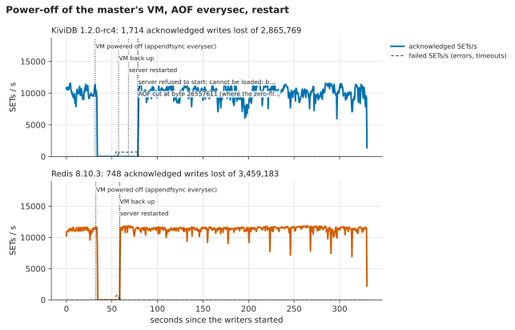

</details>

<details><summary><code>power_loss_always</code></summary>

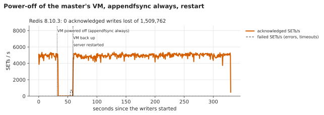

</details>

<details><summary><code>sigstop</code></summary>

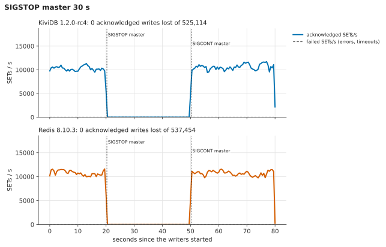

</details>

<details><summary><code>partition</code></summary>

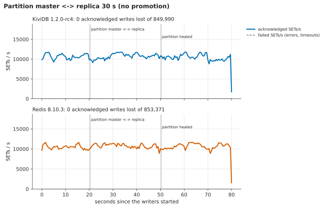

</details>

<details><summary><code>partition_promote</code></summary>

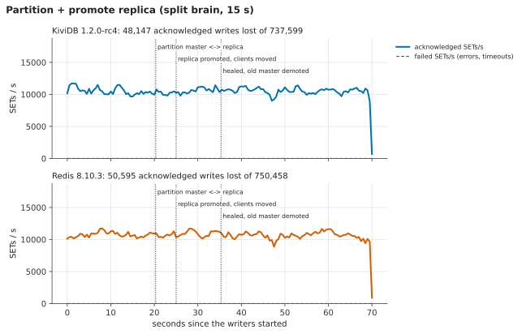

</details>

<details><summary><code>partition_promote_minrep</code></summary>

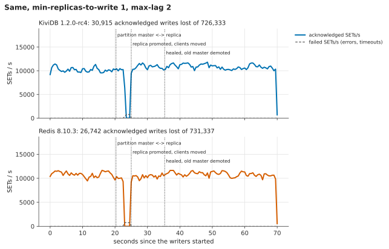

</details>

<details><summary><code>wait_kill9_promote</code></summary>

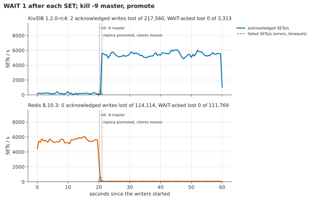

</details>

<details><summary><code>c_failover</code></summary>

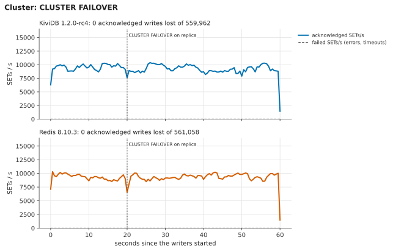

</details>

<details><summary><code>c_failover_force</code></summary>

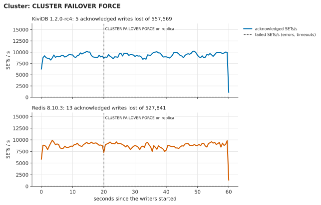

</details>

<details><summary><code>c_kill9</code></summary>

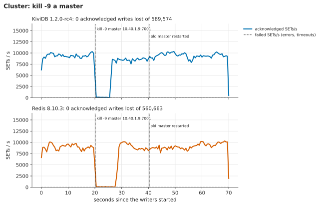

</details>

<details><summary><code>c_wait_kill9</code></summary>

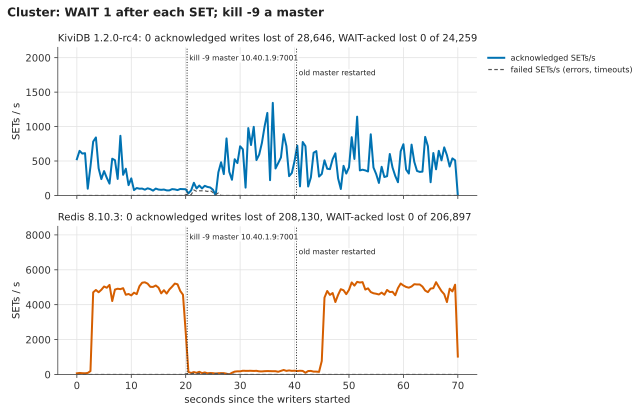

</details>

<details><summary><code>c_sigstop</code></summary>

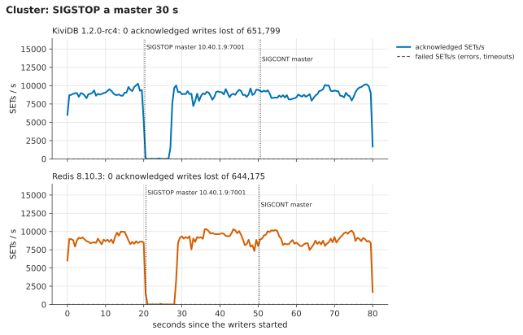

</details>

<details><summary><code>c_partition</code></summary>

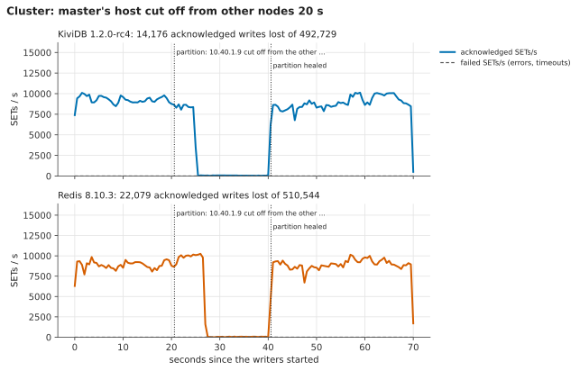

</details>

<details><summary><code>c_partition_minrep</code></summary>

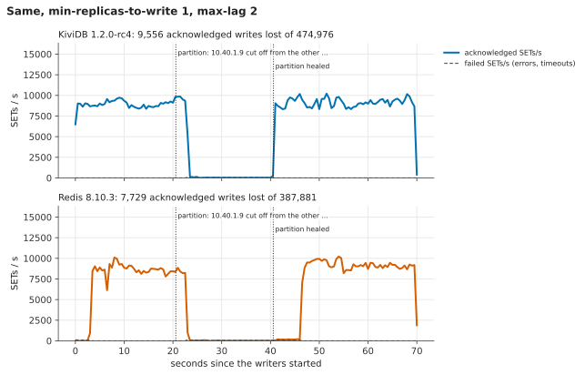

</details>


## Findings

### Finding: after a power cut, rc4 refuses to start (fixed on release/1.2.0 at 93524a1b)

Both power-offs on rc4 left `appendonly.aof` ending in bytes that are not a record (316 and 394 of them;
the first file was kept, and its tail is all zeros: `results/power-loss-torn-aof/`). ext4 had committed the
file's new size but not the data written last. rc4 stopped at them:

```
[FATAL] appendonly.aof cannot be loaded: bad file format at byte offset 27368063 of 27368379 — what follows is not a command record
[FATAL] Refusing to start with an empty dataset in place of one that could not be loaded. ...
```

Refusing beats starting empty, but after any power loss on ext4 this needs an operator, or the pod
crash-loops. Redis started by itself after its power-off. In the harness, an "operator" cut the file where
the zeros begin (`truncate -s <offset>`); the server then started, and the run lost 1,714 acknowledged
writes, all within the everysec window. `aof-load-truncated` is accepted and does nothing: rc4 already
loads a tail cut short, but it did not count zeros as a cut-short tail.

The fix on `release/1.2.0` at **93524a1b** treats zeros running to the end of the log as a truncated tail.
Zeros followed by records are still damage. Verified three ways:

* The saved torn file (`results/power-loss-torn-aof/`) loaded on both builds: rc4 refuses, while 93524a1b
  loads 352,184 keys including the last two whole records, cuts the 316 zero bytes and starts
  (`reload-saved-torn-aof.txt`).
* Two more power-offs on 93524a1b: both started by themselves. One cut a 392-byte torn tail with
  `[WARN] AOF ended with a partial record or transaction (likely an unclean shutdown); the incomplete tail
  (392 bytes) is cut off`; the other had no torn tail. Lost acknowledged writes: 0 and 7,178, the second
  all within the last 0.62 s.
* The smoke checks pass on that build: default variant 59/59, `lua,tls` 66/66
  (`../smoke/results/release-1.2.0-93524a1b/`).

Not tested specifically: #277, the power-loss gap while the AOF turns over at a checkpoint (a known open
issue). The power cuts here fell at arbitrary moments. At ~10,000 small writes a second, checkpoints ran
about every 90 s, and none of the cuts landed in one.

## Finding: `WAIT` on an io_uring master misses replica acknowledgements under concurrency

Not a durability hole (no WAIT-acknowledged write was lost in any run), but `WAIT` gives wrong answers and
is slow on Linux's default I/O model. **Present in 1.1.3 too, so not a regression.**

With 16 clients each doing `SET` then `WAIT 1 200`, an io_uring master answered **0 replicas for about
21% of the calls, after the full 200 ms (some after 400 ms)**, while the replica was connected and caught
up (`slave0 ... lag=0`). The same clients against a tokio master (`io-model tokio`) or against Redis
8.10.3 always got 1, in a few ms. It depends only on the master's I/O model: an io_uring master with a
tokio replica fails, a tokio master with an io_uring replica works. With one client it works (0.14 ms).

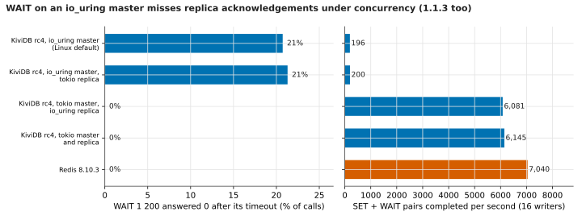

| Master / replica | `WAIT` answered 0 | SET+WAIT pairs per second | p99 of the WAITs that answered 1 |
|---|---|---|---|
| KiviDB rc4 io_uring / io_uring (Linux default) | 406 of 1,958 (21%) | 196 | 201.6 ms |
| KiviDB rc4 io_uring / tokio | 425 of 1,995 (21%) | 200 | 200.2 ms |
| KiviDB rc4 tokio / io_uring | 0 of 60,809 | 6,081 | 4.7 ms |
| KiviDB rc4 tokio / tokio | 0 of 61,447 | 6,145 | 4.7 ms |
| Redis 8.10.3 | 0 of 70,399 | 7,040 | 4.3 ms |
| KiviDB 1.1.3 io_uring / io_uring (one VM) | 438 of 1,458 (30%) | 146 | 201.2 ms |

The same thing shows in the failover runs: before the master was killed, `wait_kill9_promote` completed
about 210 SET+WAIT pairs a second on KiviDB against about 5,500 on Redis, and in cluster mode
(`c_wait_kill9`) 28,000 pairs in 70 s against 208,000.

**Likely cause** (`src/server_uring.rs`, `"WAIT"`): the io_uring loop waits with
`tokio::task::yield_now()` in a busy loop until the deadline, where the tokio loop (`src/server.rs`)
sleeps 1 ms between checks. Several connections spinning with `yield_now` on one io_uring worker appear
to keep that worker from processing the replica's `REPLCONF ACK` (and other completions) until a
deadline passes, so the count is read as 0.

**Repro** (two hosts or one; `harness/waitprobe.py` needs `pip install redis`):

```bash
kividb --port 7001 --protected-mode no &                                   # io_uring is the default on Linux
kividb --port 7002 --protected-mode no --replicaof 127.0.0.1 7001 &
python harness/waitprobe.py 127.0.0.1:7001 --writers 16 --seconds 10       # ~20% of WAITs answer 0 after 200 ms
# same with --io-model tokio on the master: every WAIT answers 1 in a few ms
```

Raw numbers: `results/wait-probe.txt`.

### Finding: every AOF checkpoint holds writes for tens of milliseconds

This shows in the soak's p99/p99.9 rather than here. See
[`../soak/README.md`](../soak/README.md#checkpoint-pauses-what-the-p999-tail-is-made-of).

### Other observations

* **`appendfsync always` has no effect in KiviDB** (documented in `docs/PERSISTENCE.md`). Its `kill -9`
  rows equal everysec, with full throughput (577k acknowledged writes in 60 s, against Redis's 260k
  with `always`). A power cut costs it the same as everysec.
* **`aof-ack-after-write no`** (acknowledge once the record is queued, as in 1.1) lost 1 acknowledged write
  in one of three `kill -9` runs. That is as documented. The default (`yes`) lost none in 6 runs, plus
  9 kills at checkpoint start.
* **Redis 8.10.3 `kill -9` with everysec** lost 2 acknowledged writes in 1 of 3 runs (`io-threads 2`), both
  acknowledged within 3 ms of when the kill was issued.
* **Cluster:** `CLUSTER FAILOVER` lost nothing on either engine. `FORCE` lost a handful (KiviDB 5,
  Redis 17), as expected when the replica does not wait for the master. A master `SIGSTOP`ped past the node
  timeout lost nothing on either engine: once resumed, it took no writes for slots its replica now owned.
  That is the #242 fix holding.
* **Replicas converged** after every standalone scenario (a full key-by-key comparison found 0 differences).


## Hardware and software

* Azure **Central India** (the assigned region, Southeast Asia, has no D-series VMs for this
  subscription), all VMs in one proximity placement group: three servers `ops-fo1..3` and the client
  `ops-foc`, each `Standard_D4s_v5` (4 vCPU Intel Xeon Platinum 8370C, 16 GB, accelerated networking),
  Ubuntu 24.04.5, kernel 7.0.0-1017-azure, data on the 128 GB Premium SSD OS disk.
* **KiviDB 1.2.0-rc4** (`a6b1bf38`), the published default-variant release binary
  (`kividb-linux-x86_64.tar.gz` from `ghcr.io/kividbio/kividb-binaries:v1.2.0-rc4`), defaults plus
  `appendonly yes` (I/O model io_uring, the Linux default; all cores).
* **Redis 8.10.3**, `redis-server` from the official `redis:8.10.3` image, `appendonly yes`,
  `save ""`, `io-threads 2` (4 vCPU), otherwise defaults.
* Node config files are generated by `harness/node.sh` (`/data/<port>/node.conf`).
* Client: Python 3.12, redis-py 5.2.1 with hiredis 3.0.0.

## Reproduce

1. Three server VMs and a client VM on one private network. On every VM: `harness/install_engines.sh
   v1.2.0-rc4` (needs ORAS and Docker; puts KiviDB in `/opt/kv`, `redis-server` in `/opt/redis`) and
   `harness/node.sh` in the home directory. The client needs passwordless ssh to the servers and
   `sudo iptables` on them, redis-tools, and a venv at `~/venv` with `redis`, `hiredis`, `matplotlib`.
2. Put the servers' private IPs in `harness/hosts.env`.
3. `bash harness/fo_all.sh "kividb redis" "<scenarios>" 3` runs every scenario three times per engine
   into `~/fo-results/<engine>/<scenario>/<rep>/`; one run: `bash harness/fo_run.sh kividb c_kill9 1`.
   The power-loss scenarios are driven from a machine with the Azure CLI, one at a time (never two drivers
   at once: both would use the same VMs): `SSH_CLIENT="ssh azureuser@<client>" bash harness/pl_drive.sh kividb power_loss_everysec 1`
   (`RES_DIR=<dir>` to keep a second build's results apart).
4. `python harness/fo_report.py ~/fo-results .` writes `results/summary.csv`, `results/table.md` and the
   charts.
5. The `WAIT` probe: `python harness/waitprobe.py <master>:6379 --writers 16 --seconds 10`.

Raw results: `results/summary.csv` (one row per run), `results/runs/rc4/<engine>/<scenario>/<rep>/`
and `results/runs/release-1.2.0-93524a1b/...` (`summary.json`, `timeline.csv`, `events`, `repl.csv.gz` with
both nodes' replication offsets every 0.5 s, `converge.json`, cluster `nodes-*.txt`),
`results/wait-probe.txt`, `results/power-loss-torn-aof/`. Server logs were kept on the VMs only (deleted).
