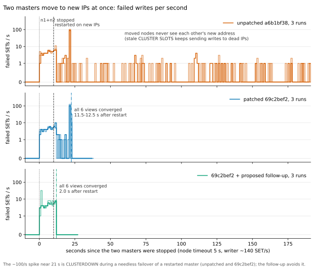

# Verification of 69c2bef2: a moved cluster node is learned from a healthy relay

Run on 2026-11-02 (01:00-02:00 UTC) on one Azure VM: `Standard_D8s_v5` in centralindia, RG
`kividb-rc4-clmove`, Ubuntu 24.04. The RG was deleted afterwards. Toolchain: rustc 1.99.1
(stable, 2026-10-13), clippy 0.1.99.

- **Unpatched:** a6b1bf38 (v1.2.0-rc4).
- **Patched:** a6b1bf38 plus `0001-Cluster-a-node-we-cannot-reach-takes-the-address-a-h.patch`
  (69c2bef2), with the `cargo fmt` fix below.

## Verdict

**The fix holds.**
- When two nodes move together, unpatched never converges: 0 of 7 runs within 180 s.
- Patched converges in every run (7 of 7):
  - every node shows the moved nodes at their new addresses 10.4-10.5 s after the restart;
  - every view is healthy and `cluster_state:ok` everywhere 11.5-12.5 s after the restart.
- A single node moving still converges in 1.5 s on both binaries, so there is no regression.
- Moving nodes twice in quick succession caused no flaps. No observer ever went back to a stale
  address.

**New finding (in both binaries; the fix does not cover it):**
- Two nodes restart on new IPs together after more than one node timeout down. One of them,
  healthy, is then **failed over by quorum** exactly 2 × node timeout after the restart.
- This costs about 1 s of CLUSTERDOWN (96-165 failed SETs) and a demoted master.
- A proposed follow-up (`proposal/0002-proposed-unconfirmed-address.patch`, not committed)
  removes the failover and brings convergence down to 2.0 s.



## Checks on the patched tree

| check | result |
|---|---|
| `git am` of the patch file | fails as is: `patch does not apply` at listener.rs:524. The listener.rs blob is CRLF, and `git am` strips the CRs from the patch's context lines. `git am --keep-cr` applies it cleanly. |
| `cargo fmt --all -- --check` | **fails**: the two long `process_message(&cs, ping(..., vec![gossip_of(...)]), peer());` lines in the new tests. `cargo fmt` reflows them (+18 -2): [`checks/cargo-fmt.patch`](checks/cargo-fmt.patch). The formatted tree was used from then on. |
| `cargo clippy --all-targets -- -D warnings` (stable 1.99.1) | clean. Also clean with `--features lua,tls`. |
| `cargo test --release --lib cluster` | 107 passed (unpatched: 105), both new tests included. |
| new tests without the fix | `a_node_we_cannot_reach_takes_the_address_a_healthy_relay_gives` **fails** (`left: "10.0.0.8"`, `right: "10.0.0.88"`), so it catches the bug. The guard test `a_relayed_address_does_not_replace_a_reachable_one_or_come_from_a_suspect` passes with and without the fix, as it should. See `checks/unit-tests-without-fix.log`. |
| `cargo test --release --test cluster` (tests/cluster.rs, its own process) | patched 49 passed, 1 ignored (the 24-node test). Unpatched: the same. No flakes in either. |

`cargo fmt` also rewrites listener.rs from CRLF to LF, which shows up as a 2252-line diff. I
converted it back to CRLF, and `cargo fmt --check` is clean with CRLF. `checks/cargo-fmt.patch`
keeps CRLF and applies on top of 69c2bef2 with `git apply`.

## End-to-end method

`scripts/e2e.py` runs as root on the VM. Six release-build nodes run in this setup:

- **Pods.** Each node runs in its own network namespace (a "pod"), with a veth onto a bridge, at
  10.99.0.11-16:7000, bus on 17000.
- **Config like the operator's.** `bind 0.0.0.0`, no `cluster-announce-ip` (peers record the
  address they observe), `cluster-node-timeout 5000` (the operator's default `nodeTimeoutMs`),
  `cluster-require-full-coverage yes`, and `dir` and `nodes.conf` per node.
- **Formation.** The cluster is formed with MEET, ADDSLOTSRANGE and REPLICATE: n1-n3 are masters,
  and n4→n1, n5→n2, n6→n3 are replicas.

**A move:**
1. SIGTERM the node(s) at the same moment.
2. Delete the namespace and veth, so the old IP vanishes and SYNs to it go unanswered, as for a
   deleted pod.
3. Create a new namespace with a new IP.
4. Restart 10 s after the stop (3 s in the `down3s` variant) with the same data dir and
   nodes.conf.

**Monitor:**
- `CLUSTER NODES` and `CLUSTER INFO` from all six nodes every 0.5 s (`monitor.csv`).
- **"converged"** means every node shows every node at its current address, with no `fail`,
  `fail?`, `handshake` or `noaddr`, link `connected`, and `cluster_state:ok` everywhere. It must
  hold for 15 s. The cap is 180 s after the restart.
- **"addresses right everywhere"** (`addr.py`) counts the address only.

**Writer:**
- One thread doing about 140 SET/s across all slots, with 250 ms timeouts and no retries.
- The slot map comes from `CLUSTER SLOTS` of a random node every second and after every error.
  MOVED is followed once.
- Per second it counts attempts, failures, CLUSTERDOWN, and connection errors or timeouts
  (`writes.csv`).

**Runs:**
- Two masters (n1+n2) ×3 per binary.
- Two masters down 3 s.
- A master and another shard's replica (n1+n5).
- One master (regression check).
- One master moved twice (.21, then .31 3 s after it came up).
- Two masters moved twice (×2).

## Results

"addresses right everywhere" and "all 6 views healthy" are measured in seconds after the (last)
restart.

| scenario | binary | run | addresses right everywhere (s) | all 6 views healthy + cluster_state ok, for good (s) | FAIL-by-quorum events | failed / attempted SETs after stop | of which CLUSTERDOWN | last failed SET (s after stop) |
|---|---|---|---|---|---|---|---|---|
| two-masters | unpatched | 1 | never (> 180) | never (> 180) | 1 | 183 / 33355 | 96 | 190 |
| two-masters | unpatched | 2 | never (> 180) | never (> 180) | 1 | 204 / 33547 | 116 | 184 |
| two-masters | unpatched | 3 | never (> 180) | never (> 180) | 1 | 189 / 33437 | 102 | 190 |
| two-masters | 69c2bef2 | 1 | 10.5 | 11.5 | 1 | 166 / 4896 | 112 | 21 |
| two-masters | 69c2bef2 | 2 | 10.4 | 12.5 | 1 | 218 / 5116 | 165 | 22 |
| two-masters | 69c2bef2 | 3 | 10.5 | 11.5 | 1 | 172 / 5031 | 122 | 22 |
| two-masters | 69c2bef2 + follow-up | 1 | 2.0 | 2.0 | 0 | 57 / 3347 | 9 | 11 |
| two-masters | 69c2bef2 + follow-up | 2 | 2.0 | 2.0 | 0 | 55 / 3353 | 8 | 11 |
| two-masters | 69c2bef2 + follow-up | 3 | 2.0 | 2.0 | 0 | 91 / 3411 | 18 | 11 |
| two-masters, down 3 s | unpatched | 1 | never (> 180) | never (> 180) | 0 | 107 / 31146 | 0 | 183 |
| two-masters, down 3 s | 69c2bef2 | 1 | 10.5 | 11.5 | 0 | 22 / 4966 | 0 | 13 |
| two-masters, down 3 s | 69c2bef2 + follow-up | 1 | 2.0 | 2.0 | 0 | 17 / 3435 | 0 | 4 |
| master + other shard's replica | unpatched | 1 | never (> 180) | never (> 180) | 3 | 32 / 36282 | 4 | 11 |
| master + other shard's replica | 69c2bef2 | 1 | 10.5 | 11.5 | 3 | 34 / 6093 | 6 | 11 |
| master + other shard's replica | 69c2bef2 + follow-up | 1 | 2.0 | 2.0 | 2 | 35 / 4133 | 6 | 12 |
| one master | unpatched | 1 | 1.5 | 1.5 | 1 | 31 / 4181 | 4 | 11 |
| one master | 69c2bef2 | 1 | 1.5 | 1.5 | 1 | 30 / 4184 | 4 | 7 |
| one master | 69c2bef2 + follow-up | 1 | 1.5 | 1.5 | 1 | 32 / 4133 | 6 | 7 |
| one master moved twice | unpatched | 1 | 1.4 | 1.4 | 1 | 34 / 5128 | 7 | 7 |
| one master moved twice | 69c2bef2 | 1 | 1.4 | 1.4 | 1 | 34 / 5110 | 6 | 11 |
| one master moved twice | 69c2bef2 + follow-up | 1 | 1.5 | 1.5 | 1 | 32 / 5122 | 6 | 7 |
| two masters moved twice | unpatched | 1 | never (> 180) | never (> 180) | 0 | 153 / 31570 | 8 | 189 |
| two masters moved twice | unpatched | 2 | never (> 180) | never (> 180) | 0 | 161 / 31527 | 8 | 194 |
| two masters moved twice | 69c2bef2 | 1 | 10.5 | 11.5 | 0 | 85 / 5286 | 11 | 25 |
| two masters moved twice | 69c2bef2 | 2 | 10.5 | 11.5 | 0 | 70 / 5579 | 8 | 20 |
| two masters moved twice | 69c2bef2 + follow-up | 1 | 1.9 | 1.9 | 0 | 71 / 3759 | 8 | 16 |
| two masters moved twice | 69c2bef2 + follow-up | 2 | 1.9 | 1.9 | 0 | 73 / 3647 | 7 | 17 |

How to read the table:
- **Attempted counts differ** because unpatched runs are observed for the full 180 s, and the
  others stop 15 s after converging.
- **Flaps** (converged, then not) were 0 in every run.
- **Address regressions** were 0 in every run: no observer showed a moved node at a former
  address after showing it at a newer one.
- **FAIL events in the one-master and n1+n5 rows are legitimate.** Those nodes were down 10 s
  while a majority of masters was up.

Raw data per run is in `e2e/<scenario>/<binary>-<rep>/`:
- `run.log`
- `summary.json`
- `addr.json`
- `monitor.csv`
- `writes.csv`
- `final-cluster-nodes.txt`
- `server-n*.log`

All runs together are in `e2e/results.csv`.

## Findings

1. **The bug reproduces exactly on unpatched.**
   - Final views, unpatched two-masters run 1 (n1 is now at .21, n2 at .22):

     ```
     n1: 72bae76d… 10.99.0.12:7000@17000 master,fail? … disconnected 5461-10922
     n2: 6e8ea801… 10.99.0.11:7000@17000 master,fail  … disconnected
     ```

   - The four nodes that did not move learned both new addresses at once, by direct contact.
   - Locally, `cluster_state` stayed ok:
     - n1 holds n2 only at `fail?` (PFAIL), so it never reaches FAIL;
     - n2 has n1 at `fail`, but n1 is a replica by then.
   - So the 7-minute CLUSTERDOWN seen on AKS did not recur here. What did persist was misrouting:
     - n1's `CLUSTER SLOTS` names the dead .12 as the owner of 5461-10922;
     - a client that takes its map from n1 or n2 keeps timing out against a dead IP;
     - that is roughly one failed SET every few seconds until the end of the run (last at
       184-194 s), versus none after 22 s with the fix.
2. **The fix converges, but only at the moment the start grace ends.**
   - `start_the_clock_on_peers` holds every peer unsuspected for 2 × node timeout after a
     restart. The new rule needs PFAIL first.
   - So the moved address is adopted 10.4-10.5 s after the restart with the operator's 5 s
     timeout, and every time.
   - With Redis's default 15 s timeout this would be about 30 s.
3. **New: a healthy master is failed over at that same instant (both binaries).**
   - Patched two-masters run 1:
     - n1's failure detection started at 01:14:02.263;
     - at 01:14:12.265 n1 logged `Node 3f684a72… marked FAIL by quorum`, about n2 (healthy,
       reachable by every other node);
     - n5 won the election and n2 became its replica.
   - What happens in that one tick:
     - The grace ends.
     - n1 sets PFAIL on n2, which it still dials at the old address.
     - Its own vote plus a failure report n3 sent during the downtime (still within its
       2 × timeout validity) make a quorum of 2 of 3.
   - That is the ~1 s CLUSTERDOWN spike at about 21 s in the chart and the 96-165 CLUSTERDOWN
     errors per run.
   - It does not happen with a 3 s downtime, because nobody suspected the masters before they
     came back.
   - It needs the stale address, so the fix cannot prevent it: the fix acts only after the PFAIL,
     and the FAIL lands in the same tick.
4. **Proposed follow-up: [`proposal/0002-proposed-unconfirmed-address.patch`](proposal/0002-proposed-unconfirmed-address.patch).**
   - It applies on 69c2bef2 + `checks/cargo-fmt.patch`. It is not committed.
   - How it works:
     - `start_the_clock_on_peers` records every peer as "address unconfirmed" in a set that is
       not persisted;
     - a direct message from the node removes it from the set;
     - while a peer is unconfirmed, a healthy relay's different address replaces nodes.conf's,
       without waiting for PFAIL;
     - suspicion still clears only on the node's own reply.
   - Measured:
     - convergence in 1.9-2.0 s in all two-node scenarios;
     - 0 needless FAIL events;
     - CLUSTERDOWN only during the downtime itself (7-18 errors);
     - the last failed write 1 s after the restart;
     - single-node moves unchanged.
   - Checks on it: fmt clean, `clippy --all-targets -D warnings` clean (default features),
     `--lib cluster` 108 passed (one new unit test), tests/cluster.rs 49 passed / 1 ignored. See
     `proposal/result.txt`.
   - The tested tree differed from the final patch only in one line wrapped before rustfmt.
   - Residual risk: a relay that restarted at the same time also holds nodes.conf addresses
     unsuspected during its grace.
     - If it has an older address, we can take it for a heartbeat or two, until a confirmed
       relay or the node itself corrects it.
     - Not seen in the two-masters-moved-twice runs: addresses went .12 → .22 → .32 with no
       regression.
5. **Minor, pre-existing.** For under 1 s after a restart, a moved node shows itself as
   `127.0.0.1` in `CLUSTER NODES`, until it learns its own IP from its first outgoing link. This
   is the wildcard-bind guess. It is the same in all binaries.

## Limits

- One VM: network namespaces on a bridge stand in for pods.
- The operator's hostname announcing (`cluster-preferred-endpoint-type hostname`) was not used.
  The writer routes by IP from `CLUSTER SLOTS`.
- The checks (clippy, unit and integration tests) ran niced on CPUs 3-7 while the first e2e runs
  used CPUs 0-2.
- tests/cluster.rs was run once per tree.
- The proposal's clippy was run with default features only.

## Files

- `failed-writes.svg`: the chart (three panels; unpatched #D55E00, patched #0072B2, follow-up
  #009E73).
- `checks/`:
  - `fmt-check.log`, `fmt-result.txt`, `cargo-fmt.patch`;
  - `clippy-*.log`;
  - `lib-cluster-{base,patched}.log`, `it-cluster-{base,patched}.log`;
  - `unit-tests-without-fix.log`;
  - `build-*.log`.
- `e2e/`: per-run raw data, `results.csv`, `table.md`, `addr.txt`.
- `proposal/`: the proposed patch and its check logs.
- Line endings: every file is LF except the two `.patch` files. Their content lines carry CRs
  because the source blobs are CRLF; without them the patches would not apply.
- `scripts/`:
  - `e2e.py`, `addr.py`, `table.py`, `chart.py`;
  - the VM scripts: `create.sh`, `setup.sh`, `build.sh`, `checks.sh`, `teststrength.sh`,
    `run_*.sh`, `proposal*.sh`, `propfmt.sh`.
