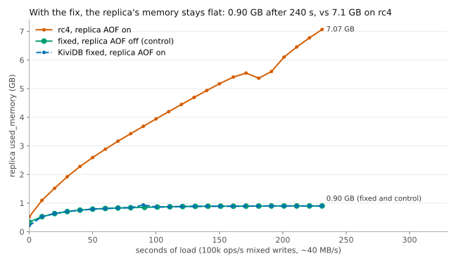

# Replica AOF backlog fix: verification (rc4 `a6b1bf38` + patch `4649666d`)

**Verdict: the fix holds.** With the same load that OOM-killed the rc4 replica, the fixed replica's
`used_memory` stays flat at 0.90 GB, the same as with the replica's AOF turned off. Its checkpoints
complete in 0.7 s, every ~10 s. The dataset matches the master key for key. The master's throughput
is unchanged within measurement noise.

## Machines

Azure, RG `kividb-rc4-aofq`, deleted at the end.

**Region: Central India, not the UK.** `uksouth` refused D8ds_v5 (`SkuNotAvailable`). `az vm list-skus`
then showed every Dv5/Dv6/Ddsv5/Dasv5/Edsv5 size as `NotAvailableForSubscription` in all zones of
both `uksouth` and `ukwest`. Central India is where the soak itself ran, so the hardware matches the
soak's exactly.

| Role | Size | Notes |
|---|---|---|
| master | Standard_D8ds_v5 | data on the local NVMe temp disk `/mnt/kv`, also built both binaries |
| replica | Standard_D8ds_v5 | same |
| load | Standard_D8s_v5 | soakgen (Go 1.26, go-redis v9), redis-benchmark 7.0.15 |
| check | Standard_D16ds_v5 | fmt / clippy / tests only, outside the PPG; its test runs overlapped the repro but share no host with the measured VMs |

All three measured VMs share one proximity placement group. They run Ubuntu 24.04 with Rust 1.99.1
(latest stable). Binaries: `cargo build --release` of `a6b1bf38` (rc4, sha256 `bc6acd70…`) and of
`a6b1bf38` + `git am --keep-cr 0001-…patch` (fixed, sha256 `0463dca9…`).

**Patch note.** Plain `git am` fails on a Linux clone ("patch does not apply") because the repo
stores these files with CRLF and `git am` strips the CRs. `git am --keep-cr` applies it cleanly. The
resulting files are CRLF throughout (2883/2883 lines in `src/aof.rs`), as in the repo.

## Checks on the fixed tree (`checks/`)

| Check | Result |
|---|---|
| `cargo fmt --all -- --check` | clean |
| `cargo clippy --all-targets -- -D warnings` (1.99.1) | clean |
| `cargo clippy --all-targets --features lua,tls -- -D warnings` | clean |
| `aof::backlog_tests::everything_queued_is_written_not_one_batch_of_it` | passes. **Fails** with fix (a) removed ("nothing is left queued"), so the test covers it |
| `cargo test --release aof` | 84 passed, 0 failed |
| `--test replication` / `resync` / `backup` | 39 / 12 / 20 passed, 0 failed |
| `--test tls_replication --features tls` | 2 passed |
| `--lib replication` | 59 passed |
| whole suite, `cargo test --release --no-fail-fast` (default features) | 2850 passed, 0 failed, 4 ignored (61 test binaries) |

## Repro: `replica_mem.sh`, the soak's mix at 100k ops/s (~40 MB/s of writes), 128 connections

Before each run, `replica_mem.sh` starts a fresh master and replica (both `appendonly yes`,
`appendfsync everysec`) and prefills 1M keys. The numbers are in `summary.csv`. The per-10 s samples
are in `<run>.csv`, `<run>.samples-{master,replica}.csv` and `<run>.load.csv`. The logs are in
`<run>.server-{master,replica}.log`.

| Run | Replica used_memory at end | Peak | Replica checkpoints done (median / max s) | `aof_rewrite_in_progress:1` samples | Replica lag, median / max |
|---|---|---|---|---|---|
| rc4, AOF on, 240 s | **7.07 GB, rising ~30 MB/s** | 7.07 GB (RSS 7.49 GB) | 1 in 240 s, **155.5 s**; second still open at the end | 20/24 | 1.7 KB / 49 KB |
| fixed, AOF on, 240 s | **0.90 GB, flat** | 0.94 GB | **23, 0.70 / 0.73 s** | 1/24 | 0.8 KB / 34 KB |
| fixed, replica AOF off, 240 s (control) | 0.90 GB, flat | 0.90 GB | – | 0/24 | 2.0 KB / 44 KB |
| fixed, AOF on, **15 min** | **0.91 GB, flat** from minute 4 to 15 | 1.00 GB (RSS peak 1.24 GB) | **85, 0.71 / 0.79 s** | 6/90 | 1.8 KB / 58 KB |

The master's own checkpoints take 0.78-0.82 s in every run.

- **Growth rate.** rc4 grew more slowly here than in the soak (7.1 GB vs 13.6 GB at 240 s), but
  monotonically, with the single replica checkpoint taking 155 s. This matches the soak's diagnosis.
- **The bug is in the AOF queue, not in applying the stream.** Replica lag stays at a few KB in
  every run, rc4 included. On rc4 the replica applies the stream on time, and the memory is records
  waiting to be written to its AOF.
- **Fixed checkpoints.** In the fixed runs, `aof_rewrite_in_progress:1` shows up only when a 10 s
  sample lands inside a 0.7 s checkpoint. Replica checkpoints come every ~10 s, as on the master and
  as on 1.1.3 in the soak (~12 s). In the 15-minute run the replica completed 85 checkpoints to the
  master's 84.
- **AOF file sizes.** The sampler's `aof_current_size` tracks the master's in the fixed runs. Medians
  over the run: 71 vs 64 MB at 240 s, and 126 vs 119 MB in the 15-minute run. Both peak at
  ~276-278 MB before a checkpoint folds them. On rc4 the replica's AOF reached 710 MB against the
  master's 276 MB.
  - Fixed, end of 240 s: replica `appendonly.aof` 0.6 MB vs master's 9.7 KB, both just after a
    checkpoint; `dump.kdb` 736.7 MB vs 736.4 MB.
  - Fixed, end of 15 min: the replica was mid-checkpoint (`appendonly.aof.prev` 148 MB plus a
    `dump.kdb…tmp`), finished normally.
  - rc4, end of 240 s: replica AOF 307 MB, `aof_rewrite_in_progress:1`.
- **Dataset.** After the load stopped, the replica's offset equalled the master's within the first
  poll in every run. DBSIZE matched: 1,279,236 = 1,279,236 at 240 s, and 1,276,633 = 1,276,633 at
  15 min. A full key-by-key compare (`harness`'s `compare.py`: type, value and TTL presence of every
  key, with a recheck) found **0 real differences** in both fixed runs:
  - 240 s: 1,278,278 keys compared, 134 differed on the first pass (expiring keys), 0 after the
    recheck;
  - 15 min: 1,275,628 compared, 112 on the first pass, 0 after.

  `DEBUG DIGEST` returns `OK` on KiviDB, not a digest, so it proves nothing. That is why the full
  compare was used.

## Master throughput (#147 path): `redis-benchmark -t set -d 100 -c 50 -r 1000000 --threads 4`, AOF on, everysec

rc4 and fixed alternated, each on a fresh server. `throughput*.csv` holds every row, and
`throughput-summary.csv` holds the medians.

| Setup | Pipeline | Rounds | rc4 median (min-max) | fixed median (min-max) | Δ median / Δ mean |
|---|---|---|---|---|---|
| master alone | 1 | 9 | 232,983 (226,389-235,276) | 230,743 (230,743-232,992) | -0.96% (one clock step) / -0.23% |
| master alone | 16 | 3 | 1,347,830 (1,318,218-1,363,264) | 1,347,951 (1,347,890-1,378,930) | +0.01% / +1.13% |
| master + replica | 1 | 3 | 216,193 (214,270-218,150) | 214,263 (214,263-216,193) | -0.89% (one clock step) / -0.60% |
| master + replica | 16 | 9 | 982,930 (951,716-1,007,794) | 983,026 (944,257-999,400) | +0.01% / -0.54% |

The fixed build's range lies inside rc4's in every row. No difference stands out from run-to-run
noise. That is expected: the patch changes nothing on the master's own path except continuing past
a full 4 MB batch, and these runs never queue that much.

**How to read these numbers:**

- **Clock resolution.** redis-benchmark's elapsed time moves in 250 ms steps, about 1% of a 26 s run.
  That is why identical values repeat (6M/25.75 s = 232,992; 6M/26.00 s = 230,743).
- **Extra rounds.** The replica P16 case first looked 3% down after 3 rounds (944k-999k for fixed).
  After 6 more alternating rounds the medians are equal. The master alone at P1 got 6 more rounds
  for the same reason: its median stays one clock step lower, and its mean is 0.2% lower.
- **Latency.** p50/p99 are the same within 0.01-0.08 ms.
- **`aof_acks_before_write`** stayed 0 in every run.
- **A second repro, from the benchmark.** With a replica attached, plain 100 B SETs at P16 showed the
  bug on rc4 too. The rc4 replica ended each 30 s benchmark at 1.1-2.4 GB `used_memory`, and the
  fixed replica at 0.15 GB (`throughput-*info.txt`).

## Review notes (not blockers)

1. **Unbounded drain under overload.** Fix (a) makes `write_queued` loop for as long as each batch
   fills 4 MB. That ends within one or two iterations unless records arrive faster than `write()`
   takes them, which means a disk slower than the incoming write rate, with dirty-page throttling.
   - In that overload the lock holder keeps writing, and the second's `fsync` waits until the queue
     drains.
   - The lock holder can be the writer thread, or a connection's thread in `written()`.
   - rc4 grew memory without bound in the same situation, so this is not a regression in what
     survives, but the everysec window stretches. A time or batch cap on the continuation (e.g. go
     on for at most ~1 s or N batches, then `notify_one` and return) would bound both.
   - Not seen in any run here, on local NVMe.
2. **Applying the patch.** The patch needs `git am --keep-cr` outside Windows (see above).

## Harness (`harness/`)

- `setup.sh`: VM setup, build and the checks.
- `server.sh`: the soak's script, plus a `kividbfix` engine at `/opt/kvfix`.
- `run_repro.sh`: the four runs and their post-run checks.
- `run_tput.sh`: the benchmark.
- `analyze.py`: `summary.csv`, the checkpoint CSVs and the chart.
- Unchanged from the soak: `replica_mem.sh`, `sampler.sh`, `compare.py` and soakgen.
