# Memory: bytes per key, memory over time, snapshots (KiviDB 1.2.0-rc4)

What this suite answers:

1. **The warefeats memory number.** The independent [warefeats/kv-stores](https://github.com/warefeats/kv-stores)
   benchmark measured KiviDB 1.1.2 at 267 bytes per key (RSS) for 1M keys of 100 B, against Dragonfly 118,
   Redis 165 and Valkey 170. We said 1.2.0 would cut that. Here is their harness, unchanged, on 1.2.0-rc4.
2. **Memory while the dataset grows, and under a mixed workload** (Hacker News, kingcauchy: *"How did overall
   memory footprint look during ingestion vs Redis? Have any tradeoff graphs as the dataset gets larger and with
   mixed workloads?"*).
3. **Memory and write latency during a snapshot** (Hacker News, porker and romange: Dragonfly's memory around
   snapshots, and KiviDB's own *"write pause that grows"*). Redis and Valkey fork and rely on copy-on-write;
   Dragonfly serialises without forking; KiviDB holds references to string values at a cut and writes after.
4. **maxmemory during a snapshot** (issue #284, fixed in rc4): a snapshot must not make writes evict keys that fit.

## Results in one paragraph

- **warefeats, 1M x 100 B:** KiviDB 1.2.0-rc4 uses **149 B/key** (RSS), down from **267** in 1.1.3 (-44%).
  That is below Redis 8.10.3 (166) and Valkey 9.1.3 (170). Dragonfly 2.0.2 is lower with memtier's default ASCII
  values (137; it packs ASCII strings), and higher with random bytes (153 against KiviDB's 149). On the second
  million, KiviDB 148 and Dragonfly 148 are level.
- **Growing to 50M keys:** at 100 B KiviDB rc4 settles at **141 B/key**, level with Dragonfly (142), 16% under
  Valkey (167), 19% under Redis (174) and 23% under 1.1.3 (183). At 1 KB, KiviDB (1,072) and Dragonfly (1,071)
  are level and 20% under Redis (1,352) and Valkey (1,344).
- **Snapshots of 30M x 1 KB under 100k uniformly random writes/s:** Redis's memory nearly **doubled** during
  BGSAVE and during the AOF rewrite (+34 GiB, +91%: fork copy-on-write); KiviDB rc4 grew **+3.1 GiB (+10%)**
  for BGSAVE and +2.1 GiB for the rewrite. But KiviDB's RSS did not come back down afterwards (30.3 GiB before,
  35.0 GiB at the end with used_memory back at 30.1). The worst single write was **256-293 ms for KiviDB** (the
  write pause at the cut, 30M keys) against 412 ms (BGSAVE) and 1,047 ms (rewrite) for Redis's fork. Dragonfly
  (8 ms worst write, +0.4% memory) was only measured with the lighter hot-set load, where it beat everyone.
- **#284:** with maxmemory 10% above the data and a BGSAVE during same-size overwrites, rc4 evicted **0** keys
  (Redis 0, KiviDB 1.1.3 7,984).
- See *Findings* for the losses and caveats, including two things that look like KiviDB problems.

## Hardware and placement

| | VM | CPU | memory | region | used for |
|---|---|---|---|---|---|
| pair A engine | Standard_E32ds_v7 (32 vCPU) | Intel Xeon 6973P-C | 251 GiB, local NVMe 440 GB (data dir) | germanywestcentral | warefeats, growth, snapshot, eviction, mixed (rc4 only) |
| pair A client | Standard_D32ls_v7 (32 vCPU) | Intel Xeon 6973P-C | 62 GiB | germanywestcentral | memtier |
| pair B engine | Standard_E32ds_v6 (32 vCPU) | Intel Xeon Platinum 8573C | 251 GiB | polandcentral | mixed (rc4, Redis, Valkey) |
| pair B client | Standard_D16ls_v6 (16 vCPU) | Intel Xeon Platinum 8573C | 31 GiB | polandcentral | memtier |

Each pair is one proximity placement group, accelerated networking, Ubuntu 24.04, kernel 7.0.0-1017-azure.
Engines run in Docker with host networking and seccomp unconfined (io_uring allowed). One engine runs at a time.
The arm64 sizes used for the earlier warefeats rerun were not offered to this subscription in germanywestcentral;
pair B exists only because the region's 65-vCPU quota was taken by pair A, and E32ds_v7 is not offered in
polandcentral. **Mixed-workload numbers are compared only within one pair.**

## Versions and flags

| engine | image (digest) | flags in our own tests (`harness/eng.sh`) |
|---|---|---|
| KiviDB 1.2.0-rc4 | `kividb/kividb:v1.2.0-rc4` (sha256:06ae4b82...b55b), tag v1.2.0-rc4 = commit a6b1bf38 | `--port 6379 --bind 0.0.0.0 --protected-mode no --dir /data`; snapshot runs add `--aof --aof-rewrite-percentage 0`. Threads: default (all 32 cores), default variant (no Lua) |
| KiviDB 1.1.3 | `kividb/kividb:v1.1.3` (sha256:5677cfc5...) | same |
| Redis 8.10.3 | `redis:8.10.3` (sha256:de1068af...) | `--io-threads 8 --save '' --appendonly no`; snapshot runs `--appendonly yes --auto-aof-rewrite-percentage 0` |
| Valkey 9.1.3 | `valkey/valkey:9.1.3` (sha256:3add1a33...) | same as Redis |
| Dragonfly 2.0.2 | `docker.dragonflydb.io/dragonflydb/dragonfly:v2.0.2` (sha256:061f00b2...) | `--proactor_threads 32 --dbfilename ''`; snapshot runs `--dbfilename dump` (its default .dfs format; Dragonfly has no AOF) |

The warefeats cells use warefeats' own compose files unchanged (`compose/cloud-*.yml` at commit a324d29):
`maxmemory 16 GiB, allkeys-lru` for all engines, Dragonfly `--cache_mode --proactor_threads 32`, Redis and Valkey
**without io-threads** (their harness), KiviDB with default threads. memtier_benchmark 2.5.1 from their Dockerfile,
25 threads.

## 1. warefeats/kv-stores, unchanged

Raw: `results/warefeats/*.json`. 1M keys of 100 B written once, then a second million on the same engine.

| engine | 1st M RSS B/key | 1st M used B/key | 2nd M RSS B/key | random bytes: 1st M RSS | random: 2nd M RSS |
|---|---|---|---|---|---|
| KiviDB 1.2.0-rc4 (run 1 / run 2) | **149.0** / 149.0 | 146.9 | 147.7 / 146.9 | **149.1** / 149.2 | 146.9 / 146.8 |
| KiviDB 1.1.3 | 267.0 | 246.4 | 352.5 | 266.9 | 352.5 |
| Redis 8.10.3 | 165.7 | 165.3 | 166.4 | 165.4 | 166.7 |
| Valkey 9.1.3 | 170.3 | 167.1 | 172.7 | 170.0 | 172.9 |
| Dragonfly 2.0.2 | 137.2 | 138.7 | 147.5 | 153.2 | 163.0 |

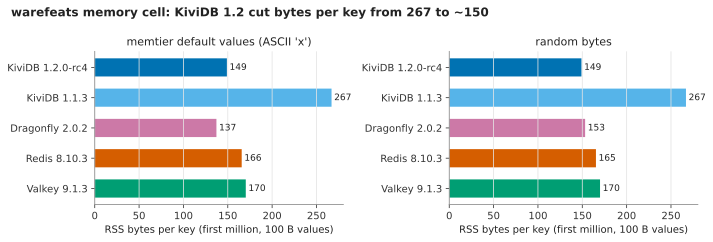

Their throughput cells (median of their passes; p50 / p99 / p99.9 in ms):

| workload | KiviDB rc4 | KiviDB 1.1.3 | Dragonfly | Redis (no io-threads) | Valkey (no io-threads) |
|---|---|---|---|---|---|
| SET:GET 1:10, 100 B, pipeline 1 | 945,842 (0.20/0.38/0.52) | 942,268 (0.20/0.38/0.55) | 871,102 (0.21/0.41/0.66) | 161,209 (1.22/1.86/2.16) | 161,806 (1.22/1.84/2.10) |
| SET:GET 1:10, 10 KB, pipeline 1 | 320,517 (0.62/1.05/1.28) | 320,426 (0.62/1.02/1.27) | 322,249 (0.62/1.03/1.54) | 83,940 (2.14/4.19/4.59) | 85,526 (2.10/4.08/4.46) |
| SET:GET 1:10, 100 B, pipeline 30 | **14,700,533** (0.36/0.79/1.03) | 11,363,019 (0.50/1.17/1.44) | 8,076,230 (0.66/1.54/3.54) | 1,504,429 (3.39/9.47/10.62) | 1,557,586 (3.85/8.38/9.12) |

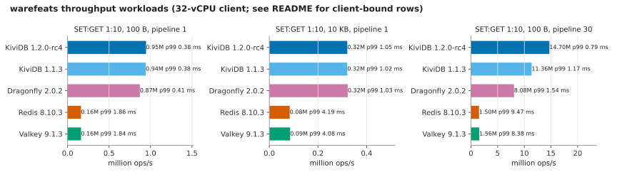

- The 10 KB row is **network-bound** for KiviDB and Dragonfly alike: 320k ops/s of mostly 10 KB replies is
  about 3.2 GB/s, the client VM's network limit. The 100 B pipeline-1 row is close to client-bound
  (client CPU 39-41%, 25 memtier threads on 32 vCPUs, latency-bound connections). Neither row separates the
  fast engines.
- Pipeline 30: rc4 is 29% above 1.1.3 and 1.8x Dragonfly, with lower p99.9. Run-to-run spread for rc4 was
  under 2% (two full runs).
- Redis and Valkey run single-threaded here because that is how warefeats configures them; with io-threads they
  would be faster. The core suite compares throughput with io-threads and Redis Cluster; this table only
  reproduces warefeats.

## 2. Memory while the dataset grows

`harness/growth.sh`: a fresh engine, no persistence; keys `memtier-1` ... `memtier-50000000` written once each, in
stages to 1M, 5M, 10M, 25M and 50M keys (memtier, 64 connections, pipeline 32), **random-byte values**
(`--random-data`). The sampler records memory every second. Bytes per key = (RSS now - RSS of the idle engine)
/ keys; RSS is the sum over the container's processes. `used_memory` per key in brackets.

100 B values:

| engine | 1M | 5M | 10M | 25M | 50M | RSS at 50M |
|---|---|---|---|---|---|---|
| KiviDB 1.2.0-rc4 | 153.9 (146.9) | 146.7 (143.1) | 145.0 (143.1) | 141.1 (140.1) | **140.7** (140.1) | 6.57 GiB |
| KiviDB 1.1.3 | 220.5 (194.1) | 197.5 (176.8) | 197.1 (176.8) | 183.1 (163.0) | 183.1 (163.0) | 8.54 GiB |
| Redis 8.10.3 | 170.2 (165.4) | 179.3 (177.3) | 179.0 (177.4) | 174.5 (173.1) | 174.4 (173.1) | 8.15 GiB |
| Valkey 9.1.3 | 172.4 (167.0) | 169.2 (166.4) | 169.3 (166.7) | 166.6 (165.4) | 166.6 (165.4) | 7.77 GiB |
| Dragonfly 2.0.2 | 163.8 (154.8) | 150.3 (148.0) | 155.9 (148.9) | 143.3 (139.4) | 141.5 (139.6) | 6.65 GiB |

1 KB values:

| engine | 1M | 5M | 10M | 25M | 50M | RSS at 50M |
|---|---|---|---|---|---|---|
| KiviDB 1.2.0-rc4 | 1085.7 (1074.9) | 1078.0 (1071.1) | 1076.2 (1071.1) | 1072.1 (1068.1) | **1071.7** (1068.1) | 49.92 GiB |
| KiviDB 1.1.3 | 1130.5 (1118.1) | 1109.7 (1100.8) | 1109.2 (1100.8) | 1095.2 (1087.0) | 1095.1 (1087.0) | 51.01 GiB |
| Redis 8.10.3 | 1351.8 (1333.4) | 1356.9 (1345.2) | 1356.7 (1345.4) | 1352.2 (1341.1) | 1352.2 (1341.1) | 62.99 GiB |
| Valkey 9.1.3 | 1352.9 (1336.6) | 1347.4 (1334.8) | 1347.3 (1334.8) | 1344.4 (1333.4) | 1344.4 (1333.4) | 62.62 GiB |
| Dragonfly 2.0.2 | 1097.6 (1082.8) | 1091.1 (1076.0) | 1084.9 (1076.9) | 1073.3 (1067.4) | 1071.0 (1067.6) | 49.93 GiB |

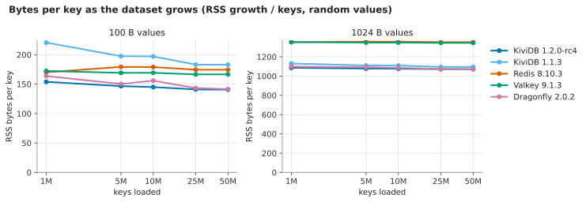

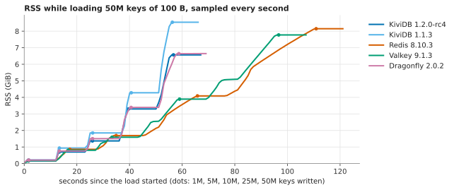

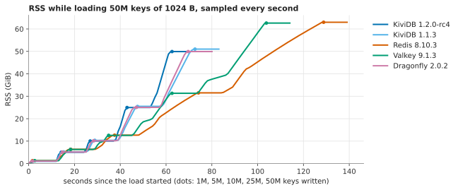

- RSS tracks used_memory within 1-6% for every engine at every size; nobody's memory runs away during ingestion.
- Redis and Valkey pay ~280 B over the 1 KB value: jemalloc puts a 1 KB string object in its 1,280-byte class.
- Dragonfly's numbers here are with random bytes; with ASCII values it saves about 16 B/key more (warefeats table).
- Load time for the 50M keys (one run, 64 connections, pipeline 32): KiviDB rc4 15.0 s (100 B) / 20.9 s
  (1 KB), KiviDB 1.1.3 14.5 / 30.9 s, Dragonfly 17.0 / 27.9 s, Valkey 55.0 / 62.0 s, Redis 69.2 / 87.1 s.

## 3. Mixed workload over 20 minutes

`harness/mixed.sh`: 10M keys of 100 B, then 20 minutes at a **fixed 150,000 ops/s** (100 connections x 1,500/s,
pipeline 1, the same offered load for every engine): 80% GET / 20% SET on uniformly random keys; every SET writes
a random 64-1024 B value with a TTL of 60-600 s, so values change size, keys expire and are re-created.

**Caveat that limits this section:** memtier was run without `--distinct-client-seed`, so all 100 connections
drew the same random key sequence. The 20 minutes therefore touched at most ~1.8M distinct keys (GET and SET
together), and SETs re-wrote only ~360k distinct keys, not the whole 10M keyspace. This is a hot-set workload,
lighter on memory churn than described above, and it should be rerun with distinct seeds (the scripts in
`harness/` now pass the flag). The runs were also cut down for time: only the rows below ran.

Pair B (Standard_E32ds_v6, polandcentral):

| engine | RSS at start GiB | RSS at end GiB | used at end GiB | RSS/used at end | keys at end (M) | ops/s | GET p50/p99/p99.9 ms | SET p50/p99/p99.9 ms |
|---|---|---|---|---|---|---|---|---|
| KiviDB 1.2.0-rc4 | 1.36 | 1.44 | 1.36 | 1.05 | 9.75 | 150,000 | 0.25/0.43/0.52 | 0.26/0.46/0.81 |
| Valkey 9.1.3 | 1.59 | 1.68 | 1.57 | 1.07 | 9.76 | 150,000 | 0.29/0.47/0.69 | 0.30/0.58/0.94 |

Pair A (Standard_E32ds_v7): KiviDB 1.2.0-rc4 1.36 -> 1.44 GiB RSS (used 1.35, RSS/used 1.07), GET
0.28/0.57/0.78 ms, SET 0.28/0.58/0.85 ms at 150,000 ops/s.

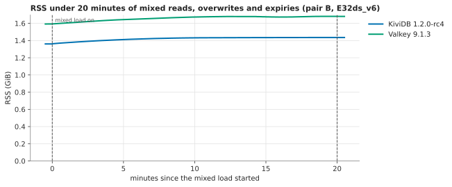

In this (hot-set) test both engines' RSS rises by about 5-6% over 20 minutes and flattens; KiviDB stays 15%
below Valkey and keeps RSS within 5-7% of used_memory. Redis, Dragonfly and KiviDB 1.1.3 mixed runs did not
complete (see *What did not run*).

## 4. Snapshots under a steady write load

`harness/snapshot.sh`: 30M keys x 1 KB random values (30-38 GiB in memory), persistence on, then two windows of
420 s, each under **100,000 SET/s** (100 connections x 1,000/s, pipeline 1, random overwrites, same size):
`BGSAVE` 60 s into the first, `BGREWRITEAOF` 60 s into the second (Dragonfly has no AOF: one window).
Memory is the container's cgroup **anon** memory: a forked child's pages are counted once while shared and again
once copied, so this is the physical memory a snapshot costs. Latency is memtier's per-second p99 and max.

### 4a. Uniformly random writes (memtier `--distinct-client-seed`), pair A

This is the run that answers the question (windows of 300 s with the command at +30 s: `WIN=300 PRE=30`).
Every connection writes its own random keys, so the 100k writes/s
spread over the whole 30M-key dataset.

| engine | event | memory before GiB | peak during GiB | added GiB | added % | duration s | worst write ms | worst 1-s p99 ms | write p99.9 over window ms | p99 before, ms |
|---|---|---|---|---|---|---|---|---|---|---|
| KiviDB 1.2.0-rc4 | BGSAVE | 30.31 | 33.39 | 3.08 | 10% | 71.6 | 256 | 1.94 | 3.12 | 1.50 |
| KiviDB 1.2.0-rc4 | BGREWRITEAOF | 33.36 | 35.41 | 2.05 | 6% | 73.8 | 293 | 1.77 | 2.58 | 1.45 |
| Redis 8.10.3 | BGSAVE | 37.60 | 71.67 | **34.06** | **91%** | 194.7 | 412 | 3.50 | 7.81 | 0.61 |
| Redis 8.10.3 | BGREWRITEAOF | 37.61 | 71.89 | **34.29** | **91%** | 203.0 | **1,047** | 2.72 | 7.49 | 0.61 |

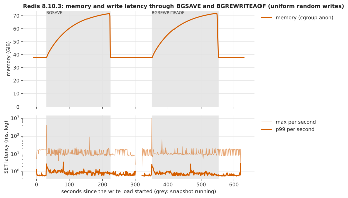

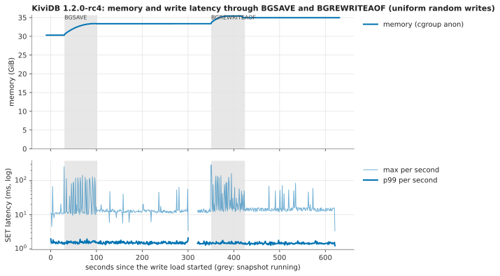

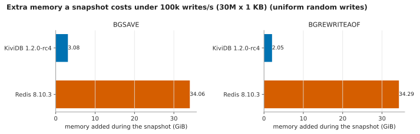

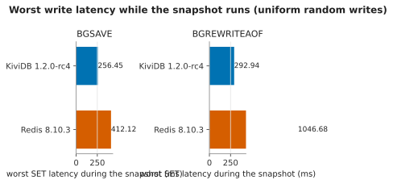

The same KiviDB rc4 run on pair B (E32ds_v6): BGSAVE +3.55 GiB (12%), 81 s, worst write 200 ms; rewrite +2.34
GiB, worst write 196 ms (`results/tables-uniform-pair-b.md`).

- **Fork (Redis, Valkey):** the child shares memory with the parent until a write copies a 4 KiB page. With
  writes spread over the whole dataset, almost every page is copied before the 3-minute save ends, so the peak
  is close to twice the dataset. That is the memory spike at snapshot time; it comes with fork.
- **KiviDB:** a snapshot holds a reference to each string value at the cut and writes it out after. An
  overwritten value stays allocated until the snapshot has written it (the snapshot lets go of each value once
  written), so memory grows by the values replaced during the save: here ~3 GiB. used_memory returns to its
  baseline at the end; RSS does not (see Findings).
- **Write pause:** KiviDB holds writes while it captures the dataset; at 30M keys that hold was the worst write,
  200-293 ms. Redis's worst write is the fork itself (page-table copy of a 38 GiB process): 412 ms, and 1 s
  for the rewrite here.
- KiviDB's write p99 *outside* the snapshot is ~1.5 ms against Redis's 0.6 ms in this AOF-on test. That is the
  AOF path, not the snapshot (0.4-0.6 ms with the AOF off, section 3): each KiviDB write waits for its AOF
  record to be written before it is acknowledged.

### 4b. First run, all engines: hot-set writes (pair A)

Without distinct seeds every connection wrote the same key sequence: ~420k distinct keys per window (1.4% of
the dataset). This under-states copy-on-write and is shown only because Valkey, Dragonfly and KiviDB 1.1.3 were
not rerun.

| engine | event | memory before GiB | peak GiB | added GiB | duration s | worst write ms | write p99.9 ms |
|---|---|---|---|---|---|---|---|
| KiviDB 1.2.0-rc4 | BGSAVE | 30.33 | 30.58 | 0.25 | 76.3 | 315 | 2.10 |
| KiviDB 1.2.0-rc4 | BGREWRITEAOF | 30.38 | 30.71 | 0.33 | 78.8 | 344 | 2.11 |
| KiviDB 1.1.3 | BGSAVE | 63.60 | 64.53 | 0.92 | 93.1 | 409 | 1.22 |
| KiviDB 1.1.3 | BGREWRITEAOF | 63.63 | 64.53 | 0.89 | 88.0 | 401 | 0.85 |
| Redis 8.10.3 | BGSAVE | 37.61 | 39.03 | 1.42 | 182.7 | 406 | 8.57 |
| Redis 8.10.3 | BGREWRITEAOF | 37.61 | 39.00 | 1.39 | 180.7 | 372 | 9.21 |
| Valkey 9.1.3 | BGSAVE | 37.82 | 39.21 | 1.39 | 170.3 | 397 | 1.70 |
| Valkey 9.1.3 | BGREWRITEAOF | 38.01 | 39.18 | 1.17 | 167.4 | 492 | 1.55 |
| Dragonfly 2.0.2 | BGSAVE | 30.73 | 30.85 | 0.12 | 55.8 | **8** | 1.11 |

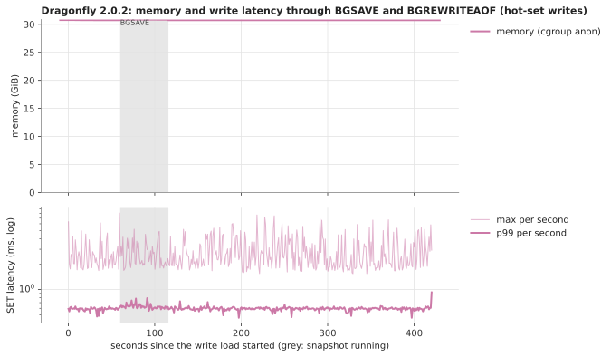

Per-engine charts: `charts/snapshot-*-hotset.svg`. KiviDB 1.1.3 sat at 63.6 GiB for a 30M x 1 KB dataset with
the AOF on: during the pipelined load its used_memory reached 53.7 GiB (AOF records queued in memory faster
than the disk took them), then fell to 32 GiB while RSS stayed at 65 GiB. rc4 peaked at 31.2 GiB used in the
same load: that backlog is gone in 1.2.

## 5. maxmemory during a snapshot (#284)

`harness/evict.sh`: 10M keys x 1 KB, then `maxmemory` = used_memory + 10% with `allkeys-lru`, 300 s of 100k
same-size overwrites/s (nothing needs new memory), BGSAVE at +60 s, no AOF.

| engine | keys before | keys after | evicted keys | maxmemory | mem_not_counted_for_evict after |
|---|---|---|---|---|---|
| KiviDB 1.2.0-rc4 | 10,000,000 | 10,000,000 | **0** | 10.98 GiB | 0 |
| KiviDB 1.1.3 | 10,000,000 | 9,992,201 | 7,984 | 11.28 GiB | (not reported by 1.1.3) |
| Redis 8.10.3 | 10,000,000 | 10,000,000 | 0 | 13.79 GiB | 0 |

Same seed caveat as the mixed and first snapshot runs: the overwrites went to ~300k distinct keys, so the
snapshot held fewer replaced values than a uniformly random load would make it hold. That is why 1.1.3 lost
only 7,984 keys here instead of emptying the keyspace as in the issue's report; the direction is the same, and
rc4 evicted nothing. `mem_not_counted_for_evict` returned to 0 after the snapshot.

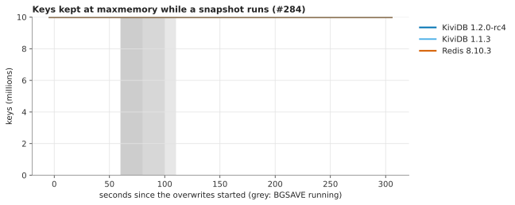

## Findings

Wins
- Bytes per key fell 44% from 1.1.3 on warefeats' own cell (267 -> 149) and is now below Redis and Valkey at
  every size measured, and level with Dragonfly from 25M keys up (random values).
- A snapshot under a uniformly random write load costs KiviDB ~10% extra memory against Redis's ~90%, and its
  worst write (256-293 ms) is below Redis's fork stall (412 ms; 1,047 ms for the AOF rewrite).
- #284 holds: no eviction during a snapshot at maxmemory.
- warefeats pipeline 30: 14.7M ops/s, 1.29x 1.1.3 and 1.8x Dragonfly, with lower p99.9.

Losses
- **Dragonfly snapshots better than KiviDB:** 8 ms worst write against KiviDB's 256-344 ms write pause at 30M
  keys (Dragonfly measured with the hot-set load only). KiviDB's pause grows with the key count: this is the
  "write pause that grows" from the HN thread, measured.
- **Dragonfly uses less memory with ASCII values** (137 vs 149 B/key at 1M x 100 B): it packs ASCII strings.
- At 1M-10M keys of 100 B, Dragonfly and KiviDB trade places within ~10 B/key (hash-table growth steps).

Looks like a KiviDB problem (worth an issue)
- **RSS stays up after a snapshot.** After the uniform-write BGSAVE and rewrite, used_memory went back to
  30.1 GiB but RSS stayed at 35.0 GiB (pair B: 36.4 GiB) for the rest of the run (5 minutes). The values the
  snapshot held were freed, but the memory was neither returned nor compacted in that time. Under repeated
  snapshots a container limit has to allow for it. Repro: `harness/snapshot.sh kividb-rc4` (with
  `--distinct-client-seed`, as in `harness/`); compare `anon_mb` with `used_mb` in the sampler CSV after
  `aofrw-done`.
- **Periodic ~100 ms write stalls after a snapshot with the AOF on.** In the hot-set run, the worst write per
  second showed ~100 ms spikes every ~20 s for about 5 minutes after each BGSAVE/rewrite finished
  (`charts/snapshot-kividb-rc4-hotset.svg`); Redis shows none. Not diagnosed; one guess is page-cache
  writeback of the 31 GB dump on the same disk stalling the AOF writes that acknowledgements wait for.
- AOF-on write latency: p50 0.58 ms and p99 1.5 ms at 100k SET/s, about twice Redis's 0.30 / 0.6 ms on the
  same load.

Caveats
- Throughput rows in the warefeats table that are network- or client-bound: 10 KB (network) and 100 B pipeline 1
  (close to client-bound). Redis and Valkey there run without io-threads, as warefeats configures them.
- memtier's `--random-data` buffer repeats, so Dragonfly's snapshot files still compress ~35%; Redis's LZF does
  not compress the random values. No engine compresses values in memory.
- One run per engine for growth, snapshot, mixed and eviction.

## What did not run

- **Mixed workload:** Redis 8.10.3, Dragonfly 2.0.2 and KiviDB 1.1.3 did not run to completion (Redis and
  Dragonfly were started and stopped for time; 1.1.3 was dropped). The rows that ran used memtier without
  `--distinct-client-seed` (hot set of at most ~1.8M keys, see the caveat in section 3). The 20-minute mixed test
  over the whole keyspace still has to be run.
- **Snapshots with a uniformly random write load** (distinct client seeds): only KiviDB 1.2.0-rc4 and Redis 8.10.3
  were rerun that way. Valkey, Dragonfly and KiviDB 1.1.3 have only the hot-set run (writes to ~420k distinct keys
  per window), which under-states copy-on-write for the forking engines.
- **Repeats:** warefeats ran rc4 twice (other engines once; the harness itself takes several passes per cell);
  growth, snapshot, mixed and eviction ran once per engine. No medians across repeats for those.
- **Redis Cluster** is not in this suite (memory per key in a cluster is the same per shard plus per-shard
  overhead); throughput with Redis Cluster is in the core suite.
- **ASCII values in the growth test:** growth used random bytes only. Dragonfly packs ASCII strings and would
  be ~16 B/key lower at 100 B with ASCII values (see warefeats' default cell).

## Reproduce

See `harness/README.md`. Every script used is there; `harness/analyze.py` turns the raw files into
`results/tables.md` and the charts.

## Files

- `results/tables.md`: every table, generated.
- `results/warefeats/`: warefeats runner JSON per engine (their schema).
- `results/raw/pair-a`, `pair-b`: first runs; `pair-a2`, `pair-b2`: the snapshot reruns with uniform writes.
  Per-run sampler CSVs (one row per second), memtier JSON (per-second latency), events, checkpoints,
  engine start lines, persistence INFO at the end of each snapshot.
