# Memory: bytes per key, memory over time, snapshots, active defrag (KiviDB 1.2.0)

Measured on the 1.2.0 release candidate, branch `release/1.2.0` at commit **75482abb** (`--version` 1.2.0-rc6
until rc7 is tagged), against **1.2.0-rc4** (a6b1bf38) and the same competitors as before, all in one session on
2026-11-02, on the same machines.

What this suite answers:

1. **The warefeats memory number.** The independent [warefeats/kv-stores](https://github.com/warefeats/kv-stores)
   benchmark measured KiviDB 1.1.2 at 267 bytes per key (RSS) for 1M keys of 100 B, against Dragonfly 118,
   Redis 165 and Valkey 170. We said 1.2.0 would cut that. Here is their harness, unchanged.
2. **Memory while the dataset grows, and under a mixed workload** (Hacker News, kingcauchy: *"How did overall
   memory footprint look during ingestion vs Redis? Have any tradeoff graphs as the dataset gets larger and with
   mixed workloads?"*).
3. **Memory and write latency during a snapshot** (Hacker News, porker and romange: Dragonfly's memory around
   snapshots, and KiviDB's own *"write pause that grows"*). Redis and Valkey fork and rely on copy-on-write;
   Dragonfly serialises without forking; KiviDB holds references to string values at a cut and writes after.
4. **maxmemory during a snapshot** (issue #284, fixed in rc4): a snapshot must not make writes evict keys that fit.
5. **Active defrag** (new in this run): after a mass delete, how fast KiviDB gives the memory back, and what the
   compaction costs the requests running beside it.
6. **Against 1.2.0-rc4:** every metric above, candidate and rc4 alternating for at least three rounds.

## Results in one paragraph

- **No regression against rc4.** 65 metrics, three to five alternating rounds each: none is worse beyond the
  run-to-run spread. The candidate and rc4 have the same memory to a tenth of a byte per key, the same snapshot
  cost, the same compaction, and throughput within the spread (pipeline 30: 15.6M against 15.1M ops/s).
- **warefeats, 1M x 100 B:** KiviDB 1.2.0 uses **149 B/key** (RSS), down from **267** in 1.1.3 (-44%), below
  Redis 8.10.3 (166) and Valkey 9.1.3 (171). Dragonfly 2.0.2 is lower with memtier's default ASCII values (137;
  it packs ASCII strings) and higher with random bytes (153). Second million: KiviDB 147, Dragonfly 147 (ASCII)
  / 163 (random).
- **Growing to 50M keys:** at 100 B KiviDB settles at **140.7 B/key**, level with Dragonfly (141.5), 16% under
  Valkey (166.6), 19% under Redis (174.4) and 23% under 1.1.3 (183.1). At 1 KB, KiviDB (1,072) and Dragonfly
  (1,071) are level and 21% under Redis (1,352) and Valkey (1,344).
- **Mixed workload, 20 min over the whole 10M-key keyspace** (new: distinct client seeds, every engine): KiviDB
  ends at **3.93 GiB RSS**, against Dragonfly 5.03, Redis 5.84, Valkey 6.20 and 1.1.3 4.70, with GET/SET p99 of
  0.46/0.51 ms at 150k ops/s (Redis 0.42/0.47, Dragonfly 0.44/0.47). Active defrag ran for 980 of the 1,200 s and
  did not move the latency.
- **Snapshots of 30M x 1 KB under 100k uniformly random writes/s** (now for every engine): Redis's memory nearly
  **doubled** (+33 GiB, +89%) and Valkey's grew +29-30 GiB (+78%); KiviDB grew **+3.1 GiB (+10%)** for BGSAVE and
  +2.1 GiB for the rewrite, Dragonfly +0.1 GiB. Worst single write: KiviDB **209 / 221 ms**, Dragonfly 291 ms,
  Redis 391 / 1,006 ms, Valkey 408 / 1,024 ms. KiviDB's RSS still does not come back down after a snapshot
  (see Findings; now explained).
- **#284:** with maxmemory 10% above the data and a BGSAVE during uniformly random same-size overwrites, KiviDB
  1.2.0 evicted **0** keys in three rounds (rc4 0, Redis 0). KiviDB 1.1.3 evicted **11.1 million** and fell to
  90k keys.
- **Active defrag:** after deleting a random half of 5M x 100 B under 100k probe requests/s, KiviDB gave back
  **334 MB of RSS in 12 s** (slabs 624 -> 321 MB for 319 MB live), with GET and SET p99/p99.9 during the pass equal
  to the same run's seconds before the delete. With `activedefrag no` it gives back 35 MB.
- See *Findings* for the losses and caveats.

## Hardware and placement

| | VM | CPU | memory | region | used for |
|---|---|---|---|---|---|
| pair A engine | Standard_E32ds_v7 (32 vCPU) | Intel Xeon 6973P-C | 251 GiB, local NVMe 440 GB (data dir) | germanywestcentral | warefeats, growth, snapshot, eviction |
| pair A client | Standard_D32ls_v7 (32 vCPU) | Intel Xeon 6973P-C | 62 GiB | germanywestcentral | memtier |
| pair B engine | Standard_E32ds_v6 (32 vCPU) | Intel Xeon Platinum 8573C | 251 GiB, local NVMe (data dir) | polandcentral | mixed (all engines), active defrag, AOF-on latency check |
| pair B client | Standard_D16ls_v6 (16 vCPU) | Intel Xeon Platinum 8573C | 31 GiB | polandcentral | memtier |

The same sizes and regions as the rc4 run. Each pair is one proximity placement group, accelerated networking,
Ubuntu 24.04, kernel 7.0.0-1017-azure. Engines run in Docker with host networking and seccomp unconfined
(io_uring allowed). One engine runs at a time. Pair B exists because the region's 65-vCPU quota is taken by pair A,
and E32ds_v7 is not offered in polandcentral. **Numbers are compared only within one pair.**

## Versions and flags

| engine | image | flags in our own tests (`harness/eng.sh`) |
|---|---|---|
| KiviDB 1.2.0 candidate | built on each engine VM from commit 75482abbb258 with the repo's Dockerfile (`cargo build --release`, Rust 1.89, default variant: no Lua) | `--port 6379 --bind 0.0.0.0 --protected-mode no --dir /data`; snapshot and AOF runs add `--aof --aof-rewrite-percentage 0`. Threads: default (all 32 cores). Active defrag: the defaults (on, ignore 64 MB, threshold-lower 20%, cycle-max 10%) |
| KiviDB 1.2.0-rc4 | built the same way from tag v1.2.0-rc4 (a6b1bf388582) | same |
| KiviDB 1.1.3 | `kividb/kividb:v1.1.3` (sha256:5677cfc5...) | same |
| Redis 8.10.3 | `redis:8.10.3` (sha256:de1068af...) | `--io-threads 8 --save '' --appendonly no`; snapshot runs `--appendonly yes --auto-aof-rewrite-percentage 0` |
| Valkey 9.1.3 | `valkey/valkey:9.1.3` (sha256:3add1a33...) | same as Redis |
| Dragonfly 2.0.2 | `docker.dragonflydb.io/dragonflydb/dragonfly:v2.0.2` (sha256:061f00b2...) | `--proactor_threads 32 --dbfilename ''`; snapshot runs `--dbfilename dump` (its default .dfs format; Dragonfly has no AOF) |

Both KiviDB 1.2 builds were made on each engine VM in the same way (the image digests are in
`results/raw/pair-*/engine-vm.txt`). The competitor digests are those of the rc4 run.

The warefeats cells use warefeats' own compose files unchanged (`compose/cloud-*.yml` at commit a324d29):
`maxmemory 16 GiB, allkeys-lru` for all engines, Dragonfly `--cache_mode --proactor_threads 32`, Redis and Valkey
**without io-threads** (their harness), KiviDB with default threads. memtier_benchmark 2.5.1 from their Dockerfile,
25 threads.

**Rounds.** The candidate and rc4 ran three alternating rounds of every test (candidate first in rounds 1 and 3,
rc4 first in round 2); the active-defrag test five rounds of the candidate and four of rc4. The other engines ran
once, in round 1. Tables give the median and, in brackets, the min-max over rounds.

## 1. warefeats/kv-stores, unchanged

Raw: `results/warefeats/*.json`. 1M keys of 100 B written once, then a second million on the same engine.

| engine | 1st M RSS B/key | 1st M used B/key | 2nd M RSS B/key | random bytes: 1st M RSS | random: 2nd M RSS |
|---|---|---|---|---|---|
| KiviDB 1.2.0 (3 runs) | **149.2** (149.2-149.2) | 146.9 | 146.8 (146.7-154.9) | **149.2** (149.2-149.2) | 146.7 (146.7-146.7) |
| KiviDB 1.1.3 | 266.9 | 246.4 | 352.5 | 267.0 | 352.5 |
| Redis 8.10.3 | 166.3 | 165.3 | 166.3 | 166.0 | 167.2 |
| Valkey 9.1.3 | 170.5 | 167.1 | 172.8 | 170.6 | 172.7 |
| Dragonfly 2.0.2 | 137.1 | 138.7 | 147.4 | 153.1 | 163.3 |

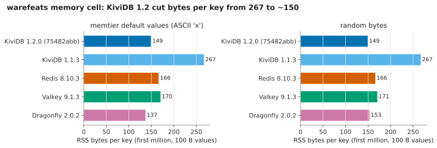

The 154.9 is one candidate run's RSS for the second ASCII million (its used_memory is the same 146.9 as every
other run); the other five candidate cells and all six rc4 cells are 146.7-147.6.

Their throughput cells (median of their passes; p50 / p99 / p99.9 in ms):

| workload | KiviDB 1.2.0 (3 runs) | KiviDB 1.1.3 | Dragonfly | Redis (no io-threads) | Valkey (no io-threads) |
|---|---|---|---|---|---|
| SET:GET 1:10, 100 B, pipeline 1 | 1,004,305 (0.19/0.38/0.48) | 989,747 (0.19/0.38/0.46) | 906,033 (0.20/0.39/0.58) | 176,722 (1.12/1.62/1.83) | 177,037 (1.11/1.63/1.84) |
| SET:GET 1:10, 10 KB, pipeline 1 | 320,324 (0.62/1.10/1.27) | 320,639 (0.62/1.06/1.25) | 321,783 (0.63/1.01/1.22) | 118,856 (1.68/2.54/2.77) | 117,031 (1.70/2.66/2.98) |
| SET:GET 1:10, 100 B, pipeline 30 | **15,630,271** (0.34/0.74/0.94) | 11,549,894 (0.50/1.09/1.34) | 8,009,195 (0.70/1.40/3.25) | 1,604,362 (3.70/8.00/8.96) | 1,583,534 (3.78/8.18/8.99) |

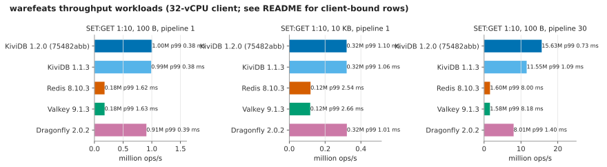

- The 10 KB row is **network-bound** for KiviDB and Dragonfly alike: 320k ops/s of mostly 10 KB replies is
  about 3.2 GB/s, the client VM's network limit. The 100 B pipeline-1 row is close to client-bound (client CPU
  40-42%, 25 memtier threads on 32 vCPUs, latency-bound connections); its ops/s moved 954k-1,027k between runs
  of the same build. Neither row separates the fast engines.
- Pipeline 30: KiviDB 1.2.0 is 1.35x 1.1.3 and 1.95x Dragonfly, with a third of Dragonfly's p99.9.
- Redis and Valkey run single-threaded here because that is how warefeats configures them; with io-threads they
  would be faster. The core suite compares throughput with io-threads and Redis Cluster; this table only
  reproduces warefeats.

## 2. Memory while the dataset grows

`harness/growth.sh`: a fresh engine, no persistence; keys `memtier-1` ... `memtier-50000000` written once each, in
stages to 1M, 5M, 10M, 25M and 50M keys (memtier, 64 connections, pipeline 32), **random-byte values**
(`--random-data`). The sampler records memory every second. Bytes per key = (RSS now - RSS of the idle engine)
/ keys; RSS is the sum over the container's processes. `used_memory` per key in brackets. KiviDB 1.2.0: median of
three rounds (every cell's spread is under 1 B/key at 100 B and 0.5 B/key at 1 KB).

100 B values:

| engine | 1M | 5M | 10M | 25M | 50M | RSS at 50M |
|---|---|---|---|---|---|---|
| KiviDB 1.2.0 | 153.8 (146.9) | 146.4 (143.1) | 145.1 (143.1) | 141.1 (140.1) | **140.7** (140.1) | 6.57 GiB |
| KiviDB 1.1.3 | 219.6 (194.1) | 197.6 (176.8) | 197.1 (176.8) | 183.2 (163.0) | 183.1 (163.0) | 8.54 GiB |
| Redis 8.10.3 | 170.5 (165.4) | 179.3 (177.1) | 179.0 (177.3) | 174.5 (173.1) | 174.4 (173.1) | 8.15 GiB |
| Valkey 9.1.3 | 172.3 (167.0) | 169.2 (166.4) | 169.3 (166.7) | 166.6 (165.4) | 166.6 (165.4) | 7.77 GiB |
| Dragonfly 2.0.2 | 164.0 (154.8) | 150.3 (148.0) | 155.6 (148.9) | 143.4 (139.4) | 141.5 (139.6) | 6.65 GiB |

1 KB values:

| engine | 1M | 5M | 10M | 25M | 50M | RSS at 50M |
|---|---|---|---|---|---|---|
| KiviDB 1.2.0 | 1085.7 (1074.9) | 1077.6 (1071.1) | 1076.2 (1071.1) | 1072.1 (1068.1) | **1071.7** (1068.1) | 49.92 GiB |
| KiviDB 1.1.3 | 1132.5 (1118.1) | 1109.8 (1100.8) | 1109.3 (1100.8) | 1095.2 (1087.0) | 1095.1 (1087.0) | 51.01 GiB |
| Redis 8.10.3 | 1347.6 (1333.4) | 1356.9 (1345.1) | 1356.7 (1345.3) | 1352.2 (1341.1) | 1352.2 (1341.1) | 62.99 GiB |
| Valkey 9.1.3 | 1352.8 (1336.6) | 1347.4 (1334.8) | 1347.2 (1334.8) | 1344.4 (1333.4) | 1344.4 (1333.4) | 62.62 GiB |
| Dragonfly 2.0.2 | 1148.7 (1082.8) | 1092.3 (1076.0) | 1085.5 (1076.9) | 1073.5 (1067.5) | 1071.2 (1067.6) | 49.94 GiB |

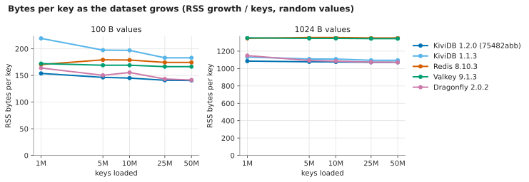

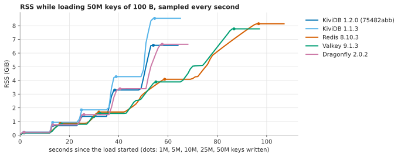

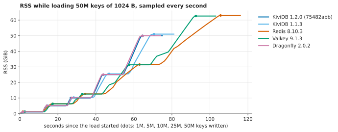

- RSS tracks used_memory within 1-6% for every engine at every size; nobody's memory runs away during ingestion.
- Redis and Valkey pay ~280 B over the 1 KB value: jemalloc puts a 1 KB string object in its 1,280-byte class.
- Dragonfly's numbers here are with random bytes; with ASCII values it saves about 16 B/key more (warefeats table).
- Load time for all 50M keys (64 connections, pipeline 32): KiviDB 1.2.0 13.0 s (100 B) / 22.9 s (1 KB), median
  of three, rc4 12.9 / 22.9; KiviDB 1.1.3 12.9 / 28.9 s, Dragonfly 16.0 / 22.8 s, Valkey 45.0 / 50.9 s, Redis
  55.1 / 63.9 s (one run each).

## 3. Mixed workload over 20 minutes

`harness/mixed.sh`: 10M keys of 100 B, then 20 minutes at a **fixed 150,000 ops/s** (100 connections x 1,500/s,
pipeline 1, the same offered load for every engine): 80% GET / 20% SET on uniformly random keys over the **whole
keyspace** (memtier `--distinct-client-seed`, the fix of the rc4 run's caveat); every SET writes a random
64-1024 B value with a TTL of 60-600 s, so values change size, keys expire and are re-created. All on pair B.

| engine | RSS at start GiB | RSS peak GiB | RSS at end GiB | used at end GiB | RSS/used at end | keys at end (M) | GET p50/p99/p99.9 ms | SET p50/p99/p99.9 ms |
|---|---|---|---|---|---|---|---|---|
| KiviDB 1.2.0 (3 runs) | 1.37 | 4.44 | **3.93** (3.92-3.94) | 3.43 | 1.15 | 6.13 | 0.29/0.46/0.69 | 0.30/0.51/0.92 |
| KiviDB 1.1.3 | 1.86 | 4.70 | 4.70 | 4.02 | 1.17 | 6.14 | 0.29/0.46/0.66 | 0.29/0.49/0.84 |
| Redis 8.10.3 | 1.70 | 5.84 | 5.84 | 4.32 | 1.35 | 6.96 | 0.25/0.42/0.60 | 0.26/0.47/1.00 |
| Valkey 9.1.3 | 1.60 | 6.21 | 6.20 | 4.26 | 1.46 | 6.96 | 0.30/0.56/0.78 | 0.31/0.56/0.78 |
| Dragonfly 2.0.2 | 1.47 | 5.04 | 5.03 | 4.01 | 1.25 | 6.34 | 0.28/0.44/0.54 | 0.29/0.47/0.85 |

Every engine was served the full offered load (149.7k-150.0k ops/s).
KiviDB 1.2.0 latency is the median over its three rounds (per round in `results/tables.md`).

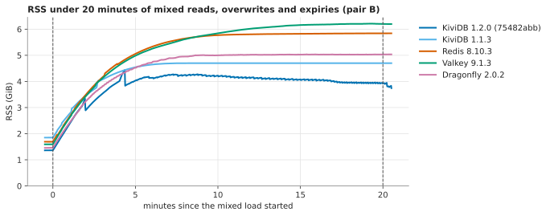

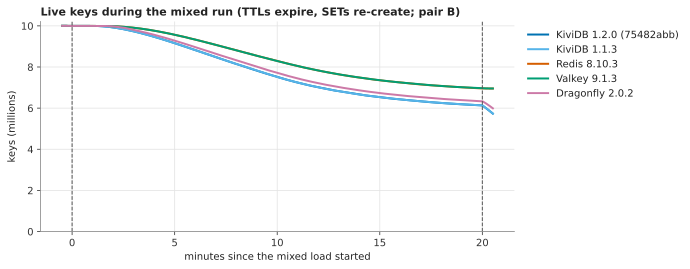

- Memory rises while the 64-1024 B values replace the 100 B ones, then flattens. KiviDB ends 22% under
  Dragonfly, 33% under Redis and 37% under Valkey.
- **KiviDB's RSS comes down while the load runs**: active defrag was running for 980 of the 1,200 s (16M values
  moved), keeping RSS within 15% of used_memory; Redis (1.35x) and Valkey (1.46x) run with active defrag off, their
  default. The steps in KiviDB's line are compaction passes. The latency above is with it running.
- Key counts differ at the end: Redis and Valkey still count ~0.8M keys whose TTL has passed but that their
  expiry has not reached yet (they report 10.84M expired against KiviDB's 11.66M); those keys hold memory too.
- p99 latency is level across engines at this fixed load (0.42-0.56 ms); the run is not a throughput test.

## 4. Snapshots under a steady write load

`harness/snapshot.sh`: 30M keys x 1 KB random values (30-38 GiB in memory), persistence on, then two windows of
300 s, each under **100,000 SET/s** (100 connections x 1,000/s, pipeline 1, uniformly random overwrites of the
whole dataset with distinct client seeds, same size): `BGSAVE` 30 s into the first, `BGREWRITEAOF` 30 s into the
second (Dragonfly has no AOF: one window). Every engine ran this load in this run (in the rc4 run Valkey,
Dragonfly and 1.1.3 had only a lighter hot-set load). Memory is the container's cgroup **anon** memory: a forked
child's pages are counted once while shared and again once copied, so this is the physical memory a snapshot
costs. Latency is memtier's per-second p99 and max. Pair A.

| engine | event | memory before GiB | added GiB | added % | duration s | worst write ms | write p99.9 over window ms | p99 before ms | memory 60 s after GiB |
|---|---|---|---|---|---|---|---|---|---|
| KiviDB 1.2.0 (3 runs) | BGSAVE | 30.30 | **3.12** (3.11-3.12) | 10% | 70.4 | **209** (206-210) | 1.96 | 1.39 | 33.39 |
| KiviDB 1.2.0 (3 runs) | BGREWRITEAOF | 33.39 | 2.08 (2.07-2.09) | 6% | 72.0 | 221 (220-226) | 1.87 | 1.40 | 34.96 |
| KiviDB 1.1.3 | BGSAVE | 63.58 | 0.93 | 1% | 97.9 | 297 | 0.84 | 0.60 | 63.61 |
| KiviDB 1.1.3 | BGREWRITEAOF | 63.61 | 0.89 | 1% | 81.0 | 289 | 1.13 | 0.82 | 63.61 |
| Redis 8.10.3 | BGSAVE | 37.60 | **33.29** | **89%** | 175.0 | 391 | 7.07 | 0.73 | 37.61 |
| Redis 8.10.3 | BGREWRITEAOF | 37.61 | **33.20** | **88%** | 177.6 | **1,006** | 4.96 | 0.67 | 37.63 |
| Valkey 9.1.3 | BGSAVE | 37.87 | 29.48 | 78% | 165.2 | 408 | 7.07 | 0.93 | 38.24 |
| Valkey 9.1.3 | BGREWRITEAOF | 38.38 | 29.95 | 78% | 172.3 | **1,024** | 6.75 | 0.61 | 38.64 |
| Dragonfly 2.0.2 | BGSAVE | 30.73 | **0.12** | 0% | 55.1 | 291 | 10.11 | 0.57 | 30.73 |

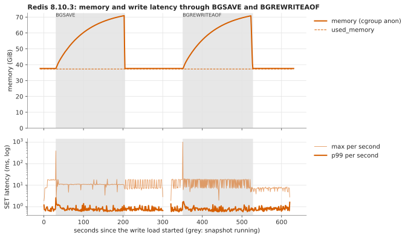

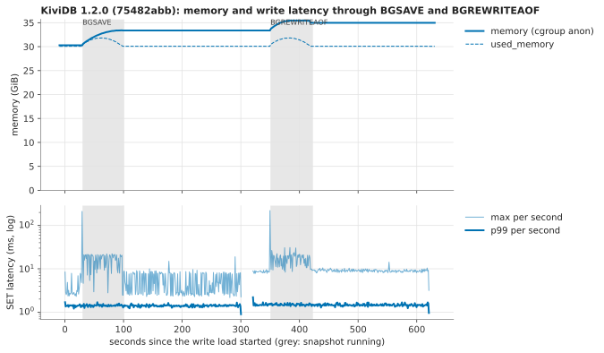

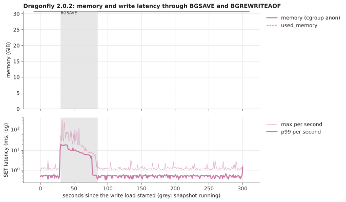

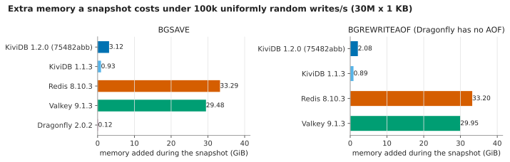

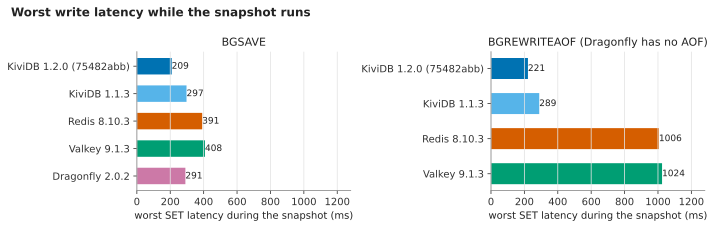

Per-engine charts for Valkey and 1.1.3: `charts/snapshot-valkey.svg`, `charts/snapshot-kividb-1.1.3.svg`.

- **Fork (Redis, Valkey):** the child shares memory with the parent until a write copies a 4 KiB page. With
  writes spread over the whole dataset, most pages are copied before the 3-minute save ends, so the peak is close
  to twice the dataset. Their worst write is the fork itself (page-table copy of a 38 GiB process): ~400 ms for
  BGSAVE and ~1 s for the rewrite.
- **KiviDB:** a snapshot holds a reference to each string value at the cut and writes it out after. An
  overwritten value stays allocated until the snapshot has written it, so memory grows by the values replaced
  during the save: ~3 GiB here. Its worst write (206-226 ms) is the write pause while it captures the 30M keys.
- **Dragonfly** serialises without forking or holding values: +0.1 GiB, the least memory of all. Under this
  uniform load its writes slow down for the whole save (per-second p99 10-20 ms, against ~1.5 ms for KiviDB and
  0.7-2.6 ms for Redis), and its worst write was 291 ms. In the rc4 run's lighter hot-set load it had an 8 ms
  worst write; that does not hold when the writes cover the dataset.
- KiviDB's write p99 *outside* the snapshot is ~1.4 ms against Redis's 0.7 ms in this AOF-on test: each KiviDB
  write waits for its AOF record to be written before it is acknowledged (1.1.3 acknowledged before, hence its
  0.6 ms). KiviDB 1.1.3 sat at 63.6 GiB for a 30M x 1 KB dataset: its load queued AOF records in memory faster
  than the disk took them (fixed in 1.2: 30.3 GiB).

## 5. maxmemory during a snapshot (#284)

`harness/evict.sh`: 10M keys x 1 KB, then `maxmemory` = used_memory + 10% with `allkeys-lru`, 300 s of 100k
same-size overwrites/s (uniformly random keys, distinct client seeds; nothing needs new memory), BGSAVE at
+60 s, no AOF. Pair A.

| engine | runs | keys before | keys after | evicted keys | lowest key count | maxmemory | SET p99 / p99.9 ms |
|---|---|---|---|---|---|---|---|
| KiviDB 1.2.0 | 3 | 10,000,000 | 10,000,000 | **0** (0-0) | 10.00M | 10.98 GiB | 0.73 / 1.11 |
| KiviDB 1.1.3 | 1 | 10,000,000 | 8,789,704 | **11,055,716** | 0.09M | 11.28 GiB | 1.21 / 1.85 |
| Redis 8.10.3 | 1 | 10,000,000 | 10,000,000 | 0 | 10.00M | 13.78 GiB | 0.62 / 1.08 |

With uniformly random overwrites (the rc4 run had a hot set) 1.1.3 shows the issue as reported: the snapshot's
held values push it over the limit and it evicts until almost no key is left, then the overwrites re-create keys.
1.2.0 evicted nothing in any round (rc4 nothing either).

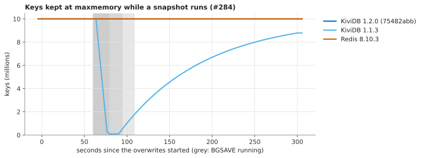

## 6. Active defrag after a mass delete

`harness/defrag.sh`: a fresh engine with the default active-defrag settings, 5M keys x 100 B (random bytes) plus
100k probe keys, then a fixed probe load for 300 s: 80,000 GET/s over the whole keyspace and 20,000 SET/s
overwriting the probe keys (same size, no new memory). 60 s in, a random half of the 5M keys (the same seeded half
every run) is deleted with 1,000-key DELs through `redis-cli --pipe` (1.6 s). The sampler records RSS,
`value_slab_bytes` / `value_slab_live_bytes` and `active_defrag_running` every second. Pair B. KiviDB only: the
other engines have no equivalent of the slab counters (Redis and Valkey have active defrag off by default).

| build | runs | RSS after load MB | slab / live after delete MB | RSS final MB | slab / live final MB | RSS returned MB | give-back s | compaction s |
|---|---|---|---|---|---|---|---|---|
| KiviDB 1.2.0 | 5 | 722 | 624 / 319 | **389** (385-390) | 321 / 319 | **334** (334-337) | **12.1** (11.7-13.1) | 13 (12-13) |
| KiviDB 1.2.0-rc4 | 4 | 722 | 624 / 319 | 387 (386-389) | 321 / 319 | 335 (335-336) | 12.1 (11.9-12.8) | 13 (12-13) |
| KiviDB 1.2.0, `activedefrag no` | 3 | 722 | 624 / 319 | 688 (687-689) | 624 / 319 | 35 (34-35) | - | 0 |

*Give-back*: from the end of the delete until RSS has made 90% of its final drop. *Compaction*: seconds with
`active_defrag_running` = 1.

Latency of the probe requests, per-second p99 / p99.9 (median over the seconds of the window), KiviDB 1.2.0:

| | GET p99 ms | GET p99.9 ms | SET p99 ms | SET p99.9 ms | worst GET / SET ms (median of the runs' worst) |
|---|---|---|---|---|---|
| 50 s before the delete (median of 5 runs) | 0.51 | 0.80 | 0.24 | 0.37 | 2.62 / 1.17 |
| while compaction runs (median of 5 runs) | 0.51 | 0.79 | 0.24 | 0.36 | 2.39 / 1.14 |
| during / before, same run (median, min-max) | 1.00 (0.93-1.02) | 0.99 (0.97-1.07) | 1.00 (0.92-1.04) | 0.95 (0.88-1.05) | |

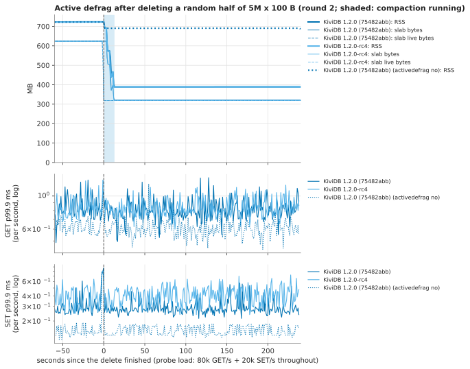

- Compaction moved ~1.4M values in 12-13 s and the slabs ended within 1% of the live bytes (624 -> 321 MB for
  319 MB live). RSS came down 334 MB: the 303 MB the slabs gave back plus ~31 MB of key entries, which come back
  without compaction too. Without compaction the freed value slots stay inside partly used slabs and only those
  35 MB come back.
- The pass did not show in the requests running beside it: in every run the seconds during compaction are within
  the noise of the same run's seconds before the delete, and the worst request during the pass was no worse than
  before it. The probe's latency *level* moved from run to run (GET p99 0.28-0.59 ms over all runs of both builds,
  with compaction on or off) on this 16-vCPU client; compare within a run.

## Against 1.2.0-rc4

Every metric of the suite, candidate (75482abb) and rc4 (a6b1bf38) on the same VMs, alternating. *Change* is the
candidate's median against rc4's; *spread* is the larger of the two builds' (max-min)/median. A row counts as a
regression when the candidate is worse by more than the spread and by at least 1%. Full table, with every metric:
`results/tables.md`.

**Verdict: no regression.** No metric is worse beyond the spread. The rows that moved most:

| section | metric | candidate | rc4 | change | spread | verdict |
|---|---|---|---|---|---|---|
| warefeats pipeline 30 | ops/s | 15,630,271 (15,041,498-15,684,903) | 15,149,332 (15,115,581-15,588,430) | +3.2% | 4.1% | level |
| warefeats pipeline 30 | p99.9 ms | 0.943 (0.939-0.987) | 0.983 (0.951-0.983) | -4.1% | 5.1% | level |
| warefeats 100 B pipeline 1 | ops/s | 1,004,305 (966,437-1,015,373) | 968,399 (954,011-1,026,910) | +3.7% | 7.5% | level |
| warefeats ASCII | 1st M RSS B/key | 149.2 (149.2-149.2) | 148.9 (148.9-149.2) | +0.2% | 0.2% | level |
| growth 100 B | RSS B/key at 50M | 140.7 (140.7-140.7) | 140.7 (140.7-140.7) | 0.0% | 0.0% | level |
| growth 1 KB | RSS B/key at 50M | 1071.7 (1071.6-1071.7) | 1071.7 (1071.6-1071.7) | 0.0% | 0.0% | level |
| growth 100 B | load seconds, 50M keys | 13.0 (12.8-13.0) | 12.9 (12.9-13.1) | +0.7% | 1.6% | level |
| mixed 20 min | RSS at end GiB | 3.93 (3.92-3.94) | 3.94 (3.92-3.94) | -0.3% | 0.5% | level |
| mixed 20 min | SET p99.9 ms | 0.92 (0.78-1.01) | 0.81 (0.78-0.86) | +13.9% | 24.4% | level |
| snapshot BGSAVE | memory added GiB | 3.12 (3.11-3.12) | 3.13 (3.09-3.15) | -0.3% | 1.9% | level |
| snapshot BGSAVE | worst write ms | 209 (206-210) | 209 (203-226) | -0.4% | 10.8% | level |
| snapshot BGREWRITEAOF | worst write ms | 221 (220-226) | 222 (222-225) | -0.3% | 2.4% | level |
| snapshot BGREWRITEAOF | write p99 before ms | 1.40 (1.23-1.46) | 1.33 (1.28-1.38) | +5.4% | 16.6% | level |
| #284 | keys evicted | 0 (0-0) | 0 (0-0) | - | - | level |
| active defrag | give-back s | 12.1 (11.7-13.1) | 12.1 (11.9-12.8) | -0.3% | 11.1% | level |
| active defrag | GET p99.9 during / before | 0.99 (0.97-1.07) | 1.01 (0.85-1.11) | -1.5% | 26.1% | level |
| AOF-on writes (check) | SET p99 ms | 0.911 (0.887-0.967) | 1.003 (0.895-1.007) | -9.2% | 11.2% | level |
| AOF-on writes (check) | engine CPU s | 554 (547-562) | 560 (552-564) | -1.2% | 2.7% | level |

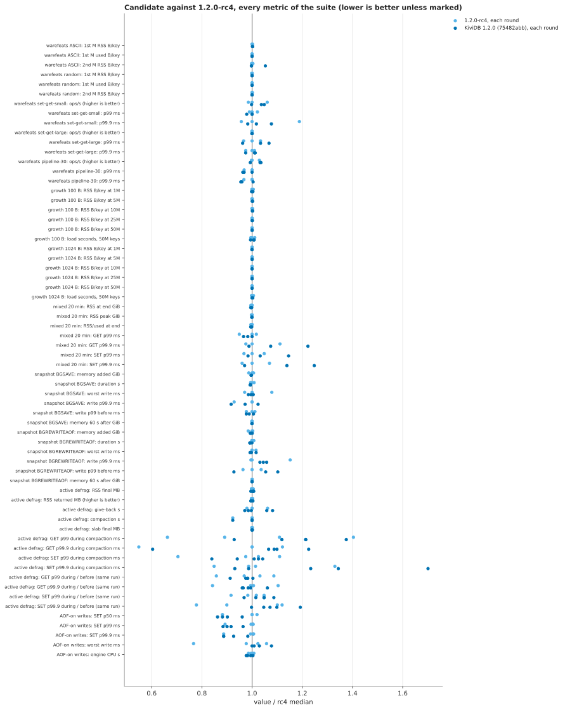

**The one row that was flagged and then cleared.** After two rounds, the snapshot runs' AOF-on write p99 in the
30 s before BGREWRITEAOF was 5.9% higher for the candidate (1.43 against 1.35 ms; spread 4.5%). Since rc4 the AOF
writer changed (a replica wakes it per applied batch, cb52b7e5; a pass stops after 64 MB, 8ef328cf), so this was
checked on its own: `harness/aoflat.sh`, the same 100k SET/s of 1 KB with the AOF on and no snapshot, four
alternating rounds per build on pair B plus one round each under `perf record -g`. The candidate was not slower
(SET p99 0.911 against 1.003 ms, p99.9 1.28 against 1.42, engine CPU 554 against 560 s), and the two profiles are
the same function for function (`aof::written` 2.16% against 2.20%, `handle_client` 2.14% both,
`set_str_expiring` 1.80% against 1.76%). With the third round the snapshot row itself fell inside the spread
(+5.4%, spread 16.6%). Not a regression.

**Probe latency in the first active-defrag run.** The candidate's first defrag run had GET p99 0.52 ms against
rc4's 0.28 in the run after it, before the delete as well as during. Later rounds put both builds anywhere in
0.28-0.59 ms (the `activedefrag no` controls too), so it is the probe's run-to-run level, not the build; the
per-run during/before ratio, which is what compaction costs, is level.

## Findings

Wins
- Bytes per key fell 44% from 1.1.3 on warefeats' own cell (267 -> 149) and is below Redis and Valkey at every size
  measured, and level with Dragonfly from 25M keys up (random values).
- Under 20 minutes of mixed reads, overwrites and expiries over the whole keyspace, KiviDB ends with the least
  memory of the five engines (3.93 GiB; Dragonfly 5.03, Redis 5.84, Valkey 6.20), active defrag running beside
  the load without moving its latency.
- A snapshot under a uniformly random write load costs KiviDB ~10% extra memory against Redis's ~89% and Valkey's
  78%, and its worst write (206-226 ms) is below every forking engine's (391-1,024 ms) and Dragonfly's (291 ms).
- #284 holds: no eviction during a snapshot at maxmemory; 1.1.3 lost 11M keys in the same test.
- Active defrag gives back the memory of a mass delete in ~12 s with no visible cost to the requests beside it.
- warefeats pipeline 30: 15.6M ops/s, 1.35x 1.1.3 and 1.95x Dragonfly, with lower p99.9.

Losses
- **Dragonfly's snapshot costs almost no memory** (+0.1 GiB against KiviDB's +3.1 GiB at 30M x 1 KB). It pays in
  write latency for the length of the save instead (p99 10-20 ms), but on memory it is better.
- **Dragonfly uses less memory with ASCII values** (137 vs 149 B/key at 1M x 100 B): it packs ASCII strings.
- **AOF-on write latency:** p99 ~1.4 ms at 100k SET/s, about twice Redis's 0.7 ms on the same load (each KiviDB
  write waits for its AOF record to be written before it is acknowledged). Same as rc4.
- At 1M-10M keys of 100 B, Dragonfly and KiviDB trade places within ~10 B/key (hash-table growth steps).

Looks like a KiviDB problem (worth an issue)
- **RSS stays up after a snapshot, and the reason is now visible.** After the BGSAVE and the rewrite, used_memory
  is back at 30.1 GiB but RSS stays at 33.4 then 35.0 GiB for the rest of the run (identical in rc4). The sampler's
  slab counters show why: after the rewrite, 34.0 GiB of slabs hold 29.5 GiB of live values, so 4.5 GiB (15%) are
  free slots in partly used slabs (3.1 GiB, 10%, after the BGSAVE). That is below `active-defrag-threshold-lower`
  (20%), so compaction never starts. Writes of the same size reuse the free slots (RSS stays flat), but the memory
  is not returned. Also visible: the 3.1 GiB of free slots left by the BGSAVE did not absorb the rewrite's held
  values; the slabs grew by another 1.4 GiB (1.8 GiB at the peak). Options: let a
  snapshot's release of held values trigger a compaction pass whatever the threshold, or prefer partly used slabs
  when allocating. Repro: `harness/snapshot.sh kividb-cand`; compare `slab_mb` and `slab_live_mb` with `used_mb`
  in the sampler CSV after `aofrw-done`.
- The snapshot charts show the worst write per second at 3-10 ms for minutes after each snapshot (p99 unchanged at
  ~1.5 ms), against 1-2 ms before it; same in rc4. Not diagnosed (one guess: writeback of the 31 GB dump to the
  disk the AOF is on).

Caveats
- Throughput rows in the warefeats table that are network- or client-bound: 10 KB (network) and 100 B pipeline 1
  (close to client-bound). Redis and Valkey there run without io-threads, as warefeats configures them.
- memtier's `--random-data` buffer repeats, so Dragonfly's snapshot files still compress ~35%; Redis's LZF does
  not compress the random values. No engine compresses values in memory.
- Competitors ran one round each (candidate and rc4: three or more). Their memory numbers repeat closely between
  the rc4 run and this one (e.g. Redis 1 KB at 50M: 1,352.2 both times; Dragonfly 100 B at 50M: 141.5 both times).
- The mixed and defrag runs are on pair B (Intel v6), the rest on pair A (v7); do not compare across pairs.

## What did not run

- **Redis Cluster** is not in this suite (memory per key in a cluster is the same per shard plus per-shard
  overhead); throughput with Redis Cluster is in the core suite.
- **ASCII values in the growth test:** growth used random bytes only. Dragonfly packs ASCII strings and would be
  ~16 B/key lower at 100 B with ASCII values (see warefeats' default cell).
- **Active defrag on the other engines:** Redis and Valkey have active defrag off by default and expose no slab
  counters to compare; the defrag test is KiviDB against itself (rc4, and `activedefrag no`).

## Reproduce

See `harness/README.md`. Every script used is there; `harness/analyze.py` turns the raw files into
`results/tables.md` and the charts.

## Files

- `results/tables.md`: every table, generated, with every round.
- `results/warefeats/`: warefeats runner JSON per engine and run (their schema).
- `results/raw/pair-a`, `pair-b`: per-run sampler CSVs (one row per second), memtier JSON (per-second latency),
  events, checkpoints, engine start lines, persistence INFO at the end of each snapshot, the two `perf report`s of
  the AOF check (`aoflat-*-p1.perf.txt`), and `engine-vm.txt` (commits, `--version`, image digests, CPU, kernel).
