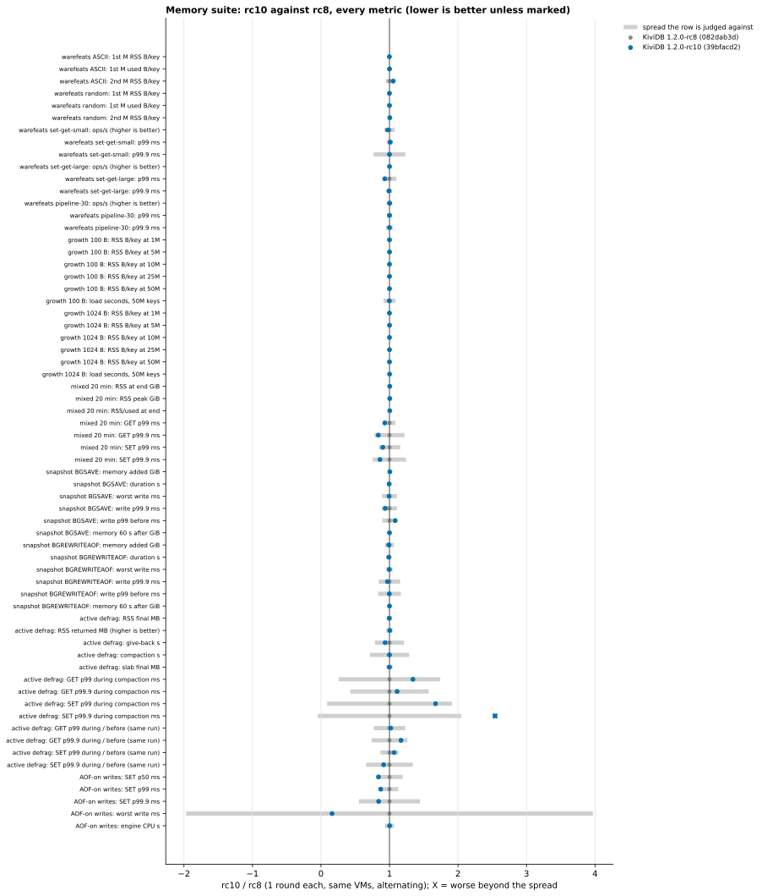

# Memory suite: 1.2.0-rc10 against rc8

The memory suite of `benchmarks/1.2.0/memory/` was run on 1.2.0-rc10 (39bfacd2) and 1.2.0-rc8 (082dab3d). It
used the rc8 round's harness, unchanged except for the build names. The builds alternated on the same VMs in one
session on 2026-11-03. No competitors ran.

**Verdict: no regression in rc10.**
- **Bytes per key are level with rc8.** `used_memory` per key is identical in every cell. RSS per key is within
  0.1 B, except one cell explained below:
  - warefeats 1M x 100 B: 146.9 B/key used for both builds;
  - growth to 50M: 140.7 vs 140.7 B/key at 100 B, and 1,071.7 vs 1,071.6 B/key at 1 KB.
- **The 64 MB `repl-backlog-size` is not allocated without a replica.** Every rc10 start reported
  `repl_backlog_active:0` and `repl_backlog_histlen:0`. Idle `used_memory` was 2,890,950 B for rc10 against
  2,890,388 B for rc8, a 562 B difference.
- Mixed load, snapshots, #284, active defrag and AOF-on write latency are level.
- One latency row is past its spread: SET p99.9 during compaction, 0.34 vs 0.14 ms. It is the probe's absolute
  level, which moved for the whole run (below), the same row the rc8 round put down to probe noise.

## What ran

| | VM | CPU | region | scenarios |
|---|---|---|---|---|
| pair A engine | Standard_E32ds_v7 (32 vCPU, 251 GiB, local NVMe data dir) | Intel Xeon 6973P-C | koreacentral | warefeats, growth, snapshot, #284 |
| pair A client | Standard_D32ls_v7 (32 vCPU) | Intel Xeon 6973P-C | koreacentral | memtier 2.5.1 |
| pair B engine | Standard_E32ds_v6 (32 vCPU, 251 GiB, local NVMe data dir) | Intel Xeon Platinum 8573C | polandcentral | mixed, active defrag, AOF-on writes |
| pair B client | Standard_D16ls_v6 (16 vCPU) | Intel Xeon Platinum 8573C | polandcentral | memtier 2.5.1 |

- **VMs.** The sizes and regions are the rc8 round's.
  - Each pair is one proximity placement group with accelerated networking, Ubuntu 24.04.
  - Engines ran in Docker with host networking and seccomp unconfined (io_uring allowed), one engine at a time,
    each in its own wiped data directory.
  - polandcentral offers no auto-shutdown; the resource group was deleted at the end.
- **Builds.** Each engine VM built both from source with the repo's Dockerfile: `cargo build --release`, default
  variant, builder `rust:1.89-slim-bookworm`, `rustc 1.89.0 (29483883e 2025-08-04)`. Both VMs produced
  byte-identical binaries. rc8's is byte-identical to the rc8 round's.

| build | commit | `--version` | binary SHA-256 |
|---|---|---|---|
| rc10 | 39bfacd231bb (v1.2.0-rc10) | kividb 1.2.0-rc10 | `332acb70fa61a86bf3f936a9883fc704d13f4fc60f64ef8dc86093da9be8d6dd` |
| rc8 | 082dab3d8929 | kividb 1.2.0-rc8 | `fed6de56867c8a80829412f2bba4ac3f6774693a9347f4ba39a3ccb8fee6475f` |

- **Rounds.** One round per build of every scenario, alternating which build went first. A few scenarios got
  more:
  - growth 100 B got a second round, rc8 first, because round 1 flagged the load time;
  - the snapshot test got a second round of rc8 only. rc10's second round was not run (time), so the snapshot
    rows compare rc10's one round with rc8's two;
  - AOF-on writes ran three rounds, alternating, because pair B was otherwise idle. It checks the snapshot's
    steady-state write p99.

## rc10 against rc8, per scenario

How to read the table:
- Values are medians, with the range over rounds in brackets.
- *Spread* is what the row is judged against: the larger of this run's (max-min)/median and the spread the rc8
  round judged the same row by (`rc8/results/compare.md`).
- A row is flagged when rc10 is worse by more than the spread and by at least 1%.
- Every metric is in `results/compare.md`.

| scenario | metric | rc10 | rc8 | change | spread | verdict |
|---|---|---|---|---|---|---|
| warefeats ASCII (1) | 1st M RSS / used B/key | 149.0 / 146.9 | 149.2 / 146.9 | -0.1% / 0.0% | 0.2% | level |
| | 2nd M RSS B/key | 154.8 | 146.7 | +5.5% | 5.6% | level (used B/key identical, below) |
| warefeats random (1) | 1st M RSS / used B/key | 149.1 / 146.9 | 149.2 / 146.9 | -0.1% / 0.0% | 0.2% | level |
| | 2nd M RSS B/key | 147.5 | 146.7 | +0.5% | 0.1% | level (under 1%) |
| warefeats 100 B p1 (1) | ops/s | 1,323,766 | 1,358,514 | -2.6% | 7.5% | level (client-bound row) |
| warefeats 10 KB p1 (1) | ops/s | 320,877 | 320,604 | +0.1% | 0.1% | level |
| warefeats pipeline 30 (1) | ops/s / p99.9 ms | 17,704,944 / 0.747 | 17,666,123 / 0.747 | +0.2% / 0.0% | 4.1% / 5.1% | level |
| growth 100 B (2) | RSS B/key at 50M | 140.7 (140.7-140.7) | 140.7 (140.6-140.7) | 0.0% | 0.0% | level |
| | load s, 50M keys | 12.5 (12.1-13.0) | 12.6 (12.0-13.1) | -0.3% | 8.6% | level |
| growth 1 KB (1) | RSS B/key at 50M | 1071.7 | 1071.6 | 0.0% | 0.0% | level |
| | load s, 50M keys | 23.0 | 22.9 | +0.2% | 0.8% | level |
| mixed 20 min (1) | RSS at end / peak GiB | 3.94 / 4.45 | 3.92 / 4.43 | +0.5% / +0.4% | 0.5% / 0.3% | level (under 1%) |
| | GET / SET p99 ms | 0.43 / 0.45 | 0.46 / 0.49 | -6.9% / -9.7% | 8.7% / 15.7% | level |
| snapshot BGSAVE (rc10 1, rc8 2) | memory added GiB | 3.56 | 3.54 (3.53-3.54) | +0.6% | 1.9% | level |
| | duration s | 81.4 | 81.9 (81.9-81.9) | -0.6% | 1.4% | level |
| | worst write ms | 206 | 208 (206-210) | -0.7% | 10.8% | level |
| | write p99 in the 30 s before ms | 1.40 | 1.29 (1.22-1.36) | +8.4% | 10.5% | level (below) |
| snapshot BGREWRITEAOF (rc10 1, rc8 2) | memory added GiB | 2.34 | 2.37 (2.36-2.38) | -1.1% | 6.6% | level |
| | duration s | 83.0 | 83.9 (83.9-84.0) | -1.2% | 0.9% | better |
| | worst write ms | 218 | 219 (214-224) | -0.4% | 4.6% | level |
| | write p99 before ms | 1.36 | 1.36 (1.30-1.42) | -0.3% | 16.6% | level |
| #284 eviction (1) | keys evicted | 0 | 0 | - | - | level (10.00M keys kept by both) |
| active defrag (1) | RSS returned MB / give-back s | 335 / 12.1 | 334 / 13.0 | +0.4% (better) / -6.4% | 4.7% / 21.2% | level |
| | slab final MB (319 live) | 321 | 321 | -0.1% | 4.7% | level |
| | GET / SET p99 during ÷ before, same run | 1.02 / 1.00 | 1.00 / 0.94 | +1.9% / +6.7% | 22.9% / 13.2% | level |
| | SET p99.9 during ÷ before, same run | 0.91 | 1.00 | -8.5% | 34.1% | level |
| | SET p99.9 during compaction ms | 0.34 | 0.14 | +154% | 105% | flagged, probe level (below) |
| AOF-on writes (3) | SET p99 ms | 0.871 (0.863-0.975) | 0.999 (0.927-1.007) | -12.8% | 12.9% | level |
| | SET p99.9 ms | 1.191 (1.183-1.351) | 1.415 (1.279-1.423) | -15.8% | 44.5% | level |
| | engine CPU s | 558 (530-567) | 557 (553-558) | +0.2% | 6.6% | level |

**Bytes per key and the 64 MB backlog.**
- rc10 raised the default `repl-backlog-size` from 1 MB to 64 MB. With no replica the backlog is not created:
  - all 10 rc10 starts reported `repl_backlog_size:67108864`, `repl_backlog_active:0` and
    `repl_backlog_histlen:0`;
  - all 11 rc8 starts reported the same with 1048576;
  - the lines are in every `*.engine.txt`.
- Memory per key is level wherever it was measured:
  - `used_memory` per key is identical to a tenth of a byte in all four warefeats cells;
  - growth: 140.1 B/key used at 50M x 100 B and 1,068.1 at 1 KB, for both builds;
  - #284: `used_memory` after 10M x 1 KB was 10,714,044,874 B for rc10 against 10,714,044,024 B for rc8, an 850 B
    difference.
- The one RSS outlier is warefeats' second ASCII million on rc10: 154.8 B/key RSS for 146.9 used. Its random-bytes
  twin is 147.5, and the published 75482abb run had the same one-off 154.9 on this cell (its README notes it).
  It is inside the 5.6% spread that row is judged by.

**Growth 100 B load time.**
- Round 1 flagged the load time: rc10 13.0 s against rc8 12.0 s. The whole second came from rc8's last stage
  (25M to 50M keys in 4.4 s, against 5.4 s). The other four stages matched within 0.05 s.
- In round 2 (rc8 first) the order flipped: rc8 13.1 s, rc10 12.1 s.
- 13.0 s is also what rc8, rc7 and 75482abb measured in earlier rounds.

**Snapshot, write p99 before the BGSAVE.**
- After round 1 this row was flagged at +14%: rc10 1.40 ms against rc8 1.22.
- rc8's second round measured 1.36 ms, which brings the median within the spread.
- The rc8 round flagged the same row the other way (rc8 1.44 against rc7 1.27). It moves this much from run to
  run on these VMs.
- The direct check of this write path, AOF-on writes, is level over three alternating rounds:
  - SET p99 0.871 vs 0.999 ms;
  - engine CPU 558 vs 557 s.
- The BGREWRITEAOF rows show the same: write p99 before 1.36 vs 1.36 ms, and the rewrite takes 1.2% less time.

**Active defrag, SET p99.9 during compaction.**
- This row is an absolute latency over the ~13 s of compaction. It follows the probe's level for the whole run:
  rc10's SET p99.9 was at the same level before the delete, giving a during/before ratio of 0.91 against rc8's 1.00.
- The rc8 round saw this metric range 0.13-0.61 ms between rounds of one build, and judged compaction's cost by
  the same-run ratios. All four ratios are level here.
- Compaction itself is level: 335 MB returned in 12.1 s, slabs 321 MB for 319 MB live.

## rc10 against the rc8 round's published rc8 numbers (indicative: other session, other VMs)

| metric | rc10 (this run) | rc8 (rc8 round) | change |
|---|---|---|---|
| warefeats ASCII 1st M RSS B/key | 149.0 | 149.1 | -0.1% |
| warefeats random 1st M RSS B/key | 149.1 | 149.2 | -0.1% |
| growth 100 B, RSS B/key at 50M | 140.7 | 140.7 | 0.0% |
| growth 1 KB, RSS B/key at 50M | 1071.7 | 1071.6 | 0.0% |
| growth 100 B load s, 50M keys | 12.5 | 13.0 | -4.0% |
| mixed, RSS at end GiB | 3.94 | 3.93 | +0.2% |
| snapshot BGSAVE memory added GiB | 3.56 | 3.57 | -0.2% |
| snapshot BGSAVE worst write ms | 206 | 214 | -3.4% |
| #284 keys evicted | 0 | 0 | - |
| defrag RSS returned MB / give-back s | 335 / 12.1 | 334 / 12.0 | +0.5% / +1.5% |
| AOF-on SET p99 ms | 0.871 | 0.983 | -11.4% |
| warefeats pipeline 30 ops/s | 17.70M | 17.30M | +2.3% |
| warefeats 100 B p1 ops/s | 1.32M | 1.31M | +1.0% |

Memory numbers repeat to a tenth of a byte per key across the two sessions. The full table is at the end of
`results/compare.md`.

## What differs from the rc8 round

- **Rounds.** One per build, plus the extra rounds listed under *What ran*. There was no profiled snapshot round
  (`PERF=1`), and no competitors.
- **Harness changes** (`harness/`):
  - builds are named `kividb-rc10` and `kividb-rc8`;
  - `eng.sh` also records `repl-backlog-size` and the INFO replication backlog fields at every KiviDB start;
  - `setup-server.sh` pulls no competitor images;
  - `compare.py` judges each row against the rc8 round's spread and compares with the rc8 round's rc8 values.
  The scenarios themselves are unchanged.
- **Lock file.** rc10 takes `kividb.lock` in its data directory. Each engine runs alone with its own wiped
  directory, so nothing waited.

## Files

- `results/tables.md`: every generated table, per round (`harness/analyze.py`).
- `results/compare.md`: every metric, rc10 against rc8 and against the rc8 round's rc8 (`harness/compare.py`).
- `results/regression-rows.json`: the values behind it.
- `results/raw/pair-a`, `results/raw/pair-b`: sampler CSVs, memtier JSON, events, checkpoints, queue logs and
  `engine-vm.txt` (commits, versions, SHA-256, toolchain, image digests, CPU, kernel). Private VNet addresses are
  replaced by `engine-a/b` and `client-a/b`.
- `results/warefeats/`: warefeats runner JSON per build.
- `charts/regression-rc10-vs-rc8.svg`: the regression check.
- `NOTES.md`: the progress log.
