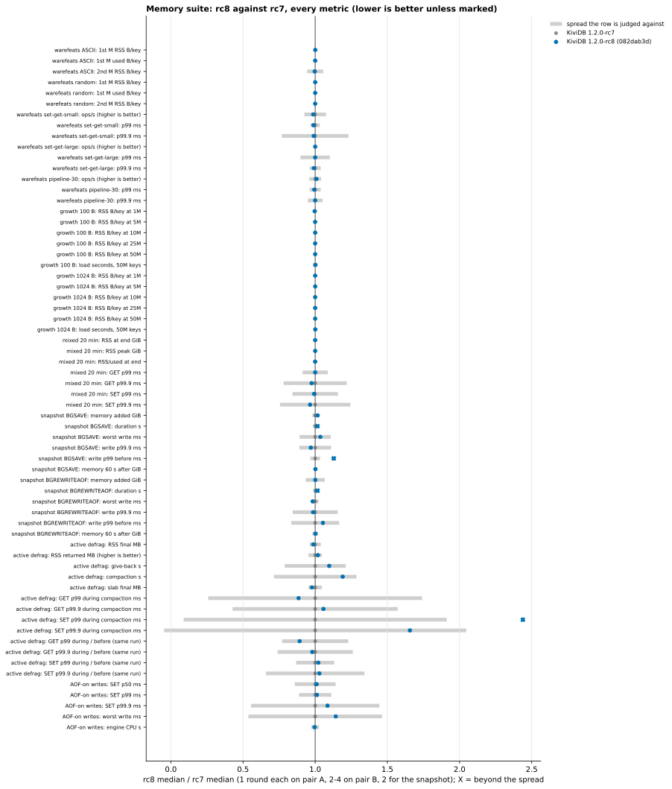

# Memory suite: 1.2.0-rc8 against rc7

The memory suite of `benchmarks/1.2.0/memory/` was run unchanged on 1.2.0-rc8 (082dab3d) and 1.2.0-rc7
(v1.2.0-rc7, 598b74d2). The builds alternated on the same VMs in one session on 2026-11-03. Competitors ran once,
for the headline rows only.

**Verdict: no regression attributed to rc8.**
- Memory per key, mixed workload, #284, active defrag and AOF-on write latency are level with rc7.
- One small difference reproduced in the snapshot test: rc8's saves took 1.6% longer, and their memory cost grew
  in proportion (+1.8%). It is not attributed to rc8: no rc8 change touches the save path, and CPU per SET and
  the profiles are equal (see *Snapshot*).
- The published headline numbers hold.

## What ran

| | VM | CPU | region | scenarios |
|---|---|---|---|---|
| pair A engine | Standard_E32ds_v7 (32 vCPU, 251 GiB, local NVMe data dir) | Intel Xeon 6973P-C | koreacentral | warefeats, growth, snapshot, #284 |
| pair A client | Standard_D32ls_v7 (32 vCPU) | Intel Xeon 6973P-C | koreacentral | memtier 2.5.1 |
| pair B engine | Standard_E32ds_v6 (32 vCPU, 251 GiB, local NVMe data dir) | Intel Xeon Platinum 8573C | polandcentral | mixed, active defrag, AOF-on writes |
| pair B client | Standard_D16ls_v6 (16 vCPU) | Intel Xeon Platinum 8573C | polandcentral | memtier 2.5.1 |

- **VMs.** The sizes match the published run. Each pair is one proximity placement group with accelerated
  networking, Ubuntu 24.04, kernel 7.0.0-1017-azure. Engines ran in Docker (host network, seccomp unconfined so
  io_uring is allowed), one engine at a time, each in its own data directory.
- **Regions.** The published pair A ran in germanywestcentral. That region refuses D-series now. polandcentral
  does not offer E32ds_v7. swedencentral's 65-vCPU quota was taken by another run. So pair A ran in koreacentral.
  Pair B is in the published region.
- **Builds.** Both were built on each engine VM the way the published numbers were: the repo's Dockerfile, which
  is also how `release.yml` builds the Docker images. That means `cargo build --release`, the default variant
  with no features, and the builder `rust:1.89-slim-bookworm` with `rustc 1.89.0 (29483883e 2025-08-04)`. Both
  VMs produced byte-identical binaries:

| build | commit | `--version` | binary SHA-256 |
|---|---|---|---|
| rc8 | 082dab3d8929 | kividb 1.2.0-rc8 | `fed6de56867c8a80829412f2bba4ac3f6774693a9347f4ba39a3ccb8fee6475f` |
| rc7 | 598b74d20ec0 (v1.2.0-rc7) | kividb 1.2.0-rc7 | `bd35a3a77f3916404eb2ac5ecad829982400f401315766267d99047e9c012535` |

- **Competitors.** Redis 8.10.3, Valkey 9.1.3 and Dragonfly 2.0.2, with the images and flags of the published
  README.
- **Rounds.** Pair A ran one round per build, alternating the order between scenarios. Two scenarios got more
  rounds:
  - The snapshot test got a second round, rc7 first, after round 1 showed a difference. That round also
    recorded engine CPU and 20 s of `perf record` under the steady load before the BGSAVE.
  - Pair B would have sat idle while pair A ran, so it ran two rounds of mixed and defrag and four of AOF-on
    writes.
- **Harness changes** (`harness/`). Builds are named `kividb-rc8` and `kividb-rc7`.
  - `warefeats.sh`: new `WF_ONLY=<workload>`, so competitors run only the headline cell.
  - `snapshot.sh`: new `PERF=1`, used in round 2. The perf report delayed the BGSAVE by about 5 s in that round,
    for both builds alike.
  - `setup-server.sh` records SHA-256 and the toolchain. `create-vms.sh` puts both pairs in one resource group.
  - `compare.py` is new. The scenarios themselves are unchanged.

## rc8 against rc7, per scenario

How to read the tables:
- Values are medians, with the range over rounds in brackets.
- *Spread* is what a row is judged against: the larger of this run's (max-min)/median and the spread the
  published run measured for the same metric over its 3-5 rounds. With one round, only the published spread
  exists.
- A row is flagged when rc8 is worse by more than the spread and by at least 1%.
- Every metric is in `results/compare.md`. The chart is `charts/regression-rc8-vs-rc7.svg`.

| scenario | metric | rc8 | rc7 | change | spread | verdict |
|---|---|---|---|---|---|---|
| warefeats ASCII (1 round) | 1st M RSS B/key | 149.1 | 149.0 | +0.1% | 0.2% | level |
| | 2nd M RSS B/key | 146.9 | 147.4 | -0.3% | 5.6% | level |
| warefeats random (1) | 1st M RSS B/key | 149.2 | 149.2 | 0.0% | 0.2% | level |
| warefeats 100 B p1 (1) | ops/s | 1,310,912 | 1,329,474 | -1.4% | 7.5% | level |
| warefeats 10 KB p1 (1) | ops/s | 318,999 | 318,937 | 0.0% | 0.1% | level |
| warefeats pipeline 30 (1) | ops/s | 17,298,680 | 17,143,693 | +0.9% | 4.1% | level |
| | p99.9 ms | 0.767 | 0.767 | 0.0% | 5.1% | level |
| growth 100 B (1) | RSS B/key at 50M | 140.7 | 140.7 | 0.0% | 0.0% | level |
| | load s, 50M keys | 13.0 | 13.0 | +0.2% | 1.6% | level |
| growth 1 KB (1) | RSS B/key at 50M | 1071.6 | 1071.7 | 0.0% | 0.0% | level |
| mixed 20 min (2) | RSS at end GiB | 3.93 (3.93-3.94) | 3.93 (3.93-3.94) | 0.0% | 0.5% | level |
| | GET / SET p99 ms | 0.46 / 0.48 | 0.46 / 0.48 | 0.0% / -0.8% | 8.7% / 15.7% | level |
| | SET p99.9 ms | 0.76 (0.71-0.81) | 0.79 (0.75-0.83) | -3.5% | 24.4% | level |
| snapshot BGSAVE (2) | memory added GiB | 3.57 (3.55-3.59) | 3.50 (3.50-3.51) | +1.8% | 1.9% | level |
| | duration s | 82.2 (82.0-82.3) | 80.9 (80.7-81.1) | +1.6% | 1.4% | flagged, not attributed to rc8 (below) |
| | worst write ms | 214 (203-224) | 206 (206-207) | +3.5% | 10.8% | level |
| | write p99 in the 30 s before ms | 1.44 (1.42-1.46) | 1.27 (1.25-1.29) | +12.9% | 3.4% | flagged, not attributed to rc8 (below) |
| snapshot BGREWRITEAOF (2) | memory added GiB | 2.40 (2.38-2.42) | 2.40 (2.32-2.48) | +0.1% | 6.6% | level |
| | duration s | 83.4 (83.1-83.7) | 82.1 (82.0-82.1) | +1.6% | 0.9% | flagged, not attributed to rc8 (below) |
| | worst write ms | 216 (215-218) | 220 (219-221) | -1.8% | 2.4% | level |
| | write p99 before ms | 1.34 (1.29-1.39) | 1.27 (1.26-1.29) | +5.3% | 16.6% | level |
| #284 eviction (1) | keys evicted | 0 | 0 | - | - | level (10.00M keys kept) |
| active defrag (2) | RSS returned MB | 334 (333-335) | 328 (320-335) | +1.9% (better) | 4.7% | level |
| | slab / live final MB | 321 / 319 | 328 (321-336) / 319 | -2.3% | 4.7% | level |
| | give-back s | 12.0 (11.9-12.1) | 10.9 (9.8-12.1) | +9.7% | 21.2% | level |
| | GET / SET p99 during ÷ before, same run | 0.99 / 1.02 | 1.11 / 1.00 | -10.8% / +2.1% | 22.9% / 13.2% | level |
| | SET p99 during compaction ms | 0.42 (0.23-0.61) | 0.17 (0.14-0.20) | +144% | 91% | flagged, probe noise (below) |
| AOF-on writes (4) | SET p99 ms | 0.983 (0.935-1.015) | 0.971 (0.903-1.007) | +1.2% | 11.2% | level |
| | SET p99.9 ms | 1.679 (1.343-2.023) | 1.547 (1.327-2.015) | +8.5% | 44.5% | level |
| | engine CPU s | 562 (556-564) | 564 (558-570) | -0.4% | 2.7% | level |

**Snapshot: +1.6% duration, not attributed to rc8.**
- The gap held in both rounds, with the order swapped: rc8's saves took 1.6% longer for BGSAVE and for
  BGREWRITEAOF.
- Memory added grows with the save's duration: values overwritten during the save are held until it has written
  them. Per second of save the rate is the same, 0.0435 GiB/s for both builds. So +1.8% memory added is the
  longer save, not a new cost.
- These koreacentral VMs save 15% slower than the published pair (82 s against 70 s for the same 30M x 1 KB).
- Under the steady 100k SET/s before the BGSAVE, the engine used:
  - rc7: 3.62 cores (36.2 µs per SET); rc8: 3.56 cores (37.1 µs). The per-SET difference is within the
    one-second resolution of the SET count.
- In 20 s of `perf record`, no function differs by more than 0.23 percentage points, for example:
  - kernel spin unlock 12.10 vs 12.33;
  - `aof::` total 3.39 vs 3.37;
  - store 2.81 vs 2.84;
  - nothing MSET-related.
- No rc8 change runs during a save or a rewrite. `save_dataset` is unchanged. The new dump fingerprint is
  computed only when a dump is loaded. MSET locking, DELSLOTS, the slot hold, the MIGRATE undo and DIGEST-VALUE
  do not run here.
- The write p99 in the 30 s before the BGSAVE was 13% higher for rc8 in both rounds (1.42-1.46 vs 1.25-1.29 ms).
  Three other measurements of the same write path are level:
  - the same metric before the rewrite: +5%, inside its spread;
  - the AOF-on write test, which is this load without a snapshot: four rounds level (p99 0.983 vs 0.971 ms,
    engine CPU 562 vs 564 s);
  - the worst write.
- The rows are kept in the tables, not hidden, but not counted as a regression.

**Active defrag, SET p99 during compaction.**
- This is the probe's absolute latency level, which moves from run to run. In rc8's first round it was
  0.61 ms both before and during compaction (ratio 1.00). In the second round it was 0.23 ms.
- The published run already saw 0.13-0.44 ms on this row, and judged compaction's cost by the
  same-run during/before ratio. That ratio is level here: 1.02 vs 1.00.
- rc7's first round stopped compacting early (slab 336 MB for 319 MB live, 9 s). Its second round matched rc8
  and the published numbers (321 MB, 12 s).

## rc8 against the published 75482abb numbers (indicative: other session; pair A in another region)

| metric | rc8 (this run) | published 75482abb | change |
|---|---|---|---|
| warefeats ASCII 1st M RSS B/key | 149.1 | 149.2 | -0.1% |
| warefeats random 1st M RSS B/key | 149.2 | 149.2 | 0.0% |
| growth 100 B, RSS B/key at 50M | 140.7 | 140.7 | 0.0% |
| growth 1 KB, RSS B/key at 50M | 1071.6 | 1071.7 | 0.0% |
| mixed, RSS at end GiB | 3.93 | 3.93 | 0.0% |
| snapshot BGSAVE memory added GiB | 3.57 | 3.12 | +14% (saves 17% longer on these VMs: 82.2 vs 70.4 s) |
| snapshot BGSAVE worst write ms | 214 | 209 | +2% |
| #284 keys evicted | 0 | 0 | - |
| defrag RSS returned MB / give-back s | 334 / 12.0 | 334 / 12.1 | 0% / -1% |
| AOF-on SET p99 ms | 0.983 | 0.911 | +8% (inside the published 11% spread) |
| warefeats pipeline 30 ops/s | 17.30M | 15.63M | +11% (other client and VMs) |
| warefeats 100 B p1 ops/s | 1.31M | 1.00M | +31% (the row is client-bound; other client) |

Memory numbers repeat to a tenth of a byte per key. Throughput and snapshot duration differ with the region's VMs.
The full table is in `results/compare.md`.

## Competitors, against their published numbers (pair A, 1 round)

| engine | warefeats ASCII 1st M RSS B/key | growth 100 B at 50M RSS B/key | BGSAVE memory added GiB | BGSAVE worst write ms |
|---|---|---|---|---|
| KiviDB 1.2.0-rc8 | **149.1** (published 149.2) | **140.7** (140.7) | **3.57** (3.12) | **214** (209) |
| Redis 8.10.3 | 166.2 (166.3) | 174.5 (174.4) | 32.34 (33.29) | 396 (391) |
| Valkey 9.1.3 | 170.6 (170.5) | 166.6 (166.6) | 29.24 (29.48) | 393 (408) |
| Dragonfly 2.0.2 | 136.9 (137.1) | 141.6 (141.5) | 0.13 (0.12) | 151 (291) |

The published headline claims hold:
- warefeats, 1M keys: 149 B/key, under Redis (166) and Valkey (171), above Dragonfly with ASCII values (137).
- 50M keys of 100 B: 140.7 B/key, level with Dragonfly (141.6), under Valkey (166.6) and Redis (174.5).
- BGSAVE memory: about +3.6 GiB (12%) against Redis's +32 GiB (86%) and Valkey's +29 GiB (77%). Dragonfly adds
  almost nothing (+0.13 GiB).
- Worst write in BGSAVE:
  - KiviDB 214 ms against Redis 396 and Valkey 393;
  - the BGREWRITEAOF worst write is 216 ms against Redis 996 and Valkey 1,011;
  - Dragonfly's worst write is better this time: 151 ms, against 291 ms published. Its per-second write p99
    during the save is still 18.7 ms at worst.

## What differs from the published run

- **Pair A region.** koreacentral, not germanywestcentral. Saves there take 82 s against 70 s, so snapshot
  memory added is about 14% higher for every KiviDB build. warefeats throughput is higher (another client VM).
- **Rounds.** One round per build, not three, except:
  - snapshot: 2 rounds;
  - mixed and defrag: 2 rounds;
  - AOF-on writes: 4 rounds;
  - competitors ran only the headline rows.
- **Not run.** KiviDB 1.1.3, the `activedefrag no` controls, the profiled AOF-on round, and the competitors'
  mixed runs and full warefeats matrix.
- **Lock file.** rc8 takes `kividb.lock` in its data directory. The harness gives each engine its own directory
  and wipes it between runs, so nothing collided.

## Files

- `results/tables.md`: every generated table, per round (`harness/analyze.py`).
- `results/compare.md`: every metric, rc8 against rc7 and against published 75482abb (`harness/compare.py`).
- `results/regression-rows.json`: the values behind it.
- `results/raw/pair-a`, `results/raw/pair-b`: sampler CSVs, memtier JSON, events, checkpoints, queue logs,
  `engine-vm.txt` (commits, versions, SHA-256, toolchain, image digests, CPU, kernel). Also the snapshot round 2
  CPU counts (`*.cpu-pre.txt`) and perf reports (`*.perf.txt`, flat `*.perf-flat.txt`).
- `results/warefeats/`: warefeats runner JSON per engine.
- `charts/regression-rc8-vs-rc7.svg`: the regression check.
