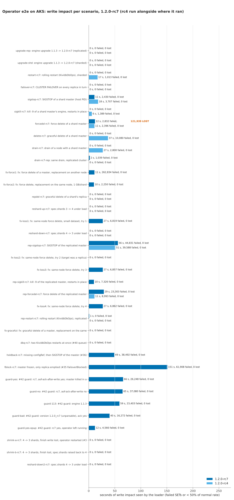
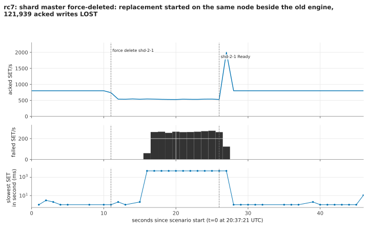
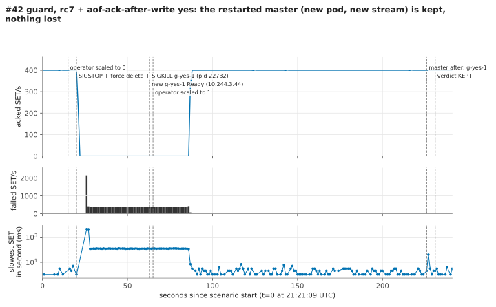
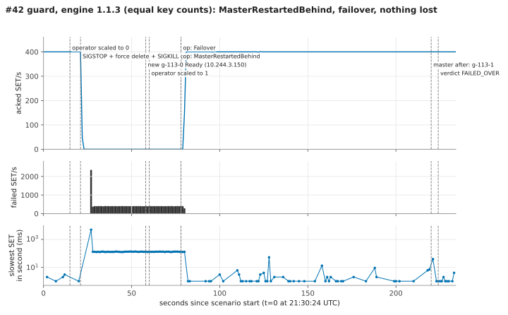
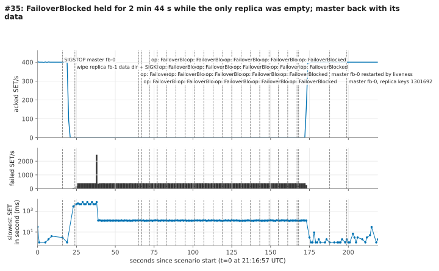
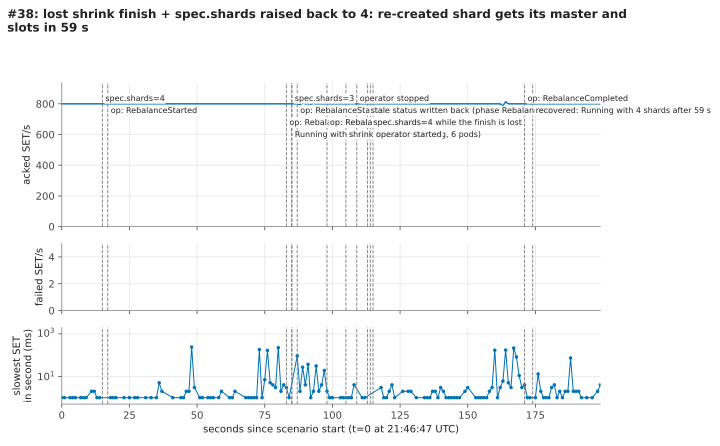

# Kubernetes operator end to end on 1.2.0-rc7: failures, upgrades, resharding, the operator fixes and the #42 AOF-master guard

The last gate for the operator side of 1.2.0. The engine is the published `v1.2.0-rc7`. The operator is
kividb-operator **afc6f49**, the head of PR #42: master b893f08 (with #35-#41), plus #42 and the
AOF-master guard commit. Loaders inside the cluster write all the time and remember every write the
server acknowledged, and every acknowledged write is read back after each scenario. We repeat the rc4
run's scenarios (`scratchpad/rc4/bench/operator/`) on rc7, then test SaiPisey2's fixes and the #42 guard.

## Results in one paragraph

About **21.9 million acknowledged writes** were read back across 9 loaders. **One scenario lost writes:**
forcedel-rc7, `kubectl delete pod --grace-period=0 --force` of a shard master, **lost 121,939 acknowledged
writes**, which is every write shard 2 acknowledged in the 8.5 minutes before. The replacement pod
started on the same node while the old engine was still shutting down on the same volume. The new engine
loaded the old engine's previous dump, replayed an AOF that the old engine had just rebased (nothing in
it), and took the old engine's final "clean stop" point as describing that data. So it carried on the
stream as master, and its replica full-resynced from it. We showed two engines running at once on one
data directory in 4 of 6 same-node force deletes. The exact losing interleaving did not happen again in
6 tries: it is a window of about 50-100 ms. A normal delete (with a grace period) is safe, and the
operator itself never force-deletes. **rc4's finding 2** (120,162 lost on 1.1.3 in the same scenario,
blamed then on 1.1.3's AOF) fits the same mechanism.

Everything else passed with 0 lost:
- engine upgrade 1.1.3 -> rc7 of both clusters, with 0 failed SETs;
- rolling restarts, with 0 failed SETs (rc4 had 1,013);
- CLUSTER FAILOVER, SIGSTOP and kill -9 of masters;
- graceful deletes and a node drain, with 0 failed SETs for the sharded cluster (rc4: 2,800);
- resharding 3 -> 4 -> 3 (42 s / 11 s, 0 failed SETs);
- **the rc4 stale-address split, which no longer reproduces** (3 tries; rc4 hit it on the first try);
- backup and restore.

The operator fixes passed:
- the DbOps queue (#40);
- hold back writes, not failover (#36);
- FailoverBlocked held until the master came back 2 min 52 s later (#35);
- a lost shrink finish, both as is and with `spec.shards` raised back (#38);
- the bootstrap CEL rule (#37).

**The #42 guard behaved as designed in all four cases**:

| Case | Result |
|---|---|
| rc7 with `aof-ack-after-write yes` | master **kept** |
| rc7 with `no` | **fails over** |
| 1.1.3 | **fails over**, even with equal key counts |
| unparsable version | **fails closed** (fails over) |

No acknowledged write was lost in any of them. **Operator bug found:** re-creating a deleted cluster with
`bootstrapFromSnapshot` on its kept volumes does not restore the snapshot. One try lost a race and
skipped the restore, so the new cluster runs on the old cluster's data. The other waited correctly, but
the restore Job failed with `chmod /data/dump.kdb: operation not permitted` and left the cluster with 0 pods.

## What was run

| | |
|---|---|
| Cloud | Azure, polandcentral, AKS (free tier), Kubernetes 1.36.4, Azure CNI overlay |
| Nodes | 4 x Standard_D4s_v5 (4 vCPU, 16 GiB), Ubuntu 24.04.5, kernel 6.8.0-1071-azure, containerd 2.3.7; at most 8 data disks per node |
| Disks | AKS default class (StandardSSD): 20 GiB per sharded pod, 5 GiB replicated, 2 GiB for the small test clusters |
| Engine | `ghcr.io/kividbio/kividb:v1.2.0-rc7` (tag v1.2.0-rc7, commit 598b74d), `ghcr.io/kividbio/kividb:v1.1.3`, and `v1.2.0-rc7-badver`, built in ACR from the rc7 image with only its version string rewritten to `1.2.0_rc7` |
| Operator | kividb-operator afc6f49. Manager, agent and GUI images built with `az acr build`. CRDs applied server-side, chart installed from the checkout |
| Clusters | `rep`: 1 master + 2 replicas. `shd`: `spec.shards: 3`, 1 replica per shard. `g-yes`, `g-no`, `g-113`, `g-bad`, `fb`: 1 + 1 each. `fx`: 3 x (1+1), for the repro. All with a password and operator defaults (`appendonly yes`, `appendfsync everysec`, `cluster-node-timeout 5000`) |
| Loader | rc4's loader (Go, go-redis v9.7.0): open loop, 800 SET/s (rep, shd, fx) or 400 SET/s (small clusters), 5 s deadline per SET, every acknowledged write recorded, `/verify` reads every one back |
| Pinning | loaders, `cli`/`curl` and the S3 stand-in run on the node labelled `e2e-infra=true`, which is never drained |

Each scenario ran once; these are event timings, not throughput. The definitions are rc4's:
- **Failed SETs** were not acknowledged.
- **Impact** runs from the first to the last second with a failed SET, or with less than half the normal rate.
- **Lost** means acknowledged writes missing at read-back that were not already missing at the previous check.

## Results

### The rc4 run's scenarios on rc7 (rc4's numbers in brackets)

| Scenario | What | Acked writes checked (cumulative) | Lost | Failed SETs | Impact (s) | Slowest SET (ms) | Notes |
|---|---|---:|---:|---:|---:|---:|---|
| install | CRDs + `helm install` of afc6f49 | - | - | - | - | - | manager and GUI Running in 27 s |
| create | `rep` and `shd` on 1.1.3 | - | - | - | - | - | both Running in 47 s |
| [upgrade-rep](charts/timeline-upgrade-rep.svg) | engine 1.1.3 -> rc7, replicated | 213,464 | 0 | 0 [0] | 0 | 166 | 1 min 08 s |
| [upgrade-shd](charts/timeline-upgrade-shd.svg) | engine 1.1.3 -> rc7, sharded | 352,696 | 0 | 0 [0] | 0 | 1,151 | 2 min 07 s, one CLUSTER FAILOVER per shard |
| [restart-rc7](charts/timeline-restart-rc7.svg) | rolling restart (`KividbDbOps`), sharded | 532,216 | 0 | **0** [1,013] | 0 | 149 | 2 min 30 s; rc4's finding 4 did not come back |
| [failover-rc7](charts/timeline-failover-rc7.svg) | `CLUSTER FAILOVER` on every replica | 634,610 | 0 | 0 [0] | 0 | 162 | |
| [sigstop-rc7](charts/timeline-sigstop-rc7.svg) | SIGSTOP of a shard master | 802,420 | 0 | 2,430 [3,707] | 11 [18] | 8,000 | replica elected; liveness restarted the hung pod at 2.5 min |
| [sigkill-rc7](charts/timeline-sigkill-rc7.svg) | kill -9 of a shard master, restarts in place | 846,988 | 0 | **0** [1,389] | 0 [6] | 1,561 | back in 12 s from its AOF |
| [forcedel-rc7](charts/timeline-forcedel-rc7.svg) | force delete of a shard master | 890,028 | **121,939** | 2,832 [2,396] | 12 [11] | 5,010 | **finding 1** |
| [delete-rc7](charts/timeline-delete-rc7.svg) | graceful delete of a shard master | 939,772 | 0 | **0** [10,080] | 0 [37 + 7 min] | 563 | handover first; no split this time |
| [drain-rc7](charts/timeline-drain-rc7.svg) | drain of a node holding a shard master and another shard's replica | 1,294,868 | 0 | **0** [2,800] | 0 [27] | 265 | |
| [drain-rc7-rep](charts/timeline-drain-rc7-rep.svg) | same drain, replicated cluster (its master was on the node) | 1,394,057 | 0 | 1,039 [0] | 2 | 565 | switchover held writes 50 ms, then about 2 s of "connection refused" on the master Service; finding 4 |
| split-rc7 | replicas of shard 0 and shard 1 deleted together, every node's view checked; 3 tries | - | - | - | - | - | **no stale address, every node `cluster_state:ok`** (rc4: split on the first try). Fixed in rc7 |
| [repdel-rc7](charts/timeline-repdel-rc7.svg) | graceful delete of a shard's replica | 1,557,100 | 0 | 0 [0] | 0 | 6 | |
| [reshard-up-rc7](charts/timeline-reshard-up-rc7.svg) | `spec.shards` 3 -> 4 | 1,627,052 | 0 | 0 [0] | 0 | 69 | 42 s [39 s] |
| [reshard-down-rc7](charts/timeline-reshard-down-rc7.svg) | `spec.shards` 4 -> 3 | 1,675,076 | 0 | 0 [0] | 0 | 261 | 11 s [10 s]; the removed shard's PVCs were deleted |
| [rep-sigstop-rc7](charts/timeline-rep-sigstop-rc7.svg) | SIGSTOP of the replicated master | 1,947,963 | 0 | 44,831 [39,588] | 56 [51] | 8,007 | operator fails over |
| [rep-sigkill-rc7](charts/timeline-rep-sigkill-rc7.svg) | kill -9 of the replicated master, restarts in place | 1,982,943 | 0 | 7,326 | 10 | 249 | no failover; the replicas reconnected (not in rc4) |
| [rep-forcedel-rc7](charts/timeline-rep-forcedel-rc7.svg) | force delete of the replicated master | 2,016,418 | 0 | 23,303 [8,993] | 29 [11] | 5,061 | the replacement went to another node and waited 18 s for the disk to detach; the master was kept (finding 4) |
| [rep-restart-rc7](charts/timeline-rep-restart-rc7.svg) | rolling restart, replicated | 2,124,882 | 0 | 0 | 1 | 1,193 | |
| backup / restore | see below | | 0 | | | | PASS, except finding 2 |

### SaiPisey2's operator fixes (now on master / in #42)

| Scenario | Fix | What we did | Result |
|---|---|---|---|
| [dbq-rc7](charts/timeline-dbq-rc7.svg) | #40, DbOps one restart per cluster | two `KividbDbOps` restarts of `rep` in one `kubectl apply` | **PASS.** q1 ran at once. q2 stayed `Pending` with `Queued=True: waiting for KividbDbOps rep-q1-… of cluster rep to finish` until q1 Completed (1 min 32 s), then ran. Never more than one pod down; 0 failed SETs, 0 lost |
| [holdback-rc7](charts/timeline-holdback-rc7.svg) | #36, hold back writes, not failover | `spec.configRef` set to a KividbConfig that does not exist, then SIGSTOP of the master | **PASS.** `Ready=False/ReconcileError` ("KividbConfig missing-cfg not found"), nothing rendered or rolled out. The **failover still ran** (rep-1 -> rep-0 after 48 s). With the ref removed, Ready=True within 3 s, without a rollout. 38,492 failed SETs (the failover window), 0 lost. As the review noted, no Warning Event carries `ReconcileError` |
| [fblock-rc7](charts/timeline-fblock-rc7.svg) | #35, FailoverBlocked keeps the master's key count | master `fb-0` (1,293,264 keys) SIGSTOPped; its only replica's data dir wiped and the engine killed, so it came back Ready with 0 keys | **PASS.** In every sample from 40 s to 2 min 12 s after the replica was wiped (until the master came back), the failover was blocked: `failover blocked: no ready replica holds any data, master fb-0 last reported 1293264 keys`, 20 `FailoverBlocked` Events. `status.pods` kept the key count (entries kept, `ready=false`), and the empty replica was never promoted (before the fix, the second pass promoted it). Liveness restarted fb-0 2 min 52 s after the SIGSTOP; it came back from its AOF as master, and the replica synced (1,301,692 keys). 0 lost |
| [shrink-a-rc7](charts/timeline-shrink-a-rc7.svg) | #38, a lost shrink finish | 3 -> 4 -> 3 with the status read every second. After the finish, with the operator stopped, the last `Rebalancing` status was written back: mid-move, "2 moves done, moving 1365 slots from shard 3 to 2", with shard 3's StatefulSet already gone | **PASS.** The operator finished again in 28 s: Running, 3 shards, 16384 slots, 0 failed SETs, 0 lost |
| [shrink-b-rc7](charts/timeline-shrink-b-rc7.svg) | #38, raising `spec.shards` back after a lost finish | same, but `spec.shards` raised to 4 before the operator was started | **PASS.** Re-created shard 3 got `shd-3-0` as master and its share (4,096 slots) in 59 s; 0 failed SETs, 0 lost. Cosmetic: the condition read "changing from 4 to 4 shards" while it did so |
| bootguard-rc7 | #37, bootstrap only at creation | (1) add `bootstrapFromSnapshot` to running `rep`; (2) delete `rep-restored` and create it again at once (twice) | (1) **PASS**: refused, `spec.bootstrapFromSnapshot cannot be added after creation: …`, `rep` untouched. (2) **FAIL, finding 2** |

### The #42 AOF-master guard

The operator keeps a master that restarted in a new stream only if `AofEnabled && aof-ack-after-write == "yes" && engine >= 1.2.0`.

**How the guard is reached.** The operator fails over at once when the master's pod object is gone. When
only the container restarts in place, the replica reconnects within a second (the documented limit). The
guard decides when the operator first sees the master again, Ready in a new pod with a new stream, while
its replica still follows the old address. `scen-guard.sh` builds exactly that:
1. the operator is scaled to 0 (as during an operator restart or upgrade);
2. the master's engine is frozen, its pod force-deleted and the engine SIGKILLed, so it never stops cleanly and a new stream is certain;
3. the new pod comes up Ready from its own volume and AOF;
4. the operator is scaled back to 1.

The `opup` row leaves the operator running.

| Scenario | Engine reports | Before the operator returned | Decision | Lost | Failed SETs (window) |
|---|---|---|---|---:|---|
| [guard-yes](charts/timeline-guard-yes.svg) | `1.2.0-rc7`, ack `yes` | new stream at offset 0; master and replica both 1,397,392 keys (AOF replay: 1,397,393 commands) | **KEPT**: no `MasterRestartedBehind`. The replica was repointed and continued through the dataset fingerprint, with no transfer | 0 | 26,248 (66 s, mostly operator downtime) |
| [guard-no](charts/timeline-guard-no.svg) | `1.2.0-rc7`, ack `no` | new stream, 1,496,182 keys each | **FAILED OVER**: `MasterRestartedBehind` + `Failover`, promoted g-no-0, 19 s after the operator returned | 0 | 37,080 |
| [guard-113](charts/timeline-guard-113.svg) | `1.1.3`, `CONFIG GET` empty | new stream, **equal key counts** (1,618,688), the case #42 without the guard would have kept | **FAILED OVER**: `MasterRestartedBehind` + `Failover` | 0 | 23,403 |
| [guard-bad](charts/timeline-guard-bad.svg) | `1.2.0_rc7` (unparsable), ack `yes` | new stream, 1,726,198 keys each | **FAILED OVER** (fails closed) | 0 | 16,272 |
| [guard-yes-opup](charts/timeline-guard-yes-opup.svg) | `1.2.0-rc7`, ack `yes`, operator running | the pod was gone from the API only for an instant, so "master pod gone" did not fire; new pod Ready in 21 s | **KEPT** | 0 | 4,566 (12 s) |

All five behave as afc6f49 intends. The `KEPT` cases lost nothing: an engine that acknowledges only after
the AOF write came back with everything. The failover cases lost nothing either: the replica was in sync
when the master was frozen.

### Backup and restore (rc7)

- **Replicated.**
  - A backup Job from the CronJob uploaded 29 MB (4,221,213 keys) in 10.5 s.
  - A new cluster with `bootstrapFromSnapshot` was Running after 43 s. The sorted key lists were identical, 300 sampled values equal.
  - The replica answered `DBSIZE 0` for a moment while it synced, as in rc4.
- **Sharded.**
  - One backup run of all three shards: 28.7 MB, 3.7 s, with a manifest.
  - A sharded restore is still not supported by the operator (documented), so shard 2's archive was started by hand in a standalone engine: 1,318,328 keys, the same as shard 2's master. 300 sampled values matched the live cluster, and the keys are in shard 2's slots only.
- Evidence: `results/evidence/backup/`.

## Findings

**1. Engine (rc7, also 1.1.3): a force-deleted master whose replacement starts on the same node can lose
every write since its previous dump: 121,939 here. Severity: high, under a stated condition.**
The condition is `kubectl delete pod --grace-period=0 --force` of a cluster-mode master, with the replacement
scheduled on the same live node. The operator never does this (no `GracePeriodSeconds`/`Force` in
`internal/` or `cmd/`; the GUI uses default `DeleteOptions`). A human or a cleanup tool can.

What happened to shd-2-1 (`results/evidence/forcedel-rc7/`):
- It stopped cleanly in the DbOps restart at 20:28:59, leaving a dump.
- It came back, partial-resynced, and was promoted by `CLUSTER FAILOVER` at 20:31:20.
- It was force-deleted at 20:37:32. The replacement pod was created in the same second on the same node, and its engine started at 20:37:33.35, while the old engine was shutting down on the same volume.
- The new engine logged:
  - `Found dump.kdb`, then `Loaded 166496 keys` (the 20:28:59 dump);
  - `Replaying appendonly.aof`, with no commands replayed;
  - `Loaded dataset is offset 11465248 of this node's stream 07c85… — replicas stopped cleanly with it can be continued`.
- 11465248 is the old engine's offset at the moment of deletion. The new engine stayed master (back inside the node timeout), and the replica full-resynced from it: `Dropped the 288435 local keys before loading 166496`.
- Missing: every shard-2 write acknowledged from 20:28:59 to 20:37:32.

The mechanism, from the coordinator's code reading and our timings:
- The kubelet starts the replacement's containers before it signals the old ones. In fx-force2 the new engine started at 20:50:27.103 and the old one got SIGTERM at 27.169.
- During the old engine's clean stop it writes its final dump, rebases the AOF to empty, and writes the master point.
- The new engine opens the old `dump.kdb` before the rename, and reads the AOF after the rebase.
- `replication::saved_point()` checks the point's fingerprint against `dump.kdb` as it is on disk now (the old engine's new dump), not against what was loaded. So it matches, and the new engine resumes the old engine's stream with old data.
- Nothing stops two engines from sharing one data directory: there is no lock file.

Repro, on a separate 3 x (1+1) cluster `fx` (`harness/scen-fxrepro.sh`, `run-fxloss.sh`; `results/evidence/fx-*`):

| Try | Setup | Two engines at once | Lost | What happened |
|---|---|---|---:|---|
| fx-force1 | replacement on another node | 0 samples | 0 | the volume had to detach (20 s), so the old engine had long exited |
| fx-force2 | replacement on the same node (other nodes cordoned), 1 GB per shard | **18 samples (1.8 s)** | 0 | both wrote `dump.kdb.1.2.tmp` in one directory at once; the new engine took the "checkpoint did not finish" path and replayed `.prev` + `.aof` |
| fx-loss1 | same node, small dataset, an older dump first | 3 samples | 0 | the new engine had finished loading before the old one even got SIGTERM; the old one then acked and rebased beside it |
| fx-loss2 | same node, small dataset | 0 samples | 0 | the target was a replica by then |
| fx-loss3 | same node, small dataset | 1 sample | 0 | the new engine opened the dump just after the old one's "Goodbye"; loaded the final dump, correct |
| fx-loss4 | same node, small dataset | 2 samples | 0 | same as loss3 |
| fx-graceful | normal delete, same node | 0 samples | 0 | handover; old engine exited 21:04:50.344, new one started 21:05:03 |

rc4's finding 2 (1.1.3 lost 120,162 in forcedel-113) has the same log signature: the snapshot from the
last clean stop, an empty AOF, "the stream's current offset". It is very likely the same race, not a
1.1.3-only AOF gap. Possible fixes: an exclusive lock on the data directory, taken at start, so a second
engine waits; and/or fingerprint the point against the bytes loaded, not the file on disk.

**2. Operator: re-creating a deleted cluster with `bootstrapFromSnapshot` does not restore the snapshot (the #37 flow). Severity: medium.**
A `KividbCluster`'s PVCs are kept when it is deleted (`persistentVolumeClaimRetentionPolicy: Retain`).
The repro, in `results/evidence/bootguard{,2}-rc7/`:
1. Restore `rep-restored` from a snapshot; this works (4,221,213 keys, identical).
2. Write 1,000 extra keys.
3. `kubectl delete kividbcluster rep-restored --wait=false` and immediately `kubectl apply` the same manifest.

- **Try 1: the restore is skipped.**
  - 21:55:39: `BootstrapWaiting`.
  - 21:55:40: `CalculateExpectedPodCountFailed: found no controllers for pod rep-restored-0`, so the old pod was still there.
  - 21:55:41: `BootstrapSkipped … the cluster is already running`. The StatefulSet was created on the kept volumes, and `status.bootstrap` became `Completed / skipped: the cluster was already running`.
  - The cluster came up with **the deleted cluster's data**, 4,222,213 keys including all 1,000 extras, not the snapshot. Only a Warning Event says so.
  - It looks like a pass that saw its own (or the old) StatefulSet without the Pending bootstrap status: the stale-read pattern #38 fixed for sharded status.
- **Try 2: the restore Job fails.**
  - The wait worked this time, and the restore Job ran onto the kept `data-rep-restored-0`.
  - It failed twice with `extract: chmod /data/dump.kdb: operation not permitted`. The Job runs as uid 65532 (fsGroup 1000). The kept `dump.kdb` is owned by the engine's uid 1000, mode 0660.
  - `cmd/agent/restore.go` opens it with `O_TRUNC` (allowed through the group), rewrites it, then `f.Chmod` fails, because only the owner may chmod.
  - The cluster was left with 0 pods and `bootstrap: Failed`.
- **Fix ideas:**
  - write to a temporary file and rename it (no chmod of someone else's file);
  - or delete the old files first, and remove a stale `appendonly.aof` too (the follow-up the author mentioned);
  - and make the skip guard ignore a StatefulSet created by this cluster's own UID while bootstrap is pending.

**3. The rc4 stale-address split is fixed.** The rc4 repro (two replicas of different shards deleted at
once) left no node holding a stale address in 3 tries, and no shard went `CLUSTERDOWN` in any
scenario. delete-rc7 and drain-rc7, which hit the split in rc4 (7 min 15 s of `CLUSTERDOWN`), had 0 failed SETs.

**4. Smaller observations.**
- **drain-rc7-rep:** the switchover held writes 50 ms, then the master Service refused connections for about 2 s (1,039 failed SETs). rc4's replicated drain had 0, but its master was not on the drained node.
- **rep-forcedel-rc7:** the replacement went to another node and waited 18 s for the Azure disk to detach. Ready came at 33 s, just past the 30 s failover threshold, and the operator kept the master (it had stopped cleanly) rather than fail over. 29 s of failed writes; rc4 failed over in 11 s.
- **Cosmetic:** the condition said "changing from 4 to 4 shards" while shrink-b re-added shard 3.
- **Not shown in the table:** a loader's error counter also counts its startup before its cluster formed (fx-force1's 262,834).
- **The 8-disk-per-node Azure limit matters on 4 nodes.** `fx` (6 more volumes) left one pod Pending, and drain-rc7's "all pods Ready" wait ran its 5 min with the node cordoned. drain-rc7's numbers are unaffected.

## Charts

Each scenario has a timeline in `charts/`, with what we did and the operator's Events marked:
acknowledged SET/s, failed SET/s, and the slowest SET each second. `charts/summary-impact.svg` puts each
rc7 scenario beside its rc4 run where there is one.

## How to reproduce

You need `az`, `kubectl`, `helm`, Python 3 with matplotlib, and a kividb-operator checkout at afc6f49.
Nothing is built locally. `harness/README-harness.md` lists every file and the order.
1. RG, Basic ACR, then AKS: `az aks create --tier free --node-count 4 --node-vm-size Standard_D4s_v5 --network-plugin azure --network-plugin-mode overlay --attach-acr <acr>`.
2. `bash harness/build.sh <checkout>`.
3. Replace `ACR` in the yaml files. Apply `ns.yaml nd.yaml`, and label one node `e2e-infra=true`.
4. Apply the CRDs server-side, then `helm install … -f values-operator.yaml`.
5. Apply `rep.yaml shd.yaml guard.yaml` and the loaders. `source env.sh; cpcli`, then start `capture.sh`.
6. `run-rc7a.sh`, then `run-rc7b.sh`. For finding 1, `fx.yaml` + `loader-fx.yaml`, then `SAMENODE=1 bash scen-fxrepro.sh <id> <master pod> force` (or `run-fxloss.sh`).
7. `build_results.py`, `summarize.py`, `charts.py` (see the harness README).

What differed from the scripts as run:
- the guard and `fb` clusters were created while upgrade-rep ran;
- `fx` was created during drain-rc7, so drain-rc7's final wait timed out (see finding 4);
- the cordons of fx-force2 and fx-loss* overlapped split-rc7 and repdel-rc7 for a few seconds each;
- `fx` was flushed and its loader restarted with a new key prefix (`g5`) before fx-loss1;
- bootguard2-rc7 (the second delete-and-recreate) was run by hand after `run-rc7b.sh`.

## Files

- `results/summary.md`, `results/summary.csv`: the tables, generated.
- `results/<scenario>-stats.json`, `-verify.json`, `-timeline.json`: loader output per scenario.
- `results/final-*-verify.json`, `results/final-readback.txt`: the last read-back of every loader.
- `results/marks.log`, `results/events.log`, `results/operator-manager-stream.log`: what we did and when, the Kubernetes Events, and the operator's log.
- `results/evidence/<scenario>/`: engine logs, process and file samples (`procs.txt`), status captures, before/after views of each guard case, the restore Job logs.
- `results/rc7a.out`, `rc7b.out`, `fxloss.out`, `fx-*.out`: the console output of the runs.
