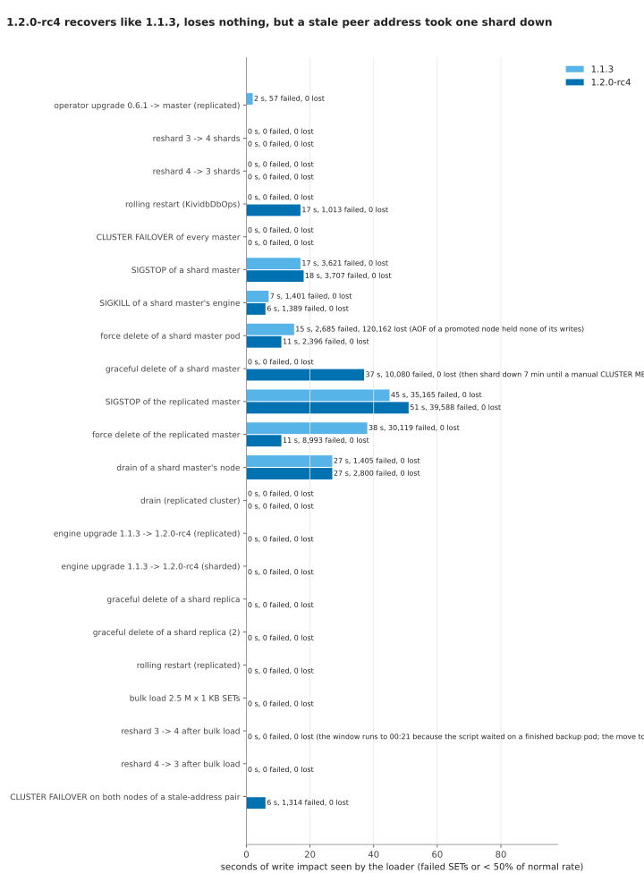
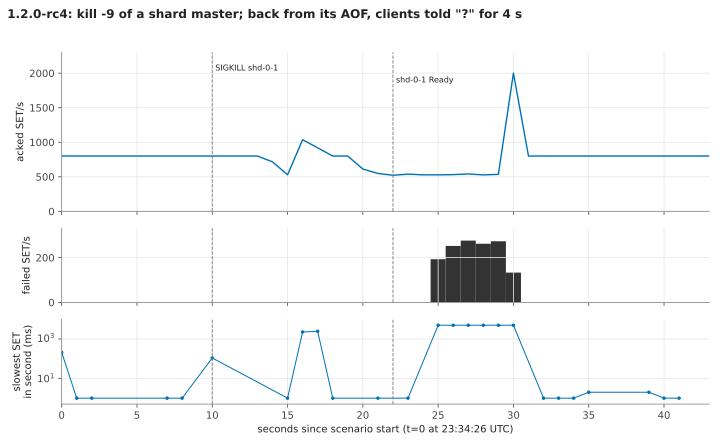
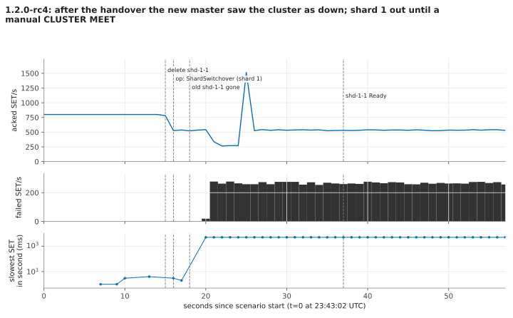
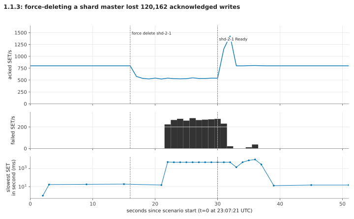
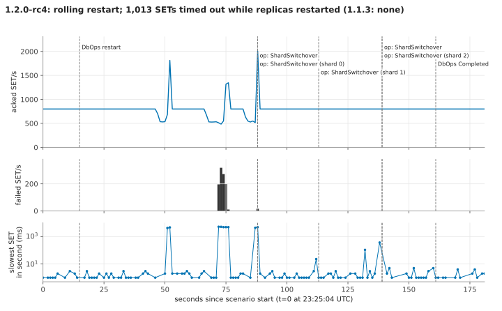
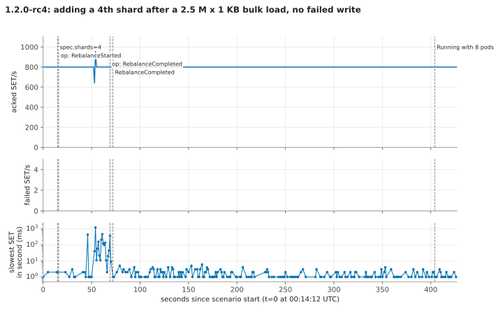
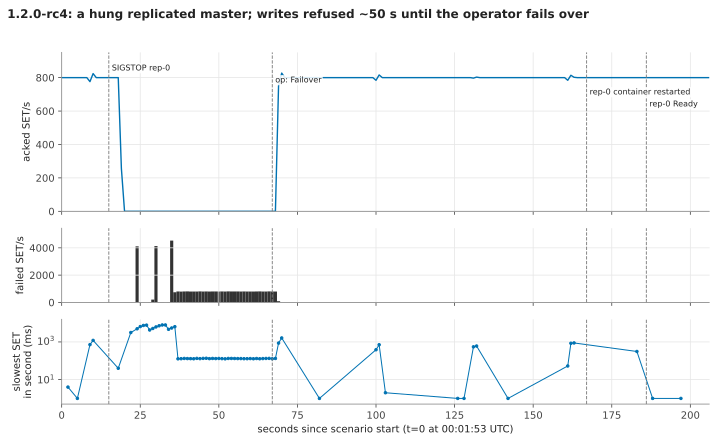

# Kubernetes operator end to end: failures, upgrades and resharding under load (1.2.0-rc4 vs 1.1.3)

On Hacker News a reader wrote that for a database "durability guarantees ... trump speed"
([comment](https://news.ycombinator.com/item?id=50155776)). This suite is the part of the answer that
runs where most people would run KiviDB: on Kubernetes, under the KiviDB operator, with clients
writing the whole time. A loader inside the cluster writes 800 keys a second, remembers every write
the server acknowledged, and after each scenario reads every one of them back. We then break things
the way production breaks them (hung processes, `kill -9`, force-deleted pods, drained nodes,
rolling restarts, upgrades, resharding) and count what clients saw and what was lost.

Every scenario ran on **1.2.0-rc4** and, where it applies, on **1.1.3** under the same operator, so a
regression would show up as a difference between the two rows.

## Results in one paragraph

Across 34 scenarios and about 13.4 million acknowledged writes read back (8.1 M by the final two
loaders, 5.3 M by the loader generations before them), **1.2.0-rc4 lost no
acknowledged write.** 1.1.3, in the same sharded setup, **lost 120,162** when a shard master that had
been promoted after a full resync was force-deleted: its append-only file held none of the writes it
took as master, and its replica resynced from it. Planned operations (operator upgrade, engine
upgrade 1.1.3 -> 1.2.0-rc4, rolling restarts, CLUSTER FAILOVER of every master, resharding 3 -> 4 -> 3
with and without 2.5 M x 1 KB of extra data) gave clients no failed write on rc4, except one rolling
restart (1,013 failed SETs, see below). Unplanned failures cost what the failure detector costs:
about 14-18 s of failed writes to the affected shard for a hung master, 5-11 s for a killed or
force-deleted one, 45-51 s for a hung master of a *replicated* (non-cluster) setup, where the operator,
not the engine, fails over. **The finding that matters:** in rc4 (and 1.1.3, same code) two cluster
nodes that restart with new pod IPs at the same time can each keep the other's old address forever.
In one run that left a promoted shard master believing the cluster was down, and **shard 1 refused
every request for 7 min 15 s** until we ran `CLUSTER MEET` by hand, while the operator reported the
cluster healthy. It reproduces on the first try by deleting two pods of different shards at once.

## What was run

| | |
|---|---|
| Cloud | Azure, francecentral, AKS (free tier), Kubernetes 1.36.5, Azure CNI overlay |
| Nodes | 4 x Standard_D4as_v7 (4 vCPU AMD EPYC 9V45, 16 GiB), Ubuntu 24.04.5, kernel 6.8.0-1071-azure, containerd 2.3.7 |
| Disks | AKS default class `managed-csi` (StandardSSD_LRS): 20 GiB per sharded pod, 5 GiB per replicated pod |
| Engine | `ghcr.io/kividbio/kividb:v1.1.3` and `ghcr.io/kividbio/kividb:v1.2.0-rc4` (tag v1.2.0-rc4, commit a6b1bf3), default build (no Lua) |
| Operator | released 0.6.1 chart first, then kividb-operator `master` at eefe65d (0.7.0, unreleased), images built with `az acr build` |
| Clusters | `rep`: replicated, 1 master + 2 replicas, password. `shd`: sharded, `spec.shards: 3`, 1 replica per shard, password. Operator defaults: `appendonly yes`, `appendfsync everysec`, `cluster-node-timeout 5000`, `cluster-preferred-endpoint-type hostname` |
| Loader | Go, go-redis v9.7.0 (cluster client for `shd`), in-cluster, 800 SET/s open loop (a slow shard does not slow the others), a 5 s deadline per SET (retries and redirects included), `MaxRetries 0`. Key `g4:<n>`, value `n`; every acknowledged `n` goes into a bitset; `/verify` reads every acknowledged key back and compares the value |
| Pinning | the loaders, the `cli`/`curl` pods and the S3 stand-in run on one node (`e2e-infra=true`) that is never drained or killed; KiviDB pods run on all four |

The loader is a correctness probe, not a benchmark: 800 SET/s is far below what the cluster does
(the bulk load in this run went at about 1 M SET/s from one `redis-benchmark` client). Each scenario
ran once per engine version; the brief's "3 runs, median and spread" rule is for throughput numbers,
and these are event timings, so read differences of a few seconds as noise.

**Definitions.** *Failed SETs*: SETs that returned an error or missed the 5 s deadline (not
acknowledged, so not counted as lost). *Impact*: seconds from the first to the last second in which a
SET failed or fewer than half the normal SETs completed. *Lost*: acknowledged writes that the
read-back after the scenario did not find, minus those already missing at the previous check.
*Slowest SET*: the longest single SET in the window (5,000-8,000 ms means it hit the deadline; a SET
can overrun the deadline while go-redis waits for a pool connection).

## Results

| Scenario | Engine | What | Acked writes checked (cumulative) | Lost | Failed SETs | Impact (s) | Slowest SET (ms) | Notes |
|---|---|---|---:|---:|---:|---:|---:|---|
| [P1](charts/timeline-P1.svg) | 1.1.3 | operator upgrade 0.6.1 -> master under load (replicated) | 167,394 | 0 | 57 | 2 | 400 | one rollout switchover, writes held 57 ms; AOF turned on by the new operator. Loader v4 (closed loop) |
| [upgrade-rep](charts/timeline-upgrade-rep.svg) | rc4 | engine upgrade 1.1.3 -> 1.2.0-rc4 (replicated) | 1,362,238 | 0 | 0 | 0 | 1,988 | 1 min 47 s |
| [upgrade-shd](charts/timeline-upgrade-shd.svg) | rc4 | engine upgrade 1.1.3 -> 1.2.0-rc4 (sharded) | 1,551,563 | 0 | 0 | 0 | 2,188 | 2 min 36 s, one CLUSTER FAILOVER per shard |
| [restart-113](charts/timeline-restart-113.svg) | 1.1.3 | rolling restart (`KividbDbOps`) | 444,275 | 0 | 0 | 0 | 791 | 3 min 08 s |
| [restart-rc4](charts/timeline-restart-rc4.svg) | rc4 | rolling restart (`KividbDbOps`) | 1,709,902 | 0 | **1,013** | 17 | 5,343 | 2 min 26 s; see finding 4 |
| [failover-113](charts/timeline-failover-113.svg) | 1.1.3 | `CLUSTER FAILOVER` on every replica in turn | 538,419 | 0 | 0 | 0 | 796 | |
| [failover-rc4](charts/timeline-failover-rc4.svg) | rc4 | `CLUSTER FAILOVER` on every replica in turn | 1,805,718 | 0 | 0 | 0 | 406 | |
| [sigstop-113](charts/timeline-sigstop-113.svg) | 1.1.3 | SIGSTOP of a shard master (host PID) | 704,726 | 0 | 3,621 | 17 | 8,001 | replica took over by election; liveness restarted the hung pod after ~2.5 min |
| [sigstop-rc4](charts/timeline-sigstop-rc4.svg) | rc4 | SIGSTOP of a shard master | 1,973,987 | 0 | 3,707 | 18 | 8,000 | same |
| [sigkill-113](charts/timeline-sigkill-113.svg) | 1.1.3 | `kill -9` of a shard master's engine, container restarts in place | 753,669 | 0 | 1,401 | 7 | 5,001 | |
| [sigkill-rc4](charts/timeline-sigkill-rc4.svg) | rc4 | `kill -9` of a shard master's engine | 2,013,862 | 0 | 1,389 | 6 | 5,001 | back from AOF (119,287 commands replayed); finding 3 |
| [forcedel-113](charts/timeline-forcedel-113.svg) | 1.1.3 | `kubectl delete --grace-period=0 --force` of a shard master | 797,112 | **120,162** | 2,685 | 15 | 9,990 | finding 2 |
| [forcedel-rc4](charts/timeline-forcedel-rc4.svg) | rc4 | force delete of a shard master | 2,713,677 | 0 | 2,396 | 11 | 5,912 | |
| [delete-113](charts/timeline-delete-113.svg) | 1.1.3 | graceful `kubectl delete` of a shard master | 848,520 | 0 | 0 | 0 | 482 | operator hands over first (CLUSTER FAILOVER) |
| [delete-rc4](charts/timeline-delete-rc4.svg) | rc4 | graceful delete of a shard master | 2,405,281 | 0 | 10,080 | 37 (then 7 min) | 5,002 | **shard 1 down 7 min 15 s**; finding 1. Loader stopped at 37 s for read-back, so the counts stop there |
| [drain-113](charts/timeline-drain-113.svg) | 1.1.3 | `kubectl drain` of a node with a shard master and another shard's replica | 1,253,947 | 0 | 1,405 | 27 | 5,752 | |
| [drain-113-rep](charts/timeline-drain-113-rep.svg) | 1.1.3 | same drain, replicated cluster (one of its pods was on the node) | 1,242,278 | 0 | 0 | 0 | 562 | |
| [drain-rc4](charts/timeline-drain-rc4.svg) | rc4 | drain of a node with a shard master and another shard's replica | 2,512,049 | 0 | 2,800 | 27 | 8,000 | left the two moved nodes with each other's old address; finding 1 |
| [drain-rc4-rep](charts/timeline-drain-rc4-rep.svg) | rc4 | same drain, replicated cluster | 2,915,846 | 0 | 0 | 0 | 1,329 | |
| [reshard-up-113](charts/timeline-reshard-up-113.svg) | 1.1.3 | `spec.shards` 3 -> 4 under load | 83,440 | 0 | 0 | 0 | 155 | 32 s |
| [reshard-down-113](charts/timeline-reshard-down-113.svg) | 1.1.3 | `spec.shards` 4 -> 3 | 261,264 | 0 | 0 | 0 | 24 | 11 s, removed shard's PVCs deleted |
| [reshard-up-rc4](charts/timeline-reshard-up-rc4.svg) | rc4 | `spec.shards` 3 -> 4 | 2,601,641 | 0 | 0 | 0 | 549 | 39 s |
| [reshard-down-rc4](charts/timeline-reshard-down-rc4.svg) | rc4 | `spec.shards` 4 -> 3 | 2,650,217 | 0 | 0 | 0 | 103 | 10 s |
| [bulk-rc4](charts/timeline-bulk-rc4.svg) | rc4 | 2.5 M x 1 KB SETs with `redis-benchmark --cluster -P 16 -c 50` while the loader runs | 3,384,693 | 0 | 0 | 0 | 524 | about 1 M SET/s for 2.5 s, AOF on; dataset now 8.3 M keys |
| [reshard-bulk-up-rc4](charts/timeline-reshard-bulk-up-rc4.svg) | rc4 | 3 -> 4 shards with ~2 GB of 1 KB values | 3,729,221 | 0 | 0 | 0 | 1,222 | slots moved in 54 s; no "reply sent without the AOF" warning (rc3 had 9 and 10-45 s stalls here) |
| [reshard-bulk-down-rc4](charts/timeline-reshard-bulk-down-rc4.svg) | rc4 | 4 -> 3 shards | 3,796,325 | 0 | 0 | 0 | 1,427 | 22 s |
| [repdel-rc4](charts/timeline-repdel-rc4.svg), [repdel2-rc4](charts/timeline-repdel2-rc4.svg) | rc4 | graceful delete of a shard's replica (twice) | 2,834,853 | 0 | 0 | 0 | 17 | |
| [rep-sigstop-113](charts/timeline-rep-sigstop-113.svg) | 1.1.3 | SIGSTOP of the replicated master | 1,091,939 | 0 | 35,165 | 45 | 7,515 | operator fails over |
| [rep-sigstop-rc4](charts/timeline-rep-sigstop-rc4.svg) | rc4 | SIGSTOP of the replicated master | 3,420,313 | 0 | 39,588 | 51 | 8,000 | |
| [rep-forcedel-113](charts/timeline-rep-forcedel-113.svg) | 1.1.3 | force delete of the replicated master | 1,130,982 | 0 | 30,119 | 38 | 5,421 | |
| [rep-forcedel-rc4](charts/timeline-rep-forcedel-rc4.svg) | rc4 | force delete of the replicated master | 3,453,784 | 0 | 8,993 | 11 | 5,001 | |
| [rep-restart-rc4](charts/timeline-rep-restart-rc4.svg) | rc4 | rolling restart of the replicated cluster | 3,594,744 | 0 | 0 | 0 | 1,619 | 2 min 16 s |
| [split-outage-rc4](charts/timeline-split-outage-rc4.svg) | rc4 | `CLUSTER FAILOVER` at once on both nodes of a stale-address pair | 3,945,907 | 0 | 1,314 | 6 | 7,996 | one election won and the split healed; the other lost (0 votes) and paused its shard ~5 s |

Totals at the end: sharded loader 3,891,989 acknowledged writes read back, 120,162 missing (all from
forcedel-113 on 1.1.3); replicated loader 4,243,936 read back, 0 missing. The three loader
generations before it (verified when they were replaced; `results/*-pre-*`, `*-g2-*`, `*-g3-*`)
had 0 missing out of 2.5 M (sharded) and 2.8 M (replicated).

**Backup and restore (rc4).** Replicated: a backup Job from the cluster's CronJob uploaded 45 MB
(6,389,882 keys) to the in-cluster S3 in 14 s; a new cluster with `bootstrapFromSnapshot` was
Running 66 s later with the same 6,389,882 keys, identical sorted key lists and 300 sampled values
equal. Sharded: one backup run of all three shards (40 MB, 4 s) with a manifest; restoring a sharded
cluster is not supported by the operator yet (documented), so shard 2's archive was restarted by hand
in a standalone engine: 1,839,847 keys, the same as shard 2's master at backup time, 300 sampled
values equal to the live cluster's, keys only in shard 2's slots. Evidence:
`results/evidence/backup/`.

## Findings

**1. Engine: two nodes that move at once never find each other again (1.1.3 and rc4). Severity: high.**
When two cluster nodes restart with new pod IPs at about the same time, each loads the other's old
address from `nodes.conf`, pings it there, never gets an answer, and never updates it: in
`src/cluster/bus/listener.rs` (`upsert_node`) an address heard from a third node "only fills a gap",
it never replaces a known one. The other nodes have the right addresses and gossip them, to no effect.
Redis replaces a PFAIL/FAIL node's address from gossip for exactly this case. Consequences seen here:
- after restart-rc4 recreated the pods, `shd-1-0` and `shd-2-1` held each other at old IPs
  (`fail?` / `fail`) for 23 minutes without anyone noticing; when delete-rc4 then promoted `shd-1-0`
  (election won with 2 of 3 votes), it saw no reachable owner for shard 2's slots, set
  `cluster_state:fail` and answered `CLUSTERDOWN` to everything: **shard 1 was down 7 min 15 s**, until
  `CLUSTER MEET <new ip> 6380 16380` on `shd-1-0` fixed it at once. 0 acknowledged writes lost.
- `kubectl drain` of a node holding pods of two shards produced the same pair again (drain-rc4).
- **Repro (first try):** a 3 x (1+1) cluster on Kubernetes; `kubectl delete pod shd-0-0 shd-1-0`
  (two replicas of different shards, one command); after both are Ready, `CLUSTER NODES` on each
  shows the other at its old IP with `fail`/`fail?`, still so 5 minutes later
  (`results/evidence/split-repro-rc4/`). Promote one of them while the other is a master and its
  shard goes down.
- The operator reported `Ready=True/ClusterOK` the whole time. It could compare every node's view of
  every peer's address with the pods' IPs and `CLUSTER MEET` the stale ones; that would also cover
  engines that already shipped. Not a regression: 1.1.3 has the same rule (same lines).

**2. 1.1.3 lost 120,162 acknowledged writes on a force-deleted shard master; rc4 did not.**
`shd-2-1` had full-resynced as a replica in a rolling restart, was promoted by a `CLUSTER FAILOVER`
2 minutes later, took writes as master for 6 more minutes, and was force-deleted. What was lost is
everything shard 2 acknowledged since that full resync, about 8 minutes. It came back in 1 s with its snapshot from the full
resync and an AOF with nothing after it (no `AOF replay:` line), claimed to be at its stream's current
offset, stayed master (back inside the node timeout), and its replica full-resynced from it: "Dropped
the 1099324 local keys before loading 979162". The operator raised no event. Under rc4 the same kind
of restart replays the AOF (sigkill-rc4: "AOF replay: 119287 commands") and forcedel-rc4 lost
nothing. Since operator 0.7.0 turns the AOF on and tells users they may pin `spec.image` to 1.1.x,
**a sharded cluster on 1.1.x under operator 0.7.0 can lose a whole shard's recent writes on a forced
pod deletion**; the operator should refuse or warn on `spec.shards` with an engine below 1.2.
Evidence: `results/evidence/forcedel-113/`.

**3. Clients are told `?` for a restarted master for ~4 s (operator, partly engine).** The operator
renders `cluster-preferred-endpoint-type hostname` but sets `cluster-announce-hostname` only at
runtime, through the agent, 4-5 s after the engine starts. Meanwhile the node gossips no hostname,
its peers drop the one they had, and `CLUSTER SLOTS` lists the shard's master as `?`; go-redis then
fails with `dial tcp: lookup ?`. Captured every 0.5 s in sigkill-rc4
(`results/evidence/sigkill-rc4/cluster-slots.txt`: `?` from 23:34:43.5 to 23:34:47.6, the agent's
`CONFIG SET` at 23:34:47.1). Putting the pod's DNS name in the boot config would remove most of the
1,389-2,685 failed SETs in the kill and force-delete rows. Redis has the same "?" behaviour for a node
without a hostname, so the engine is behaving as Redis does.

**4. restart-rc4 had 1,013 failed SETs where restart-113 had none (not explained).** They fall on the
shard whose replica was restarting (replicas restart first): SETs to shard 2 timed out from 5 s after
its replica stopped until the new replica had reconnected (23:26:11-23:26:19). Deleting a replica on
its own did not reproduce it (repdel-rc4, repdel2-rc4: 0 errors, slowest SET 17 ms). The same rollout
is where finding 1's stale pair formed, which may be related; the masters' logs from that minute were
lost when the rollout replaced those pods. Worth a second look before calling rolling restarts
error-free on 1.2.

**5. Smaller observations.**
- The replicated cluster has no engine failover: a hung master costs ~45-51 s (operator probes and
  failover), a force-deleted one 11-38 s. The sharded cluster's own election took ~10-14 s.
- Graceful pod deletion, drains of replicas, rolling restarts and both engine upgrades used a
  switchover first (writes held 34-114 ms), so the replicated loader saw 0 failed SETs in every
  planned operation on rc4.
- A `CLUSTER FAILOVER` run by hand is reported by the operator as `Warning ShardFailover` (a planned
  handover shown as a failure; cosmetic).
- The restored replicated cluster was `Running` about 6 s before its replica had finished its full
  sync (the replica answered `DBSIZE 0` at first, then 6,389,882).
- After the bulk load the AOF auto-checkpointed on every node (1-2 times) without a single
  "reply ... sent without it" warning and with no SET over 1.5 s; rc3 had 10-45 s stalls in the same
  test. The disks were the same class (StandardSSD), but the bulk load here was smaller
  (2.5 M SETs, ~2 GB) than rc3's (~4.6 M keys, ~2.7 GB on the masters), so this is not yet proof
  that the stall is gone.
- Two simultaneous `CLUSTER FAILOVER`s (split-outage-rc4) collided: one won, the other got 0 votes,
  gave up after 5 s and kept its shard's writes paused until then (1,314 failed SETs).

## Charts

Each scenario has a timeline: acknowledged SET/s, failed SET/s and the slowest SET in each second,
with what we did and the operator's handover/failover Events marked. Links are in the table above.
A few to start with:

## How to reproduce

Needs `az`, `kubectl`, `helm`, Python 3 with matplotlib, and a kividb-operator checkout (0.7.0 /
master). Nothing is built locally. See `harness/README-harness.md` for every file.

1. `D=$PWD/work; mkdir -p $D; echo <acr-name> > $D/acrname; bash harness/provision.sh $D` (RG, ACR,
   AKS with 4 nodes, kubeconfig in `$D`). Set `A=<acr-name>.azurecr.io`.
2. `bash harness/build.sh <operator checkout>` (operator, agent and GUI images, loader, S3 stand-in).
3. Replace `ACR` in `harness/*.yaml`, then `kubectl apply -f harness/ns.yaml -f harness/nd.yaml`, and
   `kubectl label node <one node> e2e-infra=true`.
4. `helm install kividb-operator kividb-operator-chart-0.6.1.tgz -n kividb-system --create-namespace`
   (the 0.6.1 release asset), `kubectl apply -f harness/rep.yaml -f harness/loader-rep.yaml`.
5. Operator upgrade: `kubectl apply --server-side --force-conflicts -f <checkout>/charts/kividb-operator/crds/`
   then `helm upgrade kividb-operator <checkout>/charts/kividb-operator -n kividb-system -f harness/values-operator-master.yaml`.
6. `kubectl apply -f harness/shd.yaml -f harness/loader-shd.yaml`; start `harness/capture.sh`.
7. `bash harness/run-baseline2.sh` (1.1.3 rows), then `ENG=ghcr.io/kividbio/kividb:v1.2.0-rc4 bash harness/run-rc4.sh`.
8. `python harness/build_results.py work/marks.log harness/titles.json results work/events.log`,
   `python harness/summarize.py results harness/titles.json`, `python harness/charts.py results charts`.

What differed from the scripts as published, in this run: the first attempt at the 1.1.3 baselines
used a closed-loop loader and was discarded (results kept out of `results/`); drain-113 first picked
a master on the infra node, which `kubectl drain` refused, and was re-run first thing in the rc4
script; run-rc4 was stopped during delete-rc4 because its read-back hung on `CLUSTERDOWN`, the
read-back was repeated after the `CLUSTER MEET`, and the rest ran from the same scenario scripts in
order (`results/rc4.out`, `results/rc4b.out`). The stale-address pair from drain-rc4 was healed with
`CLUSTER MEET` before the reshard tests.

## Files

- `results/summary.csv`, `results/summary.md`: the table above, generated.
- `results/<scenario>-stats.json | -verify.json | -timeline.json`: loader output per scenario.
- `results/marks.log`, `results/k8s-events.log`, `results/operator-manager-stream.log`: what we did
  and when, Kubernetes Events, the operator's log.
- `results/evidence/`: engine logs, `CLUSTER NODES` from every node, the `CLUSTER SLOTS` capture,
  backup/restore output.
- `results/baseline2.out`, `rc4.out`, `rc4b.out`: console output of the runs.
