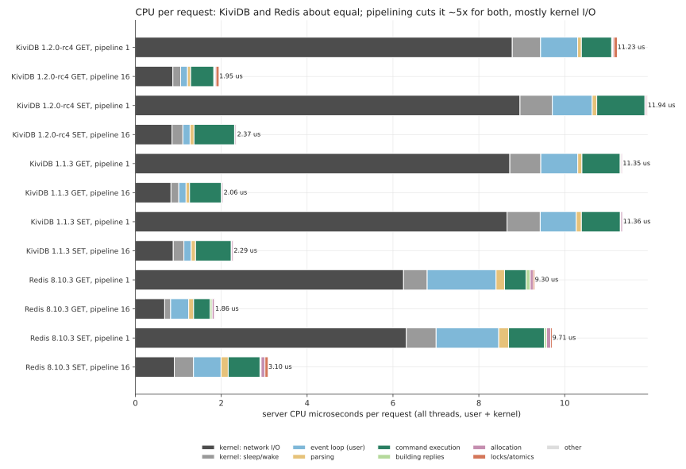
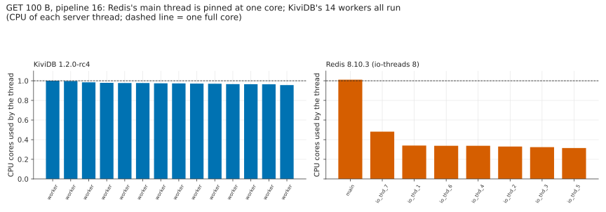
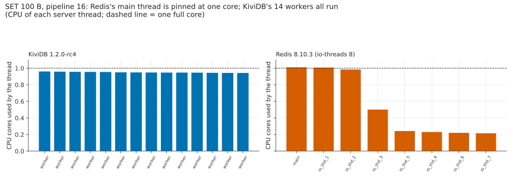
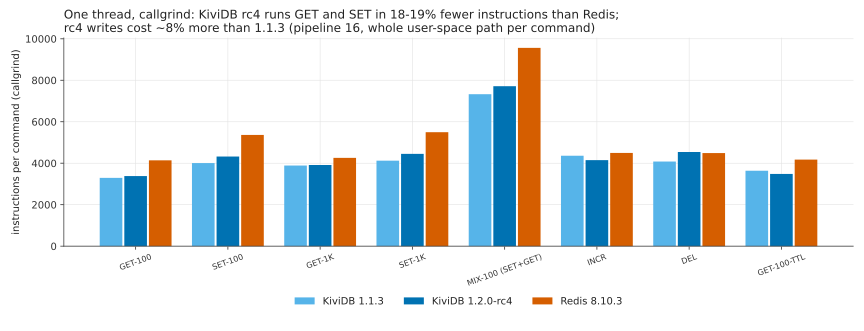

# Profiling: is it I/O batching or faster command execution?

Asked on Hacker News ([Show HN: KiviDB](https://news.ycombinator.com/item?id=50152541)):

> **AtalantaDB:** Have you looked into whether the advantage of your DB stems primarily from more
> efficient I/O batching or from faster command execution after? And its especially interesting to
> know whether performance profiling was used for optimization and if so do any flamegraphs still
> exist?

The reply in the thread promised flamegraphs and pipeline 1 against pipeline 16. This folder has
both: CPU flamegraphs of KiviDB 1.2.0-rc4 and Redis 8.10.3 under GET and SET at pipeline 1 and 16,
the server's CPU time per request split into kernel I/O, parsing, command execution and so on, the
CPU used by each server thread, and the instructions per command of KiviDB 1.2.0-rc4, KiviDB 1.1.3
and Redis 8.10.3 counted with callgrind.

## The answer

**Neither, mostly. KiviDB does about the same amount of work per request as Redis; it is faster
because it does that work on all cores at once, while Redis executes every command on one thread.**

- **Per request, the CPU cost is about the same.** At pipeline 16, a GET costs the server 1.95
  microseconds of CPU in KiviDB and 1.86 in Redis (all threads, user + kernel); a SET 2.37 against
  3.10. Yet KiviDB served 7.0M GETs a second and Redis 1.87M on the same 16 vCPUs.
- **Redis is capped by its main thread.** With `io-threads 8` (the main thread and 7 I/O threads), Redis reads, parses and writes on
  the I/O threads, but every command runs on the main thread, and that thread was at 1.01 cores
  (100%) at pipeline 16 while its I/O threads under GET were 32-48% busy (at pipeline 1 every Redis
  thread was at 0.93-0.99 cores, the I/O threads busy with the kernel's per-request cost). KiviDB's 14
  workers each read, parse, execute and reply for their own connections, and all 14 were at
  96-100% ([per-thread chart](charts/threads-get-p16.svg)). 3.7x the GETs for the same CPU per GET
  is the parallelism, not cheaper code.
- **Command execution is a little cheaper, not several times cheaper.** On one thread, under
  callgrind, a KiviDB rc4 GET is 3,380 instructions for the whole server path against Redis's
  4,140 (-18%), a SET 4,321 against 5,362 (-19%), INCR -8%, DEL +1%. On 14 threads the execution
  part costs KiviDB *more* time per request than Redis's single hot thread (0.54 against 0.39
  microseconds for GET): the same work spread over 14 cores' caches, plus shard locks.
- **I/O batching is pipelining, and it helps both engines the same way.** From pipeline 1 to 16 the
  CPU per request drops 5.8x for KiviDB (11.2 to 1.95 us, GET) and 5.0x for Redis (9.3 to 1.86).
  At pipeline 1, 78% of KiviDB's CPU and 67% of Redis's is kernel network code (TCP, softirq,
  io_uring / epoll), and KiviDB's io_uring path costs *more* kernel time per request than Redis's
  epoll + read/write (8.8 against 6.2 us). KiviDB still served 1.51x Redis's GETs at pipeline 1
  (1.27M against 0.84M), with all 14 workers busy, again by spreading the work.
- **So where does pipelining's big number come from?** At pipeline 16 one wake-up of a worker
  handles 16 requests per connection: one system call and one TCP segment carry 16 replies, so the
  fixed kernel cost per request falls from ~9 to ~0.9 microseconds, and the user-space work
  (parsing, execution) becomes half of the profile instead of a sixth. That is true of Redis too;
  it just cannot use more than one core for the execution half.

What this means for tuning KiviDB: at pipeline 1 the limit is the kernel's per-packet network cost
on every worker (KiviDB's own user-space code is ~15% of the CPU there), and at pipeline 16 it is
command execution spread over cores (cache misses, shard locks; `locks and atomics` is 3.9% of a
GET), not the I/O loop.

## Results

### CPU time per request

| engine, workload | ops/s (10 s window) | CPU us / request | user | kernel | system calls / request | busiest thread |
|---|---|---|---|---|---|---|
| KiviDB rc4, GET, pipeline 1 | 1.27M | 11.23 | 1.94 | 9.29 | 0.13 | worker 1.02 cores; 14 threads busy, 14.3 cores in all |
| KiviDB rc4, GET, pipeline 16 | 6.99M | 1.95 | 0.97 | 0.99 | 0.06 | worker 1.00 cores; 14 threads busy, 13.7 cores in all |
| KiviDB rc4, SET, pipeline 1 | 1.20M | 11.94 | 2.31 | 9.62 | 0.14 | worker 1.02 cores; 14 threads busy, 14.3 cores in all |
| KiviDB rc4, SET, pipeline 16 | 5.61M | 2.37 | 1.29 | 1.08 | 0.08 | worker 0.96 cores; 14 threads busy, 13.3 cores in all |
| Redis 8.10.3, GET, pipeline 1 | 0.84M | 9.30 | 2.55 | 6.75 | 2.11 | io_thd_1 0.99 cores; 8 threads busy, 7.8 cores in all |
| Redis 8.10.3, GET, pipeline 16 | 1.87M | 1.86 | 1.08 | 0.78 | 0.35 | redis-server 1.01 cores; 8 threads busy, 3.5 cores in all |
| Redis 8.10.3, SET, pipeline 1 | 0.77M | 9.71 | 2.73 | 6.98 | 2.05 | redis-server 0.99 cores; 8 threads busy, 7.5 cores in all |
| Redis 8.10.3, SET, pipeline 16 | 1.42M | 3.10 | 1.73 | 1.37 | 2.59 | redis-server 1.01 cores; 8 threads busy, 4.4 cores in all |
| KiviDB 1.1.3, GET, pipeline 1 | 1.26M | 11.35 | 2.02 | 9.34 | 0.14 | worker 1.02 cores; 14 threads busy, 14.3 cores in all |
| KiviDB 1.1.3, GET, pipeline 16 | 6.71M | 2.06 | 1.13 | 0.92 | 0.06 | worker 1.00 cores; 14 threads busy, 13.8 cores in all |
| KiviDB 1.1.3, SET, pipeline 1 | 1.25M | 11.36 | 2.08 | 9.28 | 0.14 | worker 1.02 cores; 14 threads busy, 14.2 cores in all |
| KiviDB 1.1.3, SET, pipeline 16 | 5.89M | 2.29 | 1.22 | 1.07 | 0.07 | worker 0.97 cores; 14 threads busy, 13.5 cores in all |
| KiviDB rc4, release binary, GET, pipeline 1 | 1.28M | 11.14 | 1.90 | 9.25 | 0.13 | worker 1.02 cores; 14 threads busy, 14.3 cores in all |
| KiviDB rc4, release binary, GET, pipeline 16 | 7.01M | 1.91 | 0.96 | 0.95 | 0.07 | worker 0.98 cores; 14 threads busy, 13.4 cores in all |
| KiviDB rc4, release binary, SET, pipeline 1 | 1.25M | 11.37 | 2.14 | 9.23 | 0.14 | worker 1.02 cores; 14 threads busy, 14.2 cores in all |
| KiviDB rc4, release binary, SET, pipeline 16 | 5.62M | 2.38 | 1.30 | 1.08 | 0.08 | worker 0.96 cores; 14 threads busy, 13.3 cores in all |

KiviDB rows are the frame-pointer build used for the flamegraphs; the release binary of the same
tag measured the same way is in the last rows (no flamegraph, the numbers only). The windows are
10 s each, inside 45 s runs, so ops/s differ a little from the data-type suite's.

### Where the CPU goes



| microseconds of CPU per request | KiviDB rc4<br>GET, pipeline 1 | KiviDB rc4<br>GET, pipeline 16 | KiviDB rc4<br>SET, pipeline 1 | KiviDB rc4<br>SET, pipeline 16 | Redis 8.10.3<br>GET, pipeline 1 | Redis 8.10.3<br>GET, pipeline 16 | Redis 8.10.3<br>SET, pipeline 1 | Redis 8.10.3<br>SET, pipeline 16 | KiviDB 1.1.3<br>GET, pipeline 1 | KiviDB 1.1.3<br>GET, pipeline 16 | KiviDB 1.1.3<br>SET, pipeline 1 | KiviDB 1.1.3<br>SET, pipeline 16 |
|---|---|---|---|---|---|---|---|---|---|---|---|---|
| kernel: thread sleep/wake | 0.66 (6%) | 0.18 (9%) | 0.75 (6%) | 0.25 (11%) | 0.55 (6%) | 0.14 (8%) | 0.69 (7%) | 0.45 (14%) | 0.72 (6%) | 0.18 (9%) | 0.77 (7%) | 0.25 (11%) |
| kernel: network I/O | 8.78 (78%) | 0.87 (45%) | 8.96 (75%) | 0.85 (36%) | 6.25 (67%) | 0.68 (37%) | 6.31 (65%) | 0.91 (29%) | 8.72 (77%) | 0.83 (40%) | 8.66 (76%) | 0.88 (38%) |
| memory allocation | 0.03 (0%) | 0.03 (2%) | 0.04 (0%) | 0.03 (1%) | 0.07 (1%) | 0.05 (3%) | 0.10 (1%) | 0.09 (3%) | 0.03 (0%) | 0.03 (1%) | 0.04 (0%) | 0.04 (2%) |
| locks and atomics | 0.08 (1%) | 0.08 (4%) | 0.02 (0%) | 0.02 (1%) | 0.04 (0%) | 0.02 (1%) | 0.04 (0%) | 0.08 (2%) | 0.01 (0%) | 0.00 (0%) | 0.01 (0%) | 0.01 (0%) |
| parsing requests | 0.09 (1%) | 0.07 (4%) | 0.11 (1%) | 0.09 (4%) | 0.20 (2%) | 0.11 (6%) | 0.23 (2%) | 0.17 (5%) | 0.10 (1%) | 0.08 (4%) | 0.12 (1%) | 0.10 (4%) |
| building replies | 0.02 (0%) | 0.02 (1%) | 0.01 (0%) | 0.01 (0%) | 0.10 (1%) | 0.05 (2%) | 0.05 (0%) | 0.03 (1%) | 0.02 (0%) | 0.02 (1%) | 0.01 (0%) | 0.01 (0%) |
| command execution | 0.70 (6%) | 0.54 (28%) | 1.12 (9%) | 0.94 (40%) | 0.50 (5%) | 0.39 (21%) | 0.83 (9%) | 0.74 (24%) | 0.89 (8%) | 0.74 (36%) | 0.91 (8%) | 0.83 (36%) |
| event loop and connection handling | 0.86 (8%) | 0.16 (8%) | 0.93 (8%) | 0.17 (7%) | 1.60 (17%) | 0.42 (23%) | 1.46 (15%) | 0.64 (21%) | 0.86 (8%) | 0.17 (8%) | 0.84 (7%) | 0.17 (8%) |
| other user space | 0.00 (0%) | 0.00 (0%) | 0.00 (0%) | 0.00 (0%) | 0.00 (0%) | 0.00 (0%) | 0.00 (0%) | 0.00 (0%) | 0.00 (0%) | 0.00 (0%) | 0.00 (0%) | 0.00 (0%) |
| **total** | **11.23** | **1.95** | **11.94** | **2.37** | **9.30** | **1.86** | **9.71** | **3.10** | **11.35** | **2.06** | **11.36** | **2.29** |

### CPU used by each server thread (pipeline 16)





### Instructions per command (one thread, callgrind)



| workload | KiviDB 1.1.3 | KiviDB 1.2.0-rc4 | rc4 vs 1.1.3 | Redis 8.10.3 | rc4 vs Redis |
|---|---|---|---|---|---|
| GET-100 | 3292 | 3380 | +2.7% | 4140 | -18.4% |
| SET-100 | 4007 | 4321 | +7.8% | 5362 | -19.4% |
| GET-1K | 3887 | 3913 | +0.7% | 4259 | -8.1% |
| SET-1K | 4123 | 4449 | +7.9% | 5496 | -19.1% |
| MIX-100 | 7327 | 7713 | +5.3% | 9562 | -19.3% |
| INCR | 4360 | 4150 | -4.8% | 4495 | -7.7% |
| DEL | 4080 | 4541 | +11.3% | 4490 | +1.1% |
| GET-100-TTL | 3637 | 3483 | -4.2% | 4173 | -16.5% |
| SET-100-TTL | 6134 | 5719 | -6.8% | - | - |
| INCR-TTL | 4587 | 4233 | -7.7% | - | - |
| DEL-TTL | 5495 | 5177 | -5.8% | - | - |
| GET-100-LRU | 3756 | 3749 | -0.2% | - | - |
| SET-100-LRU | 4525 | 4671 | +3.2% | - | - |
| INCR-LRU | 4800 | 4503 | -6.2% | - | - |
| DEL-LRU | 4678 | 4904 | +4.8% | - | - |
| GET-100-LFU | 3761 | 3949 | +5.0% | - | - |
| SET-100-LFU | 4506 | 5050 | +12.1% | - | - |
| INCR-LFU | 4791 | 4776 | -0.3% | - | - |

MIX-100 is one SET plus one GET. The `-TTL`, `-LRU` and `-LFU` rows run with a TTL on every key or
under `allkeys-lru` / `allkeys-lfu` (KiviDB only; the Redis column has the first eight). Between
1.1.3 and rc4, reads are flat (GET +2.7%) and writes got dearer: SET +7.8% (+314 instructions),
DEL +11.3%, SET under LFU +12.1%. The per-function counts (`results/callgrind/*-profile-SET-100.txt`)
put most of the SET difference in `keyspec::key_positions` (+67 a command, new in rc4: writes now
take their keys' order, #271) and in `run_command`, `from_utf8` and `memcmp` (+35-55 each), with
less spent in malloc/free. In the multi-threaded runs this shows as SET at pipeline 16 doing 5.61M
ops/s on rc4 against 5.89M on 1.1.3 (-5%), while GET went from 6.71M to 6.99M (+4%).

### Flamegraphs

Open the SVGs in a browser (they are interactive: click to zoom, Ctrl-F to search). Width is CPU
time; kernel frames end in `_[k]`. Frames narrower than 0.3% are dropped (`--minwidth 0.3`).

| | pipeline 1 | pipeline 16 |
|---|---|---|
| KiviDB 1.2.0-rc4, GET | [get-p1](flamegraphs/kividb-rc4-get-p1.svg) | [get-p16](flamegraphs/kividb-rc4-get-p16.svg) |
| KiviDB 1.2.0-rc4, SET | [set-p1](flamegraphs/kividb-rc4-set-p1.svg) | [set-p16](flamegraphs/kividb-rc4-set-p16.svg) |
| Redis 8.10.3, GET | [get-p1](flamegraphs/redis-get-p1.svg) | [get-p16](flamegraphs/redis-get-p16.svg) |
| Redis 8.10.3, SET | [set-p1](flamegraphs/redis-set-p1.svg) | [set-p16](flamegraphs/redis-set-p16.svg) |
| KiviDB 1.1.3, GET / SET | - | [get-p16](flamegraphs/kividb-1.1.3-get-p16.svg), [set-p16](flamegraphs/kividb-1.1.3-set-p16.svg) |
| KiviDB 1.2.0-rc4, LPOP while lists drain (the [tail-latency stall](../datatypes/#findings)) | - | [lpop-p16](flamegraphs/kividb-rc4-lpop-p16-stall.svg) |

The folded stacks behind every flamegraph are in `results/<engine>/*.folded.gz`
(`zcat x.folded.gz | flamegraph.pl > x.svg` redraws one at any width).

## How it was measured

### 1. CPU time per request and where it goes (perf, real network)

`harness/profile.sh ENGINE` on the server VM, with memtier_benchmark on the client VM (the same
pair, placement group and connection counts as the [data-type suite](../datatypes/)):

1. Start the engine on all 16 vCPUs, load 1,000,000 keys with 100-byte values.
2. For each of GET and SET at pipeline 1 (32 threads x 16 connections = 512) and pipeline 16
   (32 x 4 = 128 connections, 2,048 requests in flight): 45 s of load from the client, random keys.
3. From second 12, for 10 s: the server's user and system CPU time from `/proc/<pid>/stat`, the
   CPU time of each of its threads from `/proc/<pid>/task/*/stat`, and `perf stat` for system
   calls and context switches. Nothing samples during this window.
4. The next 10 s: `perf record -F 499 --call-graph fp` on every thread of the server. The folded
   stacks (`stackcollapse-perf.pl --kernel`) give the flamegraphs (`flamegraph.pl --minwidth 0.3`)
   and the split by category below.
5. `harness/categorize.py` sorts every sample into one category: a sample with kernel frames is
   kernel time (network I/O, or thread sleep/wake if it is in futex/scheduler code); a user-space
   sample is classified by walking from the leaf towards the root to the first frame that names a
   category (parsing, command execution, building replies, allocation, locks, event loop). The
   shares multiply the measured CPU time per request from step 3.

**Frame pointers.** Redis builds with `-fno-omit-frame-pointer` by default. KiviDB's release
build does not, and perf's DWARF unwinder returned no call chain at all for 20-50% of the release
binary's samples on these VMs, so the KiviDB profiles come from a build of the same tag with
`RUSTFLAGS="-C force-frame-pointers=yes"` and line tables (otherwise the release profile, LTO fat;
`harness/build.sh`, `FP=1 DEBUG=1`). Its CPU per request is within run-to-run noise of the release
binary's (both are in the table below).

### 2. Instructions per command (callgrind, one thread)

`scripts/perf/run.sh` from the KiviDB repo (`REV=v1.1.3` and `REV=v1.2.0-rc4`, `LTO=fat`,
`WORKLOADS=full`) builds the tree in a Docker image with Rust 1.99.1 and valgrind 3.19, runs the
server with one worker thread on the io_uring loop under callgrind with instrumentation off, warms
up and loads with redis-benchmark (one connection, pipeline 16, 10,000 keys), then counts the
instructions of N = 60,000 pipelined commands. That is the whole user-space path of a command:
read, parse, execute, reply, write. It does not see the kernel or cache misses.
`harness/callgrind-redis.sh` does the same for redis-server 8.10.3 (io-threads 1) in the same
image (Redis needs `--set-proc-title no` under valgrind: rewriting its process title clobbers the
environment valgrind uses to name its control FIFO).

## Hardware and versions

The same two VMs as the [data-type suite](../datatypes/#hardware-and-placement): server Azure
`Standard_D16ds_v5` (16 vCPU Xeon Platinum 8370C, 64 GB, Ubuntu 24.04, kernel 7.0.0-1017-azure),
client `Standard_D48s_v5`, koreacentral zone 1, one proximity placement group. perf 7.0.14,
FlameGraph (brendangregg/FlameGraph master). KiviDB 1.2.0-rc4 is tag `v1.2.0-rc4` (`a6b1bf38`),
1.1.3 is `v1.1.3` (`032f09eb`); Redis 8.10.3 is built from source with its default flags
(`-O3 -fno-omit-frame-pointer`, jemalloc), `--io-threads 8`. The callgrind runs used a separate
throwaway VM (Standard_D16s_v5, australiaeast: no vCPU quota was left in koreacentral); instruction
counts do not depend on the machine.

An earlier pass of the same profiles on that VM pair (no placement group, ~2 ms ping) was bounded
by round trips at pipeline 16 (KiviDB's workers 45% busy) and is not used here; its CPU per request
was 10-28% higher for both engines (fewer requests per wake-up), with the same ordering.

## Reproduce

```sh
# on the server VM of the data-type suite (harness/engines.sh is shared)
FP=1 DEBUG=1 bash harness/build.sh rc4-fp v1.2.0-rc4      # -> ~/bin/kividb-rc4-fp
FP=1 DEBUG=1 bash harness/build.sh 1.1.3-fp v1.1.3
for e in kividb-rc4-fp redis kividb-1.1.3-fp kividb-rc4; do bash harness/profile.sh $e; done
python3 harness/categorize.py ~/out/profiling results/cpu-split.csv
python3 harness/prof_tables.py results          # the tables above
python3 harness/prof_charts.py results charts
# instructions per command (any Linux VM with Docker; uses the kividb repo's scripts/perf/run.sh)
bash harness/callgrind.sh v113:v1.1.3 rc4:v1.2.0-rc4
# Redis under the same measurement, inside the same image (Redis built there from 8.10.3 source):
docker run --rm --security-opt seccomp=unconfined -v $PWD/harness:/h:ro -v /tmp/r.tgz:/r.tgz:ro \
  kividb-ci-valgrind bash -c "cd /tmp && tar xzf /r.tgz && cd redis-8.10.3 && make -j16 >/dev/null && \
  RS=/tmp/redis-8.10.3/src/redis-server bash /h/callgrind-redis.sh"
python3 harness/cg_table.py results/callgrind-table.csv results/callgrind/results.txt results/callgrind/redis.txt
```

## Files

- `flamegraphs/*.svg`: the flamegraphs (interactive SVG).
- `results/cpu-split.csv`, `cpu-split.txt`: CPU per request by category; `cpu-split-threads.csv` by thread.
- `results/<engine>/cpu.csv`: CPU per request, system calls, context switches per workload;
  `<workload>.threads.csv`: CPU of every server thread; `<workload>.folded.gz`: the folded stacks;
  `<workload>.txt`: memtier's report of the 45 s run; `<workload>.stat.txt`: perf stat.
- `results/callgrind/`: `results.txt` and `redis.txt` (instructions per command), `table.txt`,
  `<tag>-profile-<workload>.txt` (the hottest functions of each workload, callgrind_annotate),
  `revs.txt` (commits), `toolchain.txt`.
