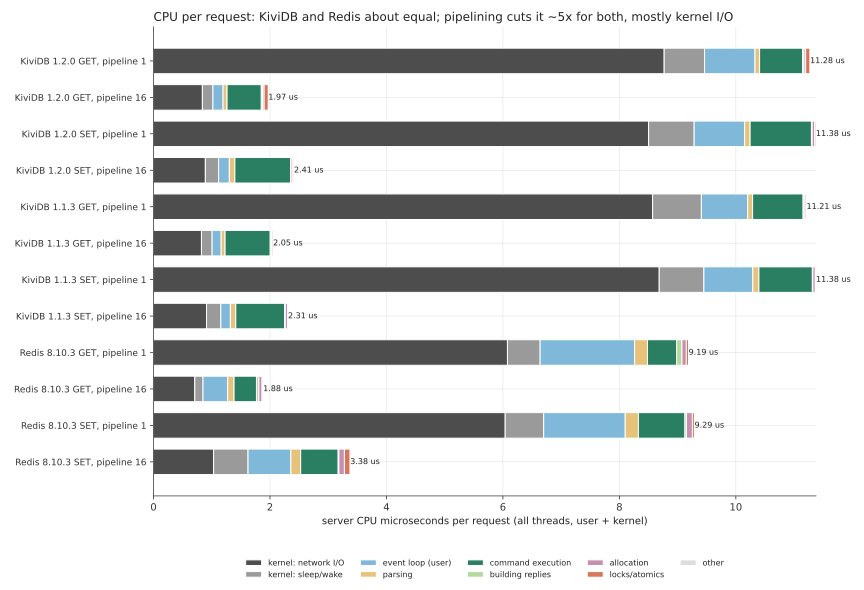
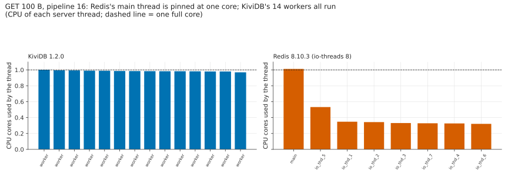
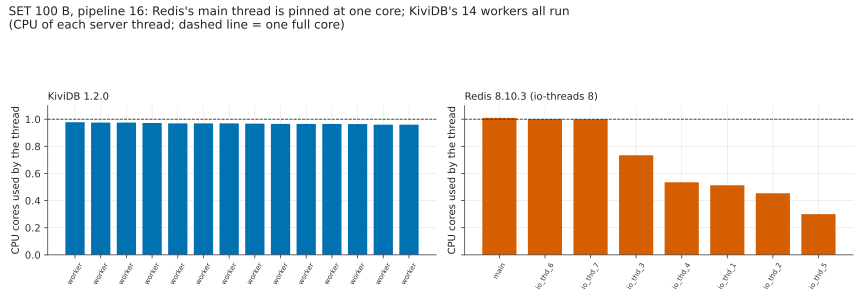
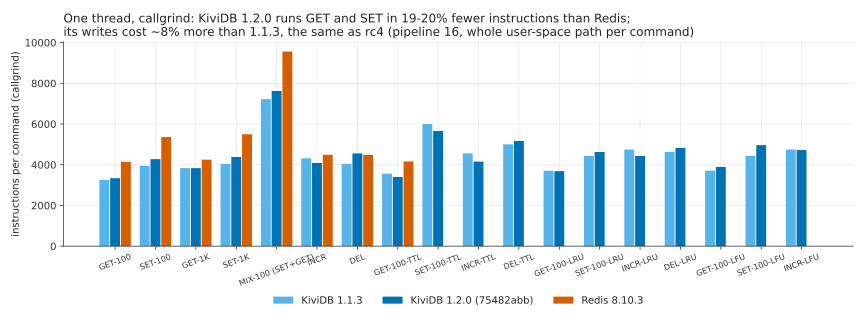
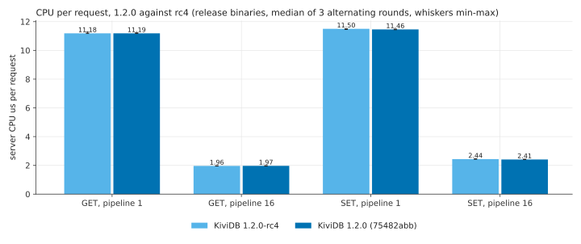
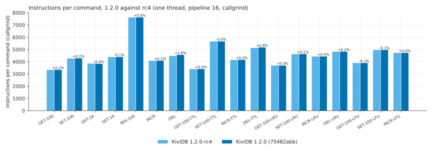

# Profiling: is it I/O batching or faster command execution?

> **Rechecked on 1.2.0-rc8**, the code that ships as 1.2.0 ([rc8/](rc8/README.md)): instructions per command are within 0.2% of rc7 on every workload, and still 19-20% fewer than Redis's for GET and SET.

Asked on Hacker News ([Show HN: KiviDB](https://news.ycombinator.com/item?id=50152541)):

> **AtalantaDB:** Have you looked into whether the advantage of your DB stems primarily from more
> efficient I/O batching or from faster command execution after? And its especially interesting to
> know whether performance profiling was used for optimization and if so do any flamegraphs still
> exist?

The reply in the thread promised flamegraphs and pipeline 1 against pipeline 16. This folder has
both: CPU flamegraphs of KiviDB 1.2.0 (release branch at `75482abb`, the code that ships as 1.2.0)
and Redis 8.10.3 under GET and SET at pipeline 1 and 16, the server's CPU time per request split
into kernel I/O, parsing, command execution and so on, the CPU used by each server thread, and the
instructions per command of KiviDB 1.2.0, KiviDB 1.1.3 and Redis 8.10.3 counted with callgrind.
Everything was measured on 2026-11-02; the same session measured 1.2.0-rc4 the same way as a
regression check ([Against 1.2.0-rc4](#against-120-rc4)).

## The answer

**Neither, mostly. KiviDB does about the same amount of work per request as Redis; it is faster
because it does that work on all cores at once, while Redis executes every command on one thread.**

- **Per request, the CPU cost is about the same.** At pipeline 16, a GET costs the server 1.97
  microseconds of CPU in KiviDB and 1.88 in Redis (all threads, user + kernel); a SET 2.41 against
  3.38. Yet KiviDB served 7.0M GETs a second and Redis 1.88M on the same 16 vCPUs.
- **Redis is capped by its main thread.** With `io-threads 8` (the main thread and 7 I/O threads),
  Redis reads, parses and writes on the I/O threads, but every command runs on the main thread, and
  that thread was at 1.01 cores (100%) at pipeline 16 while its I/O threads under GET were 32-53%
  busy (at pipeline 1 every Redis thread was at 0.93-0.99 cores, the I/O threads busy with the
  kernel's per-request cost). KiviDB's 14 workers each read, parse, execute and reply for their own
  connections, and all 14 were at 97-100% ([per-thread chart](charts/threads-get-p16.svg)). 3.7x
  the GETs for about the same CPU per GET is the parallelism, not cheaper code.
- **Command execution is a little cheaper, not several times cheaper.** On one thread, under
  callgrind, a KiviDB 1.2.0 GET is 3,339 instructions for the whole server path against Redis's
  4,139 (-19%), a SET 4,276 against 5,359 (-20%), INCR -9%, DEL +2%. On 14 threads the execution
  part costs KiviDB *more* time per request than Redis's single hot thread (0.59 against 0.39
  microseconds for GET): the same work spread over 14 cores' caches, plus shard locks.
- **I/O batching is pipelining, and it helps both engines the same way.** From pipeline 1 to 16 the
  CPU per request drops 5.7x for KiviDB (11.3 to 1.97 us, GET) and 4.9x for Redis (9.2 to 1.88).
  At pipeline 1, 78% of KiviDB's CPU and 66% of Redis's is kernel network code (TCP, softirq,
  io_uring / epoll), and KiviDB's io_uring path costs *more* kernel time per request than Redis's
  epoll + read/write (8.8 against 6.1 us). KiviDB still served 1.49x Redis's GETs at pipeline 1
  (1.27M against 0.85M), with all 14 workers busy, again by spreading the work.
- **So where does pipelining's big number come from?** At pipeline 16 one wake-up of a worker
  handles 16 requests per connection: one system call and one TCP segment carry 16 replies, so the
  fixed kernel cost per request falls from ~9 to ~0.9 microseconds, and the user-space work
  (parsing, execution) becomes half of the profile instead of a sixth. That is true of Redis too;
  it just cannot use more than one core for the execution half.

What this means for tuning KiviDB: at pipeline 1 the limit is the kernel's per-packet network cost
on every worker (KiviDB's own user-space code is ~16% of the CPU there), and at pipeline 16 it is
command execution spread over cores (cache misses, shard locks; `locks and atomics` is 3.7% of a
GET), not the I/O loop.

## Results

### CPU time per request

| engine, workload | ops/s (10 s window) | CPU us / request | user | kernel | system calls / request | busiest thread |
|---|---|---|---|---|---|---|
| KiviDB 1.2.0, GET, pipeline 1 | 1.27M | 11.28 | 1.98 | 9.30 | 0.13 | worker 1.02 cores; 14 threads busy, 14.3 cores in all |
| KiviDB 1.2.0, GET, pipeline 16 | 7.00M | 1.97 | 1.02 | 0.95 | 0.06 | worker 1.00 cores; 14 threads busy, 13.8 cores in all |
| KiviDB 1.2.0, SET, pipeline 1 | 1.25M | 11.38 | 2.21 | 9.17 | 0.14 | worker 1.02 cores; 14 threads busy, 14.2 cores in all |
| KiviDB 1.2.0, SET, pipeline 16 | 5.61M | 2.41 | 1.33 | 1.08 | 0.08 | worker 0.98 cores; 14 threads busy, 13.6 cores in all |
| Redis 8.10.3, GET, pipeline 1 | 0.85M | 9.19 | 2.57 | 6.61 | 2.11 | io_thd_1 0.99 cores; 8 threads busy, 7.8 cores in all |
| Redis 8.10.3, GET, pipeline 16 | 1.88M | 1.88 | 1.06 | 0.82 | 0.38 | redis-server 1.01 cores; 8 threads busy, 3.5 cores in all |
| Redis 8.10.3, SET, pipeline 1 | 0.82M | 9.29 | 2.61 | 6.68 | 2.10 | redis-server 0.97 cores; 8 threads busy, 7.6 cores in all |
| Redis 8.10.3, SET, pipeline 16 | 1.64M | 3.38 | 1.80 | 1.58 | 2.73 | redis-server 1.01 cores; 8 threads busy, 5.5 cores in all |
| KiviDB 1.1.3, GET, pipeline 1 | 1.27M | 11.21 | 1.98 | 9.24 | 0.13 | worker 1.02 cores; 14 threads busy, 14.3 cores in all |
| KiviDB 1.1.3, GET, pipeline 16 | 6.76M | 2.05 | 1.13 | 0.93 | 0.06 | worker 1.00 cores; 14 threads busy, 13.9 cores in all |
| KiviDB 1.1.3, SET, pipeline 1 | 1.25M | 11.38 | 2.06 | 9.31 | 0.14 | worker 1.02 cores; 14 threads busy, 14.2 cores in all |
| KiviDB 1.1.3, SET, pipeline 16 | 5.87M | 2.31 | 1.23 | 1.08 | 0.07 | worker 0.97 cores; 14 threads busy, 13.5 cores in all |
| KiviDB 1.2.0, release binary, GET, pipeline 1 | 1.28M | 11.19 | 1.88 | 9.30 | 0.13 | worker 1.02 cores; 14 threads busy, 14.3 cores in all |
| KiviDB 1.2.0, release binary, GET, pipeline 16 | 6.95M | 1.97 | 1.02 | 0.95 | 0.06 | worker 1.00 cores; 14 threads busy, 13.7 cores in all |
| KiviDB 1.2.0, release binary, SET, pipeline 1 | 1.24M | 11.46 | 2.22 | 9.22 | 0.15 | worker 1.02 cores; 14 threads busy, 14.2 cores in all |
| KiviDB 1.2.0, release binary, SET, pipeline 16 | 5.60M | 2.41 | 1.32 | 1.08 | 0.08 | worker 0.98 cores; 14 threads busy, 13.6 cores in all |

KiviDB rows are the frame-pointer build used for the flamegraphs; the release binary of the same
commit measured the same way (three rounds, alternating with rc4; the median is shown) is in the
last rows (no flamegraph, the numbers only). The windows are 10 s each, inside 45 s runs, so ops/s
differ a little from the data-type suite's. Redis's SET at pipeline 16 ran at 1.64M today (1.42M in
the rc4 session), with two of its I/O threads at a full core.

One measurement was repeated: in the first window of the session (KiviDB 1.2.0, GET, pipeline 1)
the server's CPU time read 16.9 cores on a 16-vCPU machine, because the first `sudo perf stat` of
the session started late inside the `/proc` window (perf stat's own task-clock for the same 10 s
said 14.0 cores). That workload was run again on its own; the row above is the rerun (14.3 cores,
the same as every other pipeline-1 KiviDB run).

### Where the CPU goes



| microseconds of CPU per request | KiviDB 1.2.0<br>GET, pipeline 1 | KiviDB 1.2.0<br>GET, pipeline 16 | KiviDB 1.2.0<br>SET, pipeline 1 | KiviDB 1.2.0<br>SET, pipeline 16 | Redis 8.10.3<br>GET, pipeline 1 | Redis 8.10.3<br>GET, pipeline 16 | Redis 8.10.3<br>SET, pipeline 1 | Redis 8.10.3<br>SET, pipeline 16 | KiviDB 1.1.3<br>GET, pipeline 1 | KiviDB 1.1.3<br>GET, pipeline 16 | KiviDB 1.1.3<br>SET, pipeline 1 | KiviDB 1.1.3<br>SET, pipeline 16 |
|---|---|---|---|---|---|---|---|---|---|---|---|---|
| kernel: thread sleep/wake | 0.69 (6%) | 0.18 (9%) | 0.78 (7%) | 0.23 (10%) | 0.56 (6%) | 0.14 (8%) | 0.66 (7%) | 0.59 (18%) | 0.84 (8%) | 0.18 (9%) | 0.77 (7%) | 0.25 (11%) |
| kernel: network I/O | 8.77 (78%) | 0.84 (43%) | 8.50 (75%) | 0.89 (37%) | 6.08 (66%) | 0.71 (38%) | 6.04 (65%) | 1.03 (30%) | 8.57 (76%) | 0.82 (40%) | 8.68 (76%) | 0.91 (39%) |
| memory allocation | 0.03 (0%) | 0.03 (1%) | 0.04 (0%) | 0.03 (1%) | 0.07 (1%) | 0.06 (3%) | 0.10 (1%) | 0.10 (3%) | 0.03 (0%) | 0.03 (1%) | 0.04 (0%) | 0.04 (2%) |
| locks and atomics | 0.08 (1%) | 0.07 (4%) | 0.02 (0%) | 0.02 (1%) | 0.04 (0%) | 0.02 (1%) | 0.04 (0%) | 0.10 (3%) | 0.01 (0%) | 0.00 (0%) | 0.01 (0%) | 0.01 (0%) |
| parsing requests | 0.08 (1%) | 0.07 (4%) | 0.09 (1%) | 0.10 (4%) | 0.22 (2%) | 0.11 (6%) | 0.23 (2%) | 0.17 (5%) | 0.08 (1%) | 0.07 (3%) | 0.10 (1%) | 0.09 (4%) |
| building replies | 0.02 (0%) | 0.02 (1%) | 0.01 (0%) | 0.01 (0%) | 0.09 (1%) | 0.04 (2%) | 0.03 (0%) | 0.01 (0%) | 0.02 (0%) | 0.02 (1%) | 0.01 (0%) | 0.01 (0%) |
| command execution | 0.74 (6%) | 0.59 (30%) | 1.05 (9%) | 0.96 (40%) | 0.50 (5%) | 0.39 (20%) | 0.80 (9%) | 0.64 (19%) | 0.87 (8%) | 0.78 (38%) | 0.92 (8%) | 0.84 (36%) |
| event loop and connection handling | 0.87 (8%) | 0.17 (9%) | 0.87 (8%) | 0.18 (8%) | 1.62 (18%) | 0.42 (22%) | 1.40 (15%) | 0.74 (22%) | 0.80 (7%) | 0.16 (8%) | 0.84 (7%) | 0.16 (7%) |
| other user space | 0.00 (0%) | 0.00 (0%) | 0.00 (0%) | 0.00 (0%) | 0.00 (0%) | 0.00 (0%) | 0.00 (0%) | 0.00 (0%) | 0.00 (0%) | 0.00 (0%) | 0.00 (0%) | 0.00 (0%) |
| **total** | **11.28** | **1.97** | **11.38** | **2.41** | **9.19** | **1.88** | **9.29** | **3.38** | **11.21** | **2.05** | **11.38** | **2.31** |

### CPU used by each server thread (pipeline 16)





### Instructions per command (one thread, callgrind)



| workload | KiviDB 1.1.3 | KiviDB 1.2.0-rc4 | KiviDB 1.2.0 (75482abb) | 1.2.0 vs rc4 | 1.2.0 vs 1.1.3 | Redis 8.10.3 | 1.2.0 vs Redis |
|---|---|---|---|---|---|---|---|
| GET-100 | 3250 | 3333 | 3339 | +0.2% | +2.7% | 4139 | -19.3% |
| SET-100 | 3947 | 4267 | 4276 | +0.2% | +8.3% | 5359 | -20.2% |
| GET-1K | 3837 | 3852 | 3833 | -0.5% | -0.1% | 4250 | -9.8% |
| SET-1K | 4041 | 4384 | 4380 | -0.1% | +8.4% | 5498 | -20.3% |
| MIX-100 | 7218 | 7625 | 7625 | +0.0% | +5.6% | 9559 | -20.2% |
| INCR | 4319 | 4083 | 4086 | +0.1% | -5.4% | 4489 | -9.0% |
| DEL | 4038 | 4474 | 4556 | +1.8% | +12.8% | 4483 | +1.6% |
| GET-100-TTL | 3560 | 3401 | 3402 | +0.0% | -4.4% | 4165 | -18.3% |
| SET-100-TTL | 5996 | 5658 | 5657 | -0.0% | -5.7% | - | - |
| INCR-TTL | 4560 | 4146 | 4154 | +0.2% | -8.9% | - | - |
| DEL-TTL | 5002 | 5126 | 5165 | +0.8% | +3.3% | - | - |
| GET-100-LRU | 3705 | 3687 | 3687 | +0.0% | -0.5% | - | - |
| SET-100-LRU | 4436 | 4621 | 4627 | +0.1% | +4.3% | - | - |
| INCR-LRU | 4746 | 4430 | 4431 | +0.0% | -6.6% | - | - |
| DEL-LRU | 4630 | 4818 | 4826 | +0.2% | +4.2% | - | - |
| GET-100-LFU | 3709 | 3897 | 3895 | -0.1% | +5.0% | - | - |
| SET-100-LFU | 4438 | 4966 | 4963 | -0.1% | +11.8% | - | - |
| INCR-LFU | 4743 | 4721 | 4721 | +0.0% | -0.5% | - | - |

MIX-100 is one SET plus one GET. The `-TTL`, `-LRU` and `-LFU` rows run with a TTL on every key or
under `allkeys-lru` / `allkeys-lfu` (KiviDB only; the Redis column has the first eight). Between
1.1.3 and 1.2.0, reads are flat (GET +2.7%) and writes got dearer: SET +8.3% (+329 instructions),
DEL +12.8% (+10.9% in the DEL repeats below), SET under LFU +11.8%. All of that came in rc4 and is
unchanged since (1.2.0 against rc4 is in the next section). The per-function counts
(`results/callgrind/*-profile-SET-100.txt`) put most of the SET difference in
`keyspec::key_positions` (+67 a command, new in rc4: writes now take their keys' order, #271) and
in `run_command` (+53), `from_utf8` and `memcmp` (+37 each), with less spent in malloc/free; rc4 and
1.2.0 have the same count in each of those functions. In the multi-threaded runs this shows as
SET at pipeline 16 doing 5.61M ops/s on 1.2.0 against 5.87M on 1.1.3 (-4%), while GET went from
6.76M to 7.00M (+4%).

### Flamegraphs

Open the SVGs in a browser (they are interactive: click to zoom, Ctrl-F to search). Width is CPU
time; kernel frames end in `_[k]`. Frames narrower than 0.3% are dropped (`--minwidth 0.3`).

| | pipeline 1 | pipeline 16 |
|---|---|---|
| KiviDB 1.2.0, GET | [get-p1](flamegraphs/kividb-1.2.0-get-p1.svg) | [get-p16](flamegraphs/kividb-1.2.0-get-p16.svg) |
| KiviDB 1.2.0, SET | [set-p1](flamegraphs/kividb-1.2.0-set-p1.svg) | [set-p16](flamegraphs/kividb-1.2.0-set-p16.svg) |
| Redis 8.10.3, GET | [get-p1](flamegraphs/redis-get-p1.svg) | [get-p16](flamegraphs/redis-get-p16.svg) |
| Redis 8.10.3, SET | [set-p1](flamegraphs/redis-set-p1.svg) | [set-p16](flamegraphs/redis-set-p16.svg) |
| KiviDB 1.2.0, LPOP while lists drain (the [tail-latency stall](../datatypes/#findings)) | - | [lpop-p16](../datatypes/raw/lpop-perf/kividb-cand-lpop-p16.svg) |

The folded stacks behind every flamegraph are in `results/<engine>/*.folded.gz`
(`zcat x.folded.gz | flamegraph.pl > x.svg` redraws one at any width). KiviDB 1.1.3's folded
stacks at pipeline 16 are there too (`results/kividb-1.1.3-fp/`); its flamegraphs are not drawn
here, to keep the folder small.

## Against 1.2.0-rc4

rc4 (`v1.2.0-rc4`, `a6b1bf38`) was built the same way as the candidate on the same server, and
measured three ways in the same session: the release binaries of both under `profile.sh`, three
rounds alternating (1.2.0 first in rounds 1 and 3, rc4 first in round 2); the frame-pointer builds
of both; and callgrind. **No workload costs more than 3% over rc4 anywhere, so there was no rise to
explain beyond the two small DEL rows below.**



| workload | 1.2.0 ops/s | rc4 ops/s | 1.2.0 CPU us/request (user + kernel) | rc4 CPU us/request | change | per round | frame-pointer builds: 1.2.0 / rc4 us |
|---|---|---|---|---|---|---|---|
| GET, pipeline 1 | 1.28M | 1.28M | 11.19 (1.88 + 9.30), 11.19-11.22 | 11.18 (1.88 + 9.33), 11.18-11.27 | +0.0% | +0.0% -0.7% +0.3% | 11.28 / 11.15 |
| GET, pipeline 16 | 6.95M | 6.97M | 1.97 (1.02 + 0.95), 1.97-1.97 | 1.96 (1.00 + 0.95), 1.96-1.97 | +0.3% | +0.5% -0.1% +0.3% | 1.97 / 1.98 |
| SET, pipeline 1 | 1.24M | 1.24M | 11.46 (2.22 + 9.22), 11.44-11.48 | 11.50 (2.16 + 9.30), 11.46-11.50 | -0.4% | -0.6% +0.0% -0.2% | 11.38 / 11.44 |
| SET, pipeline 16 | 5.60M | 5.55M | 2.41 (1.32 + 1.08), 2.40-2.43 | 2.44 (1.36 + 1.09), 2.43-2.45 | -1.1% | -1.9% -0.2% -1.1% | 2.41 / 2.44 |

The three rounds of each build agree to within 1.3% of each other, and the candidate is within
+0.3% / -1.1% of rc4 on all four workloads, the same split between user and kernel time. Where the
CPU goes is the same as well (frame-pointer builds, `results/cpu-split.csv`):

| microseconds of CPU per request | KiviDB 1.2.0<br>GET, pipeline 1 | KiviDB rc4<br>GET, pipeline 1 | KiviDB 1.2.0<br>GET, pipeline 16 | KiviDB rc4<br>GET, pipeline 16 | KiviDB 1.2.0<br>SET, pipeline 1 | KiviDB rc4<br>SET, pipeline 1 | KiviDB 1.2.0<br>SET, pipeline 16 | KiviDB rc4<br>SET, pipeline 16 |
|---|---|---|---|---|---|---|---|---|
| kernel: thread sleep/wake | 0.69 (6%) | 0.74 (7%) | 0.18 (9%) | 0.18 (9%) | 0.78 (7%) | 0.74 (6%) | 0.23 (10%) | 0.24 (10%) |
| kernel: network I/O | 8.77 (78%) | 8.60 (77%) | 0.84 (43%) | 0.85 (43%) | 8.50 (75%) | 8.59 (75%) | 0.89 (37%) | 0.89 (37%) |
| memory allocation | 0.03 (0%) | 0.03 (0%) | 0.03 (1%) | 0.03 (1%) | 0.04 (0%) | 0.03 (0%) | 0.03 (1%) | 0.03 (1%) |
| locks and atomics | 0.08 (1%) | 0.08 (1%) | 0.07 (4%) | 0.07 (4%) | 0.02 (0%) | 0.03 (0%) | 0.02 (1%) | 0.02 (1%) |
| parsing requests | 0.08 (1%) | 0.09 (1%) | 0.07 (4%) | 0.07 (4%) | 0.09 (1%) | 0.11 (1%) | 0.10 (4%) | 0.09 (4%) |
| building replies | 0.02 (0%) | 0.02 (0%) | 0.02 (1%) | 0.02 (1%) | 0.01 (0%) | 0.02 (0%) | 0.01 (0%) | 0.01 (0%) |
| command execution | 0.74 (6%) | 0.73 (6%) | 0.59 (30%) | 0.58 (30%) | 1.05 (9%) | 1.04 (9%) | 0.96 (40%) | 0.98 (40%) |
| event loop and connection handling | 0.87 (8%) | 0.88 (8%) | 0.17 (9%) | 0.17 (9%) | 0.87 (8%) | 0.88 (8%) | 0.18 (8%) | 0.18 (7%) |
| other user space | 0.00 (0%) | 0.00 (0%) | 0.00 (0%) | 0.00 (0%) | 0.00 (0%) | 0.00 (0%) | 0.00 (0%) | 0.00 (0%) |
| **total** | **11.28** | **11.15** | **1.97** | **1.98** | **11.38** | **11.44** | **2.41** | **2.44** |



| workload | rc4 | 1.2.0 (75482abb) | change |
|---|---|---|---|
| GET-100 | 3333 | 3339 | +0.2% |
| SET-100 | 4267 | 4276 | +0.2% |
| GET-1K | 3852 | 3833 | -0.5% |
| SET-1K | 4384 | 4380 | -0.1% |
| MIX-100 | 7625 | 7625 | +0.0% |
| INCR | 4083 | 4086 | +0.1% |
| DEL | 4474 | 4556 | +1.8% |
| GET-100-TTL | 3401 | 3402 | +0.0% |
| SET-100-TTL | 5658 | 5657 | -0.0% |
| INCR-TTL | 4146 | 4154 | +0.2% |
| DEL-TTL | 5126 | 5165 | +0.8% |
| GET-100-LRU | 3687 | 3687 | +0.0% |
| SET-100-LRU | 4621 | 4627 | +0.1% |
| INCR-LRU | 4430 | 4431 | +0.0% |
| DEL-LRU | 4818 | 4826 | +0.2% |
| GET-100-LFU | 3897 | 3895 | -0.1% |
| SET-100-LFU | 4966 | 4963 | -0.1% |
| INCR-LFU | 4721 | 4721 | +0.0% |

16 of 18 workloads are within 0.5% of rc4. The other two were measured again, six times per build
in alternating order (`harness/callgrind-del-repeat.sh`, `results/callgrind/del-repeat.txt`):

| workload (6 runs each) | rc4 median (min-max) | 1.2.0 median (min-max) | change |
|---|---|---|---|
| DEL | 4474 (4469-4480) | 4480 (4477-4484) | +0.1% |
| DEL-TTL | 5060 (5004-5145) | 5137 (5053-5185) | +1.5%, inside both builds' ranges |
| SET-100 (control) | 4272 (4270-4274) | 4273 (4269-4275) | +0.0% |

DEL's +1.8% in the first pass did not repeat: in that run more of the random DELs hit a key (more
`value_slab::free` and `memcmp` work), which depends on the preload, not on the code. DEL-TTL moves
by ±1.5% between runs of the same build; the per-function counts put its variation in
`ShardMap::due` and `memcmp`, the expiry checks over the keys with TTLs, and in nothing that changed
between rc4 and `75482abb` (`run_command`, the parser, `keyspec::key_positions` and
`write_order::lock_keys` cost exactly the same instructions in both builds).

## How it was measured

### 1. CPU time per request and where it goes (perf, real network)

`harness/profile.sh ENGINE` on the server VM, with memtier_benchmark on the client VM (the same
pair, placement group and connection counts as the [data-type suite](../datatypes/)):

1. Start the engine on all 16 vCPUs, load 1,000,000 keys with 100-byte values.
2. For each of GET and SET at pipeline 1 (32 threads x 16 connections = 512) and pipeline 16
   (32 x 4 = 128 connections, 2,048 requests in flight): 45 s of load from the client, random keys.
3. From second 12, for 10 s: the server's user and system CPU time from `/proc/<pid>/stat`, the
   CPU time of each of its threads from `/proc/<pid>/task/*/stat`, and `perf stat` for system
   calls and context switches. Nothing samples during this window.
4. The next 10 s: `perf record -F 499 --call-graph fp` on every thread of the server. The folded
   stacks (`stackcollapse-perf.pl --kernel`) give the flamegraphs (`flamegraph.pl --minwidth 0.3`)
   and the split by category below.
5. `harness/categorize.py` sorts every sample into one category: a sample with kernel frames is
   kernel time (network I/O, or thread sleep/wake if it is in futex/scheduler code); a user-space
   sample is classified by walking from the leaf towards the root to the first frame that names a
   category (parsing, command execution, building replies, allocation, locks, event loop). The
   shares multiply the measured CPU time per request from step 3.

**Frame pointers.** Redis builds with `-fno-omit-frame-pointer` by default. KiviDB's release
build does not, and perf's DWARF unwinder returned no call chain at all for 20-50% of the release
binary's samples on these VMs, so the KiviDB profiles come from a build of the same commit with
`RUSTFLAGS="-C force-frame-pointers=yes"` and line tables (otherwise the release profile, LTO fat;
`harness/build.sh`, `FP=1 DEBUG=1`, built on the client VM with the same toolchain). Its CPU per
request is within run-to-run noise of the release binary's (both are in the table above).

### 2. Instructions per command (callgrind, one thread)

`scripts/perf/run.sh` from the KiviDB repo (`REV=v1.1.3`, `REV=v1.2.0-rc4` and `REV=75482abb`,
`LTO=fat`, `WORKLOADS=full`; `harness/callgrind.sh`) builds the tree in a Docker image with Rust
1.99.1 and valgrind 3.19, runs the server with one worker thread on the io_uring loop under
callgrind with instrumentation off, warms up and loads with redis-benchmark (one connection,
pipeline 16, 10,000 keys), then counts the instructions of N = 60,000 pipelined commands. That is
the whole user-space path of a command: read, parse, execute, reply, write. It does not see the
kernel or cache misses. `harness/callgrind-redis.sh` does the same for redis-server 8.10.3
(io-threads 1) in the same image (Redis needs `--set-proc-title no` under valgrind: rewriting its
process title clobbers the environment valgrind uses to name its control FIFO).

## Hardware and versions

The same two VMs as the [data-type suite](../datatypes/#hardware-and-placement): server Azure
`Standard_D16ds_v5` (16 vCPU Xeon Platinum 8370C, 64 GB, Ubuntu 24.04, kernel 7.0.0-1017-azure),
client `Standard_D48s_v5`, koreacentral zone 1, one proximity placement group. perf 7.0.14,
FlameGraph (brendangregg/FlameGraph master). KiviDB 1.2.0 is `75482abb` on `release/1.2.0` (it
reports `1.2.0-rc6` until rc7 is tagged), rc4 is tag `v1.2.0-rc4` (`a6b1bf38`), 1.1.3 is `v1.1.3`
(`032f09eb`), all built from source with rustc 1.99.1; Redis 8.10.3 is built from source with its
default flags (`-O3 -fno-omit-frame-pointer`, jemalloc), `--io-threads 8`. The callgrind runs used a
separate throwaway VM (Standard_D8s_v5, japaneast: no vCPU quota was left in koreacentral);
instruction counts do not depend on the machine. They are a little lower than the rc4 session's
counts for the same tags (GET-100 for rc4: 3,333 today, 3,380 then), from a different build of the
image; every column here is from today's image.

## Reproduce

```sh
# on the server VM of the data-type suite (harness/engines.sh is shared)
bash harness/build.sh cand 75482abb                      # -> ~/bin/kividb-cand
bash harness/build.sh rc4 v1.2.0-rc4
FP=1 DEBUG=1 bash harness/build.sh cand-fp 75482abb      # -> ~/bin/kividb-cand-fp
FP=1 DEBUG=1 bash harness/build.sh rc4-fp v1.2.0-rc4
FP=1 DEBUG=1 bash harness/build.sh 1.1.3-fp v1.1.3
for e in kividb-cand-fp kividb-rc4-fp redis kividb-1.1.3-fp; do bash harness/profile.sh $e; done
for r in 1 2 3; do                                       # release binaries, alternating
  o="kividb-cand kividb-rc4"; [ $r = 2 ] && o="kividb-rc4 kividb-cand"
  for e in $o; do RUN=$e-r$r bash harness/profile.sh $e; done
done
python3 harness/categorize.py ~/out/profiling results/cpu-split.csv
python3 harness/prof_tables.py results          # the tables above
python3 harness/prof_charts.py results charts
python3 harness/prof_vs_rc4.py results charts   # the rc4 comparison
# instructions per command (any Linux VM with Docker; uses the kividb repo's scripts/perf/run.sh)
bash harness/callgrind.sh v113:v1.1.3 rc4:v1.2.0-rc4 cand:75482abb
bash harness/callgrind-redis-run.sh             # Redis 8.10.3 in the same image
bash harness/callgrind-del-repeat.sh            # DEL and DEL-TTL again, 6 runs per build
python3 harness/cg_table.py results/callgrind-table.csv results/callgrind/results.txt results/callgrind/redis.txt
```

## Files

- `flamegraphs/*.svg`: the flamegraphs (interactive SVG).
- `results/cpu-split.csv`, `cpu-split.txt`: CPU per request by category; `cpu-split-threads.csv` by thread.
- `results/<engine>/cpu.csv`: CPU per request, system calls, context switches per workload;
  `<workload>.threads.csv`: CPU of every server thread; `<workload>.folded.gz`: the folded stacks;
  `<workload>.txt`: memtier's report of the 45 s run; `<workload>.stat.txt`: perf stat. Engines:
  `kividb-cand-fp` (1.2.0, frame pointers), `kividb-rc4-fp`, `kividb-1.1.3-fp`, `redis`, and the
  release binaries `kividb-cand-r{1,2,3}` and `kividb-rc4-r{1,2,3}`.
- `results/callgrind/`: `results.txt` and `redis.txt` (instructions per command), `table.txt`,
  `del-repeat.txt` (the DEL repeats), `<tag>-profile-<workload>.txt` (the hottest functions of each
  workload, callgrind_annotate), `revs.txt` (commits), `toolchain.txt`.
