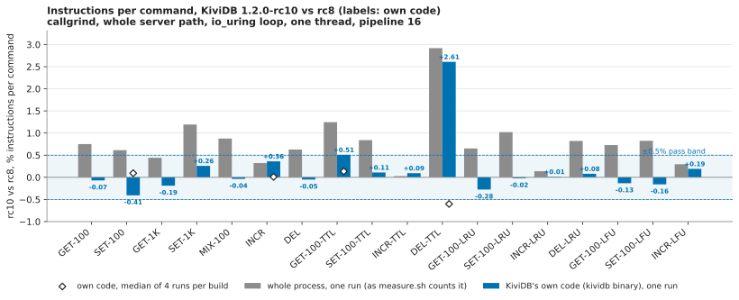

# Profiling, rc10 round: instructions per command, 1.2.0-rc10 against rc8

**Result: no regression in KiviDB's own code.** All 18 workloads of `WORKLOADS=full` pass:

- **16 of 18** are within ±0.41% of rc8 on KiviDB's own instructions (the kividb binary) in the one run of each
  build.
- **The other two are workloads with keys on a TTL**, and both pass on repeats (four runs per build):
  - GET-100-TTL is at +0.51% in the first run and **+0.14%** on the medians.
  - DEL-TTL is at +2.61% in the first run and **−0.60%** on the medians, with rc10's median inside rc8's own 3.5%
    range.
- **The TTL movement is the active-expire thread, not the commands.** That thread wakes every 100 ms of wall-clock
  time, and callgrind counts every thread. Without its functions, those two workloads move by −0.01% on four runs.

The **whole-process counts** are +0.0% to +1.24% on 17 workloads and +2.9% on DEL-TTL. All of that rise is glibc's
`__memcmp_avx2_movbe`: it is called exactly as often from rc10 as from rc8, and each call costs about 6 instructions
more. This is the string-literal page-offset effect rc9's retest found, and it is not something rc10 executes.

## What ran

- **Method.** `scripts/perf/run.sh` / `measure.sh` as in the suite's `harness/callgrind.sh` and the rc8 round:
  - the release profile with `LTO=fat`, `debug=1`, `WORKLOADS=full`, `PROFILE=1`;
  - one worker thread on the io_uring loop, pipeline 16, N = 60,000 commands a workload;
  - built and run in the `kividb-ci-valgrind` image.
- **Two additions, neither of which changes what is counted** (`harness/callgrind-keep.sh`):
  - the image is pinned to `rust:1.99.1-bookworm` rather than `rust:1-bookworm`;
  - measure.sh also keeps each workload's callgrind file (a one-line `cp`).

  The kept files let `harness/cg_split.py` split every count by object and function:
  - whole process;
  - glibc `memcmp`;
  - KiviDB's own code, meaning functions in the kividb binary, with everything Rust inlined into it;
  - the rest of glibc.

  Every file's per-function costs add up to its total, and every instruction is in either the kividb binary or glibc.
- **Toolchain in the image:** rustc 1.99.1 (58cf8f9c3 2026-10-13), valgrind 3.19.0, redis-benchmark 7.0.15, the
  same as the rc8 round and the published run.
- **Machine:** Azure `Standard_D8s_v5` (8 vCPU Xeon Platinum 8370C, x86_64), Ubuntu 24.04, kernel 7.0.0-1017-azure,
  in **centralindia**. That is the size, architecture and region of the rc8 round. One VM, since callgrind needs no
  network.
- **Builds**, both from the public repo, built inside the image (`scripts/perf/` is identical in the two commits):

| build | commit | reports | SHA-256 of the callgrind binary (LTO fat, debug=1) |
|---|---|---|---|
| rc8 (reference) | `082dab3d8929c180bccf993835e28992ea054fb5` | `kividb 1.2.0-rc8` | `e5dce0a6308abffe8924c698ad295b2dfb28da3c6eead29f424e2d474e28890a` |
| rc10 (under test) | `39bfacd231bb294d390448eacfe0e243d365ebe8` (`v1.2.0-rc10`) | `kividb 1.2.0-rc10` | `bac52c15086b25b31c9a56ef30d228d97c3f2c4cd64204134bc7b0ad354e55bd` |

- **Order:** 2026-11-03, rc8 first, then rc10, one run each. Then four workloads were run three more times per build,
  alternating (rc8 first in rounds 1 and 3, rc10 first in round 2; `harness/cg-repeat.sh`):
  - the two TTL workloads that moved;
  - INCR and SET-100, the largest of the rest.

## rc10 against rc8

Instructions per command, one run each. Column definitions:
- **whole**: what `measure.sh` reports.
- **own**: functions in the kividb binary.
- **own + memcmp**: KiviDB's code plus the glibc `memcmp` it calls.
- **own without active expiry**: own, less `spawn_active_expire_task`'s closures, `expire_pass` and `ShardMap::due`.

| workload | whole rc8 | whole rc10 | change | glibc memcmp rc8 → rc10 | own + memcmp, change | own rc8 | own rc10 | **own, change** | own without active expiry, change | verdict |
|---|---:|---:|---:|---:|---:|---:|---:|---:|---:|---|
| GET-100 | 3335 | 3360 | +0.75% | 102.3 → 129.3 | +0.85% | 2852.9 | 2850.9 | **-0.07%** | -0.07% | pass |
| SET-100 | 4280 | 4306 | +0.61% | 153.3 → 195.3 | +0.69% | 3750.0 | 3734.8 | **-0.41%** | -0.09% | pass |
| GET-1K | 3847 | 3864 | +0.44% | 102.3 → 129.3 | +0.72% | 2884.4 | 2879.0 | **-0.19%** | -0.09% | pass |
| SET-1K | 4380 | 4432 | +1.19% | 153.3 → 195.3 | +1.33% | 3747.3 | 3757.0 | **+0.26%** | +0.11% | pass |
| MIX-100 | 7621 | 7688 | +0.88% | 255.3 → 324.3 | +0.97% | 6606.4 | 6604.1 | **-0.04%** | -0.01% | pass |
| INCR | 4075 | 4088 | +0.32% | 37.0 → 36.5 | +0.34% | 3669.2 | 3682.4 | **+0.36%** | +0.08% | pass |
| DEL | 4475 | 4504 | +0.65% | 183.3 → 213.3 | +0.68% | 3920.5 | 3918.6 | **-0.05%** | +0.01% | pass |
| GET-100-TTL | 3395 | 3437 | +1.24% | 102.3 → 129.3 | +1.39% | 2904.7 | 2919.4 | **+0.51%** | +0.05% | pass on 4 runs each (below) |
| SET-100-TTL | 5643 | 5690 | +0.83% | 153.3 → 195.3 | +0.93% | 4948.9 | 4954.3 | **+0.11%** | +0.01% | pass |
| INCR-TTL | 4131 | 4132 | +0.02% | 38.8 → 36.4 | +0.03% | 3715.1 | 3718.6 | **+0.09%** | -0.00% | pass |
| DEL-TTL | 5018 | 5164 | +2.91% | 183.3 → 213.3 | +3.15% | 4455.2 | 4571.4 | **+2.61%** | +0.03% | pass on 4 runs each: rc10's median inside rc8's range (below) |
| GET-100-LRU | 3687 | 3711 | +0.65% | 144.3 → 177.3 | +0.73% | 3163.1 | 3154.3 | **-0.28%** | -0.10% | pass |
| SET-100-LRU | 4619 | 4666 | +1.02% | 195.3 → 243.3 | +1.11% | 4047.6 | 4046.8 | **-0.02%** | +0.01% | pass |
| INCR-LRU | 4424 | 4430 | +0.14% | 58.0 → 63.4 | +0.15% | 3997.9 | 3998.4 | **+0.01%** | +0.01% | pass |
| DEL-LRU | 4814 | 4853 | +0.81% | 225.3 → 261.3 | +0.89% | 4216.9 | 4220.2 | **+0.08%** | +0.07% | pass |
| GET-100-LFU | 3898 | 3926 | +0.72% | 144.3 → 177.3 | +0.81% | 3373.7 | 3369.2 | **-0.13%** | -0.06% | pass |
| SET-100-LFU | 4961 | 5002 | +0.83% | 195.3 → 243.3 | +0.90% | 4389.6 | 4382.6 | **-0.16%** | -0.02% | pass |
| INCR-LFU | 4715 | 4729 | +0.30% | 58.0 → 63.6 | +0.32% | 4288.5 | 4296.7 | **+0.19%** | +0.04% | pass |

**Repeats.** Each row below is four runs per build: the run above plus three alternating ones.

| workload | measure | rc8 median (min-max) | rc10 median (min-max) | change of medians | rc8 spread | verdict |
|---|---|---:|---:|---:|---:|---|
| SET-100 | own | 3737.7 (3733.2-3750.0) | 3741.2 (3734.8-3744.1) | +0.09% | 0.45% | pass |
| SET-100 | own without active expiry | 3714.7 (3714.2-3718.1) | 3715.8 (3714.6-3717.0) | +0.03% | 0.10% | |
| SET-100 | whole process | 4267.7 (4263.2-4280.5) | 4313.3 (4306.8-4316.4) | +1.07% | 0.41% | |
| INCR | own | 3674.1 (3669.2-3679.9) | 3674.5 (3673.2-3682.4) | +0.01% | 0.29% | pass |
| INCR | own without active expiry | 3651.4 (3651.2-3652.6) | 3651.9 (3651.4-3654.2) | +0.01% | 0.04% | |
| INCR | whole process | 4080.2 (4075.0-4086.0) | 4080.2 (4079.0-4088.2) | -0.00% | 0.27% | |
| GET-100-TTL | own | 2908.0 (2904.7-2919.3) | 2912.0 (2899.0-2919.4) | +0.14% | 0.50% | pass |
| GET-100-TTL | own without active expiry | 2872.4 (2871.2-2874.2) | 2872.2 (2870.5-2873.4) | -0.01% | 0.11% | |
| GET-100-TTL | whole process | 3399.1 (3395.5-3410.8) | 3430.2 (3417.2-3437.8) | +0.91% | 0.45% | |
| DEL-TTL | own | 4549.8 (4455.2-4613.4) | 4522.5 (4455.1-4571.4) | -0.60% | 3.48% | outside ±0.5%, inside rc8's own spread: pass |
| DEL-TTL | own without active expiry | 4065.2 (4063.0-4065.8) | 4064.7 (4064.0-4066.2) | -0.01% | 0.07% | |
| DEL-TTL | whole process | 5113.0 (5018.3-5176.6) | 5115.7 (5048.2-5164.7) | +0.05% | 3.10% | |

(`results/table.md` also has "own + memcmp" for the repeats, and a table of where each rc10 count goes.)

### Why the whole-process count rose: glibc `memcmp`

**What the per-function comparison shows** (`results/callgrind/fndiff/<workload>.txt`):
- glibc's `__memcmp_avx2_movbe` is called **the same number of times per command** in rc8 and rc10, in every
  workload: 5.012 a GET, 8.012 a SET, 13.012 a MIX pair, 9.012 a DEL.
- In rc10 each of those calls costs about **6 instructions more** (+27 a GET, +42 a SET, +69 a MIX pair).
- INCR's few calls did not move.

**Why that happens.** rc9's retest found the same pattern and traced it:
- for inputs under 32 bytes, `memcmp` takes a longer page-cross path depending on the page offsets of the string
  literals it compares;
- those offsets move whenever code or strings elsewhere in the binary change size.

**What it means.** It is placement, not work: KiviDB's own code is flat (the columns above). The core suite, on real
cores, is the measure of whether it costs anything; this suite cannot see cache or branch effects.

### Why the TTL workloads' own count moves: the active-expire thread

**Where the movement is.** In DEL-TTL nearly all of the movement is in one function, `ShardMap::due`:
- 367 → 477 instructions a command in the first run;
- reached from the active-expire thread, which ran its cycle 0.012 → 0.016 times per command;
- that thread's own closure (`spawn_active_expire_task`) moves the same way, by a few instructions a command.

**Why it moves.** The thread wakes every 100 ms of wall-clock time, and callgrind counts the whole process. How many
cycles fall inside the measured window, and how many keys with a TTL each one samples, depends on how long the
window takes under valgrind. It does not depend on the commands.

**How large the variation is.** Within one build, the repeats show the size of it:
- DEL-TTL's own count ranges 4455-4613 for rc8 and 4455-4571 for rc10;
- the suite's published README measured DEL-TTL at 5004-5185 over six runs of one build.

**The command path is unchanged.** In the same run as the +2.61%, `ShardMap::remove` was 112.69 → 112.74 and
`value_slab::free` 80.90 → 80.98. Without the expiry functions, the own count is level on every workload (−0.10% to
+0.11%).

### Other small, explained moves

- **An inlining change in the tokio event loop.** rc10 calls `MetricsBatch::end_processing_scheduled_tasks` as a
  function (+4.7 a command) where rc8 had it inlined into the loop (`__rust_begin_short_backtrace` −4.0,
  `LocalSet::run_until` −0.8). Net it is about +0.3 instructions a command, the same in every workload.
- **The command path counts the same.** Example: GET-100-TTL `run_command` 398.0 → 397.0, `strings::handle`
  212.0 → 212.2.

## Against the rc8 round's published counts (different session: indicative)

| workload | rc8 round's rc8 (published) | rc8 today | rc10 today | rc10 vs published rc8 | Redis 8.10.3 (published) | rc10 vs Redis |
|---|---:|---:|---:|---:|---:|---:|
| GET-100 | 3342 | 3335 | 3360 | +0.5% | 4139 | -18.8% |
| SET-100 | 4270 | 4280 | 4306 | +0.8% | 5359 | -19.6% |
| GET-1K | 3859 | 3847 | 3864 | +0.1% | 4250 | -9.1% |
| SET-1K | 4389 | 4380 | 4432 | +1.0% | 5498 | -19.4% |
| MIX-100 | 7638 | 7621 | 7688 | +0.7% | 9559 | -19.6% |
| INCR | 4089 | 4075 | 4088 | -0.0% | 4489 | -8.9% |
| DEL | 4482 | 4475 | 4504 | +0.5% | 4483 | +0.5% |
| GET-100-TTL | 3412 | 3395 | 3437 | +0.7% | - | - |
| SET-100-TTL | 5660 | 5643 | 5690 | +0.5% | - | - |
| INCR-TTL | 4152 | 4131 | 4132 | -0.5% | - | - |
| DEL-TTL | 5400 | 5018 | 5164 | -4.4% | - | - |
| GET-100-LRU | 3695 | 3687 | 3711 | +0.4% | - | - |
| SET-100-LRU | 4626 | 4619 | 4666 | +0.9% | - | - |
| INCR-LRU | 4427 | 4424 | 4430 | +0.1% | - | - |
| DEL-LRU | 4820 | 4814 | 4853 | +0.7% | - | - |
| GET-100-LFU | 3905 | 3898 | 3926 | +0.5% | - | - |
| SET-100-LFU | 4963 | 4961 | 5002 | +0.8% | - | - |
| INCR-LFU | 4728 | 4715 | 4729 | +0.0% | - | - |

- **Today's rc8 build reproduces the rc8 round** within −0.5% / +0.2% on every workload but DEL-TTL. The rc8 round's
  DEL-TTL was 5400, above the published 5004-5185 range, and that round already flagged it as preload variation.
- **rc10 against the rc8 round** is −0.5% to +1.0% on the whole-process count, DEL-TTL aside; that is the `memcmp`
  rise above.
- **The headline holds:** a KiviDB GET is 19% and a SET 20% fewer instructions than Redis's. Redis was not
  re-measured; its column is the published run's.

## What differs from the rc8 round

- The image is pinned to `rust:1.99.1-bookworm`; the rc8 round used `rust:1-bookworm`, which was 1.99.1 then.
- measure.sh keeps the callgrind files: a one-line `cp` after the count, which does not change the count. The
  per-object and per-function split, and the "own" verdict, come from those files. The rc8 round judged the
  whole-process count.
- Four workloads were repeated three more times per build, alternating, because two of them landed at or over ±0.5%
  in the first pass. This repeat is the suite's own practice: the published run did the same for DEL.
- Only the callgrind part of the suite ran, as in the rc8 round: no flamegraphs, no CPU per request on a real
  network.

## Files

- `results/callgrind/`:
  - `results.txt`: `workload tag instructions`, both builds, as measure.sh counts them;
  - `table.txt`: run.sh's table;
  - `split.txt`: cg_split.py on the main run;
  - `<tag>-profile-<workload>.txt`: the hottest functions, from callgrind_annotate;
  - `run-<tag>.log`, `setup.log`, `revs.txt`, `sha256.txt`, `toolchain.txt`.
- `results/callgrind/cg/<tag>-<workload>.out.gz`: every callgrind file of the main run.
- `results/callgrind/repeat/`: the repeats (`<tag>-<workload>-r<n>.out.gz`, `repeat.txt`, `split.txt`, `repeat.log`).
- `results/callgrind/fndiff/<workload>.txt`: rc8 → rc10 per function, with self cost and calls per command.
- `results/table.md`: the tables, as `harness/prof_analyze.py` printed them.
- `charts/instructions-rc8-vs-rc10.svg`.
- `harness/`:
  - `prof-setup.sh`: VM setup and the run;
  - `callgrind-keep.sh`: callgrind.sh / run.sh with the two additions;
  - `cg-repeat.sh`: the repeats;
  - `cg_split.py`, `cg_fndiff.py`, `prof_analyze.py`.
- `NOTES.md`: the progress log.
