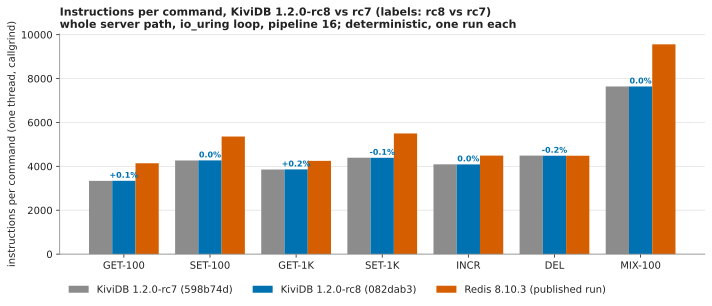

# Profiling, rc8 round: instructions per command, 1.2.0-rc8 against rc7

**Result: no change.** All seven workloads are within ±0.2% of rc7 (the other eleven of
`WORKLOADS=full` within ±0.4%). rc8's one hot-path change, MSET/MSETNX locking, is not on
any of these paths, and the counts show it.

## What ran

- `scripts/perf/run.sh` through the suite's `harness/callgrind.sh` (unchanged), as
  `benchmarks/1.2.0/profiling/README.md` describes:
  `LTO=fat`, `WORKLOADS=full`, `PROFILE=1`, one worker thread on the io_uring loop,
  pipeline 16, N = 60,000 commands per workload, built and run in the `kividb-ci-valgrind`
  image made from `rust:1-bookworm`.
- Toolchain in the image: **rustc 1.99.1 (58cf8f9c3 2026-10-13)**, valgrind 3.19.0,
  redis-benchmark 7.0.15: the same as the published run.
- Machine: Azure `Standard_D8s_v5` (8 vCPU Xeon Platinum 8370C, x86_64), Ubuntu 24.04,
  kernel 7.0.0-1017-azure, centralindia, the same VM size as the published callgrind run
  (instruction counts do not depend on the machine, but they do on the architecture, so x86
  was kept).
- Builds, both from the public repo, built inside the image:
  - **rc8**: `082dab3d8929c180bccf993835e28992ea054fb5` (`release/1.2.0`)
  - **rc7**: tag `v1.2.0-rc7` = `598b74d20ec04de5a0ff74001324907562806c3c`
  - `scripts/perf/` is identical in both tags; the run used rc8's copy for both.
  - The callgrind binaries are run.sh's builds (LTO fat, `debug=1` for the profiles) and
    live only in the image's target volume, so they have no published SHA-256; the
    release binaries of the core round are hashed in [../core/README.md](../core/README.md).
- Deterministic, so one run each (2026-11-03, rc7 first, then rc8).

## rc8 against rc7

| workload | rc7 | rc8 | rc8 vs rc7 | published 1.2.0 (75482abb) | rc8 vs published | Redis 8.10.3 (published) | rc8 vs Redis |
|---|---:|---:|---:|---:|---:|---:|---:|
| GET-100 | 3338 | 3342 | +0.1% | 3339 | +0.1% | 4139 | -19.3% |
| SET-100 | 4268 | 4270 | +0.0% | 4276 | -0.1% | 5359 | -20.3% |
| GET-1K | 3853 | 3859 | +0.2% | 3833 | +0.7% | 4250 | -9.2% |
| SET-1K | 4392 | 4389 | -0.1% | 4380 | +0.2% | 5498 | -20.2% |
| INCR | 4090 | 4089 | -0.0% | 4086 | +0.1% | 4489 | -8.9% |
| DEL | 4490 | 4482 | -0.2% | 4556 | -1.6% | 4483 | -0.0% |
| MIX-100 | 7640 | 7638 | -0.0% | 7625 | +0.2% | 9559 | -20.1% |

Verdict per workload: **pass** on all seven (the largest move is GET-1K, +6 instructions).

- **Against the published numbers** (75482abb, the code rc7 was tagged from, measured
  2026-11-02 in a different session with the same image toolchain): within +0.7% / -1.6%.
  rc7 here and 75482abb there are the same code, and they differ by the same amounts (GET-1K
  3853 against 3833, DEL 4490 against 4556), so that is the run-to-run variation of the
  random preload, not a code change. The published README already measured DEL moving
  ±1.5% between runs of one build (`del-repeat.txt`). The published headline still holds:
  a KiviDB GET is 19% and a SET 20% fewer instructions than Redis's.
- **Against Redis**: Redis was not re-measured (not asked for); its column is the published
  run's.

The other workloads of `WORKLOADS=full`, from the same two runs:

| workload | rc7 | rc8 | change |
|---|---:|---:|---:|
| GET-100-TTL | 3416 | 3412 | -0.1% |
| SET-100-TTL | 5675 | 5660 | -0.3% |
| INCR-TTL | 4161 | 4152 | -0.2% |
| DEL-TTL | 5416 | 5400 | -0.3% |
| GET-100-LRU | 3689 | 3695 | +0.2% |
| SET-100-LRU | 4632 | 4626 | -0.1% |
| INCR-LRU | 4437 | 4427 | -0.2% |
| DEL-LRU | 4837 | 4820 | -0.4% |
| GET-100-LFU | 3900 | 3905 | +0.1% |
| SET-100-LFU | 4969 | 4963 | -0.1% |
| INCR-LFU | 4732 | 4728 | -0.1% |

(DEL-TTL is 5416 / 5400 here against 5165 published: the published README measured it
between 5004 and 5185 over six runs of one build, so this run's preload hit more keys; rc7 and
rc8 moved together.)

## What differs from the published profiling suite

- Only the callgrind part was asked for and run. The CPU-per-request split, the flamegraphs and
  the per-thread CPU (perf on a real network) were not repeated; the core round's server CPU
  per request covers rc8's multi-threaded cost instead.
- No MSET workload exists in `scripts/perf/measure.sh`, so the MSET change is not visible here;
  its effect is in the core round.

## Files

- `results/callgrind/results.txt`: `workload tag instructions`, both builds.
- `results/callgrind/table.txt`: run.sh's table.
- `results/callgrind/<tag>-profile-<workload>.txt`: the hottest functions of each workload
  (callgrind_annotate).
- `results/callgrind/run-<tag>.log`, `revs.txt`, `toolchain.txt`.
- `results/table.md`: the tables above, as `harness/prof_analyze.py` printed them.
- `charts/instructions-rc7-vs-rc8.svg`.
- `harness/`: `prof-setup.sh` (VM setup and the run) and `prof_analyze.py` (table and chart);
  `callgrind.sh` is the suite's, unchanged.
- `NOTES.md`: the progress log.
