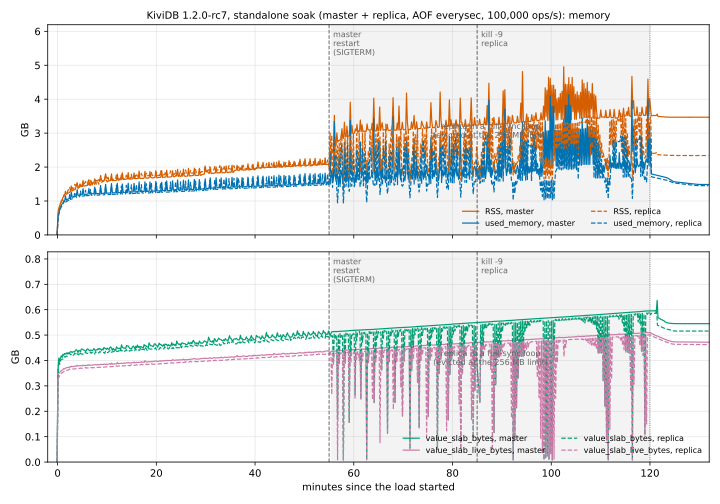
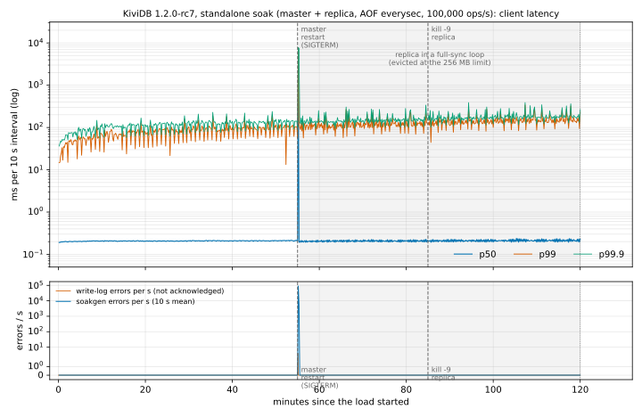
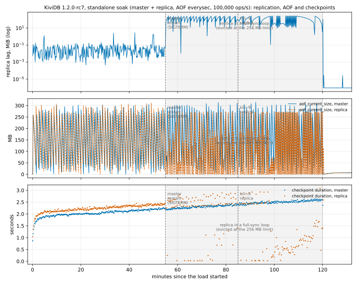
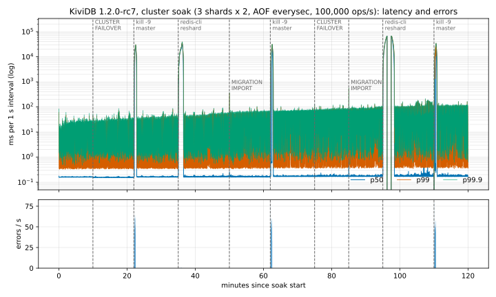
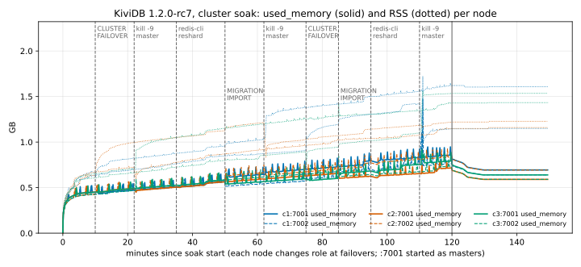

# KiviDB 1.2.0-rc7: soak tests on Azure, 2026-11-02/03

**Build under test:** tag `v1.2.0-rc7`, commit `598b74d2` on branch `release/1.2.0`. Release run 41509100399 succeeded.
- **Binary.** The published default variant, `kividb-linux-x86_64.tar.gz`, from the ORAS artifact
  `ghcr.io/kividbio/kividb-binaries:v1.2.0-rc7`. `SHA256SUMS.txt` checked, sha256 of `kividb` `9e9abf86…a7ea5e` on
  every VM.
- **Comparison binaries.** rc6 and rc5 come from their ORAS artifacts, 1.1.3 from its GitHub release, and Redis 8.10.3
  (`redis-server`) from the official image, extracted with Docker on the VM.

## Verdict

| Soak | Result | Key numbers |
|---|---|---|
| 1. Standalone, 2 h, master + replica, AOF on, 100k ops/s, master SIGTERM restart at 55 min, replica `kill -9` at 85 min | **PASS on data: 0 lost acknowledged writes. One availability finding (1)** | **5,623,474 acknowledged writes** (7 kinds, with `MULTI/EXEC` and field TTLs), **0 bad on the master and on the replica**, and 0 bad again after `kill -9` + AOF restart of each. Master vs replica: 0 differences apart from 172 empty hashes (known issue #302). Master `used_memory` 1.19 → 2.15 GB and RSS 1.43 → 3.52 GB, from data the write log never deletes; no leak. p50 0.21 ms, p99 104 ms (section 3: from the mix, same on rc6). **After the master restart the replica never caught up while the load ran:** 201 full syncs in 65 min, evicted at the 256 MB limit each time (finding 1) |
| 2. Cluster, 2 h, 3 shards × (master + replica), AOF on, 100k ops/s: run 2 (clean) | **PASS: 0 lost acknowledged writes** (rc7, run to the end before the coordinator moved the clean cluster soak to rc8) | **11,056,954 acknowledged, 0 lost, 0 wrong.**<br>• **Events:** 5 failovers (2 × `CLUSTER FAILOVER`, 3 × `kill -9`) and 4 reshards (2 × redis-cli, 10 and 5 slots; 2 × `CLUSTER MIGRATION IMPORT`, 500 slots each in 3.7 and 5.2 s).<br>• **Master vs replica:** 0 differences in 12.16 M keys.<br>• **Logs:** 0 `[ERROR]`.<br>• **Latency:** p99 8.7 ms (median of 1 s intervals).<br>• **RSS per node:** 0.61-0.71 → 1.15-1.62 GB, with the ackcheck keys (0.77 M → 3.8-4.5 M per node) |
| 2. Cluster run 1 (supplementary) | **0 server-side lost writes.** 509 losses in slots 0-5, all caused by my harness | 11,054,774 acknowledged. The 509 lost are all in slots 0-5, acknowledged before 21:09:52. My first `slotfix.py` handed those slots over while the source still held keys, and the source deleted them, as Redis does (section 2, run 1). **0 lost anywhere else.** Shard compares: 0 differences in 12.15 M keys |

**Regressions against rc6: none found.**
- **Same latency and checkpoints.** The A/B on the same VMs gives rc6 and rc7 the same p99 and checkpoint times with
  either mix.
- **Same restart race.** The partial resync after a clean restart is a race in both builds (finding 2).
- **Same full-sync convergence.** The full-sync loop is not new either: forced under load, rc6 behaves the same as rc7. At 3.4 M keys and 100k ops/s both made 13 full syncs and never converged; at 2.4 M keys both converged on the first sync.
- **rc6's finding A** (an expired key brought back by AOF replay) **is fixed.** 0 differences after the `kill -9`
  restarts, and the 1.4 M write-log keys and fields with 20 s TTLs all stayed gone.

## Findings

| # | Finding | rc6 / older | Impact, fix |
|---|---|---|---|
| 1 | **A replica that must full-sync under heavy writes may never converge.** After the soak 1 master's clean restart, the full sync of 2.1 M keys (a 0.93 GB payload) took ~11 s. In that time the master's queue for the replica passed `repl-replica-max-backlog-bytes` (256 MB), so the master evicted the replica and the sync began again: **200 evictions, 201 full syncs in 65 min.** It converged 12 s after the load stopped. `repl-replica-max-backlog-bytes` is immutable (`CONFIG SET` → "can't set immutable config") and there is no `client-output-buffer-limit`, so an operator can't break the loop without restarting the master. **Forced full syncs (section 3):** rc7 converges with the default limit up to ~75k ops/s at 3.4 M keys. At 100k, each attempt loads in ~7 s and rebases the AOF in ~3 s, and the replica is evicted ~9 s after "Synced", while it drains the queue. | **Same in rc6**: 13 full syncs, 13 evictions, no convergence at 3.4 M keys / 100k. **Redis 8.10.3** converges in 1 sync (24 s), buffering 345 MB on the replica side. Not a regression | **Availability**: no live replica while the write rate stays high, so no failover target. No data loss: write log and compare clean at the end. **Fix suggestions:** size the limit to the dataset, or make it live-settable; buffer on the replica side during the load, as Redis 8 does (its replica streamed a 250 MB buffer into the db after loading) |
| 2 | **A clean restart of the master gives a partial resync only if the timing happens to be right.** A partial resync needs the replica's offset to equal the master's saved point, the `repl_offset` read at the final checkpoint's cut. `main.rs` (~880-930) does this on SIGTERM: stop the ports, close the command gate, `save_dataset` (the point is read at the cut), `process::exit`. It neither flushes nor waits for replicas, and the replica `PING` timer and active expiry keep running until the exit. Two ways to miss: <br>• **Behind:** bytes before the cut never reach the replica, 112 B to 25.6 KB under load. <br>• **Ahead:** a 14-byte `PING` sent after the cut reaches it, and the master logs "Partial resync refused … offset … is not where a command begins". <br>Across both builds, 12 of 18 SIGTERM restarts ended in a full sync. Redis 8.10.3 waited for its replica (it exited 1.2 s after the signal, with the replica at exactly its offset). It still full-synced, because with `save ""` and AOF on it keeps no replication point | **Same race in rc6:** 4 of 8 rc6 restarts full-synced against 8 of 10 for rc7. rc6's include one 1,335 B behind, one 14 B ahead, and two at the exact offset with no reason logged. No commit between rc6 and rc7 touches the shutdown or replication code. Not a regression | Makes every master restart under load a full sync, and with finding 1 a sync loop. **Fix:** flush the replica connections and wait briefly for them to acknowledge the final offset (Redis `shutdown-timeout`, default 10 s); stop the `PING` timer and active expiry before the cut |
| 3 | **Empty hashes after a restart from `dump.kdb` (#302).** A hash whose fields all expire after a SIGTERM restart stays as an empty key (EXISTS 1, TYPE hash, HLEN 0, PTTL -1, counted in DBSIZE); the replica has no such key. 172 on the soak 1 master, 187 in the smoke run | **Same in rc6, rc5 and 1.1.3** (`results/fieldexp/`). Filed by the coordinator as #302: `field_expiry::rescan` runs before `recover_local` loads the dump | Master/replica mismatch, wrong EXISTS and DBSIZE. Cleared by the next restart that replays the AOF |
| 4 | **redis-cli resharding under write load.** KiviDB answers `MIGRATE` with `TRYAGAIN` when a key is written while it travels (#274, by design), and `redis-cli --cluster reshard` stops on it. At this soak's write rate, every slot hit it. In the cluster smoke run, `redis-cli --cluster fix` then picked the source as owner and cleared its MIGRATING state. Its `CLUSTER DELSLOTS 0` on the importing node failed (`ERR Slot 0 is owned by another node`), so redis-cli never moved the keys back: **17 acknowledged writes stranded on the importing node**, unreachable | DELSLOTS refusal = rc6 finding C = #295, in 1.1.3 too | Finished by hand (MIGRATE REPLACE + SETSLOT NODE): **all 17 read back with their acknowledged values** and all 373,189 acknowledged writes verified, 0 lost (`results/smoke-cluster/`). Use `CLUSTER MIGRATION IMPORT`, or finish such slots by hand, until #295 is fixed |
| 5 | **A redis-cli reshard stalls the source** (rc6 finding B): `GETKEYSINSLOT`/`COUNTKEYSINSLOT` walk the whole keyspace. The open-loop backlog reached 67 s during run 1's reshard at 95 min | As in rc6 | Known; the operator uses MIGRATION IMPORT |
| 6 | **p99 rises with `MULTI/EXEC` (and field TTLs) in the mix**: 40 ms against 2 ms with rc6's mix, for both rc6 and rc7 (section 3). `ab_drop.sh` pins most of it on `MULTI/EXEC` (p99 8.3 ms without it, 39.2 ms without the field-TTL ops); every op type then sees the same 50-70 ms maximum, so transactions seem to wait on something the checkpoint holds | As in rc6 | Performance, not a regression; worth a look at what holds writes during a checkpoint |

## Set-up

- **Where.** Azure **Sweden Central**, RG `kividb-rc7-soak`, deleted afterwards. Ubuntu 24.04 (kernel 7.0 azure),
  accelerated networking, auto-shutdown set on every VM. CPU on all VMs: Intel Xeon Platinum 8573C.

| VM | Size | Role |
|---|---|---|
| `r7-sm`, `r7-sr` | Standard_D8ds_v5 | soak 1 master and replica, data on the local NVMe disk (`/mnt/kv`) |
| `r7-sc` | Standard_D8s_v5 | soak 1 client: `soakgen` and `writelog.py`; also the rc6/rc7 A/B afterwards. sm, sr, sc share a PPG |
| `r7-c1`, `r7-c2`, `r7-c3` | Standard_D8ds_v5 | cluster: two nodes each (`:7001`, `:7002`), `threads 4`, data on NVMe |
| `r7-cc` | Standard_D8s_v5 | cluster client: `soakgen -cluster`, `ackcheck.py`, the event driver. c1-c3 and cc share a second PPG |
| `r7-ab`, `r7-abc` | Standard_D4s_v5 | a quick rc6/rc7 A/B (server, client), run while the soaks ran |
| `r7-xm`, `r7-xr` | Standard_D4ds_v5 | the shutdown probe (master; replica + client) |

- **Same layout as the rc6 soak.** rc6 ran in Central India; this run is in Sweden Central, since other agents use
  Central India today.

## Harness (`harness/`)

From `benchmarks/1.2.0/` at the tag, and from the rc6 soak, with these changes:
- **`soakgen`** (rc6's copy with `-cluster` and `-err-log`) gains three ops, 8 % of the mix:
  - `HSET hf:<k> f<n>` + `HEXPIRE … 10-300 s FIELDS 1 f<n>` (3 %);
  - `HTTL`/`HGETALL` on those hashes (2 %);
  - `MULTI/EXEC` of `INCRBY`, `LPUSH`, `LTRIM 0 49` and `HINCRBY` on three keys of one hash tag (3 %).
  - The rest of the mix is rc6's, unchanged; `soakgen-rc6mix/` is rc6's own, for the A/B.
- **`writelog.py`** (new): soak 1's acknowledged-write log.
  - 8 writers × 100 writes/s. The kind of write is `seq % 8`:
    - plain `SET`;
    - `SET EX 86400`;
    - `SET PX 20000`, which must be gone at the end;
    - `HSET`;
    - `MULTI{HSET; HEXPIRE 86400}`;
    - `MULTI{HSET; HPEXPIRE 20000}`, which must be gone;
    - `MULTI{RPUSH; SADD; ZADD; INCR}`;
    - an overwrite `SET` on 1,000 keys per writer.
  - Every write is logged as it completes, as `A` (acknowledged) or `U` (error or no reply, so it may or may not have
    happened).
  - `verify` reads every logged write back from one node:
    - the values, and that TTLs are > 0;
    - that the expired keys and fields are gone;
    - list order, with no entry never written;
    - set and sorted-set members;
    - counter bounds (acked ≤ counter ≤ acked + unknown);
    - the last acknowledged overwrite.
- **`sampler.sh`** adds `value_slab_bytes`, `value_slab_live_bytes`, `master_link_status`, `loading`, expired keys and
  fields, `aof_rewrite_in_progress`, `mem_fragmentation_ratio`, `aof_lost_records` and `aof_last_write_status`.
- **`s1_soak.sh`, `s1_events.sh`, `s1_restart.sh`**: soak 1.
  - Clean master restart at 55 min and replica `kill -9` at 85 min.
  - At the end, rc6's restart-from-AOF check (kill -9 of each node), with the write log checked after each restart.
- **`cl_soak.sh`, `cl_events.sh`**: rc6's cluster soak with a new event list.
- **`slotfix.py`** (new): finishes a slot that a redis-cli reshard left open, as described under
  [Resharding with redis-cli](#resharding-with-redis-cli-under-this-load). `selftest` checks its handover guard.
- **`ackcheck.py`, `cltool.py`, `compare.py`, `compare_ro.py`, `node.sh`, `server.sh`**: unchanged, except that
  `server.sh` gained an `ENGINE=kividbrc6` line for the A/B.
- **`fieldexp.sh`**: the #302 repro.
- **A/Bs**:
  - latency: `ab.sh`, `abq.sh` and `ab_drop.sh` (soakgen `-drop` leaves ops out);
  - restart: `ab_restart.sh`, `ab_restart2.sh`, `shutdown_probe.sh`;
  - full sync: `ab_fullsync.sh` and `ab_fullsync2.sh` (`KEYS`, `RUNS`).
- **Set-up**: `create.sh`, `base.sh`, `inst.sh`, `inst_redis.sh`.
- **Reports**: `s1report.py`, `clreport.py`, `abreport.py`, and `wlmem.py` (the write log's share of memory).

## 1. Standalone soak: 2 h, master + replica, AOF on, 100,000 ops/s

`harness/s1_soak.sh` on r7-sc. Master and replica both run `appendonly yes` and `appendfsync everysec`; everything else is
at its default: `aof-ack-after-write yes`, io_uring, all cores, `repl-replica-max-backlog-bytes` 256 MB.
- **Load.** 1 M string keys are prefilled. The rc7 soak mix runs at 100,000 ops/s, open loop, on 128 connections; latency
  is measured from each op's scheduled send time. Alongside it, `writelog.py` runs 8 writers × 100 writes/s.
- **Events.**
  - **55 min:** clean restart of the master: SIGTERM, wait for the exit, start again with the same `node.conf`.
  - **85 min:** `kill -9` of the replica, started again 20 s later with the same `node.conf`.
- **At the end:**
  - the replica's offset must reach the master's;
  - the write log is checked on both nodes;
  - `compare.py` compares master and replica, full scan, type-aware;
  - 3 quiet minutes;
  - then rc6's restart-from-AOF check: `REPLICAOF NO ONE`, `kill -9` and restart of each node, a compare and the write
    log after each.







### Acknowledged writes and data

| Check | Result |
|---|---|
| Write log, acknowledged | **5,623,474** writes; 8 errors, all at the master restart (`ConnectionError`) |
| Write log on the master at the end | **0 bad**: every acknowledged write present with its value, TTLs > 0 where set, expired keys and fields gone, lists in order with nothing extra, counters in bounds, last overwrite kept |
| Write log on the replica at the end | **0 bad** |
| Write log after `kill -9` + restart from AOF, master / replica | **0 bad / 0 bad** |
| Per kind, each ~703 k acknowledged | `SET`, `SET EX`, `SET PX 20 s` (gone), `HSET`, `MULTI{HSET; HEXPIRE}`, `MULTI{HSET; HPEXPIRE 20 s}` (gone), `MULTI{RPUSH; SADD; ZADD; INCR}`: 0 bad each. Overwrites: 702,933 writes to 1,000 keys, each key holds its last acknowledged value |
| Master vs replica at the end (offsets equal at 181,098,206,958) | 2,948,099 keys compared. **172 differ, all one known issue (#302)**: empty hashes `wl:hx:*` on the master (EXISTS 1, HLEN 0), absent on the replica. A scan of every hash finds 172 empty hashes on the master, 0 on the replica, and nothing else differs. **0 other differences** |
| After `REPLICAOF NO ONE`, kill -9 + restart of the master from its AOF | serving after 8.4 s, 2,747,449 keys = the replica's. **0 differences** (the empty hashes are gone after the reload) |
| After kill -9 + restart of the replica | serving after 8.8 s. **0 differences** between the two restarted nodes |
| rc6's finding A (expired key brought back by AOF replay) | **Not seen.** 0 differences after both restarts, and all ~703 k `SET PX 20 s` keys and ~703 k 20 s fields stay gone after each restart |
| `[ERROR]` / panic lines | 0 on both nodes. The only `[WARN]` lines are the replica sync loop (finding 1) |
| `aof_lost_records`, `aof_last_write_status` | 0 and `ok` throughout, on both |

### Throughput and latency

| | Result |
|---|---|
| Throughput | 719,999,584 ops in 120 min; lowest 10 s interval 97,518 ops/s |
| Errors | 958,567, all inside the master's restart window: 958,432 `dial`, 119 `EOF`, 16 `read`, from 5.6 to 19.9 s after the SIGTERM. The open-loop client fails fast while the master is down for 9.6 s. 0 errors outside it, 0 at the replica `kill -9` |
| Latency, median of the 10 s intervals | p50 **0.21 ms**, p99 **104 ms**, p99.9 **138 ms** |
| By half hour (median p50 / p99 / p99.9) | 0-30 min: 0.206 / 68 / 104 ms. 30-60: 0.210 / 97 / 133. 60-90: 0.207 / 120 / 147. 90-120: 0.209 / 143 / 174 |
| Worst 10 s interval | the master restart: p99 7.7 s (open-loop backlog) |

**The p99 is not an rc7 regression.** p99 is 104 ms here against rc6's 6.8 ms, and it grows with the dataset. The A/B in
section 3 shows two things:
- rc6 and rc7 give the same p99 on the same VMs, with either mix.
- The rise comes from the ops this soak added to the mix, mostly `MULTI/EXEC` (p99 8.3 ms without it), with field TTLs
  adding the rest:

| | p99 | checkpoint |
|---|---|---|
| rc6 mix | 1.9 ms | 1.67 s |
| rc7 mix | 40 ms | 1.82 s |

The p99 then grows with the dataset because the write log never deletes its keys: 1.43 M keys at 5 min, 3.0 M at
120 min. p50 stays flat at 0.21 ms.

### Memory

| | Master | Replica |
|---|---|---|
| `used_memory` at 5 min → 54 min (before the restart) | 1.187 → 1.521 GB, keys 1.43 M → 2.11 M | 1.143 → 1.477 GB |
| Bytes per key, 5 min → 54 min | 831 → 721 | 800 → 701 |
| `used_memory` at 119 min | 2.145 GB, 2.99 M keys (717 B/key) | (in the sync loop) |
| RSS at 5 min → 54 min → 119 min | 1.43 → 2.08 → 3.52 GB | 1.43 → 2.08 → 2.26 GB |
| `value_slab_bytes` / `value_slab_live_bytes` | 0.445 / 0.379 GB (85 % live) → 0.594 / 0.509 GB (86 % live) at 119 min | 0.424 / 0.369 → 0.588 / 0.501 GB (max) |
| Restarted from the same data (kill -9 after the soak) | 1.432 GB `used_memory`, 1.946 GB RSS, 2.75 M keys | |

**No leak.**
- **Growth tracks keys.** All the growth in `used_memory` comes from the write log's keys, which are never deleted:
  1.65 M `wl:*` keys at the end. `wlmem.py` puts them at ~0.30 GB by `MEMORY USAGE`. Bytes per key fall over the run.
- **Value slabs.** They stay 85-86 % live, so compaction keeps up.
- **The master after 55 min.** Its `used_memory` and RSS swing by 1-2 GB, peaking at 4.13 / 4.96 GB. That is the
  replica's sync loop: each full sync holds a 0.9 GB payload plus up to 256 MB of queued writes. It is not data.

### Replication, AOF, checkpoints

| | Result |
|---|---|
| Replica lag before the restart, master's view every 10 s | median 92 KB |
| Checkpoints (AOF folded into `dump.kdb`) | master **588**, median 2.23 s, p90 2.53 s, max 2.63 s. Replica 469, median 2.25 s. All completed. Longer than the rc6 soak's 0.79 s mostly because of the VMs: here rc6 itself, with its own mix, takes 1.67 s (section 3). The larger dataset adds the rest |
| AOF size | saw-tooth between ~40 MB and ~300 MB, one fold every ~11 s, the same pattern as rc6 |
| Master SIGTERM | wrote its final snapshot and exited in 4.0 s. Serving 5.3 s after the start (2.11 M keys from `dump.kdb`), 9.6 s of unavailability in all |
| Replica after the master restart | **full resync, then a full-sync loop** (finding 1): 201 full syncs and 200 evictions until the load stopped 65 min later. It converged 12 s after the load stopped; offsets then equal |
| Replica `kill -9` at 85 min | done, although the replica was in the loop: it still tests the replica's restart from its own AOF. Serving 6.9 s after the start, rejoined after 13.4 s with a full sync, and went on looping. The write log and the compare at the end show it lost nothing |

## 2. Cluster soak: 2 h, 3 shards × (master + replica), AOF on, 100,000 ops/s

`harness/cl_soak.sh` and `harness/cl_events.sh` on r7-cc.
- **Nodes.** Six nodes on three VMs (`node.sh`): `cluster-enabled yes`, `cluster-node-timeout 5000`,
  `appendonly yes`, `appendfsync everysec`, `threads 4`. Created with `redis-cli --cluster create … --cluster-replicas 1`,
  so each replica is on another VM than its master.
- **Load.** The rc7 soak mix at 100,000 ops/s through go-redis v9.23 `ClusterClient`, 128 connections, 1 s samples.
- **Acknowledged writes.** `ackcheck.py --mode cluster` (redis-py `RedisCluster`): 16 writers × 100 `SET`/s, each a
  unique key with a known value, every acknowledgement recorded and every acknowledged key read back at the end.
- **At the end.** Each master is compared with its replica (`compare_ro.py`, full scan) once their offsets are equal.

### Events: the same schedule in both runs, at minutes after the start

Each shard is named by a slot no event moves:

| min | Event |
|---|---|
| 10 | `CLUSTER FAILOVER`, shard of slot 3000 |
| 22 | `kill -9` of the master, shard of slot 8000; restarted 20 s later |
| 35 | `redis-cli --cluster reshard` of 10 slots, slot-3000 shard → slot-8000 shard |
| 50 | `CLUSTER MIGRATION IMPORT 10923 11422` (500 slots), slot-13000 shard → slot-3000 shard |
| 62 | `kill -9` of the master, shard of slot 3000 |
| 75 | `CLUSTER FAILOVER`, shard of slot 13000 |
| 85 | `CLUSTER MIGRATION IMPORT 5461 5960` (500 slots), slot-8000 shard → slot-13000 shard |
| 95 | `redis-cli --cluster reshard` of 5 slots, slot-13000 shard → slot-3000 shard |
| 110 | `kill -9` of the master, shard of slot 13000 |

### Resharding with redis-cli under this load

redis-cli stops at the first `TRYAGAIN` (finding 4), and `--cluster fix` can't close the slot it leaves open (#295).
So `cl_events.sh` runs `redis-cli --cluster reshard … --cluster-replace` and, after each stop, finishes the open slot
with `slotfix.py repair`:
1. `SETSLOT IMPORTING` on the destination, `MIGRATING` on the source.
2. `MIGRATE … REPLACE` of every key left on the source, retried after each `TRYAGAIN`.
3. `SETSLOT NODE` on the destination, the source and every other node.

It then runs redis-cli again for the slots still to move.

**The guard.** `SETSLOT NODE` goes out only after `CLUSTER COUNTKEYSINSLOT` on the source reads 0 (`hand_over()`).
Otherwise nothing is sent and the repair fails. `slotfix.py selftest` checks this against stand-in connections, and
`cl_soak.sh` ran it before run 2.

### Run 2 (clean): the schedule with the fixed `slotfix.py`

The coordinator has moved the release's clean cluster soak to rc8 (cluster changes: DELSLOTS like Redis, MIGRATE undoing
its copies on TRYAGAIN, a hold on slots set by hand). This rc7 run had already finished and is reported as it ran.





| | Run 2 |
|---|---|
| Acknowledged writes | **11,056,954** |
| **Lost** | **0** |
| Wrong value | 0 |
| Not acknowledged (errors) | 691: 647 connection errors, 44 `CLUSTERDOWN`, all inside the three `kill -9` windows |
| Master vs replica at the end | offsets equal on all three shards. **0 differences**: 4,419,241 + 3,688,822 + 4,047,801 keys (`compare/`) |
| `redis-cli --cluster check` at the end | 12,155,864 keys in 3 masters, all 16384 slots covered, no open slot |
| `[ERROR]`/panic lines in the six logs | 0 |
| Throughput | 719,999,733 ops in 120 min, median 100,000 ops/s |
| Latency (median of 1 s intervals) | p50 **0.169 ms**, p99 **8.7 ms**, p99.9 **23.7 ms** |

**Failovers: 5.**

| min | Event | Promotion | Old master back as a replica | soakgen errors | ackcheck errors, first → last (s after the event) |
|---|---|---|---|---|---|
| 10 | `CLUSTER FAILOVER` | 0.02 s | 3.4 s | 0 | 0 |
| 22 | `kill -9` | 6.28 s | 5.6 s after its restart | 1,541 (`dial` 1,476) | 276, 0.7 → 7.3 |
| 62 | `kill -9` | 5.68 s | 6.8 s | 1,573 | 219, 0.8 → 6.6 |
| 75 | `CLUSTER FAILOVER` | 0.04 s | 7.6 s | 0 | 0 |
| 110 | `kill -9` | 6.22 s | 13.5 s | 1,634 | 196, 0.8 → 7.5 |

go-redis keeps dialling a killed master for ~30 s, as in rc6 (finding E there).

**Reshards: 4.**

| min | How | Slots | Time | Client errors | Notes |
|---|---|---|---|---|---|
| 35 | redis-cli + `slotfix.py` | 10 of 10 | 69 s | 4 `ASK` | Every slot stopped on TRYAGAIN; 10 redis-cli runs |
| 50 | `CLUSTER MIGRATION IMPORT 10923 11422` | 500 | **3.65 s**, 0 retries | 0 | ~134 k keys moved |
| 85 | `CLUSTER MIGRATION IMPORT 5461 5960` | 500 | **5.21 s**, 0 retries | 0 | |
| 95 | redis-cli + `slotfix.py` | 5 of 5 | 121 s | 2 `ASK` | 3 redis-cli runs; the source stalled (finding 5), backlog up to 67 s |

Over both redis-cli reshards, `slotfix.py` finished 13 slots:
- it retried 249 `TRYAGAIN`s;
- each slot had **0 keys left on the source before `SETSLOT NODE`**;
- it refused no handover.

**Memory per node.** `used_memory` 0.43-0.45 → 0.72-0.86 GB and RSS 0.61-0.71 → 1.15-1.62 GB. The ackcheck keys are
never deleted, so each node grows from 0.77 M to 3.8-4.5 M keys. Value slabs end 90-95 % live.


### Run 1 (supplementary): the same schedule, with my harness bug at the first reshard

Run 1 used the same set-up and schedule as run 2. Its numbers stand, apart from the losses the harness caused at the
first redis-cli reshard.

**What happened at 35 min (21:09:46 UTC).** redis-cli moved slots 0-9 of the slot-3000 shard. Each slot stopped at
once on `TRYAGAIN`, because the soak's `hf:` hashes are written about 15 times a second each. For every such slot,
the first `slotfix.py` did the following:
1. It sent `SETSLOT IMPORTING`/`MIGRATING`.
2. Its first `MIGRATE` got the `TRYAGAIN` back, but redis-py raises that as `TryAgainError` and strips the word from
   the message, so `slotfix.py` did not recognise it and stopped migrating.
3. It still sent `SETSLOT <slot> NODE <dest>` to the destination and the other four nodes.

**The source then lost its keys.** The source refused its own `SETSLOT NODE` ("Can't assign hashslot 0 to a different
node while I still hold keys"). The cluster then agreed through gossip that the destination owns the slot, and the
source logged `Cluster: deleted N key(s) in 1 slot(s) owned by another node` for each slot: 711 keys in slots 0-7,
21:09:49-21:10:12. Redis deletes keys in a slot it has lost the same way. The keys it held were the newest copies, or
the only ones.

**Recovery.** I stopped the event driver at 21:10:14, fixed `slotfix.py` and finished slot 8 by hand: 114 keys, one
`TRYAGAIN` retried, 0 left on the source. The cluster check was clean. The driver ran the rest of the schedule from
50 min.

| | Run 1 |
|---|---|
| Acknowledged writes | 11,054,774 |
| **Lost, all from the harness's slot handover** | **509**: all in slots 0-5, all acknowledged before 21:09:52, the moment of the deletions (`results/cluster-run1/ack/attribution.json`) |
| Lost outside slots 0-7 (server-side) | **0** |
| Wrong value | 0 |
| Not acknowledged (errors) | 659: 624 connection errors, 35 `CLUSTERDOWN` |
| Master vs replica at the end | offsets equal on all three shards. **0 differences**: 4,419,275 + 3,686,819 + 4,047,080 keys |
| `[ERROR]`/panic lines in the six logs | 0 |
| Failovers | 2 × `CLUSTER FAILOVER` (promoted in 0.04 and 0.02 s); 3 × `kill -9` of a master (promoted in 6.05, 5.58 and 5.83 s; restarted node back as a replica in 6.1, 8.4 and 12.9 s) |
| `CLUSTER MIGRATION IMPORT` | 10923-11422 (500 slots, ~134 k keys): 3.65 s, 0 retries. 5461-5960 (500 slots): 5.20 s, 0 retries. 0 client errors from either |
| redis-cli reshards | 35 min: 9 of 10 slots moved, 7 of them by the bug above. 95 min (fixed `slotfix.py`): 5 of 5 slots in 3 redis-cli runs, 2 slots finished by `slotfix.py` after 96 and 26 `TRYAGAIN`s, 147 s, 0 lost |
| Latency (median of 1 s intervals) | p50 0.169 ms, p99 9.1 ms, p99.9 24 ms. During the 95-min redis-cli reshard the open-loop backlog reached 67 s (rc6 finding B: `GETKEYSINSLOT`/`COUNTKEYSINSLOT` walk the whole keyspace) |

Charts: `charts/run1/`.

## 3. A/B runs after soak 1

All on soak 1's VMs (D8ds_v5 master and replica, D8s_v5 client), unless noted.

### Latency: rc6 against rc7, and the two mixes (`ab.sh`)

Each run: a fresh pair, 1 M keys prefilled, 12 min at 100,000 ops/s. Medians of the 10 s intervals, first minute
dropped. Output: `results/ab-d8/ab-table.md`.

| Run | p50 | p99 | p99.9 | checkpoints | checkpoint median | master CPU | `used_memory` at the end |
|---|---|---|---|---|---|---|---|
| rc6, rc6 mix | 0.164 ms | 2.2 ms | 37.9 ms | 62 | 1.67 s | 333 % | 0.953 GB |
| **rc7, rc6 mix** | 0.169 ms | **1.9 ms** | 39.3 ms | 62 | 1.67 s | 327 % | 0.952 GB |
| rc6, rc7 mix | 0.243 ms | 40.8 ms | 60.9 ms | 61 | 1.81 s | 342 % | 1.175 GB |
| **rc7, rc7 mix** | 0.188 ms | **40.0 ms** | 59.7 ms | 61 | 1.82 s | 372 % | 1.173 GB |

**What the A/B shows:**
- **No regression.** rc7 matches rc6 in every column.
- **The mix is the cause.** With rc6's mix, p99 matches the rc6 soak (2.4 ms in its first half hour). The rc7 soak's
  extra ops raise it to 40 ms in both builds.
- **It is a server-wide pause.** Every op type sees the same 50-70 ms maximum per interval (`opstats.txt`).


**Which op is it** (`ab_drop.sh`): rc7, the rc7 mix with one group left out, 6 min per run (31 checkpoints each).

| Run | p50 | p99 | p99.9 | checkpoint median |
|---|---|---|---|---|
| rc7 mix | 0.188 ms | 40.0 ms | 59.7 ms | 1.82 s |
| without the field-TTL ops (`HSET`+`HEXPIRE`, `HTTL`/`HGETALL`) | 0.175 ms | 39.2 ms | 63.5 ms | 1.75 s |
| without `MULTI/EXEC` | 0.164 ms | **8.3 ms** | 50.7 ms | 1.71 s |
| rc6 mix (neither) | 0.169 ms | 1.9 ms | 39.3 ms | 1.67 s |

**`MULTI/EXEC` is most of it.** At 3 % of ops (`INCRBY`, `LPUSH`, `LTRIM`, `HINCRBY` on one hash tag), it lifts p99 from
8 to 40 ms. The field-TTL ops account for the step from 2 to 8 ms. Checkpoints change little (1.67-1.82 s), so the
transactions are waiting on something they share with the checkpoint, not on a longer checkpoint.

The quick A/B on a spare D4s_v5 pair (master only, 50k ops/s, AOF on the OS disk, `results/ab-quick/`) agrees.
rc6 and rc7 are within noise: p99 149-175 ms and checkpoints 18.3-18.9 s on both, all disk-bound.

### Master restart under load: rc7, rc6, Redis 8.10.3 (`ab_restart.sh`, `ab_restart2.sh`, `shutdown_probe.sh`)

**Under load.** 1 M or 2.4 M keys, 100k ops/s, SIGTERM to the master, start it again.

| Build | Replica offset vs the master's saved point at the exit | Resync | Sync attempts until converged |
|---|---|---|---|
| rc7, 2.4 M keys (`ab_restart.sh`) | 358 B behind | full | 22: evicted at 256 MB until the load stopped |
| rc6, 2.4 M keys | exact | **partial** ("no dataset transfer") | 1 (partial), link down 6 s |
| Redis 8.10.3, 2.4 M keys | exact (waited for the replica; exited in 1.2 s) | full (no replication point without RDB) | 1, converged in 19 s, 0 evictions |
| rc7, 1 M keys, 3 rounds (`ab_restart2.sh`) | 2,099 / 1,622 / 112 B behind | full ×3 | 2 each |
| rc6, 1 M keys, 3 rounds | exact / 1,335 B behind / exact | full ×3 (two at the exact offset, no reason logged) | 1 / 2 / 2 |
| Soak 1 (rc7, 2.1 M keys) | 25,604 B behind | full | 201, until the load stopped |

**Idle.** A separate D4ds pair (`shutdown_probe.sh`): load stopped 30 s before the SIGTERM, master at `loglevel verbose`.

| Build | Keys with TTLs expiring | Replica vs saved point | Resync |
|---|---|---|---|
| rc7 | yes ×2 | 14 B **ahead** ×2 (a `PING` after the cut) | full ×2 ("not where a command begins") |
| rc7 | none ×2 | exact ×2 | partial ×2 |
| rc6 | yes ×2 | exact ×2 | partial ×2 |
| rc6 | none ×2 | exact / 14 B ahead | partial / full |

**What the bytes are.**
- **Under load:** client writes and expiry `DEL`s that were in the stream before the cut but not yet delivered when
  the process exited.
- **Idle:** a replica `PING` (`*1\r\n$4\r\nPING\r\n`, 14 bytes) written after the cut.

Either way the offsets differ and the restart full-syncs. rc6 does the same (finding 2). In this table rc7 lost the
race more often (8 of 10 restarts against 4 of 8), but no rc6→rc7 commit touches this code. The rc6→rc7 changes are
replay-only expiry, the slab generation check, SLOWLOG redaction, FreeBSD client limits, `rejected_connections` and
negative `EXPIREAT`.

### Forced full sync under load (`ab_fullsync.sh`)

The replica is killed, its data wiped and restarted, so it must full-sync. 3 min of load before, 4 min after. The
peak queue is the largest master offset minus the replica's acknowledged offset (INFO `slave0`) in 1 s samples.

| Build | Keys | Rate | Full syncs after the wipe | Evictions | Converged while the load ran | Sync duration (restart to "Synced") | Peak queue (master offset − replica ack) |
|---|---|---|---|---|---|---|---|
| rc7 | 2.4 M | 100k | 1 | 0 | yes | 9.6 s | 221 MiB |
| rc6 | 2.4 M | 100k | 1 | 0 | yes | 9.7 s | 228 MiB |
| Redis 8.10.3 | 2.5 M | 100k | 1 | 0 | yes | 15.7 s (sync started → buffer streamed) | 223 MiB |
| **rc7** | **3.4 M** | **100k** | **13** | **13** | **no**: 253 s of link down out of 239 s of load; converged 14 s after the load stopped | ~13 s per attempt, then evicted ~9 s after "Synced" while draining | 260 MiB |
| **rc6** | **3.4 M** | **100k** | **13** | **13** | **no**: the same | the same | 268 MiB |
| Redis 8.10.3 | 3.5 M | 100k | 1 | 0 | yes | 24.1 s, then 345 MB streamed from its own buffer in 3.5 s | 343 MiB (held on the replica, so not counted against the master's limit) |
| rc7 | 3.4 M | 75k | 1 | 0 | yes | 12.0 s | 210 MiB |
| rc7 | 3.3 M | 50k | 1 | 0 | yes | 11.4 s | 128 MiB |

**Notes on the table:**
- **Evictions.** Each KiviDB run also had one eviction before the wipe, at the replica's first sync during the prefill; it is not counted here.
- **Highest converging rate.** With the default 256 MB, the highest rate at which rc7's full sync converged at ~3.4 M keys was **75k ops/s**, with a 210 MiB peak. At 100k it never converges. Soak 1's loop at 2.1-3 M keys had a larger payload: hashes, lists, field TTLs, 0.93 GB.
- **rc6 behaves the same as rc7.** **Redis 8.10.3 never loops**: its replica buffers the stream itself during the load (`Starting to stream replication buffer into the db (255 MB)`).
- **Files.** `results/fullsync-2.4m/`, `results/fullsync-3m/`.

## Against rc6 and rc4

| | rc4 soak (2 h, Central India) | rc6 soak (2 h, Central India) | rc7 soak 1 (2 h, Sweden Central) |
|---|---|---|---|
| Mix | soakgen | soakgen | soakgen + field TTLs + `MULTI/EXEC` + write log; master restart and replica kill -9 |
| Lost acknowledged writes | not measured (compare only) | not measured in soak 1; cluster 0 of 11.3 M | **0 of 5.62 M** (standalone), cluster: run 2 0 of 11.06 M; run 1 0 server-side (509 from my harness) |
| Master vs replica at the end | 0 differences | 0 differences | 0 apart from 172 empty hashes (#302, also in rc6) |
| Memory | `used_memory` flat 0.89 GB; RSS +0.2 GB in the first hour, then flat | `used_memory` −1.1 MiB/h; RSS +15 MiB/h in the last hour | Grows with the write log's keys (1.65 M never deleted): bytes per key fall from 831 to 721 over the first 54 min; slabs 85-86 % live. No leak. A like-for-like 12 min run gives rc6 0.953 GB and rc7 0.952 GB |
| p50 / p99 / p99.9 (median of the 10 s intervals) | 0.18 / 10.9 / 62 ms | 0.176 / 6.8 / 41.7 ms | 0.21 / 104 / 138 ms; from the mix (section 3). Same VMs, rc6's mix: rc7 0.169 / 1.9 / 39.3 ms vs rc6 0.164 / 2.2 / 37.9 ms |
| Checkpoints | one every ~11 s | 668, median 0.79 s | 588, median 2.23 s. This region with rc6's mix: 1.67 s on both builds |
| Cluster p50 / p99 (1 s) | – | ~0.17 / ~1 ms | 0.169 / 8.7 ms (run 2). The p99 comes from the mix, as in soak 1 |

## How to reproduce

```
# laptop: RG, VMs (auto-shutdown on each), then on every VM:
bash harness/create.sh <ssh-public-key>
bash base.sh srv|client; bash inst.sh v1.2.0-rc7     # ORAS pull, SHA256SUMS check
# client VMs: build harness/soakgen (go build), copy writelog.py, ackcheck.py, cltool.py, compare*.py, slotfix.py
# soak 1 (r7-sc, hosts.env with M= R=):
bash s1_soak.sh                 # 2 h + checks + restart-from-AOF check; s1_events.sh does the restart/kill
python3 s1report.py ~/s1 charts
# cluster (r7-cc, clhosts.env with C1= C2= C3=):
python3 slotfix.py selftest && OUT=~/cl2 bash cl_soak.sh
python3 clreport.py ~/cl2 charts
# A/Bs (r7-sc): ab.sh, ab_restart.sh, ab_restart2.sh, ab_fullsync2.sh (OUT, KEYS, RUNS), ab_drop.sh;
# shutdown_probe.sh on a pair of its own; fieldexp.sh <kividb binary> <label> for #302
```

## Files

- **`harness/`.** Every script and the soakgen source; the list is under [Harness](#harness-harness).
- **`results/soak1/`.** Soak 1:
  - `soak.csv`, `samples-*.csv`, `events`;
  - `wl/` (`verify-*.json`, `timeline.csv`, `meta.json`). The per-writer logs, 24 MB, were not copied;
  - `compare.*`, `restart/`;
  - the full server logs, `s1-summary.json`, `wlmem-master.json`, `empty-hashes-master-at-end.txt`.
- **`results/cluster-run2/`, `results/cluster-run1/`.** For each run:
  - `soak.csv` (1 s), `soak-errs.log`, `events`, `state.csv`;
  - `ack/` (`summary.json`, `lost.json`; run 1 also `attribution.json`). `acked.json` was not copied;
  - `compare/`, `reshard-*.log`, `import-*`, `check-*`, the six server logs and their samples, `cl-summary.json`.
- **`results/smoke-cluster/`.** The 4-min smoke run with the stranded slot 0: `fixtest.log`,
  `dst-node-slot0-keys.txt`, `stranded-*.txt`, `repair-slot0.json`, `ack-after-repair/`.
- **`results/ab-d8/`, `results/ab-quick/`.** The latency A/Bs.
- **`results/restart-ab/`, `results/shutdown-probe/`.** The restart A/Bs.
- **`results/fullsync-2.4m/`, `results/fullsync-3m/`.** The forced full syncs.
- **`results/fieldexp/`.** The #302 repro outputs.
- **`charts/`.** Soak 1: `s1-*.svg`. Cluster run 2: `cl-*.svg`. Run 1: `run1/`.
- **`NOTES.md`.** The progress log.

## Teardown

`az group delete -n kividb-rc7-soak --yes`, then `az group exists -n kividb-rc7-soak` → `false`. The extra
D4 pairs (r7-ab/abc, r7-xm/xr) were deleted as soon as each test was done. No other resource group was touched.
