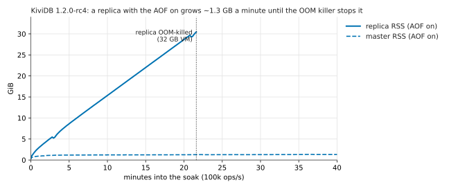
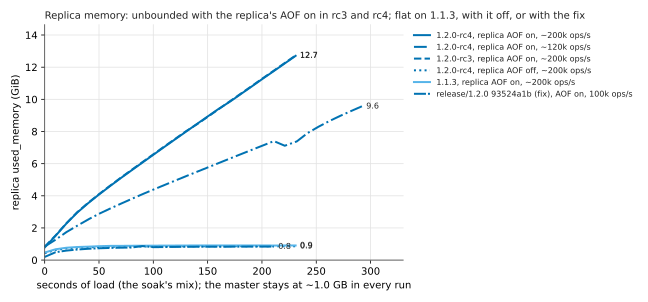
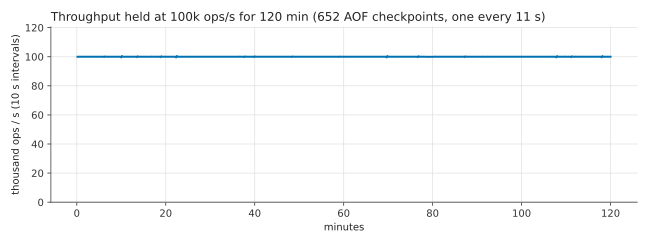
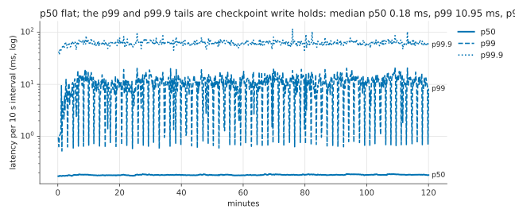
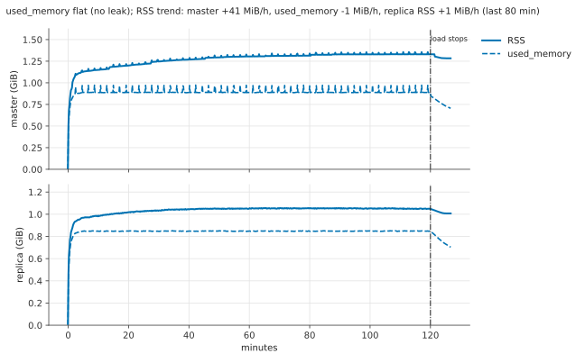
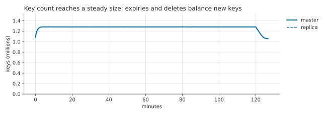
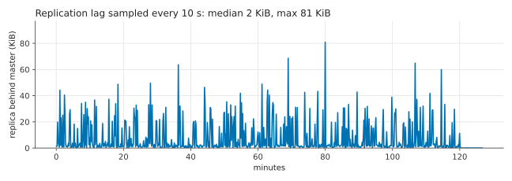
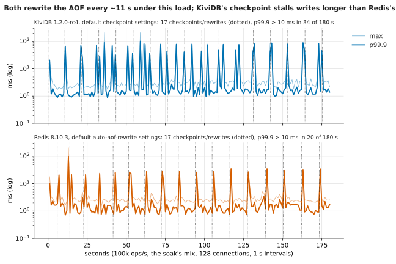

# Soak: 2.5 hours of a mixed workload with AOF and a replica

**The questions** (Hacker News): does memory stay flat over time under a mixed workload, or creep up
(*kingcauchy*: "How did overall memory footprint look ... with mixed workloads?"); does latency hold
(*falconBrisk47*: "Any p99 numbers alongside it?"); and does the replica end up holding exactly what
the master holds (*ignoramous*: durability and consistency before speed)?

**Results (KiviDB 1.2.0-rc4):**

* **Release blocker:** a replica with its **own AOF on** grew by about 1.3 GB a minute and was
  **OOM-killed after 22 minutes** at 32 GB. It is a regression since 1.1.3 (1.1.3 stays flat) and was
  already in rc3. The fix on `release/1.2.0` at 93524a1b holds the replica flat; see
  [below](#release-blocker-found-a-replica-with-the-aof-on-grows-without-bound-and-is-oom-killed).
* With the replica's AOF off (the master's on), **120 minutes at 100,000 ops/s: 720 million operations, 0
  errors, and master and replica identical at the end** (1,280,449 keys compared, 0 differences).
* **No leak:** `used_memory` stayed flat (0.89 GB) for two hours. RSS settled about 0.2 GB higher over the
  first hour (allocator fragmentation) and then held.
* **Latency:** p50 0.18 ms throughout. p99 is 10.9 ms and p99.9 62 ms per 10 s interval because of AOF
  checkpoints, one every 11 s. Each holds writes for tens of milliseconds: under the same load Redis 8.10.3
  rewrites its AOF just as often, but its tail at a rewrite is 2-3 times shorter. See
  [Checkpoint pauses](#checkpoint-pauses-what-the-p999-tail-is-made-of).

## What ran

* **KiviDB 1.2.0-rc4** (`a6b1bf38`, the published default-variant release binary) as master on
  `ops-soakm`, one replica on `ops-soakr`, the load generator on `ops-soakc`.
* Master and replica: `appendonly yes`, `appendfsync everysec` (the replica `appendonly no` in the
  completed run, see below), everything else default (I/O model
  io_uring, all cores, `auto-aof-rewrite-percentage 100`, `auto-aof-rewrite-min-size 64mb`). Data on the
  VM's local NVMe SSD.
* **Load:** `harness/soakgen` (Go, go-redis v9), **100,000 operations a second, open loop** (each of 128
  connections sends on a fixed schedule; latency is measured from when the operation was due, so a stall
  shows in every operation queued behind it, with no coordinated omission), planned for 150 minutes and
  run for **120 minutes** after the first attempt's replica was OOM-killed (below), after a prefill of
  1,000,000 string keys. The mix, by share of operations:

  | Share | Operations | Key space |
  |---|---|---|
  | 28% | `GET` small string | 1,000,000 keys, 64-512 B values |
  | 14% | `SET` small string | same keys |
  | 3% | `SET ... EX 5-300 s` | 250,000 expiring keys |
  | 1% / 2% | `SET` / `GET` large string | 20,000 keys, **2-32 KB** values |
  | 8% / 5% | `HSET` / `HGET` (1 in 4 `HGETALL`) | 20,000 hashes, up to 50 fields |
  | 6% / 4% | `LPUSH`+`LTRIM 0 99` (pipelined) / `LRANGE 0 9` or `RPOP` | 20,000 lists |
  | 6% / 3% | `SADD` (1 in 4 `SREM`) / `SCARD`, `SISMEMBER` | 20,000 sets, up to 200 members |
  | 6% / 3% | `ZADD` (1 in 3 `ZINCRBY`) / `ZREVRANGE 0 9`, `ZRANGEBYSCORE ... LIMIT` | 20,000 sorted sets, up to 200 members |
  | 4% | `INCRBY` | 10,000 counters |
  | 2% / 1% | `EXPIRE 30-600 s` on a collection / `DEL` | all of the above |

  Every key space is bounded and expiries and deletes balance new keys, so after the first minutes the
  data set stays at a steady size: any lasting growth in memory would be a leak, not data.
* **Sampling** every 10 s: throughput and p50 / p99 / p99.9 / max latency from the client; RSS, CPU,
  `used_memory`, key count and replication offsets from each server (`harness/sampler.sh`).
* **At the end:** writes stop, the replica's offset must reach the master's, and every key on either
  side is compared (`harness/compare.py`: type, value, order-insensitive for hashes and sets, and whether
  it has a TTL; differing keys are read again after 3 s, and a key missing on one side that expires
  within 5 s on the other counts as "expiring", not as a difference). Sampling then goes on for 5 more
  minutes without load.

## Release blocker found: a replica with the AOF on grows without bound and is OOM-killed

The first soak ran the replica with the AOF on, as planned. **22 minutes in, the kernel's OOM killer
killed the replica** at 32 GB RSS (`results/run1-replica-aof/dmesg-oom.txt`), while the master held at
1.3 GB. From the first minute the replica's `used_memory` grew by about **1.3 GB a minute**; its AOF
checkpoint, which takes ~1.7 s on the master, ran for 2.5 minutes, then for 18 minutes
(`aof_rewrite_in_progress:1` throughout), and the next one was running when it was killed
(`results/run1-replica-aof/server-replica.log`). The load went on against the master alone, which
stayed flat (`used_memory` 0.89 GB for 75 minutes, RSS 1.17 to 1.34 GB, flat for the last 30 minutes).



Four- to five-minute runs of the same mix on a fresh pair narrow it down (`harness/replica_mem.sh`,
`results/replica-memory/`). **Caveat on the load:** the first soak's load generator was still running by
mistake during these runs (it had ignored the stop signal), so the master took that soak's 100k ops/s
**on top of** each run's own load: the "100k" runs below had about 200k ops/s, the "20k" run about
120k. Every build got the same, so the comparison between builds stands; the growth per minute is
higher than at the soak's 100k (1.3 GB a minute there).

| Build | Replica AOF | Load (own + leftover 100k) | Replica `used_memory` after ~4 min | Master |
|---|---|---|---|---|
| 1.2.0-rc4 | on | 100k + 100k | **13.6 GB**, still growing | 1.0 GB |
| 1.2.0-rc4 | on | 20k + 100k | **10.3 GB** after 5 min, still growing | 1.0 GB |
| 1.2.0-rc3 | on | 100k + 100k | **13.7 GB**, still growing | 1.0 GB |
| 1.2.0-rc4 | **off** | 100k + 100k | 0.93 GB, flat | 1.0 GB |
| 1.1.3 | on | 100k + 100k | 0.98 GB, flat (checkpoints complete every ~12 s); a second run the same | 1.1 GB |

The first soak itself (one load generator, 100k ops/s) is the clean measurement: 1.3 GB a minute.



(rc3's line lies under rc4's.) So it is a **regression since 1.1.3**, already in rc3, and needs the
replica's AOF on; the write rate changes only how fast it grows. Root cause (from the coordinator's
reading of the code): since #147 (cb50ef12) the AOF writer is no longer woken per record, and a
replica's stream records were left to the once-a-second sync, which writes one 4 MB batch a second;
under a stream faster than that the backlog grows in memory and the checkpoint waits on it. A fix is on
branch `fix/replica-aof-backlog` (4649666d), also on `release/1.2.0`.

**Re-run on `release/1.2.0` at 93524a1b (not rc4)**, which includes that fix: same mix, 100k ops/s (and no
leftover load this time), 240 s, AOF on for both nodes. The replica's `used_memory` stayed **flat at
0.90 GB** (master 0.94 GB), and its checkpoints completed (`aof_rewrite_in_progress` back to 0 within
seconds). The fix works for this case (`results/replica-memory/release-1.2.0-93524a1b-fix-aof.csv`):

| t (s) | 0 | 30 | 60 | 90 | 120 | 150 | 191 |
|---|---|---|---|---|---|---|---|
| replica `used_memory` (GB) | 0.21 | 0.71 | 0.81 | 0.94 | 0.88 | 0.89 | 0.90 |
| master `used_memory` (GB) | 0.48 | 0.75 | 0.91 | 0.90 | 0.92 | 0.94 | 0.94 |

**Repro:**

```bash
# master and replica (two hosts), both with the AOF on:
#   port 6379 / appendonly yes / appendfsync everysec   (+ replicaof <master> 6379 on the replica)
./soakgen -addr <master>:6379 -conns 64 -prefill
./soakgen -addr <master>:6379 -conns 128 -rate 100000 -duration 300s      # or -rate 20000
watch -n 10 'redis-cli -h <replica> INFO memory | grep ^used_memory:; redis-cli -h <replica> INFO persistence | grep aof_rewrite_in_progress'
# or all of it: bash harness/replica_mem.sh <master> <replica> out rc4-aof kividb "" 240
```

Because of it, the soak whose numbers are below ran the replica **without** its own AOF
(`appendonly no` on the replica, AOF on the master), which is the configuration that works today.

## The soak (replica without its own AOF): results

120 minutes at 100,000 ops/s, **720 million operations, 0 errors**, KiviDB 1.2.0-rc4. The master had
the AOF on (everysec); the replica had `appendonly no` because of the blocker above. Throughput held at
100,000 ops/s in every 10 s interval (lowest 99,522).

| | Result |
|---|---|
| Throughput | 100,000 ops/s median, lowest interval 99,522 |
| Latency, median of the 10 s intervals | p50 **0.18 ms**, p99 **10.9 ms**, p99.9 **61.8 ms** |
| Latency, worst 10 s interval | p99 21.1 ms, p99.9 117 ms; slowest single op 218 ms |
| Master `used_memory` | **flat**: 0.89 GB from minute 5 to minute 120 (trend over the last 80 min: −1 MiB/h) |
| Master RSS | 1.13 GB at minute 5, 1.30 GB at minute 60, 1.33 GB at minute 100, 1.28 GB after the load stopped (trend over the last 80 min: +41 MiB/h, flattening) |
| Replica RSS / `used_memory` | 1.05 GB / 0.85 GB, flat (+1 MiB/h) |
| Keys | ~1.28 million throughout (1.06 million 5 min after the load stopped, as expiring keys lapsed) |
| Replication lag (master's view, every 10 s) | median 1.6 KiB, largest 81 KiB |
| AOF checkpoints | 652 in 120 min, **one every 11 s** |
| `aof_acks_before_write` | 0 (no reply ever went out before its write reached the AOF) |
| **Master vs replica at the end** | offsets equal (186,305,276,762); **1,280,449 keys compared, 0 differences** (96 differed on the first pass because expiries were still in flight; all matched on the re-read) |

**Memory:** `used_memory` is flat to the megabyte, so nothing leaks. RSS rose about 0.2 GB over the first
hour and then flattened. That is the allocator's fragmentation settling under a mix that keeps
rewriting 2-32 KB values, not data. The default build uses the system allocator, and active defrag was on
(the default).

**Latency:** p50 is flat at 0.18 ms for the whole run. The p99 and p99.9 come from the AOF checkpoints, one
every 11 s, each holding writes for tens of milliseconds (next section). In the 10 s intervals that hold no checkpoint, p99
is under 1 ms (the troughs in the chart).











## Checkpoint pauses: what the p99.9 tail is made of

The soak's p99 (10.9 ms) and p99.9 (62 ms) are not spread across the run. They come from the AOF
checkpoints. KiviDB holds writes while it captures the data set and turns the log over (documented in
`docs/PERSISTENCE.md`: "under 100 ms" at 9 million keys). With this mix and the default
`auto-aof-rewrite-percentage 100` / `auto-aof-rewrite-min-size 64mb`, a checkpoint ran every 11 s (652 in
the 120 minutes).

**How long one hold is.** In a 30k ops/s run with the AOF on, each 10 s interval held one checkpoint, and in
each such interval **every one of the 128 connections had exactly one operation take 25-35 ms**: one hold
per checkpoint, felt by every client. Without the AOF, the same mix on a fresh instance with 1.2 million
keys had p99.9 1.5 ms and a slowest operation of 3-7 ms, like Redis. At 100k ops/s with 1.28 million keys
the holds reached 60-90 ms (the p99.9 of the second that held one).

**Compared with Redis.** Three-minute runs at 100k ops/s, latency per 1 s, master plus replica, AOF
everysec, default rewrite settings (`harness/checkpoint_probe.sh`, `results/probe/`):

| | AOF rewrites in 180 s | p99, median second | p99.9, median second | seconds with p99.9 > 30 ms | seconds with an op > 50 ms |
|---|---|---|---|---|---|
| KiviDB 1.2.0-rc4 | 17 | 0.52 ms | 1.53 ms | **31** | **23** |
| Redis 8.10.3 (`io-threads 4`) | 17 | 0.52 ms | 1.35 ms | 6 | 1 |
| *second pair of runs, same set-up (`results/probe2/`):* | | | | | |
| KiviDB 1.1.3 | 16 | 0.45 ms | 1.19 ms | 31 | 33 |
| KiviDB 1.2.0-rc4 | 17 | 0.50 ms | 1.48 ms | 32 | 27 |

**Not a regression:** 1.1.3 checkpoints as often and stalls the same way. rc4's p50 (0.184 against 0.171 ms)
and p99 (0.50 against 0.45 ms) are a little higher with the AOF on. That is in line with the documented
cost of acknowledging a write only once it is in the AOF (`aof-ack-after-write yes`, new in 1.2), which is
what kept every `kill -9` from losing an acknowledged write in the failover runs.

Under this write rate both rewrite the AOF about every 11 s. Redis forks for each rewrite and stalls
its event loop for the fork; that shows as 20-35 ms p99.9 spikes. KiviDB's hold is longer: 60-90 ms
spikes. Between rewrites the two are the same (p99 0.52 ms). Same order of magnitude, but KiviDB's tail at
checkpoints is 2-3 times Redis's here.



**Repro:**

```bash
# master + replica, appendonly yes, appendfsync everysec, defaults otherwise
./soakgen -addr <master>:6379 -conns 64 -prefill
./soakgen -addr <master>:6379 -conns 128 -rate 100000 -duration 180s -interval 1s
grep -E 'auto-checkpoint|rebased onto' <dir>/server.log     # one every ~11 s; the p99.9 spikes line up with them
# or: SETS="kividb-default redis" bash harness/checkpoint_probe.sh <master> <replica> probe
```

Raising `auto-aof-rewrite-min-size` makes checkpoints rarer, but each still holds writes, and a larger log
takes longer to replay at startup.

## Hardware

Azure **Central India** (the assigned region, Southeast Asia, offers no D-series VMs to this
subscription), one proximity placement group:

| Role | VM | CPU | Memory | Disk |
|---|---|---|---|---|
| master `ops-soakm` | Standard_D8ds_v5 | 8 vCPU Intel Xeon Platinum 8370C | 32 GB | local NVMe temp disk (`/mnt`) |
| replica `ops-soakr` | Standard_D8ds_v5 | same | 32 GB | same |
| client `ops-soakc` | Standard_D8s_v5 | 8 vCPU | 32 GB | – |

Ubuntu 24.04.5, kernel 7.0.0-1017-azure, accelerated networking. The client used about 3 of its 8
cores at 100k ops/s (at 150k it needed 5, which is why the soak runs at 100k: the closed-loop maximum
of this mix on this pair is about 255,000 ops/s with 128 connections).

## Reproduce

```bash
# server VMs: the release binary in /opt/kv (failover/harness/install_engines.sh v1.2.0-rc4),
#             harness/server.sh and harness/sampler.sh in the home directory
# client VM:  Go (go.mod asks for 1.26; the go command fetches it), a venv at ~/venv with redis, hiredis, matplotlib; ssh to both servers
(cd harness/soakgen && go build -o ~/soakgen .)
REPLICA_EXTRA="appendonly no" bash harness/soak_run.sh <master-ip> <replica-ip> 100000 120m ~/soak-rc4   # leave REPLICA_EXTRA out to reproduce the OOM
bash harness/replica_mem.sh <master-ip> <replica-ip> out rc4-aof kividb "" 240 100000                    # the replica-memory check
python harness/soak_report.py ~/soak-rc4 ~/soak-rc4/charts
bash harness/checkpoint_probe.sh <master-ip> <replica-ip> ~/probe && python harness/checkpoint_report.py ~/probe charts
```

Raw data: `results/run2/` (the completed soak: `soak.csv` from the client every 10 s,
`samples-master.csv`, `samples-replica.csv`, `compare.json`, `summary.json`, the servers' last log lines),
`results/run1-replica-aof/` (the run whose replica was OOM-killed, with both servers' logs and the kernel's
OOM report), `results/replica-memory/` (the version matrix and the fix), `results/probe/` (checkpoint
latency per second, KiviDB and Redis), `results/probe2/` (1.1.3 against rc4).
