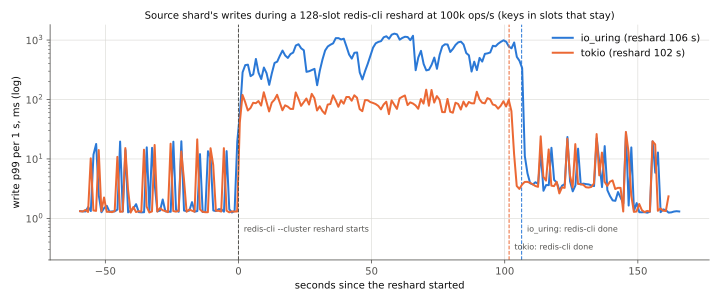
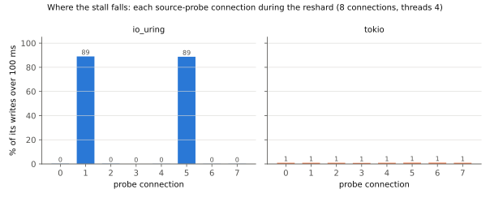

# KiviDB 1.2.0-rc10: final soak on Azure, 2026-11-03

**Build under test:** commit `39bfacd2` on branch `release/1.2.0` ("Version 1.2.0-rc10", not tagged), which reports
`kividb 1.2.0-rc10`.
- **Built from source** on r10-cc with `harness/build.sh`, the way release.yml's linux-amd64 job builds the default
  variant: an `amazonlinux:2023` container, rustup `stable` (minimal profile, rustc 1.99.1), `cargo build --release`,
  no features. It took 362 s.
- **sha256 of `kividb`:** `1057a8a0adf724acb3a85fd1828d55d24a6142b96516a2605266232ec31e97e4`, the same on every VM
  (`results/build.txt`).
- **What rc10 changes that this run exercises** (over rc9 `4a47644e`):
  - `14662105`: writes to the keys a `MIGRATE` is moving wait instead of answering `TRYAGAIN` (#295);
  - `01a9bdff`: a replica stopped with SIGTERM takes its final save's locks before closing the gate (#308);
  - `ff3ebf47`: `repl-backlog-size` 64 MB by default.

## Verdict

| Item | Result | Key numbers |
|---|---|---|
| **1. Cluster soak**, 2 h, 3 shards × (master + replica), AOF on, 100k ops/s mixed (lists, hashes, zsets, `MULTI/EXEC`) | **PASS** | **ackcheck:** 6,577,270 acknowledged, **0 lost, 0 wrong**. **owcheck:** 32,768 keys, 6,172,947 acknowledged overwrites, **0 stale, 0 missing**. **Master vs replica:** **0 differences** in 7,856,315 keys. **`--cluster check`:** clean, 7,857,681 keys. **Logs:** **0 `[ERROR]`** lines in the six |
| 1a. 2 × `CLUSTER FAILOVER` | **PASS** | promoted in 0.02 / 0.04 s, 0 client errors; both old masters resynced **partially** |
| 1b. 3 × `kill -9` of a master | **PASS** | promoted in 5.20 / 5.55 / 5.90 s (rc8: 5.24 / 5.54 / 17.08); each restarted node a replica again in 6.7-9.4 s |
| 1c. 2 × `CLUSTER MIGRATION IMPORT` of 500 slots | **PASS** | 4.80 and 6.90 s, 0 retries |
| **1d. 3 × plain `redis-cli --cluster reshard` of 128 slots under the full load** | **PASS** | **3/3 exit 0**, 128 slots each, **0 TRYAGAIN**, no slot left open, `--cluster check` clean after each; no `--cluster fix`, no slotfix.py (rc8: 3/3 stopped on TRYAGAIN, `--cluster fix` failed in all 3). **But slow:** 749 / 1,317 / 1,629 s (item 2) |
| **1e. 4 × SIGTERM of a replica under load (#308)** | **PASS** | **4/4 exited** in 1.10 / 1.25 / 1.53 / 1.37 s, **4/4 with a final save** ("Writing final snapshot..." and "Goodbye."), 0 `[ERROR]` |
| **2. Reshard latency (#310), io_uring vs tokio** | **Answered: it's the io_uring worker, on top of an O(N) command** | **Per-command cost is the same on both:** `CLUSTER GETKEYSINSLOT` 33.7 / 33.4 ms (uring / tokio), `SETSLOT` 30.8 / 30.6 ms, `MIGRATE` 5.3 / 5.1 ms, 1 M keys. Both walk the whole keyspace (#294). **What differs is where it lands.** Source writes, open loop: p99 **1,032 ms** (uring) vs **99 ms** (tokio), worst 1,326 vs 186 ms. On uring, 2 of 8 connections (a quarter, with `threads 4`: by all signs those on the worker that runs redis-cli's commands) are over 100 ms for 89 % of their writes; the other 6 for 0-0.2 %. On tokio every connection is at ~1 %. Repeat run: io_uring p99 689 ms, worst 1,077 ms, 2 of 8 connections at 72-73 %; tokio p99 100 ms, worst 179 ms, all at ~1 % |
| 3. Partial resyncs | **PASS, with a sizing note** | **8 full syncs** in the soak: 3 initial, 3 after the `kill -9`s (no saved offset, as in Redis), 2 after SIGTERM restarts. **4 partial:** both failovers and 2 of the 4 SIGTERM restarts. The two SIGTERM restarts that full-synced were away 5.6 and 8.0 s, right after a reshard, while the shard streamed ~17-19 MB/s. Their offsets had left the 64 MB backlog, by 28 and 61 MB |

## Findings

| # | Finding | Impact |
|---|---|---|
| 1 | **`CLUSTER GETKEYSINSLOT` and `CLUSTER SETSLOT … NODE` walk the whole keyspace** (#294). `cmd_getkeysinslot` hashes every key until it has `count` (redis-cli asks for 10, so the last calls of each slot walk everything). `SETSLOT … NODE` on the owner calls `slot_has_keys()`, which walks everything too, because the slot is empty by then. They take **33 ms each at 1 M keys and 154 / 192 / 216 ms at 1.4 / 2.1 / 2.4 M keys on the source**, in **80-97 % of each reshard's time** | A 128-slot redis-cli reshard took **106 s on a 1 M-key cluster and 12.5-27 min in the soak**, against 4.8-6.9 s for 500 slots with `CLUSTER MIGRATION IMPORT`. The cost grows with the keys on the node, not with the keys moved |
| 2 | **On io_uring each of those walks blocks the worker it runs on** (#310). The connections on that worker wait for every walk. In every io_uring reshard, 2-3 of the 8 probe connections (7 of 8 at 2.1 M keys) were over 100 ms for 72-100 % of their writes. With `io-model tokio`, the same walks cost the same, but the stall spreads over every connection and stays at one walk (~1 % of writes over 100 ms, worst 186 ms) | **Latency only: 0 lost writes.** Under an open-loop load, the stuck connections fall behind for the whole reshard: worst 1,326 ms (1 M keys), **568 / 1,063 / 1,366 s** in the soak (queueing). The mix fell to 23-46k (smoke and A/B, both I/O models) and 4.7-9.8k (soak) of its 100k ops/s, because every soakgen connection reaches all three shards. Fixing #294 removes the walks; handing the worker off on uring removes the concentration |
| 3 | **At the soak's write rate, the 64 MB backlog holds ~3-8 s of stream.** Each shard streams ~8 MB/s steadily, and ~17-19 MB/s while the mix catches up after a reshard. A replica that stops cleanly, reloads its dump (3-5 s at 1.5-2.4 M keys) and asks to continue is past it in two of four SIGTERM rounds | Availability only: a full sync instead of a partial one (5-8 s here). Write-heavy deployments should size `repl-backlog-size` for their stream rate times a restart |
| 4 | Plain commands on the source show the walks too. The slowlog of reshard round 2 holds 1,890 `SET`s and 1,243 `GET`s of ~200 ms each; in the A/B, on both I/O models, `SET`/`GET` over 10 ms have a median of 33-39 ms | Every command on the source can pay for one walk, not only those queued on the blocked worker |

## Set-up

- **Where.** Azure **Sweden Central**, RG `kividb-rc10-soak`, deleted afterwards. Ubuntu 24.04, accelerated networking,
  one proximity placement group, auto-shutdown on every VM.

| VM | Size | Role |
|---|---|---|
| `r10-c1`, `r10-c2`, `r10-c3` | Standard_D8ds_v5 | cluster: two nodes each (`:7001`, `:7002`), `threads 4`, data on the local NVMe disk |
| `r10-cc` | Standard_D8s_v5 | cluster client: `soakgen -cluster`, `ackcheck.py`, `owcheck.py`, three `shardprobe`s, the event driver; also the build |

- **Nodes.** Six, each in its own data directory (`kividb.lock`): `cluster-enabled yes`, `cluster-node-timeout 5000`,
  `appendonly yes`, `appendfsync everysec`, `threads 4`, `update-check no`, and, new over rc8, `slowlog-log-slower-than
  10000` and `slowlog-max-len 10000` (KiviDB ships the slowlog off: `-1`). Everything else at its default, so
  `repl-backlog-size` is rc10's new 64 MB and the I/O model is `auto`: the logs say `I/O model : io_uring`. Created
  with `redis-cli --cluster create … --cluster-replicas 1`. `redis-cli` is Ubuntu's 7.0.15, as in rc7 and rc8.
- **Load, the rc8 run's.** 1 M string keys prefilled, then the rc7 soak mix at **100,000 ops/s** through go-redis v9.23
  `ClusterClient`, 128 connections, open loop, 1 s samples: strings (small and 2-32 KB), hashes with field TTLs, lists,
  sets, zsets, counters, `EXPIRE`, `DEL`, `MULTI/EXEC`. Beside it:
  - `ackcheck.py`: 16 writers × 100 unique `SET`/s, every acknowledged key read back at the end;
  - `owcheck.py`: 8 writers × 200 overwrites/s, every key checked for its latest acknowledged value; while a reshard
    runs, half of its writes go to 8 keys per writer in each slot being moved;
  - **`shardprobe` (new)**: one per shard, 500 `SET`/s on 8 connections, open loop, keys in slots no event moves
    (2990-3010, 7990-8010, 12990-13010). It logs every operation, so the source's write latency during a reshard can
    be cut exactly; this is the #310 measurement.

## Harness (`harness/`)

The rc8 soak's harness. What changed:
- **`cl_events.sh`**: the rc8 schedule's failovers, `kill -9`s and imports, plus:
  - **`reshard`: one plain `redis-cli --cluster reshard … --cluster-slots 128 --cluster-yes`**, with no
    `--cluster-replace`, no slotfix.py and no `--cluster fix`. Its exit code, TRYAGAINs and open slots are the
    result; slotfix.py would only have run (and the round counted as failed) if a slot had been left open. It never ran.
    owcheck writes hot keys in the moving slots, as in rc8. Before and after: the source's and destination's
    `INFO commandstats` and `SLOWLOG`.
  - **`sigterm` (new)**: SIGTERM of a shard's replica under load. It must exit within 30 s with "Writing final
    snapshot" and "Goodbye." in its log (else gdb stacks and kill -9). It is restarted at once, as a rolling restart
    would.
  - After every event that makes a node sync again, its log after the event is read for "Partial resync" / "Full
    resync", and `INFO stats` `sync_*` of every node goes to `syncstats.txt`.
- **`shardprobe/` (new, Go)**: the per-shard open-loop write probe. Its raw log has one line per operation.
- **`probe_ana.py` (new)**: per reshard:
  - the source probe's open-loop latency (from each write's scheduled start) and **service time** (from when its
    connection could send it, i.e. without the queue behind a stalled write);
  - the destination's and third shard's probes, and the mix;
  - `MIGRATE` / `SETSLOT` / `GETKEYSINSLOT` calls and mean time; slowlog by command.
- **`perconn.py` (new)**: how a reshard's stall spreads over the source probe's 8 connections.
- **`slowdump.py` (new)**: a node's whole slowlog as JSON.
- **`tailload.sh` (new, started during the run)**: the same load from the end of cl_soak.sh's 120 min until the last
  event is done (below). Its checkers use their own keys (`ackt:`, `owt:`).
- **`cl_soak.sh`**: rc8's, plus the probes, the slowlog settings and `IOMODEL` (empty = default; `tokio`).
- **`ab.sh` (new)**: the #310 A/B: fresh cluster, 1 M keys, the same load, one 128-slot reshard at 3 min, 8 min in all;
  run in the order io_uring, tokio, io_uring, tokio.
- **`clreport.py`**: rc10 hosts and titles, the SIGTERM event (its `cl-summary.json` and memory chart are used).
  **`reshard_charts.py`, `soak_chart.py` (new)**: the #310 charts and the soak's throughput chart.
- **`build.sh`, `create.sh`, `base.sh`, `node.sh`, `sampler.sh`, ackcheck, owcheck, compare, cltool, slotfix**:
  rc8's (build.sh with the rc10 commit; create.sh cut to the four cluster VMs).

## 1. Cluster soak

`harness/cl_soak.sh` and `harness/cl_events.sh` on r10-cc, 11:37-13:38 UTC.

**The schedule ran late, and the load was kept on to the end.** The reshards took 12.5-27 min each (finding 1), and
events run in order, so the later events were pushed back. Round 3, the 4th SIGTERM and the 3rd `kill -9` would have
fallen after the 120 min load. The event driver can't be edited while it runs, so `harness/tailload.sh` ran the same
load (soakgen 100k, the probes, ackcheck, owcheck) from 13:37:30 until the last event was done, 13:38:17. The 4th
SIGTERM ran under cl_soak.sh's own load; the 3rd `kill -9` ran under the tail load.

### Events

| Planned min | Ran at min | Event | Result |
|---|---|---|---|
| 10 | 10.0 | `CLUSTER FAILOVER`, shard of slot 3000 | promoted in 0.02 s, old master a replica after 0.02 s; **partial resync** |
| 16 | 16.0 | SIGTERM of the replica, shard 8000 | **exited in 1.10 s, final save**; restarted, a replica at once; **partial resync** |
| 22 | 22.0 | `kill -9` of the master, shard 8000 | promoted in 5.20 s; restarted 20 s later, a replica after 6.72 s; full sync |
| 30 | 30.3 | **redis-cli reshard 128 slots**, 3000 → 8000 (1.42 M keys on the source) | **exit 0 in 749 s**, 128 slots, 0 TRYAGAIN, no open slot, check clean |
| 42 | 43.0 | SIGTERM of the replica, shard 13000 | **exited in 1.25 s, final save**; full sync (away 5.6 s at ~19 MB/s; missed the backlog by 28 MB) |
| 50 | 50.0 | `CLUSTER MIGRATION IMPORT 10923 11422` | completed in **4.80 s**, 0 retries |
| 56 | 56.0 | SIGTERM of the replica, shard 3000 | **exited in 1.53 s, final save**; **partial resync** |
| 62 | 62.0 | `kill -9` of the master, shard 3000 | promoted in 5.55 s; a replica 7.72 s after its restart; full sync |
| 68 | 68.3 | **redis-cli reshard 128 slots**, 13000 → 8000 (2.10 M keys) | **exit 0 in 1,317 s**, 128 slots, 0 TRYAGAIN, no open slot, check clean |
| 78 | 90.4 | `CLUSTER FAILOVER`, shard 13000 | promoted in 0.04 s, old master a replica after 0.02 s; **partial resync** |
| 85 | 90.6 | `CLUSTER MIGRATION IMPORT 5461 5960` | completed in **6.90 s**, 0 retries |
| 92 | 92.3 | **redis-cli reshard 128 slots**, 8000 → 3000 (2.41 M keys) | **exit 0 in 1,629 s**, 128 slots, 0 TRYAGAIN, no open slot, check clean |
| 104 | 119.6 | SIGTERM of the replica, shard 8000 | **exited in 1.37 s, final save**; full sync (away 8.0 s at ~17 MB/s; missed by 61 MB) |
| 110 | 120.0 | `kill -9` of the master, shard 13000 (tail load) | promoted in 5.90 s; a replica 9.38 s after its restart; full sync |

### Acknowledged writes and data

| Check | Result |
|---|---|
| ackcheck: acknowledged unique `SET`s | **6,577,270**, **0 lost, 0 wrong**. 416 not acknowledged (errors in the `kill -9` windows). Fewer than rc8's 10.9 M because its 16 closed-loop writers slowed to the source's pace during the reshards |
| owcheck: keys / acknowledged overwrites | 32,768 keys / **6,172,947**; **0 missing, 0 stale, 0 other**; 364 failed (event windows) |
| tail load's checkers (13:37:30-13:38:17) | ackcheck 67,994 acknowledged, 0 lost, 0 wrong; owcheck 16,384 keys, 73,267 overwrites, 0 missing, 0 stale |
| Master vs replica at the end | offsets equal on all three shards; **0 real differences** in 2,860,765 + 2,443,756 + 2,551,794 keys (4-8 differed on the first pass, in flight, 0 after the recheck; 0 not-owned) |
| `redis-cli --cluster check` at the end | 7,857,681 keys in 3 masters, all nodes agree, all 16384 slots covered, no open slot. Also clean after each reshard and each import |
| `[ERROR]`/panic lines in the six logs | **0** |
| Throughput (120 min of cl_soak.sh's load) | 465,024,583 ops; 100k ops/s outside the reshards, 4.7-9.8k median inside them (`charts/cl-throughput.svg`). rc8 did 720 M: its reshards were 10 and 5 slots. 2,850 errors: 2,761 `dial` (the `kill -9` windows), 33 `MOVED`, 30 `ASK`, 20 `read`, 6 `CLUSTERDOWN` |
| Latency of the mix, first 30 min (no reshard yet; median of the 1 s intervals) | p50 0.188 ms, p99 0.913 ms, p99.9 2.9 ms (rc8, whole run: 0.158 / 19.6 / 31.4 ms). During the reshards soakgen's latencies went past its 60 s histogram, so the soak's latency is given by the probes (section 2) |
| Memory per node | `used_memory` 0.6-0.72 GB at the end (max 0.81-0.83), RSS 0.83-1.61 GB; keys 0.78 M at 10 min → 2.46-2.88 M at the end (ackcheck's keys are never deleted); value slabs ~91 % live. No leak (`charts/cl-memory.svg`) |

### SIGTERM of a replica (#308)

| Round | Replica | Exit after SIGTERM | Final save | Away (SIGTERM → master's answer) | Resync |
|---|---|---:|---|---:|---|
| 1 | shard 8000 | 1.10 s | yes | 4.7 s | **partial** |
| 2 | shard 13000 | 1.25 s | yes | 5.6 s | full: offset 28 MB before the backlog's start |
| 3 | shard 3000 | 1.53 s | yes | 7.1 s | **partial** |
| 4 | shard 8000 | 1.37 s | yes | 8.0 s | full: 61 MB before |

Each stop logged "SIGTERM received", "Writing final snapshot...", "Goodbye." and 0 `[ERROR]`
(`results/cluster/sigterm-N/log-at-stop.txt`). The restarted replica logged "Loaded dataset is offset … a partial
resync will be asked for" every time, so the final save carried the offset. Rounds 2 and 4 came right after a reshard
(round 1 and round 3 had pushed them there). The mix's open-loop backlog was draining then, and the stream ran at ~2×
its steady ~8 MB/s (95 MB in round 2's 5 s, 128 MB in round 4's 7 s). Round 3 was away longer than round 2 and still
continued: the stream rate decides, not the absence alone.

## 2. Reshard latency (#310): io_uring against tokio

**What is measured.** The shard probe of the source shard: 500 `SET`/s on 8 connections, to keys in slots that stay,
so its latency is the source's write latency to keys the reshard doesn't touch.
- **Open-loop latency** counts from each write's scheduled start, as soakgen and #310 do. A connection held up by one
  slow command shows its whole queue.
- **Service time** counts from when the connection could send the write (its scheduled start, or the previous write's
  reply) to its reply: what a closed-loop client sees per command.

### Per command, on the source

| Run | Keys on the source | Reshard | `GETKEYSINSLOT` | `SETSLOT` | `MIGRATE` | Walks' share of the reshard |
|---|---:|---:|---|---|---|---:|
| A/B io_uring | 0.57 M | 106 s | 2,292 × **33.7 ms** (77 s) | 256 × 30.8 ms (8 s) | 2,164 × 5.3 ms (12 s) | 80 % |
| **A/B tokio** | 0.57 M | 102 s | 2,291 × **33.4 ms** (77 s) | 256 × 30.6 ms (8 s) | 2,163 × 5.1 ms (11 s) | 83 % |
| A/B io_uring, repeat | 0.57 M | 105 s | 2,288 × **33.5 ms** (77 s) | 256 × 30.6 ms (8 s) | 2,160 × 5.5 ms (12 s) | 81 % |
| **A/B tokio, repeat** | 0.57 M | 101 s | 2,284 × **33.1 ms** (76 s) | 256 × 29.8 ms (8 s) | 2,156 × 5.5 ms (12 s) | 83 % |
| soak round 1, io_uring | 1.42 M | 749 s | 4,304 × **154 ms** (664 s) | 256 × 146 ms (37 s) | 4,176 × 5.9 ms (25 s) | 94 % |
| soak round 2, io_uring | 2.10 M | 1,317 s | 6,404 × **192 ms** (1,229 s) | 256 × 183 ms (47 s) | 6,276 × 1.4 ms (9 s) | 97 % |
| soak round 3, io_uring | 2.41 M | 1,629 s | 6,892 × **216 ms** (1,491 s) | 256 × 205 ms (52 s) | 6,764 × 6.6 ms (45 s) | 95 % |

Calls and mean time from the source's `INFO commandstats` before and after. `SETSLOT`'s mean covers two calls per slot:
`IMPORTING`/`MIGRATING` (fast) and `NODE` (the walk). The slowlog has 128 of the 256 over 10 ms, median 60 ms in the
A/B and 296-415 ms in the soak.

**The I/O model changes nothing here:** the same calls, within 1 % of the same time. The cost grows with the keys on
the node (33 ms at 0.57 M, 216 ms at 2.41 M), and redis-cli calls `GETKEYSINSLOT` once per 10 keys moved and
`SETSLOT … NODE` once per slot. This is #294.

### Writes on the source during the reshard

| Run | Open loop: p50 | p99 | worst | 1 s p99, median | Service: p50 | p99 | worst | Baseline service p99 | Destination / third shard p99 | Mix during, ops/s |
|---|---:|---:|---:|---:|---:|---:|---:|---:|---:|---:|
| A/B io_uring | 27 ms | **1,032 ms** | **1,326 ms** | 605 ms | 1.8 ms | 61 ms | 95 ms | 1.75 ms | 3.95 / 3.96 ms | 45,530 |
| **A/B tokio** | 23 ms | **99 ms** | **186 ms** | 87 ms | 1.9 ms | 60 ms | 116 ms | 1.52 ms | 3.97 / 4.07 ms | 37,529 |
| A/B io_uring, repeat | 28 ms | **689 ms** | **1,077 ms** | 313 ms | 1.9 ms | 61 ms | 87 ms | 2.07 ms | 4.26 / 4.40 ms | 39,494 |
| **A/B tokio, repeat** | 23 ms | **100 ms** | **179 ms** | 88 ms | 1.8 ms | 60 ms | 121 ms | 2.05 ms | 4.39 / 4.32 ms | 37,419 |
| soak round 1, io_uring | 421 ms | 553 s | 568 s | 665 ms | 0.23 ms | 285 ms | 375 ms | 1.94 ms | 2.96 / 2.93 ms | 9,786 |
| soak round 2, io_uring | 284 s | 1,024 s | 1,063 s | 3.1 s | 0.27 ms | 338 ms | 723 ms | 2.56 ms | 2.77 / 2.41 ms | 4,697 |
| soak round 3, io_uring | 1.09 s | 1,312 s | 1,366 s | 1.5 s | 0.24 ms | 372 ms | 511 ms | 4.48 ms | 2.97 / 2.86 ms | 6,721 |

### Where the stall falls: the source probe's 8 connections

| Run | Connections over 100 ms most of the time | The others |
|---|---|---|
| A/B io_uring | **2 of 8: 89 % of their writes, worst 1.3 s** | 0-0.2 %, worst 103-130 ms |
| **A/B tokio** | **none** | all 8: 0.8-1.0 %, worst 140-186 ms |
| A/B io_uring, repeat | **2 of 8: 72-73 %, worst 1.05-1.08 s** | 0.4-1.0 %, worst 133-175 ms |
| **A/B tokio, repeat** | **none** | all 8: 0.7-1.3 %, worst 149-179 ms |
| soak round 1, io_uring | **3 of 8: 100 %**, open-loop worst 568 s | 57-70 %, worst 1.4-2.3 s |
| soak round 2, io_uring | **7 of 8: 99.9-100 %**, open-loop worst 561-1,063 s | 1 at 96 %, worst 12 s |
| soak round 3, io_uring | **2 of 8: 100 %**, worst 1,366 s | 84-89 %, worst 4.2-6.1 s |





**What this says about #310:**
- **The walk is the cost, and the io_uring worker blocking is the concentration.** Both I/O models do the same
  33 ms walks, and on both a write's service time on the source reaches one walk (p99 60-61 ms). On tokio that is
  all: no connection stays behind, open-loop p99 99 ms, worst 186 ms. On io_uring the connections on the worker that
  runs redis-cli's commands wait for walk after walk, about one write per walk. Under an open-loop load they fall
  further behind for the whole reshard: p99 1,032 ms and worst 1.3 s at 0.57 M keys; 553-1,312 s in the soak.
- **The soak's larger nodes spread it.** At 2.1 M keys (round 2), 7 of 8 connections were stuck, and plain `SET`s and
  `GET`s took ~200 ms in the slowlog. A 200 ms walk every few ms of redis-cli's pipeline leaves the other workers'
  connections waiting on the walked shards' locks, or on a CPU, too.
- **So two fixes, in order:** an index of keys by slot for `GETKEYSINSLOT`, `COUNTKEYSINSLOT` and `SETSLOT … NODE`'s
  check (#294; Redis keeps one) removes the walks, and with them almost all of the 106-1,629 s. Handing the worker off
  for these commands on io_uring, as tokio's `off_the_runtime` does for `MIGRATE`, would keep any cost left from piling
  onto a quarter of the connections.
- Until then, the advice in #310 holds: `CLUSTER MIGRATION IMPORT` (500 slots in 4.8-6.9 s here), or redis-cli under
  low write load.

## 3. Partial resyncs

| Event | Count | Resync |
|---|---:|---|
| initial sync at create | 3 | full (expected) |
| `CLUSTER FAILOVER`: the old master rejoins as a replica | 2 | **2/2 partial** |
| `kill -9` of a master: restarted, rejoins as a replica | 3 | 3/3 full. Expected: after a crash the node has no saved offset (it logs no "partial resync will be asked for"), as in Redis, and it was away ~30 s |
| SIGTERM of a replica: final save, restart, rejoin | 4 | **2/4 partial**; 2 full, because the offset had left the 64 MB backlog (28 and 61 MB before its start) |
| **Total during the soak** | | **8 full, 4 partial** |

Counted from the six logs ("Full resync from" / "Partial resync: continuing" on the replica side, "Partial resync not
possible" on the master side). `INFO stats` `sync_*` is per process and restarts with it; `syncstats.txt` has it after
every event.

**Where it could, it did:** every failover and every clean stop whose offset was still in the backlog continued
without a dataset transfer. In the 10 min smoke run, the first harness version waited 5 s before restarting a stopped
replica: away 8 s at 8.4 MB/s, it missed by 3.8 MB. The harness then restarted at once.

## Smoke run (10 min, every event once, before the soak)

`results/smoke-cluster/`: one event of each kind on a fresh 1 M-key cluster.
- **Reshard:** exit 0 in 106 s, 0 TRYAGAIN. `GETKEYSINSLOT` 2,262 × 38.2 ms.
- **Failover:** partial resync. **Import:** 2.68 s.
- **SIGTERM:** exit 0.95 s with its final save; full sync (the 5 s wait above).
- **kill -9:** promoted in 6.45 s.
- **Checks:** ackcheck 874,772 acknowledged, 0 lost; owcheck 0 stale; compare 0 differences; check clean; 0 `[ERROR]`.

## How to reproduce

```
# laptop: RG, VMs (auto-shutdown on each); on every VM: bash base.sh srv|client
bash harness/create.sh <ssh-public-key>
# r10-cc: build, then copy ~/kividb-build/kividb to /opt/kv/kividb on c1-c3
bash build.sh 39bfacd231bb294d390448eacfe0e243d365ebe8
# r10-cc: go build harness/soakgen (-> ~/soakgen-cl) and harness/shardprobe (-> ~/shardprobe); *.py, *.sh to ~,
# the harness to ~/h/soak/harness; clhosts.env with C1= C2= C3=
OUT=~/cl bash cl_soak.sh & bash tailload.sh ~/cl      # the soak (tailload only matters if the events run past 120 min)
python3 probe_ana.py ~/cl; python3 perconn.py ~/cl <probe> <round>; python3 clreport.py ~/cl charts
bash ab.sh uring tokio uring2 tokio2                  # #310 A/B
python3 reshard_charts.py charts io_uring=$HOME/ab-uring tokio=$HOME/ab-tokio; python3 soak_chart.py ~/cl charts
```

## Files

- **`harness/`**: every script, plus the soakgen and shardprobe sources.
- **`results/build.txt`**: commit, toolchain, build time, `--version`, sha256 on every VM.
- **`results/cluster/`**: the 2 h run:
  - `events`, `events.log`, `syncstats*.txt`, `soak.csv`, `state.csv`, `probe-*.csv`, `probe_ana.txt`,
    `reshard-latency.json`, `perconn-*.json`;
  - `probe-windows/`: the source probe's per-operation log around each reshard;
  - `reshard-N/`: redis-cli's log, commandstats, slowlogs, check;
  - `sigterm-N/`: the replica's log from SIGTERM to exit, its data directory;
  - `ack/`, `ow/` (summaries, without ackcheck's 217 MB `acked.json`), `compare/`, `check-*`, `import-*`, `nodes-*`;
  - `tail/` (the tail load); the six server logs and samples; `cl-summary.json`.
- **`results/ab/`**: the four A/B runs (`uring`, `tokio`, `uring2`, `tokio2`), the same files for each, with the source probe's per-operation log around the reshard in `probe-windows/`.
- **`results/smoke-cluster/`**: the 10 min smoke run.
- **`charts/`**: `cl-throughput.svg`, `cl-memory.svg` (soak), `reshard-source-p99.svg`,
  `reshard-per-connection.svg` (A/B, first pair). Static SVGs; the numbers are in the tables above. rc8's latency
  chart is left out: soakgen's histogram stops at 60 s, so the reshard windows would plot as gaps.
- **`NOTES.md`**: the progress log.

## Teardown

- **What ran:** RG `kividb-rc10-soak` in swedencentral, four VMs (r10-c1, r10-c2, r10-c3, r10-cc), each with
  auto-shutdown.
- **Deleted:** `az group delete -n kividb-rc10-soak --yes`, then `az group exists -n kividb-rc10-soak` → **false** at
  14:39 UTC.
- **Other RGs:** none touched.
