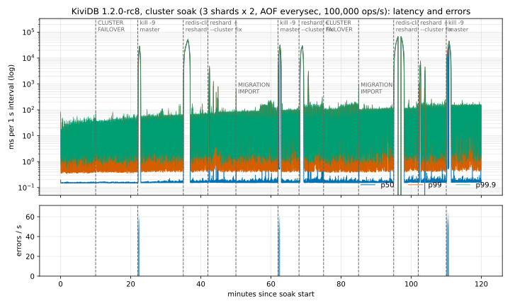
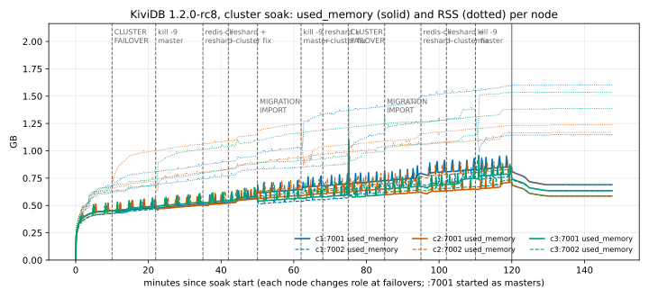
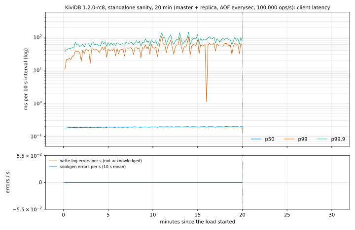

# KiviDB 1.2.0-rc8: soak tests on Azure, 2026-11-03

**Build under test:** commit `082dab3d` on branch `release/1.2.0` (not tagged), which reports `kividb 1.2.0-rc8`.
- **Built from source** on r8-cc with `harness/build.sh`, the way release.yml's linux-amd64 job builds the default variant:
  an `amazonlinux:2023` container, rustup `stable` (minimal profile, rustc 1.99.1), `cargo build --release`, no features.
  It took 341 s.
- **sha256 of `kividb`:** `684e71afb1192a3c9f34ea74c603c32e994987701729d9c013835cc5dd75c80a`, the same on every VM
  (`results/build.txt`).
- **What rc8 changes that these runs exercise:**
  - `d2040c90`: `CLUSTER DELSLOTS` removes a slot another node owns (#295);
  - `42a7282a`: a `MIGRATE` that answers `TRYAGAIN` deletes at the destination the copies of the keys it kept;
  - `983c510a`: a slot assigned by hand keeps over a peer's older claim;
  - `c038e1b0`: hashes loaded from `dump.kdb` are watched for field TTLs (#302);
  - `cee00851`: `kividb.lock` in the data directory (#303). Every server here has a directory of its own.

## Verdict

| Item | Result | Key numbers |
|---|---|---|
| 1. Cluster soak, 2 h, 3 shards × (master + replica), AOF on, 100k ops/s; 2 × `CLUSTER FAILOVER`, 3 × `kill -9`, redis-cli reshards of 10 and 5 slots, 2 × `MIGRATION IMPORT` of 500 slots | **PASS** | **ackcheck:** 10,872,312 acknowledged, **0 lost, 0 wrong**; this counts the hand repair of the #295 rounds (row below).<br>**owcheck:** 17,344 keys, 11,068,419 acknowledged overwrites, **0 stale**.<br>**Master vs replica:** **0 differences** in 11,988,648 keys.<br>**Failovers:** all five done. Promotion in 0.02/0.03 s (`FAILOVER`) and 5.24/5.54/**17.08** s (`kill -9`).<br>**Imports:** 4.17 and 6.26 s, 0 retries.<br>**Logs:** 0 `[ERROR]` lines. p99 19.6 ms |
| 1b. #295: plain `redis-cli --cluster reshard` stopped by TRYAGAIN, then `redis-cli --cluster fix` (3 rounds) | **FAIL** | **The fix exited 1 in all 3 rounds,** and a second fix exited 1 each time. In the 5 min smoke round it exited 0.<br>• **What fix left:** the slot open, `IMPORTING` on the non-owner, with **138 and 56 acknowledged keys** unreadable there (rounds 2 and 3).<br>• **Collections:** their older contents were hidden behind keys re-created on the owner.<br>• **After the hand repair:** every acknowledged key read back with its latest acknowledged value. Without it, the 194 keys would have read as lost.<br>• **`--cluster-replace`** would have overwritten newer acknowledged values with older ones.<br>• **DELSLOTS (the rc7 failure) is fixed.** What fails now is the fix's key move under writes (finding 1) |
| 2. #302: SIGTERM restart with hash field TTLs | **PASS** | DBSIZE **1** in all five cases (rc7: 3 in `term-early`) |
| 3. Standalone sanity, 20 min, master + replica, AOF on, 100k ops/s | **PASS** | 950,019 acknowledged writes, **0 bad** on the master and on the replica. Master vs replica: **0 differences** in 1,628,568 keys. 0 errors, 0 `[ERROR]` lines |

## Findings

| # | Finding | Impact |
|---|---|---|
| 1 | **`redis-cli --cluster fix` can't close a slot that a reshard left open under write load.** It makes one node the owner and then moves the other node's keys to it. Meanwhile clients write those keys on the owner, which creates them from empty. The move then meets the same key on both sides and stops (rounds 1 and 3), or KiviDB answers its `MIGRATE` with `TRYAGAIN` (round 2). It exits 1 and leaves the slot `IMPORTING` on the non-owner, holding acknowledged keys that clients can't read. Details in section 1 | **Acknowledged writes unreadable** until the slot is closed by hand. The keys aren't deleted. The owner's copy is the newer one, so `--cluster-replace` (redis-cli's own advice) would lose acknowledged overwrites. Close such a slot with `MIGRATE` without `REPLACE` of the keys the owner lacks, then `SETSLOT STABLE` (`harness/strandfix.py`). Or use `CLUSTER MIGRATION IMPORT`, which closed both of its 500-slot moves in 4-6 s with 0 retries |
| 2 | **The third `kill -9` took 17.08 s to promote the replica**, against 5.24 and 5.54 s for the other two and 5.6-6.3 s in rc7 (`cluster-node-timeout 5000`). 345 `CLUSTERDOWN` errors in that window | Availability only: 0 lost writes. Seen once; not investigated, to keep to the brief |
| 3 | **Cluster p99 19.6 ms**, against rc7 run 2's 8.7 ms. This run also had owcheck's 1,600 overwrites/s, partly on hot slots | Performance; no A/B was run, so this is not shown to be an rc8 regression |

## Set-up

- **Where.** Azure **Sweden Central**, RG `kividb-rc8-soak`, deleted afterwards. Ubuntu 24.04, accelerated networking,
  auto-shutdown on every VM.

| VM | Size | Role |
|---|---|---|
| `r8-c1`, `r8-c2`, `r8-c3` | Standard_D8ds_v5 | cluster: two nodes each (`:7001`, `:7002`), `threads 4`, data on the local NVMe disk |
| `r8-cc` | Standard_D8s_v5 | cluster client: `soakgen -cluster`, `ackcheck.py`, `owcheck.py`, the event driver; also the build. c1-c3 and cc share a PPG |
| `r8-sm`, `r8-sr` | Standard_D8ds_v5 | sanity master and replica, data on NVMe (`/mnt/kv`); r8-sm also ran the #302 repro |
| `r8-sc` | Standard_D8s_v5 | sanity client: `soakgen`, `writelog.py`. sm, sr, sc share a second PPG |

- **Same layout, region and load as the rc7 soak.** `redis-cli` is Ubuntu's 7.0.15, as in rc7.

## Harness (`harness/`)

rc7's soak harness, with these changes:
- **`owcheck.py` (new).** It checks that each key holds its *latest* acknowledged value. ackcheck writes each key only
  once, so it can find a missing key but not a stale one, and a slot closed by `--cluster fix` with the wrong copy would
  show up as a stale value.
  - 8 writers × 200 `SET`/s. Each writer owns its keys and writes `<writer>:<seq>`.
  - A cold pool of one key per slot (16,384 keys).
  - A hot pool: 8 keys per writer in each slot listed in `hot-slots`. The event driver lists there the slots a
    `reshardfix` round is about to move. Half the writes go to the hot pool while it is set, so each hot key is
    overwritten several times a second while its slot moves and while `--cluster fix` closes it.
  - At the end each key must hold its last acknowledged value, or one of the writes that failed after it.
- **`cl_events.sh`: the rc7 schedule plus three `reshardfix` rounds** (42, 68 and 102 min). Each round:
  1. the source's lowest 5 slots (the ones redis-cli takes) go to `hot-slots`, then a 15 s wait;
  2. a plain `redis-cli --cluster reshard … --cluster-yes`: no `--cluster-replace` and no slotfix.py;
  3. if it stopped and left a slot open: the slot's keys on every node, then `redis-cli --cluster fix <src> --cluster-yes`;
  4. its exit code, the slot's keys on every node again, and `redis-cli --cluster check`. slotfix.py runs only if the
     fix fails or leaves the slot open.

  The two rc7 reshards (35 and 95 min) still run with rc7's fixed `slotfix.py`.
- **`slotfix.py`**: `first` (a node's lowest n slots) and `keys` (per-node `COUNTKEYSINSLOT` and slot state). The repair
  is rc7's fixed one, `selftest` OK before the run.
- **`compare.py`**: the hash-field-TTL allowance. A hash that still differs after the recheck is read field by field.
  - It counts as `hash_field_expiring` only if every field that differs has a field TTL under 5 s, or has just expired.
  - It counts as `hash_settled_on_field_recheck` if the two sides agree by then. That count is reported, not hidden.
  - Anything else is a real difference.
  - A key in a slot the node doesn't own (a stale copy that a failed fix left behind) answers `MOVED`. It is counted as
    `not-owned` instead of stopping the compare, and is still compared between master and replica.
- **`strandfix.py` (new, written during the run):** closes a slot that `--cluster fix` left `IMPORTING` on a non-owner.
  Keys the owner lacks are moved with `MIGRATE` without `REPLACE`. Keys on both nodes are left with the owner's copy and
  recorded. Then `SETSLOT STABLE`. Used by hand in rounds 2 and 3, since the running `cl_events.sh` fallback looks only
  for a `MIGRATING` slot on the source.
- **`s1_sanity.sh`**: s1_soak.sh cut to 20 min, with no events and no restart check.
- **`build.sh`**: the build described above.
- **`clreport.py`, `s1report.py`**: rc8 titles and IPs; `cl-summary.json` includes the owcheck summary.

## 1. Cluster soak: 2 h, 3 shards × (master + replica), AOF on, 100,000 ops/s

`harness/cl_soak.sh` and `harness/cl_events.sh` on r8-cc, as in rc7.
- **Nodes.** Six nodes on three VMs (`node.sh`), each in its own data directory: `cluster-enabled yes`,
  `cluster-node-timeout 5000`, `appendonly yes`, `appendfsync everysec`, `threads 4`. Created with
  `redis-cli --cluster create … --cluster-replicas 1`.
- **Load.** The rc7 soak mix at 100,000 ops/s through go-redis v9.23 `ClusterClient`, 128 connections, 1 s samples.
- **ackcheck.py:** 16 writers × 100 unique `SET`/s, every acknowledged key read back at the end.
- **owcheck.py:** 8 writers × 200 overwrites/s, every key checked for its latest acknowledged value.
- **At the end.** Each master is compared with its replica once their offsets are equal.

### Events, at minutes after the start

| min | Event | Result |
|---|---|---|
| 10 | `CLUSTER FAILOVER`, shard of slot 3000 | promoted in 0.02 s, old master a replica after 3.2 s; 0 client errors |
| 22 | `kill -9` of the master, shard of slot 8000 | promoted in 5.24 s; restarted node a replica 5.9 s after its restart; 1,481 soakgen errors (`dial` 1,420), 227 ackcheck errors |
| 35 | `redis-cli --cluster reshard` 10 slots + slotfix.py | 10 of 10 slots in 9 redis-cli runs, 79 s; each stopped on TRYAGAIN and was finished by slotfix.py with 0 keys left on the source |
| **42** | **reshardfix round 1:** plain reshard of 5 slots, then `--cluster fix` | reshard stopped on TRYAGAIN at slot 0; **fix exit 1** (twice); closed by hand |
| 50 | `CLUSTER MIGRATION IMPORT 10923 11422` (500 slots) | completed in **4.17 s**, 0 retries, 0 client errors |
| 62 | `kill -9` of the master, shard of slot 3000 | promoted in 5.54 s, rejoined after 6.9 s; 1,615 soakgen errors, 202 ackcheck errors |
| **68** | **reshardfix round 2** | 1 slot moved, then TRYAGAIN at slot 11424; **fix exit 1** (twice); closed by hand |
| 75 | `CLUSTER FAILOVER`, shard of slot 13000 | promoted in 0.03 s, old master a replica after 10.8 s; 0 client errors |
| 85 | `CLUSTER MIGRATION IMPORT 5461 5960` (500 slots) | completed in **6.26 s**, 0 retries, 0 client errors |
| 95 | `redis-cli --cluster reshard` 5 slots + slotfix.py | 5 of 5 slots in 3 redis-cli runs, 106 s |
| **102** | **reshardfix round 3** | TRYAGAIN at slot 10; **fix exit 1** (twice); closed by hand |
| 110 | `kill -9` of the master, shard of slot 13000 | promoted in **17.08 s** (5.2-6.3 s in the two other kills and in rc7); rejoined after 14.0 s; 2,334 soakgen errors (345 `CLUSTERDOWN`), 468 ackcheck errors |

### The `redis-cli --cluster fix` rounds (#295)

| Round | Slot | Before the fix: source / destination keys | Owner fix chose | Fix exit (2nd fix) | Why it stopped | Left on the non-owner, slot IMPORTING there | Acknowledged ackcheck keys among them |
|---|---|---|---|---|---|---|---|
| smoke | 0 | 134 / 29 | source | **0** | – | 0 | 0 |
| 1 (42 min) | 0 | 345 / 69 | source (by key count) | **1** (1) | `Target key exists … 1 key(s) in both source node and target node having different values … relaunch with --cluster-replace` | 10, then 3 | 0 |
| 2 (68 min) | 11424 | 220 / 330 | destination (by key count) | **1** (1) | KiviDB answered fix's MIGRATE with `TRYAGAIN … The copy sent to … may be older; MIGRATE them again with REPLACE` | 210 (201 when closed) | **138** |
| 3 (102 min) | 10 | 504 / 130 | source | **1** (1) | `Target key exists … 2 key(s) … having different values` | 92 (83 when closed) | **56** |

**What happens.** redis-cli's fix makes one node the owner, then moves the slot's keys to it from the other node
("Case 2"). From the moment the owner owns the slot, clients send every key of the slot to it. A write to a key still on
the other node therefore lands on the owner, which doesn't have the key and creates it from empty.
- When fix reaches such a key, both nodes hold a copy and the values differ, so fix refuses: rounds 1 and 3.
- In round 2, KiviDB's own `TRYAGAIN` on fix's `MIGRATE` stopped it first.
- Either way fix exits 1 and the slot stays `IMPORTING` on the non-owner, with keys the cluster no longer routes to.
  - **Acknowledged writes become unreadable:** 138 and 56 ackcheck keys.
  - **Earlier contents of collections are hidden behind a re-created key.** Stranded copy vs the owner's new one:

    | Key | Stranded copy | Owner's copy |
    |---|---|---|
    | `z:11111` | 65 members | 21 |
    | `{tx2504}:l` | 50 entries | 17 |
    | `{tx305}:l` | 50 entries | 28 |
    | `{tx11546}:h` | 20 fields | 7 |
    | `hf:664` | 4 fields | 16 |
- **`--cluster-replace` makes it worse.** For every owcheck key found on both nodes (2 in round 1, 2 in round 2, 12 in
  round 3), the owner held the newer acknowledged value, e.g. `1:1187869` vs `1:1180628`. Pushing the non-owner's copy
  over it, as `--cluster-replace` does, would lose acknowledged overwrites.

**How each slot was closed** (so the soak could go on). The files are in `results/cluster/reshardfix-N/`.
- **Round 1:** `CLUSTER SETSLOT 0 STABLE` on the non-owner (`manual-close.txt`; the 3 left were not ackcheck keys,
  `stranded-keys.json`).
- **Rounds 2 and 3:** `harness/strandfix.py` (`strandfix.json`).
  - Each key the owner lacked was moved there with `MIGRATE` without `REPLACE`: 140 keys in round 2 and 60 in round 3,
    including all 138 + 56 ackcheck keys.
  - Each key on both nodes was left alone with the owner's newer copy: 61 and 23 keys.
  - Then `SETSLOT STABLE`.

The stale copies stay on the old non-owner (and its replica): 3 + 61 + 23 keys. The cluster never routes to them and
`compare.py` counts them as `not-owned`.

**The rc7 failure is fixed: `DELSLOTS` no longer refuses a slot another node owns.** In the smoke round, where no key was
written on both sides during the fix, `--cluster fix` closed the slot and exited 0. Under this soak's write rate, it
didn't in any of the three rounds.

### Acknowledged writes and data

| Check | Result |
|---|---|
| ackcheck: acknowledged unique `SET`s | **10,872,312** |
| **Lost / wrong value at the end** | **0 / 0**, after the hand repairs above. Without them the 138 + 56 keys stranded by fix would read as lost |
| ackcheck not acknowledged (errors) | 897: 673 connection errors, 224 `CLUSTERDOWN`, all in the three `kill -9` windows |
| owcheck: keys / acknowledged overwrites | 17,344 keys / **11,068,419** overwrites; 1,266 failed (connection errors, `kill -9` windows) |
| **owcheck: latest acknowledged value** | **17,344 OK, 0 missing, 0 stale, 0 other** |
| Master vs replica at the end | offsets equal on all three shards. **0 real differences**: 4,358,558 + 3,990,384 + 3,639,706 keys (`compare/shard-3000.out`, `compare-rerun/`). The first compares of shards 8000 and 13000 stopped on `MOVED`: they scanned the stale copies left on non-owner nodes. They were rerun with `compare.py` counting such keys as `not-owned`: 57 and 22, the same on master and replica (the others of the 64 and 23 left had expired by then) |
| `redis-cli --cluster check` at the end | 11,988,648 keys in 3 masters, all 16384 slots covered, all nodes agree, no open slot |
| `[ERROR]`/panic lines in the six logs | 0 |
| Throughput | 719,999,572 ops in 120 min, median 100,000 ops/s. 5,444 errors: 4,926 `dial` and 356 `CLUSTERDOWN`, all in the `kill -9` windows; also 113 `MOVED` and 4 `ASK` |
| Latency (median of 1 s intervals) | p50 **0.158 ms**, p99 **19.6 ms**, p99.9 **31.4 ms** (rc7 run 2: 0.169 / 8.7 / 23.7 ms; this run also carries owcheck's 1,600 overwrites/s, and there was no A/B) |
| Memory per node | `used_memory` 0.43-0.45 → 0.71-0.85 GB, RSS 0.62-0.76 → 1.14-1.60 GB; keys 0.78 M → 3.7-4.4 M (the ackcheck keys are never deleted); value slabs end 90-95 % live. No leak |





## 2. #302: field TTLs of hashes loaded from `dump.kdb`

`harness/fieldexp.sh /opt/kv/kividb rc8` on r8-sm (`results/fieldexp-rc8.txt`).
- **Set-up.** A fresh server with `appendonly yes` and `appendfsync always`, and three hashes:
  - `h1`: one field with `HPEXPIRE 3000`;
  - `h2`: two fields, both with `HPEXPIRE 3000`;
  - `h3`: two fields, only one with `HPEXPIRE 3000` (the control).
- **Restart.** After 0.5 s the server is stopped and started again: at once (`-early`) or 4 s later (`-late`).
- **Read-back.** 8 s after the writes, check each hash and `DBSIZE`. Redis gives DBSIZE 1.

| Case | h1 | h2 | h3 | DBSIZE | rc7 |
|---|---|---|---|---|---|
| none (no restart) | gone | gone | HLEN 1 | **1** | 1 |
| **term-early** (SIGTERM, restart at once: loads `dump.kdb`, the fields expire after the load) | gone | gone | HLEN 1 | **1** | **3** (h1, h2 empty: #302) |
| kill9-early (AOF replay) | gone | gone | HLEN 1 | **1** | 1 |
| term-late | gone | gone | HLEN 1 | **1** | 1 |
| kill9-late | gone | gone | HLEN 1 | **1** | 1 |

**PASS: #302 is fixed.** The case that left two empty hashes on rc7 (and on rc6, rc5 and 1.1.3) now gives DBSIZE 1.

## 3. Standalone sanity: 20 min, master + replica, AOF on, 100,000 ops/s

`harness/s1_sanity.sh` on r8-sc. Master and replica run `appendonly yes` and `appendfsync everysec`; everything else is
at its default. 1 M string keys are prefilled. The rc7 soak mix runs at 100,000 ops/s, open loop, on 128 connections,
with `writelog.py` alongside: 8 writers × 100 writes/s, eight kinds of write including `MULTI/EXEC` and field TTLs.

| Check | Result |
|---|---|
| Write log, acknowledged | **950,019** writes, 0 unknown (no errors) |
| Write log on the master | **0 bad**. Each kind 118,749-118,756 acknowledged, all OK: plain `SET`, `SET EX`, `SET PX 20 s` (gone), `HSET`, `MULTI{HSET; HEXPIRE}`, `MULTI{HSET; HPEXPIRE 20 s}` (gone), `MULTI{RPUSH; SADD; ZADD; INCR}`; 118,749 overwrites of 1,000 keys, each key holding its last acknowledged value |
| Write log on the replica | **0 bad** |
| Offsets at the end | master 30,469,889,734 = replica; 1 full sync (the initial one), 0 link-down samples |
| Master vs replica (`compare.py`) | 1,628,568 keys compared; 309 differ on the first pass (in flight), 0 after the recheck; **0 real differences** (0 expiring, 0 field-expiring) |
| `[ERROR]`/panic lines | 0 on both. 0 `[WARN]` |
| `aof_lost_records`, `aof_last_write_status` | 0 and `ok` throughout, on both |
| Throughput | 119,999,588 ops in 20 min, 0 errors; lowest 10 s interval 99,378 ops/s |
| Latency, median of the 10 s intervals | p50 0.19 ms, p99 47 ms, p99.9 70 ms. The p99 comes from `MULTI/EXEC` in the mix, as on rc7 and rc6 (rc7 soak: 40 ms on the same mix in a 12 min A/B, 68 ms in its first half hour) |
| Memory | master `used_memory` 1.19 → 1.29 GB, RSS 1.70 → 1.94 GB, keys 1.43 M → 1.63 M (the write log never deletes) |
| Checkpoints | master 99, median 2.17 s, max 2.31 s; replica 101, median 1.90 s |

**PASS.** Charts: `charts/sanity/s1-*.svg`.



## How to reproduce

```
# laptop: RG, VMs (auto-shutdown on each); on every VM: bash base.sh srv|client
bash harness/create.sh <ssh-public-key>
# r8-cc: build, then copy ~/kividb-build/kividb to /opt/kv/kividb on every server VM
bash build.sh 082dab3d8929c180bccf993835e28992ea054fb5
# client VMs: go build harness/soakgen; copy *.py, *.sh to ~ and the harness to ~/h/soak/harness
# cluster (r8-cc, clhosts.env with C1= C2= C3=):
python3 slotfix.py selftest && OUT=~/cl bash cl_soak.sh; python3 clreport.py ~/cl charts
# #302 (any server VM): bash fieldexp.sh /opt/kv/kividb rc8
# sanity (r8-sc, hosts.env with M= R=): OUT=~/s1 bash s1_sanity.sh; python3 s1report.py ~/s1 charts/sanity
```

## Files

- **`harness/`**: every script, plus the soakgen source.
- **`results/build.txt`**: the commit, toolchain, build time, `--version` and sha256.
- **`results/cluster/`**: the 2 h run:
  - `soak.csv`, `events`, `state.csv`;
  - `ack/` and `ow/` summaries;
  - `compare/`;
  - `reshardfix-*/` (the reshard and fix logs, the slot's keys before and after, the checks);
  - `reshard-*.log`, `import-*`, `check-*`, the six server logs and samples, `cl-summary.json`.
- **`results/smoke-cluster/`**: the 5 min harness smoke run, with one reshardfix round.
- **`results/fieldexp-rc8.txt`**: #302.
- **`results/sanity/`**: the 20 min run. The per-writer logs were not copied.
- **`charts/`**: `cl-*.svg` (cluster) and `sanity/s1-*.svg`.
- **`NOTES.md`**: the progress log.

## Teardown

The three sanity VMs were deleted as soon as the sanity run was done. Then `az group delete -n kividb-rc8-soak --yes`, and `az group exists -n kividb-rc8-soak` returned `false` at 08:09 UTC. No other resource group was touched.
