# Vector search: KiviDB 1.2.0-rc4 vs Redis 8.10.2 vs Dragonfly 2.0.2

KiviDB 1.2.0-rc4 against Redis 8.10.2 (with its built-in query engine) and Dragonfly 2.0.2, on
four public datasets, with
[redis/vector-db-benchmark](https://github.com/redis/vector-db-benchmark). Each run reports
queries per second, recall, latency and ingest time. It also reports **memory during ingestion,
sampled every half second**. That answers a question asked on Hacker News
([kingcauchy](https://news.ycombinator.com/item?id=50154366)): *"How did overall memory footprint
look during ingestion vs Redis? Have any tradeoff graphs as the dataset gets larger?"*

The same run includes KiviDB 1.2.0-rc3 on the same machines, as a regression check for rc4.

Measured 2026-11-01/02 (UTC) on Azure, swedencentral. The server is `D32ps_v5` (32 vCPU arm64)
and the load generator runs on a separate `D16ps_v5`. Details are under
[How it was measured](#how-it-was-measured).

## Summary

### Headline (ef 128; q/s = median of 3 repetitions; ingest and memory = median of 3 loads)

| Dataset | Engine | q/s, 1 client | q/s, 16 | q/s, 100 | recall@10 | p99 ms at 100 | ingest s | RSS bytes / vector |
|---|---|---:|---:|---:|---:|---:|---:|---:|
| h-and-m 2048-d filtered, 105K | KiviDB 1.2.0-rc4 | 251 | 3,146 | 4,548 | 0.9984 | 84.2 | 14.6 | 21,909 |
| h-and-m 2048-d filtered, 105K | Redis 8.10.2 | 134 | 1,808 | 1,847 | 0.9986 | 107.1 | 14.8 | 23,033 |
| h-and-m 2048-d filtered, 105K | Dragonfly 2.0.2 | 176 | 382 | 762 | 0.9981 | 279.9 | 9.6 | 13,569 |
| dbpedia 1536-d, 100K | KiviDB 1.2.0-rc4 | 615 | 7,424 | 10,365 | 0.9864 | 13.8 | 11.6 | 13,265 |
| dbpedia 1536-d, 100K | Redis 8.10.2 | 582 | 7,422 | 8,156 | 0.9807 | 13.2 | 10.0 | 14,724 |
| dbpedia 1536-d, 100K | Dragonfly 2.0.2 | 473 | 4,790 | 9,595 | 0.9802 | 17.2 | 9.2 | 8,297 |
| dbpedia 1536-d, 1M | KiviDB 1.2.0-rc4 | 346 | 4,474 | 6,363 | 0.9595 | 27.4 | 219.1 | 13,202 |
| dbpedia 1536-d, 1M | Redis 8.10.2 | 348 | 4,845 | 5,458 | 0.9382 | 19.3 | 180.5 | 14,439 |
| dbpedia 1536-d, 1M | Dragonfly 2.0.2 | 353 | 3,560 | 6,880 | 0.9389 | 25.4 | 146.3 | 8,496 |
| glove 25-d, 1.18M | KiviDB 1.2.0-rc4 | - | - | 34,551 | 0.9648 | 3.9 | 29.1 | 1,121 |
| glove 25-d, 1.18M | Redis 8.10.2 | - | - | 20,082 | 0.9368 | 6.8 | 59.4 | 990 |
| glove 25-d, 1.18M | Dragonfly 2.0.2 | - | - | 23,591 | 0.9366 | 7.4 | 27.5 | 893 |

The Redis rows use the flags of `vector-benchmark.yml`. Redis with `--io-threads 8` and KiviDB
1.2.0-rc3 are in the full tables below. glove-25 runs at 100 clients only, as in the workflow.

### Findings

**No regression from rc3 to rc4.** Both ran on the same machines in the same run:
- Every rc4 search point is within 0.96-1.02x of rc3's.
- Recall is within 0.0013. The HNSW build is randomised, so the graphs differ slightly.
- Ingest time is within 1% and memory per vector is identical.

The two lowest ratios are h-and-m ef 256 at 0.96 and dbpedia-1M ef 256 at 0.98, both at one
client. Both are inside the spread of those rows' three repetitions (3-5%).

One p99 moved: dbpedia-1M at 100 clients was 27.4 ms on rc4 against 21.7 ms on rc3, with p95 at
20.7 ms against 20.1. On dbpedia-100K at 100 clients it moved the other way (13.8 against 18.2 ms).
Each p99 comes from one repetition, so treat these as tail noise rather than a change.

The rc3 → rc4 changes nearest this path are #275 (index walks ordered against document
writes) and #271 (write ordering), and they cost nothing measurable here. rc4 also matches the
rc3 run of 2026-11-01 (eastasia, same machine types) within 1-4%. For example, h-and-m at ef 128
gives 251 / 3,146 / 4,548 q/s at 1 / 16 / 100 clients, against 244 / 3,096 / 4,504 then.

**Where KiviDB wins**
- **Filtered search (h-and-m).** This is the workload with a metadata filter on every query.
  - Against Redis, at the same recall (0.998): 1.9x the q/s at 1 client (251 vs 134), 1.7x at
    16 clients (3,146 vs 1,808) and 2.5x at 100 clients (4,548 vs 1,847). p99 at 100 clients is
    84 ms against Redis's 107 ms.
  - Against Dragonfly: 1.4x at 1 client, 8x at 16 and 6x at 100. Dragonfly's filtered search
    barely scales with clients (382 q/s at 16), and its p99 reaches 280 ms at 100 clients.
- **Speed at equal recall, unfiltered.** At the same ef, KiviDB's HNSW graph returns higher recall
  than Redis's and Dragonfly's on every unfiltered set. For example, dbpedia-1M at ef 128 gives
  0.960 against 0.938 and 0.939. Compared at the same recall (interpolated along the ef sweep):
  - dbpedia-1M, 1 client: about 1.25x Redis and Dragonfly. At recall 0.96: 343 vs 276 vs 275 q/s.
  - dbpedia-100K, 1 client: about 1.25-1.3x Redis. At recall 0.98: 737 vs 589 q/s.
  - glove-25, 100 clients: 2.1x Redis and 1.5x Dragonfly. At recall 0.972: 31.7K vs 15.2K vs
    21.6K q/s.
- **100 clients at ef 128.**
  - dbpedia-100K: 10,365 q/s, against Redis's 8,156 and Dragonfly's 9,595.
  - dbpedia-1M: 6,363 q/s, against Redis's 5,458. Dragonfly is ahead here at 6,880, but at lower
    recall (0.939 vs 0.960).
- **Ingest of many small vectors (glove-25, 1.18M x 25-d):** 29.1 s, against Redis's 59.4 s. This
  is 2x faster than Redis. Dragonfly takes 27.5 s.

**Where KiviDB loses**
- **Ingest of large vectors.**
  - dbpedia-1M (1536-d) takes 219 s in KiviDB, 181 s in Redis and 146 s in Dragonfly. That makes
    KiviDB 21% slower than Redis and 50% slower than Dragonfly.
  - dbpedia-100K takes 11.6 s, 10.0 s and 9.2 s.
  - On h-and-m, KiviDB ties Redis (14.6 vs 14.8 s; 13.1 s with io-threads) and Dragonfly takes
    9.6 s.

  During the load, KiviDB and Redis both keep about 16 cores busy: one per upload connection.
  KiviDB inserts into the graph inline in `HSET`, and Redis uses its 16 search workers. Dragonfly
  uses about 25 cores. So KiviDB spends more CPU per inserted 1536-d vector than Redis. Part of that
  likely buys the better graph, since recall is higher at every ef. This run did not profile it.
  An earlier profile on x86 found about 80% of upload time in the dot-product kernel, which is
  memory-bound on vectors this large. It was not re-profiled on arm64.
- **16 clients at a fixed ef on dbpedia-1M:** 4,474 q/s, against Redis's 4,845 (0.92x), at higher
  recall (0.960 vs 0.938). At equal recall KiviDB would run a lower ef, but that point was not
  measured at 16 clients.
- **Memory per vector against Dragonfly.**
  - Dragonfly needs 8.5 KB of RSS per 1536-d vector. That is 36% less than KiviDB (13.2 KB) and
    41% less than Redis (14.4 KB).
  - A 1536-d float32 vector is 6,144 bytes. KiviDB holds each vector twice: once as the bytes of
    the document's hash field, and once as floats in the HNSW graph's slots (`src/vector/mod.rs`,
    `HnswIndex::slots`). That is 12.3 KB before the graph's links and the key.
  - Redis also stores two copies. Dragonfly's 8.5 KB is consistent with one copy plus overhead.
  - On glove-25 the vector is only 100 bytes and per-key overhead dominates. KiviDB needs 1,121
    bytes per vector there, against Redis's 990 and Dragonfly's 893.
- **Memory after deleting the data.** After the tool drops the index and deletes all 999K documents
  of dbpedia-1M, Redis's RSS falls to 0.10 GiB and Dragonfly's to 0.23 GiB, both within about 10 s.

  KiviDB's RSS stays at 10.6 GiB of 12.3 for as long as we watched: 45 s in pass 3, and 65 s in a
  separate run, while `used_memory` reads 6 MB. Within a second of `MEMORY PURGE` it drops to
  0.07 GiB ([chart](charts/memory-purge-dbpedia-1M.svg)).

  KiviDB allocates with glibc malloc, which keeps freed pages in its arenas until `malloc_trim`.
  KiviDB calls `malloc_trim` on `FLUSHALL`/`FLUSHDB` and on `MEMORY PURGE`, but not after
  `FT.DROPINDEX` or after many `DEL`s. KiviDB can probably reuse those pages for its next writes
  (not measured), but the operating system, and a container's memory limit, still count them as in
  use. To be filed as an issue.

**Memory during ingestion (the HN question).**
- Memory grows in a straight line with the number of vectors stored, for all three engines and
  all four datasets.
- No engine shows a transient spike while loading: peak RSS equals the RSS after the load. On
  dbpedia-1M that is 12.30 GiB for KiviDB, 13.45 GiB for Redis and 7.96 GiB for Dragonfly.
- As the dataset grows from 100K to 1M vectors (dbpedia, 1536-d), each engine's cost per vector
  stays flat:
  - KiviDB: 13.27 KB, then 13.20 KB.
  - Redis: 14.7 KB, then 14.4 KB.
  - Dragonfly: 8.3 KB, then 8.5 KB.

  So the gaps between engines grow linearly with the data. At 1M vectors KiviDB uses 1.15 GiB less
  than Redis and 4.3 GiB more than Dragonfly.

This run does not answer the question's second half, mixed workloads: it measures search on a
static index after the load.

**Caveats**
- One load generator, one server size and no persistence. Only one engine is resident at a time.
- Each search point's three repetitions run back to back on the same loaded index. The ingest
  repeats are separate loads into fresh servers.
- The tool's own summary keeps the best of the three repetitions. This README uses the median, so
  its numbers are slightly lower than the tool's.
- Redis's filtered queries return the same recall and q/s at every ef (0.9986, about 133 q/s).
  That matches what its query engine does when it brute-forces the filtered subset instead of
  walking the graph (hybrid policy `ADHOC_BF`). This is inferred from the numbers, not confirmed
  from Redis's query plan.
- Redis's `--io-threads 8` changes nothing here (within 1-2%), except h-and-m ingest, which is 11%
  faster. The work happens in the query engine's 16 search workers, which are on by default.
- dbpedia-1M is the redislabs `text-embedding-3-large` set. It comes from a different embedding
  model than dbpedia-100K, so recall is not comparable between the two dbpedia sets. The tool
  warns that the file holds 999,000 vectors, not 1,000,000. All engines load the same 999,000.
- The client was not the bottleneck:
  - The tool's client CPU check, run at every search point, never flagged saturation.
  - The client's busiest second used 52% of its 16 cores (glove-25 at 100 clients).
- Redis Cluster is not included. An FT index is per shard and the tool drives one endpoint.
  Valkey (with valkey-search) and Garnet were not run in this suite.

## Charts

### Speed against recall
Each line is an ef sweep. Up and to the right is better. Compare engines at the same recall, not at
the same ef: at the same ef, KiviDB's graph returns higher recall on the dbpedia and glove sets.

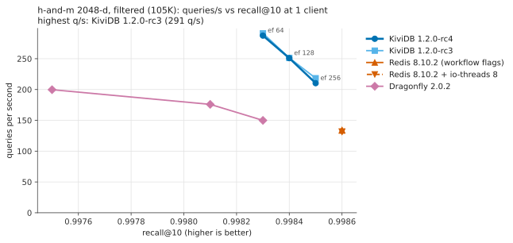
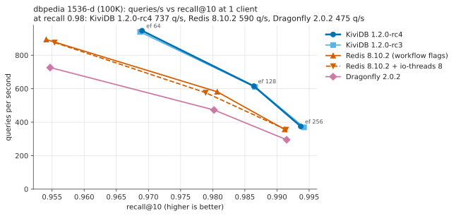
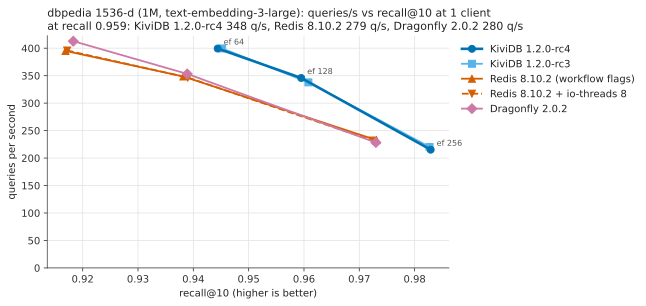
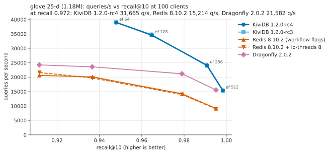

### Throughput by number of clients (ef 128)
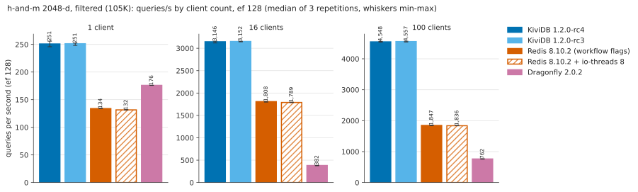
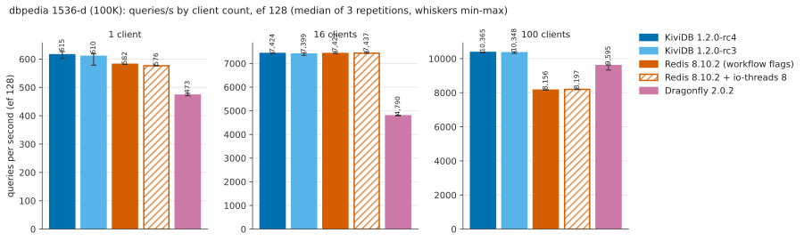
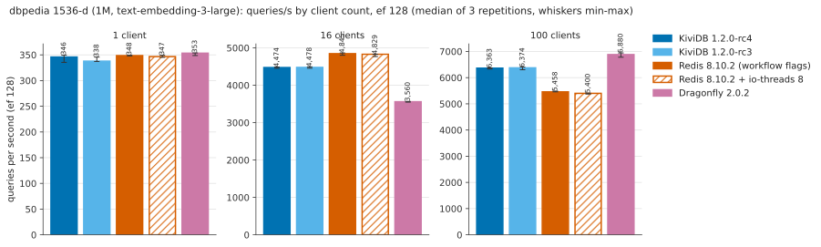

### Ingest time
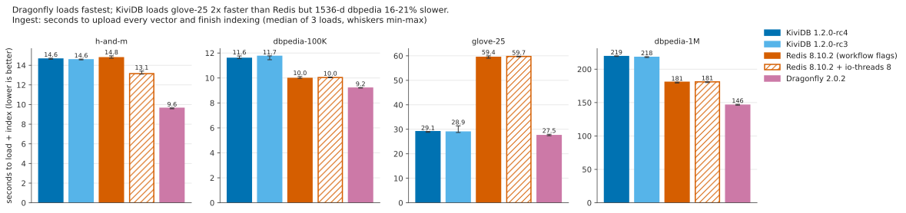

### Memory during ingestion
Server RSS over time while each engine loads the dataset. The dotted line is where the client
starts uploading, and each engine's marker is where its load ended (indexing complete). The lines
stop where the tool begins deleting the data.

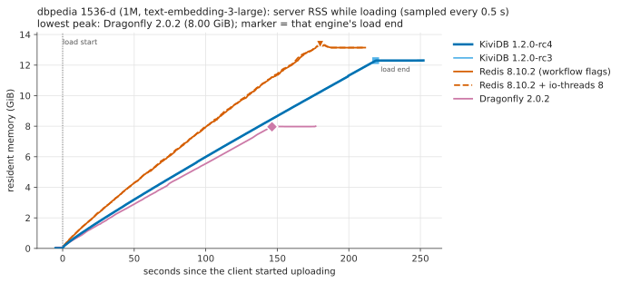
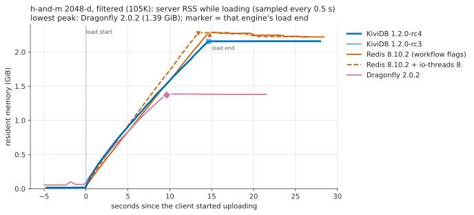
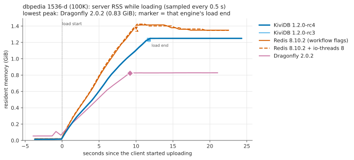
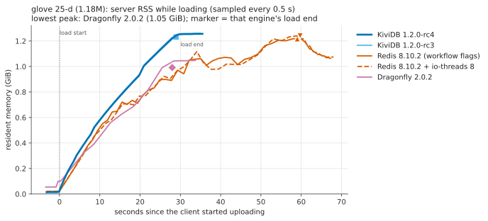

### Memory as the dataset grows
The same samples, plotted against the number of vectors stored so far.

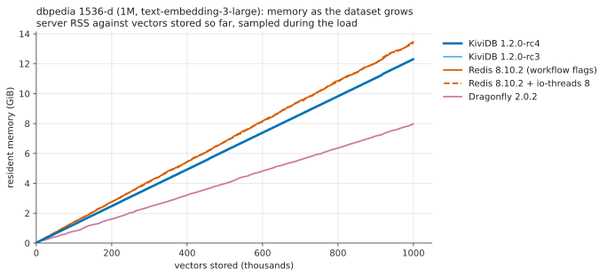
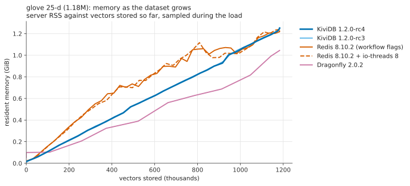
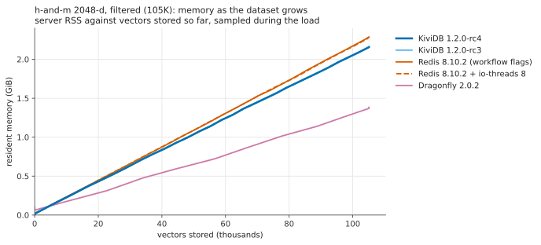
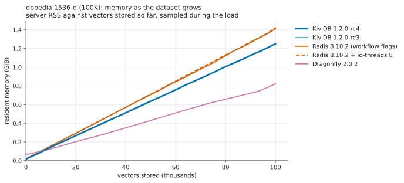

### Memory per vector
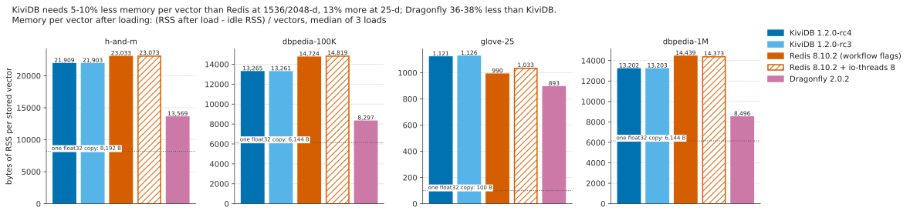

### Memory after deleting everything
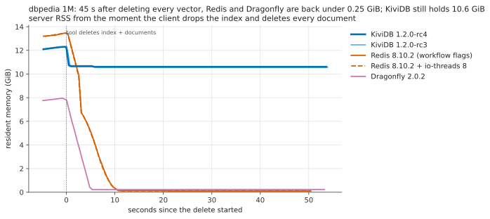
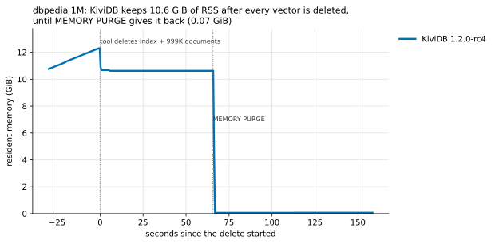

## All results

Search rows come from pass 1; ingest and memory rows are the median of all three loads.

### h-and-m 2048-d, filtered (105K)

| engine | ef | clients | q/s median (3 reps) | spread | recall@10 | p50 ms | p95 ms | p99 ms | client-bound? |
|---|---:|---:|---:|---:|---:|---:|---:|---:|---|
| KiviDB 1.2.0-rc4 | 64 | 1 | 288 | 3.8% | 0.9983 | 2.10 | 9.76 | 27.15 | no |
| KiviDB 1.2.0-rc4 | 128 | 1 | 251 | 4.0% | 0.9984 | 2.35 | 14.66 | 16.35 | no |
| KiviDB 1.2.0-rc4 | 256 | 1 | 210 | 4.4% | 0.9985 | 2.50 | 16.54 | 20.51 | no |
| KiviDB 1.2.0-rc4 | 128 | 16 | 3,146 | 1.3% | 0.9984 | 3.02 | 19.08 | 21.43 | no |
| KiviDB 1.2.0-rc4 | 128 | 100 | 4,548 | 0.5% | 0.9984 | 17.85 | 49.88 | 84.22 | no |
| KiviDB 1.2.0-rc3 | 64 | 1 | 291 | 1.8% | 0.9983 | 2.10 | 9.83 | 27.07 | no |
| KiviDB 1.2.0-rc3 | 128 | 1 | 251 | 1.7% | 0.9984 | 2.39 | 14.90 | 16.56 | no |
| KiviDB 1.2.0-rc3 | 256 | 1 | 218 | 3.6% | 0.9985 | 2.48 | 16.21 | 20.06 | no |
| KiviDB 1.2.0-rc3 | 128 | 16 | 3,152 | 0.4% | 0.9984 | 3.02 | 19.13 | 21.55 | no |
| KiviDB 1.2.0-rc3 | 128 | 100 | 4,557 | 0.6% | 0.9984 | 17.66 | 51.02 | 84.41 | no |
| Redis 8.10.2 (workflow flags) | 64 | 1 | 133 | 0.4% | 0.9986 | 2.79 | 39.71 | 47.42 | no |
| Redis 8.10.2 (workflow flags) | 128 | 1 | 134 | 0.3% | 0.9986 | 2.78 | 39.32 | 46.88 | no |
| Redis 8.10.2 (workflow flags) | 256 | 1 | 134 | 1.0% | 0.9986 | 2.78 | 38.86 | 46.45 | no |
| Redis 8.10.2 (workflow flags) | 128 | 16 | 1,808 | 0.8% | 0.9986 | 3.25 | 46.68 | 55.89 | no |
| Redis 8.10.2 (workflow flags) | 128 | 100 | 1,847 | 0.8% | 0.9986 | 50.04 | 89.68 | 107.10 | no |
| Redis 8.10.2 + io-threads 8 | 64 | 1 | 132 | 0.3% | 0.9986 | 2.83 | 39.73 | 47.58 | no |
| Redis 8.10.2 + io-threads 8 | 128 | 1 | 132 | 0.5% | 0.9986 | 2.84 | 39.72 | 47.50 | no |
| Redis 8.10.2 + io-threads 8 | 256 | 1 | 132 | 0.5% | 0.9986 | 2.85 | 39.74 | 47.68 | no |
| Redis 8.10.2 + io-threads 8 | 128 | 16 | 1,789 | 0.5% | 0.9986 | 3.31 | 47.11 | 56.03 | no |
| Redis 8.10.2 + io-threads 8 | 128 | 100 | 1,836 | 0.5% | 0.9986 | 50.27 | 89.90 | 107.67 | no |
| Dragonfly 2.0.2 | 64 | 1 | 200 | 1.7% | 0.9975 | 3.38 | 12.16 | 30.02 | no |
| Dragonfly 2.0.2 | 128 | 1 | 176 | 0.1% | 0.9981 | 3.50 | 14.08 | 38.17 | no |
| Dragonfly 2.0.2 | 256 | 1 | 150 | 1.7% | 0.9983 | 3.45 | 20.24 | 53.53 | no |
| Dragonfly 2.0.2 | 128 | 16 | 382 | 2.5% | 0.9981 | 31.56 | 112.64 | 142.37 | no |
| Dragonfly 2.0.2 | 128 | 100 | 762 | 1.9% | 0.9981 | 122.23 | 232.29 | 279.93 | no |

| engine | loads | upload s (median, min-max) | index wait s | upload+index s | peak RSS GiB | RSS after load GiB | used_memory after load GiB | RSS B/vector | used_memory B/vector |
|---|---:|---:|---:|---:|---:|---:|---:|---:|---:|
| KiviDB 1.2.0-rc4 | 3 | 14.6 (14.6-14.7) | 0.01 | 14.6 | 2.15 | 2.15 | 2.04 | 21,909 | 20,866 |
| KiviDB 1.2.0-rc3 | 3 | 14.6 (14.5-14.6) | 0.01 | 14.6 | 2.16 | 2.16 | 2.04 | 21,903 | 20,863 |
| Redis 8.10.2 (workflow flags) | 3 | 14.8 (14.7-15.0) | 0.00 | 14.8 | 2.28 | 2.27 | 2.37 | 23,033 | 24,220 |
| Redis 8.10.2 + io-threads 8 | 3 | 13.1 (13.1-13.4) | 0.00 | 13.1 | 2.28 | 2.28 | 2.37 | 23,073 | 24,205 |
| Dragonfly 2.0.2 | 3 | 9.6 (9.6-9.7) | 0.00 | 9.6 | 1.41 | 1.38 | 1.27 | 13,569 | 12,917 |

### dbpedia 1536-d (100K)

| engine | ef | clients | q/s median (3 reps) | spread | recall@10 | p50 ms | p95 ms | p99 ms | client-bound? |
|---|---:|---:|---:|---:|---:|---:|---:|---:|---|
| KiviDB 1.2.0-rc4 | 64 | 1 | 946 | 2.8% | 0.9690 | 1.06 | 1.30 | 1.43 | no |
| KiviDB 1.2.0-rc4 | 128 | 1 | 615 | 4.0% | 0.9864 | 1.61 | 2.05 | 2.20 | no |
| KiviDB 1.2.0-rc4 | 256 | 1 | 375 | 4.8% | 0.9937 | 2.67 | 3.42 | 3.72 | no |
| KiviDB 1.2.0-rc4 | 128 | 16 | 7,424 | 0.8% | 0.9864 | 2.17 | 2.76 | 2.99 | no |
| KiviDB 1.2.0-rc4 | 128 | 100 | 10,365 | 0.4% | 0.9864 | 9.24 | 12.68 | 13.84 | no |
| KiviDB 1.2.0-rc3 | 64 | 1 | 939 | 1.8% | 0.9687 | 1.06 | 1.32 | 1.46 | no |
| KiviDB 1.2.0-rc3 | 128 | 1 | 610 | 6.5% | 0.9866 | 1.63 | 2.08 | 2.25 | no |
| KiviDB 1.2.0-rc3 | 256 | 1 | 369 | 3.6% | 0.9942 | 2.66 | 3.41 | 3.73 | no |
| KiviDB 1.2.0-rc3 | 128 | 16 | 7,399 | 1.5% | 0.9866 | 2.17 | 2.74 | 2.99 | no |
| KiviDB 1.2.0-rc3 | 128 | 100 | 10,348 | 1.0% | 0.9866 | 8.89 | 15.72 | 18.24 | no |
| Redis 8.10.2 (workflow flags) | 64 | 1 | 894 | 0.1% | 0.9541 | 1.12 | 1.33 | 1.49 | no |
| Redis 8.10.2 (workflow flags) | 128 | 1 | 582 | 0.1% | 0.9807 | 1.74 | 2.07 | 2.23 | no |
| Redis 8.10.2 (workflow flags) | 256 | 1 | 357 | 0.1% | 0.9912 | 2.85 | 3.40 | 3.60 | no |
| Redis 8.10.2 (workflow flags) | 128 | 16 | 7,422 | 1.1% | 0.9807 | 2.15 | 2.58 | 2.78 | no |
| Redis 8.10.2 (workflow flags) | 128 | 100 | 8,156 | 0.2% | 0.9807 | 12.18 | 12.91 | 13.20 | no |
| Redis 8.10.2 + io-threads 8 | 64 | 1 | 876 | 0.7% | 0.9554 | 1.14 | 1.35 | 1.52 | no |
| Redis 8.10.2 + io-threads 8 | 128 | 1 | 576 | 0.2% | 0.9789 | 1.75 | 2.08 | 2.22 | no |
| Redis 8.10.2 + io-threads 8 | 256 | 1 | 356 | 0.1% | 0.9914 | 2.86 | 3.41 | 3.62 | no |
| Redis 8.10.2 + io-threads 8 | 128 | 16 | 7,437 | 0.9% | 0.9789 | 2.16 | 2.56 | 2.74 | no |
| Redis 8.10.2 + io-threads 8 | 128 | 100 | 8,197 | 0.3% | 0.9789 | 12.11 | 12.84 | 13.16 | no |
| Dragonfly 2.0.2 | 64 | 1 | 726 | 0.7% | 0.9547 | 1.37 | 1.65 | 2.22 | no |
| Dragonfly 2.0.2 | 128 | 1 | 473 | 1.8% | 0.9802 | 2.12 | 2.54 | 2.77 | no |
| Dragonfly 2.0.2 | 256 | 1 | 295 | 1.7% | 0.9915 | 3.41 | 4.17 | 4.47 | no |
| Dragonfly 2.0.2 | 128 | 16 | 4,790 | 0.7% | 0.9802 | 3.29 | 3.65 | 4.23 | no |
| Dragonfly 2.0.2 | 128 | 100 | 9,595 | 3.2% | 0.9802 | 9.96 | 14.32 | 17.24 | no |

| engine | loads | upload s (median, min-max) | index wait s | upload+index s | peak RSS GiB | RSS after load GiB | used_memory after load GiB | RSS B/vector | used_memory B/vector |
|---|---:|---:|---:|---:|---:|---:|---:|---:|---:|
| KiviDB 1.2.0-rc4 | 3 | 11.6 (11.5-11.8) | 0.01 | 11.6 | 1.25 | 1.25 | 1.22 | 13,265 | 13,102 |
| KiviDB 1.2.0-rc3 | 3 | 11.7 (11.5-11.8) | 0.01 | 11.7 | 1.25 | 1.25 | 1.22 | 13,261 | 13,066 |
| Redis 8.10.2 (workflow flags) | 3 | 10.0 (10.0-10.1) | 0.00 | 10.0 | 1.38 | 1.38 | 1.38 | 14,724 | 15,074 |
| Redis 8.10.2 + io-threads 8 | 3 | 10.0 (10.0-10.1) | 0.00 | 10.0 | 1.41 | 1.37 | 1.37 | 14,819 | 15,062 |
| Dragonfly 2.0.2 | 3 | 9.2 (9.2-9.2) | 0.00 | 9.2 | 0.82 | 0.82 | 0.72 | 8,297 | 7,681 |

### glove 25-d (1.18M)

| engine | ef | clients | q/s median (3 reps) | spread | recall@10 | p50 ms | p95 ms | p99 ms | client-bound? |
|---|---:|---:|---:|---:|---:|---:|---:|---:|---|
| KiviDB 1.2.0-rc4 | 64 | 100 | 38,967 | 0.8% | 0.9480 | 2.38 | 3.30 | 3.54 | no |
| KiviDB 1.2.0-rc4 | 128 | 100 | 34,551 | 0.7% | 0.9648 | 2.68 | 3.65 | 3.88 | no |
| KiviDB 1.2.0-rc4 | 256 | 100 | 24,131 | 1.0% | 0.9908 | 3.86 | 5.30 | 5.60 | no |
| KiviDB 1.2.0-rc4 | 512 | 100 | 15,417 | 0.6% | 0.9983 | 6.14 | 8.49 | 9.11 | no |
| KiviDB 1.2.0-rc3 | 64 | 100 | 39,034 | 1.0% | 0.9478 | 2.40 | 3.29 | 3.57 | no |
| KiviDB 1.2.0-rc3 | 128 | 100 | 34,801 | 1.1% | 0.9646 | 2.66 | 3.66 | 3.87 | no |
| KiviDB 1.2.0-rc3 | 256 | 100 | 23,981 | 0.3% | 0.9908 | 3.92 | 5.34 | 5.67 | no |
| KiviDB 1.2.0-rc3 | 512 | 100 | 15,300 | 0.7% | 0.9983 | 6.14 | 8.51 | 9.10 | no |
| Redis 8.10.2 (workflow flags) | 64 | 100 | 20,607 | 1.8% | 0.9116 | 4.61 | 6.94 | 8.63 | no |
| Redis 8.10.2 (workflow flags) | 128 | 100 | 20,082 | 1.2% | 0.9368 | 4.87 | 5.52 | 6.80 | no |
| Redis 8.10.2 (workflow flags) | 256 | 100 | 14,232 | 0.4% | 0.9791 | 6.95 | 7.34 | 7.97 | no |
| Redis 8.10.2 (workflow flags) | 512 | 100 | 9,121 | 0.4% | 0.9951 | 10.87 | 11.41 | 11.83 | no |
| Redis 8.10.2 + io-threads 8 | 64 | 100 | 21,599 | 2.2% | 0.9117 | 4.48 | 5.61 | 6.71 | no |
| Redis 8.10.2 + io-threads 8 | 128 | 100 | 19,728 | 1.1% | 0.9367 | 4.93 | 5.90 | 7.06 | no |
| Redis 8.10.2 + io-threads 8 | 256 | 100 | 13,994 | 1.1% | 0.9790 | 7.06 | 7.51 | 8.33 | no |
| Redis 8.10.2 + io-threads 8 | 512 | 100 | 9,012 | 0.1% | 0.9951 | 11.03 | 11.55 | 12.12 | no |
| Dragonfly 2.0.2 | 64 | 100 | 24,256 | 1.7% | 0.9116 | 3.94 | 5.82 | 7.11 | no |
| Dragonfly 2.0.2 | 128 | 100 | 23,591 | 1.2% | 0.9366 | 4.04 | 6.00 | 7.45 | no |
| Dragonfly 2.0.2 | 256 | 100 | 21,185 | 2.8% | 0.9790 | 4.44 | 6.37 | 7.66 | no |
| Dragonfly 2.0.2 | 512 | 100 | 15,564 | 0.3% | 0.9951 | 6.14 | 9.01 | 10.93 | no |

| engine | loads | upload s (median, min-max) | index wait s | upload+index s | peak RSS GiB | RSS after load GiB | used_memory after load GiB | RSS B/vector | used_memory B/vector |
|---|---:|---:|---:|---:|---:|---:|---:|---:|---:|
| KiviDB 1.2.0-rc4 | 3 | 29.0 (28.7-29.0) | 0.08 | 29.1 | 1.25 | 1.25 | 1.15 | 1,121 | 1,042 |
| KiviDB 1.2.0-rc3 | 3 | 28.8 (28.6-31.3) | 0.09 | 28.9 | 1.25 | 1.25 | 1.15 | 1,126 | 1,041 |
| Redis 8.10.2 (workflow flags) | 3 | 59.4 (59.0-60.0) | 0.00 | 59.4 | 1.24 | 1.24 | 0.71 | 990 | 925 |
| Redis 8.10.2 + io-threads 8 | 3 | 59.7 (59.6-59.8) | 0.00 | 59.7 | 1.21 | 1.21 | 1.02 | 1,033 | 924 |
| Dragonfly 2.0.2 | 3 | 27.5 (27.4-28.0) | 0.00 | 27.5 | 1.04 | 1.04 | 1.07 | 893 | 965 |

### dbpedia 1536-d (1M, text-embedding-3-large)

| engine | ef | clients | q/s median (3 reps) | spread | recall@10 | p50 ms | p95 ms | p99 ms | client-bound? |
|---|---:|---:|---:|---:|---:|---:|---:|---:|---|
| KiviDB 1.2.0-rc4 | 64 | 1 | 399 | 1.1% | 0.9444 | 2.55 | 3.08 | 3.31 | no |
| KiviDB 1.2.0-rc4 | 128 | 1 | 346 | 4.1% | 0.9595 | 2.92 | 3.60 | 3.86 | no |
| KiviDB 1.2.0-rc4 | 256 | 1 | 215 | 2.9% | 0.9829 | 4.65 | 5.96 | 6.22 | no |
| KiviDB 1.2.0-rc4 | 128 | 16 | 4,474 | 0.8% | 0.9595 | 3.61 | 4.44 | 4.86 | no |
| KiviDB 1.2.0-rc4 | 128 | 100 | 6,363 | 0.7% | 0.9595 | 14.42 | 20.70 | 27.44 | no |
| KiviDB 1.2.0-rc3 | 64 | 1 | 400 | 1.4% | 0.9452 | 2.56 | 3.04 | 3.30 | no |
| KiviDB 1.2.0-rc3 | 128 | 1 | 338 | 2.5% | 0.9608 | 2.96 | 3.59 | 3.82 | no |
| KiviDB 1.2.0-rc3 | 256 | 1 | 220 | 4.5% | 0.9827 | 4.51 | 5.79 | 6.16 | no |
| KiviDB 1.2.0-rc3 | 128 | 16 | 4,478 | 0.8% | 0.9608 | 3.61 | 4.45 | 4.73 | no |
| KiviDB 1.2.0-rc3 | 128 | 100 | 6,374 | 1.5% | 0.9608 | 14.62 | 20.05 | 21.69 | no |
| Redis 8.10.2 (workflow flags) | 64 | 1 | 395 | 0.5% | 0.9169 | 2.54 | 2.97 | 3.16 | no |
| Redis 8.10.2 (workflow flags) | 128 | 1 | 348 | 0.3% | 0.9382 | 2.89 | 3.37 | 3.58 | no |
| Redis 8.10.2 (workflow flags) | 256 | 1 | 233 | 0.2% | 0.9731 | 4.34 | 5.25 | 5.48 | no |
| Redis 8.10.2 (workflow flags) | 128 | 16 | 4,845 | 1.3% | 0.9382 | 3.30 | 3.88 | 4.16 | no |
| Redis 8.10.2 (workflow flags) | 128 | 100 | 5,458 | 0.5% | 0.9382 | 17.85 | 18.93 | 19.26 | no |
| Redis 8.10.2 + io-threads 8 | 64 | 1 | 396 | 1.3% | 0.9172 | 2.55 | 2.95 | 3.09 | no |
| Redis 8.10.2 + io-threads 8 | 128 | 1 | 347 | 1.2% | 0.9390 | 2.86 | 3.38 | 3.60 | no |
| Redis 8.10.2 + io-threads 8 | 256 | 1 | 232 | 0.1% | 0.9724 | 4.34 | 5.31 | 5.55 | no |
| Redis 8.10.2 + io-threads 8 | 128 | 16 | 4,829 | 1.3% | 0.9390 | 3.29 | 3.94 | 4.46 | no |
| Redis 8.10.2 + io-threads 8 | 128 | 100 | 5,400 | 0.7% | 0.9390 | 17.98 | 19.20 | 19.75 | no |
| Dragonfly 2.0.2 | 64 | 1 | 413 | 1.0% | 0.9183 | 2.44 | 2.95 | 3.22 | no |
| Dragonfly 2.0.2 | 128 | 1 | 353 | 1.4% | 0.9389 | 2.85 | 3.43 | 3.80 | no |
| Dragonfly 2.0.2 | 256 | 1 | 228 | 1.8% | 0.9730 | 4.39 | 5.56 | 5.92 | no |
| Dragonfly 2.0.2 | 128 | 16 | 3,560 | 0.5% | 0.9389 | 4.39 | 4.92 | 5.26 | no |
| Dragonfly 2.0.2 | 128 | 100 | 6,880 | 2.4% | 0.9389 | 13.62 | 20.42 | 25.43 | no |

| engine | loads | upload s (median, min-max) | index wait s | upload+index s | peak RSS GiB | RSS after load GiB | used_memory after load GiB | RSS B/vector | used_memory B/vector |
|---|---:|---:|---:|---:|---:|---:|---:|---:|---:|
| KiviDB 1.2.0-rc4 | 3 | 219.0 (219.0-219.9) | 0.07 | 219.1 | 12.30 | 12.30 | 12.23 | 13,202 | 13,140 |
| KiviDB 1.2.0-rc3 | 3 | 217.8 (217.4-218.7) | 0.07 | 217.9 | 12.30 | 12.30 | 12.23 | 13,203 | 13,140 |
| Redis 8.10.2 (workflow flags) | 3 | 180.5 (179.4-180.6) | 0.00 | 180.5 | 13.45 | 13.45 | 14.01 | 14,439 | 15,057 |
| Redis 8.10.2 + io-threads 8 | 3 | 181.0 (180.0-181.3) | 0.00 | 181.0 | 13.39 | 13.39 | 14.01 | 14,373 | 15,057 |
| Dragonfly 2.0.2 | 3 | 146.3 (146.1-147.4) | 0.00 | 146.3 | 7.96 | 7.96 | 7.16 | 8,496 | 7,691 |

### KiviDB 1.2.0-rc4 against 1.2.0-rc3 (same VMs, same run)

| dataset | ef | clients | rc3 q/s | rc4 q/s | rc4/rc3 | rc3 recall | rc4 recall | rc3 p99 ms | rc4 p99 ms |
|---|---:|---:|---:|---:|---:|---:|---:|---:|---:|
| h-and-m | 64 | 1 | 291 | 288 | 0.99 | 0.9983 | 0.9983 | 27.07 | 27.15 |
| h-and-m | 128 | 1 | 251 | 251 | 1.00 | 0.9984 | 0.9984 | 16.56 | 16.35 |
| h-and-m | 256 | 1 | 218 | 210 | 0.96 | 0.9985 | 0.9985 | 20.06 | 20.51 |
| h-and-m | 128 | 16 | 3,152 | 3,146 | 1.00 | 0.9984 | 0.9984 | 21.55 | 21.43 |
| h-and-m | 128 | 100 | 4,557 | 4,548 | 1.00 | 0.9984 | 0.9984 | 84.41 | 84.22 |
| dbpedia-100K | 64 | 1 | 939 | 946 | 1.01 | 0.9687 | 0.9690 | 1.46 | 1.43 |
| dbpedia-100K | 128 | 1 | 610 | 615 | 1.01 | 0.9866 | 0.9864 | 2.25 | 2.20 |
| dbpedia-100K | 256 | 1 | 369 | 375 | 1.02 | 0.9942 | 0.9937 | 3.73 | 3.72 |
| dbpedia-100K | 128 | 16 | 7,399 | 7,424 | 1.00 | 0.9866 | 0.9864 | 2.99 | 2.99 |
| dbpedia-100K | 128 | 100 | 10,348 | 10,365 | 1.00 | 0.9866 | 0.9864 | 18.24 | 13.84 |
| glove-25 | 64 | 100 | 39,034 | 38,967 | 1.00 | 0.9478 | 0.9480 | 3.57 | 3.54 |
| glove-25 | 128 | 100 | 34,801 | 34,551 | 0.99 | 0.9646 | 0.9648 | 3.87 | 3.88 |
| glove-25 | 256 | 100 | 23,981 | 24,131 | 1.01 | 0.9908 | 0.9908 | 5.67 | 5.60 |
| glove-25 | 512 | 100 | 15,300 | 15,417 | 1.01 | 0.9983 | 0.9983 | 9.10 | 9.11 |
| dbpedia-1M | 64 | 1 | 400 | 399 | 1.00 | 0.9452 | 0.9444 | 3.30 | 3.31 |
| dbpedia-1M | 128 | 1 | 338 | 346 | 1.02 | 0.9608 | 0.9595 | 3.82 | 3.86 |
| dbpedia-1M | 256 | 1 | 220 | 215 | 0.98 | 0.9827 | 0.9829 | 6.16 | 6.22 |
| dbpedia-1M | 128 | 16 | 4,478 | 4,474 | 1.00 | 0.9608 | 0.9595 | 4.73 | 4.86 |
| dbpedia-1M | 128 | 100 | 6,374 | 6,363 | 1.00 | 0.9608 | 0.9595 | 21.69 | 27.44 |

| dataset | rc3 upload+index s (median) | rc4 | rc4/rc3 | rc3 RSS B/vector | rc4 RSS B/vector |
|---|---:|---:|---:|---:|---:|
| h-and-m | 14.6 | 14.6 | 1.01 | 21,903 | 21,909 |
| dbpedia-100K | 11.7 | 11.6 | 0.99 | 13,261 | 13,265 |
| glove-25 | 28.9 | 29.1 | 1.00 | 1,126 | 1,121 |
| dbpedia-1M | 217.9 | 219.1 | 1.01 | 13,203 | 13,202 |

## How it was measured

### Hardware

| | |
|---|---|
| Cloud | Azure, region swedencentral, both VMs in one proximity placement group (same datacenter), one virtual network, accelerated networking |
| Server | `Standard_D32ps_v5`: 32 vCPU Ampere Altra (Arm Neoverse-N1), 1 NUMA node, 128 GB RAM |
| Client | `Standard_D16ps_v5`: 16 vCPU Ampere Altra (Neoverse-N1), 64 GB RAM (runs only the load generator) |
| OS | Ubuntu 22.04.5 LTS arm64, kernel 6.8.0-1070-azure |

These are the machine types of the 1.2.0-rc3 run (server D32ps_v5, client D16ps_v5) and of the
repo's `vector-benchmark.yml` server. Only one engine is resident on the server at a time:
each is started fresh for each dataset, loaded, searched, and stopped (its port must be closed)
before the next one starts.

### Engines and flags

| Engine | Version | Command line |
|---|---|---|
| KiviDB | 1.2.0-rc4 (tag `v1.2.0-rc4`, commit `a6b1bf3`) | `kividb --bind 0.0.0.0 --port 6380 --loglevel error` |
| KiviDB | 1.2.0-rc3 (tag `v1.2.0-rc3`, commit `f5d06a3`) | the same |
| Redis | 8.10.2 (`redis=6:8.10.2-1rl1~jammy1` from packages.redis.io, query engine `redisearch.so` from the same package) | `redis-server --port 6381 --bind 0.0.0.0 --protected-mode no --save '' --appendonly no --loadmodule .../redisearch.so` |
| Redis, multi-core | the same | the same plus `--io-threads 8` |
| Dragonfly | v2.0.2 (release binary `dragonfly-aarch64`) | `dragonfly --port 6382 --bind 0.0.0.0 --proactor_threads=32 --dbfilename= --logtostderr` |

- KiviDB is built from the tag exactly as `vector-benchmark.yml` and the arm64 release build it:
  `RUSTFLAGS="-C target-feature=+lse" cargo build --release`, default features (no Lua, no TLS),
  rustc 1.99.1. Its worker threads default to one per core.
- Redis 8.10.2's query engine already runs with `search-workers 16` by default (checked with
  `CONFIG GET search-workers` on every start), so queries and background indexing are
  multi-threaded in both Redis rows. The second Redis row adds the I/O threads Redis's docs
  recommend for a multi-core box. The first row is the configuration `vector-benchmark.yml`
  and the rc3 run used, kept for comparability.
- No persistence on any engine (no RDB/AOF/snapshot file), as in the workflow.
- Redis Cluster is not included: the benchmark tool drives one endpoint and an FT index is local
  to one shard, so a cluster run would measure something else (a coordinator layer).

### Tool and workload

The load generator is [redis/vector-db-benchmark](https://github.com/redis/vector-db-benchmark)
(the Rust rewrite of qdrant/vector-db-benchmark's methodology), at the two pins the repo's
`.github/workflows/vector-benchmark.yml` uses:

| Dataset | Vectors | Dim | Tool pin | HNSW | Upload | Searches |
|---|---:|---:|---|---|---|---|
| `h-and-m-2048-angular-filters`: every query is a KNN under a TAG/NUMERIC metadata filter (median 2% of documents match) | 105,100 | 2048 | `d22d44e` (tag 0.2.0) | M 16, EF_CONSTRUCTION 128 | 16 threads, batch 64 | ef 64/128/256 at 1 client; ef 128 at 16 and 100 clients |
| `dbpedia-openai-100K-1536-angular` | 100,000 | 1536 | `d22d44e` | the same | the same | the same |
| `glove-25-angular` | 1,183,514 | 25 | `31a28b5` (the workflow's glove pin) | M 16, EF_CONSTRUCTION 256 | 100 threads, batch 64 | ef 64/128/256/512 at 100 clients |
| `dbpedia-openai-1M-1536-angular` (added for scale; a different embedding model, text-embedding-3-large, so not comparable with the 100K set) | 1,000,000 | 1536 | `d22d44e` | M 16, EF_CONSTRUCTION 128 | 16 threads, batch 64 | as h-and-m |

All engines get identical engines-files (only the engine name differs), the same query set and
top-10. Recall is recall@10 against the dataset's ground truth.

Repetitions:
- **Search**: the tool runs each (ef, clients) point three times back to back; the first rep also
  warms the engine. The tables show the **median** of the three reps and the spread
  ((max-min)/median); the tool's own summary keeps the best rep, which is in the raw files.
  Latency percentiles (p50/p95/p99, per query, client-side) are those of the tool's reported rep.
- **Ingest and memory**: every engine loads every dataset three times (pass 1 with searches,
  passes 2 and 3 load-only with `--skip-search`), each time into a freshly started server.
  Ingest tables give the median and the min-max.

Client-bound check: the tool records its own CPU use per search point and flags a saturated
client (`client_saturated`); the client's whole-machine CPU was also logged every second
(`mpstat`). The columns "client-bound?" come from the tool's flag.

### Memory sampling

While each engine runs, a sampler on the server reads every 0.5 s: the process's `VmRSS`
(`/proc/<pid>/status`), `used_memory` from `INFO memory`, `DBSIZE`, and the process's CPU ticks.
The load window comes from the tool's own log, timestamped per line on the client
("Starting upload" to "Indexing complete"); the two machines' clocks differ by about 0.1 s.
"After load" memory is the median of the samples between the end of indexing and the start of
the first search (up to 10 s), with all vectors present. Bytes per vector = (RSS after load -
RSS of the idle server) / vectors. RSS is what the operating system has to provide;
`used_memory` is each engine's own accounting and is not defined the same way across engines.

### Reproduce

```
# 1. VMs (Azure CLI signed in)
RG=my-rg LOCATION=swedencentral SSH_PUB=~/.ssh/id_ed25519.pub SSH_CIDR=<your ip>/32 harness/create_vms.sh
# 2. server: Redis 8.10.2, Dragonfly 2.0.2, Rust; then build the KiviDB tags
scp harness/setup_server.sh harness/build_kividb.sh harness/server_ctl.sh ubuntu@SERVER:
ssh ubuntu@SERVER 'bash setup_server.sh && bash build_kividb.sh v1.2.0-rc4 rc4 && bash build_kividb.sh v1.2.0-rc3 rc3'
# 3. client: both tool pins + engines-files; the client must be able to ssh to the server's private IP
scp harness/setup_client.sh harness/run_suite.sh ubuntu@CLIENT:
ssh ubuntu@CLIENT 'bash setup_client.sh'
# 4. run (on the client)
DS="h-and-m-2048-angular-filters dbpedia-openai-100K-1536-angular glove-25-angular dbpedia-openai-1M-1536-angular"
SERVER_IP=<server private ip> PASS=p1 MODE=full   DATASETS="$DS" bash run_suite.sh
SERVER_IP=<server private ip> PASS=p2 MODE=upload DATASETS="$DS" bash run_suite.sh
SERVER_IP=<server private ip> PASS=p3 MODE=upload DATASETS="$DS" bash run_suite.sh
# 5. optional: memory given back after a delete (pass 3 here ran with `echo 45 > ~/linger` on the server)
SERVER_IP=<server private ip> bash purge_test.sh
# 6. summarise (anywhere with Python 3 + matplotlib), from a copy of the client's ~/out
python harness/parse.py out results/summary.json
python harness/charts.py results/summary.json charts results/tables.md
python harness/chart_purge.py out/purge/kividb-rc4/dbpedia-openai-1M-1536-angular charts/memory-purge-dbpedia-1M.svg
```

### Files

- `results/summary.json`: every run parsed, including each run's memory samples. The charts and
  tables are made from it.
- `results/tables.md`: every number in this README.
- `results/raw/<pass>/<engine>/<dataset>/`: the tool's console output (`tool.log`, timestamped per
  line on the client), the server's memory samples (`mem.csv`), and for the purge run `purge.log`.
  Passes are `p1` (full), `p2`/`p3` (load only) and `purge`.
- `results/tool-results-json.tar.gz`: the tool's own result files (per search point: q/s,
  latency percentiles, recall, client CPU). `results/client-mpstat.tar.gz`: the client's CPU per
  second. To re-run `parse.py`, extract both into `results/raw/`.
