# Vector search: KiviDB 1.2.0 vs Redis 8.10.2 vs Dragonfly 2.0.2

> **Rechecked on 1.2.0-rc8**, the code that ships as 1.2.0 ([rc8/](rc8/README.md)): every search point and ingest time within rc7's run-to-run spread, recall within 0.0008, and the comparisons with Redis and Dragonfly held.

KiviDB 1.2.0 against Redis 8.10.2 (with its built-in query engine) and Dragonfly 2.0.2, on four
public datasets, with
[redis/vector-db-benchmark](https://github.com/redis/vector-db-benchmark). Each run reports
queries per second, recall, latency and ingest time. It also reports **memory during ingestion,
sampled every half second**. That answers a question asked on Hacker News
([kingcauchy](https://news.ycombinator.com/item?id=50154366)): *"How did overall memory footprint
look during ingestion vs Redis? Have any tradeoff graphs as the dataset gets larger?"*

The KiviDB build is the 1.2.0 release candidate: branch `release/1.2.0` at commit `75482ab`,
which still reports its version as `1.2.0-rc6` (the tag comes after these benchmarks). The same run
includes KiviDB 1.2.0-rc4 on the same machines, as the regression check
([Against 1.2.0-rc4](#against-120-rc4)).

Measured 2026-11-02 (UTC) on Azure, swedencentral. The server is `D32ps_v5` (32 vCPU arm64)
and the load generator runs on a separate `D16ps_v5`. Details are under
[How it was measured](#how-it-was-measured).

## Summary

### Headline (ef 128; q/s = median of 3 passes; ingest and memory = median of 3 loads)

| Dataset | Engine | q/s, 1 client | q/s, 16 | q/s, 100 | recall@10 | p99 ms at 100 | ingest s | RSS bytes / vector |
|---|---|---:|---:|---:|---:|---:|---:|---:|
| h-and-m 2048-d filtered, 105K | KiviDB 1.2.0 | 252 | 3,092 | 4,478 | 0.9984 | 87.0 | 14.9 | 21,936 |
| h-and-m 2048-d filtered, 105K | Redis 8.10.2 | 131 | 1,765 | 1,802 | 0.9986 | 109.3 | 15.1 | 22,785 |
| h-and-m 2048-d filtered, 105K | Dragonfly 2.0.2 | 181 | 394 | 811 | 0.9981 | 257.3 | 9.5 | 14,233 |
| dbpedia 1536-d, 100K | KiviDB 1.2.0 | 609 | 7,163 | 10,255 | 0.9864 | 13.9 | 11.7 | 13,265 |
| dbpedia 1536-d, 100K | Redis 8.10.2 | 589 | 7,470 | 8,198 | 0.9813 | 13.1 | 10.1 | 14,451 |
| dbpedia 1536-d, 100K | Dragonfly 2.0.2 | 462 | 4,724 | 9,399 | 0.9801 | 17.4 | 9.2 | 8,281 |
| dbpedia 1536-d, 1M | KiviDB 1.2.0 | 341 | 4,509 | 6,255 | 0.9604 | 21.7 | 221.0 | 13,202 |
| dbpedia 1536-d, 1M | Redis 8.10.2 | 352 | 4,832 | 5,386 | 0.9388 | 19.8 | 180.8 | 14,151 |
| dbpedia 1536-d, 1M | Dragonfly 2.0.2 | 350 | 3,517 | 6,768 | 0.9379 | 24.7 | 149.7 | 8,467 |
| glove 25-d, 1.18M | KiviDB 1.2.0 | - | - | 33,891 | 0.9647 | 3.9 | 30.2 | 1,126 |
| glove 25-d, 1.18M | Redis 8.10.2 | - | - | 19,863 | 0.9367 | 7.0 | 60.3 | 981 |
| glove 25-d, 1.18M | Dragonfly 2.0.2 | - | - | 25,089 | 0.9366 | 6.5 | 27.8 | 905 |

The Redis rows use the flags of `vector-benchmark.yml`. Redis with `--io-threads 8` is in the full
tables below. glove-25 runs at 100 clients only, as in the workflow.

### Findings

**No regression from rc4 to 1.2.0.** Both ran on the same machines in the same session, three
full passes each, alternating which went first:
- Every search point of 1.2.0 is within 0.98-1.03x of rc4's, and every difference is inside the
  run-to-run spread of the three passes. One point is faster by more than its spread (h-and-m,
  ef 128, 1 client: 1.02x).
- Recall is within 0.0008. The HNSW build is randomised, so the graphs differ slightly.
- Ingest time is within 2% and memory per vector is identical. The one ingest gap, glove-25 at
  +1.9%, did not survive five more alternating loads: over eight loads each it is 1% (medians
  30.35 s against 30.05 s), and the ranges overlap.

See [Against 1.2.0-rc4](#against-120-rc4) for every row.

**Where KiviDB wins**
- **Filtered search (h-and-m).** This is the workload with a metadata filter on every query.
  - Against Redis, at the same recall (0.998): 1.9x the q/s at 1 client (252 vs 131), 1.8x at
    16 clients (3,092 vs 1,765) and 2.5x at 100 clients (4,478 vs 1,802). p99 at 100 clients is
    87 ms against Redis's 109 ms.
  - Against Dragonfly: 1.4x at 1 client, 8x at 16 and 5.5x at 100. Dragonfly's filtered search
    barely scales with clients (394 q/s at 16), and its p99 reaches 257 ms at 100 clients.
- **Speed at equal recall, unfiltered.** At the same ef, KiviDB's HNSW graph returns higher recall
  than Redis's and Dragonfly's on every unfiltered set. For example, dbpedia-1M at ef 128 gives
  0.960 against 0.939 and 0.938. Compared at the same recall (interpolated along the ef sweep):
  - dbpedia-1M, 1 client: about 1.2-1.25x Redis and Dragonfly. At recall 0.96: 342 vs 279 vs
    270 q/s.
  - dbpedia-100K, 1 client: about 1.2x Redis. At recall 0.98: 724 vs 606 q/s.
  - glove-25, 100 clients: 2.1x Redis and 1.4x Dragonfly. At recall 0.972: 31.0K vs 15.0K vs
    22.0K q/s.
- **100 clients at ef 128.**
  - dbpedia-100K: 10,255 q/s, against Redis's 8,198 and Dragonfly's 9,399.
  - dbpedia-1M: 6,255 q/s, against Redis's 5,386. Dragonfly is ahead here at 6,768, but at lower
    recall (0.938 vs 0.960).
- **Ingest of many small vectors (glove-25, 1.18M x 25-d):** 30.2 s, against Redis's 60.3 s. This
  is 2x faster than Redis. Dragonfly takes 27.8 s.

**Where KiviDB loses**
- **Ingest of large vectors.**
  - dbpedia-1M (1536-d) takes 221 s in KiviDB, 181 s in Redis and 150 s in Dragonfly. That makes
    KiviDB 22% slower than Redis and 48% slower than Dragonfly.
  - dbpedia-100K takes 11.7 s, 10.1 s and 9.2 s.
  - On h-and-m, KiviDB ties Redis (14.9 vs 15.1 s; 13.3 s with io-threads) and Dragonfly takes
    9.5 s.

  During the load, KiviDB and Redis both keep about 16 cores busy: one per upload connection.
  KiviDB inserts into the graph inline in `HSET`, and Redis uses its 16 search workers. Dragonfly
  uses about 25 cores. So KiviDB spends more CPU per inserted 1536-d vector than Redis. Part of that
  likely buys the better graph, since recall is higher at every ef. This run did not profile it.
  An earlier profile on x86 found about 80% of upload time in the dot-product kernel, which is
  memory-bound on vectors this large. It was not re-profiled on arm64.
- **16 clients at a fixed ef on dbpedia.**
  - dbpedia-1M: 4,509 q/s against Redis's 4,832 (0.93x), at higher recall (0.960 vs 0.939).
  - dbpedia-100K: 7,163 q/s against Redis's 7,470 (0.96x), at recall 0.986 vs 0.981. In the rc4
    run this point was a tie (7,424 vs 7,422). rc4 itself gives 7,328 in this run, so it is the
    spread between runs (3% for KiviDB, 2.5% for Redis here), not a change in 1.2.0.

  At equal recall KiviDB would run a lower ef, but that point was not measured at 16 clients.
- **1 client at a fixed ef on dbpedia-1M:** 341 q/s against Redis's 352 and Dragonfly's 350
  (0.97x), at higher recall (0.960 vs 0.939 and 0.938). At equal recall KiviDB is ahead (above).
- **Memory per vector against Dragonfly.**
  - Dragonfly needs 8.5 KB of RSS per 1536-d vector. That is 36% less than KiviDB (13.2 KB) and
    40% less than Redis (14.2 KB).
  - A 1536-d float32 vector is 6,144 bytes. KiviDB holds each vector twice: once as the bytes of
    the document's hash field, and once as floats in the HNSW graph's slots (`src/vector/mod.rs`,
    `HnswIndex::slots`). That is 12.3 KB before the graph's links and the key.
  - Redis also stores two copies. Dragonfly's 8.5 KB is consistent with one copy plus overhead.
  - On glove-25 the vector is only 100 bytes and per-key overhead dominates. KiviDB needs 1,126
    bytes per vector there, against Redis's 981 and Dragonfly's 905.
- **Memory after deleting the data.** After the tool drops the index and deletes all 999K documents
  of dbpedia-1M, Redis's RSS falls to 0.09 GiB within 10 s and Dragonfly's to 0.19 GiB within 5 s.

  KiviDB's RSS stays at 10.6 GiB of 12.3 for as long as we watched: about 50 s in pass 3, and 60 s
  in a separate run, while `used_memory` reads 6-8 MB. Within a second of `MEMORY PURGE` it drops
  to 0.07 GiB ([chart](charts/memory-purge-dbpedia-1M.svg)). 1.2.0 behaves exactly as rc4 here
  (10.58 GiB held, 0.06 GiB after the purge).

  KiviDB allocates with glibc malloc, which keeps freed pages in its arenas until `malloc_trim`.
  KiviDB calls `malloc_trim` on `FLUSHALL`/`FLUSHDB` and on `MEMORY PURGE`, but not after
  `FT.DROPINDEX` or after many `DEL`s. KiviDB can probably reuse those pages for its next writes
  (not measured), but the operating system, and a container's memory limit, still count them as in
  use.

**Memory during ingestion (the HN question).**
- Memory grows in a straight line with the number of vectors stored, for all three engines and
  all four datasets.
- KiviDB and Dragonfly show no transient spike while loading: peak RSS is within 0.03 GiB of the
  RSS after the load. On dbpedia-1M that is 12.31 / 12.30 GiB for KiviDB and 7.95 / 7.93 GiB for
  Dragonfly. Redis peaks slightly above its after-load RSS: 13.44 against 13.19 GiB on
  dbpedia-1M, and 1.22 against 1.10 GiB on glove-25.
- As the dataset grows from 100K to 1M vectors (dbpedia, 1536-d), each engine's cost per vector
  stays flat:
  - KiviDB: 13.27 KB, then 13.20 KB.
  - Redis: 14.5 KB, then 14.2 KB.
  - Dragonfly: 8.3 KB, then 8.5 KB.

  So the gaps between engines grow linearly with the data. At 1M vectors KiviDB uses 0.9 GiB less
  than Redis and 4.4 GiB more than Dragonfly.

This run does not answer the question's second half, mixed workloads: it measures search on a
static index after the load.

**Caveats**
- One load generator, one server size and no persistence. Only one engine is resident at a time.
- Each search point's three repetitions run back to back on the same loaded index. The three passes
  are separate loads into fresh servers, so the pass-to-pass spread includes the randomised graph
  build.
- The tool's own summary keeps the best of the three repetitions. This README uses the median of
  the repetitions, then the median of the three passes, so its numbers are slightly lower than the
  tool's.
- Latency percentiles are per query, client-side, from the tool's reported repetition of each
  pass; the tables give the median over the three passes. Each run has 10,000 queries, so p99.9
  is set by the slowest 10 of them and moves by 10-20% between passes.
- Redis's filtered queries return the same recall and q/s at every ef (0.9986, about 131 q/s).
  That matches what its query engine does when it brute-forces the filtered subset instead of
  walking the graph (hybrid policy `ADHOC_BF`). This is inferred from the numbers, not confirmed
  from Redis's query plan.
- Redis's `--io-threads 8` changes nothing here (within 1-3%), except h-and-m ingest, which is 12%
  faster. The work happens in the query engine's 16 search workers, which are on by default.
- dbpedia-1M is the redislabs `text-embedding-3-large` set. It comes from a different embedding
  model than dbpedia-100K, so recall is not comparable between the two dbpedia sets. The tool
  warns that the file holds 999,000 vectors, not 1,000,000. All engines load the same 999,000.
- The client was not the bottleneck:
  - The tool's client CPU check, run at every search point, never flagged saturation.
  - The client's busiest second used 53% of its 16 cores (glove-25 at 100 clients).
- Redis Cluster is not included. An FT index is per shard and the tool drives one endpoint.
  Valkey (with valkey-search) and Garnet were not run in this suite.

## Charts

### Speed against recall
Each line is an ef sweep. Up and to the right is better. Compare engines at the same recall, not at
the same ef: at the same ef, KiviDB's graph returns higher recall on the dbpedia and glove sets.

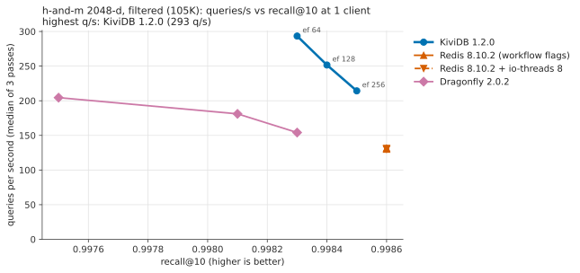
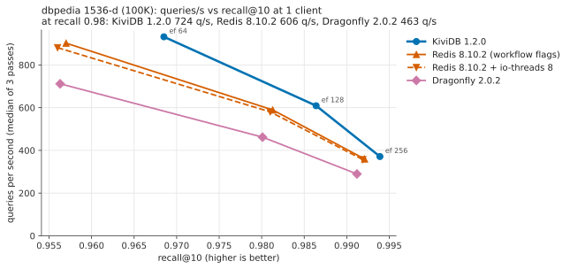
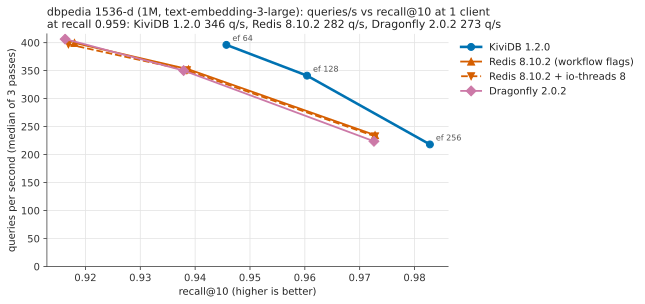
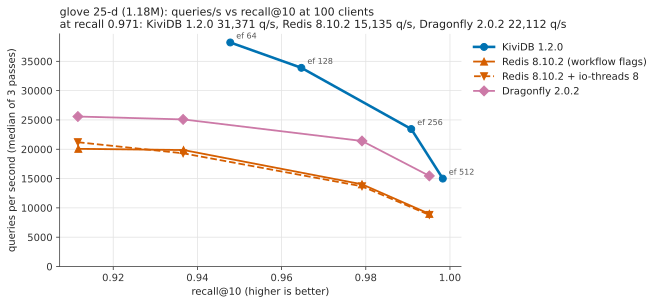

### Throughput by number of clients (ef 128)
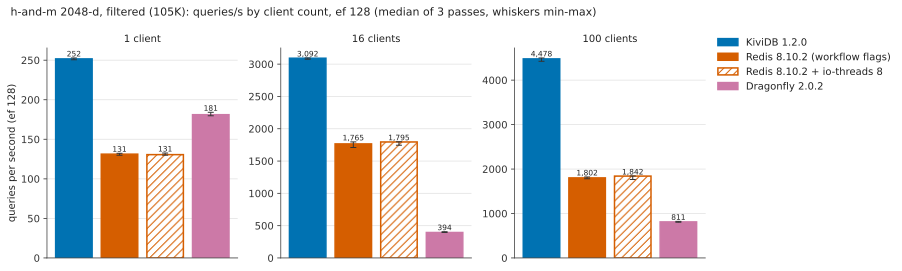
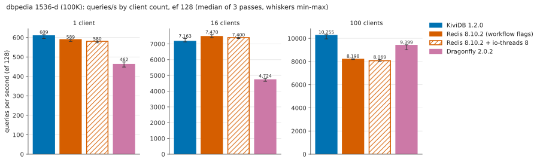
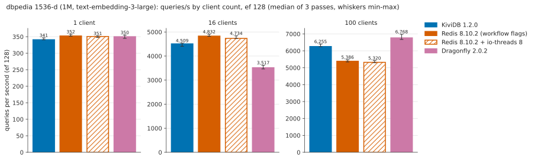

### Ingest time
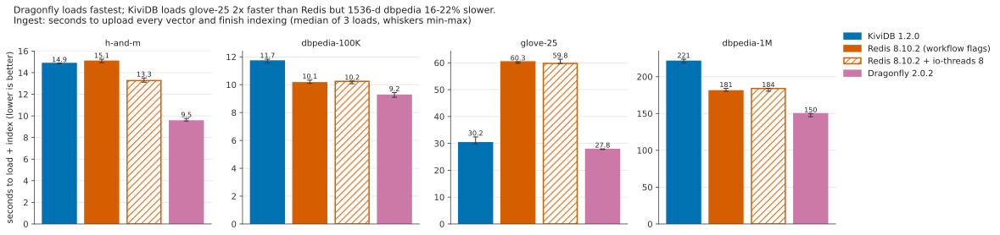

### Memory during ingestion
Server RSS over time while each engine loads the dataset. The dotted line is where the client
starts uploading, and each engine's marker is where its load ended (indexing complete). The lines
stop where the tool begins deleting the data.

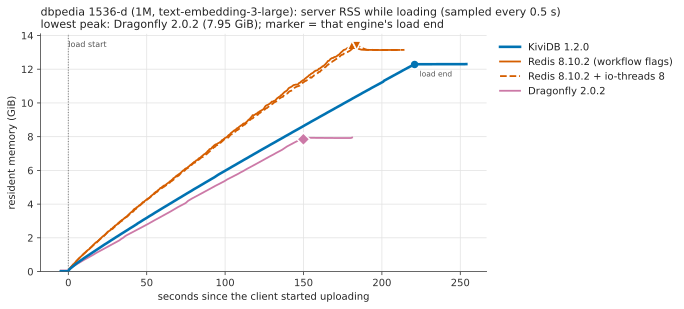
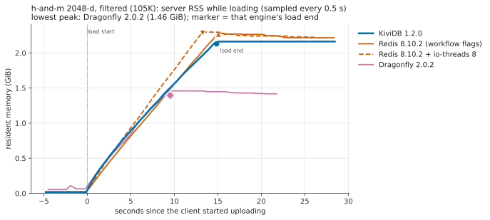
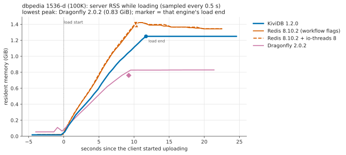
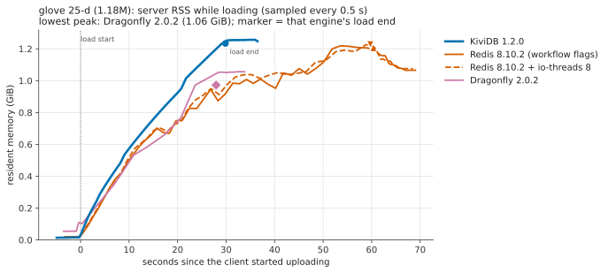

### Memory as the dataset grows
The same samples, plotted against the number of vectors stored so far.

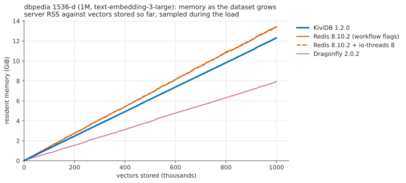
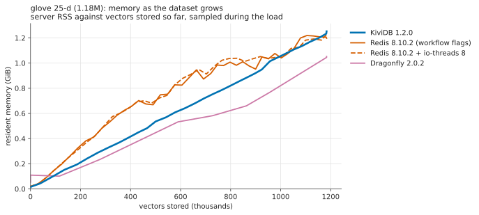
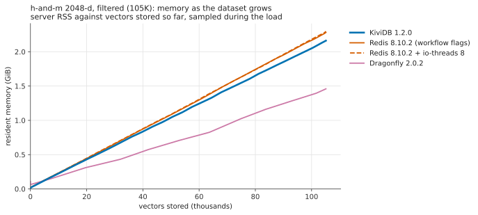
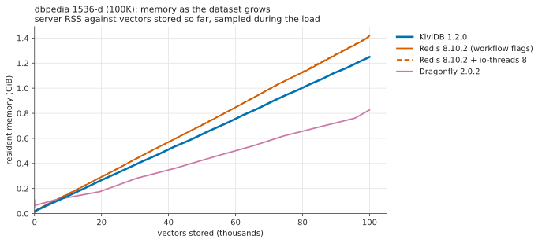

### Memory per vector
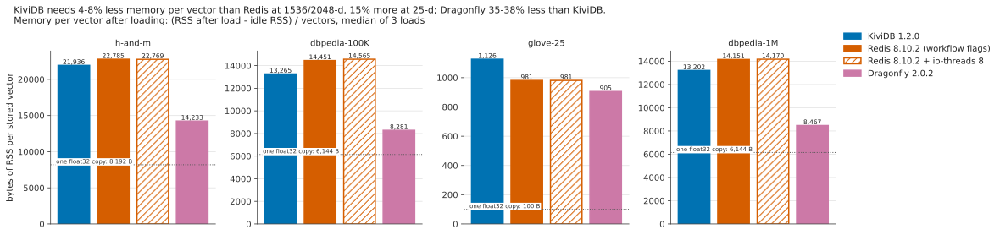

### Memory after deleting everything
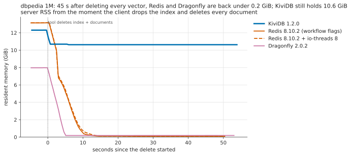
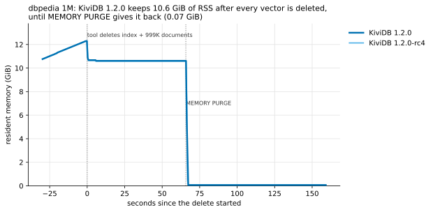

### Against 1.2.0-rc4
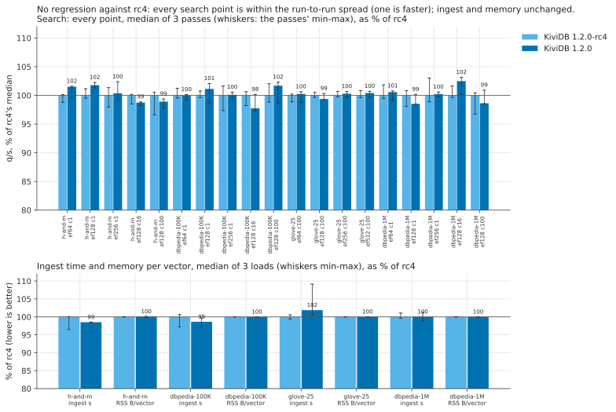

## All results

Search rows are the median of three full passes (each pass: the median of three repetitions);
ingest and memory rows are the median of the three loads.

### h-and-m 2048-d, filtered (105K)

| engine | ef | clients | q/s median (3 passes) | spread between passes | largest spread of 3 reps | recall@10 | p50 ms | p95 ms | p99 ms | p99.9 ms | client-bound? |
|---|---:|---:|---:|---:|---:|---:|---:|---:|---:|---:|---|
| KiviDB 1.2.0 | 64 | 1 | 293 | 2.0% | 4.7% | 0.9983 | 2.08 | 9.77 | 26.58 | 45.09 | no |
| KiviDB 1.2.0 | 128 | 1 | 252 | 0.9% | 4.5% | 0.9984 | 2.35 | 14.72 | 16.53 | 45.38 | no |
| KiviDB 1.2.0 | 256 | 1 | 214 | 3.3% | 5.9% | 0.9985 | 2.51 | 16.52 | 20.37 | 46.72 | no |
| KiviDB 1.2.0 | 128 | 16 | 3,092 | 0.6% | 0.9% | 0.9984 | 3.08 | 19.60 | 22.16 | 60.22 | no |
| KiviDB 1.2.0 | 128 | 100 | 4,478 | 1.7% | 1.2% | 0.9984 | 17.70 | 52.75 | 86.99 | 122.69 | no |
| Redis 8.10.2 (workflow flags) | 64 | 1 | 131 | 2.4% | 2.0% | 0.9986 | 2.87 | 39.72 | 47.67 | 53.38 | no |
| Redis 8.10.2 (workflow flags) | 128 | 1 | 131 | 1.9% | 1.0% | 0.9986 | 2.85 | 39.74 | 47.54 | 53.82 | no |
| Redis 8.10.2 (workflow flags) | 256 | 1 | 130 | 1.4% | 0.9% | 0.9986 | 2.87 | 39.86 | 47.64 | 53.57 | no |
| Redis 8.10.2 (workflow flags) | 128 | 16 | 1,765 | 4.9% | 0.9% | 0.9986 | 3.34 | 47.62 | 56.71 | 64.61 | no |
| Redis 8.10.2 (workflow flags) | 128 | 100 | 1,802 | 2.3% | 1.3% | 0.9986 | 51.33 | 92.15 | 109.30 | 121.22 | no |
| Redis 8.10.2 + io-threads 8 | 64 | 1 | 130 | 2.5% | 0.8% | 0.9986 | 2.91 | 40.02 | 47.86 | 53.47 | no |
| Redis 8.10.2 + io-threads 8 | 128 | 1 | 131 | 2.1% | 0.9% | 0.9986 | 2.88 | 40.16 | 47.75 | 53.89 | no |
| Redis 8.10.2 + io-threads 8 | 256 | 1 | 131 | 2.7% | 1.1% | 0.9986 | 2.86 | 39.63 | 47.36 | 53.22 | no |
| Redis 8.10.2 + io-threads 8 | 128 | 16 | 1,795 | 3.0% | 1.1% | 0.9986 | 3.31 | 47.05 | 55.98 | 63.01 | no |
| Redis 8.10.2 + io-threads 8 | 128 | 100 | 1,842 | 4.2% | 2.3% | 0.9986 | 50.28 | 89.93 | 107.64 | 118.85 | no |
| Dragonfly 2.0.2 | 64 | 1 | 204 | 2.5% | 1.7% | 0.9975 | 3.35 | 11.65 | 29.47 | 95.17 | no |
| Dragonfly 2.0.2 | 128 | 1 | 181 | 2.4% | 2.6% | 0.9981 | 3.35 | 13.33 | 36.95 | 108.35 | no |
| Dragonfly 2.0.2 | 256 | 1 | 154 | 1.7% | 1.9% | 0.9983 | 3.37 | 19.30 | 51.12 | 122.69 | no |
| Dragonfly 2.0.2 | 128 | 16 | 394 | 3.2% | 3.9% | 0.9981 | 29.56 | 103.36 | 133.48 | 194.30 | no |
| Dragonfly 2.0.2 | 128 | 100 | 811 | 2.5% | 3.1% | 0.9981 | 113.72 | 218.13 | 257.26 | 296.45 | no |

| engine | loads | upload s (median, min-max) | index wait s | upload+index s | peak RSS GiB | RSS after load GiB | used_memory after load GiB | RSS B/vector | used_memory B/vector |
|---|---:|---:|---:|---:|---:|---:|---:|---:|---:|
| KiviDB 1.2.0 | 3 | 14.8 (14.8-14.8) | 0.01 | 14.9 | 2.19 | 2.16 | 2.04 | 21,936 | 20,859 |
| Redis 8.10.2 (workflow flags) | 3 | 15.1 (14.9-15.2) | 0.00 | 15.1 | 2.28 | 2.25 | 2.37 | 22,785 | 24,220 |
| Redis 8.10.2 + io-threads 8 | 3 | 13.3 (13.1-13.5) | 0.00 | 13.3 | 2.29 | 2.25 | 2.37 | 22,769 | 24,237 |
| Dragonfly 2.0.2 | 3 | 9.5 (9.5-9.8) | 0.00 | 9.5 | 1.46 | 1.45 | 1.27 | 14,233 | 12,919 |
| KiviDB 1.2.0-rc4 | 3 | 15.1 (14.5-15.1) | 0.01 | 15.1 | 2.19 | 2.16 | 2.04 | 21,920 | 20,859 |

### dbpedia 1536-d (100K)

| engine | ef | clients | q/s median (3 passes) | spread between passes | largest spread of 3 reps | recall@10 | p50 ms | p95 ms | p99 ms | p99.9 ms | client-bound? |
|---|---:|---:|---:|---:|---:|---:|---:|---:|---:|---:|---|
| KiviDB 1.2.0 | 64 | 1 | 932 | 1.0% | 3.3% | 0.9685 | 1.07 | 1.33 | 1.50 | 1.79 | no |
| KiviDB 1.2.0 | 128 | 1 | 609 | 3.3% | 4.5% | 0.9864 | 1.64 | 2.08 | 2.24 | 2.54 | no |
| KiviDB 1.2.0 | 256 | 1 | 371 | 1.0% | 4.4% | 0.9939 | 2.71 | 3.49 | 3.82 | 4.06 | no |
| KiviDB 1.2.0 | 128 | 16 | 7,163 | 3.0% | 2.0% | 0.9864 | 2.22 | 2.84 | 3.07 | 3.43 | no |
| KiviDB 1.2.0 | 128 | 100 | 10,255 | 3.6% | 3.4% | 0.9864 | 9.27 | 13.03 | 13.88 | 14.90 | no |
| Redis 8.10.2 (workflow flags) | 64 | 1 | 902 | 0.7% | 0.9% | 0.9570 | 1.11 | 1.31 | 1.48 | 1.69 | no |
| Redis 8.10.2 (workflow flags) | 128 | 1 | 589 | 1.6% | 1.1% | 0.9813 | 1.71 | 2.04 | 2.19 | 2.47 | no |
| Redis 8.10.2 (workflow flags) | 256 | 1 | 360 | 1.4% | 0.9% | 0.9921 | 2.83 | 3.39 | 3.58 | 3.83 | no |
| Redis 8.10.2 (workflow flags) | 128 | 16 | 7,470 | 2.5% | 4.5% | 0.9813 | 2.12 | 2.54 | 2.75 | 3.21 | no |
| Redis 8.10.2 (workflow flags) | 128 | 100 | 8,198 | 0.9% | 1.6% | 0.9813 | 12.10 | 12.79 | 13.09 | 13.53 | no |
| Redis 8.10.2 + io-threads 8 | 64 | 1 | 881 | 1.0% | 0.5% | 0.9560 | 1.13 | 1.34 | 1.54 | 1.73 | no |
| Redis 8.10.2 + io-threads 8 | 128 | 1 | 580 | 1.4% | 1.1% | 0.9810 | 1.74 | 2.07 | 2.21 | 2.62 | no |
| Redis 8.10.2 + io-threads 8 | 256 | 1 | 357 | 1.6% | 0.3% | 0.9919 | 2.84 | 3.41 | 3.62 | 3.89 | no |
| Redis 8.10.2 + io-threads 8 | 128 | 16 | 7,400 | 1.0% | 3.0% | 0.9810 | 2.17 | 2.58 | 2.81 | 3.25 | no |
| Redis 8.10.2 + io-threads 8 | 128 | 100 | 8,069 | 1.8% | 1.5% | 0.9810 | 12.28 | 13.08 | 13.44 | 13.76 | no |
| Dragonfly 2.0.2 | 64 | 1 | 712 | 5.0% | 2.3% | 0.9563 | 1.39 | 1.69 | 2.17 | 2.68 | no |
| Dragonfly 2.0.2 | 128 | 1 | 462 | 5.6% | 2.2% | 0.9801 | 2.16 | 2.63 | 2.92 | 3.62 | no |
| Dragonfly 2.0.2 | 256 | 1 | 290 | 5.2% | 2.1% | 0.9912 | 3.48 | 4.27 | 4.65 | 5.36 | no |
| Dragonfly 2.0.2 | 128 | 16 | 4,724 | 3.9% | 3.2% | 0.9801 | 3.26 | 3.64 | 4.23 | 4.88 | no |
| Dragonfly 2.0.2 | 128 | 100 | 9,399 | 4.6% | 1.9% | 0.9801 | 10.09 | 14.76 | 17.43 | 20.24 | no |

| engine | loads | upload s (median, min-max) | index wait s | upload+index s | peak RSS GiB | RSS after load GiB | used_memory after load GiB | RSS B/vector | used_memory B/vector |
|---|---:|---:|---:|---:|---:|---:|---:|---:|---:|
| KiviDB 1.2.0 | 3 | 11.7 (11.6-11.8) | 0.01 | 11.7 | 1.25 | 1.25 | 1.22 | 13,265 | 13,066 |
| Redis 8.10.2 (workflow flags) | 3 | 10.1 (10.1-10.3) | 0.00 | 10.1 | 1.42 | 1.37 | 1.40 | 14,451 | 15,073 |
| Redis 8.10.2 + io-threads 8 | 3 | 10.2 (10.1-10.3) | 0.00 | 10.2 | 1.42 | 1.38 | 1.41 | 14,565 | 15,074 |
| Dragonfly 2.0.2 | 3 | 9.2 (9.1-9.4) | 0.00 | 9.2 | 0.84 | 0.83 | 0.72 | 8,281 | 7,691 |
| KiviDB 1.2.0-rc4 | 3 | 11.9 (11.5-11.9) | 0.01 | 11.9 | 1.25 | 1.25 | 1.22 | 13,266 | 13,066 |

### glove 25-d (1.18M)

| engine | ef | clients | q/s median (3 passes) | spread between passes | largest spread of 3 reps | recall@10 | p50 ms | p95 ms | p99 ms | p99.9 ms | client-bound? |
|---|---:|---:|---:|---:|---:|---:|---:|---:|---:|---:|---|
| KiviDB 1.2.0 | 64 | 100 | 38,217 | 1.8% | 1.8% | 0.9478 | 2.41 | 3.32 | 3.54 | 4.13 | no |
| KiviDB 1.2.0 | 128 | 100 | 33,891 | 1.1% | 1.4% | 0.9647 | 2.71 | 3.72 | 3.94 | 4.24 | no |
| KiviDB 1.2.0 | 256 | 100 | 23,451 | 1.0% | 0.9% | 0.9908 | 4.01 | 5.44 | 5.78 | 6.05 | no |
| KiviDB 1.2.0 | 512 | 100 | 14,992 | 1.0% | 0.5% | 0.9983 | 6.31 | 8.66 | 9.26 | 9.83 | no |
| Redis 8.10.2 (workflow flags) | 64 | 100 | 20,071 | 5.9% | 6.0% | 0.9117 | 4.77 | 7.32 | 8.86 | 10.06 | no |
| Redis 8.10.2 (workflow flags) | 128 | 100 | 19,863 | 1.3% | 0.7% | 0.9367 | 4.92 | 5.75 | 6.98 | 7.86 | no |
| Redis 8.10.2 (workflow flags) | 256 | 100 | 14,019 | 1.3% | 0.7% | 0.9791 | 7.02 | 7.40 | 8.14 | 9.19 | no |
| Redis 8.10.2 (workflow flags) | 512 | 100 | 8,973 | 2.0% | 1.3% | 0.9951 | 11.03 | 11.60 | 12.00 | 13.05 | no |
| Redis 8.10.2 + io-threads 8 | 64 | 100 | 21,198 | 0.6% | 1.9% | 0.9116 | 4.56 | 5.98 | 7.14 | 7.92 | no |
| Redis 8.10.2 + io-threads 8 | 128 | 100 | 19,310 | 0.7% | 0.8% | 0.9366 | 5.05 | 6.03 | 7.04 | 7.85 | no |
| Redis 8.10.2 + io-threads 8 | 256 | 100 | 13,677 | 2.1% | 1.2% | 0.9791 | 7.24 | 7.68 | 8.49 | 9.38 | no |
| Redis 8.10.2 + io-threads 8 | 512 | 100 | 8,794 | 2.0% | 0.6% | 0.9951 | 11.29 | 11.82 | 12.33 | 13.16 | no |
| Dragonfly 2.0.2 | 64 | 100 | 25,582 | 4.0% | 5.3% | 0.9116 | 3.72 | 5.51 | 7.04 | 8.42 | no |
| Dragonfly 2.0.2 | 128 | 100 | 25,089 | 0.7% | 3.2% | 0.9366 | 3.83 | 5.52 | 6.51 | 7.59 | no |
| Dragonfly 2.0.2 | 256 | 100 | 21,412 | 3.5% | 3.6% | 0.9791 | 4.44 | 6.47 | 8.09 | 10.09 | no |
| Dragonfly 2.0.2 | 512 | 100 | 15,452 | 0.5% | 2.1% | 0.9951 | 6.14 | 8.79 | 10.69 | 12.49 | no |

| engine | loads | upload s (median, min-max) | index wait s | upload+index s | peak RSS GiB | RSS after load GiB | used_memory after load GiB | RSS B/vector | used_memory B/vector |
|---|---:|---:|---:|---:|---:|---:|---:|---:|---:|
| KiviDB 1.2.0 | 3 | 30.2 (29.8-32.3) | 0.09 | 30.2 | 1.26 | 1.25 | 1.17 | 1,126 | 1,055 |
| Redis 8.10.2 (workflow flags) | 3 | 60.3 (59.8-60.4) | 0.00 | 60.3 | 1.22 | 1.10 | 1.02 | 981 | 925 |
| Redis 8.10.2 + io-threads 8 | 3 | 59.8 (59.7-61.3) | 0.00 | 59.8 | 1.25 | 1.10 | 1.02 | 981 | 925 |
| Dragonfly 2.0.2 | 3 | 27.8 (27.7-27.9) | 0.00 | 27.8 | 1.06 | 1.05 | 1.07 | 905 | 965 |
| KiviDB 1.2.0-rc4 | 3 | 29.6 (29.4-29.8) | 0.08 | 29.7 | 1.26 | 1.25 | 1.17 | 1,126 | 1,055 |

### dbpedia 1536-d (1M, text-embedding-3-large)

| engine | ef | clients | q/s median (3 passes) | spread between passes | largest spread of 3 reps | recall@10 | p50 ms | p95 ms | p99 ms | p99.9 ms | client-bound? |
|---|---:|---:|---:|---:|---:|---:|---:|---:|---:|---:|---|
| KiviDB 1.2.0 | 64 | 1 | 396 | 1.7% | 5.9% | 0.9457 | 2.53 | 3.02 | 3.23 | 3.66 | no |
| KiviDB 1.2.0 | 128 | 1 | 341 | 1.8% | 4.5% | 0.9604 | 2.86 | 3.53 | 3.68 | 4.04 | no |
| KiviDB 1.2.0 | 256 | 1 | 218 | 0.8% | 3.9% | 0.9828 | 4.63 | 5.90 | 6.21 | 6.59 | no |
| KiviDB 1.2.0 | 128 | 16 | 4,509 | 3.0% | 0.7% | 0.9604 | 3.57 | 4.40 | 4.73 | 5.09 | no |
| KiviDB 1.2.0 | 128 | 100 | 6,255 | 2.4% | 6.7% | 0.9604 | 14.60 | 19.94 | 21.66 | 24.13 | no |
| Redis 8.10.2 (workflow flags) | 64 | 1 | 400 | 2.8% | 1.0% | 0.9180 | 2.53 | 2.93 | 3.03 | 3.46 | no |
| Redis 8.10.2 (workflow flags) | 128 | 1 | 352 | 1.6% | 1.0% | 0.9388 | 2.83 | 3.36 | 3.55 | 4.09 | no |
| Redis 8.10.2 (workflow flags) | 256 | 1 | 235 | 1.3% | 0.1% | 0.9728 | 4.29 | 5.26 | 5.48 | 5.84 | no |
| Redis 8.10.2 (workflow flags) | 128 | 16 | 4,832 | 1.8% | 1.6% | 0.9388 | 3.28 | 3.87 | 4.16 | 4.76 | no |
| Redis 8.10.2 (workflow flags) | 128 | 100 | 5,386 | 2.4% | 1.0% | 0.9388 | 18.15 | 19.30 | 19.79 | 20.50 | no |
| Redis 8.10.2 + io-threads 8 | 64 | 1 | 397 | 0.7% | 1.3% | 0.9169 | 2.53 | 2.93 | 3.10 | 3.33 | no |
| Redis 8.10.2 + io-threads 8 | 128 | 1 | 351 | 1.4% | 2.2% | 0.9385 | 2.87 | 3.35 | 3.55 | 4.04 | no |
| Redis 8.10.2 + io-threads 8 | 256 | 1 | 232 | 1.1% | 0.3% | 0.9728 | 4.34 | 5.31 | 5.54 | 5.79 | no |
| Redis 8.10.2 + io-threads 8 | 128 | 16 | 4,734 | 2.3% | 3.0% | 0.9385 | 3.35 | 3.96 | 4.16 | 4.78 | no |
| Redis 8.10.2 + io-threads 8 | 128 | 100 | 5,320 | 2.3% | 0.7% | 0.9385 | 18.33 | 19.43 | 19.92 | 20.32 | no |
| Dragonfly 2.0.2 | 64 | 1 | 406 | 1.3% | 2.3% | 0.9163 | 2.46 | 2.96 | 3.22 | 3.70 | no |
| Dragonfly 2.0.2 | 128 | 1 | 350 | 2.9% | 2.3% | 0.9379 | 2.85 | 3.53 | 4.04 | 5.08 | no |
| Dragonfly 2.0.2 | 256 | 1 | 224 | 4.0% | 6.2% | 0.9726 | 4.43 | 5.61 | 5.98 | 6.24 | no |
| Dragonfly 2.0.2 | 128 | 16 | 3,517 | 4.4% | 1.7% | 0.9379 | 4.40 | 4.91 | 5.42 | 5.57 | no |
| Dragonfly 2.0.2 | 128 | 100 | 6,768 | 4.6% | 5.1% | 0.9379 | 13.91 | 20.32 | 24.69 | 28.24 | no |

| engine | loads | upload s (median, min-max) | index wait s | upload+index s | peak RSS GiB | RSS after load GiB | used_memory after load GiB | RSS B/vector | used_memory B/vector |
|---|---:|---:|---:|---:|---:|---:|---:|---:|---:|
| KiviDB 1.2.0 | 3 | 220.9 (218.5-223.6) | 0.07 | 221.0 | 12.31 | 12.30 | 12.23 | 13,202 | 13,140 |
| Redis 8.10.2 (workflow flags) | 3 | 180.8 (180.3-184.1) | 0.00 | 180.8 | 13.44 | 13.19 | 14.01 | 14,151 | 15,057 |
| Redis 8.10.2 + io-threads 8 | 3 | 183.9 (180.2-184.0) | 0.00 | 183.9 | 13.45 | 13.20 | 14.01 | 14,170 | 15,057 |
| Dragonfly 2.0.2 | 3 | 149.7 (145.6-149.9) | 0.00 | 149.7 | 7.95 | 7.93 | 7.17 | 8,467 | 7,697 |
| KiviDB 1.2.0-rc4 | 3 | 220.9 (220.0-223.3) | 0.07 | 220.9 | 12.31 | 12.30 | 12.23 | 13,203 | 13,140 |

## Against 1.2.0-rc4

KiviDB 1.2.0 (`75482ab`) and 1.2.0-rc4 (`a6b1bf3`) were built the same way on the same machine
image and run on the same server in the same session. Each ran three full passes (a fresh server,
a load and every search point; three repetitions per point), with the order alternating: 1.2.0
first in passes 1 and 3, rc4 first in pass 2. A row counts as a regression when 1.2.0 is slower
than rc4 by more than the larger of the two engines' pass-to-pass spreads.

**Verdict: no regression.** 18 of 19 search points are within the spread. One is faster (h-and-m,
ef 128, 1 client). Ingest time and memory per vector match. The changes since rc4 (ACL key
checks for SORT/SORT_RO BY/GET and STORE/STOREDIST/STREAMS, SLOWLOG/MONITOR redaction, the AOF
writer, AOF replay of expired keys, cluster gossip addresses, MIGRATE on tokio, the compaction
slab-generation check, FreeBSD-only code, `INFO stats rejected_connections`) do not touch the
vector search or `HSET` ingest path, and nothing here shows them.

| dataset | ef | clients | rc4 q/s | 1.2.0 q/s | 1.2.0/rc4 | run-to-run spread | verdict | rc4 recall | 1.2.0 recall | rc4 p50 / p99 / p99.9 ms | 1.2.0 p50 / p99 / p99.9 ms |
|---|---:|---:|---:|---:|---:|---:|---|---:|---:|---:|---:|
| h-and-m | 64 | 1 | 289 | 293 | 1.015 | 2.0% | same | 0.9983 | 0.9983 | 2.06 / 26.86 / 45.38 | 2.08 / 26.58 / 45.09 |
| h-and-m | 128 | 1 | 247 | 252 | 1.018 | 1.7% | faster | 0.9984 | 0.9984 | 2.42 / 16.91 / 47.20 | 2.35 / 16.53 / 45.38 |
| h-and-m | 256 | 1 | 214 | 214 | 1.004 | 3.4% | same | 0.9985 | 0.9985 | 2.54 / 20.58 / 47.20 | 2.51 / 20.37 / 46.72 |
| h-and-m | 128 | 16 | 3,131 | 3,092 | 0.988 | 1.7% | same | 0.9984 | 0.9984 | 3.05 / 21.84 / 59.97 | 3.08 / 22.16 / 60.22 |
| h-and-m | 128 | 100 | 4,527 | 4,478 | 0.989 | 3.9% | same | 0.9984 | 0.9984 | 18.16 / 84.86 / 113.15 | 17.70 / 86.99 / 122.69 |
| dbpedia-100K | 64 | 1 | 932 | 932 | 1.000 | 1.7% | same | 0.9688 | 0.9685 | 1.06 / 1.47 / 1.85 | 1.07 / 1.50 / 1.79 |
| dbpedia-100K | 128 | 1 | 602 | 609 | 1.011 | 3.3% | same | 0.9856 | 0.9864 | 1.66 / 2.29 / 2.54 | 1.64 / 2.24 / 2.54 |
| dbpedia-100K | 256 | 1 | 371 | 371 | 1.001 | 4.3% | same | 0.9936 | 0.9939 | 2.70 / 3.76 / 4.07 | 2.71 / 3.82 / 4.06 |
| dbpedia-100K | 128 | 16 | 7,328 | 7,163 | 0.978 | 3.0% | same | 0.9856 | 0.9864 | 2.17 / 2.99 / 3.40 | 2.22 / 3.07 / 3.43 |
| dbpedia-100K | 128 | 100 | 10,085 | 10,255 | 1.017 | 3.6% | same | 0.9856 | 0.9864 | 9.47 / 14.16 / 15.62 | 9.27 / 13.88 / 14.90 |
| glove-25 | 64 | 100 | 38,124 | 38,217 | 1.002 | 1.8% | same | 0.9479 | 0.9478 | 2.42 / 3.63 / 3.92 | 2.41 / 3.54 / 4.13 |
| glove-25 | 128 | 100 | 34,108 | 33,891 | 0.994 | 1.1% | same | 0.9648 | 0.9647 | 2.72 / 3.92 / 4.21 | 2.71 / 3.94 / 4.24 |
| glove-25 | 256 | 100 | 23,381 | 23,451 | 1.003 | 1.0% | same | 0.9908 | 0.9908 | 3.99 / 5.81 / 6.06 | 4.01 / 5.78 / 6.05 |
| glove-25 | 512 | 100 | 14,932 | 14,992 | 1.004 | 1.2% | same | 0.9983 | 0.9983 | 6.40 / 9.29 / 9.75 | 6.31 / 9.26 / 9.83 |
| dbpedia-1M | 64 | 1 | 394 | 396 | 1.006 | 2.3% | same | 0.9460 | 0.9457 | 2.52 / 3.22 / 3.48 | 2.53 / 3.23 / 3.66 |
| dbpedia-1M | 128 | 1 | 346 | 341 | 0.985 | 2.8% | same | 0.9609 | 0.9604 | 2.94 / 3.79 / 3.98 | 2.86 / 3.68 / 4.04 |
| dbpedia-1M | 256 | 1 | 218 | 218 | 1.002 | 4.1% | same | 0.9828 | 0.9828 | 4.55 / 6.18 / 6.51 | 4.63 / 6.21 / 6.59 |
| dbpedia-1M | 128 | 16 | 4,400 | 4,509 | 1.025 | 3.0% | same | 0.9609 | 0.9604 | 3.60 / 4.69 / 5.08 | 3.57 / 4.73 / 5.09 |
| dbpedia-1M | 128 | 100 | 6,342 | 6,255 | 0.986 | 3.7% | same | 0.9609 | 0.9604 | 14.58 / 22.17 / 27.36 | 14.60 / 21.66 / 24.13 |

| dataset | rc4 upload+index s (median, min-max) | 1.2.0 | 1.2.0/rc4 | rc4 RSS B/vector | 1.2.0 RSS B/vector | 1.2.0/rc4 |
|---|---:|---:|---:|---:|---:|---:|
| h-and-m | 15.1 (14.5-15.1) | 14.9 (14.8-14.9) | 0.985 | 21,920 | 21,936 | 1.001 |
| dbpedia-100K | 11.9 (11.5-11.9) | 11.7 (11.6-11.8) | 0.986 | 13,266 | 13,265 | 1.000 |
| glove-25 | 29.7 (29.5-29.9) | 30.2 (29.9-32.4) | 1.019 | 1,126 | 1,126 | 1.000 |
| dbpedia-1M | 220.9 (220.1-223.3) | 221.0 (218.5-223.7) | 1.000 | 13,203 | 13,202 | 1.000 |

**glove-25 ingest, checked with more loads.** In the three passes every 1.2.0 load (29.9, 30.2,
32.4 s) was slower than every rc4 load (29.5-29.9 s): +1.9% at the median, against a 1.3% spread.
Five more upload-only loads of each, alternating which went first (`harness/extra_glove.sh`,
passes `xg1`-`xg5` in `results/raw/`), gave these upload times:

| | load 1 | 2 | 3 | 4 | 5 | median of all 8 loads (range) |
|---|---:|---:|---:|---:|---:|---:|
| 1.2.0-rc4 | 30.7 | 30.3 | 31.9 | 30.0 | 30.1 | 30.05 (29.4-31.9) |
| 1.2.0 | 30.5 | 30.6 | 32.3 | 30.0 | 29.9 | 30.35 (29.8-32.3) |

That is 1% over eight loads each, and the ranges overlap (rc4 also reached 31.9 s), so this is
not a regression and was not profiled. The pass medians in the tables above keep the three-load
method of every other row.

**Tail latency.** p99.9 at 100 clients on h-and-m is 122.7 ms against 113.2 (median of three
passes). Per pass it is 117 / 123 / 134 ms against 118 / 113 / 113, with p99 at 86 / 87 / 101
against 85 / 84 / 85. The ranges overlap, the third pass alone drives the difference, and on
dbpedia-1M the tail moves the other way (24.1 against 27.4 ms). Each p99.9 is set by the slowest
10 of a run's 10,000 queries, so treat it as tail noise rather than a change.

**Memory after a delete** is unchanged: both hold 10.6 GiB of RSS after the delete and drop to
0.06-0.07 GiB on `MEMORY PURGE` ([chart](charts/memory-purge-dbpedia-1M.svg)).

## How it was measured

### Hardware

| | |
|---|---|
| Cloud | Azure, region swedencentral, both VMs in one proximity placement group (same datacenter), one virtual network, accelerated networking |
| Server | `Standard_D32ps_v5`: 32 vCPU Ampere Altra (Arm Neoverse-N1), 1 NUMA node, 128 GB RAM |
| Client | `Standard_D16ps_v5`: 16 vCPU Ampere Altra (Neoverse-N1), 64 GB RAM (runs only the load generator) |
| Builder | `Standard_D8ps_v5`, same image, outside the placement group; compiles KiviDB only, so nothing builds on the server |
| OS | Ubuntu 22.04.5 LTS arm64, kernel 6.8.0-1070-azure |

These are the machine types of the 1.2.0-rc3 and rc4 runs (server D32ps_v5, client D16ps_v5) and
of the repo's `vector-benchmark.yml` server. Only one engine is resident on the server at a time:
each is started fresh for each dataset, loaded, searched, and stopped (its port must be closed)
before the next one starts.

### Engines and flags

| Engine | Version | Command line |
|---|---|---|
| KiviDB | 1.2.0 (branch `release/1.2.0`, commit `75482ab`; reports `1.2.0-rc6` until the rc7 tag) | `kividb --bind 0.0.0.0 --port 6380 --loglevel error` |
| KiviDB | 1.2.0-rc4 (tag `v1.2.0-rc4`, commit `a6b1bf3`) | the same |
| Redis | 8.10.2 (`redis=6:8.10.2-1rl1~jammy1` from packages.redis.io, query engine `redisearch.so` from the same package) | `redis-server --port 6381 --bind 0.0.0.0 --protected-mode no --save '' --appendonly no --loadmodule .../redisearch.so` |
| Redis, multi-core | the same | the same plus `--io-threads 8` |
| Dragonfly | v2.0.2 (release binary `dragonfly-aarch64`) | `dragonfly --port 6382 --bind 0.0.0.0 --proactor_threads=32 --dbfilename= --logtostderr` |

- KiviDB is built exactly as `vector-benchmark.yml` and the arm64 release build it:
  `RUSTFLAGS="-C target-feature=+lse" cargo build --release`, default features (no Lua, no TLS),
  rustc 1.99.1. Both builds come from the same builder VM. Its worker threads default to one per
  core.
- Redis 8.10.2's query engine already runs with `search-workers 16` by default (checked with
  `CONFIG GET search-workers` on every start), so queries and background indexing are
  multi-threaded in both Redis rows. The second Redis row adds the I/O threads Redis's docs
  recommend for a multi-core box. The first row is the configuration `vector-benchmark.yml`
  and the earlier runs used, kept for comparability.
- No persistence on any engine (no RDB/AOF/snapshot file), as in the workflow.
- Redis Cluster is not included: the benchmark tool drives one endpoint and an FT index is local
  to one shard, so a cluster run would measure something else (a coordinator layer).

### Tool and workload

The load generator is [redis/vector-db-benchmark](https://github.com/redis/vector-db-benchmark)
(the Rust rewrite of qdrant/vector-db-benchmark's methodology), at the two pins the repo's
`.github/workflows/vector-benchmark.yml` uses:

| Dataset | Vectors | Dim | Tool pin | HNSW | Upload | Searches |
|---|---:|---:|---|---|---|---|
| `h-and-m-2048-angular-filters`: every query is a KNN under a TAG/NUMERIC metadata filter (median 2% of documents match) | 105,100 | 2048 | `d22d44e` (tag 0.2.0) | M 16, EF_CONSTRUCTION 128 | 16 threads, batch 64 | ef 64/128/256 at 1 client; ef 128 at 16 and 100 clients |
| `dbpedia-openai-100K-1536-angular` | 100,000 | 1536 | `d22d44e` | the same | the same | the same |
| `glove-25-angular` | 1,183,514 | 25 | `31a28b5` (the workflow's glove pin) | M 16, EF_CONSTRUCTION 256 | 100 threads, batch 64 | ef 64/128/256/512 at 100 clients |
| `dbpedia-openai-1M-1536-angular` (added for scale; a different embedding model, text-embedding-3-large, so not comparable with the 100K set) | 1,000,000 | 1536 | `d22d44e` | M 16, EF_CONSTRUCTION 128 | 16 threads, batch 64 | as h-and-m |

All engines get identical engines-files (only the engine name differs), the same query set and
top-10. Recall is recall@10 against the dataset's ground truth.

Repetitions:
- **Passes**: `harness/run_all.sh` runs three full passes over every engine and dataset. Each pass
  starts every engine fresh, loads the dataset and runs every search point. The order alternates:
  pass 1 runs 1.2.0, rc4, Redis, Redis + io-threads, Dragonfly; pass 2 runs the reverse
  (rc4 first); pass 3 runs pass 1's order again and keeps sampling for 45 s after the tool's
  delete (the memory-after-delete chart).
- **Search**: within a pass the tool runs each (ef, clients) point three times back to back; the
  first repetition also warms the engine. A pass's value is the median of its three repetitions.
  The tables show the **median of the three passes**, the spread between passes
  ((max-min)/median), and the largest spread of three repetitions inside one pass. Latency
  percentiles (p50/p95/p99/p99.9, per query, client-side) are those of the tool's reported
  repetition, as the median of the three passes.
- **Ingest and memory**: the three passes are three loads, each into a freshly started server.
  Ingest tables give the median and the min-max.

Client-bound check: the tool records its own CPU use per search point and flags a saturated
client (`client_saturated`); the client's whole-machine CPU was also logged every second
(`mpstat`). The columns "client-bound?" come from the tool's flag.

### Memory sampling

While each engine runs, a sampler on the server reads every 0.5 s: the process's `VmRSS`
(`/proc/<pid>/status`), `used_memory` from `INFO memory`, `DBSIZE`, and the process's CPU ticks.
The load window comes from the tool's own log, timestamped per line on the client
("Starting upload" to "Indexing complete"); the two machines' clocks differ by about 0.1 s.
"After load" memory is the median of the samples between the end of indexing and the start of
the first search (up to 10 s), with all vectors present. Bytes per vector = (RSS after load -
RSS of the idle server) / vectors. RSS is what the operating system has to provide;
`used_memory` is each engine's own accounting and is not defined the same way across engines.

### Reproduce

```
# 1. VMs (Azure CLI signed in): server + client in one placement group, plus a builder.
#    SSH_PUB is read by az itself: on Windows give a native path (C:/Users/me/.ssh/id_ed25519.pub).
RG=my-rg LOCATION=swedencentral SSH_PUB=~/.ssh/id_ed25519.pub SSH_CIDR=<your ip>/32 harness/create_vms.sh
# 2. builder: Rust 1.99.1 (build_kividb.sh pins it; TOOLCHAIN= overrides) + the two KiviDB builds.
#    The second argument names the build: kividb-<name> is its label in run_all.sh (cand, rc4).
scp harness/build_kividb.sh azureuser@BUILDER:
ssh azureuser@BUILDER 'bash build_kividb.sh 75482abb cand && bash build_kividb.sh v1.2.0-rc4 rc4'
#    copy ~/bins/ to the server, then delete the builder
ssh azureuser@BUILDER 'tar cz bins' | ssh azureuser@SERVER 'tar xz'
az vm delete -g my-rg -n vec-builder --yes
# 3. server: Redis 8.10.2, Dragonfly 2.0.2, the engine control script
scp harness/setup_server.sh harness/server_ctl.sh azureuser@SERVER:
ssh azureuser@SERVER 'bash setup_server.sh'
# 4. client: both tool pins + engines-files (about 15 min: it compiles the tool twice)
scp harness/setup_client.sh harness/run_suite.sh harness/run_all.sh harness/purge_test.sh harness/extra_glove.sh azureuser@CLIENT:
ssh azureuser@CLIENT 'bash setup_client.sh'
#    the client starts and stops engines over ssh to the server's private IP: give it a key the server accepts
ssh azureuser@CLIENT 'ssh-keygen -q -t ed25519 -N "" -f ~/.ssh/id_ed25519 <<< y >/dev/null; cat ~/.ssh/id_ed25519.pub' \
  | ssh azureuser@SERVER 'cat >> ~/.ssh/authorized_keys'
ssh azureuser@CLIENT 'ssh -o StrictHostKeyChecking=no <server private ip> true'
#    The tool downloads each dataset on its first use (from storage.googleapis.com/ann-filtered-benchmark,
#    ann-benchmarks.com and benchmarks.redislabs.s3.amazonaws.com, as its datasets.json says) before its
#    "Starting upload" line, so the download is not in the ingest time; it makes pass 1's first run of each
#    dataset take longer. Keep 100 GB free on the client.
# 5. run (on the client): three full passes, then the MEMORY PURGE check on 1.2.0 and rc4.
#    About 5 hours; run it detached so an ssh drop does not kill it, and wait for ~/out/ALL-DONE.
#    CAND=kividb-<name> BASE=kividb-<name> choose two other builds.
SERVER_IP=<server private ip> nohup bash run_all.sh > run_all.log 2>&1 < /dev/null &
#    optional: five more alternating glove-25 loads
SERVER_IP=<server private ip> bash extra_glove.sh
# 6. summarise (anywhere with Python 3 + matplotlib), from a copy of the client's ~/out
python harness/parse.py out results/summary.json
CHART_TITLES='{"ingest": "...", "bpv": "...", "after_delete": "...", "regression": "..."}' \
  python harness/charts.py results/summary.json charts results/tables.md
python harness/chart_purge.py charts/memory-purge-dbpedia-1M.svg \
  'out/purge/kividb-cand/dbpedia-openai-1M-1536-angular=KiviDB 1.2.0=#0072B2' \
  'out/purge/kividb-rc4/dbpedia-openai-1M-1536-angular=KiviDB 1.2.0-rc4=#56B4E9'
```

`CHART_TITLES` sets the one-line finding above four charts (ingest time, bytes per vector,
memory after delete, against rc4); without it they carry only their descriptive titles.

`charts.py` here knows only the labels `kividb-cand` and `kividb-rc4`. To compare two other builds, use the
copy in [`../../1.2.1/vector/harness/`](../../1.2.1/vector/harness/charts.py), which takes the labels and
names from `CAND`, `BASE`, `CAND_NAME` and `BASE_NAME`. That folder also has `fetch_release.sh`, which installs
a published release binary (checked against the release's `SHA256SUMS.txt`) in place of a local build.

### Files

- `results/summary.json`: every run parsed, including each run's memory samples. The charts and
  tables are made from it.
- `results/tables.md`: every number in this README's tables.
- `results/raw/<pass>/<engine>/<dataset>/`: the tool's console output (`tool.log`, timestamped per
  line on the client), the server's memory samples (`mem.csv`), and for the purge run `purge.log`.
  Passes are `p1`-`p3` (full), `purge`, and `xg1`-`xg5` (the extra glove-25 loads).
- `results/tool-results-json.tar.gz`: the tool's own result files (per search point: q/s,
  latency percentiles, recall, client CPU). `results/client-mpstat.tar.gz`: the client's CPU per
  second. To re-run `parse.py`, extract both into `results/` (they unpack under `raw/`).
