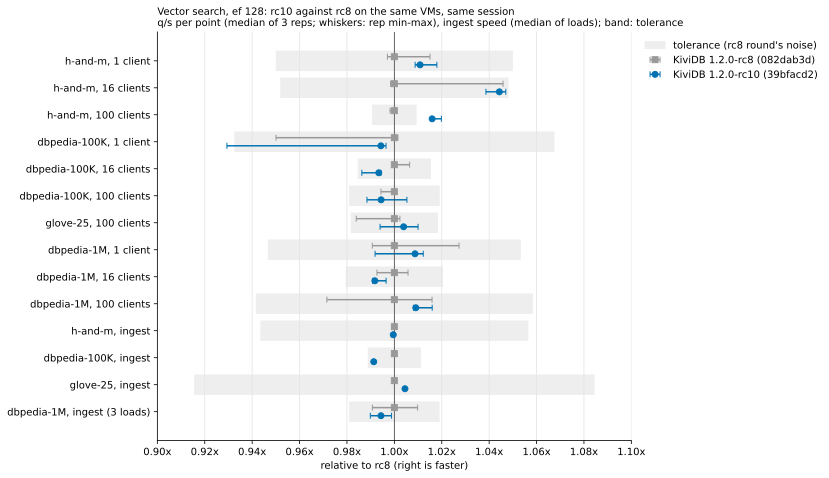

# Vector search: 1.2.0-rc10 round

KiviDB 1.2.0-rc10 (the code that ships as 1.2.0) against 1.2.0-rc8, with
[redis/vector-db-benchmark](https://github.com/redis/vector-db-benchmark), on the harness of
`benchmarks/1.2.0/vector/` and its `rc8/` round. Measured 2026-11-03 (UTC), one pass of each
build, no competitors.

**Verdict: no regression.** All 10 search points and all 4 ingest rows of rc10 are within the
noise the rc8 round measured. Recall is within 0.0004 and memory per vector within 0.4%.
- One point reads "faster": h-and-m at 100 clients, 1.016x. That comes from rc8 running low in
  this session, not from rc10. rc10 matches the rc8 round's rc8 there (0.992x).
- dbpedia-1M ingest read 1.1% slower after the first load pair, just outside the rc8 round's
  0.7% load spread. Two more alternating load pairs settled it: over three loads each, rc10 is
  0.6% slower, and the two builds' ranges overlap (rc8 225.6-229.9 s, rc10 228.1-230.1 s).

## What ran

| | |
|---|---|
| Cloud | Azure swedencentral (the region of the published run and the rc8 round). Server and client in one proximity placement group, one virtual network, accelerated networking |
| Server | `Standard_D32ps_v5`: 32 vCPU Ampere Altra (Neoverse-N1), 1 NUMA node, 128 GB |
| Client | `Standard_D16ps_v5`: 16 vCPU Neoverse-N1, 64 GB (load generator only) |
| Builder | `Standard_D8ps_v5`, same image, outside the placement group; deleted after the builds |
| OS | Ubuntu 22.04.5 LTS arm64, kernel 6.8.0-1070-azure (as published) |

| Build | Commit | `--version` | SHA-256 of the binary |
|---|---|---|---|
| rc10 (under test) | `39bfacd231bb294d390448eacfe0e243d365ebe8` (tag `v1.2.0-rc10`) | `kividb 1.2.0-rc10` | `66d8cc0d08852aa860d0a481d473b6b4bf804d940362b0037bd0036b0ebb3195` |
| rc8 (reference) | `082dab3d8929c180bccf993835e28992ea054fb5` | `kividb 1.2.0-rc8` | `edd8dfd4d6d9e5e7d9dd41d48e4ad2a96481399cd27615b6afef7ef5c8988cd4` |

- **Builds.** Both builds came from the same builder, using the suite's `build_kividb.sh`:
  - rustup stable, `rustc 1.99.1 (58cf8f9c3 2026-10-13)`, the rc8 round's toolchain;
  - `RUSTFLAGS="-C target-feature=+lse" cargo build --release`, default features.

  rc8's binary is byte-identical to the rc8 round's (same SHA-256). Both ran as
  `kividb --bind 0.0.0.0 --port 6380 --loglevel error`, one at a time, each started fresh in an
  emptied working directory.
- **Workload.** The rc8 round's workload, unchanged:
  - tool pins `d22d44e` (h-and-m, dbpedia) and `31a28b5` (glove-25);
  - HNSW M 16, EF_CONSTRUCTION 128 (256 for glove-25);
  - ef 128 at 1, 16 and 100 clients (glove-25 at 100 only);
  - three repetitions per point, back to back. A point's value is their median.
- **Pass.** One pass (`run_rc10.sh`). For each dataset each build gets a fresh server, one load
  and every search point. The order alternates: rc10 first on h-and-m and glove-25, rc8 first on
  dbpedia-100K and dbpedia-1M.
- **Extra loads.** dbpedia-1M ingest got two more upload-only load pairs, alternating
  (`extra_ingest_1m.sh`, passes `xg1` with rc10 first and `xg2` with rc8 first). The first pair
  had read 1.1% slower, against the rc8 round's 0.7% load spread.
- **Verdict rule.** One pass has no pass-to-pass spread of its own, so the tolerance is the
  larger of:
  - the rc8 round's pass-to-pass spreads (both its builds);
  - the rc8 round's largest within-pass repetition spread;
  - this round's own repetition spread.

  For ingest it is the larger of the rc8 round's load spreads, this round's, and 1%. The search
  table also says whether each gap is inside the narrower rule, the rc8 round's pass spreads
  alone.
- **Client.** The client was never the bottleneck: `client_saturated` was never set, and the
  client's busiest second used 51% of its 16 cores.

## rc10 against rc8 (same VMs, same session)

Search, ef 128, one pass each. q/s is the median of three repetitions; min-max is across the
repetitions.

| dataset | clients | first | rc8 q/s (min-max) | rc10 q/s (min-max) | rc10/rc8 | tolerance | verdict | within rc8-round pass spread | recall rc8 / rc10 | p99 ms rc8 / rc10 |
|---|---:|---|---:|---:|---:|---:|---|---|---:|---:|
| h-and-m (filtered) | 1 | rc10 | 240 (239-243) | 242 (242-244) | 1.011 | 5.0% | same | yes | 0.9985 / 0.9984 | 17.33 / 17.39 |
| h-and-m (filtered) | 16 | rc10 | 2,945 (2,940-3,080) | 3,076 (3,059-3,084) | 1.044 | 4.8% | same | no (faster) | 0.9985 / 0.9984 | 22.28 / 22.43 |
| h-and-m (filtered) | 100 | rc10 | 4,380 (4,372-4,383) | 4,450 (4,448-4,467) | 1.016 | 0.9% | faster | no (faster) | 0.9985 / 0.9984 | 88.22 / 85.57 |
| dbpedia-100K | 1 | rc8 | 599 (569-600) | 595 (556-597) | 0.994 | 6.8% | same | yes | 0.9857 / 0.9858 | 2.30 / 2.31 |
| dbpedia-100K | 16 | rc8 | 7,026 (7,022-7,071) | 6,980 (6,930-6,986) | 0.993 | 1.5% | same | yes | 0.9857 / 0.9858 | 3.13 / 3.18 |
| dbpedia-100K | 100 | rc8 | 9,944 (9,888-9,946) | 9,888 (9,829-9,996) | 0.994 | 1.9% | same | yes | 0.9857 / 0.9858 | 14.22 / 14.02 |
| glove-25 | 100 | rc10 | 33,328 (32,792-33,406) | 33,458 (33,127-33,662) | 1.004 | 1.8% | same | yes | 0.9647 / 0.9647 | 4.09 / 4.17 |
| dbpedia-1M | 1 | rc8 | 344 (341-354) | 347 (342-349) | 1.009 | 5.3% | same | yes | 0.9604 / 0.9608 | 3.79 / 3.80 |
| dbpedia-1M | 16 | rc8 | 4,366 (4,334-4,391) | 4,330 (4,326-4,351) | 0.992 | 2.1% | same | yes | 0.9604 / 0.9608 | 4.85 / 4.89 |
| dbpedia-1M | 100 | rc8 | 6,182 (6,006-6,280) | 6,238 (6,232-6,281) | 1.009 | 5.8% | same | yes | 0.9604 / 0.9608 | 20.89 / 22.54 |

The slowest rc10 point is 0.992x (dbpedia-1M, 16 clients). It is inside the rc8 round's own
pass spread (2.1%) and its repetition spread.

### Ingest and memory

One load each in the pass. dbpedia-1M also has the two extra load pairs.

| dataset | rc8 upload+index s, median (loads) | rc10 upload+index s, median (loads) | rc10/rc8 | tolerance | verdict | rc8 RSS B/vector | rc10 RSS B/vector | rc10/rc8 |
|---|---:|---:|---:|---:|---|---:|---:|---:|
| h-and-m | 15.2 | 15.2 | 1.000 | 5.7% | same | 21,863 | 21,950 | 1.004 |
| dbpedia-100K | 12.0 | 12.1 | 1.009 | 1.1% | same | 13,271 | 13,263 | 0.999 |
| glove-25 | 30.7 | 30.6 | 0.996 | 8.4% | same | 1,125 | 1,123 | 0.999 |
| dbpedia-1M | 227.8 (225.6, 227.8, 229.9) | 229.1 (228.1, 230.1, 229.1) | 1.006 | 1.9% | same | 13,203 | 13,198 | 1.000 |

**dbpedia-1M ingest.** The loads, in the order they ran:

| pair | first | second | rc10/rc8 |
|---|---|---|---:|
| p1 | rc8 225.6 s | rc10 228.1 s | 1.011 |
| xg1 | rc10 230.1 s | rc8 227.8 s | 1.010 |
| xg2 | rc8 229.9 s | rc10 229.1 s | 0.997 |

- rc10 is 0.6% slower over three loads each, and the ranges overlap.
- That is inside the 1% floor that applies even under the rc8 round's narrower 0.7% load spread.
- It is well inside the published run's load-to-load range for this dataset (218.5-223.7 s,
  2.4%).
- Both builds load 1.3-2.4% slower than in the rc8 round (rc8 then: 223.6-225.2 s). That is
  session drift, and it hits both builds.
- rc10 changes no ingest code. The one change on the command path is a flag check in the write
  gate, a few nanoseconds against about 3.6 ms per 1536-d `HSET` here.
- `repl-backlog-size` (now 64 MB) plays no part either: the backlog only starts at a replica's
  first full sync, and this run had no replica.

Peak RSS is identical: 12.31 / 12.30 GiB on dbpedia-1M, 2.18 / 2.19 GiB on h-and-m, and
1.25 GiB for both builds on dbpedia-100K and glove-25.

## rc10 against the rc8 round's numbers (different session: indicative only)

The second ratio column, rc8 in this round against rc8 in the rc8 round, is the same binary in
two sessions. It measures the session drift alone.

| dataset | clients | rc8 round: rc8 q/s | rc10 q/s now | rc10 now / rc8 round | rc8 now / rc8 round | rc8 round recall | rc10 recall |
|---|---:|---:|---:|---:|---:|---:|---:|
| h-and-m | 1 | 242 | 242 | 0.999 | 0.988 | 0.9984 | 0.9984 |
| h-and-m | 16 | 3,077 | 3,076 | 1.000 | 0.957 | 0.9984 | 0.9984 |
| h-and-m | 100 | 4,485 | 4,450 | 0.992 | 0.976 | 0.9984 | 0.9984 |
| dbpedia-100K | 1 | 591 | 595 | 1.007 | 1.012 | 0.9850 | 0.9858 |
| dbpedia-100K | 16 | 7,189 | 6,980 | 0.971 | 0.977 | 0.9850 | 0.9858 |
| dbpedia-100K | 100 | 10,160 | 9,888 | 0.973 | 0.979 | 0.9850 | 0.9858 |
| glove-25 | 100 | 33,934 | 33,458 | 0.986 | 0.982 | 0.9647 | 0.9647 |
| dbpedia-1M | 1 | 339 | 347 | 1.024 | 1.016 | 0.9607 | 0.9608 |
| dbpedia-1M | 16 | 4,392 | 4,330 | 0.986 | 0.994 | 0.9607 | 0.9608 |
| dbpedia-1M | 100 | 6,235 | 6,238 | 1.000 | 0.992 | 0.9607 | 0.9608 |

| dataset | rc8 round: rc8 ingest s | rc10 ingest s now | ratio | rc8 round: rc8 RSS B/vector | rc10 RSS B/vector now |
|---|---:|---:|---:|---:|---:|
| h-and-m | 15.0 | 15.2 | 1.009 | 21,930 | 21,950 |
| dbpedia-100K | 11.9 | 12.1 | 1.019 | 13,269 | 13,263 |
| glove-25 | 30.1 | 30.6 | 1.014 | 1,125 | 1,123 |
| dbpedia-1M | 224.8 | 229.1 | 1.019 | 13,202 | 13,198 |

## What differs

- **h-and-m at 16 and 100 clients: rc8 ran low, not rc10 high.**
  - rc8 measured 2,945 and 4,380 q/s, against 3,077 and 4,485 for the same binary in the rc8
    round.
  - rc10 matches the rc8 round's rc8: 3,076 and 4,450.
  - At 16 clients rc8's three repetitions spread 4.7% (2,940-3,080), so its median landed on a
    low repetition.
  - The 100-client point is therefore marked "faster" (1.016x, beyond a 0.9% tolerance). It is
    not counted as an improvement.
- **dbpedia-100K at 16 and 100 clients and glove-25 run 2-3% under the rc8 round, for both
  builds.**
  - rc8 now / rc8 round: 0.977, 0.979, 0.982.
  - rc10 now / rc8 round: 0.971, 0.973, 0.986.
  - The same binary moves by that much, so this is the session (host and time), not rc10.
- **Ingest is 1-2% slower than in the rc8 round, for both builds** (see the dbpedia-1M ingest
  section above).
- **dbpedia-1M at 100 clients: rc10's p99 is 22.5 ms against rc8's 20.9.** p99.9 is 28.4 against
  24.9.
  - The rc8 round had 23.17 ms for rc8 and 22.76 for rc7, and the published run 21.66.
  - So rc10 sits inside the range seen before.
  - q/s at that point is 1.009x, and its repetition spread is 0.8% against rc8's 4.4%.
  - With one pass this tail is a single sample. Each p99.9 is set by the slowest 10 of 10,000
    queries.
- **Fewer runs than the rc8 round.**
  - One pass rather than two or three, plus the two dbpedia-1M load pairs.
  - No competitors, no `MEMORY PURGE` check, and no extra glove-25 loads.
- **The dataset download.** The dbpedia-1M file (12.3 GB) downloaded during rc8's first run, as in
  the earlier rounds. It took about 11 minutes, before "Starting upload", so it is outside the
  measured load.

## Files

- `results/raw/<pass>/<engine>/<dataset>/`: the raw output of each run.
  - `tool.log`: the tool's console output, timestamped on the client.
  - `results/`: the tool's result JSONs.
  - `mem.csv`: the server's memory samples.
  - `client-mpstat.txt`: the client's CPU.

  Passes are `p1` and `xg1`-`xg2`, and each pass has a `suite.log`. The server's private IP is
  replaced by `SERVER_IP`.
- `results/summary.json`: every run, parsed by the suite's `harness/parse.py` (unchanged).
- `results/tables.md`: the tables above, as `harness/summarize.py` prints them, with more columns
  and a latency table.
- `charts/regression-rc10-vs-rc8.svg`: the regression-check chart.
- `harness/`: the scripts this round ran.
  - `create_vms.sh`: changed to create the VMs one at a time, the builder first.
  - `setup_client.sh`: the rc8 round's ef 128 engines-files.
  - `run_rc10.sh`, `extra_ingest_1m.sh`: new.
  - `summarize.py`: the rc8 round's, adapted to rc10/rc8 and one pass. It reads the rc8 round's
    `results/summary.json` for the tolerance.
  - `build_kividb.sh`, `setup_server.sh`, `server_ctl.sh`, `run_suite.sh`, `parse.py`: the
    suite's, unchanged.
- `NOTES.md`: the progress log.
