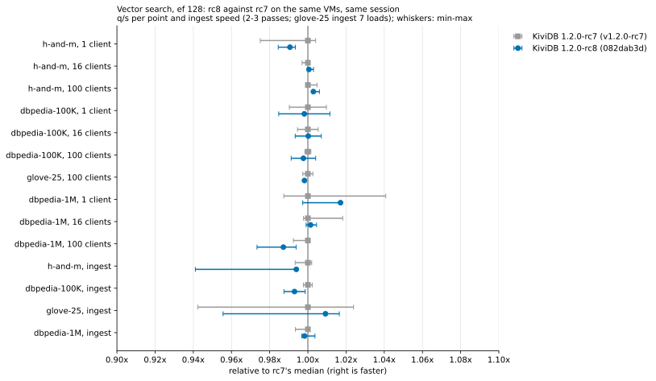

# Vector search: 1.2.0-rc8 round

KiviDB 1.2.0-rc8 against 1.2.0-rc7 (the code behind the published 1.2.0 numbers), with
[redis/vector-db-benchmark](https://github.com/redis/vector-db-benchmark), on the harness of
`benchmarks/1.2.0/vector/`. Measured 2026-11-03 (UTC).

**Verdict: no regression.** All 10 search points and all 4 ingest rows of rc8 are within the
run-to-run spread of rc7, in the same session on the same VMs. Memory per vector is identical.
Memory after a drop behaves as published (the known issue #300). The published headline numbers
still hold: KiviDB's lead over Redis 8.10.2 and Dragonfly 2.0.2 at 100 clients is within 2% of the
published ratios.

## What ran

| | |
|---|---|
| Cloud | Azure swedencentral (the region of the published run). Server and client in one proximity placement group, one virtual network, accelerated networking |
| Server | `Standard_D32ps_v5`: 32 vCPU Ampere Altra (Neoverse-N1), 1 NUMA node, 128 GB |
| Client | `Standard_D16ps_v5`: 16 vCPU Neoverse-N1, 64 GB (load generator only) |
| Builder | `Standard_D8ps_v5`, same image, outside the placement group; deleted after the builds |
| OS | Ubuntu 22.04.5 LTS arm64, kernel 6.8.0-1070-azure (as published) |

| Build | Commit | `--version` | SHA-256 of the binary |
|---|---|---|---|
| rc8 (under test) | `082dab3d8929c180bccf993835e28992ea054fb5` (`release/1.2.0`) | `kividb 1.2.0-rc8` | `edd8dfd4d6d9e5e7d9dd41d48e4ad2a96481399cd27615b6afef7ef5c8988cd4` |
| rc7 (reference) | `598b74d20ec04de5a0ff74001324907562806c3c` (tag `v1.2.0-rc7`) | `kividb 1.2.0-rc7` | `6a4a9d3cfe740ee0fee0b1745ec528c563b303b2a44fe6041d955836b7061081` |

- **Builds.** Both were built on the same builder with the suite's `build_kividb.sh`: rustup
  stable, `rustc 1.99.1 (58cf8f9c3 2026-10-13)`, `RUSTFLAGS="-C target-feature=+lse" cargo build
  --release`, default features. Both ran as `kividb --bind 0.0.0.0 --port 6380 --loglevel error`.
- **Competitors.** Redis 8.10.2 (`6:8.10.2-1rl1~jammy1`, redisearch.so from the same package,
  workflow flags, `search-workers 16` checked at start) and Dragonfly v2.0.2 (`dragonfly-aarch64`,
  `--proactor_threads=32`). These are the versions and flags of the published headline rows.
- **Workload.** Unchanged: the same tool pins (`d22d44e` for h-and-m and dbpedia, `31a28b5` for
  glove-25), datasets, HNSW settings (M 16, EF_CONSTRUCTION 128; 256 for glove-25) and upload
  settings. Only the ef 128 points were run: 1, 16 and 100 clients, and 100 clients for glove-25.
  These are the README's "Against 1.2.0-rc4" points at ef 128. Each point runs three repetitions
  back to back, and a pass's value is their median.
- **Passes.**
  - p1 and p2 cover all four datasets, rc8 and rc7 alternating within each dataset (rc8 first in
    p1, rc7 first in p2). Each pass starts a fresh server and does one load plus every search point.
  - Two points sat just outside the two-pass spread while well inside the repetition spread:
    h-and-m at 1 client and dbpedia-1M at 100 clients. A third pass (p3, rc8 first) of those two
    datasets settled them.
  - glove-25 ingest got five extra alternating upload-only loads (xg1-xg5), as in the published
    round.
  - Competitors ran one pass (comp) on h-and-m and dbpedia-100K at 100 clients.
  - Finally, the `MEMORY PURGE` check ran on rc8 (purge).
- **Verdict rule.** "same" when rc8 is within the larger of: the two builds' pass-to-pass spreads
  ((max-min)/median, the published suite's rule), and the largest spread of three repetitions
  inside one pass. The second term is there because two passes alone give a thin estimate. With
  three passes, every row is also "same" under the published rule alone.
- **Client.** No search point was client-bound: the tool's `client_saturated` flag was never set.

## rc8 against rc7 (same VMs, same session)

Search, ef 128. q/s is the median over passes (3 passes for h-and-m and dbpedia-1M, 2 for the
others); min-max is across passes.

| dataset | clients | rc7 q/s median (min-max) | rc8 q/s median (min-max) | rc8/rc7 | pass spread rc7 / rc8 | largest rep spread | verdict | recall rc7 / rc8 | p99 ms rc7 / rc8 |
|---|---:|---:|---:|---:|---:|---:|---|---:|---:|
| h-and-m (filtered) | 1 | 245 (239-246) | 242 (241-243) | 0.991 | 2.9% / 0.9% | 5.0% | same | 0.9984 / 0.9984 | 16.91 / 17.23 |
| h-and-m (filtered) | 16 | 3,075 (3,066-3,078) | 3,077 (3,076-3,084) | 1.001 | 0.4% / 0.3% | 4.8% | same | 0.9984 / 0.9984 | 22.25 / 22.13 |
| h-and-m (filtered) | 100 | 4,472 (4,471-4,494) | 4,485 (4,482-4,499) | 1.003 | 0.5% / 0.4% | 0.9% | same | 0.9984 / 0.9984 | 84.47 / 84.55 |
| dbpedia-100K | 1 | 593 (587-598) | 591 (584-599) | 0.998 | 1.9% / 2.7% | 4.6% | same | 0.9858 / 0.9850 | 2.33 / 2.30 |
| dbpedia-100K | 16 | 7,187 (7,148-7,226) | 7,189 (7,140-7,238) | 1.000 | 1.1% / 1.4% | 1.5% | same | 0.9858 / 0.9850 | 3.07 / 3.09 |
| dbpedia-100K | 100 | 10,184 (10,168-10,200) | 10,160 (10,095-10,226) | 0.998 | 0.3% / 1.3% | 1.9% | same | 0.9858 / 0.9850 | 13.91 / 13.72 |
| glove-25 | 100 | 33,995 (33,905-34,084) | 33,934 (33,929-33,940) | 0.998 | 0.5% / 0.0% | 1.6% | same | 0.9647 / 0.9647 | 3.94 / 3.94 |
| dbpedia-1M | 1 | 333 (329-347) | 339 (332-339) | 1.017 | 5.3% / 2.0% | 4.6% | same | 0.9603 / 0.9607 | 3.90 / 3.90 |
| dbpedia-1M | 16 | 4,386 (4,376-4,466) | 4,392 (4,382-4,406) | 1.001 | 2.1% / 0.5% | 1.7% | same | 0.9603 / 0.9607 | 4.88 / 4.85 |
| dbpedia-1M | 100 | 6,316 (6,268-6,320) | 6,235 (6,148-6,277) | 0.987 | 0.8% / 2.1% | 5.8% | same | 0.9603 / 0.9607 | 22.76 / 23.17 |

The two points re-checked with a third pass:
- **h-and-m, 1 client.** After two passes it read 0.987, against pass spreads of 0.4% and 0.9%.
  In p3, rc8 measured 242 against rc7's 239, the other way round. Over three passes it is 0.991,
  within rc7's 2.9% spread.
- **dbpedia-1M, 100 clients.** After two passes it read 0.984, against pass spreads of 0.8% and
  1.4%. Over three passes it is 0.987, within rc8's 2.1% spread. A single pass of this point swings
  by up to 5.8% between its own repetitions (rc7, p1: 5,964 to 6,330).

### Ingest and memory

One load per pass. glove-25 ingest also includes the five extra loads.

| dataset | rc7 upload+index s, median (loads) | rc8 upload+index s, median (loads) | rc8/rc7 | rc7 RSS B/vector | rc8 RSS B/vector | rc8/rc7 | verdict |
|---|---:|---:|---:|---:|---:|---:|---|
| h-and-m | 15.0 (15.0, 14.9, 15.1) | 15.0 (15.0, 15.0, 15.9) | 1.006 | 21,928 | 21,930 | 1.000 | same |
| dbpedia-100K | 11.8 (11.8, 11.8) | 11.9 (11.9, 11.8) | 1.007 | 13,263 | 13,269 | 1.000 | same |
| glove-25 | 30.4 (29.7, 30.4, 31.9, 32.3, 31.9, 30.0, 29.8) | 30.1 (31.8, 30.2, 30.0, 30.0, 30.1, 29.9, 30.5) | 0.991 | 1,124 | 1,125 | 1.001 | same |
| dbpedia-1M | 224.5 (224.5, 225.9, 224.4) | 224.8 (223.6, 225.2, 224.8) | 1.002 | 13,202 | 13,202 | 1.000 | same |

**glove-25 ingest.** rc8's first load took 31.8 s against rc7's 29.7 s (+7%). The five extra
alternating loads gave rc8 29.8-30.5 s and rc7 29.7-32.2 s. Both builds sometimes land near 32 s.
Over seven loads rc8's median is 1% lower than rc7's.

## rc8 against the published 75482abb numbers (different session: indicative only)

| dataset | clients | published q/s | rc8 q/s | rc8/published | published recall | rc8 recall |
|---|---:|---:|---:|---:|---:|---:|
| h-and-m | 1 | 252 | 242 | 0.962 | 0.9984 | 0.9984 |
| h-and-m | 16 | 3,092 | 3,077 | 0.995 | 0.9984 | 0.9984 |
| h-and-m | 100 | 4,478 | 4,485 | 1.002 | 0.9984 | 0.9984 |
| dbpedia-100K | 1 | 609 | 591 | 0.971 | 0.9864 | 0.9850 |
| dbpedia-100K | 16 | 7,163 | 7,189 | 1.004 | 0.9864 | 0.9850 |
| dbpedia-100K | 100 | 10,255 | 10,160 | 0.991 | 0.9864 | 0.9850 |
| glove-25 | 100 | 33,891 | 33,934 | 1.001 | 0.9647 | 0.9647 |
| dbpedia-1M | 1 | 341 | 339 | 0.994 | 0.9604 | 0.9607 |
| dbpedia-1M | 16 | 4,509 | 4,392 | 0.974 | 0.9604 | 0.9607 |
| dbpedia-1M | 100 | 6,255 | 6,235 | 0.997 | 0.9604 | 0.9607 |

| dataset | published ingest s | rc8 ingest s | ratio | published RSS B/vector | rc8 RSS B/vector |
|---|---:|---:|---:|---:|---:|
| h-and-m | 14.9 | 15.0 | 1.010 | 21,936 | 21,930 |
| dbpedia-100K | 11.7 | 11.9 | 1.014 | 13,265 | 13,269 |
| glove-25 | 30.2 | 30.1 | 0.998 | 1,126 | 1,125 |
| dbpedia-1M | 221.0 | 224.8 | 1.017 | 13,202 | 13,202 |

## Competitors

One pass each, ef 128, 100 clients, against their published numbers.

| dataset | engine | published q/s | q/s now | now/published | recall now | ingest s, published / now | RSS B/vector, published / now | KiviDB rc8 lead now (published) |
|---|---|---:|---:|---:|---:|---:|---:|---:|
| h-and-m | Redis 8.10.2 | 1,802 | 1,793 | 0.995 | 0.9986 | 15.1 / 14.9 | 22,785 / 22,793 | 2.50x (2.49x) |
| h-and-m | Dragonfly 2.0.2 | 811 | 796 | 0.982 | 0.9981 | 9.5 / 9.8 | 14,233 / 14,480 | 5.63x (5.52x) |
| dbpedia-100K | Redis 8.10.2 | 8,198 | 8,031 | 0.980 | 0.9805 | 10.1 / 10.3 | 14,451 / 14,778 | 1.27x (1.25x) |
| dbpedia-100K | Dragonfly 2.0.2 | 9,399 | 9,362 | 0.996 | 0.9803 | 9.2 / 9.3 | 8,281 / 8,378 | 1.09x (1.09x) |

The headline holds. Both competitors are within 0.98-1.00x of their published q/s. KiviDB's lead
at 100 clients is the same as published, or slightly larger:
- filtered h-and-m: 2.5x Redis and 5.6x Dragonfly;
- dbpedia-100K: 1.27x Redis and 1.09x Dragonfly.

## Memory after the drop (rc8, the known issue #300)

The rc8 purge check loaded dbpedia-1M without searches; the tool then dropped the index and
deleted all 999K documents. Samples came every 0.5 s on the server.

| moment | RSS | `used_memory` | keys |
|---|---:|---:|---:|
| after the load | 12.30 GiB | | 999,000 |
| 5 s into the delete | 10.67 GiB | 392 MiB | 61,200 |
| delete finished (the 61 s before `MEMORY PURGE`) | 10.61 GiB, flat | 5.6 MiB | 0 |
| 1.1 s after `MEMORY PURGE` | 0.07 GiB | 5.6 MiB | 0 |

This is the published behaviour, unchanged: 10.58 GiB held after the delete and 0.06-0.07 GiB after
`MEMORY PURGE`. rc8 still gives the freed pages back only on `MEMORY PURGE` (or
`FLUSHALL`/`FLUSHDB`), not after `FT.DROPINDEX` or the `DEL`s.

## What differs from the published run

- **1-client points are 2-4% lower in this session, for both builds.**
  - h-and-m: rc8 242 and rc7 245, against 252 published.
  - dbpedia-100K: 591 and 593, against 609.

  rc7 is equally low, so this is not rc8. One likely cause is that this round runs ef 128 first.
  The published engines-file ran ef 64 at 1 client before it, which also warmed the engine. The
  other is the different session (host and time).
- **dbpedia-1M at 16 clients is 0.974x published for rc8, and rc7 is the same** (4,386 against
  4,509). dbpedia-1M ingest is 1.6-1.7% slower than published for both builds. The session
  explains both.
- **dbpedia-100K recall at ef 128** is 0.9850 for rc8 and 0.9858 for rc7, against 0.9864
  published. The HNSW build is randomised and the graphs differ slightly between loads.
- **Memory per vector for the competitors** is 0-2.3% above published: Redis dbpedia-100K is
  14,778 against 14,451, and Dragonfly h-and-m is 14,480 against 14,233. KiviDB's is identical.
- **Fewer passes.** This round ran two or three passes and only the ef 128 points, against three
  passes over the full ef sweep in the published run. Redis with `--io-threads 8`, glove-25 and
  dbpedia-1M were not re-run for the competitors.

## Files

- `results/raw/<pass>/<engine>/<dataset>/`: the tool's console output (`tool.log`, timestamped on
  the client) and its result JSONs (`results/`), the server's memory samples (`mem.csv`), the
  client's `mpstat`, and `purge.log` for the purge pass. Passes: `p1`-`p3`, `comp`, `purge`,
  `xg1`-`xg5`. Private IPs are replaced by `SERVER_IP` and `CLIENT_IP`.
- `results/summary.json`: every run, parsed by the suite's `harness/parse.py`.
- `results/tables.md`: the tables above, as `harness/summarize.py` prints them.
- `charts/regression-rc8-vs-rc7.svg`: the regression-check chart.
- `harness/`: what this round changed or added to the suite's harness:
  - `setup_client.sh`: engines-files trimmed to ef 128;
  - `run_rc8.sh`, `run_p3.sh`, `extra_glove_rc8.sh`;
  - `summarize.py`.

  Everything else is the suite's harness, unchanged.
- `NOTES.md`: the progress log.
