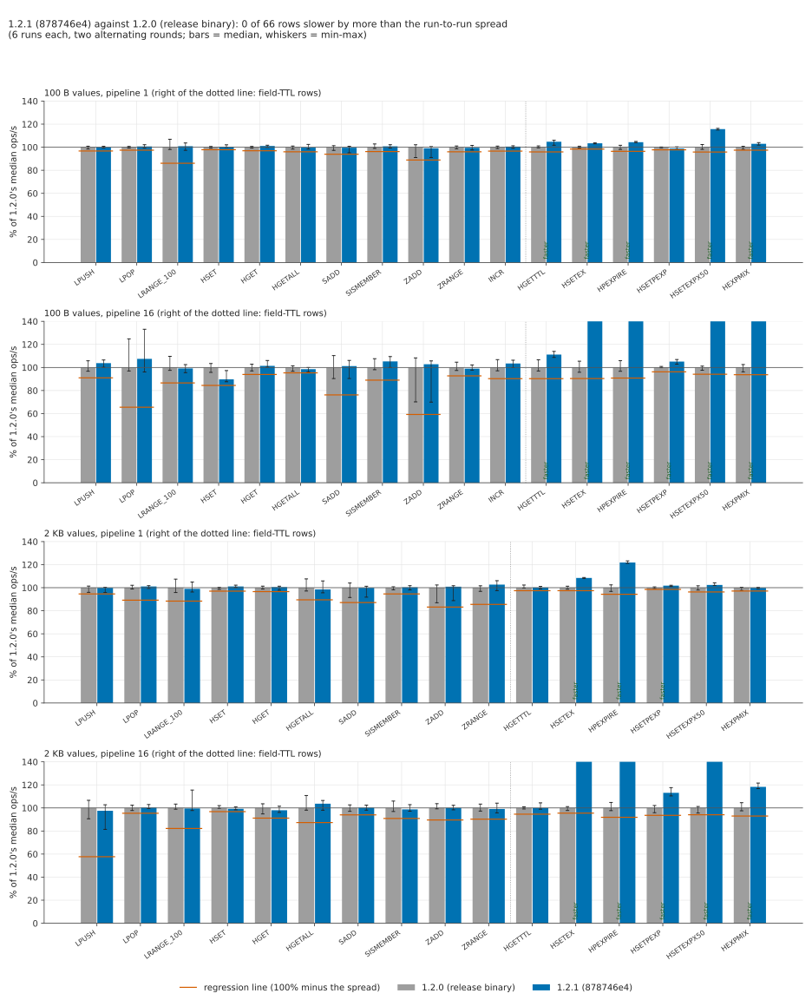

# Data types, 1.2.1 against 1.2.0

The `benchmarks/1.2.0/datatypes` suite on 1.2.1 (`878746e4`) against the 1.2.0 release binary, with
the 1.2.0 method. It covers the full 42-row matrix: eleven commands on lists, hashes, sets, sorted
sets and counters, with 100 B and 2 KB values, at pipeline 1 and 16. It adds **24 rows for hashes
whose fields carry TTLs**, because 1.2.1 (#531) made hash-field expiry master-driven and changed the
hash code. Each build ran two alternating rounds on the same two VMs, in one session on 2026-11-09.
There are no competitors, no memory pass and no LPOP tail repro. The suite's own harness ran with
two additions in `harness/datatypes.sh`: the `hfe` group and an `INFO stats` read after each run.

## Short version

- **The 42-row matrix: no row is outside the run-to-run spread**, but one row is a real loss.
  The other 41 rows are within -2.4% and +7.5% of 1.2.0, and 36 of all 42 are within ±3%.
  - The exception is **HSET at 100 B, pipeline 16: -10.3%** (4.00M vs 4.46M ops/s; p50 0.51 vs
    0.44 ms). That is inside the 15.6% spread the 1.2.0 suite measured for this row, so the rule says
    "same". But all six 1.2.1 runs have a higher p50, so it was re-checked on its own: 4 more
    alternating rounds, 12 runs per build. The result was **-9.2%** (4.03M, range 3.83-4.19M, against
    4.44M, range 4.30-4.60M), with no overlap between the two ranges.
  - `perf stat` puts it at about **7% more server CPU per HSET**. HSET at pipeline 1, HGET and
    HGETALL are unchanged. This is a regression, small and confined to one row (see
    [Where 1.2.1 loses](#where-121-loses)).
- **Field-TTL rows: 1.2.1 is faster, often much faster.** 19 of 24 rows read "faster" and 5 read
  "same". None is slower.
  - At pipeline 16, writes that set a TTL ran at 1.5-2.0x 1.2.0:
    - `HSETEX … PX 3600000`: +71% at 100 B, +80% at 2 KB;
    - `HPEXPIRE`: +104% and +86%;
    - `HSETEX … PX 50`, with fields expiring all through the run: +80% and +52%.
  - Reads of hashes with TTLs went up too (`HGET`, +11% at 100 B, pipeline 16).
  - p99 is lower on every pipeline-16 field-TTL row (e.g. HSETEX at 100 B: 1.87 vs 3.01 ms).
  - This holds although 1.2.1 does more for each due field. It removes the field and sends an
    `HDEL` before the write that found it due, so it counted 22.8M expired fields per
    `HSETEX PX 50` run where 1.2.0 counted 0.7M (see [Field expiry under load](#field-expiry-under-load)).
- **Latency on the matrix:** p99 moves by at most 0.06 ms on any row the network doesn't cap, and
  the largest rise is on that HSET row (0.85 vs 0.80 ms; p50 0.51 vs 0.44). p99.9 shows no
  direction: 1.2.1 reads higher on 17 of 42 rows, by at most 0.27 ms on rows under 20 ms.
- **The LPOP stall is unchanged.** LPOP at 100 B, pipeline 16 has a p99.9 of 44.5 ms for 1.2.1 and
  46.2 ms for 1.2.0. This is the same stall the 1.2.0 suite describes.
- **The client was never the limit.** memtier's threads were at most 56% busy on any run. The rows
  marked "network" are the ones the 1.2.0 suite found capped by a NIC.

## Hardware, region, builds

| | server | client |
|---|---|---|
| VM | Azure `Standard_D16ds_v5` | Azure `Standard_D48s_v5` |
| CPU | 16 vCPU, Intel Xeon Platinum 8370C 2.8 GHz | 48 vCPU, same CPU |
| OS | Ubuntu 24.04, kernel 7.0.0-1017-azure | same |

These are the sizes, CPU and kernel of the 1.2.0 suite. The D16ds_v5 is the server and the
D48s_v5 runs memtier_benchmark 2.5.2. Both VMs are in one proximity placement group and one VNet,
with accelerated networking (`harness/infra/up.sh`).

**The region is eastasia, zone 1, not koreacentral.** The 1.2.0 runs used koreacentral and
japaneast, but here:

- koreacentral's 65 regional vCPUs were taken by another benchmark that day;
- japaneast had 16 of 65 in use;
- southeastasia refused the D16ds_v5 for capacity.

Docker was installed and running on the server, as in every 1.2.0 round, so netfilter conntrack
was active. Only one KiviDB server ran at a time.

| build | what | how it was built | `--version` | SHA-256 of the binary |
|---|---|---|---|---|
| 1.2.1, under test | commit `878746e41e2f7a9050852e6ec5ef67394778368c` | as `.github/workflows/release.yml` builds `kividb-linux-x86_64`: in `amazonlinux:2023` (glibc 2.34), rustup stable = rustc 1.99.1 (58cf8f9c3 2026-10-13), `cargo build --release`, no features, no RUSTFLAGS (`harness/builds.sh`) | `kividb 1.2.0` (Cargo.toml still says 1.2.0 at this commit) | `b07d52342c774f8e4dcd6122ed85681cf96718366860a6872b45e4b8bcf63a05` |
| 1.2.0, reference | the released `kividb-linux-x86_64.tar.gz` from GitHub release v1.2.0 | release.yml; tarball SHA-256 `2d918e71…7d3e673f` checked OK against `SHA256SUMS.txt` | `kividb 1.2.0` | `a211d544be79bb78cfc5bc16b1e1315d20913f154cd8179f80668ab048edd72f` |

**How this differs from the 1.2.0 suite's builds.** The 1.2.0 suite built its KiviDB on the Ubuntu
24.04 server with `harness/build.sh` (native `cargo build --release`, rustc 1.99.1, glibc 2.39).
Here both binaries come from release.yml's recipe: the downloaded one and the one built the same
way. So they are the binaries users run. The profile (opt-level 3, LTO fat, one codegen unit),
default features (glibc malloc, no Lua, no TLS) and rustc are the same as the 1.2.0 suite's. Only
the build distribution, and with it the glibc the binary links against, differs.

## Method

The 1.2.0 suite's `datatypes.sh`, `engines.sh` and `summarize.py` ran unchanged, with two additions
in `datatypes.sh`:

- the `hfe` group (below);
- after each run, `INFO stats expired_subkeys` is appended to `expiry.csv`, read after the run's
  clock stopped.

Keys, loads, requests per run and connections are the suite's:

- 32 threads x 16 connections at pipeline 1, and 32 x 4 at pipeline 16;
- one warm-up of a quarter of the requests, then 3 measured runs per row;
- `--distinct-client-seed`, with keys drawn uniformly at random.

See [the suite README](../../1.2.0/datatypes/README.md#workload).

**Order** (`harness/session.sh`): round 1 ran 1.2.1, then 1.2.0. Round 2 ran 1.2.0, then 1.2.1.
Each "round of a build" is the whole matrix plus the field-TTL group on a freshly started server,
in the group order hash, hfe, set, zset, list, incr, for 100 B and then 2 KB. Each build has 6 runs
per row. A round took 23 min (1.2.1) or 26 min (1.2.0).

**Verdict rule** (the last 1.2.0 round's, `harness/vs_120.py`). A row is a **regression** when
1.2.1's median is below 1.2.0's by more than the row's threshold, and **faster** when it is above
by more than that. Otherwise it is **same**. The threshold is the largest of:

- today's 6-run spread of 1.2.1;
- today's 6-run spread of 1.2.0;
- the spread the 1.2.0 suite published for that row (its 1.2.0 build, 9 runs, from
  `benchmarks/1.2.0/datatypes/results/summary.csv`). Field-TTL rows have no published spread.

Spread is (max-min)/median. "Per round" is 1.2.1's median of that round against 1.2.0's.

### Field-TTL rows: exactly what ran

The `hfe` group, per value size V (100 B, 2048 B), after a `FLUSHALL`. Every command is a memtier
`--command`, with `--key-prefix` and `-d V` as shown. `-R` gives random data per request.
`--command-key-pattern=R` draws a key uniformly from the range.

**Load** (memtier, one connection, pipeline 32, `-n allkeys`, `--command-key-pattern=P`):

- `x:1..100000`: `HSETEX __key__ PX 3600000 FIELDS 10 f0 __data__ … f9 __data__`. That gives 10
  fields of V bytes with a 1-hour TTL each, so every hash is on the field-expiry watch list and no
  field expires during the session. Checked after the load: `HLEN x:77777` = 10, `HPTTL` ≈ 3.59M ms.
- `y:1..1000000`: `HSET __key__ p __data__`, one field without a TTL. The hash outlives its
  expiring field, so an expiry is an `HDEL` of a field, not the removal of a key.

**Rows** (requests per measured run as for HSET: 6M at p1 and 24M at p16 for 100 B, 3M for 2 KB):

| row (label) | keys | memtier command(s) |
|---|---|---|
| HGET (fields with TTLs) (`hgetttl`) | x: 1..100000 | `--command="HGET __key__ f5"` |
| HSETEX PX 1h (`hsetex`) | x: | `--command="HSETEX __key__ PX 3600000 FIELDS 1 f0 __data__" -R` (overwrites a field and its TTL on each write) |
| HPEXPIRE 1h (`hpexpire`) | x: | `--command="HPEXPIRE __key__ 3600000 FIELDS 1 f1"` (resets a live field's TTL) |
| HSET + HPEXPIRE (1:1) (`hsetpexp`) | x: | `--command="HSET __key__ f2 __data__" --command-ratio=1 --command-key-pattern=R --command="HPEXPIRE __key__ 3600000 FIELDS 1 f2" --command-ratio=1 --command-key-pattern=R -R` |
| HSETEX PX 50, expiring (`hsetexpx50`) | y: 1..1000000 | `--command="HSETEX __key__ PX 50 FIELDS 1 t __data__" -R` |
| HSETEX PX 50 + HGET (1:1), expiring (`hexpmix`) | y: | `--command="HSETEX __key__ PX 50 FIELDS 1 t __data__" --command-ratio=1 --command-key-pattern=R --command="HGET __key__ t" --command-ratio=1 --command-key-pattern=R -R` |

Notes on the rows:

- **Mixed rows.** memtier sends the two commands of a mixed row alternately, each with its own
  random key. Its ops/s and latency are for both commands together.
- **HSET + HPEXPIRE.** `HSET` of `f2` clears that field's TTL and `HPEXPIRE` sets it again, so the
  hash keeps changing between "f2 has a TTL" and "f2 has none".
- **The expiring rows.** At these rates a key of `y:` is written about once every 1-6 s, so nearly
  every field `t` is past its 50 ms deadline before the key is written again. The field is then
  removed either by the background sweep (10 times a second) or by the write that finds it due.
  Most `HGET __key__ t` in the mix miss (about 4% hit, as the TTL and the rate predict).
- **After each value size.** `expired_subkeys` was read, and 10 sampled `y:` keys were checked:
  none still had `t` (0/10) for either build, `HLEN` was 1 and `DBSIZE` 1.1M (`results/hfe-checks.txt`).

## Results



ops/s: the median of 6 runs (2 rounds x 3), with (min-max). Latency is in ms, as medians over the
runs. "limit: network" marks rows the server's or client's NIC caps (see the 1.2.0 suite). The
client was the limit on no row (`client_cpu_pct_max` ≤ 56%).

### The 42-row matrix

| values, pipeline | command | 1.2.1 (878746e4): median (min-max) | 1.2.0 (release): median (min-max) | change | per round | threshold | p50 1.2.1 / 1.2.0 | p99 1.2.1 / 1.2.0 | p99.9 1.2.1 / 1.2.0 | limit | verdict |
|---|---|---|---|---|---|---|---|---|---|---|---|
| 100 B, p1 | LPUSH | 1.24M (1.23M-1.25M) | 1.24M (1.22M-1.25M) | -0.1% | +1.3 +0.1 | 3.3% | 0.41 / 0.41 | 0.66 / 0.67 | 1.04 / 1.12 | - | same |
| 100 B, p1 | LPOP | 1.24M (1.23M-1.26M) | 1.23M (1.23M-1.24M) | +0.7% | +1.0 -0.5 | 2.6% | 0.41 / 0.41 | 0.64 / 0.66 | 1.14 / 1.34 | - | same |
| 100 B, p1 | LRANGE_100 | 150k (145k-155k) | 149k (146k-159k) | +0.9% | +2.5 -4.7 | 13.9% | 0.96 / 0.97 | 9.95 / 9.54 | 11.04 / 10.81 | network | same |
| 100 B, p1 | HSET | 1.21M (1.20M-1.23M) | 1.21M (1.20M-1.21M) | +0.4% | -0.2 +0.6 | 2.2% | 0.42 / 0.42 | 0.67 / 0.66 | 1.05 / 0.94 | - | same |
| 100 B, p1 | HGET | 1.26M (1.25M-1.27M) | 1.25M (1.24M-1.26M) | +1.1% | +1.2 +1.0 | 3.1% | 0.41 / 0.41 | 0.63 / 0.63 | 0.90 / 0.91 | - | same |
| 100 B, p1 | HGETALL | 1.07M (1.06M-1.10M) | 1.08M (1.06M-1.09M) | -0.4% | -1.1 +0.8 | 4.0% | 0.47 / 0.47 | 0.72 / 0.73 | 1.03 / 0.94 | - | same |
| 100 B, p1 | SADD | 1.23M (1.17M-1.24M) | 1.23M (1.20M-1.25M) | -0.4% | -0.6 -0.3 | 6.1% | 0.41 / 0.41 | 0.65 / 0.67 | 1.13 / 1.20 | - | same |
| 100 B, p1 | SISMEMBER | 1.26M (1.24M-1.28M) | 1.25M (1.24M-1.28M) | +0.8% | +0.5 -1.3 | 3.8% | 0.41 / 0.41 | 0.64 / 0.65 | 1.08 / 1.22 | - | same |
| 100 B, p1 | ZADD | 1.18M (1.09M-1.20M) | 1.19M (1.09M-1.22M) | -0.9% | -1.3 -0.3 | 11.1% | 0.42 / 0.42 | 0.68 / 0.69 | 1.26 / 1.29 | - | same |
| 100 B, p1 | ZRANGE | 1.06M (1.04M-1.08M) | 1.07M (1.05M-1.08M) | -0.5% | -1.2 -1.0 | 4.0% | 0.49 / 0.48 | 0.75 / 0.74 | 1.47 / 1.29 | - | same |
| 100 B, p1 | INCR | 1.28M (1.26M-1.29M) | 1.27M (1.26M-1.28M) | +0.6% | +0.7 +0.0 | 3.4% | 0.41 / 0.41 | 0.64 / 0.65 | 1.04 / 1.27 | - | same |
| 100 B, p16 | LPUSH | 4.91M (4.74M-5.04M) | 4.74M (4.58M-5.01M) | +3.7% | +2.7 +4.8 | 9.0% | 0.40 / 0.41 | 0.75 / 0.75 | 1.05 / 1.14 | - | same |
| 100 B, p16 | LPOP | 4.39M (3.93M-5.44M) | 4.09M (3.96M-5.10M) | +7.5% | +14.6 -2.0 | 34.5% | 0.34 / 0.34 | 0.59 / 0.64 | 44.54 / 46.21 | - | same |
| 100 B, p16 | LRANGE_100 | 152k (146k-157k) | 153k (150k-168k) | -0.8% | -0.1 -3.8 | 13.4% | 10.49 / 10.43 | 39.68 / 39.94 | 59.01 / 59.26 | network | same |
| 100 B, p16 | HSET | 4.00M (3.91M-4.34M) | 4.46M (4.27M-4.61M) | -10.3% | -3.0 -13.2 | 15.6% | 0.51 / 0.44 | 0.85 / 0.80 | 1.15 / 0.99 | - | same |
| 100 B, p16 | HGET | 5.74M (5.67M-6.00M) | 5.66M (5.49M-5.82M) | +1.4% | +0.8 +1.9 | 6.1% | 0.34 / 0.34 | 0.58 / 0.57 | 0.85 / 0.75 | - | same |
| 100 B, p16 | HGETALL | 1.36M (1.32M-1.38M) | 1.38M (1.33M-1.40M) | -1.5% | -0.7 -1.6 | 4.7% | 0.76 / 0.76 | 6.69 / 6.83 | 7.39 / 7.50 | network | same |
| 100 B, p16 | SADD | 5.12M (4.57M-5.36M) | 5.06M (4.57M-5.58M) | +1.2% | -0.3 +2.8 | 23.8% | 0.37 / 0.38 | 0.68 / 0.69 | 1.17 / 0.97 | - | same |
| 100 B, p16 | SISMEMBER | 5.68M (5.39M-5.90M) | 5.39M (5.29M-5.80M) | +5.2% | +7.9 +0.6 | 11.0% | 0.35 / 0.35 | 0.62 / 0.64 | 0.95 / 0.85 | - | same |
| 100 B, p16 | ZADD | 4.61M (3.14M-4.74M) | 4.49M (3.15M-4.86M) | +2.8% | +2.4 +3.2 | 40.8% | 0.43 / 0.43 | 0.79 / 0.79 | 1.40 / 1.13 | - | same |
| 100 B, p16 | ZRANGE | 1.34M (1.32M-1.38M) | 1.35M (1.32M-1.42M) | -1.0% | -0.6 -5.7 | 7.3% | 0.78 / 0.78 | 6.58 / 6.56 | 7.29 / 7.28 | network | same |
| 100 B, p16 | INCR | 6.88M (6.64M-7.07M) | 6.65M (6.46M-7.10M) | +3.4% | +3.4 +1.7 | 9.7% | 0.29 / 0.29 | 0.50 / 0.51 | 0.64 / 0.81 | - | same |
| 2 KB, p1 | LPUSH | 836k (802k-840k) | 837k (804k-849k) | -0.1% | +0.4 -1.0 | 5.4% | 0.61 / 0.61 | 0.96 / 0.98 | 1.64 / 1.74 | - | same |
| 2 KB, p1 | LPOP | 816k (803k-822k) | 808k (799k-824k) | +1.1% | +0.6 +2.5 | 10.8% | 0.59 / 0.59 | 2.13 / 2.10 | 2.81 / 2.87 | - | same |
| 2 KB, p1 | LRANGE_100 | 8k (8k-9k) | 8k (8k-9k) | -1.0% | -2.4 -0.5 | 11.6% | 59.90 / 59.77 | 180.22 / 179.20 | 291.84 / 285.69 | network | same |
| 2 KB, p1 | HSET | 832k (826k-842k) | 824k (812k-826k) | +1.1% | +1.8 +1.0 | 3.0% | 0.61 / 0.61 | 0.97 / 0.98 | 1.63 / 1.73 | - | same |
| 2 KB, p1 | HGET | 756k (736k-762k) | 752k (743k-762k) | +0.5% | +0.5 +0.6 | 3.4% | 0.54 / 0.54 | 3.25 / 3.18 | 3.89 / 3.69 | network | same |
| 2 KB, p1 | HGETALL | 77k (75k-83k) | 78k (76k-84k) | -1.5% | +3.2 -2.0 | 10.5% | 8.22 / 8.22 | 19.20 / 19.26 | 221.18 / 221.18 | network | same |
| 2 KB, p1 | SADD | 881k (810k-893k) | 882k (807k-918k) | -0.1% | -1.5 +1.4 | 12.9% | 0.56 / 0.56 | 0.94 / 0.92 | 1.72 / 1.65 | - | same |
| 2 KB, p1 | SISMEMBER | 908k (888k-921k) | 905k (889k-912k) | +0.3% | +0.5 +0.2 | 5.4% | 0.56 / 0.56 | 0.92 / 0.90 | 1.82 / 1.69 | - | same |
| 2 KB, p1 | ZADD | 861k (758k-868k) | 854k (742k-874k) | +0.9% | -0.5 +1.2 | 16.8% | 0.58 / 0.58 | 0.95 / 0.94 | 1.71 / 1.99 | - | same |
| 2 KB, p1 | ZRANGE | 81k (77k-84k) | 79k (77k-81k) | +2.7% | +1.7 +6.2 | 14.5% | 8.21 / 8.21 | 19.26 / 19.26 | 221.18 / 221.18 | network | same |
| 2 KB, p16 | LPUSH | 1.72M (1.44M-1.82M) | 1.77M (1.60M-1.88M) | -2.4% | -12.0 +9.6 | 42.3% | 1.10 / 1.27 | 3.00 / 3.09 | 4.46 / 3.81 | network | same |
| 2 KB, p16 | LPOP | 824k (817k-846k) | 821k (803k-841k) | +0.3% | +0.7 +0.3 | 4.6% | 1.18 / 1.18 | 8.24 / 8.29 | 8.93 / 8.99 | network | same |
| 2 KB, p16 | LRANGE_100 | 8k (8k-9k) | 8k (8k-8k) | -0.4% | -2.4 +0.3 | 17.8% | 254.98 / 254.98 | 482.30 / 489.47 | 567.29 / 565.25 | network | same |
| 2 KB, p16 | HSET | 1.47M (1.46M-1.50M) | 1.49M (1.48M-1.52M) | -0.7% | -1.2 -0.7 | 3.2% | 0.92 / 0.95 | 5.36 / 5.26 | 5.86 / 5.87 | network | same |
| 2 KB, p16 | HGET | 775k (760k-803k) | 791k (750k-819k) | -2.0% | -5.4 +4.1 | 8.8% | 0.78 / 0.78 | 9.34 / 8.99 | 9.98 / 9.63 | network | same |
| 2 KB, p16 | HGETALL | 80k (76k-82k) | 77k (76k-86k) | +3.7% | -0.6 +6.6 | 12.7% | 20.61 / 20.61 | 79.36 / 79.36 | 101.63 / 105.22 | network | same |
| 2 KB, p16 | SADD | 1.64M (1.60M-1.67M) | 1.63M (1.58M-1.68M) | +0.2% | -1.1 +2.8 | 6.0% | 0.67 / 0.67 | 6.56 / 6.58 | 6.94 / 7.02 | network | same |
| 2 KB, p16 | SISMEMBER | 1.49M (1.47M-1.55M) | 1.51M (1.47M-1.60M) | -1.2% | +0.1 +0.2 | 9.1% | 0.67 / 0.67 | 6.59 / 6.59 | 7.02 / 7.20 | network | same |
| 2 KB, p16 | ZADD | 1.61M (1.59M-1.65M) | 1.61M (1.60M-1.67M) | +0.0% | -0.7 +0.1 | 10.4% | 0.74 / 0.74 | 6.08 / 6.08 | 6.46 / 6.59 | network | same |
| 2 KB, p16 | ZRANGE | 78k (75k-82k) | 79k (77k-81k) | -0.9% | +0.6 -3.6 | 9.7% | 20.73 / 20.54 | 75.52 / 79.87 | 101.12 / 110.08 | network | same |

### Field-TTL rows

| values, pipeline | command | 1.2.1 (878746e4): median (min-max) | 1.2.0 (release): median (min-max) | change | per round | threshold | p50 1.2.1 / 1.2.0 | p99 1.2.1 / 1.2.0 | p99.9 1.2.1 / 1.2.0 | limit | verdict |
|---|---|---|---|---|---|---|---|---|---|---|---|
| 100 B, p1 | HGET (fields with TTLs) | 1.25M (1.21M-1.27M) | 1.19M (1.19M-1.21M) | +4.8% | +5.2 +3.7 | 4.1% | 0.41 / 0.42 | 0.64 / 0.65 | 0.98 / 1.08 | - | faster |
| 100 B, p1 | HSETEX PX 1h | 859k (854k-862k) | 830k (824k-838k) | +3.4% | +2.8 +4.0 | 1.6% | 0.58 / 0.60 | 1.01 / 1.07 | 1.84 / 1.83 | - | faster |
| 100 B, p1 | HPEXPIRE 1h | 875k (872k-880k) | 839k (823k-852k) | +4.3% | +2.9 +5.9 | 3.6% | 0.57 / 0.60 | 1.00 / 1.08 | 1.81 / 1.77 | - | faster |
| 100 B, p1 | HSET + HPEXPIRE (1:1) | 974k (966k-989k) | 985k (980k-988k) | -1.1% | -1.1 -1.1 | 2.3% | 0.52 / 0.52 | 0.90 / 0.90 | 1.76 / 1.66 | - | same |
| 100 B, p1 | HSETEX PX 50 (expiring) | 707k (702k-711k) | 611k (600k-625k) | +15.7% | +14.8 +16.4 | 4.2% | 0.71 / 0.82 | 1.09 / 1.27 | 2.50 / 2.17 | - | faster |
| 100 B, p1 | HSETEX PX 50 + HGET (1:1, expiring) | 908k (898k-917k) | 882k (865k-889k) | +2.9% | +2.1 +3.6 | 2.6% | 0.55 / 0.55 | 0.88 / 0.92 | 2.76 / 2.32 | - | faster |
| 100 B, p16 | HGET (fields with TTLs) | 5.39M (5.28M-5.53M) | 4.85M (4.70M-5.17M) | +11.2% | +12.0 +10.3 | 9.7% | 0.36 / 0.41 | 0.61 / 0.68 | 0.87 / 0.91 | - | faster |
| 100 B, p16 | HSETEX PX 1h | 1.57M (1.57M-1.62M) | 921k (882k-971k) | +71.0% | +63.7 +78.4 | 9.6% | 1.27 / 2.25 | 1.87 / 3.01 | 2.26 / 3.44 | - | faster |
| 100 B, p16 | HPEXPIRE 1h | 1.67M (1.65M-1.78M) | 823k (796k-872k) | +103.5% | +92.1 +114.6 | 9.2% | 1.21 / 2.52 | 1.75 / 3.36 | 2.18 / 3.81 | - | faster |
| 100 B, p16 | HSET + HPEXPIRE (1:1) | 2.31M (2.26M-2.35M) | 2.20M (2.19M-2.22M) | +5.1% | +4.1 +6.6 | 3.8% | 0.87 / 0.92 | 1.37 / 1.40 | 1.82 / 1.87 | - | faster |
| 100 B, p16 | HSETEX PX 50 (expiring) | 1.05M (1.02M-1.08M) | 583k (569k-590k) | +80.0% | +75.7 +85.3 | 5.9% | 1.96 / 3.51 | 2.48 / 4.46 | 3.77 / 5.38 | - | faster |
| 100 B, p16 | HSETEX PX 50 + HGET (1:1, expiring) | 1.78M (1.73M-1.80M) | 1.23M (1.18M-1.26M) | +44.7% | +43.3 +48.1 | 6.3% | 1.14 / 1.66 | 1.47 / 2.22 | 2.46 / 2.99 | - | faster |
| 2 KB, p1 | HGET (fields with TTLs) | 754k (746k-761k) | 753k (751k-770k) | +0.1% | +0.3 -0.1 | 2.6% | 0.55 / 0.56 | 3.10 / 2.94 | 3.67 / 3.41 | network | same |
| 2 KB, p1 | HSETEX PX 1h | 575k (573k-577k) | 530k (523k-537k) | +8.5% | +7.2 +10.0 | 2.6% | 0.87 / 0.94 | 1.98 / 2.45 | 3.10 / 3.16 | - | faster |
| 2 KB, p1 | HPEXPIRE 1h | 820k (815k-829k) | 673k (651k-689k) | +21.9% | +18.4 +25.0 | 5.7% | 0.61 / 0.75 | 1.07 / 1.39 | 2.65 / 2.84 | - | faster |
| 2 KB, p1 | HSET + HPEXPIRE (1:1) | 748k (742k-750k) | 734k (729k-740k) | +1.8% | +1.6 +1.6 | 1.5% | 0.67 / 0.68 | 1.21 / 1.26 | 2.88 / 2.78 | - | faster |
| 2 KB, p1 | HSETEX PX 50 (expiring) | 517k (515k-527k) | 505k (495k-514k) | +2.4% | +1.3 +2.4 | 3.7% | 0.98 / 0.97 | 1.41 / 1.50 | 2.58 / 2.85 | - | same |
| 2 KB, p1 | HSETEX PX 50 + HGET (1:1, expiring) | 733k (728k-736k) | 734k (716k-737k) | -0.1% | +0.0 -0.0 | 2.9% | 0.69 / 0.66 | 1.10 / 1.10 | 3.94 / 3.71 | - | same |
| 2 KB, p16 | HGET (fields with TTLs) | 757k (750k-791k) | 758k (751k-765k) | -0.1% | +1.3 -0.0 | 5.4% | 0.83 / 0.85 | 9.18 / 8.99 | 9.86 / 9.82 | network | same |
| 2 KB, p16 | HSETEX PX 1h | 1.05M (1.02M-1.07M) | 583k (570k-590k) | +79.5% | +78.4 +82.6 | 4.5% | 1.81 / 3.33 | 4.00 / 7.36 | 5.44 / 8.70 | network | faster |
| 2 KB, p16 | HPEXPIRE 1h | 1.18M (1.14M-1.24M) | 634k (619k-664k) | +86.1% | +74.3 +94.5 | 8.1% | 1.72 / 3.22 | 3.33 / 5.12 | 3.80 / 5.79 | network | faster |
| 2 KB, p16 | HSET + HPEXPIRE (1:1) | 1.58M (1.54M-1.64M) | 1.39M (1.34M-1.42M) | +13.1% | +11.0 +16.2 | 6.4% | 1.25 / 1.44 | 2.94 / 3.10 | 3.34 / 3.58 | network | faster |
| 2 KB, p16 | HSETEX PX 50 (expiring) | 846k (827k-876k) | 558k (534k-565k) | +51.6% | +53.8 +56.0 | 5.9% | 2.24 / 3.53 | 4.85 / 7.63 | 6.08 / 8.70 | network | faster |
| 2 KB, p16 | HSETEX PX 50 + HGET (1:1, expiring) | 1.51M (1.49M-1.55M) | 1.28M (1.24M-1.33M) | +18.3% | +17.4 +19.2 | 7.0% | 1.33 / 1.55 | 1.79 / 2.17 | 12.61 / 20.61 | network | faster |

## Field expiry under load

The two expiring rows write a 50 ms TTL on each request, to 1M hashes, so fields come due all
through the run. `INFO stats expired_subkeys` was read after every run (`results/expiry.csv`, and
per run in `results/raw/<run>/expiry.csv`). Fields counted as expired during each measured run,
median of 6 runs (range):

| row | 1.2.1 | 1.2.0 |
|---|---|---|
| HSETEX PX 50, 100 B, p1 (6M writes) | 5.71M (5.23M-5.90M) | 1.03M (0.78M-1.21M) |
| HSETEX PX 50, 100 B, p16 (24M writes) | 22.82M (22.78M-23.27M) | 0.70M (0.68M-0.93M) |
| HSETEX PX 50, 2 KB, p1 (3M writes) | 2.71M (2.38M-3.31M) | 0.96M (0.77M-1.11M) |
| HSETEX PX 50, 2 KB, p16 (3M writes) | 2.86M (2.77M-2.96M) | 0.25M (0.20M-0.36M) |
| + HGET 1:1, 100 B, p1 | 2.93M (2.84M-2.96M) | 1.12M (0.93M-1.48M) |
| + HGET 1:1, 100 B, p16 | 11.48M (11.33M-11.89M) | 0.37M (0.25M-0.64M) |
| + HGET 1:1, 2 KB, p1 | 1.48M (1.45M-1.61M) | 0.81M (0.71M-0.87M) |
| + HGET 1:1, 2 KB, p16 | 1.44M (1.36M-1.47M) | 0.37M (0.33M-0.43M) |

1.2.1 counts nearly one expired field per write: almost every `HSETEX` finds the previous `t` past
its deadline. 1.2.0 counts a fraction of that. This matches what #531 changed.

- **1.2.1.** Every removal of a due field goes through one path (`field_expiry::expire_due`). That
  path removes the field, counts it and propagates an `HDEL` before the write that found it goes on.
- **1.2.0.** The count fits a write that finds `t` due overwriting it without counting an expiry.

So the counter is not comparable between the builds. What it shows is that 1.2.1 really does the
removal and propagation for every one of these fields, under full load, and still writes 1.5-1.8x
as fast at pipeline 16. Neither build left a due field behind: `t` was gone from every sampled key
a second after each group (0/10).

## Latency

- **Matrix.** p50 is the same (±0.01 ms) on every row the network doesn't cap, except HSET at 100 B, pipeline 16 (0.51 vs
  0.44 ms). p99 rises by at most 0.06 ms on rows the network doesn't cap, the largest being that
  HSET row. p99.9 is higher for 1.2.1 on 17 of 42 rows and lower on the rest. Every rise is under
  0.3 ms on rows under 20 ms (the largest: ZADD 100 B p16, 1.40 vs 1.13 ms; SADD 100 B p16, 1.17 vs
  0.97 ms). Their per-run p99.9 ranges overlap, except HSET 100 B p16 (1.10-1.33 vs 0.94-1.01 ms).
- **Field-TTL rows.** At pipeline 16, 1.2.1's p50 and p99 are lower on every write row. For
  example HSETEX 100 B: p50 1.27 vs 2.25 ms, p99 1.87 vs 3.01 ms. HPEXPIRE 2 KB: p99 3.33 vs
  5.12 ms. At pipeline 1 they are equal or lower. p99.9 is a little higher for 1.2.1 on three
  pipeline-1 expiring rows:
  - HSETEX PX 50 at 100 B: 2.50 vs 2.17 ms;
  - the mix at 100 B: 2.76 vs 2.32 ms;
  - the mix at 2 KB: 3.94 vs 3.71 ms.

  These are the rows where 1.2.1 removes and propagates a field on almost every write.
- **LPOP, 100 B, pipeline 16.** This row has the stall the 1.2.0 suite describes: p99.9 is
  44.5 ms (1.2.1) and 46.2 ms (1.2.0), with per-run p99.9 from 1.9 to 75.8 ms for both and a 35%
  throughput spread. 1.2.1 doesn't change it.

## Where 1.2.1 loses

- **HSET at 100 B, pipeline 16 is about 9% slower** ([#544](https://github.com/kividbio/kividb/issues/544)). The
  rows below are the matrix, then a re-check that ran right after the session with
  `harness/hset-recheck.sh`. The re-check repeated the hash group alone at 100 B, pipeline 16: a
  fresh server and load each time, 1 warm-up and 3 runs, 4 alternating rounds per build.

  | | 1.2.1 | 1.2.0 | change |
  |---|---|---|---|
  | matrix: HSET, 6 runs | 4.00M (3.91M-4.34M), p50 0.51, p99 0.85 ms | 4.46M (4.27M-4.61M), p50 0.44, p99 0.80 ms | -10.3% |
  | re-check: HSET, 12 runs | 4.03M (3.83M-4.19M), p50 0.49, p99 0.88 ms | 4.44M (4.30M-4.60M), p50 0.44, p99 0.81 ms | -9.2% |
  | re-check: HGET, 12 runs | 5.63M (5.42M-5.81M) | 5.70M (5.63M-5.84M) | -1.2% |
  | re-check: HGETALL, 12 runs | 1.36M (1.32M-1.43M) | 1.37M (1.34M-1.42M) | -0.5% |

  - The verdict rule calls the matrix row "same", because the 1.2.0 suite measured a 15.6% spread
    on this row. Today's two 12-run HSET ranges do not overlap, though, and the -9.2% exceeds both
    of today's spreads (9.0%, 6.8%). We count it as a regression.
  - `harness/hset-perfstat.sh` ran `perf stat` on the server during one 24M-request HSET run of
    each build, twice, alternating (`results/hset-recheck/hset-perfstat.txt`):
    - 1.2.1 used 78.6 and 79.7 CPU-seconds;
    - 1.2.0 used 73.8 and 74.3, with the same number of context switches.

    That is about 7% more CPU per HSET: more work, not waiting. These VMs expose no PMU, so there
    are no instruction counts.
  - The row is a field overwrite on hashes without TTLs. HSET at pipeline 1 (latency-bound) and at
    2 KB (network-bound) shows nothing. The `HSET` half of the HSET + HPEXPIRE mix, on hashes that
    have TTLs, is faster.
  - Our reading, not proven: the hash write path #531 changed (the due-field checks before a
    write) costs a plain HSET something. Callgrind (`scripts/perf/run.sh`) would place it.
- **Field-TTL writes cost much more than plain writes, in both builds.** At 100 B, pipeline 16,
  HSETEX with a TTL does 1.57M a second and HPEXPIRE 1.67M, against 4.0M for HSET of the same
  field. 1.2.1 narrowed this from 1.2.0's 0.92M and 0.82M. Every write that sets a field TTL notes
  the hash in `field_expiry::track`, which takes one process-wide mutex. That is a likely limit,
  but not a measured one.
- **p99.9 on three pipeline-1 expiring rows** is 0.2-0.45 ms higher (see Latency). That is the
  price of removing and propagating each due field before the write.
- **The LPOP stall** (p99.9 ~45 ms at 100 B, pipeline 16) is still there, as in 1.2.0.

## Anything that differs from the 1.2.0 suite

- **Region eastasia**, for quota and capacity (see above). Same VM sizes, CPU model and kernel.
  Absolute numbers match the 1.2.0 suite's within its spreads, e.g. HGET 100 B p16 5.74M here
  against 5.62M published, and INCR p16 6.88M against 6.56M.
- **Both binaries are release-workflow builds** (amazonlinux:2023, glibc 2.34), not native Ubuntu
  builds. Same rustc (1.99.1), profile and features.
- **Two rounds, 6 runs per build per row**, against the 1.2.0 suite's 3 rounds and 9 runs. The
  threshold therefore also uses the published 9-run spread for the 42 matrix rows.
- **The `hfe` group is new.** It runs after the hash group of each value size and before sets.
  It flushes the database first, as every group does, so the other groups start from the same
  state as in the 1.2.0 suite.
- **One `INFO stats` call after each run.** It is outside the timed window and is not in the
  1.2.0 method.
- **No competitors, no memory pass, no LPOP tail repro.** None was asked for in this round.

## Reproduce

```sh
RG=my-rg REGION=eastasia ZONE=1 bash harness/infra/up.sh <your-ip>/32 ~/.ssh/id_rsa.pub
# server: harness/infra/setup-srv.sh; client: harness/infra/setup-cli.sh (memtier_benchmark 2.5.2)
# the server needs passwordless ssh to the client (CLI=10.0.0.5 by default)
# on the server, with the 878746e4 tree as ~/src-878746e4.tgz:
bash harness/builds.sh                 # ~/bin/kividb-120 (release tarball, SHA256SUMS checked), ~/bin/kividb-121
bash harness/session.sh                # 2 alternating rounds: matrix + field-TTL group
cp <repo>/benchmarks/1.2.0/datatypes/results/summary.csv harness/published-summary.csv
bash harness/finalize.sh               # summary, vs-120 table and chart, scrubbed raw reports -> ~/final
bash harness/hset-recheck.sh           # the HSET re-check (4 more alternating rounds of the hash group)
bash harness/hset-perfstat.sh          # perf stat on HSET (needs linux-tools)
```

## Files

- `results/vs-120.csv`, `results/vs-120.md`: the comparison. It has every row with medians, min,
  max, spreads, the published spread, the threshold, per-round changes, p50/p99/p99.9, p99.9
  ranges, client CPU and server cores. The expired-field counts are at the end of the `.md`.
- `results/summary.csv`, `results/runs.csv`: `summarize.py` output, with every measured run and
  its round.
- `results/expiry.csv`: fields expired during each run of the expiring rows (`expired_subkeys`
  differences).
- `results/hfe-checks.txt`: the load and after-group checks of the field-TTL group.
- `results/session.log`, `results/versions.txt`: order, timings, build log, SHA-256, toolchain,
  client.
- `results/raw/<run>/`: memtier reports (tarred, private IPs replaced by `<server>`/`<client>`),
  server CPU per run, `expiry.csv`, engine version. `kividb-121` and `kividb-120` are round 1;
  `-r2` is round 2.
- `results/hset-recheck/`: the HSET re-check (summary, runs, log, raw reports) and `perf stat`
  output.
- `charts/vs-120.svg`: 1.2.1 as % of 1.2.0 per row, with whiskers for min-max and the regression
  line.
- `harness/`:
  - `datatypes.sh`: the suite's script, plus the `hfe` group and the `expired_subkeys` read;
  - `engines.sh`, `summarize.py`: unchanged (one comment line of `engines.sh` names this round's builds);
  - `builds.sh`, `session.sh`, `vs_120.py`, `finalize.sh`, `hset-recheck.sh`, `hset-perfstat.sh`;
  - `infra/`.
