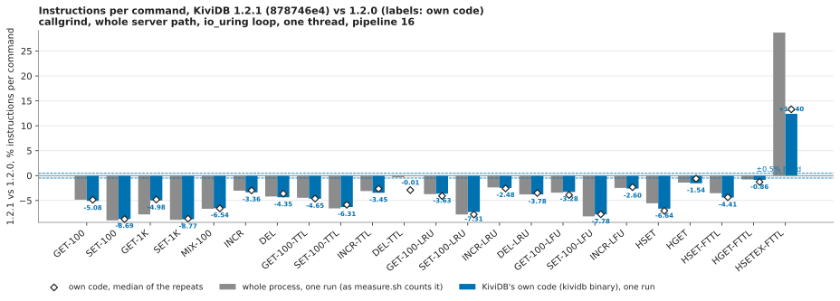

# Profiling, 1.2.1: instructions per command, 1.2.1 against 1.2.0

**Result: 1.2.1 is cheaper than 1.2.0 on 22 of 23 workloads. The exception is `HSETEX` on fields with a TTL, which costs
29% more.**

- **The 18 workloads of `WORKLOADS=full`** (GET, SET, MIX, INCR, DEL, plain, with key TTLs, and under LRU/LFU) are
  **2.3% to 8.8% fewer instructions** in KiviDB's own code (medians of 4 runs per build). The whole process is down by
  the same amount.
- **Plain hashes.** HSET is −7.1% and HGET −0.6%.
- **Hashes with field TTLs**, the code #531 changed:
  - HSET on a hash with a field TTL: −4.4%;
  - HGET of a field with a TTL: −1.3% (−0.1% without the expiry threads).
- **HSETEX on fields with a TTL is the one regression:**
  - +13.3% in KiviDB's own code;
  - +29.1% for the whole process, of which about 2,800 instructions are glibc, 2,500 of them malloc/free.
  - **Cause:** since #531, every `HSETEX` builds its replicated form, `HSETEX key PXAT <ms> FIELDS …`, as about ten
    heap allocations. It does this even when no replica, AOF or tap reads the write stream. It also does a second
    lookup of the key before the write (`expire_before`).
  - It is a cost, not a correctness problem. It is filed as [#543](https://github.com/kividbio/kividb/issues/543).

## What ran

- **Method.** This is the suite's callgrind method: `scripts/perf/build.sh` and `measure.sh`, as run by the 1.2.0 suite's
  `callgrind-keep.sh`, with:
  - the release profile, `LTO=fat`, `debug=1`;
  - `WORKLOADS=full`, `PROFILE` (the hottest functions of each workload are kept);
  - one worker thread on the io_uring loop;
  - pipeline 16, N = 60,000 commands a workload;
  - the server started under callgrind with instrumentation off; the keys loaded and warmed up; then instrumentation on
    for the N commands only.
- **Image.** `kividb-ci-valgrind`, pinned to `rust:1.99.1-bookworm`, with valgrind and redis-tools added. Its
  toolchain: rustc 1.99.1 (58cf8f9c3 2026-10-13), valgrind 3.19.0, redis-benchmark 7.0.15. That is the same as the
  1.2.0 suite.
- **These are same-way builds, not the shipped binary.** callgrind needs symbols, so both versions were built from
  source in the image, identically (`LTO=fat`, `debug=1`). The released 1.2.0 tarball is stripped and was not
  profiled. This measures the code difference between the two versions, not the release artifacts.
- **Builds**, from a clone of the public repo:

| build | commit | `--version` | SHA-256 of the profiled binary (LTO fat, debug=1) |
|---|---|---|---|
| 1.2.0 (reference) | `v1.2.0` = `d241b74a2afe0faea662f2f528119c39070e431d` | `kividb 1.2.0` | `321cdd252b1e810c9a23bb06b65912fa94ae806edfaeb6f6faba852d6002473f` |
| 1.2.1 (under test) | `878746e41e2f7a9050852e6ec5ef67394778368c` | `kividb 1.2.0` (Cargo.toml not yet bumped at this commit) | `9762eacefd628c68a80523afc9b2b2ef3974eedecee00511650a39b6d3d69cb2` |

  - The release checks' source tarball of 878746e4 was checked against this commit's tree (`git archive`), and they
    were identical.
  - `scripts/perf/` is identical in the two commits.
- **Machine.** Azure `Standard_D16ds_v5` (16 vCPU Xeon Platinum 8370C, x86_64), Ubuntu 24.04, kernel
  7.0.0-1017-azure, in japaneast. It ran on 2026-11-09. One VM was enough, since callgrind needs no network.
- **Order.**
  - Both trees were built at the same time.
  - The main run measured both at the same time, in two containers, each with its own network namespace, port and
    `/tmp`. Valgrind runs a process's threads one at a time, so each run used about one core of 16 and the two do not
    affect each other's counts.
  - Then three more rounds of all 23 workloads were run, both builds at a time (`harness/cg-repeat.sh`): 4 runs per
    build in all. Every workload moved by more than 0.5% in the main run, so every workload was repeated.

### Workloads: the 18 of `WORKLOADS=full`, plus 5 hash workloads added for 1.2.1

measure.sh has no hash workload, and #531 changed the hash-field expiry code. `harness/patch_measure.py` adds five
workloads after the 18, which run exactly as before. All five run on 10,000 hashes `h:<n>`, loaded and warmed up as
measure.sh does for every workload:

| workload | measured command | hashes hold | what it exercises |
|---|---|---|---|
| HSET | `HSET h:<n> f <100 B>` | `f` | plain hash write |
| HGET | `HGET h:<n> f` | `f` | plain hash read |
| HSET-FTTL | `HSET h:<n> f <100 B>` | `t` with a TTL, `f` | a write to a hash that tracks field TTLs |
| HGET-FTTL | `HGET h:<n> f` | `f` with a TTL | a read of a field with a TTL (the expiry check on read) |
| HSETEX-FTTL | `HSETEX h:<n> EX 1000000 FIELDS 1 f <100 B>` | `f` with a TTL | setting a field together with its TTL |

The TTLs are 1,000,000 s, so nothing expires during a run. For HSET-FTTL the patch adds `PRELOAD2`, a second preload
command (`HSETEX … FIELDS 1 t x`, then `HSET … f <100 B>`). It also adds `ONLY=` for the repeats, and keeps each
callgrind file for the per-object and per-function split, as the 1.2.0 suite's last round did.

### Columns

- **whole**: the whole process, as `measure.sh` counts it.
- **own**: functions in the kividb binary, with everything Rust inlined into them.
- **own without active expiry**: own, less the active-expire thread (`spawn_active_expire_task`'s closures,
  `expire_pass`, `ShardMap::due`). That thread wakes every 100 ms of wall-clock time, so how much of it falls inside
  the measured window depends on how long the window takes under valgrind, not on the commands.
- **glibc memcmp** and **glibc, other** are split out in `results/table.md`.

## 1.2.1 against 1.2.0: medians of 4 runs per build (instructions per command)

| workload | whole 1.2.0 | whole 1.2.1 | **whole, change** | own 1.2.0 | own 1.2.1 | **own, change** | own without active expiry, change |
|---|---:|---:|---:|---:|---:|---:|---:|
| GET-100 | 3420 | 3261 | **−4.66%** | 2910.9 | 2769.4 | **−4.86%** | −4.78% |
| SET-100 | 4375 | 3980 | **−9.03%** | 3802.6 | 3470.5 | **−8.73%** | −8.75% |
| GET-1K | 3918 | 3705 | **−5.44%** | 2950.6 | 2808.8 | **−4.81%** | −4.80% |
| SET-1K | 4506 | 4112 | **−8.75%** | 3831.1 | 3499.8 | **−8.65%** | −8.14% |
| MIX-100 | 7779 | 7258 | **−6.70%** | 6694.6 | 6254.0 | **−6.58%** | −7.01% |
| INCR | 4142 | 4032 | **−2.67%** | 3736.5 | 3625.1 | **−2.98%** | −2.99% |
| DEL | 4568 | 4406 | **−3.54%** | 3982.2 | 3838.3 | **−3.61%** | −3.83% |
| GET-100-TTL | 3496 | 3341 | **−4.44%** | 2976.8 | 2839.5 | **−4.61%** | −4.90% |
| SET-100-TTL | 5779 | 5421 | **−6.19%** | 5041.7 | 4746.4 | **−5.86%** | −6.05% |
| INCR-TTL | 4206 | 4106 | **−2.37%** | 3790.9 | 3690.7 | **−2.64%** | −2.87% |
| DEL-TTL | 5274 | 5121 | **−2.91%** | 4680.4 | 4544.4 | **−2.91%** | −3.68% |
| GET-100-LRU | 3767 | 3612 | **−4.11%** | 3209.4 | 3078.4 | **−4.08%** | −4.30% |
| SET-100-LRU | 4730 | 4340 | **−8.24%** | 4109.4 | 3788.3 | **−7.81%** | −8.06% |
| INCR-LRU | 4491 | 4380 | **−2.48%** | 4057.6 | 3953.0 | **−2.58%** | −2.69% |
| DEL-LRU | 4927 | 4753 | **−3.53%** | 4292.8 | 4142.8 | **−3.49%** | −3.54% |
| GET-100-LFU | 3988 | 3830 | **−3.95%** | 3430.2 | 3296.6 | **−3.90%** | −4.11% |
| SET-100-LFU | 5091 | 4675 | **−8.17%** | 4471.0 | 4124.1 | **−7.76%** | −7.52% |
| INCR-LFU | 4786 | 4679 | **−2.23%** | 4353.3 | 4252.3 | **−2.32%** | −2.56% |
| HSET | 5687 | 5355 | **−5.85%** | 4714.0 | 4381.3 | **−7.06%** | −6.92% |
| HGET | 4095 | 4072 | **−0.56%** | 3709.4 | 3686.5 | **−0.62%** | −0.83% |
| HSET-FTTL | 5802 | 5602 | **−3.45%** | 4840.2 | 4629.6 | **−4.35%** | −3.60% |
| HGET-FTTL | 4244 | 4196 | **−1.14%** | 3850.7 | 3801.8 | **−1.27%** | −0.12% |
| HSETEX-FTTL | 14081 | 18171 | **+29.05%** | 10004.2 | 11335.1 | **+13.30%** | +13.94% |

**Repeatability.** Without the active-expire thread, a build's four runs agree within 0.02-0.41% on every workload:

| measure | 1.2.0 | 1.2.1 |
|---|---|---|
| spread of own without active expiry, four runs | 0.02-0.37% | 0.01-0.41% |
| spread of own | up to 3% (DEL-TTL) | up to 5% (DEL-TTL) |

Every move in the table is many times that spread. The full table, with min-max per build and the "own + memcmp"
measure, is in `results/table.md`.

## Why the counts move

### The general drop: keys handled as bytes, and a shorter way into a command

The per-function diffs are in `results/callgrind/fndiff/<workload>.txt`. They show the same few changes on every
workload. They come from 1.2.1's handling of keys as bytes (`src/key_bytes.rs`) and from the reworked command entry
in `commands/handler.rs`:

**GET-100: −166 a command.**
- `core::str::from_utf8` on the key is gone: −142.
- `command_gate::enter_unless` is gone: −43.
- glibc `memcmp`: −18. It is called as often as before, so this is cheaper calls.
- `run_command` is +42, where the checks moved.
- The active-expire closure is −13. That is noise; see below.

**SET-100: −394 a command.**
- `from_utf8`: −207 (two calls).
- `keyspec::key_positions` (−69), `replication::is_write_command_bytes` (−47) and half of `is_write_command` (−24)
  are replaced by `one_key_write` (+17), `keys_of_several_shards` (+31) and `write_is_observed` (+22).
- glibc `memcmp` makes one call fewer per SET: −63.
- `ShardMap::set_str_expiring` now takes the key as `&[u8]` and costs the same (180).

**HSET: −316 a command.**
- `from_utf8`: −190.
- Building a `Vec<(String, Arc<[u8]>)>` of the pairs is gone: −120.
- `key_positions` and `is_write_command_bytes`: −124.
- The write path was inlined into `hash::handle` and costs about the same.

### HGET and HSET on hashes with field TTLs (#531)

1.2.0 handled a hash with field TTLs (`HashEx`) this way on every read: it took the hash's write lock and swept the
expired fields (`HashInner::sweep_expired`, 51 a command).

1.2.1 handles it differently:
- it takes the read lock;
- it checks the earliest deadline first (`has_due`);
- it removes or hides fields only when one is due (`hash::read_hash` / `with_hash_fields`).

**HGET-FTTL.**
- Net, the command path is slightly cheaper: −1.3% own on the medians.
- The new `with_hash_fields` (+271) replaces `with_hash_read` (−237) and the sweep (−51).
- The key-as-bytes savings above apply too (`from_utf8` −132).
- Without the expiry threads the difference is −0.1%.

**HSET-FTTL.** It gets the same savings as HSET, less `field_expiry::sweep` (+57; see below): −4.4%.

**A new background function.** 1.2.1's active field expiry runs as `field_expiry::sweep`, which is called about
0.001 times a command from the expiry thread:
- +40 a command in HGET-FTTL, +57 in HSET-FTTL, +112 in HSETEX-FTTL.
- Like the active-expire thread, its share depends on the wall-clock length of the run.
- It is *not* removed by the "own without active expiry" column. In 1.2.0 the equivalent work sat inside the
  active-expire closure, which that column does remove.
- So for the three FTTL workloads that column slightly overstates 1.2.1's cost.

### The regression: HSETEX, +29% whole, +13% own

`results/callgrind/fndiff/HSETEX-FTTL.txt`, per command:

| function | 1.2.0 | 1.2.1 | change |
|---|---:|---:|---:|
| `hash::record_hsetex_effect` (new) | 0 | 454 | +454 |
| `hash::expire_before` (new) | 0 | 243 | +243 |
| `field_expiry::track_key` (was `track`) | 231 + 73 | 269 | −35 |
| `types::Expiries::insert` / the old `HashMap<String, Instant>::insert` | 94 | 166 | +72 |
| `script_feed::effects_begin` | 0 | 54 | +54 |
| `field_expiry::sweep` (active, background) | 0 | 112 | +112 |
| `from_utf8` | 750 | 372 | −378 |
| glibc `malloc` + `_int_malloc` + `free` + `_int_free` + `realloc` + `_int_realloc` | 2,326 (17 malloc) | 4,855 (27 malloc, 2 realloc) | +2,529 |
| rest of glibc, other than memcmp (memcpy, malloc_consolidate, unlink_chunk, ...) | 233 | 488 | +255 |

**Why.** #531 made hash-field expiry master-driven, so `HSETEX` now records its effect for replicas and the AOF:
`HSETEX key PXAT <ms> FIELDS n field value…`. It does this in `record_hsetex_effect`:
- the effect is a `Vec<Vec<u8>>` with copies of the key, the field names and the values;
- that makes about 10 extra heap allocations and frees per command, which is the glibc share of the rise;
- it is built even when nothing observes the write: this run had no replica, no AOF and no tap;
- `expire_before` adds a second lookup of the key, and a clock read, before the write.

The rest of 1.2.1's savings (`from_utf8` −378) make up part of it.

**The fix.** Build the effect only when the write is observed (`replication::write_is_observed`), and fold the
pre-lookup into the write. It is filed as [#543](https://github.com/kividbio/kividb/issues/543).

**How much it matters.** Correctness is not affected. HSETEX with field TTLs is a niche write, and plain
`HSET`/`HGET`/`HSET` with field TTLs did not get dearer.

### Noise: the active-expire thread

**The thread's share is larger in this session.** It is in "own" but not in "own without active expiry". Here it is
65-100 instructions a command on most workloads, against 17-47 in the 1.2.0 suite's last round, and 695 on DEL-TTL.

**Why.** It wakes every 100 ms of wall-clock time, so its share follows how long the measured window takes under
valgrind on this VM, not what the commands do.

**Where it shows.** It is why "own" spreads up to 1.8% within a build, and why DEL-TTL spreads 3-5%. That is the
suite's known DEL-TTL effect: `ShardMap::due` samples the keys with a TTL. Without it, the four runs agree within 0.4%.

## Against the 1.2.0 suite's published counts of the 1.2.0 code (different session: indicative)

**The 1.2.0 build reproduces the published counts.** Without the active-expire thread, this session's 1.2.0 build
matches the suite's last published round of the same 1.2.0 code to within 0.1%:

| workload | own without active expiry, published | own without active expiry, this session's 1.2.0 (median) |
|---|---:|---:|
| GET-100 | 2833.5 | 2833.4 |
| SET-100 | 3714.6 | 3715.4 |
| INCR | 3651.9 | 3652.9 |
| GET-100-TTL | 2872.2 | 2874.6 |
| DEL-TTL | 4064.7 | 4066.1 |

Today's *whole* counts for 1.2.0 are 1-2% above the published ones only because of the larger active-expire share
described above.

**Against Redis.** On the whole-process count, against Redis 8.10.3's published counts (Redis was not re-measured):

| workload | 1.2.1 against Redis |
|---|---:|
| GET | −21% |
| SET | −26% |
| INCR | −10% |
| DEL | −2% |

The 1.2.0 suite had GET at −19% and SET at −20%. The per-workload table is in `results/table.md`.

## Files

- `harness/`:
  - `prof-setup.sh`: VM setup, clone, checks of the commits and the tarball, then the run;
  - `callgrind-keep.sh`: the 1.2.0 suite's `callgrind-keep.sh`, both builds built and measured at the same time;
  - `patch_measure.py`: the measure.sh patch (keep the callgrind file, `ONLY=`, `PRELOAD2`, the five hash workloads);
  - `cg-repeat.sh`: the repeat rounds;
  - `cg_split.py`, `cg_fndiff.py`: unchanged from the 1.2.0 suite;
  - `prof_analyze.py`: the tables and chart, run as
    `PUBTAG=<tag of the 1.2.0 code in that round> prof_analyze.py results.txt split.txt repeat/split.txt <1.2.0 suite's results.txt> charts/`.
- `results/table.md`: every table, as `prof_analyze.py` printed it. This includes the one-run table, the repeats with
  min-max and spreads, and where each 1.2.1 count goes.
- `results/callgrind/`:
  - `results.txt` and `table.txt`: measure.sh's counts and run.sh's table;
  - `split.txt`: cg_split.py on the main run;
  - `<tag>-profile-<workload>.txt`: callgrind_annotate's hottest functions;
  - `fndiff/<workload>.txt`: 1.2.0 → 1.2.1 per function;
  - `cg/<tag>-<workload>.out.gz`: the main run's callgrind files (2.4 MB);
  - `repeat/`: `repeat.txt` and `split.txt` of the repeats (their callgrind files were not kept);
  - `build-*.log`, `run-*.log`, `keep.log`, `setup.log`, `revs.txt`, `sha256.txt`, `toolchain.txt`, `measure.diff`.
- `charts/instructions-1.2.0-vs-1.2.1.svg`: the one-run change per workload, with the repeat medians.

Tags in the result files: `v120` is 1.2.0 (`v1.2.0`) and `v121` is 1.2.1 (`878746e4`).
