# Vector search: 1.2.1 (35a413c0) against 1.2.0

The vector suite of [`benchmarks/1.2.1/vector/`](../../1.2.1/vector/README.md) rerun on **1.2.1 (commit `35a413c0`)**,
the code 1.2.1 ships, and on the **1.2.0 release binary**, in one session on 2026-11-12 (UTC), on servers of the
same sizes in the same region and placement, with the same tool pins, datasets, engine flags and repetition rules.
It answers one question: does the final 1.2.1 cost anything in vector search, ingest or memory against 1.2.0, and
does it match the earlier 1.2.1 build measured in `benchmarks/1.2.1/vector/` (commit `ccba20e2`)?

Redis 8.10.2 (with and without `--io-threads 8`) and Dragonfly 2.0.2 were **not** re-measured: the question is
between KiviDB builds, and their published rows in `benchmarks/1.2.1/vector/` stand. Leaving them out cut the
session from about 5 h 10 min to 2 h.

**Verdicts**
- **No regression against 1.2.0.** All 19 search points of 1.2.1 are within 0.979-1.009x of 1.2.0's measured in
  the same session; none is more than 2.1% slower. Recall is within 0.0019 (dbpedia-1M ef 64; every other point
  within 0.0004), memory per vector is identical to 0.1%, and ingest is within 1.6%.
- **Same as the earlier 1.2.1 build.** The 1.2.1/1.2.0 ratios match the earlier session's point by point (both
  sessions show the same 1.5-2% gap at 1 client on h-and-m). This session was 0-5% faster for *both* builds than
  the earlier one (the machine, not the code: 1.2.0 moved the same way), and ingest was 3-4% faster for both.
- **Memory after deleting everything** behaves as before: RSS stays at 10.5-10.6 GiB of 12.3 after the tool's delete
  while `used_memory` reads 6-8 MB, and falls to 0.06-0.07 GiB within a second of `MEMORY PURGE`, on both builds.

## Headline (ef 128; q/s = median of 3 passes; ingest and memory = median of 3 loads)

| Dataset | Engine | q/s, 1 client | q/s, 16 | q/s, 100 | recall@10 | p99 ms at 100 | ingest s | RSS bytes / vector |
|---|---|---:|---:|---:|---:|---:|---:|---:|
| h-and-m 2048-d filtered, 105K | KiviDB 1.2.1 | 250 | 3,154 | 4,542 | 0.9984 | 84.7 | 14.7 | 21,917 |
| h-and-m 2048-d filtered, 105K | KiviDB 1.2.0 | 254 | 3,148 | 4,526 | 0.9984 | 84.6 | 14.6 | 21,931 |
| dbpedia 1536-d, 100K | KiviDB 1.2.1 | 608 | 7,237 | 10,233 | 0.9859 | 14.7 | 11.7 | 13,266 |
| dbpedia 1536-d, 100K | KiviDB 1.2.0 | 610 | 7,336 | 10,279 | 0.9858 | 13.7 | 11.5 | 13,261 |
| dbpedia 1536-d, 1M | KiviDB 1.2.1 | 348 | 4,469 | 6,317 | 0.9605 | 22.2 | 220.6 | 13,202 |
| dbpedia 1536-d, 1M | KiviDB 1.2.0 | 345 | 4,494 | 6,347 | 0.9609 | 21.7 | 219.5 | 13,202 |
| glove 25-d, 1.18M | KiviDB 1.2.1 | - | - | 34,131 | 0.9648 | 3.9 | 29.5 | 1,126 |
| glove 25-d, 1.18M | KiviDB 1.2.0 | - | - | 34,358 | 0.9648 | 3.9 | 29.3 | 1,126 |

glove-25 runs at 100 clients only, as in the workflow. Every ef point, p50/p95/p99/p99.9 and the spreads are in
[`results/tables.md`](results/tables.md).

## 1.2.1 against 1.2.0, and against the earlier 1.2.1 build

Both builds ran on the same server in the same session, three full passes each (a fresh server, a load and every
search point, three repetitions per point), alternating which went first: 1.2.1 first in passes 1 and 3, 1.2.0
first in pass 2. "prev" columns are the numbers published in `benchmarks/1.2.1/vector/README.md` (build `ccba20e2`
and 1.2.0, session of 2026-11-11). Spread = the larger of the two builds' pass-to-pass spreads in this session.

| dataset | ef | clients | 1.2.1 q/s | 1.2.0 q/s | 1.2.1/1.2.0 | spread | prev 1.2.1 q/s | prev 1.2.0 q/s | prev 1.2.1/1.2.0 | recall 1.2.1 / prev 1.2.1 / 1.2.0 | p99 ms 1.2.1 / prev 1.2.1 / 1.2.0 |
|---|---:|---:|---:|---:|---:|---:|---:|---:|---:|---:|---:|
| h-and-m | 64 | 1 | 288 | 292 | 0.986 | 2.0% | 280 | 277 | 1.011 | 0.9982 / 0.9983 / 0.9983 | 27.13 / 27.69 / 27.12 |
| h-and-m | 128 | 1 | 250 | 254 | 0.984 | 2.1% | 238 | 243 | 0.979 | 0.9984 / 0.9985 / 0.9984 | 16.68 / 17.52 / 16.50 |
| h-and-m | 256 | 1 | 215 | 220 | 0.979 | 1.2% | 207 | 212 | 0.980 | 0.9985 / 0.9985 / 0.9985 | 20.38 / 21.03 / 20.03 |
| h-and-m | 128 | 16 | 3,154 | 3,148 | 1.002 | 0.7% | 3,010 | 3,020 | 0.997 | 0.9984 / 0.9985 / 0.9984 | 21.70 / 22.63 / 21.70 |
| h-and-m | 128 | 100 | 4,542 | 4,526 | 1.003 | 1.5% | 4,440 | 4,464 | 0.994 | 0.9984 / 0.9985 / 0.9984 | 84.67 / 85.35 / 84.62 |
| dbpedia-100K | 64 | 1 | 929 | 946 | 0.982 | 3.0% | 912 | 920 | 0.992 | 0.9675 / 0.9686 / 0.9672 | 1.49 / 1.56 / 1.49 |
| dbpedia-100K | 128 | 1 | 608 | 610 | 0.997 | 2.6% | 587 | 592 | 0.993 | 0.9859 / 0.9860 / 0.9858 | 2.26 / 2.35 / 2.25 |
| dbpedia-100K | 256 | 1 | 370 | 373 | 0.991 | 2.9% | 362 | 362 | 1.000 | 0.9939 / 0.9940 / 0.9939 | 3.77 / 3.87 / 3.80 |
| dbpedia-100K | 128 | 16 | 7,237 | 7,336 | 0.987 | 0.6% | 7,077 | 7,043 | 1.005 | 0.9859 / 0.9860 / 0.9858 | 3.08 / 3.16 / 3.01 |
| dbpedia-100K | 128 | 100 | 10,233 | 10,279 | 0.995 | 1.5% | 10,083 | 9,920 | 1.016 | 0.9859 / 0.9860 / 0.9858 | 14.67 / 13.96 / 13.68 |
| glove-25 | 64 | 100 | 38,122 | 38,296 | 0.995 | 1.3% | 37,693 | 38,381 | 0.982 | 0.9479 / 0.9478 / 0.9479 | 3.54 / 3.61 / 3.50 |
| glove-25 | 128 | 100 | 34,131 | 34,358 | 0.993 | 1.3% | 34,037 | 34,043 | 1.000 | 0.9648 / 0.9647 / 0.9648 | 3.91 / 3.96 / 3.85 |
| glove-25 | 256 | 100 | 23,566 | 23,594 | 0.999 | 1.1% | 23,175 | 23,381 | 0.991 | 0.9908 / 0.9908 / 0.9908 | 5.75 / 5.78 / 5.69 |
| glove-25 | 512 | 100 | 15,104 | 14,992 | 1.007 | 1.8% | 14,860 | 14,984 | 0.992 | 0.9983 / 0.9983 / 0.9983 | 9.28 / 9.31 / 9.16 |
| dbpedia-1M | 64 | 1 | 395 | 402 | 0.982 | 4.7% | 390 | 393 | 0.992 | 0.9444 / 0.9461 / 0.9463 | 3.26 / 3.39 / 3.26 |
| dbpedia-1M | 128 | 1 | 348 | 345 | 1.009 | 3.7% | 336 | 343 | 0.980 | 0.9605 / 0.9608 / 0.9609 | 3.76 / 3.90 / 3.72 |
| dbpedia-1M | 256 | 1 | 216 | 218 | 0.994 | 4.5% | 216 | 215 | 1.003 | 0.9829 / 0.9828 / 0.9829 | 6.27 / 6.40 / 6.16 |
| dbpedia-1M | 128 | 16 | 4,469 | 4,494 | 0.995 | 1.3% | 4,336 | 4,351 | 0.996 | 0.9605 / 0.9608 / 0.9609 | 4.72 / 4.88 / 4.68 |
| dbpedia-1M | 128 | 100 | 6,317 | 6,347 | 0.995 | 2.2% | 6,222 | 6,279 | 0.991 | 0.9605 / 0.9608 / 0.9609 | 22.21 / 22.30 / 21.70 |

| dataset | 1.2.1 upload+index s (median, min-max) | 1.2.0 | 1.2.1/1.2.0 | prev 1.2.1 | prev 1.2.0 | RSS B/vector 1.2.1 / 1.2.0 / prev 1.2.1 / prev 1.2.0 |
|---|---:|---:|---:|---:|---:|---:|
| h-and-m | 14.7 (14.7-14.7) | 14.6 (14.6-14.7) | 1.010 | 15.1 | 15.7 | 21,917 / 21,931 / 21,933 / 21,940 |
| dbpedia-100K | 11.7 (11.6-11.8) | 11.5 (11.5-11.6) | 1.016 | 11.9 | 11.9 | 13,266 / 13,261 / 13,265 / 13,264 |
| glove-25 | 29.5 (29.4-29.5) | 29.3 (29.3-29.7) | 1.007 | 30.5 | 31.9 | 1,126 / 1,126 / 1,126 / 1,126 |
| dbpedia-1M | 220.6 (219.9-221.6) | 219.5 (219.0-219.8) | 1.005 | 228.8 | 226.9 | 13,202 / 13,202 / 13,202 / 13,201 |

- **Search.** No point moves by 3% or more. The largest gaps are -2.1% (h-and-m ef 256, 1 client) and -1.8% (dbpedia
  ef 64 at 1 client, 100K and 1M). Two points are lower by more than their (small) pass-to-pass spread: h-and-m
  ef 256 at 1 client (-2.1%, spread 1.2%) and dbpedia-100K at 16 clients (-1.3%, spread 0.6%; 1.2.1 7,231-7,250
  against 7,310-7,357 in every pass). The h-and-m 1-client gap is the same one the earlier session measured for the
  earlier 1.2.1 build (0.979-0.980 at ef 128/256); dbpedia-100K at 16 clients was 1.005 there. Both are under 3% and
  are not put down to anything in particular.
- **p99.** Within 0.6 ms everywhere except dbpedia-100K at 100 clients: 14.67 against 13.68 ms. Per pass it is
  14.67 / 13.79 / 18.17 ms for 1.2.1 against 13.60 / 13.92 / 13.68 for 1.2.0, at the same q/s; the tail of one
  best-of-3 rep at 100 clients moves that much between passes (the earlier session had 13.96 against 13.79).
- **Ingest.** Within 0.5-1.6%, inside or touching the load ranges. Both builds loaded 3-4% faster than in the
  earlier session.
- **Memory.** RSS per vector identical (within 14 B of 1-22 KB).
- **Memory after deleting everything** (dbpedia-1M): RSS 45 s after the tool's delete is 10.54 GiB (1.2.1) and
  10.64 GiB (1.2.0) of a 12.31 GiB peak while `used_memory` is 8 MB; `MEMORY PURGE` takes it to 0.06 GiB (1.2.1)
  and 0.07 GiB (1.2.0) within a second ([chart](charts/memory-purge-dbpedia-1M.svg)). The earlier session: 10.64 /
  10.60 GiB and 0.06-0.08 GiB.

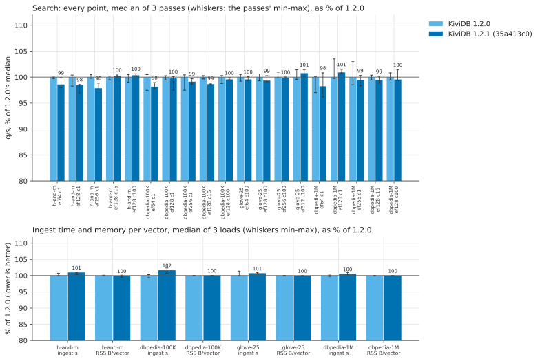

## Charts

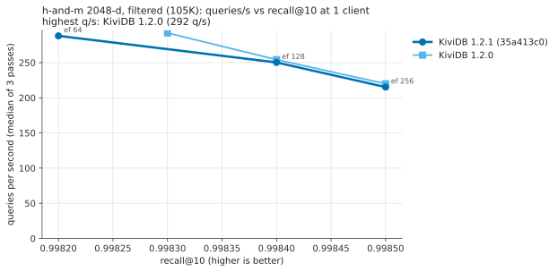
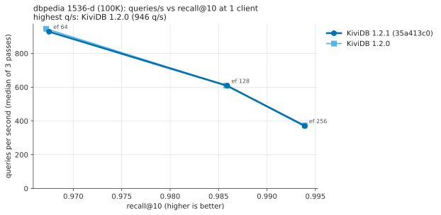
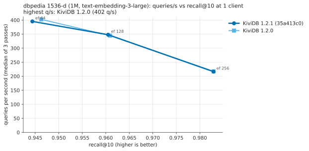
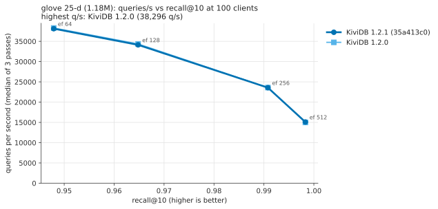
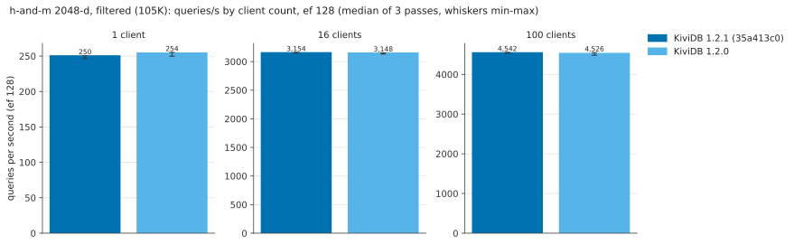
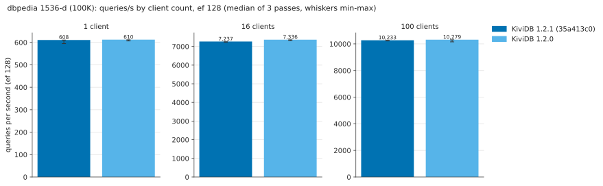
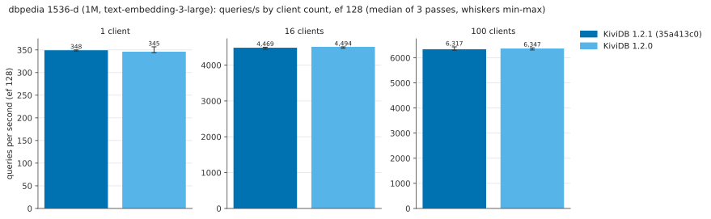
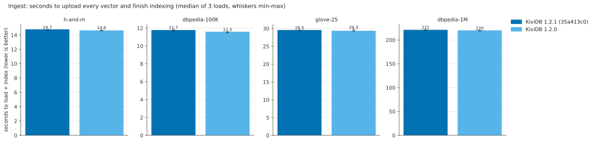
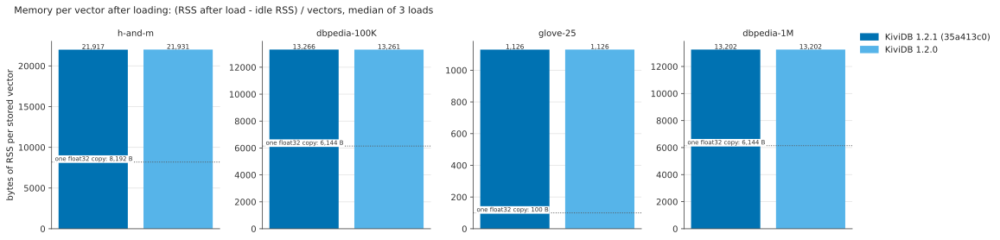
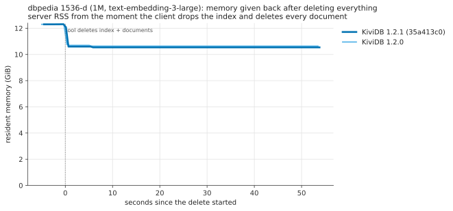
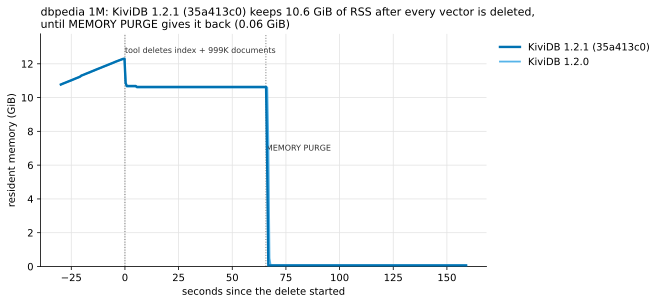

## How it was measured

The method of [`benchmarks/1.2.1/vector/`](../../1.2.1/vector/README.md#how-it-was-measured), unchanged, with the
competitors left out.

| | |
|---|---|
| Cloud | Azure swedencentral, server and client in one proximity placement group, one virtual network, accelerated networking |
| Server | `Standard_D32ps_v5`: 32 vCPU Ampere Altra (Neoverse-N1), 1 NUMA node, 128 GB |
| Client | `Standard_D16ps_v5`: 16 vCPU Neoverse-N1, 64 GB (load generator only) |
| OS | Ubuntu 22.04.5 LTS arm64, kernel 6.8.0-1070-azure (both VMs) |
| Tool | redis/vector-db-benchmark `d22d44e` (h-and-m, dbpedia) and `31a28b5` (glove-25), built with rustc 1.99.1 |

| Build | What | binary SHA-256 |
|---|---|---|
| 1.2.1 | commit `35a413c0`, built on a separate `Standard_D8ps_v5` builder the way `release.yml`'s linux-arm64 job builds it: inside `amazonlinux:2023`, rustup stable = rustc 1.99.1 (58cf8f9c3 2026-10-13), `RUSTFLAGS=-C target-feature=+lse`, `cargo build --release` (release profile: `lto = "fat"`, `codegen-units = 1`), default features, packed as `kividb-linux-aarch64.tar.gz` (SHA-256 `95bf74632339ef55993bde9d4c68b829236646bfb826e180f0a1648596bc723f`) | `2a66c1de503ded3dbd1981e0b235ae5a8bd8d9230225ef09bec71d9ba26bbb77` |
| 1.2.0 | `kividb-linux-aarch64.tar.gz` of the v1.2.0 GitHub release, `sha256sum -c` against its `SHA256SUMS.txt`: OK (tarball `106af976cb33261703fe1aa4b1c7f4d57558169d069fefe63f69c16c9507083c`) | `e936ce57888114e8dc24f5609e61454dcb77b1c609e1b7e59598d648b677673c` |

Both ran as `kividb --bind 0.0.0.0 --port 6380 --loglevel error`, one resident at a time. No compiler ran on the
server; the builder was deleted once the tarball was copied.

**Session.** `harness/run_all_kividb.sh` (`run_all.sh` with `ENGINES` limited to the two KiviDB builds): three full
passes over both builds and four datasets (pass 2 in reverse order), pass 3 sampling for 45 s after the tool's
delete, then the `MEMORY PURGE` check on both builds. 04:05-06:03 UTC. The client was never the bottleneck: the
tool's `client_saturated` flag was never set.

### Reproduce

As in [`benchmarks/1.2.1/vector/`](../../1.2.1/vector/README.md#reproduce), with these differences:
- the 1.2.1 binary comes from `harness/build_release_al2023.sh`, run on the builder with the source tree in
  `~/comb.tgz` (it needs Docker; it writes `~/kividb-linux-aarch64.tar.gz`), then
  `fetch_release.sh ~/kividb-linux-aarch64.tar.gz 121 <its sha256>` on the server;
- step 4 runs `run_all_kividb.sh` instead of `run_all.sh`;
- step 5 adds `python harness/compare.py results/summary.json <benchmarks/1.2.1/vector/README.md> results/compare.md`
  (run from `harness/`; it reads the earlier session's numbers from that README's tables).

`create_vms.sh` here shuts the VMs down 8 h out instead of 10. Note that `BUILDER_SIZE=` does not skip the builder
(`${BUILDER_SIZE:-...}` treats an empty value as unset); it was used here anyway.

### Files

- `results/tables.md`: every table, generated by `charts.py`; `results/compare.md`: the tables above, generated by
  `compare.py`.
- `results/raw.tar.gz`: `tar xzf results/raw.tar.gz -C results` gives `summary.json` and
  `raw/<pass>/<engine>/<dataset>/` (tool console output `tool.log`, the tool's result JSON in `results/`, the
  server's memory samples `mem.csv`, the client's `client-mpstat.txt`, `purge.log` for the purge runs; `suite.log`
  per pass).
- `results/server-info.txt`, `results/client-info.txt`: versions, binary hashes, tool commits, rustc;
  `results/build.log`: the build of 1.2.1.
