# Vector search: 1.2.1 against 1.2.0, Redis 8.10.2 and Dragonfly 2.0.2

The vector suite of [`benchmarks/1.2.0/vector/`](../../1.2.0/vector/README.md), rerun on **1.2.1 (commit
`ccba20e2`)** and on the **1.2.0 release binary**, with the same competitors, in one session on 2026-11-11 (UTC).
It answers two questions:

1. Does 1.2.1 cost anything in vector search, ingest or memory against 1.2.0?
2. Can the published 1.2.0 numbers be reproduced from what is committed in the repo?

The run used only the 1.2.0 suite's README and harness. Every gap found on the way is fixed in this change; see
[Reproduction gaps](#reproduction-gaps-found-and-fixed).

**Verdicts**
- **No regression.** All 19 search points of 1.2.1 are within 0.98-1.02x of 1.2.0's, inside the run-to-run spread.
  Recall is within 0.0011, memory per vector is identical to 0.1%, and ingest time is level or faster.
- **The published 1.2.0 numbers reproduced.** 1.2.0 measured today is within -5.6% to +0.5% of its published q/s
  (18 of 19 points within 3.5%), with the same recall to the fourth decimal and the same bytes per vector. Every
  engine ran 2-4% slower on dbpedia in this session, Redis included, so the comparisons between engines hold. Details
  are in [Against the published 1.2.0 numbers](#against-the-published-120-numbers).

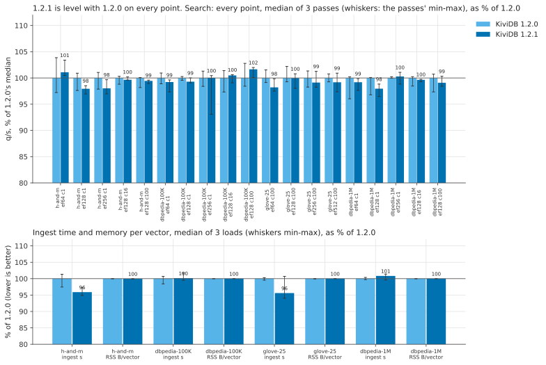

## Headline (ef 128; q/s = median of 3 passes; ingest and memory = median of 3 loads)

| Dataset | Engine | q/s, 1 client | q/s, 16 | q/s, 100 | recall@10 | p99 ms at 100 | ingest s | RSS bytes / vector |
|---|---|---:|---:|---:|---:|---:|---:|---:|
| h-and-m 2048-d filtered, 105K | KiviDB 1.2.1 | 238 | 3,010 | 4,440 | 0.9985 | 85.4 | 15.1 | 21,933 |
| h-and-m 2048-d filtered, 105K | KiviDB 1.2.0 | 243 | 3,020 | 4,464 | 0.9984 | 85.4 | 15.7 | 21,940 |
| h-and-m 2048-d filtered, 105K | Redis 8.10.2 | 129 | 1,723 | 1,757 | 0.9986 | 112.4 | 15.0 | 22,859 |
| h-and-m 2048-d filtered, 105K | Dragonfly 2.0.2 | 183 | 396 | 797 | 0.9981 | 255.4 | 9.9 | 14,210 |
| dbpedia 1536-d, 100K | KiviDB 1.2.1 | 587 | 7,077 | 10,083 | 0.9860 | 14.0 | 11.9 | 13,265 |
| dbpedia 1536-d, 100K | KiviDB 1.2.0 | 592 | 7,043 | 9,920 | 0.9860 | 13.8 | 11.9 | 13,264 |
| dbpedia 1536-d, 100K | Redis 8.10.2 | 569 | 7,227 | 7,901 | 0.9812 | 13.7 | 10.3 | 14,462 |
| dbpedia 1536-d, 100K | Dragonfly 2.0.2 | 454 | 4,600 | 9,308 | 0.9805 | 17.6 | 9.5 | 8,310 |
| dbpedia 1536-d, 1M | KiviDB 1.2.1 | 336 | 4,336 | 6,222 | 0.9608 | 22.3 | 228.8 | 13,202 |
| dbpedia 1536-d, 1M | KiviDB 1.2.0 | 343 | 4,351 | 6,279 | 0.9603 | 22.7 | 226.9 | 13,201 |
| dbpedia 1536-d, 1M | Redis 8.10.2 | 343 | 4,695 | 5,254 | 0.9386 | 20.1 | 188.5 | 14,142 |
| dbpedia 1536-d, 1M | Dragonfly 2.0.2 | 342 | 3,376 | 6,632 | 0.9389 | 24.7 | 151.4 | 8,468 |
| glove 25-d, 1.18M | KiviDB 1.2.1 | - | - | 34,037 | 0.9647 | 4.0 | 30.5 | 1,126 |
| glove 25-d, 1.18M | KiviDB 1.2.0 | - | - | 34,043 | 0.9647 | 4.0 | 31.9 | 1,126 |
| glove 25-d, 1.18M | Redis 8.10.2 | - | - | 19,757 | 0.9366 | 7.1 | 60.0 | 975 |
| glove 25-d, 1.18M | Dragonfly 2.0.2 | - | - | 25,410 | 0.9366 | 6.3 | 27.9 | 906 |

The Redis rows use the flags of `vector-benchmark.yml`; Redis with `--io-threads 8` is in
[`results/tables.md`](results/tables.md), within 1-3% of these rows except h-and-m ingest (13.3 s). glove-25 runs at
100 clients only, as in the workflow. Every ef point, p50/p95/p99/p99.9 and the spreads are in
[`results/tables.md`](results/tables.md).

## 1.2.1 against 1.2.0

Both builds ran on the same server in the same session, three full passes each (a fresh server, a load and every
search point, three repetitions per point), alternating which went first: 1.2.1 first in passes 1 and 3, 1.2.0
first in pass 2. A point counts as a change when the gap is larger than the larger of the two builds' pass-to-pass
spreads.

| dataset | ef | clients | 1.2.0 q/s | 1.2.1 q/s | 1.2.1/1.2.0 | run-to-run spread | verdict | 1.2.0 recall | 1.2.1 recall | 1.2.0 p50 / p99 / p99.9 ms | 1.2.1 p50 / p99 / p99.9 ms |
|---|---:|---:|---:|---:|---:|---:|---|---:|---:|---:|---:|
| h-and-m | 64 | 1 | 277 | 280 | 1.011 | 6.6% | same | 0.9983 | 0.9983 | 2.18 / 28.14 / 47.42 | 2.18 / 27.69 / 47.01 |
| h-and-m | 128 | 1 | 243 | 238 | 0.979 | 3.3% | same | 0.9984 | 0.9985 | 2.44 / 17.57 / 47.87 | 2.48 / 17.52 / 47.71 |
| h-and-m | 256 | 1 | 212 | 207 | 0.980 | 3.2% | same | 0.9985 | 0.9985 | 2.59 / 20.92 / 48.03 | 2.59 / 21.03 / 48.09 |
| h-and-m | 128 | 16 | 3,020 | 3,010 | 0.997 | 1.5% | same | 0.9984 | 0.9985 | 3.13 / 22.63 / 61.70 | 3.15 / 22.63 / 61.60 |
| h-and-m | 128 | 100 | 4,464 | 4,440 | 0.994 | 1.9% | same | 0.9984 | 0.9985 | 18.32 / 85.44 / 114.69 | 18.21 / 85.35 / 115.65 |
| dbpedia-100K | 64 | 1 | 920 | 912 | 0.992 | 2.3% | same | 0.9681 | 0.9686 | 1.08 / 1.51 / 1.73 | 1.09 / 1.56 / 1.87 |
| dbpedia-100K | 128 | 1 | 592 | 587 | 0.993 | 0.9% | same | 0.9860 | 0.9860 | 1.69 / 2.31 / 2.57 | 1.70 / 2.35 / 2.64 |
| dbpedia-100K | 256 | 1 | 362 | 362 | 1.000 | 7.4% | same | 0.9938 | 0.9940 | 2.79 / 3.90 / 4.21 | 2.78 / 3.87 / 4.20 |
| dbpedia-100K | 128 | 16 | 7,043 | 7,077 | 1.005 | 4.1% | same | 0.9860 | 0.9860 | 2.28 / 3.10 / 3.51 | 2.28 / 3.16 / 3.54 |
| dbpedia-100K | 128 | 100 | 9,920 | 10,083 | 1.016 | 4.3% | same | 0.9860 | 0.9860 | 9.59 / 13.79 / 14.89 | 9.48 / 13.96 / 15.14 |
| glove-25 | 64 | 100 | 38,381 | 37,693 | 0.982 | 2.4% | same | 0.9479 | 0.9478 | 2.42 / 3.52 / 4.21 | 2.46 / 3.61 / 4.04 |
| glove-25 | 128 | 100 | 34,043 | 34,037 | 1.000 | 2.9% | same | 0.9647 | 0.9647 | 2.72 / 3.97 / 4.38 | 2.71 / 3.96 / 4.40 |
| glove-25 | 256 | 100 | 23,381 | 23,175 | 0.991 | 3.1% | same | 0.9908 | 0.9908 | 3.98 / 5.77 / 6.02 | 4.06 / 5.78 / 6.10 |
| glove-25 | 512 | 100 | 14,984 | 14,860 | 0.992 | 3.6% | same | 0.9983 | 0.9983 | 6.36 / 9.11 / 9.57 | 6.34 / 9.31 / 9.85 |
| dbpedia-1M | 64 | 1 | 393 | 390 | 0.992 | 4.2% | same | 0.9450 | 0.9461 | 2.59 / 3.36 / 3.66 | 2.60 / 3.39 / 3.77 |
| dbpedia-1M | 128 | 1 | 343 | 336 | 0.980 | 3.3% | same | 0.9603 | 0.9608 | 2.98 / 3.81 / 4.18 | 3.00 / 3.90 / 4.19 |
| dbpedia-1M | 256 | 1 | 215 | 216 | 1.003 | 2.2% | same | 0.9827 | 0.9828 | 4.66 / 6.35 / 6.77 | 4.71 / 6.40 / 6.69 |
| dbpedia-1M | 128 | 16 | 4,351 | 4,336 | 0.996 | 1.8% | same | 0.9603 | 0.9608 | 3.69 / 4.85 / 5.21 | 3.73 / 4.88 / 5.16 |
| dbpedia-1M | 128 | 100 | 6,279 | 6,222 | 0.991 | 3.4% | same | 0.9603 | 0.9608 | 14.87 / 22.69 / 28.72 | 14.82 / 22.30 / 25.82 |

| dataset | 1.2.0 upload+index s (median, min-max) | 1.2.1 | 1.2.1/1.2.0 | 1.2.0 RSS B/vector | 1.2.1 RSS B/vector | 1.2.1/1.2.0 |
|---|---:|---:|---:|---:|---:|---:|
| h-and-m | 15.7 (15.3-15.9) | 15.1 (14.9-15.3) | 0.959 | 21,940 | 21,933 | 1.000 |
| dbpedia-100K | 11.9 (11.7-12.0) | 11.9 (11.9-12.1) | 1.001 | 13,264 | 13,265 | 1.000 |
| glove-25 | 31.9 (31.8-32.0) | 30.5 (30.0-32.1) | 0.956 | 1,126 | 1,126 | 1.000 |
| dbpedia-1M | 226.9 (226.3-227.8) | 228.8 (226.0-230.1) | 1.008 | 13,201 | 13,202 | 1.000 |

- **Search.** No point moves by more than its spread. The largest gaps are -2.1% (h-and-m ef 128 and dbpedia-1M
  ef 128, 1 client, spreads 3.3%) and +1.6% (dbpedia-100K, 100 clients).
- **Ingest.** Two rows moved by more than 3%, both faster in 1.2.1: h-and-m by 4.1% (the load ranges just
  touch: 14.9-15.3 s against 15.3-15.9 s) and glove-25 by 4.4% (the ranges overlap: 1.2.1's slowest load,
  32.1 s, is slower than 1.2.0's slowest). Neither is put down to 1.2.1. Nothing in 1.2.1 targets the `HSET`
  ingest path, and the 1.2.0 suite saw the same glove-25 swing between two builds of identical vector code. dbpedia-1M
  is 0.8% slower, inside the ranges.
- **Memory.** RSS per vector is identical (within 7 B of 1-22 KB), `used_memory` per vector identical to the byte.
- **Memory after deleting everything** (dbpedia-1M): both builds behave as 1.2.0 did. After the tool drops the index
  and deletes the 999K documents, RSS stays at 10.6 GiB of 12.3 (1.2.1 10.64, 1.2.0 10.60 GiB, 45 s after the
  delete) while `used_memory` reads 6-9 MB, and drops to 0.06-0.08 GiB within a second of `MEMORY PURGE`
  ([chart](charts/memory-purge-dbpedia-1M.svg)). Redis falls to 0.09 GiB and Dragonfly to 0.19 GiB on their own.
- **What changed between the builds** (1.2.1's fixes: key handling as bytes, the command entry path, hash field
  TTLs, replication and persistence fixes, ACL checks) does not touch the HNSW index or the search path, and
  nothing here shows it.

## Against the published 1.2.0 numbers

The [1.2.0 suite](../../1.2.0/vector/README.md) was measured on 2026-11-02 on another server and client of the
same sizes in the same region, with a 1.2.0 build compiled from source on Ubuntu (commit `75482ab`, the code that
shipped). Here 1.2.0 is the published release binary, which `release.yml` compiles on Amazon Linux 2023.

| | KiviDB 1.2.0, published | KiviDB 1.2.0, today | change | Redis 8.10.2: published -> today |
|---|---:|---:|---:|---:|
| h-and-m ef 128, q/s at 1 / 16 / 100 clients | 252 / 3,092 / 4,478 | 243 / 3,020 / 4,464 | -3.4% / -2.3% / -0.3% | 131 / 1,765 / 1,802 -> 129 / 1,723 / 1,757 |
| dbpedia-100K ef 128, q/s at 1 / 16 / 100 | 609 / 7,163 / 10,255 | 592 / 7,043 / 9,920 | -2.9% / -1.7% / -3.3% | 589 / 7,470 / 8,198 -> 569 / 7,227 / 7,901 |
| dbpedia-1M ef 128, q/s at 1 / 16 / 100 | 341 / 4,509 / 6,255 | 343 / 4,351 / 6,279 | +0.5% / -3.5% / +0.4% | 352 / 4,832 / 5,386 -> 343 / 4,695 / 5,254 |
| glove-25 ef 64 / 128 / 256 / 512, q/s at 100 | 38,217 / 33,891 / 23,451 / 14,992 | 38,381 / 34,043 / 23,381 / 14,984 | +0.4% / +0.4% / -0.3% / -0.1% | 20,071 / 19,863 / 14,019 / 8,973 -> 21,599 / 19,757 / 13,768 / 8,806 |
| recall@10 at ef 128 (h-and-m / dbpedia-100K / 1M / glove) | 0.9984 / 0.9864 / 0.9604 / 0.9647 | 0.9984 / 0.9860 / 0.9603 / 0.9647 | within 0.0004 | identical |
| ingest s (h-and-m / dbpedia-100K / 1M / glove) | 14.9 / 11.7 / 221.0 / 30.2 | 15.7 / 11.9 / 226.9 / 31.9 | +5.9% / +1.9% / +2.7% / +5.5% | 15.1 / 10.1 / 180.8 / 60.3 -> 15.0 / 10.3 / 188.5 / 60.0 |
| RSS B/vector (h-and-m / dbpedia-100K / 1M / glove) | 21,936 / 13,265 / 13,202 / 1,126 | 21,940 / 13,264 / 13,201 / 1,126 | 0.0% | within 0.6% |
| RSS after the delete / after `MEMORY PURGE`, dbpedia-1M | 10.6 / 0.07 GiB | 10.6 / 0.08 GiB | same | 0.09 GiB |

- **Recall and memory reproduce exactly.** They do not depend on the machine.
- **q/s reproduces within -5.6% to +0.5%.** 18 of 19 points are within 3.5%. The largest gap is h-and-m ef 64 at
  1 client (-5.6%), whose pass ranges overlap the published ones (269-288 against 288-294).
- **This session was slower for every engine on dbpedia**, not only for KiviDB. Redis's dbpedia points are 2.4-4.0%
  below its published ones and Dragonfly's 1.0-4.7%. So the ratios between engines hold: for example, KiviDB against
  Redis at dbpedia-100K, 100 clients, is 1.26x today against 1.25x published, and on h-and-m at 100 clients 2.54x
  against 2.49x.
- **Ingest is 2-6% slower than published.** Redis's dbpedia-1M ingest moved the same way (+4.3%). The two
  glove-25 and h-and-m gaps (+5.5%, +5.9%) are larger than Redis's, which could be the build: the published row is
  a source build on Ubuntu with the same compiler (rustc 1.99.1), this one `release.yml`'s Amazon Linux build. The
  1.2.0 suite's own last round (also built from source, on the code that shipped) measured dbpedia-1M ingest at 228-230 s, the same as
  today. Not investigated further; it does not change any comparison in the 1.2.0 README.

## Charts

All charts include both KiviDB builds. Speed against recall:

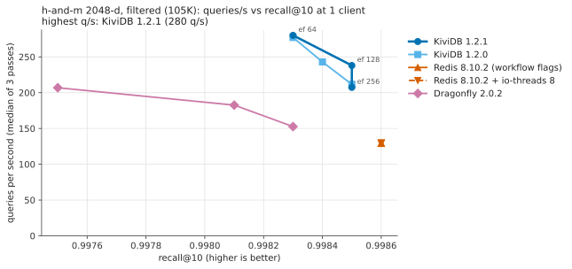
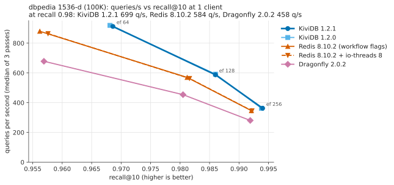
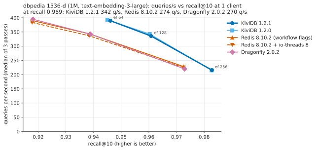
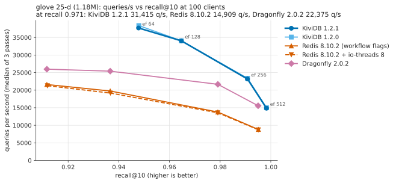

Throughput by clients, ingest, memory:

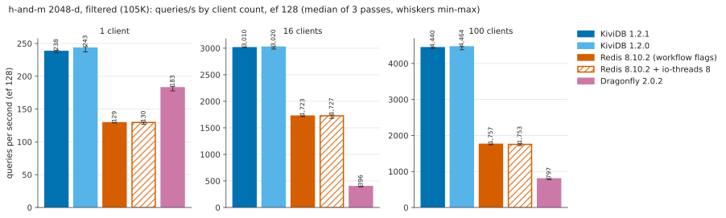
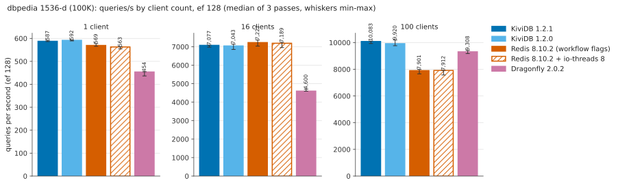
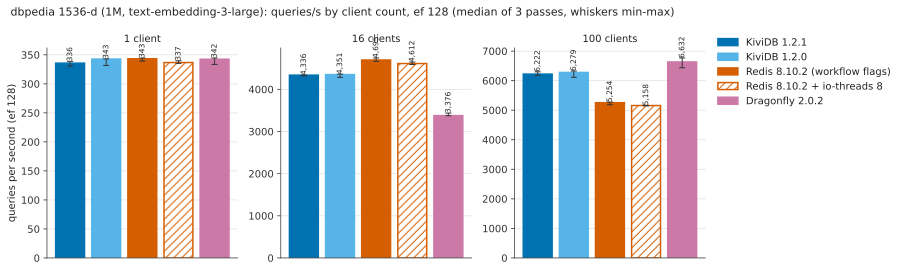
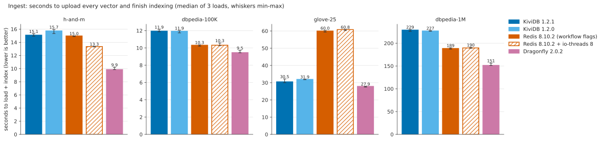
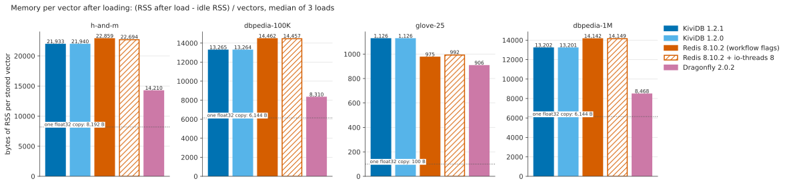
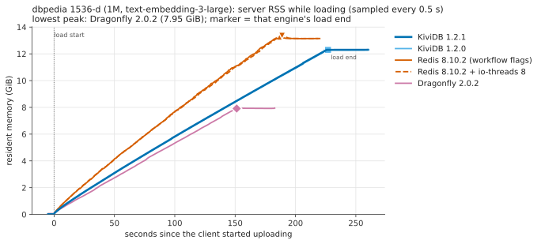
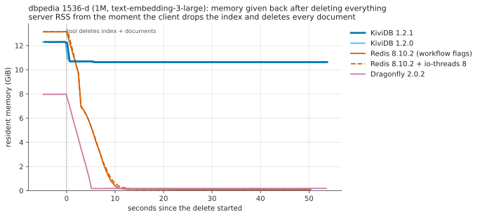
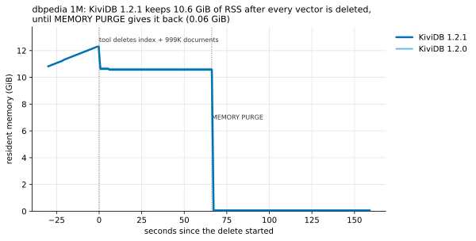

The memory-over-time and memory-vs-vectors charts of the other datasets are in [`charts/`](charts/).

## How it was measured

The 1.2.0 suite's method, unchanged; see [its README](../../1.2.0/vector/README.md#how-it-was-measured) for the
tool, workload, sampling and repetition rules.

| | |
|---|---|
| Cloud | Azure swedencentral (the region of the 1.2.0 suite), server and client in one proximity placement group, one virtual network, accelerated networking |
| Server | `Standard_D32ps_v5`: 32 vCPU Ampere Altra (Neoverse-N1), 1 NUMA node, 128 GB |
| Client | `Standard_D16ps_v5`: 16 vCPU Neoverse-N1, 64 GB (load generator only) |
| OS | Ubuntu 22.04.5 LTS arm64, kernel 6.8.0-1070-azure (as published) |
| Tool | redis/vector-db-benchmark `d22d44e` (h-and-m, dbpedia) and `31a28b5` (glove-25), built with rustc 1.99.1 |
| Competitors | Redis `6:8.10.2-1rl1~jammy1` with its `redisearch.so` (`search-workers` 16), with and without `--io-threads 8`; Dragonfly v2.0.2 `dragonfly-aarch64` with `--proactor_threads=32` |

| Build | What | binary SHA-256 |
|---|---|---|
| 1.2.1 | commit `ccba20e2`, `kividb-linux-aarch64.tar.gz` of `release.yml` run 42974385537 (Amazon Linux 2023, rustup stable = rustc 1.99.1, `RUSTFLAGS=-C target-feature=+lse`, `cargo build --release`, default features); tarball SHA-256 `0ce0ea23ff8c8ef586b9fff95ce87d2ab4dc42704bab77d09d32879a4cf7e586` | `af4d07c1981e2c6b8f4f1bd6b54036bf341ceb084e748d9b19f12ce7f31cdc79` |
| 1.2.0 | `kividb-linux-aarch64.tar.gz` of the v1.2.0 GitHub release, `sha256sum -c` against its `SHA256SUMS.txt`: OK (tarball `106af976cb33261703fe1aa4b1c7f4d57558169d069fefe63f69c16c9507083c`) | `e936ce57888114e8dc24f5609e61454dcb77b1c609e1b7e59598d648b677673c` |

Both ran as `kividb --bind 0.0.0.0 --port 6380 --loglevel error`, one engine resident at a time. No compiler ran on
the server; no builder VM was needed.

**Session.** `harness/run_all.sh`: three full passes over all five engines and four datasets (1.2.1, 1.2.0, Redis,
Redis + io-threads, Dragonfly; pass 2 in reverse order), pass 3 sampling for 45 s after the tool's delete, then the
`MEMORY PURGE` check on both builds. 06:57-12:08 UTC. The client was never the bottleneck: the tool's
`client_saturated` flag was never set.

### Reproduce

```
# 1. VMs: server + client in one placement group (BUILDER_SIZE= skips the builder; release binaries need none)
RG=my-rg LOCATION=swedencentral SSH_PUB=~/.ssh/id_ed25519.pub SSH_CIDR=<your ip>/32 BUILDER_SIZE= harness/create_vms.sh
# 2. server: Redis 8.10.2, Dragonfly 2.0.2, the engine control script, the two KiviDB binaries
scp harness/setup_server.sh harness/server_ctl.sh harness/fetch_release.sh azureuser@SERVER:
ssh azureuser@SERVER 'bash setup_server.sh && bash fetch_release.sh v1.2.0 120'
gh run download 42974385537 -R kividbio/kividb -n dist-linux-arm64-default    # release.yml's build of ccba20e2
scp kividb-linux-aarch64.tar.gz azureuser@SERVER:
ssh azureuser@SERVER 'bash fetch_release.sh ~/kividb-linux-aarch64.tar.gz 121 0ce0ea23ff8c8ef586b9fff95ce87d2ab4dc42704bab77d09d32879a4cf7e586'
# 3. client: both tool pins + engines-files, and an ssh key the server accepts
scp harness/setup_client.sh harness/run_suite.sh harness/run_all.sh harness/purge_test.sh azureuser@CLIENT:
ssh azureuser@CLIENT 'bash setup_client.sh'
ssh azureuser@CLIENT 'ssh-keygen -q -t ed25519 -N "" -f ~/.ssh/id_ed25519 <<< y >/dev/null; cat ~/.ssh/id_ed25519.pub' \
  | ssh azureuser@SERVER 'cat >> ~/.ssh/authorized_keys'
# 4. run on the client, detached (about 5 h 10 min); done when ~/out/ALL-DONE exists
ssh azureuser@CLIENT 'SERVER_IP=<server private ip> nohup bash run_all.sh > run_all.log 2>&1 < /dev/null &'
# 5. summarise (Python 3 + matplotlib) from a copy of the client's ~/out in results/raw
#    (to redo it from this run's data: tar xzf results/raw.tar.gz -C results)
python harness/parse.py results/raw results/summary.json
python harness/charts.py results/summary.json charts results/tables.md
python harness/chart_purge.py charts/memory-purge-dbpedia-1M.svg \
  'results/raw/purge/kividb-121/dbpedia-openai-1M-1536-angular=KiviDB 1.2.1=#0072B2' \
  'results/raw/purge/kividb-120/dbpedia-openai-1M-1536-angular=KiviDB 1.2.0=#56B4E9'
az group delete -n my-rg --yes
```

The harness is the 1.2.0 suite's, with these changes: `fetch_release.sh` is new (it replaces `build_kividb.sh`);
`run_all.sh` takes the two builds from `CAND`/`BASE` (default `kividb-121`/`kividb-120`); `charts.py` takes their
labels and names from the environment, draws both builds in every chart, and clamps rounding-negative error bars;
`purge_test.sh` waits at most an hour for the load. `setup_server.sh`, `server_ctl.sh`, `setup_client.sh`,
`run_suite.sh`, `parse.py`, `chart_purge.py` and `create_vms.sh` are unchanged apart from default labels.

### Files

- `results/tables.md`: every table, generated by `charts.py`.
- `results/raw.tar.gz`: the raw data, packed to keep the repository small. `tar xzf results/raw.tar.gz -C results`
  gives `summary.json` (every run parsed, with its memory samples) and `raw/<pass>/<engine>/<dataset>/`: the
  tool's console output (`tool.log`, timestamped per line on the client), the server's memory samples
  (`mem.csv`) and, for the purge runs, `purge.log`; `suite.log` per pass.
- `results/tool-results-json.tar.gz`: the tool's own result files; `results/client-mpstat.tar.gz`: the client's CPU
  per second. `results/server-info.txt`, `results/client-info.txt`: versions, binary hashes, tool commits, rustc.

## Reproduction gaps found and fixed

Following [`benchmarks/1.2.0/vector/README.md`](../../1.2.0/vector/README.md) step by step:

1. **The client's ssh access to the server was not set up anywhere.** The README said only "the client must be able
   to ssh to the server's private IP". Added the key exchange to its Reproduce block.
2. **The builder's binaries were never copied to the server**, and the builder never deleted: "then copy ~/bins/ to
   the server" had no command. Added both.
3. **The compiler was not pinned.** `build_kividb.sh` installed whatever rustup's `stable` was on the day; the
   published binaries were built with rustc 1.99.1. It now pins `TOOLCHAIN=1.99.1` (overridable).
4. **The build labels were hard-coded.** `run_all.sh` ran only `kividb-cand` and `kividb-rc4`, and `charts.py`
   names them "1.2.0" and "1.2.0-rc4". `run_all.sh` now takes `CAND`/`BASE`; the README says how the labels map to
   `build_kividb.sh` names and points to this folder's `charts.py` for other builds.
5. **The 5-hour run was shown as a foreground command**, which dies with the ssh session. The README now runs it
   detached and says to wait for `~/out/ALL-DONE`.
6. **`purge_test.sh` waited forever** if its load failed. It now gives up after an hour.
7. **Undocumented:** the tool downloads the datasets on first use (sources, disk space, and that the download is
   outside the measured ingest time), and `SSH_PUB` must be a path `az` itself can read (a native path on
   Windows). Both are now in the README. `extra_glove.sh` was missing from the files copied to the client.
