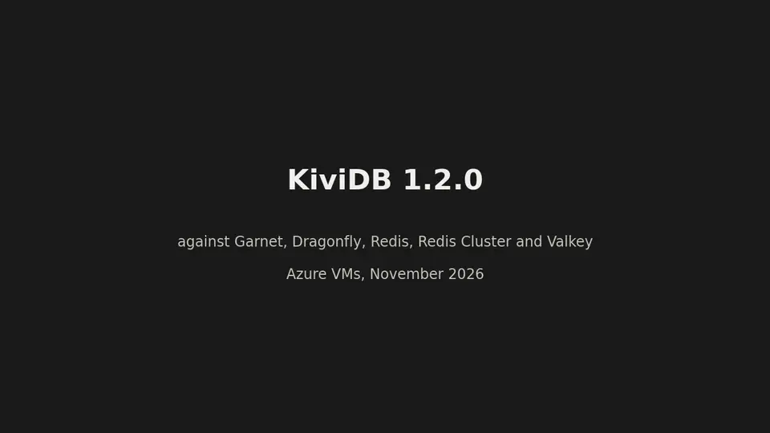
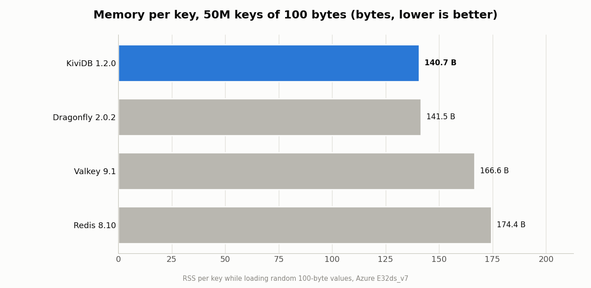
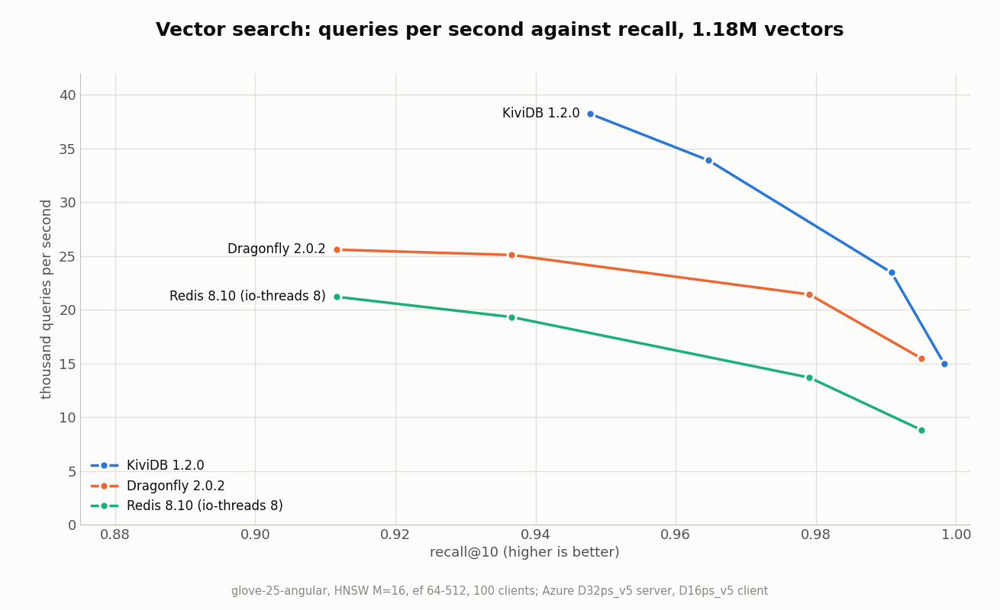
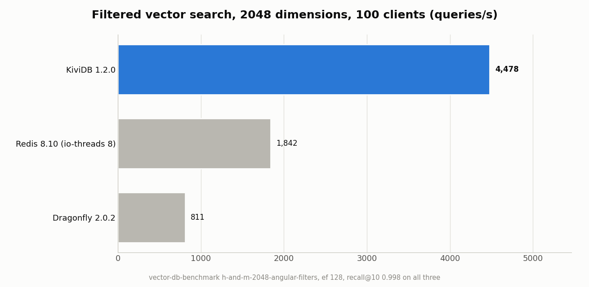
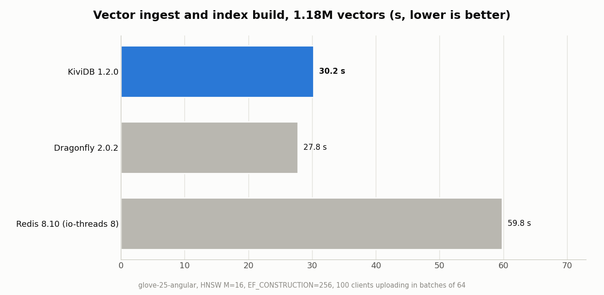

# Performance

*KiviDB 1.2.0 against Garnet, Dragonfly, Redis, Redis Cluster and Valkey. Click for the full-resolution video.*

- [Bare metal](#bare-metal)
- [The full suite, on Azure VMs](#the-full-suite-on-azure-vms)
- [Memory of small sets](#memory-of-small-sets)
- [Memory of small hashes](#memory-of-small-hashes)
- [Worker threads](#worker-threads)
- [Worker CPU affinity](#worker-cpu-affinity)
- [Earlier runs](#earlier-runs)
- [Independent reviews](#independent-reviews)

## Bare metal

AWS Graviton3, November 2026: the server on a `c7gn.metal` confined to 32 cores, the load
generator on a second `c7gn.metal` in the same placement group, one engine at a time,
persistence off. memtier_benchmark, 10 million keys of 100 bytes, 30 s a run, the mean of
two rounds; 300 connections pipelined, 1,200 without.

| | KiviDB 1.2.0 | Garnet 2.2.5 | Dragonfly 2.0.2 | Redis 8.10.3 |
|---|---:|---:|---:|---:|
| `GET`, pipeline 16 | **21.24M** | 20.82M | 9.31M | 2.36M |
| `SET`, pipeline 16 | 17.79M | **20.27M** | 8.70M | 1.94M |
| `GET`, no pipelining | 2.99M | 2.88M | **3.30M** | 1.47M |
| `SET`, no pipelining | 3.22M | 3.07M | **3.37M** | 1.26M |
| p99, `GET` / `SET` at pipeline 16 | **0.36 / 0.45 ms** | 0.67 / 0.80 ms | 0.88 / 1.02 ms | 2.29 / 2.72 ms |
| Bytes a key, 10M keys of 100 B | 143 | | **134** | 178 |

Pipelined, KiviDB served 9.0× Redis's GETs and 9.2× its SETs, and more than twice
Dragonfly's. Garnet was a close second on `GET` and ahead on pipelined `SET`; without
pipelining Dragonfly was 5-10% ahead. Scripts and raw results:
[kivi-benchmark](https://github.com/kividbio/kivi-benchmark).

## The full suite, on Azure VMs

KiviDB 1.2.0 was measured in November 2026 on Azure VMs against Redis 8.10, Redis Cluster,
Valkey 9.1, Dragonfly 2.0, Garnet 2.2 and kvrocks 2.17, each on the same machines in the same
hour, with p50/p99/p99.9 latency from two load generators.
[benchmarks/1.2.0/REPORT.md](../benchmarks/1.2.0/REPORT.md) has every number and comparison;
[benchmarks/1.2.0](../benchmarks/1.2.0/README.md) has the harnesses, raw results and charts.

| | KiviDB 1.2.0 | Best other | Redis 8.10 |
|---|---|---|---|
| `GET` 100 B, pipeline 16 | 10.45M ops/s | Garnet 10.69M | 1.41M |
| `SET` 100 B, pipeline 16 | 7.94M ops/s | Garnet 9.83M | 1.25M |
| `MSET` of 10 keys | 569K commands/s | Garnet 800K | 144K |
| Lists, hashes, sets, sorted sets, counters, pipeline 16 | 4.2-6.6M ops/s | Redis Cluster (16 shards): level, ahead on `HSET` and `INCR` | 3.7-6.0x less |
| Bytes per key, 100 B values, 50M keys | 140.7 | Dragonfly 141.5 | 174.4 |
| Memory added by `BGSAVE`, 30M keys of 1 KB under writes | +10% | Dragonfly +0.4% | +89% |
| Filtered vector search, 100 clients | 4,478 q/s | Dragonfly 811 | 1,802 |
| Cache hit rate ([#202](https://github.com/kividbio/kividb/issues/202)) | 60.96% | | 60.78% |

Where KiviDB loses: Garnet is faster on `SET` at pipeline 16 and on `MSET`; Redis Cluster on
`HSET` and `INCR`; Dragonfly uses less memory per vector, during a snapshot, and for ASCII
values; Redis ingests vectors faster and serves 3-9% more cache reads a second. These are
cloud VMs, so absolute numbers are lower than on the [bare metal](#bare-metal) above.

<picture>
  <source media="(prefers-color-scheme: dark)" srcset="../assets/benchmarks/1.2.0/throughput-pipelined-dark.png">
  
</picture>

<picture>
  <source media="(prefers-color-scheme: dark)" srcset="../assets/benchmarks/1.2.0/throughput-unpipelined-dark.png">
  
</picture>

<picture>
  <source media="(prefers-color-scheme: dark)" srcset="../assets/benchmarks/1.2.0/latency-p99-pipelined-dark.png">
  
</picture>

<picture>
  <source media="(prefers-color-scheme: dark)" srcset="../assets/benchmarks/1.2.0/mset-dark.png">
  
</picture>

<picture>
  <source media="(prefers-color-scheme: dark)" srcset="../assets/benchmarks/1.2.0/memory-per-key-dark.png">
  
</picture>

<picture>
  <source media="(prefers-color-scheme: dark)" srcset="../assets/benchmarks/1.2.0/snapshot-memory-dark.png">
  
</picture>

<picture>
  <source media="(prefers-color-scheme: dark)" srcset="../assets/benchmarks/1.2.0/vector-qps-recall-dark.png">
  
</picture>

<picture>
  <source media="(prefers-color-scheme: dark)" srcset="../assets/benchmarks/1.2.0/vector-filtered-dark.png">
  
</picture>

<picture>
  <source media="(prefers-color-scheme: dark)" srcset="../assets/benchmarks/1.2.0/vector-ingest-dark.png">
  
</picture>

## Memory of small sets

Since 1.3.0 a small set is kept in one block (`listpack` in `OBJECT ENCODING`:
up to 128 members of up to 64 bytes) or, when its members are integers, as a
sorted array (`intset`: up to 512), where 1.2 kept every set as a hash table
with an allocation per member (#297). Bytes of `used_memory` a member, 3M
members in sets of each size, 14-byte members (`membr:00000001`) or the
integers 0 to n-1, on an Azure `Standard_D4s_v5`:

| members a set | 1.2.2 strings | 1.3.0 strings | Redis 8.10.2 strings | 1.2.2 integers | 1.3.0 integers | Redis 8.10.2 integers |
|---:|---:|---:|---:|---:|---:|---:|
| 10 | 76.0 | 34.6 | 25.8 | 68.0 | 17.6 | 9.8 |
| 100 | 55.5 | 20.4 | 18.5 | 47.5 | 3.8 | 2.8 |
| 1,000 | 67.0 | 67.0 | 30.0 | 59.0 | 59.0 | 22.3 |
| 100,000 | 54.3 | 54.3 | 36.8 | 46.3 | 46.3 | 28.8 |

What is left over Redis at 10 members is mostly the key's own: an entry and
the set's header, about 150 bytes a key. Sets of more
than 128 members (512 integers) are tables as before; making those smaller is
the next step of #297. Suite `17-set-memory` of
[the regression suite](../benchmarks/1.3.0/regressions/README.md) measures
this table again and fails a build that loses it.

## Memory of small hashes

Since 1.3.0 a small hash is kept in one block, its fields and values end to
end (`listpack` in `OBJECT ENCODING`, `listpackex` once a field has a TTL: up
to 512 fields, no field or value longer than 64 bytes), where 1.2 kept every
hash as a table with two allocations per field. Bytes of `used_memory` a
field, 3M fields in hashes of each size, 14-byte fields (`field:00000001`)
with 32-byte values, on an Azure `Standard_D4s_v5`:

| fields a hash | 1.2.2 | 1.3.0 | Redis 8.10.2 |
|---:|---:|---:|---:|
| 10 | 162.8 | 71.8 | 57.8 |
| 100 | 129.2 | 55.8 | 51.7 |
| 1,000 | 166.6 | 166.6 | 70.1 |
| 100,000 | 128.8 | 128.8 | 76.8 |
| 3,000,000 | 133.3 | 133.3 | 77.9 |

As for sets, what is left over Redis at 10 fields is mostly the key's own
entry and the hash's header. Hashes past the block's limits are tables as
before. Suite `19-hash-memory` of
[the regression suite](../benchmarks/1.3.0/regressions/README.md) measures
this again (with and without field TTLs) and fails a build that loses it.

## Memory of lists

Since 1.3.0 a list's elements lie end to end in chunks of up to 64, each
element between two copies of its length (one byte each for an element
shorter than 128 bytes, two otherwise), where 1.2 kept a slot, a shared
header and an allocation of its own for every element. Bytes of
`used_memory` an element, 1M elements of 32 bytes in lists of each size (3M
in one list), on an Azure `Standard_D4s_v5`:

| elements a list | 1.2.2 | 1.3.0 | Redis 8.10.2 |
|---:|---:|---:|---:|
| 10 | 75.6 | 46.4 | 44.0 |
| 100 | 65.2 | 36.4 | 36.4 |
| 1,000 | 64.1 | 34.7 | 34.6 |
| 100,000 | 68.5 | 34.7 | 34.3 |
| 3,000,000 | 69.8 | 34.7 | 34.3 |

Short elements, which queues hold (job ids), gain most: six-byte ids take
8.7 bytes an element in lists of 100,000 (1.2.2: 44.5; Redis 8.10.2, which
keeps such numbers as integers: 5.0), and BullMQ's wait list of 200,000 ids
8.1 (1.2.2: 45.0; Redis: 5.0). A queue's churn (ten full rotations) leaves
it as compact as a bulk load, and a list drained to a tenth gives back the
room it kept for the rest (9.3 bytes an element left, where 1.2.2 kept 192).

At 10 elements most of what is left over Redis is the key's own: its entry
and the list's header. A list that has had an element longer than 1,024
bytes keeps its elements apart, as 1.2 did, and takes what 1.2 took. Suite
`21-list-memory` of
[the regression suite](../benchmarks/1.3.0/regressions/README.md) measures
this table again (1M elements, 10 to 100,000 a list) and fails a build that
loses it.

## Memory of small sorted sets

Since 1.3.0 a sorted set of up to 128 members of up to 64 bytes is kept in
one block, its entries in order by score and then by member, each score as
its integer in one to eight bytes where it is one (`listpack` in
`OBJECT ENCODING`), where 1.2 kept every sorted set as a hash table and a
tree holding a shared copy of each member. Bytes of `used_memory` a member,
1M members in sets of each size, 14-byte members (`membr:00000001`), on an
Azure `Standard_D4s_v5`:

| members a set | 1.2.2 whole scores | 1.3.0 whole scores | Redis 8.10.2 whole scores | 1.2.2 fractions | 1.3.0 fractions | Redis 8.10.2 fractions |
|---:|---:|---:|---:|---:|---:|---:|
| 10 | 118.8 | 29.6 | 24.8 | 118.8 | 37.6 | 28.0 |
| 100 | 116.4 | 19.3 | 21.0 | 116.4 | 27.3 | 26.2 |
| 128 | 131.7 | 19.0 | 20.4 | 131.7 | 27.0 | 24.4 |
| 129 | 130.9 | 79.1 | 79.1 | 130.9 | 79.1 | 78.8 |
| 1,000 | 132.5 | 76.4 | 68.0 | 132.5 | 76.4 | 68.0 |
| 100,000 | 113.7 | 72.1 | 74.2 | 113.7 | 72.1 | 74.2 |
| 3,000,000 | 115.9 | 71.9 | 75.2 | 115.9 | 71.9 | 75.2 |

Measured a key at a time as #297 measured it (100,000 sets of 10 members of
8 bytes, scores 0 to 9): 274 bytes of RSS a key (1.2.2: 1,249; Redis: 186),
236 of `used_memory` (1,108; 176). What is left over Redis is mostly the
key's own entry and the set's header. The rows from 129 members on are
from an Azure `Standard_D8s_v5` (suite 31's recorded run, one set each of
100,000 and 3,000,000): past 128 members a sorted set is a table of
members, each member and its score in one block of the collections' pool,
and an index of their order (a B-tree) that holds each member as the
address of its block. Of the bytes a member at 3,000,000 (16-byte
members), the table takes 45.7 and the index 34 when members come in
order one `ZADD` at a time, 27 at random, 18 for a set built whole (a
load, `RESTORE`); see `benchmarks/1.3.0/large-zsets`. Suite
`31-zset-memory` of
[the regression suite](../benchmarks/1.3.0/regressions/README.md) measures
the table again and fails a build that loses it.

## Snapshot size

Since 1.3.0 a snapshot can be written compressed (`rdbcompression yes`,
off by default in 1.3 so that a rollback to 1.2 works; see
[PERSISTENCE.md](PERSISTENCE.md#compressed-snapshots)): the
same image, in blocks of 256 KiB compressed with zstd level 1 off the
serving threads. On an Azure `Standard_D4s_v5`, the server on 2 CPUs, the file
on tmpfs (the save on the VM's disk in its own row):

| dataset | 1.2.2 (and 1.3.0 by default) | 1.3.0, `rdbcompression yes` | Redis 8.10.2 |
|---|---:|---:|---:|
| 6M strings of 150 B ([#879](https://github.com/kividbio/kividb/issues/879)), file | 1,007 MB | 32.7 MB | 142.9 MB |
| the same, `SAVE` to the VM's disk | 6.2 s | 2.0 s | 6.4 s |
| the same, master memory during a full sync | +1,055 MB | +99 MB | |
| 6M text strings of 16-64 B, file | 359 MB | 131 MB | 308 MB |
| 6M random strings of 16-64 B, file | 359 MB | 305 MB | 323 MB |
| 1M hashes and 600k sets, sorted sets and lists, file | 490 MB | 206 MB | 392 MB |

Compressing costs CPU on the saving threads: a save to tmpfs of the text
strings takes 2.0 s instead of 1.2 s, and loading takes up to 1.1 s more.
`rdbcompression no`, the default, writes the plain image, as 1.2 did. Suite
`24-snapshot-size` of
[the regression suite](../benchmarks/1.3.0/regressions/README.md) measures
the first and last datasets again (snapshot size, save and load time against
1.2.2 and Redis, with the default and with `yes`) and fails a build that
loses it.

## Script call cost

What one short script call costs the server ([#901](https://github.com/kividbio/kividb/issues/901)),
measured in November 2026 on one Azure `Standard_D8s_v5`: the server on 2 CPUs
(`taskset`), the `lua,tls` build of each tree made by rustc 1.100.0 with the release
profile (fat LTO, one codegen unit), Redis 8.10.2 with its defaults, and a Go client (64
connections, one command at a time, go-redis) on the other 6 CPUs, 10 s after 3 s of
warm-up. CPU per call is the server's user + system time over the calls it counted. The
scripts:

- **Tyk**: Tyk 5.16's sliding-log rate limiter: `ZREMRANGEBYSCORE`, `ZCARD`, `ZADD`,
  `EXPIRE` on one of 5,000 keys of about 144 members, a 3-element reply.
- **lock**: `SET lock token PX 30000`, then the compare-and-delete release of
  [#880](https://github.com/kividbio/kividb/issues/880); both commands are in the row.
- **return 1**: `return 1`, no keys.
- **centrifuge history / add**: centrifuge v0.40.1's `broker_history_list.lua` (2 keys) and
  `broker_history_add_list.lua` (3 keys, a `PUBLISH`), on one channel, as suite 25 runs them.
- **BullMQ add / move**: bullmq 5.81.5 from Node 22: `queue.add` of 1.8 KB jobs, 50 at a time
  (`addStandardJob`), then a worker of concurrency 50 (`moveToFinished`, fetching the next
  job), 100,000 jobs. The Node client, not the server, is the limit here, so CPU per job is
  shown.

One worker (`--threads 1`, Redis being single-threaded anyway), CPU per call:

| script | 1.2.2 | master before | 1.3.0 | Redis 8.10.2 |
|---|---:|---:|---:|---:|
| Tyk | 15.6 µs | 16.1 µs | **13.4 µs** | 13.8 µs |
| lock (`SET` + script) | 15.3 µs | 16.2 µs | 15.3 µs | 13.7 µs |
| return 1 | 7.5 µs | 7.9 µs | 7.3 µs | 6.2 µs |
| centrifuge history | 14.2 µs | 14.3 µs | **10.1 µs** | 11.1 µs |
| centrifuge add | 14.9 µs | 15.5 µs | **12.4 µs** | 13.0 µs |

Two workers (`--threads 2`), calls a second (both CPUs are busy, so CPU per call would be
two CPUs over the rate, and is not shown; untagged scripts run one at a time,
[#880](https://github.com/kividbio/kividb/issues/880)):

| script | 1.2.2 | master before | 1.3.0 | Redis 8.10.2 |
|---|---:|---:|---:|---:|
| Tyk | 62.3k | 60.7k | **92.3k** | 72.6k |
| Tyk, key under a hash tag | 83.3k | 78.0k | **101.7k** | 69.5k |
| lock | 59.4k | 71.4k | **85.4k** | 72.8k |
| return 1 | 155.8k | 159.7k | **187.4k** | 161.3k |
| centrifuge history | 72.7k | 74.3k | **111.7k** | 89.5k |
| centrifuge add | 59.8k | 58.6k | **90.5k** | 77.1k |
| BullMQ add, CPU per job | 25.9 µs | 24.8 µs | **22.4 µs** | 24.0 µs |
| BullMQ move, CPU per job | 50.6 µs | 47.9 µs | **37.3 µs** | 42.0 µs |

Instructions per call, the whole server under callgrind (`--threads 1`, 20,000 calls
pipelined, `CMP=plain`; Redis measured as the difference of two whole runs):

| script | 1.2.2 | master before | 1.3.0 | Redis 8.10.2 |
|---|---:|---:|---:|---:|
| Tyk | 63,200 | 64,044 | **44,849** | 55,560 |
| Tyk, hash tag | 66,735 | 67,184 | **48,057** | 56,342 |
| lock (`SET` + script) | 31,928 | 31,864 | **25,286** | 35,723 |
| return 1 | 13,446 | 13,586 | **9,595** | 11,579 |
| return 1, hash tag | 15,729 | 15,660 | **11,598** | 13,840 |
| centrifuge history | 60,555 | 59,935 | **35,316** | 59,949 |
| centrifuge add | 75,064 | 75,268 | **53,947** | 77,539 |

What changed: a script's reply is written as RESP from Lua's stack into one buffer (it was
built value by value through mlua, with seven field lookups for every table), and a short
array is told from `{ok=...}`, `{err=...}` and the RESP3 shapes by walking it; a global
such as `redis` is found by a table lookup rather than a Lua call; `EVAL`, `EVALSHA` and
`FCALL` go straight to the script handler instead of past every command module; each
command a script calls is classified as a write once instead of five times, and its
replication feed is built only when an AOF, a replica, the backlog or a tap reads it;
`KEYS` and `ARGV` of at most 4 KB and at most 64 arguments in all are left for the next
script to replace instead of being swapped out after every call; one argument list for each `EVAL` and each `redis.call`; the
digest lookups use ahash; and a script handed to the script-runner thread takes its
connection's environment by reference count instead of copying it. Replies, errors,
replication and the AOF are as before.

Left: `return 1` and the lock row still cost 18 % and 11 % more than Redis on one worker, in the
path around the call (the connection loop and the script command's way to the VM) rather
than in the script: the call's own time (`usec_per_call`) is 0.42 µs against Redis's 0.67 for
`return 1`, and 6.4 against 7.4 µs for Tyk's. The count hook
behind `SCRIPT KILL` and `lua-time-limit` makes Lua 5.4 trace every instruction, 3-4 % of a
call. And an untagged script that meets another one running is queued, and run after it by
the thread running that one (see "Scripts that run alone, beside plain commands" below).

All of it was measured with a Go client (the scripts above, one command at a time per
connection), `/proc` for the server's CPU, `INFO commandstats` for the calls, and callgrind
for the instructions, each tree and 1.2.2 built by the same rustc.

## Scripts that run alone, beside plain commands

A script whose key has no hash tag runs alone: no other command runs while it does
([SCRIPTS.md](SCRIPTS.md)). A quick one that comes while another is running is run right after
it, by the thread running that one, in a run ([#880](https://github.com/kividbio/kividb/issues/880)):
the first script of the run holds the other commands back where it would on its own, after its
checks, and they stay held back for the scripts after it until 200 µs have passed since they were
held back and the script then running has finished. They are held back once for the run, not
once for each script. A script that has to wait (a slot handoff, a `MIGRATE` of its key) lets
them in while it waits. `INFO stats` counts the runs (`scripts_alone_runs`) and the scripts in
them (`scripts_in_alone_runs`).

Azure `Standard_D8s_v5`, server on CPUs 0-3 (`--threads 4`, io_uring), memtier_benchmark 2.6.1 on
CPUs 4-7, 4 threads, one call at a time per connection, `--randomize --distinct-client-seed`,
100,000 keys written again before each run; the build before #880 (master `6bcf8afa`) and the
build with it, both `--features lua,tls` by rustc 1.100.0, run interleaved, 3 rounds of 20 s,
medians; ops/s, p99 and p99.9 in ms:

| workload, connections | before #880 | with #880 |
|---|---:|---:|
| Nextcloud's mix, 500 | 289k, 8.45, 17.5 | 321k, 2.45, 6.1 |
| Nextcloud's mix, 200 | 284k, 4.38, 9.2 | 326k, 0.90, 2.4 |
| the same mix with no script, 500 | 297k, 2.53, 5.1 | 298k, 2.53, 5.3 |
| the same mix with no script, 200 | 307k, 0.96, 1.6 | 308k, 0.96, 1.6 |
| Superset's mix, 500 | 97.0k, 12.0, 30.0 | 97.2k, 8.5, 12.5 |
| compare-and-delete alone, untagged, 500 | 259k, 3.25 | 261k, 3.17 |
| Appwrite's abuse limiter (`EVAL`), untagged, 500 | 135k, 4.13 | 133k, 4.16 |
| compare-and-delete alone, tagged key, 500 | 326k, 1.83 | 324k, 1.82 |
| Appwrite's limiter, tagged key, 500 | 250k, 2.27 | 249k, 2.37 |

Nextcloud's mix is `GET` 40, `TTL` 15, `INCRBY` 15, `EXPIRE` 15, `EVALSHA` of its
compare-and-delete 12 and `SETEX` 3; Superset's is `GET` 85 of 50 KB values, `SETEX` 10,
`SET NX EX` 3 and its unlock 2. With the script, the mix's p99 is the no-script mix's (2.45
against 2.53 ms at 500 connections, 0.90 against 0.96 at 200). A script alone runs at the rate
it did: one thread runs such scripts one after another. A script on a tagged key runs beside
others and is not affected. For comparison, on the same machine type in another session: Valkey
8.1 with `--io-threads 4` ran the mix at 333k ops/s with a p99 of 2.06 ms at 500 connections
(0.72 ms at 200) and the compare-and-delete alone at 302k/s; Redis 8.10.2 ran the mix at 142k
(p99 6.53 ms). TOKIO_LINE Regression suite 42 (`benchmarks/1.3.0/regressions`) keeps these rows.

## Vector index builds

Since 1.3.0 helper threads link the vectors written to an HNSW index into
its graph ([#760](https://github.com/kividbio/kividb/issues/760); see
[SEARCH.md](SEARCH.md#index-builds-and-ef_runtime)). Up to 1.2 each vector
was linked inside its write, on the thread of the connection that wrote it,
so one client loading documents built the graph on one CPU. KiviDB spent
less CPU per document than Redis 8.10's query engine; Redis links on eight
threads.

Measured on an Azure `Standard_D8s_v5` (4 cores, 8 threads), the client on
the same machine, one server at a time, rustc 1.100.0 builds of 1.2.2 (from
its tag), master and this change, Redis 8.10.2 from the `redis:8.10.2` image
(`--save "" --appendonly no`), medians of 3. `FT.CREATE ... VECTOR HNSW ...
COSINE M 16 EF_CONSTRUCTION 200`, random vectors in [0, 1), one client
writing `HSET` pipelines of 1,000; the clock stops when every document is in
the graph:

| | 1.2.2 | 1.3.0 before | 1.3.0 | Redis 8.10.2 |
|---|---:|---:|---:|---:|
| 50,000 × 384-d, documents a second | 1,615 | 1,584 | 6,495 | 7,783 |
| the same, CPU seconds | 30.6 | 31.2 | 35.9 | 47.0 |
| the same, peak RSS | 215 MiB | 217 MiB | 218 MiB | 248 MiB |
| 200,000 × 64-d, documents a second | 2,556 | 2,548 | 9,970 | 16,081 |
| `FT.CREATE` over the 50,000 already written | 1,666 | 1,648 | 2,746 | 7,442 |
| 2 rounds of writing over half and deleting a tenth | 40.0 s | 40.5 s | 13.2 s | 12.1 s |

KNN q/s of one client (`KNN 10`, `NOCONTENT`) and recall@10 against exact,
384-d, at the same `EF_RUNTIME` and at the same recall:

| `EF_RUNTIME` | 1.3.0 recall / q/s | Redis recall / q/s |
|---|---|---|
| 10 (the default) | 0.381 / 2,844 (searches with 50: see SEARCH.md) | 0.114 / 4,276 |
| 40 | 0.381 / 2,942 | 0.288 / 2,942 |
| 80 | 0.473 / 2,309 | 0.424 / 2,006 |
| 160 | 0.626 / 1,505 | 0.586 / 1,317 |

So Redis's default answers twice as many queries with a third of the recall;
at the same recall KiviDB answers 15-30 % more. The issue's "2.3x slower
unfiltered KNN" is that comparison. On dbpedia-openai-100K-1536 (the
`vector-benchmark.yml` settings: M 16, EF_CONSTRUCTION 128, 16 upload
clients, the tool's client on the same machine, medians of 3):

| | 1.2.2 | 1.3.0 | Redis 8.10.2 |
|---|---:|---:|---:|
| upload until indexed | 23.9 s | 22.5 s | 17.5 s |
| ef 64, 1 client: recall / q/s | 0.967 / 1,308 | 0.969 / 1,334 | 0.955 / 1,294 |
| ef 128, 1 client: recall / q/s | 0.986 / 821 | 0.986 / 807 | 0.980 / 835 |
| ef 128, 16 clients: q/s | 3,562 | 3,825 | 4,116 |

There 16 clients upload at once, so 1.2.2's workers already linked on
several threads; the helpers add nothing. KiviDB's recall is the higher at
each ef, and at the same recall it answers more on one client; on 16
clients sharing the machine with the server Redis answers 7 % more at a
recall 0.006 lower.

Recall after the update rounds is that of 1.2.2 (0.365 / 0.463 / 0.619 at
`EF_RUNTIME` 40 / 80 / 160, against 0.363 / 0.460 / 0.622). Queries beside
500 `HSET` a second of 200,000 64-d documents: p99 0.35 ms (1.2.2 0.34,
Redis 0.40).

What the helpers cost the rest of the server: GET/SET from memtier (40
connections, the server on 6 vCPUs) while one client loads 150,000 384-d
vectors: master before this change 137k a second at a p99 of 0.39 ms and a p99.9 of 25 ms
(the writing connection's worker links each vector); 1.3.0 144k, p99 1.08
ms, p99.9 11.6 ms, the index built in 41 s instead of 130. One helper per
CPU built it in 36 s but cut GET/SET to 112k at a p99 of 3.7 ms; hence half
the CPUs, as `SCHED_IDLE`. A 1,536-d KNN beside the same kind of load takes
1.7 ms at the median against 0.8 ms (the helpers share the cores); Redis
8.10.2 takes 10.4 ms beside its own load, against 0.9 idle.

With every CPU of the server busy (the server on 4 vCPUs with `--threads 4`,
memtier GET/SET 1:1 from 50 connections on 2 others, one client loading
384-d vectors, a KNN probe at `EF_RUNTIME 100` and one `HSET` into the index
every 2 ms, 40 s, 3 runs) the backlog stays at its limit and the writes link
their vectors themselves, as in 1.2; the helpers still take some of the CPU
time. GET/SET p99 was 3.2 ms and the `HSET` probe's p99 6.5 ms, against
0.8-1.5 and 2.0 ms with every vector linked in its write; the KNN probe's
median 0.9 ms against 0.7-0.8. The helpers as `SCHED_BATCH` at nice 19 gave
3.8-4.8 and 7.0 ms, at nice 19 alone 4.0-4.8 and 7.9 ms, and the build
alone was no faster for it (3,960-4,030 documents a second on those 4 vCPUs
each way, 1,710 linked in the writes); hence `SCHED_IDLE`. In about one run
in three of every build (1.2's way included) the probe's median was near
30 ms instead, the same with every build: by all signs its connection was
on the loading client's worker, behind that client's pipelines. Those runs
are left out above.

How many helpers `search-index-threads auto` starts was set from the same
load on 4 vCPUs (the server on 4, `--threads 4`; memtier GET/SET from 50
connections, one client loading 384-d vectors, a KNN probe over 8
connections reported by its fastest, and one `HSET` every 2 ms, on the
other 4; 40 s, 3 runs each, medians):

| helpers | GET/SET p99 | KNN p50 | `HSET` p99 | build alone |
|---|---:|---:|---:|---:|
| master (links in the writes) | 1.61 ms | 0.87 ms | 2.25 ms | 1,550 docs/s |
| 0 (`auto` below 8 CPUs) | 1.64 ms | 0.89 ms | 2.32 ms | 1,540 docs/s |
| 1 | 2.10 ms | 1.08 ms | 4.4-34 ms | 3,190 docs/s |
| 2 | 2.62 ms | 1.13 ms | 5.5 ms | 3,620 docs/s |

One helper moved GET/SET p99 by 1.3x, two by 1.6x. The `HSET` column is one
writer connection: with one helper it shared the bulk loader's worker in two
runs of three and waited behind its pipelines (median 25 ms). Measured again
over 8 writer connections (3 runs each, the same load):

| helpers | connections behind the loader | their median | `HSET` p99, other connections | GET/SET p99 |
|---|---:|---:|---:|---:|
| master | 2-3 of 8 | 19.6-23.9 ms | 2.3-2.4 ms | 1.05-1.60 ms |
| 0 | 1-3 of 8 | 15.3-24.6 ms | 2.3-2.7 ms | 1.05-1.63 ms |
| 1 | 1-3 of 8 | 12.5-15.5 ms | 4.5-4.7 ms | 2.18-2.61 ms |

So a writer on the loader's worker waits in every build; what one helper
costs is the other connections' latency. A small server that serves while it
loads is better off without helpers, so
`auto` starts none below 8 CPUs (three on 8, seven on 16), and builds there
run at 1.2's speed unless `search-index-threads` is given a number.

Under a CPU quota there are no helpers. In a container with `--cpus 2` on
the same 8-vCPU VM, memtier GET/SET from the host while one client loaded
384-d vectors (30 s, 3 runs), one helper took GET/SET from 141-142k a
second at a p99 of 0.35-0.38 ms to 93-96k at 8.0-9.3 ms, the container
throttled in every period: `SCHED_IDLE` keeps a thread off busy CPUs, not
off the quota, and with idle CPUs beside it the helper ran until the quota
was spent. With `--cpus 4`, two helpers: 147-150k at 0.32-0.35 ms against
119-121k at 0.95-0.98 ms, the load 1,500-1,550 documents a second against
2,390-2,410. Without helpers under the quota 1.3.0 measures as 1.2 does
there (140-143k at 0.35 ms with `--cpus 2`, 148-150k at 0.33 ms with 4).

Left: 64-d documents build at 0.62x Redis's rate. Per document the helpers
spend 23 % more CPU than one thread linking alone (93.6 against 77.2 CPU
seconds for 200,000): no lock shows in the profile (`search_layer` 57 %,
the distance kernel 18 %, the kernel's futex paths about 1 %); four helpers
and the writer share 4 cores' 8 hyperthreads and their caches.

Suite `28-ft-hnsw` of
[the regression suite](../benchmarks/1.3.0/regressions/README.md) measures
the 50,000 × 384-d build and KNN against 1.2.2 (and Redis, given its query
engine module) and fails a build that loses it.

## Worker threads

How many workers to start on a CPU allowance ([#873](https://github.com/kividbio/kividb/issues/873)),
measured on master `b2203cce` in November 2026 on one Azure `Standard_D8s_v5` (8 vCPUs, 4
cores with two hyper-threads each): the server confined with `taskset`, memtier_benchmark
2.6.1 with 4 threads on the other CPUs, 1M keys of 100 B and 500k of 2 KB, `GET`:`SET`
9:1, three runs of 8 s, the median. "4 vCPUs" is the server on the two hyper-threads of 2
cores, "4 cores" on one hyper-thread of each of the 4 cores with memtier on the siblings.
Up to 1.2, auto started 2 workers on 4 vCPUs and 2 on 2. The table and the first three bullets below are that study; the default is now half the CPUs ([below](#half-the-cpus-is-the-default)).

Unpipelined, 500 connections, ops/s and p99:

| Server on | I/O model | 1 worker | 2 workers | 3 workers | 4 workers | 5 workers |
|---|---|---:|---:|---:|---:|---:|
| 2 vCPUs | io_uring | 131k, 4.32 ms | **222k, 2.43 ms** | 215k, 5.95 ms | | |
| 4 vCPUs | io_uring | | 302k, 1.81 ms | 344k, 2.06 ms | 326k, 2.29 ms | 345k, 2.50 ms |
| 4 cores | io_uring | | 239k, 2.51 ms | 336k, 1.83 ms | 326k, 2.30 ms | 360k, 2.58 ms |
| 4 cores | tokio | | 210k, 12.93 ms | 344k, 3.71 ms | **376k, 1.96 ms** | 353k, 3.92 ms |

- On 2 vCPUs the server is the limit: one worker served 24-41% less than two in every
  workload (100 B and 2 KB, 48 and 500 connections, pipeline 1 and 16, a Rails cache mix of
  `GET`, `MGET` of 10 and `SET PX`, with AOF, with a replica, during `BGSAVE`). A third
  worker served 0-10% less (22% more during `BGSAVE`) and multiplied the p99 by 2 to 12
  (by 1.1 during `BGSAVE`).
- On 4 vCPUs the load generator, at about 340k unpipelined and 2.4M pipelined, is the
  limit from 3 workers up, so 3, 4 and 5 workers are within about 10% of each other. 2 workers
  served 2-22% less than 4 on io_uring, and 20-33% less on 4 cores; on tokio 23% less on 4 vCPUs and 37-46% less on 4 cores,
  at 3.5 to 6.6 times the p99.
- During back-to-back `BGSAVE`s of 4 GB, on 4 vCPUs, 3 workers had a lower p99 than 4
  (3.0 against 5.5 ms on io_uring, at the same throughput), and with a replica 2.3 against
  3.0 ms; on tokio with AOF it was the other way round (4.0 against 2.1 ms on 4 cores).
  Neither is consistent enough to start a worker fewer when persistence is on.
- With the server and memtier sharing all 8 vCPUs, 4 to 9 workers were within 9% of each
  other.
- A fractional quota: in a container with `--cpus 1.5`, two workers served 202k with a
  p99 of 27.5 ms, one 119k at 4.7 ms; with `--cpus 2.5`, three workers 282k at 18.2 ms,
  two 273k at 2.1 ms; and with `--cpus 2`, three workers 223k at 35.6 ms, two 270k at
  2.0 ms. Auto rounds the quota down.

### Half the CPUs is the default

`--threads 0` starts half the available CPUs, rounded up, and at least 2 where there are 2 or more (1 on 1, 2 on 2, 3 or 4, 3 on 6,
4 on 8, 8 on 16). It was chosen from a matrix of worker counts on one Azure `Standard_D8s_v5`
(8 vCPUs, 4 cores with two hyper-threads each): master `006f8d10` built by rustc 1.100.0, the
v1.2.2 release binary and Redis 8.10.2, three runs, the median. The server was either unpinned
on all 8 vCPUs beside its load generator (alone, or with an application-like neighbour of 4
threads busy 3 ms of every 6), or confined to CPUs 0-3 (4 vCPUs, on 2 cores) or 0-5 (6 vCPUs,
on 3 cores) with the load generator on the others. Over the 14 cells that saturate the server
(`GET`:`SET` at 100 B and 2 KB, `SET` pipelined 16 and 100, `XADD`, pub/sub), the throughput
lost against the best count measured in the same cell:

| policy | worst loss | average loss | cells within 3% of the best |
|---|---:|---:|---:|
| one per CPU | 37.9% | 8.2% | 9 of 14 |
| CPUs minus 2 (all below 4), as 1.2.2 | 26.2% | 4.8% | 10 of 14 |
| half the CPUs, rounded up | 6.3% | 1.3% | 13 of 14 |

One worker per CPU also raised the p99 of a server that shared its machine with other busy
threads: by up to 1011% in the paced cells (`GET`, `SET` and `EXPIRE` over 200 connections at a fixed 100,000 requests a
second and at 2,000) against up to 20% for half the CPUs, and by up to 229% in the saturating cells against up to 4%.
The worst throughput cell of one per
CPU was `XADD` on io_uring with the server on 4 vCPUs of 2 cores (37.9% lost).

A server that has its CPUs to itself, with its clients elsewhere, can use more workers: set
`--threads` to the CPUs, and `worker-cpu-affinity auto` then binds them. On 2 dedicated CPUs (a Standard_D4s_v5 run with the server on 2 CPUs) one worker served 78-85% of the best count's throughput on `GET` (50 connections) and 84% on `SET` pipelined 16, and had a p99 of 64.5 ms against 3.2 ms with two workers on tokio (500 connections) and of 4.5 ms against 0.66 ms on a near-idle load; two workers were within a few percent of the best count except on `XADD` and pub`--threads` to the CPUs, and `worker-cpu-affinity auto` then binds them. The regression suitesub (91-94%), which is why auto starts at least 2. The regression suite
`32-default-threads` records the default against the best explicit count on a
`Standard_D4s_v5`, with the load generators on the same CPUs.

## Worker CPU affinity

`worker-cpu-affinity auto` against `off`
([#894](https://github.com/kividbio/kividb/issues/894); see
[CONFIGURATION.md](CONFIGURATION.md#worker-cpu-affinity)), measured in November 2026 on one
Azure `Standard_D8s_v5` (8 vCPUs, 4 cores of two hyper-threads), every binary built with
rustc 1.100.0 (as releases are), medians of three runs.

**A rate limiter beside other replicas' load.** envoyproxy/ratelimit's checks (`INCRBY` +
`EXPIRE` on two keys, the four in one write; 65 connections, each a closed loop with 2 ms
of the limiter's own time after each check) beside 100 connections of pipelined `INCRBY` +
`EXPIRE` pairs at a fixed rate; the server on vCPUs 0 and 2 (one hyper-thread of two
cores, `--threads 2`, io_uring), the checks on 4-5 and the load on 6-7; the server started
from a snapshot of 100,000 keys, so that it keeps a replication backlog with no replica.
Checks a second and their p99, on master before #919 (ea84fc08):

| background | off | auto | Redis 8.10.2 |
|---|---|---|---|
| 0 | 31.6k, 0.16 ms | 31.7k, 0.10 ms | 31.6k, 0.12 ms |
| 100,000 | 30.1k, 0.68 ms | 31.4k, 0.26 ms | 32.0k, 0.05 ms |
| 150,000 | 25.2k, 3.9 ms | 30.9k, 2.7 ms | 32.0k, 0.06 ms |
| 200,000 | 21.5k, 5.2 ms | 28.9k, 3.5 ms | 31.9k, 0.10 ms |
| 300,000 | 23.7k, 6.9 ms | 24.2k, 8.3 ms | 22.6k, 1.4 ms |

On its own `auto` helps up to 200,000 a second but does not fix the rate limiter's p99:
the replication thread still wakes for every write and takes turns with the workers on
their CPUs, and at 300,000 `auto` is worse than `off` (8.3 against 6.9 ms). Redis, on one
core, is saturated at 300,000. On the tokio I/O model `auto` binds nothing: its workers take
each other's connections (31.5-32.0k at 0.06-0.16 ms at every rate, both settings).

What fixes the p99 is [#919](https://github.com/kividbio/kividb/pull/919), now on master (a
backlog with no replica wakes that thread once a millisecond, not for each write): with it
merged in, `off` gives 31.8k / 0.11, 31.4k / 0.50, 31.1k / 1.8 and 30.9k / 0.27 ms at 100,000 to
300,000, and `auto` 31.8k / 0.10, 31.7k / 0.14, 31.6k / 0.17 and 30.9k / 0.26 ms; `auto` then
differs from `off` only at 150,000-200,000.

**`SAVE` holds writes a little longer.** 948,000 keys of 100 B, the server on vCPUs 0 and 2
(`--threads 2`), a `SET` every millisecond from another connection: `SAVE` took 0.77-0.88 s
with `off` and 0.72-0.82 s with `auto`, and the longest `SET` during it was 22.5-22.8 ms
with `off` and 25.7-29.2 ms with `auto` (three runs each).

**Throughput is unchanged.** An empty server, `redis-benchmark -c 50 -r 100000 -d 100` on
vCPUs 4-7, `SET` / `GET` a second, off and auto:

| | pipeline 1 | 16 | 100 |
|---|---|---|---|
| io_uring, off | 123k / 120k | 1.55M / 1.56M | 2.88M / 3.78M |
| io_uring, auto | 123k / 120k | 1.56M / 1.57M | 2.94M / 3.82M |

A `--threads 4` server on vCPUs 0-3 (each worker on one of them with `auto`), memtier with 4
threads and 50 connections each on 4-7, `SET`:`GET` 1:1, 100 B: 311k ops/s at a p99 of
0.94 ms, off and auto alike.

**When the server shares its CPUs, leave it off.** With `stress-ng --cpu 2` busy on the
server's two vCPUs, a bound worker cannot move to the other CPU when its own is busy:
unpipelined `GET` from 50 connections fell by a third, from 91k a second (off) to 61k
(auto), and the
rate limiter's p99 at rest went from 1.3 to 3.0 ms (at 100,000 background, 24.5k checks a
second at 5.9 ms against 19.6k at 6.9 ms).

## Probabilistic types on one key

A type's commands on one key, `redis-benchmark -P 16 -c 50 -n 1000000` on one
D4s_v5 VM (4 vCPUs), KiviDB 1.3 (unreleased) at its default threads against Redis 8.10.2
(one thread), commands a second (2026-11-19). Writes to one key take its lock in turn,
so one key's writes do not spread over the threads; many keys do. `CMS.INCRBY` runs
beside others on its key (its additions commute); `TOPK.*`'s do not (their draws
depend on their order). The writes behind Redis's here are not chased yet.

| Command | KiviDB | Redis 8.10.2 | |
|---|---:|---:|---:|
| `CMS.INCRBY` of one item | 0.97M | 0.84M | +15% |
| `CMS.QUERY` of one item | 0.98M | 1.05M | -7% |
| `TOPK.ADD` of one item | 0.55M | 0.87M | -37% |
| `TOPK.QUERY` of one item | 1.03M | 1.11M | -7% |
| `CF.ADD` of one item | 0.50M | 0.96M | -48% |
| `CF.EXISTS` of one item | 1.07M | 0.97M | +10% |
| `TDIGEST.ADD` of one value | 0.67M | 0.92M | -27% |
| `TDIGEST.QUANTILE` of one quantile | 0.85M | 0.81M | +5% |

## Earlier runs

KiviDB 1.1 was also measured on AWS Graviton3 bare metal in October 2026, against
Dragonfly, Redis and Redis Cluster: [benchmarks/1.1-bare-metal.md](../benchmarks/1.1-bare-metal.md).

## Independent reviews

Written by others, not by the KiviDB project:

- [Redis vs Valkey vs Dragonfly vs KiviDB](https://warefeats.com/posts/2026-11-05-kv-stores-redis-vs-valkey-vs-dragonfly-vs-kividb/)
  (warefeats, 5 November 2026): KiviDB 1.2.0 measured on AWS Graviton3 against Redis 8.10,
  Valkey 9.1 and Dragonfly 2.1: throughput, pipelining, latency and memory per key.
- [KiviDB Review: Rust Redis Alternative With Vector Search](https://andrew.ooo/posts/kividb-review-rust-redis-alternative-vector-search/)
  (andrew.ooo, 10 November 2026): a review of KiviDB's design, published benchmarks,
  durability record and where it fits.
