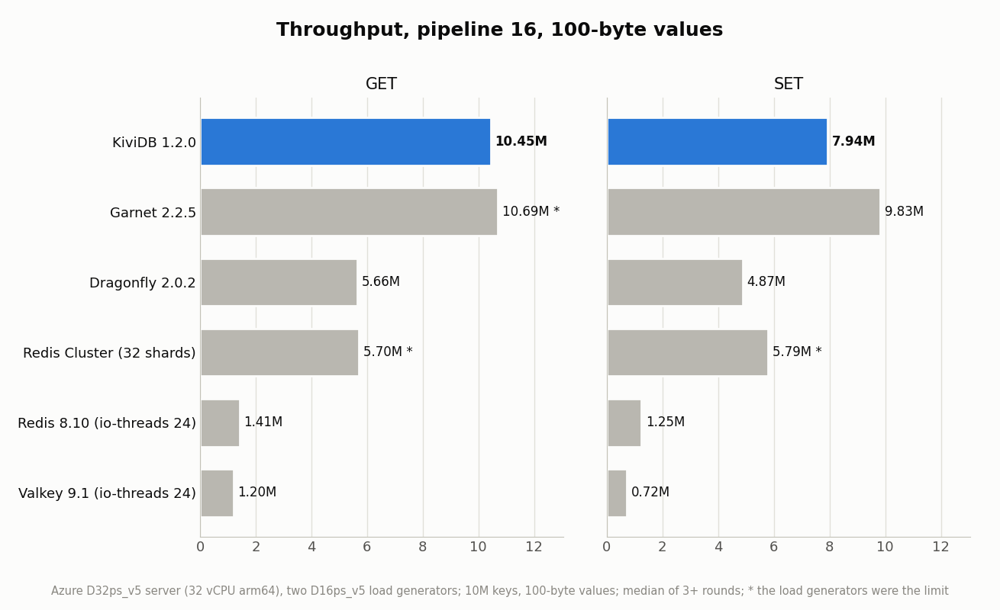
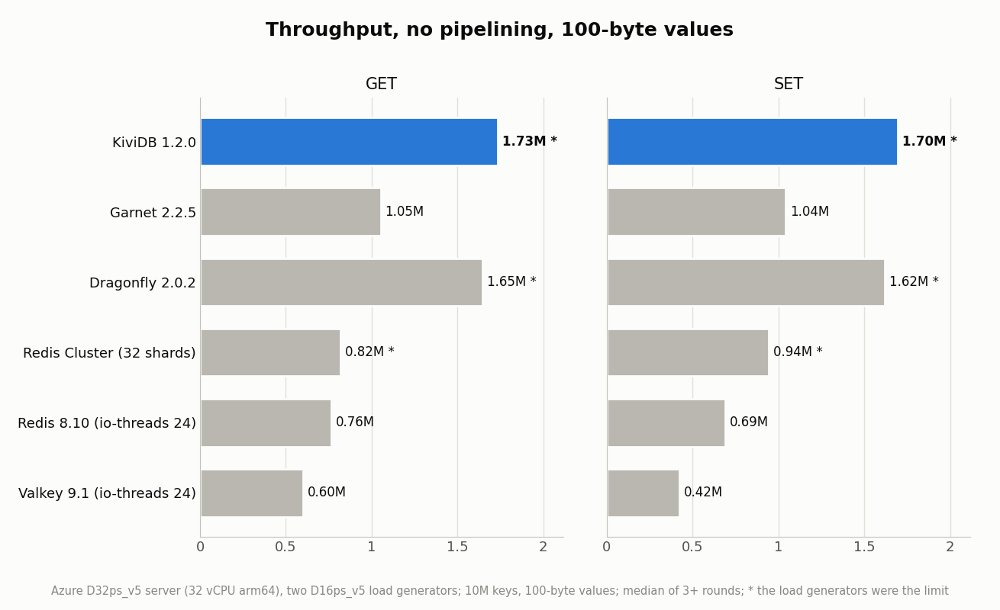
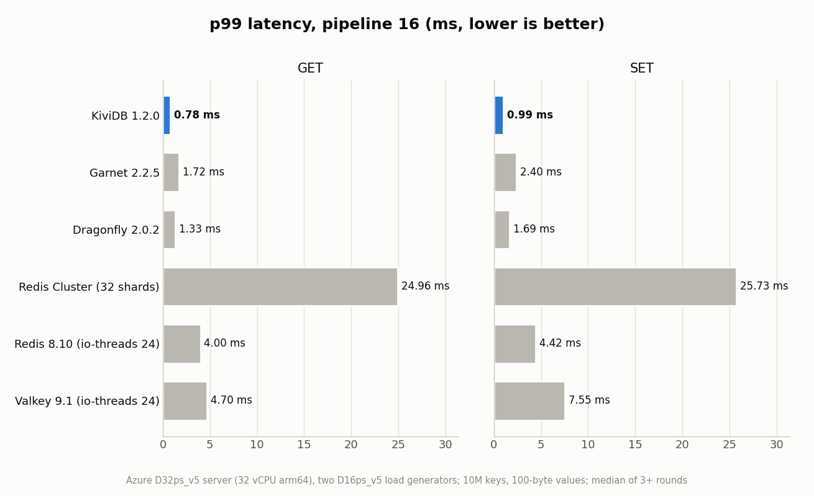
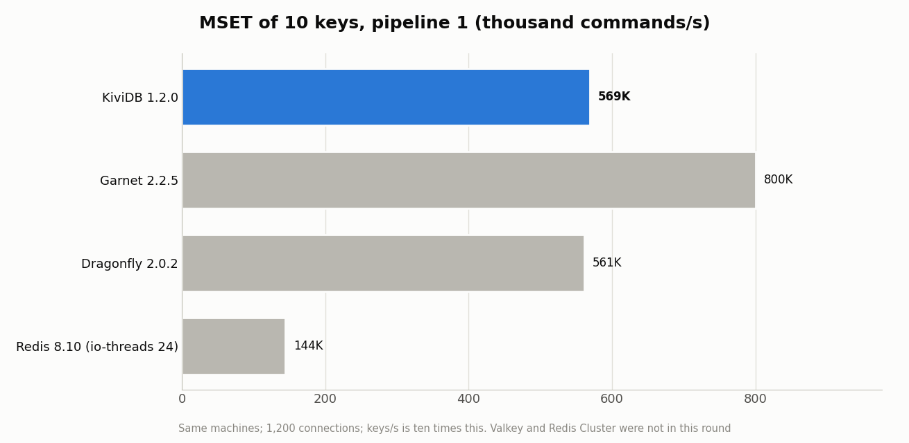

# Performance

*KiviDB 1.2.0 against Garnet, Dragonfly, Redis, Redis Cluster and Valkey. Click for the full-resolution video.*

- [Bare metal](#bare-metal)
- [The full suite, on Azure VMs](#the-full-suite-on-azure-vms)
- [Memory of small sets](#memory-of-small-sets)
- [Memory of small hashes](#memory-of-small-hashes)
- [Earlier runs](#earlier-runs)
- [Independent reviews](#independent-reviews)

## Bare metal

AWS Graviton3, November 2026: the server on a `c7gn.metal` confined to 32 cores, the load
generator on a second `c7gn.metal` in the same placement group, one engine at a time,
persistence off. memtier_benchmark, 10 million keys of 100 bytes, 30 s a run, the mean of
two rounds; 300 connections pipelined, 1,200 without.

| | KiviDB 1.2.0 | Garnet 2.2.5 | Dragonfly 2.0.2 | Redis 8.10.3 |
|---|---:|---:|---:|---:|
| `GET`, pipeline 16 | **21.24M** | 20.82M | 9.31M | 2.36M |
| `SET`, pipeline 16 | 17.79M | **20.27M** | 8.70M | 1.94M |
| `GET`, no pipelining | 2.99M | 2.88M | **3.30M** | 1.47M |
| `SET`, no pipelining | 3.22M | 3.07M | **3.37M** | 1.26M |
| p99, `GET` / `SET` at pipeline 16 | **0.36 / 0.45 ms** | 0.67 / 0.80 ms | 0.88 / 1.02 ms | 2.29 / 2.72 ms |
| Bytes a key, 10M keys of 100 B | 143 | | **134** | 178 |

Pipelined, KiviDB served 9.0× Redis's GETs and 9.2× its SETs, and more than twice
Dragonfly's. Garnet was a close second on `GET` and ahead on pipelined `SET`; without
pipelining Dragonfly was 5-10% ahead. Scripts and raw results:
[kivi-benchmark](https://github.com/kividbio/kivi-benchmark).

## The full suite, on Azure VMs

KiviDB 1.2.0 was measured in November 2026 on Azure VMs against Redis 8.10, Redis Cluster,
Valkey 9.1, Dragonfly 2.0, Garnet 2.2 and kvrocks 2.17, each on the same machines in the same
hour, with p50/p99/p99.9 latency from two load generators.
[benchmarks/1.2.0/REPORT.md](../benchmarks/1.2.0/REPORT.md) has every number and comparison;
[benchmarks/1.2.0](../benchmarks/1.2.0/README.md) has the harnesses, raw results and charts.

| | KiviDB 1.2.0 | Best other | Redis 8.10 |
|---|---|---|---|
| `GET` 100 B, pipeline 16 | 10.45M ops/s | Garnet 10.69M | 1.41M |
| `SET` 100 B, pipeline 16 | 7.94M ops/s | Garnet 9.83M | 1.25M |
| `MSET` of 10 keys | 569K commands/s | Garnet 800K | 144K |
| Lists, hashes, sets, sorted sets, counters, pipeline 16 | 4.2-6.6M ops/s | Redis Cluster (16 shards): level, ahead on `HSET` and `INCR` | 3.7-6.0x less |
| Bytes per key, 100 B values, 50M keys | 140.7 | Dragonfly 141.5 | 174.4 |
| Memory added by `BGSAVE`, 30M keys of 1 KB under writes | +10% | Dragonfly +0.4% | +89% |
| Filtered vector search, 100 clients | 4,478 q/s | Dragonfly 811 | 1,802 |
| Cache hit rate ([#202](https://github.com/kividbio/kividb/issues/202)) | 60.96% | | 60.78% |

Where KiviDB loses: Garnet is faster on `SET` at pipeline 16 and on `MSET`; Redis Cluster on
`HSET` and `INCR`; Dragonfly uses less memory per vector, during a snapshot, and for ASCII
values; Redis ingests vectors faster and serves 3-9% more cache reads a second. These are
cloud VMs, so absolute numbers are lower than on the [bare metal](#bare-metal) above.

<picture>
  <source media="(prefers-color-scheme: dark)" srcset="../assets/benchmarks/1.2.0/throughput-pipelined-dark.png">
  
</picture>

<picture>
  <source media="(prefers-color-scheme: dark)" srcset="../assets/benchmarks/1.2.0/throughput-unpipelined-dark.png">
  
</picture>

<picture>
  <source media="(prefers-color-scheme: dark)" srcset="../assets/benchmarks/1.2.0/latency-p99-pipelined-dark.png">
  
</picture>

<picture>
  <source media="(prefers-color-scheme: dark)" srcset="../assets/benchmarks/1.2.0/mset-dark.png">
  
</picture>

<picture>
  <source media="(prefers-color-scheme: dark)" srcset="../assets/benchmarks/1.2.0/memory-per-key-dark.png">
  
</picture>

<picture>
  <source media="(prefers-color-scheme: dark)" srcset="../assets/benchmarks/1.2.0/snapshot-memory-dark.png">
  
</picture>

<picture>
  <source media="(prefers-color-scheme: dark)" srcset="../assets/benchmarks/1.2.0/vector-qps-recall-dark.png">
  
</picture>

<picture>
  <source media="(prefers-color-scheme: dark)" srcset="../assets/benchmarks/1.2.0/vector-filtered-dark.png">
  
</picture>

<picture>
  <source media="(prefers-color-scheme: dark)" srcset="../assets/benchmarks/1.2.0/vector-ingest-dark.png">
  
</picture>

## Memory of small sets

Since 1.3.0 a small set is kept in one block (`listpack` in `OBJECT ENCODING`:
up to 128 members of up to 64 bytes) or, when its members are integers, as a
sorted array (`intset`: up to 512), where 1.2 kept every set as a hash table
with an allocation per member (#297). Bytes of `used_memory` a member, 3M
members in sets of each size, 14-byte members (`membr:00000001`) or the
integers 0 to n-1, on an Azure `Standard_D4s_v5`:

| members a set | 1.2.2 strings | 1.3.0 strings | Redis 8.10.2 strings | 1.2.2 integers | 1.3.0 integers | Redis 8.10.2 integers |
|---:|---:|---:|---:|---:|---:|---:|
| 10 | 76.0 | 34.6 | 25.8 | 68.0 | 17.6 | 9.8 |
| 100 | 55.5 | 20.4 | 18.5 | 47.5 | 3.8 | 2.8 |
| 1,000 | 67.0 | 67.0 | 30.0 | 59.0 | 59.0 | 22.3 |
| 100,000 | 54.3 | 54.3 | 36.8 | 46.3 | 46.3 | 28.8 |

What is left over Redis at 10 members is mostly the key's own: an entry and
the set's header, about 150 bytes a key. Sets of more
than 128 members (512 integers) are tables as before; making those smaller is
the next step of #297. Suite `17-set-memory` of
[the regression suite](../benchmarks/1.3.0/regressions/README.md) measures
this table again and fails a build that loses it.

## Memory of small hashes

Since 1.3.0 a small hash is kept in one block, its fields and values end to
end (`listpack` in `OBJECT ENCODING`, `listpackex` once a field has a TTL: up
to 512 fields, no field or value longer than 64 bytes), where 1.2 kept every
hash as a table with two allocations per field. Bytes of `used_memory` a
field, 3M fields in hashes of each size, 14-byte fields (`field:00000001`)
with 32-byte values, on an Azure `Standard_D4s_v5`:

| fields a hash | 1.2.2 | 1.3.0 | Redis 8.10.2 |
|---:|---:|---:|---:|
| 10 | 162.8 | 71.8 | 57.8 |
| 100 | 129.2 | 55.8 | 51.7 |
| 1,000 | 166.6 | 166.6 | 70.1 |
| 100,000 | 128.8 | 128.8 | 76.8 |
| 3,000,000 | 133.3 | 133.3 | 77.9 |

As for sets, what is left over Redis at 10 fields is mostly the key's own
entry and the hash's header. Hashes past the block's limits are tables as
before. Suite `19-hash-memory` of
[the regression suite](../benchmarks/1.3.0/regressions/README.md) measures
this again (with and without field TTLs) and fails a build that loses it.

## Memory of lists

Since 1.3.0 a list's elements lie end to end in chunks of up to 64, each
element between two copies of its length, where 1.2 kept a slot, a shared
header and an allocation of its own for every element. Bytes of
`used_memory` an element, 3M elements of 32 bytes in lists of each size, on
an Azure `Standard_D4s_v5`:

| elements a list | 1.2.2 | 1.3.0 | Redis 8.10.2 |
|---:|---:|---:|---:|
| 10 | 76.0 | 48.8 | 45.0 |
| 100 | 65.2 | 38.4 | 36.4 |
| 1,000 | 64.1 | 36.7 | 34.6 |
| 100,000 | 68.5 | 36.7 | 34.3 |
| 3,000,000 | 69.8 | 36.7 | 34.3 |

At 10 elements most of what is left over Redis is the key's own: its entry
and the list's header. A list that has had an element longer than 1,024
bytes keeps its elements apart, as 1.2 did, and takes what 1.2 took. Suite
`21-list-memory` of
[the regression suite](../benchmarks/1.3.0/regressions/README.md) measures
this table again (1M elements, 10 to 100,000 a list) and fails a build that
loses it.

## Earlier runs

KiviDB 1.1 was also measured on AWS Graviton3 bare metal in October 2026, against
Dragonfly, Redis and Redis Cluster: [benchmarks/1.1-bare-metal.md](../benchmarks/1.1-bare-metal.md).

## Independent reviews

Written by others, not by the KiviDB project:

- [Redis vs Valkey vs Dragonfly vs KiviDB](https://warefeats.com/posts/2026-11-05-kv-stores-redis-vs-valkey-vs-dragonfly-vs-kividb/)
  (warefeats, 5 November 2026): KiviDB 1.2.0 measured on AWS Graviton3 against Redis 8.10,
  Valkey 9.1 and Dragonfly 2.1: throughput, pipelining, latency and memory per key.
- [KiviDB Review: Rust Redis Alternative With Vector Search](https://andrew.ooo/posts/kividb-review-rust-redis-alternative-vector-search/)
  (andrew.ooo, 10 November 2026): a review of KiviDB's design, published benchmarks,
  durability record and where it fits.
