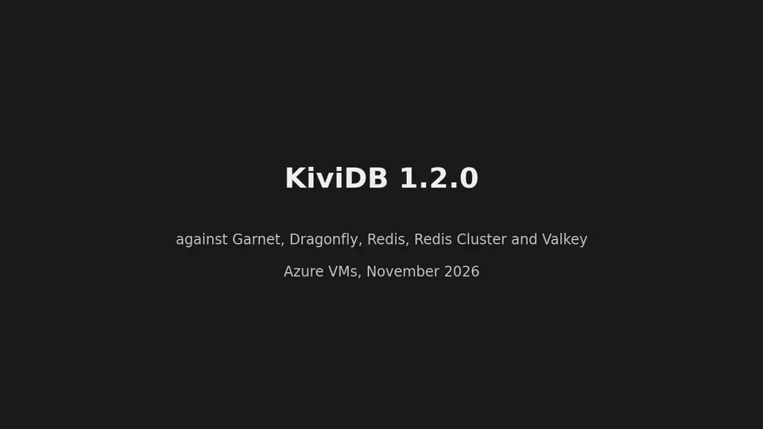
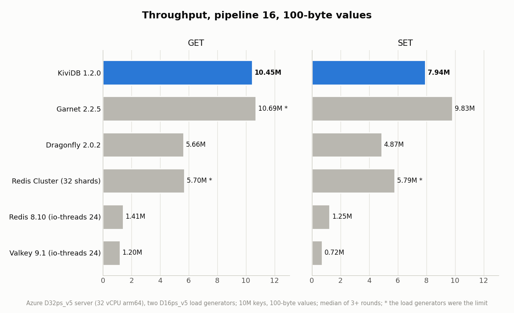
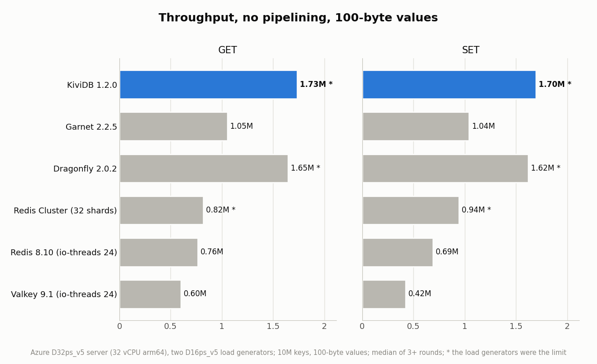
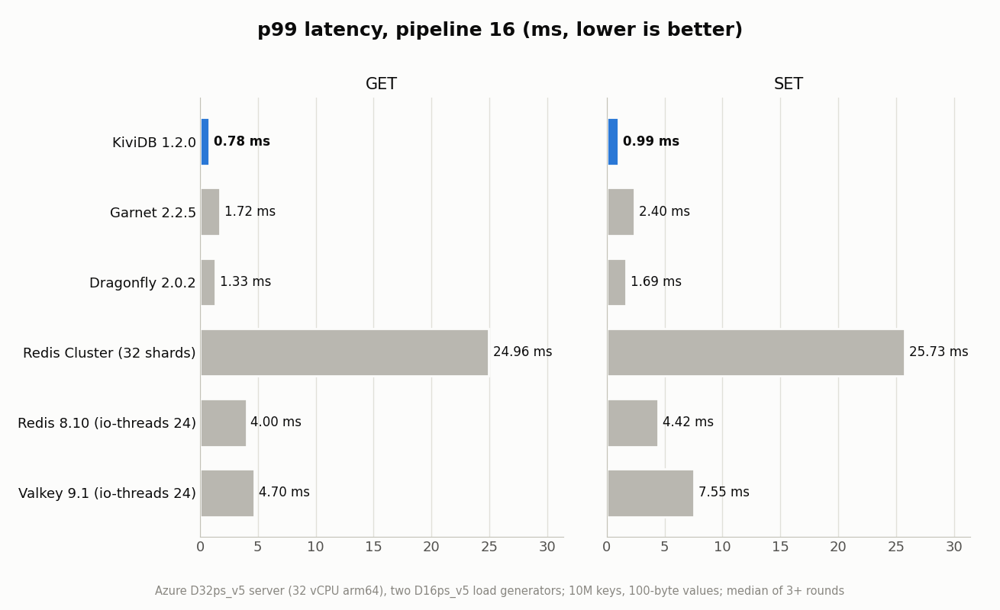
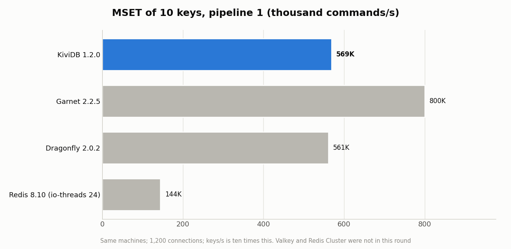
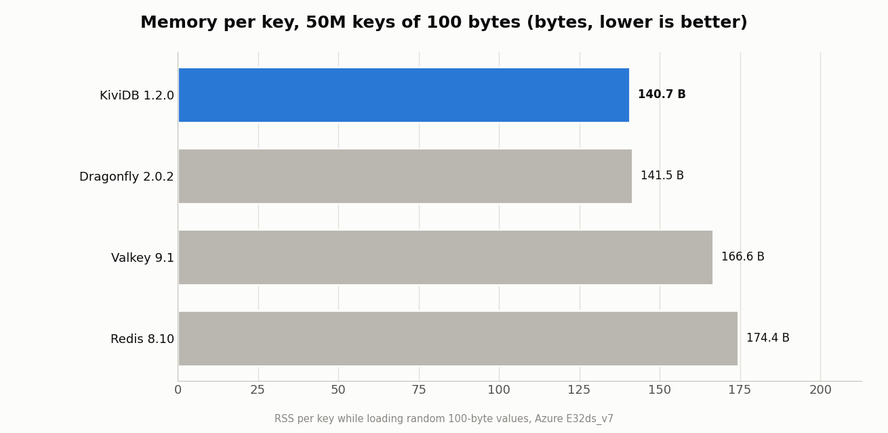
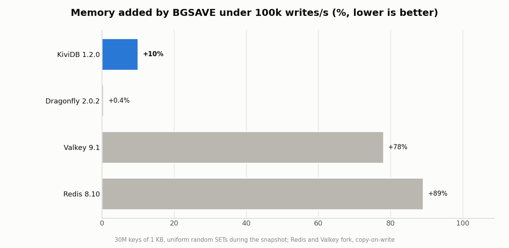
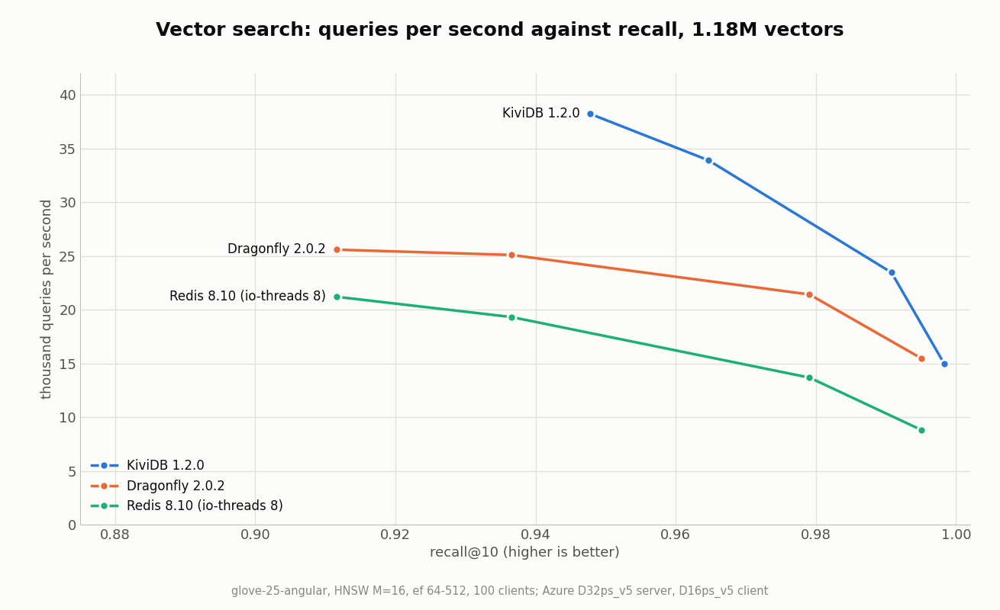
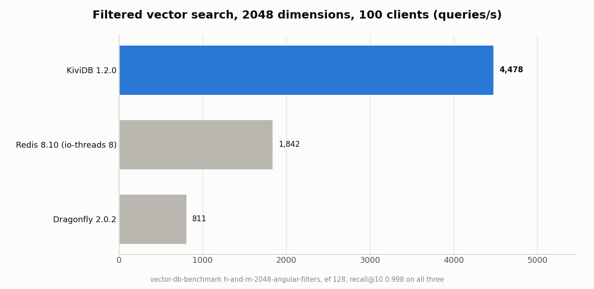
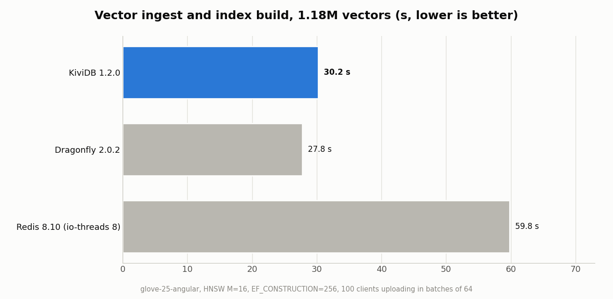

# Performance

*KiviDB 1.2.0 against Garnet, Dragonfly, Redis, Redis Cluster and Valkey. Click for the full-resolution video.*

- [Bare metal](#bare-metal)
- [The full suite, on Azure VMs](#the-full-suite-on-azure-vms)
- [Earlier runs](#earlier-runs)
- [Independent reviews](#independent-reviews)

## Bare metal

AWS Graviton3, November 2026: the server on a `c7gn.metal` confined to 32 cores, the load
generator on a second `c7gn.metal` in the same placement group, one engine at a time,
persistence off. memtier_benchmark, 10 million keys of 100 bytes, 30 s a run, the mean of
two rounds; 300 connections pipelined, 1,200 without.

| | KiviDB 1.2.0 | Garnet 2.2.5 | Dragonfly 2.0.2 | Redis 8.10.3 |
|---|---:|---:|---:|---:|
| `GET`, pipeline 16 | **21.24M** | 20.82M | 9.31M | 2.36M |
| `SET`, pipeline 16 | 17.79M | **20.27M** | 8.70M | 1.94M |
| `GET`, no pipelining | 2.99M | 2.88M | **3.30M** | 1.47M |
| `SET`, no pipelining | 3.22M | 3.07M | **3.37M** | 1.26M |
| p99, `GET` / `SET` at pipeline 16 | **0.36 / 0.45 ms** | 0.67 / 0.80 ms | 0.88 / 1.02 ms | 2.29 / 2.72 ms |
| Bytes a key, 10M keys of 100 B | 143 | | **134** | 178 |

Pipelined, KiviDB served 9.0× Redis's GETs and 9.2× its SETs, and more than twice
Dragonfly's. Garnet was a close second on `GET` and ahead on pipelined `SET`; without
pipelining Dragonfly was 5-10% ahead. Scripts and raw results:
[kivi-benchmark](https://github.com/kividbio/kivi-benchmark).

## The full suite, on Azure VMs

KiviDB 1.2.0 was measured in November 2026 on Azure VMs against Redis 8.10, Redis Cluster,
Valkey 9.1, Dragonfly 2.0, Garnet 2.2 and kvrocks 2.17, each on the same machines in the same
hour, with p50/p99/p99.9 latency from two load generators.
[benchmarks/1.2.0/REPORT.md](../benchmarks/1.2.0/REPORT.md) has every number and comparison;
[benchmarks/1.2.0](../benchmarks/1.2.0/README.md) has the harnesses, raw results and charts.

| | KiviDB 1.2.0 | Best other | Redis 8.10 |
|---|---|---|---|
| `GET` 100 B, pipeline 16 | 10.45M ops/s | Garnet 10.69M | 1.41M |
| `SET` 100 B, pipeline 16 | 7.94M ops/s | Garnet 9.83M | 1.25M |
| `MSET` of 10 keys | 569K commands/s | Garnet 800K | 144K |
| Lists, hashes, sets, sorted sets, counters, pipeline 16 | 4.2-6.6M ops/s | Redis Cluster (16 shards): level, ahead on `HSET` and `INCR` | 3.7-6.0x less |
| Bytes per key, 100 B values, 50M keys | 140.7 | Dragonfly 141.5 | 174.4 |
| Memory added by `BGSAVE`, 30M keys of 1 KB under writes | +10% | Dragonfly +0.4% | +89% |
| Filtered vector search, 100 clients | 4,478 q/s | Dragonfly 811 | 1,802 |
| Cache hit rate ([#202](https://github.com/kividbio/kividb/issues/202)) | 60.96% | | 60.78% |

Where KiviDB loses: Garnet is faster on `SET` at pipeline 16 and on `MSET`; Redis Cluster on
`HSET` and `INCR`; Dragonfly uses less memory per vector, during a snapshot, and for ASCII
values; Redis ingests vectors faster and serves 3-9% more cache reads a second. These are
cloud VMs, so absolute numbers are lower than on the [bare metal](#bare-metal) above.

<picture>
  <source media="(prefers-color-scheme: dark)" srcset="../assets/benchmarks/1.2.0/throughput-pipelined-dark.png">
  
</picture>

<picture>
  <source media="(prefers-color-scheme: dark)" srcset="../assets/benchmarks/1.2.0/throughput-unpipelined-dark.png">
  
</picture>

<picture>
  <source media="(prefers-color-scheme: dark)" srcset="../assets/benchmarks/1.2.0/latency-p99-pipelined-dark.png">
  
</picture>

<picture>
  <source media="(prefers-color-scheme: dark)" srcset="../assets/benchmarks/1.2.0/mset-dark.png">
  
</picture>

<picture>
  <source media="(prefers-color-scheme: dark)" srcset="../assets/benchmarks/1.2.0/memory-per-key-dark.png">
  
</picture>

<picture>
  <source media="(prefers-color-scheme: dark)" srcset="../assets/benchmarks/1.2.0/snapshot-memory-dark.png">
  
</picture>

<picture>
  <source media="(prefers-color-scheme: dark)" srcset="../assets/benchmarks/1.2.0/vector-qps-recall-dark.png">
  
</picture>

<picture>
  <source media="(prefers-color-scheme: dark)" srcset="../assets/benchmarks/1.2.0/vector-filtered-dark.png">
  
</picture>

<picture>
  <source media="(prefers-color-scheme: dark)" srcset="../assets/benchmarks/1.2.0/vector-ingest-dark.png">
  
</picture>

## Earlier runs

KiviDB 1.1 was also measured on AWS Graviton3 bare metal in October 2026, against
Dragonfly, Redis and Redis Cluster: [benchmarks/1.1-bare-metal.md](../benchmarks/1.1-bare-metal.md).

## Independent reviews

Written by others, not by the KiviDB project:

- [Redis vs Valkey vs Dragonfly vs KiviDB](https://warefeats.com/posts/2026-11-05-kv-stores-redis-vs-valkey-vs-dragonfly-vs-kividb/)
  (warefeats, 5 November 2026): KiviDB 1.2.0 measured on AWS Graviton3 against Redis 8.10,
  Valkey 9.1 and Dragonfly 2.1: throughput, pipelining, latency and memory per key.
- [KiviDB Review: Rust Redis Alternative With Vector Search](https://andrew.ooo/posts/kividb-review-rust-redis-alternative-vector-search/)
  (andrew.ooo, 10 November 2026): a review of KiviDB's design, published benchmarks,
  durability record and where it fits.
